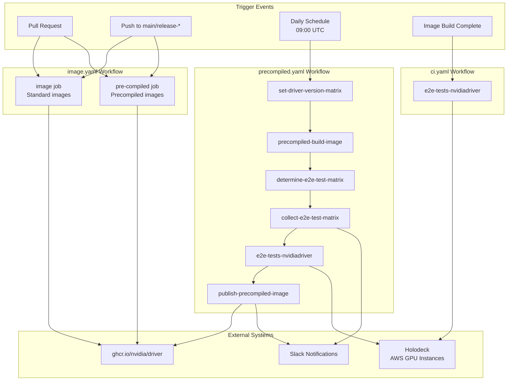
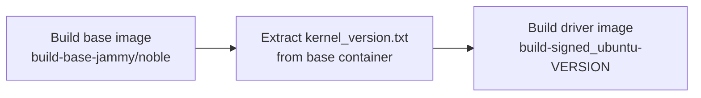
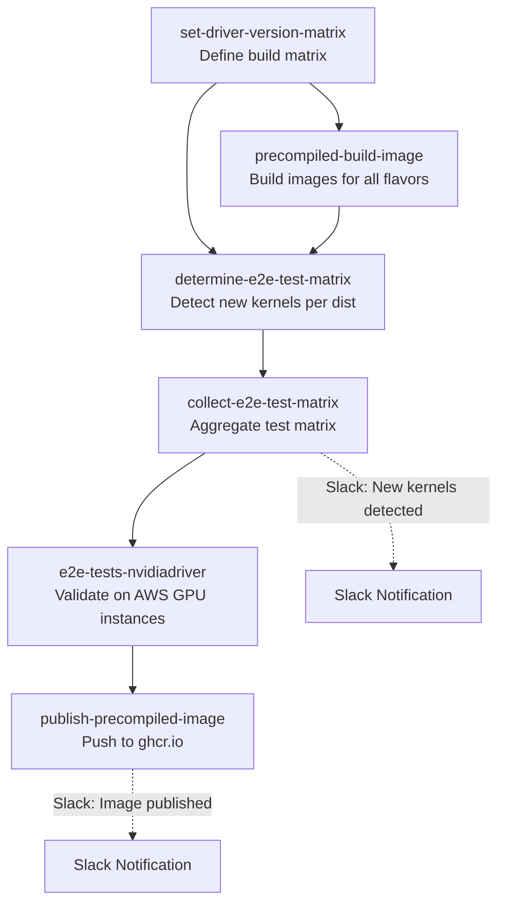
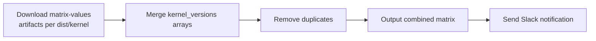
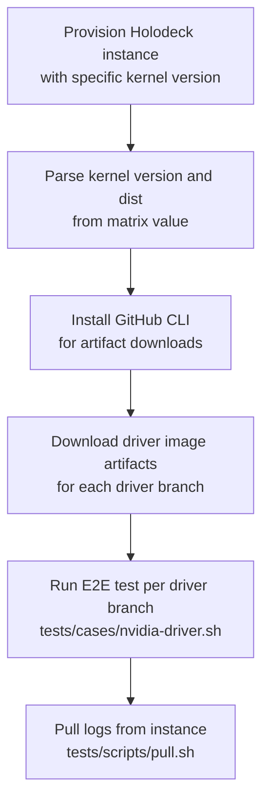

<!-- source: DeepWiki mcp.deepwiki.com · repo NVIDIA/gpu-driver-container · page 3.2 GitHub Actions Workflows · fetched 2026-10-26 -->

# GitHub Actions Workflows

<details>
<summary>Relevant source files</summary>

The following files were used as context for generating this wiki page:

- [.common-ci.yml](.common-ci.yml)
- [.github/workflows/ci.yaml](.github/workflows/ci.yaml)
- [.github/workflows/image.yaml](.github/workflows/image.yaml)
- [.github/workflows/precompiled.yaml](.github/workflows/precompiled.yaml)
- [.nvidia-ci.yml](.nvidia-ci.yml)
- [tests/scripts/ci-precompiled-helpers.sh](tests/scripts/ci-precompiled-helpers.sh)
- [tests/scripts/findkernelversion.sh](tests/scripts/findkernelversion.sh)
- [tests/scripts/prerequisites.sh](tests/scripts/prerequisites.sh)
- [versions.mk](versions.mk)

</details>


## Purpose and Scope

This document describes the GitHub Actions CI/CD workflows used in the gpu-driver-container repository. These workflows handle the automated building, testing, and publishing of driver container images for pull requests, main branch commits, and scheduled builds. 

For information about the complementary GitLab CI pipeline which handles production releases and NGC publishing, see [GitLab CI Workflows](#3.1). For details on the testing infrastructure provisioned by these workflows, see [Testing and Validation](#3.3).

## Overview

The GitHub Actions workflows serve distinct purposes:

1. **image.yaml** - Builds and publishes standard and precompiled driver images on pull requests and main branch pushes
2. **precompiled.yaml** - Scheduled daily workflow that detects new kernel versions, builds precompiled driver images, runs E2E tests, and publishes validated images
3. **ci.yaml** - End-to-end validation workflow triggered after image builds complete

All workflows publish artifacts to `ghcr.io/nvidia/driver` (or `ghcr.io/<user>/driver` for forks) and use self-hosted GitHub runners with the tag `linux-amd64-cpu4`.

Sources: [.github/workflows/image.yaml:1-194](), [.github/workflows/precompiled.yaml:1-470](), [.github/workflows/ci.yaml:1-89]()

## Workflow Architecture



**Diagram: GitHub Actions Workflow Architecture**

Sources: [.github/workflows/image.yaml:18-24](), [.github/workflows/precompiled.yaml:18-21](), [.github/workflows/ci.yaml:17-24]()

## Image Workflow (image.yaml)

The `image` workflow builds driver container images for pull requests and pushes to main or release branches. It consists of two primary jobs that run in parallel.

### Trigger Conditions

```yaml
on:
  push:
    branches:
      - main
      - "pull-request/[0-9]+"
      - release-*
```

Sources: [.github/workflows/image.yaml:18-24]()

### Job: image

Builds standard driver images across a matrix of distributions and driver versions.

**Build Matrix:**

| Parameter | Values |
|-----------|--------|
| `driver` | 535.274.02, 570.195.03, 580.95.05 |
| `dist` | ubuntu22.04, ubuntu24.04, rhel8, rhel9 |
| `ispr` | Indicates if running on PR |

**Exclusions:**
- ubuntu24.04 is excluded for driver 535.274.02

The job performs the following steps:

1. **Calculate build vars** - Sets environment variables including `COMMIT_SHORT_SHA`, `LOWERCASE_REPO_OWNER`, and determines whether to push images based on context
2. **Set up multi-arch build** - Configures QEMU and Docker Buildx for cross-platform builds
3. **Login to GHCR** - Authenticates to GitHub Container Registry
4. **Build image** - Executes `make build-${dist}-${driver}` with appropriate environment variables

**Key Environment Variables:**

| Variable | Description |
|----------|-------------|
| `IMAGE_NAME` | Target registry path (ghcr.io/${LOWERCASE_REPO_OWNER}/driver) |
| `VERSION` | Short commit SHA for image tagging |
| `PUSH_ON_BUILD` | Whether to push images (false for dependabot, true for internal PRs and pushes) |
| `BUILD_MULTI_ARCH_IMAGES` | Enable multi-architecture builds (amd64 and arm64) |
| `CVE_UPDATES` | Distribution-specific packages to update for security patches |

Sources: [.github/workflows/image.yaml:26-92]()

### Job: pre-compiled

Builds precompiled driver images with kernel modules pre-built for specific kernel versions.

**Build Matrix:**

| Parameter | Values |
|-----------|--------|
| `driver` | 535, 570, 580 (driver branches) |
| `flavor` | aws, azure, generic, nvidia, oracle |
| `dist` | ubuntu22.04, ubuntu24.04 |
| `lts_kernel` | 5.15, 6.8 |

**Exclusions for Pull Requests:**
- Only `generic` flavor is built on PRs (others are manual/scheduled)
- Driver 535 excluded for ubuntu24.04
- Kernel 5.15 excluded for ubuntu24.04

**Build Process:**



**Diagram: Precompiled Build Process**

The workflow:

1. Builds a base image for the target distribution, kernel flavor, and LTS kernel version
2. Runs the base image as a container and extracts `/var/kernel_version.txt` which contains `KERNEL_VERSION` and `DRIVER_VERSIONS`
3. Sources the kernel version file and builds the signed precompiled driver image

Sources: [.github/workflows/image.yaml:93-194]()

## Precompiled Workflow (precompiled.yaml)

The scheduled `precompiled` workflow runs daily at 09:00 UTC to detect new kernel releases, build precompiled driver images, validate them with E2E tests, and publish successful builds.

### Job Flow



**Diagram: Precompiled Workflow Job Dependencies**

Sources: [.github/workflows/precompiled.yaml:22-470]()

### Job: set-driver-version-matrix

Outputs matrix values for subsequent jobs:

- `driver_branch`: ["535", "570", "580"]
- `kernel_flavors`: ["aws", "azure", "generic", "nvidia", "oracle"]
- `dist`: ["ubuntu22.04", "ubuntu24.04"]
- `lts_kernel`: ["5.15", "6.8"]

Sources: [.github/workflows/precompiled.yaml:23-54]()

### Job: precompiled-build-image

Builds precompiled images for all matrix combinations and saves artifacts for later testing.

**Build Steps:**

1. Build base image with `make DRIVER_BRANCH=<branch> KERNEL_FLAVOR=<flavor> LTS_KERNEL=<kernel> build-base-<target>`
2. Extract kernel version from running base container at `/var/kernel_version.txt`
3. Build driver image with `make DRIVER_VERSIONS=${DRIVER_VERSIONS} DRIVER_BRANCH=<branch> build-signed_<dist>-<version>`
4. Save three artifacts per build:
   - `base-images-<branch>-<kernel_version>-<dist>.tar` - Base image tarball
   - `driver-images-<branch>-<kernel_version>-<dist>.tar` - Driver image tarball
   - `kernel-version-<branch>-<kernel_version>-<dist>.tar` - Kernel version metadata

Artifacts are retained for 1 day for use in testing and publishing jobs.

Sources: [.github/workflows/precompiled.yaml:56-164]()

### Job: determine-e2e-test-matrix

Determines which kernel versions require E2E testing by comparing built images against published registries.

**Key Script: ci-precompiled-helpers.sh**

The `get_kernel_versions_to_test` function:

1. Iterates through kernel flavors and driver branches
2. For each combination, sources `findkernelversion.sh` which:
   - Downloads the kernel version artifact from the current workflow run
   - Checks if `${DRIVER_BRANCH}-${KERNEL_VERSION}-${DIST}` already exists in `nvcr.io/nvidia/driver` or `ghcr.io/nvidia/driver`
   - Sets `should_continue=true` if the image doesn't exist
3. Collects unique kernel versions that need testing
4. Outputs matrix as JSON artifact

Sources: [.github/workflows/precompiled.yaml:166-221](), [tests/scripts/ci-precompiled-helpers.sh:1-32](), [tests/scripts/findkernelversion.sh:1-45]()

### Job: collect-e2e-test-matrix

Aggregates test matrices from all distributions and kernels, downloads artifacts, and sends Slack notification if new kernels are detected.

**Matrix Collection Logic:**



**Diagram: Matrix Collection Process**

The job sets `matrix_values_not_empty=1` if any new kernels are detected, which controls whether subsequent E2E tests execute.

Sources: [.github/workflows/precompiled.yaml:223-287]()

### Job: e2e-tests-nvidiadriver

Runs end-to-end validation tests on AWS GPU instances using Holodeck for infrastructure provisioning.

**Test Execution Flow:**



**Diagram: E2E Test Execution Flow**

**Test Configuration:**

The test modifies `tests/holodeck_<dist>.yaml` to set the target kernel version:

```yaml
spec:
  kernel:
    version: "<KERNEL_VERSION>"
```

**GPU Operator Installation:**

Tests install the NVIDIA GPU Operator with custom settings:

```bash
GPU_OPERATOR_OPTIONS="--set driver.repository=ghcr.io/nvidia \
  --set driver.usePrecompiled=true \
  --set driver.imagePullPolicy=Never \
  --set driver.version=<DRIVER_BRANCH>"
```

The test validates that:
1. Driver pods start successfully
2. GPU devices are detected
3. Driver modules load correctly

Sources: [.github/workflows/precompiled.yaml:289-395]()

### Job: publish-precompiled-image

Publishes validated images to `ghcr.io/nvidia/driver` after successful E2E tests.

For each validated kernel version and driver branch:

1. Downloads base and driver image artifacts
2. Loads images with `docker load -i <tarball>`
3. Pushes to registry:
   - Base: `ghcr.io/nvidia/driver:base-<target>-<lts_kernel>-<flavor>-<branch>`
   - Driver: `ghcr.io/nvidia/driver:<branch>-<kernel_version>`
4. Sends Slack notification with published image details

Sources: [.github/workflows/precompiled.yaml:397-469]()

## End-to-End Testing Workflow (ci.yaml)

The `ci` workflow provides E2E validation for standard (non-precompiled) driver images built by the image workflow.

### Trigger

```yaml
on:
  workflow_run:
    workflows: [image]
    types:
      - completed
    branches:
      - main
```

This workflow runs automatically after the `image` workflow completes on the main branch.

Sources: [.github/workflows/ci.yaml:17-24]()

### Job: e2e-tests-nvidiadriver

**Test Infrastructure:**

Uses Holodeck to provision AWS EC2 GPU instances with configuration from `tests/holodeck_ubuntu22.04.yaml`.

**Test Execution:**

```bash
for DRIVER_VERSION in ${DRIVER_VERSIONS}; do
  OPERATOR_OPTIONS="--set driver.repository=ghcr.io/nvidia \
    --set driver.version=${COMMIT_SHORT_SHA}-${DRIVER_VERSION}"
  ./tests/ci-run-e2e.sh "${TEST_CASE}" "${OPERATOR_OPTIONS}"
done
```

Tests iterate through all driver versions defined in `versions.mk` and validate each with the GPU Operator test case at `tests/cases/nvidia-driver.sh`.

Sources: [.github/workflows/ci.yaml:26-89](), [versions.mk:16]()

## Environment Variables and Configuration

### Common Variables

| Variable | Source | Description |
|----------|--------|-------------|
| `COMMIT_SHORT_SHA` | `${GITHUB_SHA:0:8}` | 8-character commit hash for image tagging |
| `LOWERCASE_REPO_OWNER` | Repository owner | Normalized repository owner for registry paths |
| `IMAGE_NAME` | Workflow | Full registry path (ghcr.io/nvidia/driver) |
| `DRIVER_VERSIONS` | versions.mk or kernel_version.txt | Space-separated driver versions to build |
| `PRIVATE_REGISTRY` | Workflow | Registry URL (ghcr.io) |

### Build Control Variables

| Variable | Purpose | Values |
|----------|---------|--------|
| `PUSH_ON_BUILD` | Control image push on build | true/false |
| `BUILD_MULTI_ARCH_IMAGES` | Enable multi-architecture builds | true/false |
| `PRECOMPILED` | Indicate precompiled build | "true"/"" |
| `CVE_UPDATES` | Security package updates | Distribution-specific package list |

### Matrix Variables

| Variable | Usage | Example Values |
|----------|-------|----------------|
| `DRIVER_BRANCH` | Precompiled builds | 535, 570, 580 |
| `KERNEL_FLAVOR` | Kernel variant | aws, azure, generic, nvidia, oracle |
| `LTS_KERNEL` | LTS kernel series | 5.15, 6.8 |
| `BASE_TARGET` | Ubuntu codename | jammy (22.04), noble (24.04) |

Sources: [.github/workflows/image.yaml:48-70](), [.github/workflows/precompiled.yaml:74-82]()

## Integration with External Systems

### GitHub Container Registry (ghcr.io)

All workflows authenticate to GHCR using the GitHub token:

```yaml
- name: Login to GitHub Container Registry
  uses: docker/login-action@v3
  with:
    registry: ghcr.io
    username: ${{ github.actor }}
    password: ${{ secrets.GITHUB_TOKEN }}
```

Images are pushed to:
- Standard builds: `ghcr.io/nvidia/driver:<commit_sha>-<driver_version>-<dist>`
- Precompiled builds: `ghcr.io/nvidia/driver:<driver_branch>-<kernel_version>`
- Base images: `ghcr.io/nvidia/driver:base-<target>-<lts_kernel>-<flavor>-<branch>`

Sources: [.github/workflows/image.yaml:80-85](), [.github/workflows/precompiled.yaml:90-95]()

### Holodeck (AWS GPU Provisioning)

Holodeck is used to provision temporary AWS EC2 GPU instances for E2E testing:

```yaml
- name: Set up Holodeck
  uses: NVIDIA/holodeck@v0.2.16
  with:
    aws_access_key_id: ${{ secrets.AWS_ACCESS_KEY_ID }}
    aws_secret_access_key: ${{ secrets.AWS_SECRET_ACCESS_KEY }}
    aws_ssh_key: ${{ secrets.AWS_SSH_KEY }}
    holodeck_config: "tests/holodeck_<dist>.yaml"
```

The workflow retrieves the provisioned instance's public DNS name and uses SSH to run test scripts on the GPU instance.

Sources: [.github/workflows/precompiled.yaml:327-338](), [.github/workflows/ci.yaml:33-43]()

### Slack Notifications

The precompiled workflow sends Slack notifications at two critical points:

1. **New Kernel Detection** - After collecting E2E test matrix, notifies channel of newly detected kernel versions
2. **Image Publication** - After successfully publishing each validated precompiled image

Both use the `slackapi/slack-github-action@v2.1.1` action with secrets:
- `SLACK_BOT_TOKEN` - Bot authentication token
- `SLACK_CHANNEL_ID` - Target channel ID
- Custom message templates

Sources: [.github/workflows/precompiled.yaml:276-287](), [.github/workflows/precompiled.yaml:459-469]()

## Workflow Configuration Files

### Runner Configuration

All jobs use self-hosted runners with label `linux-amd64-cpu4`:

```yaml
runs-on: linux-amd64-cpu4
```

### Docker Buildx Configuration

Multi-architecture builds require Buildx with custom config at `/etc/buildkit/buildkitd.toml`:

```yaml
- name: Set up QEMU
  uses: docker/setup-qemu-action@v3
  with:
    image: tonistiigi/binfmt:qemu-v6.2.0
- name: Set up Docker Buildx
  uses: docker/setup-buildx-action@v3
  with:
    buildkitd-config: /etc/buildkit/buildkitd.toml
```

### Artifact Retention

Build artifacts (image tarballs, kernel version files) are retained for 1 day to minimize storage costs while allowing dependent jobs to execute:

```yaml
retention-days: 1
```

Test log artifacts are retained for 15 days for debugging:

```yaml
retention-days: 15
```

Sources: [.github/workflows/image.yaml:27](), [.github/workflows/image.yaml:72-79](), [.github/workflows/precompiled.yaml:150](), [.github/workflows/ci.yaml:88]()

## Comparison with GitLab CI

| Aspect | GitHub Actions | GitLab CI |
|--------|----------------|-----------|
| **Purpose** | PR validation, scheduled precompiled builds | Production releases, NGC publishing |
| **Registry** | ghcr.io/nvidia/driver | nvcr.io/nvidia/driver (production), ghcr.io (staging) |
| **Build Types** | Standard + Precompiled | Standard + Precompiled + vGPU |
| **Distribution Coverage** | ubuntu22.04, ubuntu24.04, rhel8, rhel9 | All distributions including CoreOS, Flatcar, Fedora |
| **Testing** | Holodeck E2E tests | Security scanning (pulse-cli) + E2E tests |
| **Scheduling** | Daily at 09:00 UTC | Daily + manual triggers + tag-based releases |
| **Release Process** | Automatic publish after tests pass | Multi-stage: staging → NGC → metadata updates |

The GitHub Actions workflows focus on rapid iteration and validation, while GitLab CI handles the full production release pipeline. For production release details, see [GitLab CI Workflows](#3.1).

Sources: [.github/workflows/precompiled.yaml:20](), [.common-ci.yml:221-256](), [.nvidia-ci.yml:34-37]()

---

