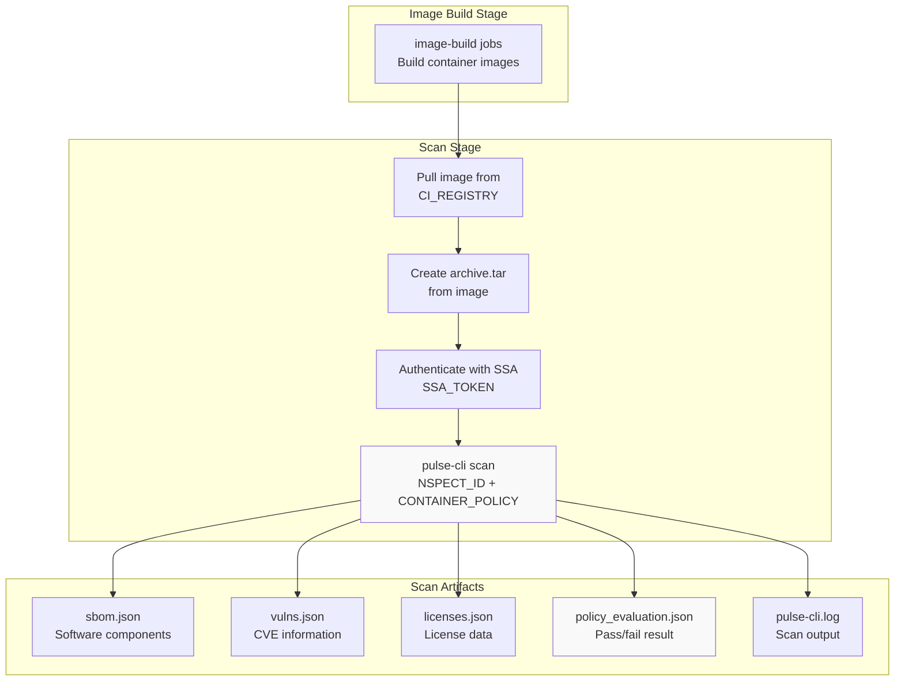
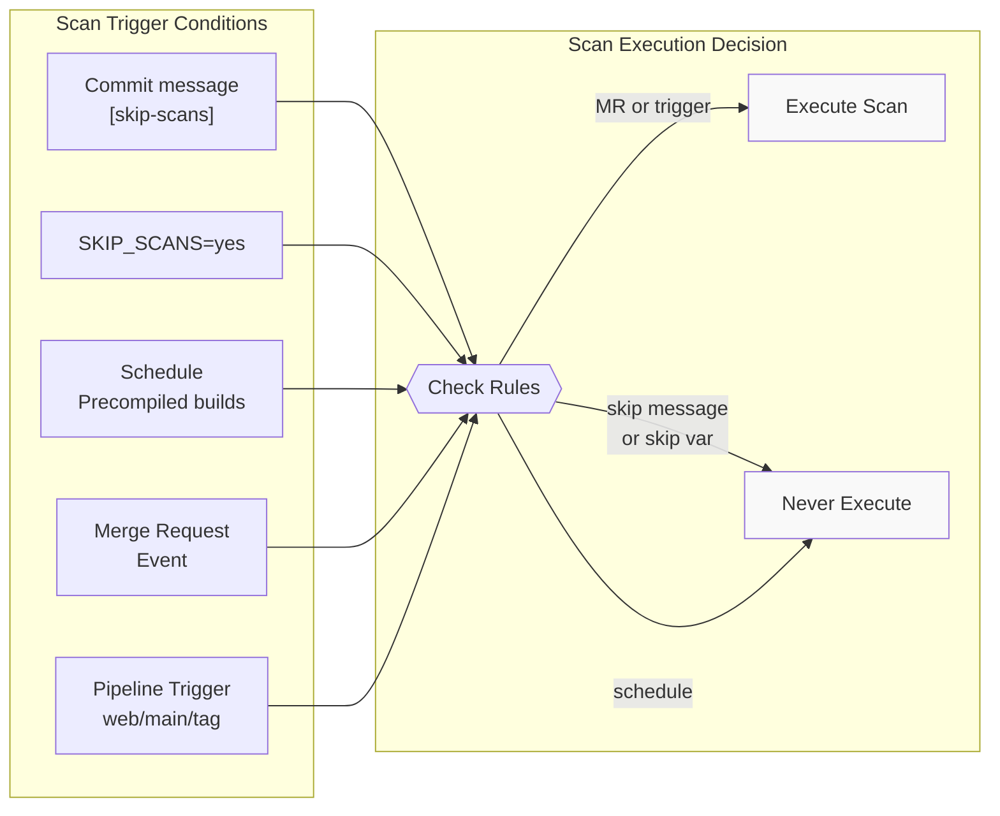
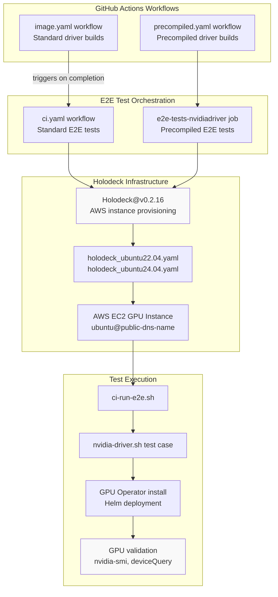
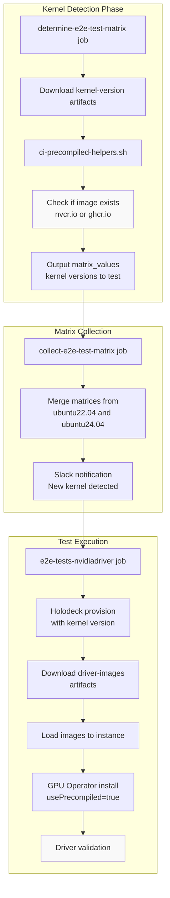
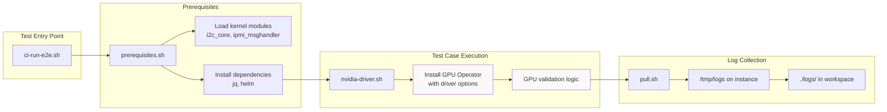
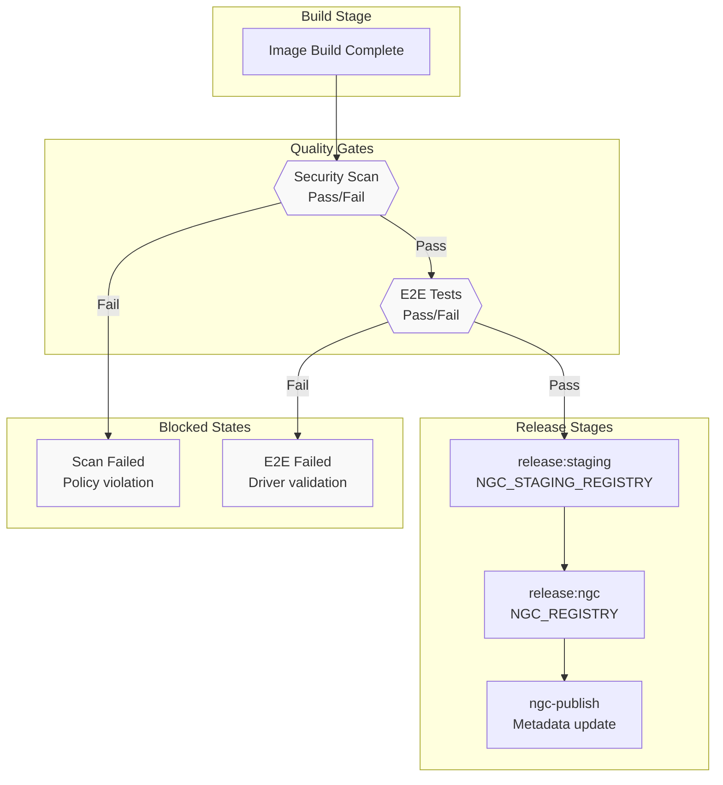
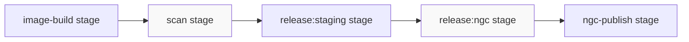

<!-- source: DeepWiki mcp.deepwiki.com · repo NVIDIA/gpu-driver-container · page 3.3 Testing and Validation · fetched 2026-10-26 -->

# Testing and Validation

Relevant source files

The following files were used as context for generating this wiki page:

- [.common-ci.yml](.common-ci.yml)
- [.github/workflows/ci.yaml](.github/workflows/ci.yaml)
- [.github/workflows/image.yaml](.github/workflows/image.yaml)
- [.github/workflows/precompiled.yaml](.github/workflows/precompiled.yaml)
- [.nvidia-ci.yml](.nvidia-ci.yml)
- [ci/flatcar/build.sh](ci/flatcar/build.sh)
- [ci/localbuild.sh](ci/localbuild.sh)
- [ci/run.sh](ci/run.sh)
- [ci/terraform.tf](ci/terraform.tf)
- [tests/scripts/ci-precompiled-helpers.sh](tests/scripts/ci-precompiled-helpers.sh)
- [tests/scripts/findkernelversion.sh](tests/scripts/findkernelversion.sh)
- [tests/scripts/prerequisites.sh](tests/scripts/prerequisites.sh)
- [versions.mk](versions.mk)

## Purpose and Scope

This document covers the testing and validation infrastructure that ensures the quality and security of GPU driver container images before they are released. This includes security scanning with SBOM generation, end-to-end testing on GPU instances, and kernel version detection for precompiled images.

For information about the overall CI/CD pipeline structure, see [CI/CD Pipeline](#3). For registry management and image promotion workflows, see [Registry Management](#3.4).

## Security Scanning

All driver container images undergo security scanning before release using the pulse-cli tool integrated with NVIDIA's Security Scanning Automation (SSA) service. Scanning generates Software Bill of Materials (SBOM) documents, vulnerability reports, and policy evaluation results.

### Scan Stage Configuration

Security scanning occurs in the `scan` stage of the GitLab CI pipeline after images are built and pulled from the internal registry. The scan jobs are organized by distribution, driver version, and platform architecture.

**Sources:** [.nvidia-ci.yml:149-186]()

### Scan Job Implementation

The `.scan-generic` template defines the base scanning logic that is extended for each distribution and architecture combination:

[.nvidia-ci.yml:151-186]()

Key scan job components:
- **Image Pull**: Downloads the image from `CI_REGISTRY` using regctl
- **Archive Creation**: Creates `archive.tar` file from the Docker image
- **SSA Authentication**: Obtains an access token using `SSA_CLIENT_ID` and `SSA_CLIENT_SECRET`
- **Pulse-CLI Execution**: Runs `pulse-cli -n $NSPECT_ID --ssa $SSA_TOKEN scan -i "archive.tar" -p $CONTAINER_POLICY -o`
- **Artifact Collection**: Saves SBOM, vulnerabilities, licenses, policy evaluation, and logs

### Scan Rules and Triggers

**Sources:** [.nvidia-ci.yml:187-228]()

Scan jobs are skipped when:
- Commit message contains `[skip-scans]` or `[skip_scans]` or `[skip scans]`
- Environment variable `SKIP_SCANS=yes` is set
- Pipeline source is `schedule` (precompiled builds have separate scan schedule)

### Scan Matrix

The scanning system creates a matrix of jobs across multiple dimensions:

| Dimension | Values | Example Jobs |
|-----------|--------|--------------|
| Distribution | ubuntu22.04, ubuntu24.04, rhel8, rhel9, signed_ubuntu22.04, signed_ubuntu24.04 | `scan-ubuntu22.04-amd64` |
| Driver Version | 535.274.02, 570.195.03, 580.95.05 | `scan-ubuntu22.04-amd64` with DRIVER_VERSION=535.274.02 |
| Architecture | linux/amd64, linux/arm64 | `scan-ubuntu22.04-arm64` |
| Image Type | Standard, Precompiled | `scan-precompiled-ubuntu22.04-amd64` |

**Sources:** [.nvidia-ci.yml:254-334]()

## End-to-End Testing

End-to-end tests validate that driver containers work correctly on real GPU instances by deploying them through the NVIDIA GPU Operator and verifying GPU functionality.

### E2E Test Architecture

**Sources:** [.github/workflows/ci.yaml:1-89](), [.github/workflows/precompiled.yaml:289-395]()

### Standard Driver E2E Tests

Standard driver E2E tests run after the `image.yaml` workflow completes on the main branch. The test workflow provisions a GPU instance using Holodeck, installs the GPU Operator, and validates driver functionality.

[.github/workflows/ci.yaml:26-88]()

Test execution flow:
1. **Holodeck Provisioning**: Uses `NVIDIA/holodeck@v0.2.16` action with AWS credentials
2. **Instance Configuration**: Reads `tests/holodeck_ubuntu22.04.yaml` for instance specifications
3. **DNS Extraction**: Retrieves public DNS name using `yq` from holodeck state
4. **Driver Version Matrix**: Tests all versions from `versions.mk` (535.274.02, 570.195.03, 580.95.05)
5. **GPU Operator Deployment**: Installs via Helm with custom driver repository and version
6. **Validation**: Executes `tests/cases/nvidia-driver.sh` test case
7. **Log Collection**: Pulls logs from `/tmp/logs` on failure

**Sources:** [.github/workflows/ci.yaml:26-88]()

### Precompiled Driver E2E Tests

Precompiled driver E2E tests are more complex because they must validate that precompiled kernel modules work correctly with specific kernel versions detected during the build process.

**Sources:** [.github/workflows/precompiled.yaml:166-395]()

#### Kernel Version Detection

The `determine-e2e-test-matrix` job detects new kernel versions that need testing by comparing built images against existing images in registries:

[.github/workflows/precompiled.yaml:166-221]()

Detection process:
1. **Download Kernel Artifacts**: Gets `kernel-version-*` artifacts from the build phase
2. **Execute Helper Script**: Runs `tests/scripts/ci-precompiled-helpers.sh` with kernel flavors and driver branches
3. **Check Registry**: Uses `tests/scripts/findkernelversion.sh` to query `nvcr.io/nvidia/driver` and `ghcr.io/nvidia/driver` with regctl
4. **Generate Matrix**: Creates `matrix_values_*.json` files with kernel versions that don't exist in registries

The kernel detection logic in `tests/scripts/findkernelversion.sh`:

[tests/scripts/findkernelversion.sh:1-45]()

Key variables:
- `KERNEL_VERSION`: Extracted from artifact kernel_version.txt file
- `should_continue`: Set to `true` if image doesn't exist in either registry
- `DRIVER_BRANCH`: Driver branch being tested (535, 570, 580)

**Sources:** [tests/scripts/findkernelversion.sh:1-45](), [tests/scripts/ci-precompiled-helpers.sh:1-32]()

#### E2E Test Execution

The precompiled E2E test job executes for each detected kernel version with special considerations:

[.github/workflows/precompiled.yaml:289-395]()

Execution details:
- **Kernel Configuration**: Sets kernel version in holodeck config using `yq eval`
- **Driver Branch Matrix**: Tests all driver branches (535, 570, 580) except 535 for ubuntu24.04
- **Image Loading**: Downloads and loads driver-images artifacts for each driver branch
- **GPU Operator Options**: Sets `--set driver.usePrecompiled=true --set driver.imagePullPolicy=Never`
- **Test Script**: Executes `tests/ci-run-e2e.sh` with test case `tests/cases/nvidia-driver.sh`
- **Multi-Version Testing**: Iterates through all driver branches for each kernel version

**Sources:** [.github/workflows/precompiled.yaml:289-395]()

### Holodeck Integration

Holodeck is an infrastructure-as-code tool that provisions AWS EC2 GPU instances for testing. The integration uses version `v0.2.16` of the Holodeck GitHub Action.

Configuration files define instance specifications:
- `tests/holodeck_ubuntu22.04.yaml`: Ubuntu 22.04 GPU instance configuration
- `tests/holodeck_ubuntu24.04.yaml`: Ubuntu 24.04 GPU instance configuration

Common Holodeck workflow steps:
1. **Action Setup**: `uses: NVIDIA/holodeck@v0.2.16` with AWS credentials
2. **Config Specification**: `holodeck_config: "tests/holodeck_ubuntu22.04.yaml"`
3. **State File**: Holodeck writes state to `/github/workspace/.cache/holodeck.yaml`
4. **DNS Extraction**: `yq '.status.properties[] | select(.name == "public-dns-name") | .value'`
5. **SSH Connection**: Test scripts connect via `ubuntu@<public-dns-name>` with AWS SSH key

**Sources:** [.github/workflows/ci.yaml:33-49](), [.github/workflows/precompiled.yaml:327-346]()

## Test Infrastructure

### Test Script Architecture

**Sources:** [tests/scripts/prerequisites.sh:1-24]()

#### Prerequisites Setup

The `tests/scripts/prerequisites.sh` script prepares the test environment:

[tests/scripts/prerequisites.sh:1-24]()

Setup steps:
1. **Log Directory**: Creates `LOG_DIR` for test output
2. **Kernel Modules**: Loads `i2c_core` and `ipmi_msghandler` modules required for GPUs
3. **Dependencies**: Installs `jq` for JSON processing and Helm for GPU Operator deployment
4. **Skip Option**: Can be bypassed with `SKIP_PREREQUISITES=true`

**Sources:** [tests/scripts/prerequisites.sh:1-24]()

## Quality Gates

Quality gates ensure that only validated, secure images are released to production registries.

### Release Blocking Conditions

### Scan Policy Enforcement

Security scanning uses the `CONTAINER_POLICY` variable to enforce vulnerability and licensing policies. Policy evaluation results are captured in `policy_evaluation.json` artifact.

Policy violations block the pipeline by causing the scan job to fail with exit code 1. The pulse-cli tool evaluates:
- **CVE Severity Thresholds**: Critical and high-severity vulnerabilities
- **License Compliance**: Restricted licenses that are not approved
- **SBOM Completeness**: Verification that all components are identified

**Sources:** [.nvidia-ci.yml:151-186]()

### E2E Test Requirements

E2E tests must pass for all driver versions in the test matrix before images are promoted to NGC production registry:

| Test Type | Validation Requirements |
|-----------|------------------------|
| Standard Driver | GPU Operator deployment successful, nvidia-smi returns device info, CUDA deviceQuery runs |
| Precompiled Driver | Kernel modules load without compilation, nvidia-smi returns device info, driver version matches |
| Multi-Version | All driver branches (535, 570, 580) pass for each kernel version |

Test failures are captured in:
- **Logs**: Archived as `nvidiadriver-e2e-test-logs` or `nvidiadriver-Precompiled-e2e-test-logs` artifacts
- **Exit Codes**: Non-zero exit codes halt the pipeline and prevent promotion
- **Slack Notifications**: Failed tests trigger notifications to monitoring channels

**Sources:** [.github/workflows/ci.yaml:82-88](), [.github/workflows/precompiled.yaml:389-395]()

### Release Stage Dependencies

GitLab CI pipeline stages enforce sequential execution with job dependencies:

Job needs declarations:
- `scan-*` jobs need corresponding `image-*` jobs
- `release:staging-*` jobs need scan jobs (implicit stage dependency)
- `release:ngc-*` jobs only run on tagged releases
- `ngc-publish` jobs need `generate-build-info` job

**Sources:** [.common-ci.yml:25-31](), [.nvidia-ci.yml:254-335]()

### Notification and Monitoring

The precompiled workflow includes Slack notifications for key events:

1. **New Kernel Detection**: Notifies when new kernel versions are detected before E2E tests
2. **Image Publication**: Notifies when new precompiled images are published to GHCR
3. **Test Failures**: Implicit notifications via workflow failure monitoring

Notification configuration uses:
- `SLACK_BOT_TOKEN`: Authentication for Slack API
- `SLACK_CHANNEL_ID`: Target channel for notifications
- `DETECTED_PRECOMPILED_KERNEL_MESSAGE`: Message template for kernel detection
- `PUBLISHED_PRECOMPILED_IMAGE_MESSAGE`: Message template for image publication

**Sources:** [.github/workflows/precompiled.yaml:276-287](), [.github/workflows/precompiled.yaml:459-469]()

## Driver Version Matrix

The testing system validates multiple driver versions across different distributions:

| Driver Version | Ubuntu 22.04 | Ubuntu 24.04 | RHEL 8 | RHEL 9 |
|----------------|--------------|--------------|--------|--------|
| 535.274.02 | ✓ | ✗ | ✓ | ✓ |
| 570.195.03 | ✓ | ✓ | ✓ | ✓ |
| 580.95.05 | ✓ | ✓ | ✓ | ✓ |

Driver versions are defined in:
- `versions.mk`: [versions.mk:16]() - `DRIVER_VERSIONS ?= 535.274.02 570.195.03 580.95.05`
- `.common-ci.yml`: [.common-ci.yml:22]() - `DRIVER_VERSIONS: 535.274.02 570.195.03 580.95.05`
- GitLab CI matrix: [.common-ci.yml:82-90]() - `.driver-versions` and `.driver-versions-ubuntu24.04` templates

Ubuntu 24.04 excludes driver 535 due to kernel compatibility requirements.

**Sources:** [versions.mk:16](), [.common-ci.yml:22](), [.common-ci.yml:82-90]()

---

