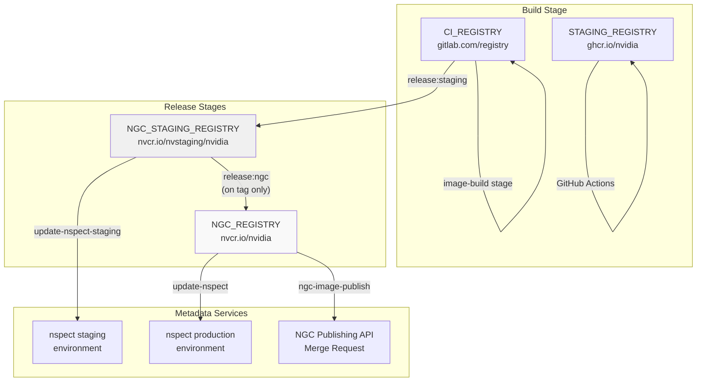
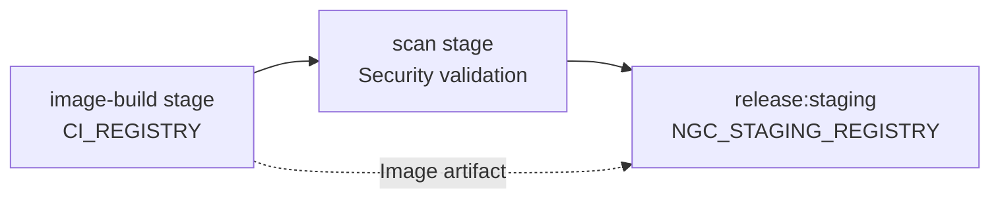
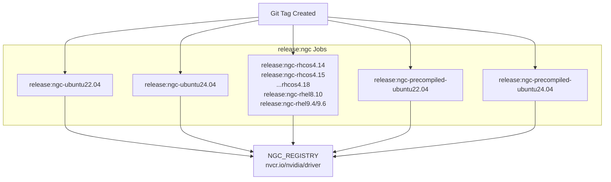
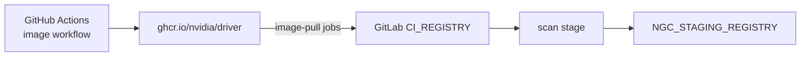
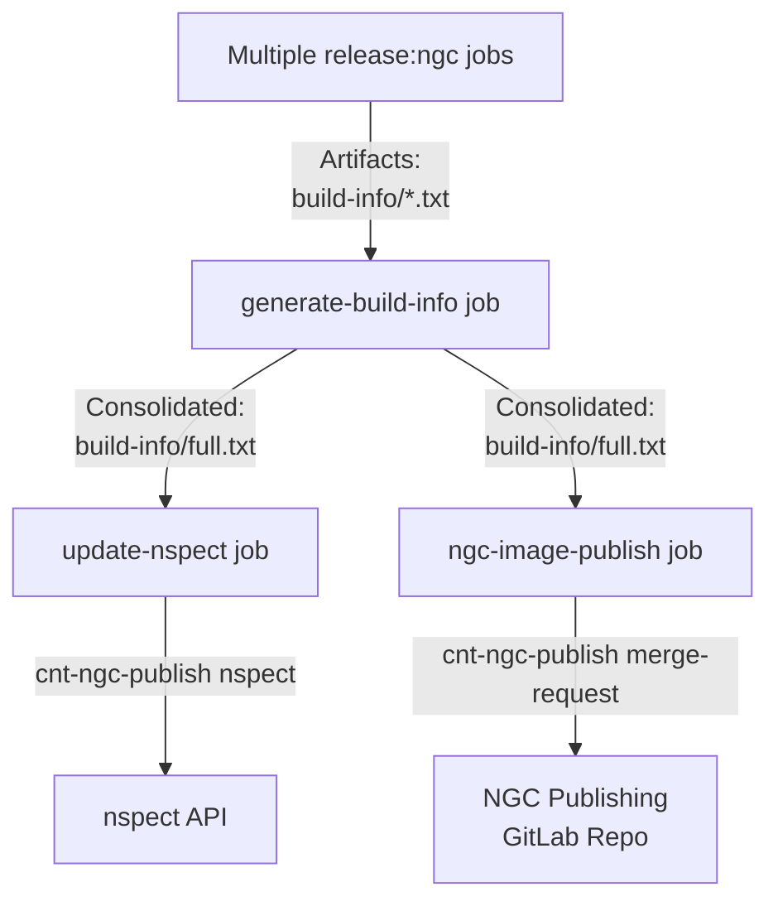

<!-- source: DeepWiki mcp.deepwiki.com · repo NVIDIA/gpu-driver-container · page 3.4 Registry Management · fetched 2026-10-26 -->

# Registry Management

<details>
<summary>Relevant source files</summary>

The following files were used as context for generating this wiki page:

- [.common-ci.yml](.common-ci.yml)
- [.github/workflows/image.yaml](.github/workflows/image.yaml)
- [.gitlab-ci.yml](.gitlab-ci.yml)
- [.nvidia-ci.yml](.nvidia-ci.yml)
- [Makefile](Makefile)
- [base/Dockerfile](base/Dockerfile)
- [base/generate-ci-config](base/generate-ci-config)
- [multi-arch.mk](multi-arch.mk)
- [native-only.mk](native-only.mk)
- [scripts/precompiled.sh](scripts/precompiled.sh)
- [versions.mk](versions.mk)

</details>


## Purpose and Scope

This document describes the container image registry architecture, release workflows, and publishing mechanisms used in the GPU driver container project. It covers the staging and production registry environments, image promotion processes, and NGC catalog integration. 

For information about the build process that produces these images, see [Build Pipeline Flow](#2.2). For testing and validation before registry promotion, see [Testing and Validation](#3.3).

## Registry Architecture

The project employs a two-tier registry strategy with distinct staging and production environments to ensure image quality and enable controlled releases.

### Registry Flow Diagram



**Sources:** [.common-ci.yml:218-367](), [.nvidia-ci.yml:336-533]()

## Registry Endpoints

The system uses multiple registry endpoints for different stages of the release pipeline:

| Registry | Variable | Purpose | Access |
|----------|----------|---------|--------|
| GitLab Container Registry | `CI_REGISTRY` | Internal CI build artifacts | CI pipeline only |
| GitHub Container Registry | `STAGING_REGISTRY=ghcr.io/nvidia` | Public staging for GitHub Actions | Public read |
| NGC Staging | `NGC_STAGING_REGISTRY` | Pre-production validation | Authenticated access |
| NGC Production | `NGC_REGISTRY=nvcr.io/nvidia` | Public production distribution | Public read |

### Registry Variables

```
CI_REGISTRY_IMAGE         # GitLab internal registry image name
IMAGE_NAME                # Build-time image name (defaults to nvidia/driver)
OUT_IMAGE_NAME            # Target registry image name for promotion
OUT_REGISTRY              # Target registry for image push
OUT_VERSION               # Target version tag for promoted images
```

**Sources:** [.common-ci.yml:21-38](), [.nvidia-ci.yml:27-37](), [Makefile:25-54]()

## Image Release Workflow

The release workflow consists of multiple stages that progressively promote images from build artifacts to production registries.

### Staging Release

The `release:staging` jobs push images to the NGC staging registry after successful builds and scans. This occurs on all pipeline triggers (merge requests, main branch, tags).



**Key Configuration:**

```yaml
# From .common-ci.yml
.release:staging:
  variables:
    OUT_REGISTRY_USER: "${NGC_REGISTRY_USER}"
    OUT_REGISTRY_TOKEN: "${NGC_REGISTRY_TOKEN}"
    OUT_REGISTRY: "${NGC_REGISTRY}"
    OUT_IMAGE_NAME: "${NGC_STAGING_REGISTRY}/driver"
```

The staging release job performs:
1. Login to both CI and NGC registries using `regctl`
2. Copy image from `CI_REGISTRY` to `NGC_STAGING_REGISTRY`
3. Generate build information artifact for tracking

**Sources:** [.common-ci.yml:218-256](), [.common-ci.yml:159-185]()

### Production Release (NGC)

Production releases to the NGC public registry only occur when a Git tag is created. The `release:ngc` jobs extend the external release template with NGC-specific variables.



**Distribution Aliasing:**

The release process supports publishing the same image under multiple distribution aliases. For example, RHEL9 images are published as multiple RHCOS variants:

```yaml
# From .nvidia-ci.yml:385-418
release:ngc-rhcos4.14:
  extends:
    - .release:ngc
    - .dist-rhel9
  variables:
    OUT_DIST: "rhcos4.14"
```

This allows one base RHEL9 image to appear as `rhcos4.14`, `rhcos4.15`, `rhcos4.16`, `rhcos4.17`, and `rhcos4.18` in the NGC catalog.

**Sources:** [.nvidia-ci.yml:344-440](), [.common-ci.yml:257-295]()

### GitHub Actions Registry Flow

GitHub Actions workflows publish directly to `ghcr.io` for both standard and precompiled images. These serve as staging artifacts that are later pulled into the GitLab pipeline.



The GitHub workflow authenticates using `GITHUB_TOKEN` and pushes to `ghcr.io/${LOWERCASE_REPO_OWNER}/driver`:

**Sources:** [.github/workflows/image.yaml:80-92](), [.nvidia-ci.yml:45-128]()

## Release Job Implementation

### Generic Release Template

The `.release-generic` template defines the core release logic used by all distribution-specific release jobs:

```yaml
# From .common-ci.yml:159-185
.release-generic:
  stage: release
  variables:
    IMAGE_NAME: "${CI_REGISTRY_IMAGE}"
    VERSION: "${CI_COMMIT_SHORT_SHA}"
    OUT_VERSION: "${CI_COMMIT_SHORT_SHA}"
    OUT_DIST: "${DIST}"
```

**Release Script Logic:**

1. **Registry Authentication**
   - Login to source registry (`CI_REGISTRY`)
   - Login to destination registry (`OUT_REGISTRY`) if different

2. **Image Push**
   - For precompiled images: `./scripts/precompiled.sh push`
   - For standard images: `make push-${DIST}-${DRIVER_VERSION}`

3. **Build Info Generation**
   - Creates artifact `build-info/${CI_PIPELINE_ID}-${DRIVER_VERSION}-${OUT_DIST}.txt`
   - Contains mapping: `${CI_COMMIT_SHORT_SHA}-${DRIVER_VERSION}-${DIST} ${DRIVER_VERSION}-${OUT_DIST}`

**Sources:** [.common-ci.yml:159-185]()

### Precompiled Image Release

Precompiled images follow a specialized release path due to their kernel-specific nature:

```yaml
# From .common-ci.yml:325-367
.release:staging-precompiled:
  stage: release
  variables:
    IN_REGISTRY: "${STAGING_REGISTRY}"
    IN_IMAGE_NAME: driver
    OUT_REGISTRY_USER: "${NGC_REGISTRY_USER}"
    OUT_REGISTRY_TOKEN: "${NGC_REGISTRY_TOKEN}"
    OUT_REGISTRY: "${NGC_REGISTRY}"
    OUT_IMAGE_NAME: "${NGC_STAGING_REGISTRY}/driver"
    PRECOMPILED: "true"
```

The precompiled release jobs iterate over a matrix of driver branches, kernel flavors, and LTS kernels, generating unique image tags for each combination.

**Sources:** [.common-ci.yml:325-367](), [scripts/precompiled.sh:57-72]()

## NGC Publishing and Metadata Updates

After images are pushed to the NGC registry, additional jobs update metadata systems and raise merge requests for catalog publication.

### Build Information Aggregation



**Sources:** [.nvidia-ci.yml:441-533]()

### Generate Build Info Job

The `generate-build-info` job consolidates all individual build information artifacts:

```yaml
# From .nvidia-ci.yml:441-456
generate-build-info:
  stage: ngc-publish
  script:
    - |
      for DRIVER_VERSION in ${PUBLISH_VERSIONS}; do
        for file in build-info/${CI_PIPELINE_ID}-${DRIVER_VERSION}-*; do
          cat "$file" >> build-info/${CI_PIPELINE_ID}-full.txt
        done
      done
```

This creates a consolidated mapping file used by downstream publishing jobs.

**Sources:** [.nvidia-ci.yml:441-456]()

### nspect Updates

The `update-nspect` jobs register driver container metadata with NVIDIA's security and compliance tracking system:

```yaml
# From .nvidia-ci.yml:458-495
.update-nspect:
  stage: ngc-publish
  image: 
    name: "${CNT_NGC_PUBLISH_IMAGE}"
  variables:
    PROJECT_NAME: "gpu-driver-container"
    REPO_URL: "https://github.com/NVIDIA/gpu-driver-container.git"
  script:
    - cnt-ngc-publish nspect --versions-file "build-info/${CI_PIPELINE_ID}-full.txt"
```

Two variants exist:
- `update-nspect-staging`: Updates staging environment for testing (except on tags)
- `update-nspect`: Updates production environment (only on tags with `OSRB_BUG_ID`)

**Sources:** [.nvidia-ci.yml:458-495]()

### NGC Catalog Publication

The final step raises a merge request to the NGC publishing repository to make images discoverable in the NGC catalog:

```yaml
# From .nvidia-ci.yml:497-533
.publish-images:
  stage: ngc-publish
  image:
    name: "${CNT_NGC_PUBLISH_IMAGE}"
  script:
    - cnt-ngc-publish render --project-name "gpu-driver-container" 
        --versions-file "build-info/${CI_PIPELINE_ID}-full.txt" 
        --output gpu-driver-container.yaml
    - cnt-ngc-publish merge-request --files "gpu-driver-container.yaml"
```

The `ngc-image-publish` job runs only on Git tags and creates an MR to `NGC_PUBLISHING_PROD_PROJECT_PATH`. The `mock-image-publish` job creates test MRs for validation.

**Sources:** [.nvidia-ci.yml:497-533]()

## Image Tagging Conventions

### Standard Image Tags

Standard (non-precompiled) images use the following tag format:

```
[VERSION-]DRIVER_VERSION-DIST
```

Examples:
- `535.274.02-ubuntu22.04` (production)
- `a1b2c3d4-535.274.02-ubuntu22.04` (development)
- `535.274.02-rhcos4.16` (RHEL9 published as RHCOS)

**Sources:** [Makefile:30-54]()

### Precompiled Image Tags

Precompiled images include kernel version information:

```
[VERSION-]DRIVER_BRANCH-KERNEL_VERSION-DIST
```

Examples:
- `535-5.15.0-119-generic-ubuntu22.04`
- `a1b2c3d4-580-6.8.0-1015-aws-ubuntu24.04`

The `DRIVER_BRANCH` (e.g., 535, 570, 580) is used instead of full driver version since precompiled packages are keyed by branch.

**Sources:** [Makefile:92-148](), [.common-ci.yml:346-367]()

### Base Image Tags

Base images used for kernel version detection have specialized tags:

```
base-TARGET-LTS_KERNEL-KERNEL_FLAVOR-DRIVER_BRANCH
```

Example:
- `base-jammy-6.8-generic-535`
- `base-noble-6.8-aws-570`

**Sources:** [Makefile:206-230]()

## Image Push Implementation

### Makefile Push Targets

The Makefile provides push targets that handle image promotion between registries:

```makefile
# From Makefile:129-148
push-%: DIST = $(word 2,$(subst -, ,$@))
push-%: DRIVER_VERSION = $(word 3,$(subst -, ,$@))
push-%: DRIVER_BRANCH = $(word 1,$(subst ., ,${DRIVER_VERSION}))

push-signed_ubuntu22.04%: DIST = ubuntu22.04
push-signed_ubuntu22.04%: DRIVER_TAG = $(DRIVER_BRANCH)
push-signed_ubuntu22.04%: IMAGE_TAG = $(if $(VERSION),$(VERSION)-)$(DRIVER_BRANCH)-$(KERNEL_VERSION)-$(DIST)
push-signed_ubuntu22.04%: OUT_IMAGE_TAG = $(if $(VERSION),$(VERSION)-)$(DRIVER_BRANCH)-$(KERNEL_VERSION)-$(DIST)
```

**Push Methods:**

The actual push implementation differs based on multi-arch support:

**Multi-arch (using regctl):**
```makefile
# From multi-arch.mk:20-24
$(DRIVER_PUSH_TARGETS): push-%:
	$(REGCTL) \
		image copy \
		$(IMAGE) $(OUT_IMAGE)
```

**Native-only (using docker):**
```makefile
# From native-only.mk:17-19
$(DRIVER_PUSH_TARGETS): push-%:
	$(DOCKER) tag "$(IMAGE)" "$(OUT_IMAGE)"
	$(DOCKER) push "$(OUT_IMAGE)"
```

**Sources:** [Makefile:129-148](), [multi-arch.mk:20-24](), [native-only.mk:17-19]()

### Precompiled Push Script

The `scripts/precompiled.sh` script handles precompiled image pushing with additional validation:

```bash
# From scripts/precompiled.sh:57-72
function pushImage(){
	# check if image exists in output registry
	local out_image=${OUT_IMAGE_NAME}:${DRIVER_BRANCH}-${KERNEL_VERSION}-${DIST##*_}
	if imageExists "$out_image"; then
		echo "image tag already exists in output registry - $out_image"
		if [ "$FORCE_PUSH" != "true" ]; then
			echo "exiting"
			return 0
		fi
		echo "overwriting image tag - $out_image"
	fi
    # push the image
    make DRIVER_VERSIONS=${DRIVER_VERSIONS} DRIVER_BRANCH=${DRIVER_BRANCH} push-${DIST}
}
```

This function:
1. Checks if the target tag already exists using `regctl manifest get`
2. Skips push if image exists (unless `FORCE_PUSH=true`)
3. Delegates to Makefile push targets

**Sources:** [scripts/precompiled.sh:57-86]()

## Authentication and Credentials

### GitLab CI Registry Authentication

```yaml
# Variables used:
CI_REGISTRY              # GitLab registry URL (automatic)
CI_REGISTRY_USER         # Username for GitLab registry (automatic)
CI_REGISTRY_PASSWORD     # Token for GitLab registry (automatic)
```

### NGC Registry Authentication

```yaml
# Variables used:
NGC_REGISTRY             # Production: nvcr.io
NGC_REGISTRY_USER        # Service account username
NGC_REGISTRY_TOKEN       # Service account API key
NGC_STAGING_REGISTRY     # Staging environment path
```

### GitHub Container Registry Authentication

```yaml
# From .github/workflows/image.yaml:80-85
- name: Login to GitHub Container Registry
  uses: docker/login-action@v3
  with:
    registry: ghcr.io
    username: ${{ github.actor }}
    password: ${{ secrets.GITHUB_TOKEN }}
```

**Sources:** [.common-ci.yml:177-180](), [.github/workflows/image.yaml:80-85]()

## Registry Tools and Utilities

### regctl

The project uses `regctl` from the regclient project for registry operations:

```yaml
# From .common-ci.yml:149-157
.regctl-setup:
  before_script:
    - export REGCTL_VERSION=v0.7.1
    - apk add --no-cache curl
    - mkdir -p bin
    - curl -sSLo bin/regctl https://github.com/regclient/regclient/releases/download/${REGCTL_VERSION}/regctl-linux-amd64
    - chmod a+x bin/regctl
    - export PATH=$(pwd)/bin:${PATH}
```

**Key operations:**
- `regctl registry login`: Authenticate to registries
- `regctl image copy`: Copy images between registries (preserves multi-arch manifests)
- `regctl manifest get --list`: Check if image exists
- `regctl image get-file`: Extract files from images without running them

**Sources:** [.common-ci.yml:149-157](), [scripts/precompiled.sh:24-34]()

### Image Pull from Staging

The `.image-pull-generic` jobs demonstrate pulling images from the public staging registry into the internal CI registry:

```yaml
# From .nvidia-ci.yml:45-68
.image-pull-generic:
  stage: image-build
  variables:
    IN_REGISTRY: "${STAGING_REGISTRY}"
    IN_IMAGE_NAME: driver
    IN_VERSION: "${STAGING_VERSION}"
    OUT_REGISTRY_USER: "${CI_REGISTRY_USER}"
    OUT_REGISTRY_TOKEN: "${CI_REGISTRY_PASSWORD}"
    OUT_REGISTRY: "${CI_REGISTRY}"
    OUT_IMAGE_NAME: "${CI_REGISTRY_IMAGE}"
  script:
    - regctl registry login "${OUT_REGISTRY}" -u "${OUT_REGISTRY_USER}" -p "${OUT_REGISTRY_TOKEN}"
    - make IMAGE_NAME=${IN_REGISTRY}/${IN_IMAGE_NAME} VERSION=${IN_VERSION} push-${DIST}-${DRIVER_VERSION}
```

This allows the NVIDIA internal pipeline to consume images built by the public GitHub Actions workflow, enabling consistent scanning and promotion through both pipelines.

**Sources:** [.nvidia-ci.yml:45-68]()

## Summary

The registry management system implements a multi-tier release strategy:

1. **Build artifacts** initially stored in `CI_REGISTRY` or `ghcr.io`
2. **Staging release** to `NGC_STAGING_REGISTRY` after scan validation
3. **Production release** to `NGC_REGISTRY` only on Git tags
4. **Metadata updates** to nspect and NGC catalog
5. **Automated promotion** using `regctl` for multi-arch support

This workflow ensures all images undergo security scanning before staging, and only tagged releases reach production, maintaining high quality standards for publicly distributed GPU driver containers.

---

