<!-- source: DeepWiki mcp.deepwiki.com · repo NVIDIA/gpu-driver-container · page 4 Container Image Types · fetched 2026-10-26 -->

# Container Image Types

<details>
<summary>Relevant source files</summary>

The following files were used as context for generating this wiki page:

- [rhel8/Dockerfile](rhel8/Dockerfile)
- [rhel8/precompiled/Dockerfile](rhel8/precompiled/Dockerfile)
- [rhel9/Dockerfile](rhel9/Dockerfile)
- [rhel9/precompiled/Dockerfile](rhel9/precompiled/Dockerfile)
- [ubuntu20.04/Dockerfile](ubuntu20.04/Dockerfile)
- [ubuntu20.04/precompiled/Dockerfile](ubuntu20.04/precompiled/Dockerfile)
- [ubuntu22.04/Dockerfile](ubuntu22.04/Dockerfile)
- [ubuntu22.04/precompiled/local-repo.sh](ubuntu22.04/precompiled/local-repo.sh)
- [ubuntu22.04/precompiled/nvidia-driver](ubuntu22.04/precompiled/nvidia-driver)
- [ubuntu24.04/precompiled/Dockerfile](ubuntu24.04/precompiled/Dockerfile)
- [ubuntu24.04/precompiled/local-repo.sh](ubuntu24.04/precompiled/local-repo.sh)
- [ubuntu24.04/precompiled/nvidia-driver](ubuntu24.04/precompiled/nvidia-driver)
- [vgpu-manager/rhel8/Dockerfile](vgpu-manager/rhel8/Dockerfile)
- [vgpu-manager/ubuntu20.04/Dockerfile](vgpu-manager/ubuntu20.04/Dockerfile)
- [vgpu-manager/ubuntu22.04/Dockerfile](vgpu-manager/ubuntu22.04/Dockerfile)

</details>


## Purpose and Scope

This document provides an overview of the different types of NVIDIA GPU driver container images produced by the gpu-driver-container build system. It describes the three main image categories, their distinguishing characteristics, build-time configurations, and use cases.

For detailed information about the build pipeline that produces these images, see [CI/CD Pipeline](#3). For information about the runtime behavior and driver lifecycle management, see [Runtime Architecture](#2.3).

## Image Type Classification

The gpu-driver-container repository produces three distinct categories of container images, each optimized for different deployment scenarios:

| Image Type | Compilation Strategy | Primary Use Case | Kernel Flexibility |
|------------|---------------------|------------------|-------------------|
| **Standard** | Runtime compilation | General-purpose bare metal/VM GPU workloads | High - compiles against actual host kernel |
| **Precompiled** | Build-time compilation | Ubuntu environments with Canonical-signed modules | Low - kernel version must match exactly |
| **vGPU** | Runtime compilation | Virtualized GPU environments (both guest and host) | High (guest) / Medium (host) |

**Sources:** [rhel8/Dockerfile:38-40](), [ubuntu22.04/Dockerfile:7-8](), [ubuntu24.04/precompiled/Dockerfile:1-15](), [vgpu-manager/ubuntu22.04/Dockerfile:1-6]()

### Image Type Determination Flow

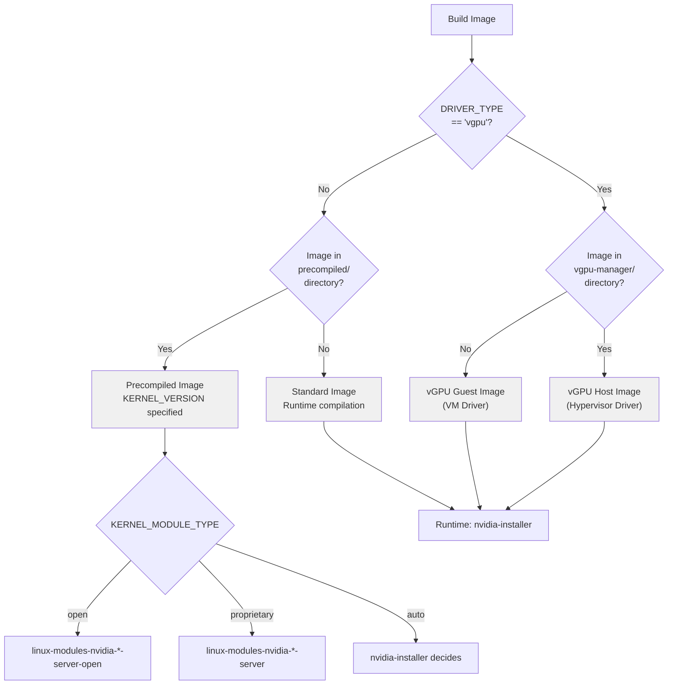

**Sources:** [rhel8/Dockerfile:38-48](), [ubuntu22.04/Dockerfile:6-8](), [ubuntu24.04/precompiled/Dockerfile:1-14](), [vgpu-manager/ubuntu22.04/Dockerfile:1-6]()

### Build Arguments Common to All Image Types

All image types share a core set of build arguments that control their configuration:

| Build Argument | Purpose | Example Values | Default |
|----------------|---------|----------------|---------|
| `DRIVER_VERSION` | NVIDIA driver version to install | `535.183.01`, `550.90.07` | Required |
| `DRIVER_BRANCH` | Driver major version | `535`, `550`, `580` | Required |
| `DRIVER_TYPE` | Driver deployment mode | `passthrough`, `vgpu` | `passthrough` |
| `TARGETARCH` | Target architecture | `amd64`, `arm64` | Required |
| `CVE_UPDATES` | Packages to update for CVE fixes | Space-separated package names | Empty |

**Sources:** [rhel8/Dockerfile:33-48](), [ubuntu20.04/Dockerfile:42-56](), [ubuntu22.04/Dockerfile:47-61]()

### Dockerfile Location Structure

```mermaid
graph TB
    ROOT["Repository Root"]
    
    ROOT --> DIST1["ubuntu20.04/"]
    ROOT --> DIST2["ubuntu22.04/"]
    ROOT --> DIST3["ubuntu24.04/"]
    ROOT --> DIST4["rhel8/"]
    ROOT --> DIST5["rhel9/"]
    ROOT --> VGPU["vgpu-manager/"]
    
    DIST1 --> U20_STD["Dockerfile<br/>(Standard)"]
    DIST1 --> U20_PRE["precompiled/<br/>Dockerfile"]
    
    DIST2 --> U22_STD["Dockerfile<br/>(Standard)"]
    DIST2 --> U22_PRE["precompiled/<br/>Dockerfile"]
    
    DIST3 --> U24_STD["Dockerfile<br/>(Standard)"]
    DIST3 --> U24_PRE["precompiled/<br/>Dockerfile"]
    
    DIST4 --> R8_STD["Dockerfile<br/>(Standard)"]
    DIST4 --> R8_PRE["precompiled/<br/>Dockerfile"]
    
    DIST5 --> R9_STD["Dockerfile<br/>(Standard)"]
    DIST5 --> R9_PRE["precompiled/<br/>Dockerfile"]
    
    VGPU --> VGPU_U20["ubuntu20.04/<br/>Dockerfile"]
    VGPU --> VGPU_U22["ubuntu22.04/<br/>Dockerfile"]
    VGPU --> VGPU_R8["rhel8/<br/>Dockerfile"]
    
    style U20_STD fill:#e8f4f8
    style U22_STD fill:#e8f4f8
    style U24_STD fill:#e8f4f8
    style R8_STD fill:#e8f4f8
    style R9_STD fill:#e8f4f8
    
    style U20_PRE fill:#fff4e6
    style U22_PRE fill:#fff4e6
    style U24_PRE fill:#fff4e6
    style R8_PRE fill:#fff4e6
    style R9_PRE fill:#fff4e6
    
    style VGPU_U20 fill:#f0e6ff
    style VGPU_U22 fill:#f0e6ff
    style VGPU_R8 fill:#f0e6ff
```

**Sources:** [ubuntu20.04/Dockerfile:1](), [ubuntu22.04/precompiled/Dockerfile:1](), [vgpu-manager/ubuntu22.04/Dockerfile:1]()

## Key Differentiators

### Standard Images vs Precompiled Images

The fundamental difference between standard and precompiled images lies in **when kernel modules are compiled**:

#### Standard Images
- Download `NVIDIA-Linux-*.run` installer at build time
- Extract kernel module sources to `/usr/src/nvidia-*`
- Compile kernel modules at **runtime** against host kernel headers
- Single image supports multiple kernel versions
- Larger image size due to build toolchain

**Runtime Compilation Pattern (Standard):**
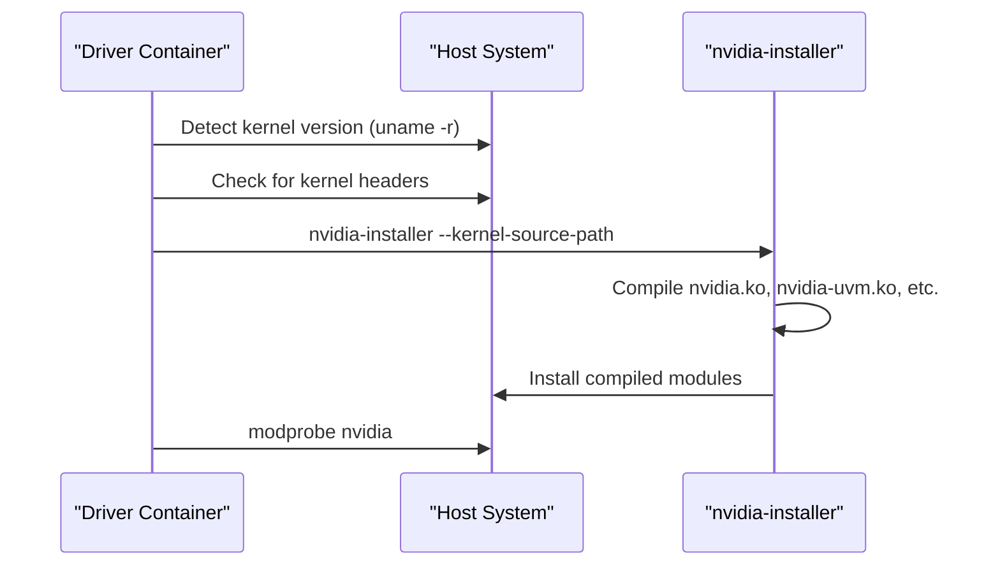

**Sources:** [ubuntu20.04/Dockerfile:78-86](), [rhel8/Dockerfile:63-72]()

#### Precompiled Images
- Download pre-built kernel module packages from Canonical (Ubuntu) or build RPMs (RHEL)
- Modules are already compiled for specific `KERNEL_VERSION`
- Install via APT/DNF at **runtime** (no compilation)
- Separate image required for each kernel version
- Smaller runtime image, no build toolchain needed

**Package Installation Pattern (Precompiled):**
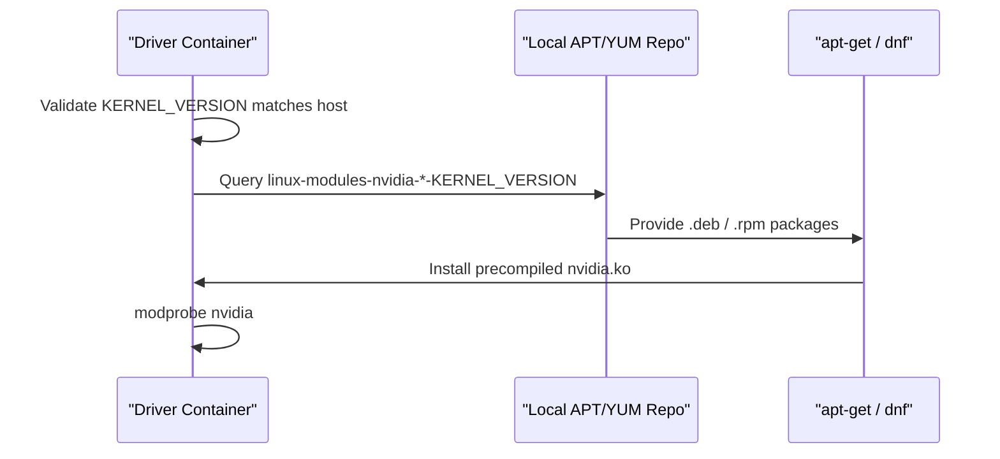

**Sources:** [ubuntu22.04/precompiled/nvidia-driver:371-394](), [ubuntu24.04/precompiled/nvidia-driver:371-395]()

### vGPU Images: Guest vs Host

vGPU images come in two distinct flavors based on their role in the virtualization stack:

| Aspect | vGPU Guest (VM) | vGPU Host (Hypervisor) |
|--------|-----------------|------------------------|
| **Base Dockerfile** | Standard distribution Dockerfile | `vgpu-manager/` directory |
| **DRIVER_TYPE** | `vgpu` | `passthrough` (implicit) |
| **Installer File** | `NVIDIA-Linux-*.run` | `NVIDIA-Linux-*-vgpu-kvm.run` |
| **License Server** | Required | Not required |
| **Additional Component** | `vgpu-util` Go binary | None |
| **Target Environment** | Inside VM | Hypervisor host |

**vGPU Architecture:**
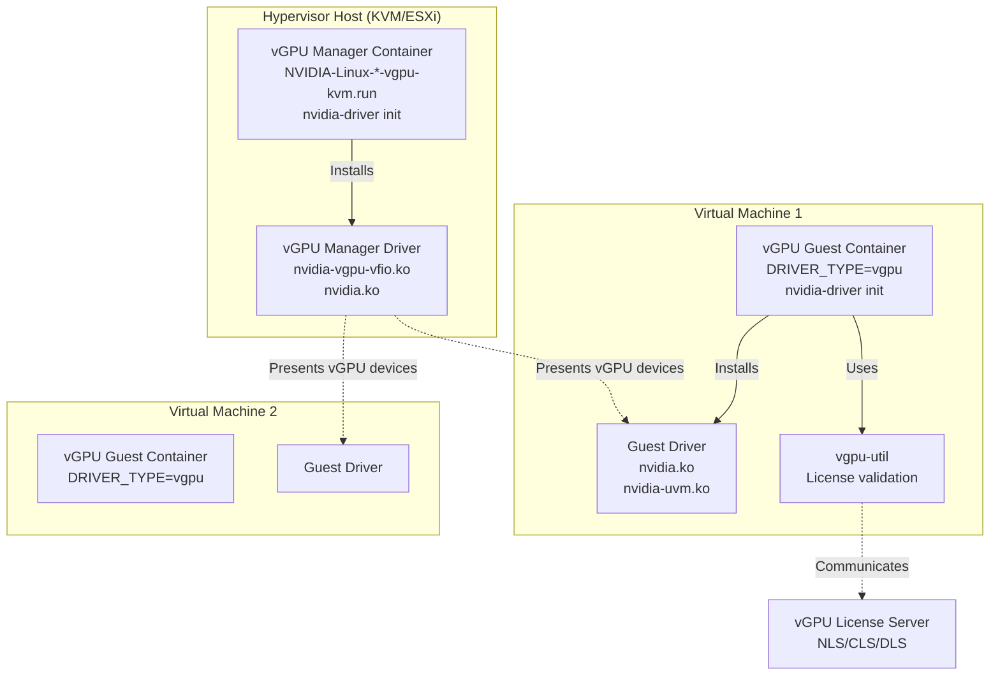

**Sources:** [rhel8/Dockerfile:38-48](), [vgpu-manager/ubuntu22.04/Dockerfile:1-50](), [rhel8/Dockerfile:78]()

### vgpu-util Component

The `vgpu-util` binary is compiled from Go source code and included only in vGPU guest images:

**Build Process:**
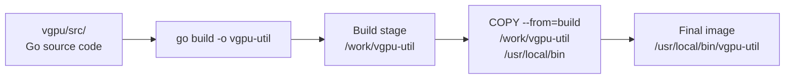

**Sources:** [rhel8/Dockerfile:19-22](), [rhel8/Dockerfile:78](), [ubuntu20.04/Dockerfile:30-33](), [ubuntu22.04/Dockerfile:34-38]()

### vGPU License Server Configuration

vGPU guest images support license server configuration through environment variables:

| Variable | Purpose | Values | Default |
|----------|---------|--------|---------|
| `VGPU_LICENSE_SERVER_TYPE` | Type of license server | `NLS`, `CLS`, `DLS` | `NLS` |
| `DISABLE_VGPU_VERSION_CHECK` | Skip version compatibility check | `true`, `false` | `true` |

**Sources:** [rhel8/Dockerfile:41-45](), [ubuntu20.04/Dockerfile:51-55]()

## Driver Installer Downloads

Standard images download the NVIDIA driver installer during build time, while the method differs between distribution families:

### Ubuntu Standard Images

Ubuntu images download the `.run` installer from the Tesla download site:

```dockerfile
# Download logic in Dockerfile
RUN if [ "$DRIVER_TYPE" != "vgpu" ]; then \
    cd drivers && \
    /tmp/install.sh download_installer && \
    apt-get update && \
    apt-get install -y --no-install-recommends nvidia-fabricmanager-${DRIVER_BRANCH}=${DRIVER_VERSION}-1 \
    libnvidia-nscq-${DRIVER_BRANCH}=${DRIVER_VERSION}-1 && \
    rm -rf /var/lib/apt/lists/*; fi
```

**Sources:** [ubuntu20.04/Dockerfile:78-86](), [ubuntu22.04/Dockerfile:84-88]()

### RHEL Standard Images

RHEL images download directly using `curl`:

```dockerfile
RUN if [ "$DRIVER_TYPE" != "vgpu" ]; then \
    cd drivers && \
    DRIVER_ARCH=${TARGETARCH/amd64/x86_64} && DRIVER_ARCH=${DRIVER_ARCH/arm64/aarch64} && \
    curl -fSsl -O $BASE_URL/$DRIVER_VERSION/NVIDIA-Linux-$DRIVER_ARCH-$DRIVER_VERSION.run && \
    chmod +x  NVIDIA-Linux-$DRIVER_ARCH-$DRIVER_VERSION.run; fi
```

**Sources:** [rhel8/Dockerfile:65-69](), [rhel9/Dockerfile:73-77]()

### vGPU Host Images

vGPU manager images expect the installer to be provided via `ADD` or `COPY` at build time (not downloaded):

```dockerfile
WORKDIR /driver
ADD NVIDIA-Linux-${DRIVER_ARCH}-${DRIVER_VERSION}-vgpu-kvm.run .
RUN chmod +x NVIDIA-Linux-${DRIVER_ARCH}-${DRIVER_VERSION}-vgpu-kvm.run
```

**Sources:** [vgpu-manager/ubuntu22.04/Dockerfile:33-36](), [vgpu-manager/rhel8/Dockerfile:8-11]()

## Precompiled Image Architecture

Precompiled images use a fundamentally different build and runtime approach. For Ubuntu precompiled images, packages are downloaded and cached in a local APT repository.

### Local Repository Build Process

Ubuntu precompiled images create a self-contained local APT repository:

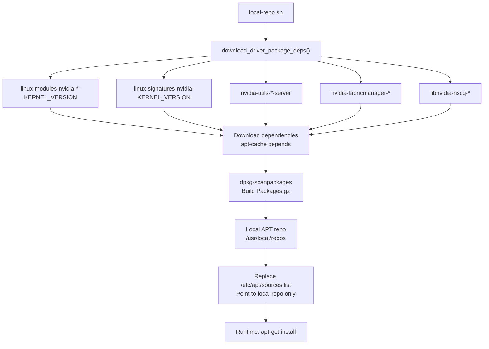

**Sources:** [ubuntu22.04/precompiled/local-repo.sh:1-118](), [ubuntu24.04/precompiled/local-repo.sh:1-118]()

### Precompiled Package Types

Ubuntu precompiled images distinguish between **open** and **proprietary** kernel modules:

| Module Type | Package Pattern | KERNEL_MODULE_TYPE |
|-------------|-----------------|-------------------|
| **Open** | `linux-modules-nvidia-*-server-open-${KERNEL_VERSION}` | `open` or `auto` (if recommended) |
| **Proprietary** | `linux-modules-nvidia-*-server-${KERNEL_VERSION}` | `proprietary` or `auto` (if recommended) |

**Module Type Resolution:**
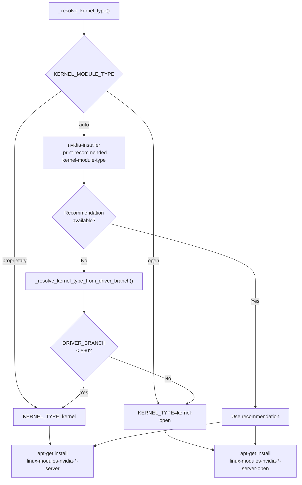

**Sources:** [ubuntu22.04/precompiled/nvidia-driver:340-368](), [ubuntu24.04/precompiled/nvidia-driver:341-369]()

### RHEL Precompiled Images

RHEL precompiled images build kernel module RPMs using a multi-stage build:

#### Stage 1: Builder Stage

```dockerfile
FROM ${DRIVER_TOOLKIT_IMAGE} as builder
# Clone yum-packaging-precompiled-kmod
# Download NVIDIA-Linux-*.run
# Extract kernel modules
# Build kmod-nvidia RPM with rpmbuild
```

**Sources:** [rhel8/precompiled/Dockerfile:4-54](), [rhel9/precompiled/Dockerfile:5-71]()

#### Stage 2: Runtime Stage

```dockerfile
FROM nvcr.io/nvidia/cuda:*
# Copy built RPM from builder
# Install with dnf
# Register with RHSM and install userspace components
```

**Sources:** [rhel8/precompiled/Dockerfile:56-151](), [rhel9/precompiled/Dockerfile:73-185]()

### Precompiled vs Standard: Storage Comparison

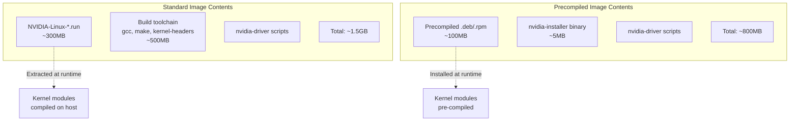

## Container Entrypoints

All image types use the same entrypoint command but with different runtime behaviors:

```dockerfile
ENTRYPOINT ["nvidia-driver", "init"]
```

The `nvidia-driver` script adapts its behavior based on:
- Whether precompiled packages are available
- The `DRIVER_TYPE` environment variable
- The presence of the vGPU installer

**Entrypoint Dispatch:**
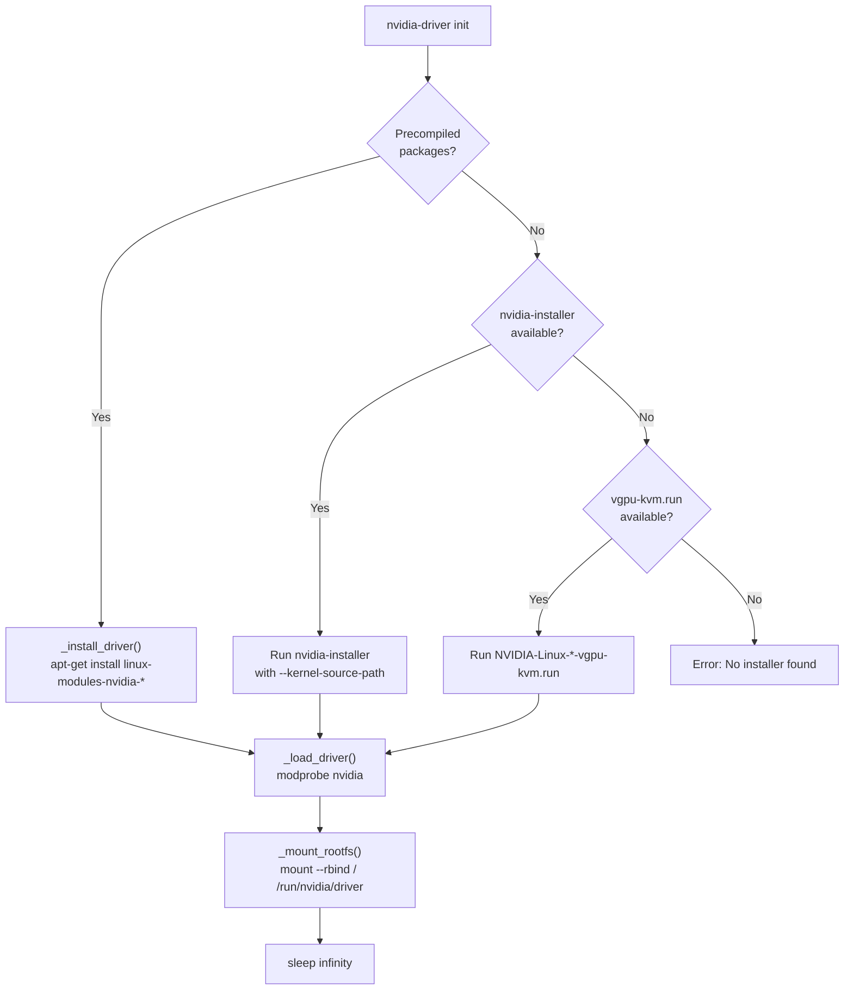

**Sources:** [ubuntu22.04/precompiled/nvidia-driver:413-443](), [rhel8/Dockerfile:109](), [vgpu-manager/ubuntu22.04/Dockerfile:50]()

## Environment Variables by Image Type

### Standard Images

| Variable | Purpose | Standard Images | Precompiled Images | vGPU Images |
|----------|---------|-----------------|-------------------|-------------|
| `DRIVER_VERSION` | Driver version installed | ✓ | ✓ | ✓ |
| `DRIVER_BRANCH` | Driver branch (535, 550, etc.) | ✓ | ✓ | ✓ |
| `DRIVER_TYPE` | `passthrough` or `vgpu` | ✓ | ✓ | ✓ |
| `TARGETARCH` | `amd64` or `arm64` | ✓ | ✓ | ✓ |
| `KERNEL_VERSION` | Host kernel version (runtime) | - | ✓ (build arg) | - |
| `VGPU_LICENSE_SERVER_TYPE` | License server type | - | - | ✓ |
| `DISABLE_VGPU_VERSION_CHECK` | Skip version check | - | - | ✓ |
| `NVIDIA_VISIBLE_DEVICES` | Set to `void` (no GPU needed in container) | ✓ | ✓ | ✓ |
| `KERNEL_MODULE_TYPE` | `auto`, `open`, or `proprietary` | - | ✓ | - |

**Sources:** [rhel8/Dockerfile:33-48](), [ubuntu24.04/precompiled/Dockerfile:6-16](), [ubuntu22.04/precompiled/nvidia-driver:6-17]()

## Additional Components by Image Type

### Fabric Manager and NSCQ

All non-vGPU images include support for NVIDIA Fabric Manager (for NVSwitch systems) and libnvidia-nscq:

**Version-based Installation Pattern:**
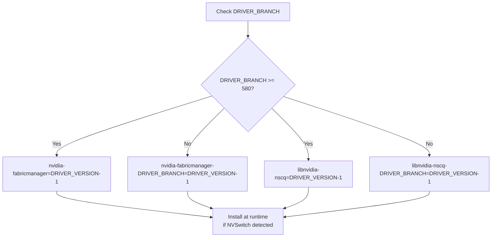

**Sources:** [ubuntu22.04/precompiled/nvidia-driver:19-33](), [ubuntu24.04/precompiled/nvidia-driver:20-34]()

### nvlsm (NVLink Subnet Manager)

For driver branches 570+ and 550+ (Ubuntu 24.04), NVLink5+ support includes additional packages:

- `nvlsm` - NVLink Subnet Manager
- `infiniband-diags` - InfiniBand diagnostic tools

**Sources:** [ubuntu22.04/precompiled/nvidia-driver:43-48](), [ubuntu24.04/precompiled/nvidia-driver:44-49]()

### libnvsdm

The `libnvsdm` library is included for driver branches 560+ but **only on amd64 architecture** (not available for arm64):

**Sources:** [ubuntu22.04/precompiled/nvidia-driver:50-59](), [ubuntu24.04/precompiled/nvidia-driver:51-60]()

## Image Labeling

All images include standard Kubernetes and OCI labels:

```dockerfile
LABEL io.k8s.display-name="NVIDIA Driver Container"
LABEL name="NVIDIA Driver Container"
LABEL vendor="NVIDIA"
LABEL version="${DRIVER_VERSION}"
LABEL release="N/A"
LABEL summary="Provision the NVIDIA driver through containers"
LABEL description="See summary"
```

vGPU manager images use slightly different labels:

```dockerfile
LABEL io.k8s.display-name="NVIDIA vGPU Manager Container"
LABEL name="NVIDIA vGPU Manager Container"
LABEL summary="Provision the NVIDIA vGPU Manager through containers"
```

**Sources:** [rhel8/Dockerfile:88-94](), [vgpu-manager/rhel8/Dockerfile:16-22]()

## Security: CVE Updates

All image types support CVE remediation through the `CVE_UPDATES` build argument:

**Ubuntu:**
```dockerfile
ARG CVE_UPDATES
RUN if [ -n "${CVE_UPDATES}" ]; then \
        apt-get update && apt-get upgrade -y ${CVE_UPDATES} && \
        rm -rf /var/lib/apt/lists/*; \
    fi
```

**RHEL:**
```dockerfile
ARG CVE_UPDATES
RUN if [ -n "${CVE_UPDATES}" ]; then \
        yum update -y ${CVE_UPDATES} && \
        rm -rf /var/cache/yum/*; \
    fi
```

**Sources:** [ubuntu20.04/Dockerfile:93-97](), [rhel8/Dockerfile:100-104](), [vgpu-manager/ubuntu22.04/Dockerfile:41-45]()

---

