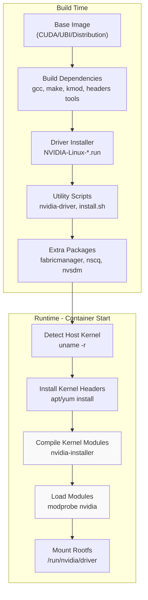
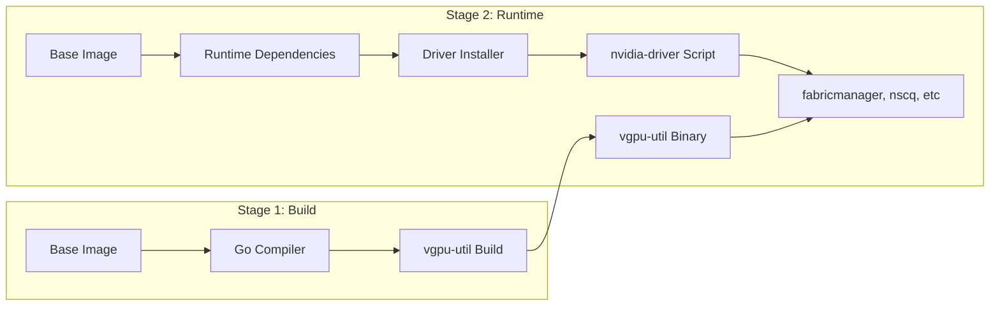
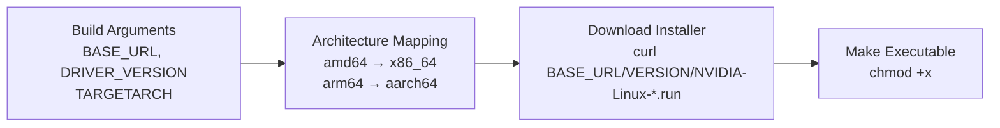
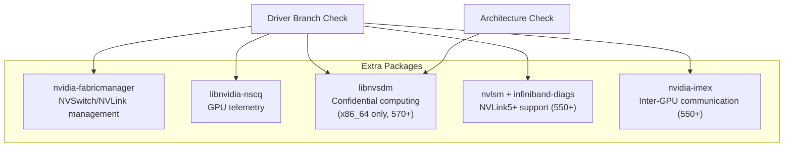
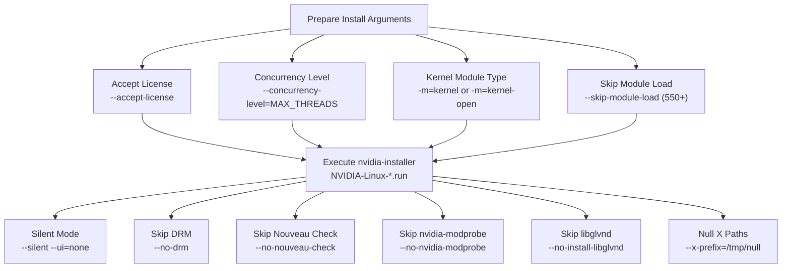
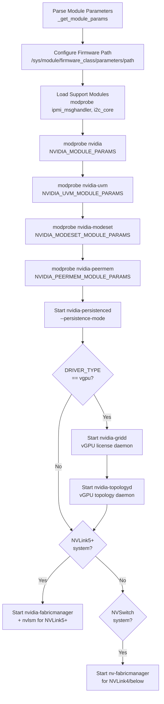
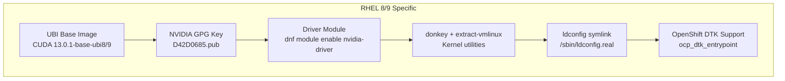

<!-- source: DeepWiki mcp.deepwiki.com · repo NVIDIA/gpu-driver-container · page 4.1 Standard Driver Images · fetched 2026-10-26 -->

# Standard Driver Images

<details>
<summary>Relevant source files</summary>

The following files were used as context for generating this wiki page:

- [coreos/Dockerfile](coreos/Dockerfile)
- [fedora/Dockerfile](fedora/Dockerfile)
- [photon3.0/Dockerfile](photon3.0/Dockerfile)
- [rhel8/Dockerfile](rhel8/Dockerfile)
- [rhel9/Dockerfile](rhel9/Dockerfile)
- [sle15/Dockerfile](sle15/Dockerfile)
- [ubuntu20.04/Dockerfile](ubuntu20.04/Dockerfile)
- [ubuntu22.04/Dockerfile](ubuntu22.04/Dockerfile)
- [ubuntu24.04/Dockerfile](ubuntu24.04/Dockerfile)
- [ubuntu24.04/install.sh](ubuntu24.04/install.sh)
- [ubuntu24.04/nvidia-driver](ubuntu24.04/nvidia-driver)

</details>


## Purpose and Scope

This document describes standard driver container images that compile NVIDIA GPU kernel modules at runtime against the host's running kernel. Standard driver images provide maximum kernel compatibility by performing late-binding compilation when the container starts, allowing a single image to support multiple kernel versions within a distribution.

For information about precompiled driver images with pre-built kernel modules, see [Precompiled Driver Images](#4.2). For vGPU-specific configurations, see [vGPU Images](#4.3). For details about the runtime driver management scripts, see [Driver Management Scripts](#5).

## Overview

Standard driver images are the primary distribution mechanism for containerized NVIDIA GPU drivers. They follow a "compile at runtime" approach where kernel modules are built during container initialization, enabling broad kernel compatibility without maintaining per-kernel image variants.

**Key Characteristics:**

| Aspect | Description |
|--------|-------------|
| Compilation | Runtime, against host kernel |
| Kernel Support | Multiple kernel versions per image |
| Image Size | Larger (includes build tools) |
| Startup Time | Slower (compilation required) |
| Kernel Updates | Automatic recompilation via hooks |
| Driver Types | Passthrough, vGPU Guest, vGPU Host |



**Sources:** High-level diagrams (Diagram 3, Diagram 4)

## Build-Time Architecture

### Multi-Stage Dockerfile Structure

Standard driver images use a two-stage build process to separate build dependencies from runtime components:



**Build Stage Example (Ubuntu 24.04):**

[ubuntu24.04/Dockerfile:1-42]() defines the build stage that compiles the `vgpu-util` binary:
- Downloads Go compiler for the target architecture
- Clones the gpu-driver-container repository
- Builds the vGPU utility (only for vGPU driver type)

**Runtime Stage Example (Ubuntu 24.04):**

[ubuntu24.04/Dockerfile:44-98]() defines the runtime stage that includes:
- Base Ubuntu image
- Runtime dependencies via `install.sh depinstall`
- NVIDIA driver installer download
- Extra packages (fabricmanager, nscq, nvsdm, imex)
- nvidia-driver script and vgpu-util binary

**Sources:** [ubuntu24.04/Dockerfile](), [ubuntu22.04/Dockerfile](), [rhel8/Dockerfile](), [rhel9/Dockerfile]()

### Base Images and Dependencies

Each distribution uses a specific base image and dependency installation strategy:

| Distribution | Base Image | Dependencies Script |
|--------------|------------|---------------------|
| Ubuntu 20.04 | `nvcr.io/nvidia/cuda:12.9.1-base-ubuntu20.04` | [ubuntu20.04/install.sh]() |
| Ubuntu 22.04 | `nvcr.io/nvidia/cuda:13.0.1-base-ubuntu22.04` | [ubuntu22.04/install.sh]() |
| Ubuntu 24.04 | `ubuntu:noble-20250925` | [ubuntu24.04/install.sh]() |
| RHEL 8 | `nvcr.io/nvidia/cuda:13.0.1-base-ubi8` | [rhel8/install.sh]() |
| RHEL 9 | `nvcr.io/nvidia/cuda:13.0.1-base-ubi9` | [rhel9/install.sh]() |
| CoreOS | `ubuntu:16.04` | Inline dependencies |
| Fedora | `fedora:${FEDORA_VERSION}` | [fedora/install.sh]() |
| SLES 15 | `registry.suse.com/suse/sle15` | [sle15/install.sh]() |

**Common Build Dependencies Installed:**

[ubuntu24.04/install.sh:10-38]() shows typical dependencies for Ubuntu:
- `build-essential` (gcc, make, etc.)
- `kmod` (kernel module utilities)
- `libelf-dev` (ELF library for kernel module building)
- `curl`, `ca-certificates` (for downloading packages)
- `libglvnd-dev` (OpenGL vendor neutral dispatch)

**Sources:** [ubuntu24.04/Dockerfile:1-44](), [ubuntu24.04/install.sh:10-38](), [rhel8/Dockerfile:1-62](), [rhel9/Dockerfile:1-68]()

### Driver Installer Acquisition

The NVIDIA driver installer (`.run` file) is downloaded at build time for passthrough/baremetal driver types:



**Ubuntu Implementation:**

[ubuntu24.04/install.sh:5-8]() defines the `download_installer` function:
```bash
DRIVER_ARCH=${TARGETARCH/amd64/x86_64} && DRIVER_ARCH=${DRIVER_ARCH/arm64/aarch64}
curl -fSsl -O $BASE_URL/$DRIVER_VERSION/NVIDIA-Linux-$DRIVER_ARCH-$DRIVER_VERSION.run
chmod +x NVIDIA-Linux-$DRIVER_ARCH-$DRIVER_VERSION.run
```

[ubuntu24.04/Dockerfile:83-86]() invokes the download for passthrough types:
```dockerfile
RUN if [ "$DRIVER_TYPE" != "vgpu" ]; then \
    cd drivers && \
    /tmp/install.sh download_installer; fi
```

**RHEL Implementation:**

[rhel8/Dockerfile:65-69]() downloads the installer directly in the Dockerfile:
```dockerfile
RUN if [ "$DRIVER_TYPE" != "vgpu" ]; then \
    cd drivers && \
    DRIVER_ARCH=${TARGETARCH/amd64/x86_64} && DRIVER_ARCH=${DRIVER_ARCH/arm64/aarch64} && \
    curl -fSsl -O $BASE_URL/$DRIVER_VERSION/NVIDIA-Linux-$DRIVER_ARCH-$DRIVER_VERSION.run && \
    chmod +x  NVIDIA-Linux-$DRIVER_ARCH-$DRIVER_VERSION.run; fi
```

**Sources:** [ubuntu24.04/install.sh:5-8](), [ubuntu24.04/Dockerfile:83-86](), [rhel8/Dockerfile:65-69](), [rhel9/Dockerfile:73-77]()

### Extra Package Installation

Standard driver images include supporting packages beyond the core driver:



**Ubuntu Extra Packages:**

[ubuntu24.04/install.sh:47-86]() defines conditional package installation based on driver branch and architecture:

- **Fabric Manager** [ubuntu24.04/install.sh:47-53](): Branch 580+ uses `nvidia-fabricmanager=${DRIVER_VERSION}-1`, earlier versions use `nvidia-fabricmanager-${DRIVER_BRANCH}=${DRIVER_VERSION}-1`
- **NSCQ** [ubuntu24.04/install.sh:55-61](): Similar versioning pattern as fabric manager
- **NVSDM** [ubuntu24.04/install.sh:64-72](): Only for amd64, only for branches 570+
- **NVLink5 Packages** [ubuntu24.04/install.sh:74-78](): `nvlsm` and `infiniband-diags` for branch 550+
- **IMEX** [ubuntu24.04/install.sh:80-86](): Branch-specific packages for 550+

[ubuntu24.04/Dockerfile:87]() invokes the extra package installation:
```dockerfile
RUN /tmp/install.sh extra_pkgs_install
```

**RHEL Extra Packages:**

[rhel8/Dockerfile:72]() and [rhel9/Dockerfile:80]() call `extrapkgsinstall` from the install.sh script to install fabric manager, nscq, nvsdm, and imex packages.

**Sources:** [ubuntu24.04/install.sh:47-106](), [ubuntu24.04/Dockerfile:87](), [rhel8/Dockerfile:72](), [rhel9/Dockerfile:80]()

## Runtime Architecture

### Initialization Process Flow

The `nvidia-driver init` command orchestrates the entire driver initialization process:

```mermaid
graph TB
    START["nvidia-driver init"]
    LOCK["Acquire PID Lock<br/>/run/nvidia/nvidia-driver.pid"]
    VGPU_CHECK["vGPU Version Check<br/>_find_vgpu_driver_version"]
    UNLOAD["Unload Existing Driver<br/>_unload_driver"]
    UNMOUNT["Unmount Previous Rootfs<br/>_unmount_rootfs"]
    
    UPDATE_CA["Update CA Certificates<br/>_update_ca_certificates"]
    UPDATE_PKG["Update Package Cache<br/>_update_package_cache"]
    FIPS["Enable FIPS if Required<br/>_enable_fips_if_required"]
    RESOLVE_KERNEL["Resolve Kernel Version<br/>_resolve_kernel_version"]
    INSTALL_PREREQ["Install Prerequisites<br/>_install_prerequisites"]
    LINK_OFA["Link OFA Kernel<br/>_link_ofa_kernel"]
    
    INSTALL_DRIVER["Install Driver<br/>_install_driver"]
    LOAD_DRIVER["Load Driver Modules<br/>_load_driver"]
    MOUNT_ROOTFS["Mount Rootfs<br/>_mount_rootfs"]
    WRITE_HOOK["Write Kernel Update Hook<br/>_write_kernel_update_hook"]
    
    SLEEP["Sleep Infinity<br/>Wait for signals"]
    
    START --> LOCK
    LOCK --> VGPU_CHECK
    VGPU_CHECK --> UNLOAD
    UNLOAD --> UNMOUNT
    UNMOUNT --> UPDATE_CA
    UPDATE_CA --> UPDATE_PKG
    UPDATE_PKG --> FIPS
    FIPS --> RESOLVE_KERNEL
    RESOLVE_KERNEL --> INSTALL_PREREQ
    INSTALL_PREREQ --> LINK_OFA
    LINK_OFA --> INSTALL_DRIVER
    INSTALL_DRIVER --> LOAD_DRIVER
    LOAD_DRIVER --> MOUNT_ROOTFS
    MOUNT_ROOTFS --> WRITE_HOOK
    WRITE_HOOK --> SLEEP
```



**Sources:** [ubuntu24.04/nvidia-driver:569-610]()

### Kernel Version Resolution and Prerequisites

Before compilation, the driver container must install kernel headers and resolve the exact kernel version:

[ubuntu24.04/nvidia-driver:69-84]() implements `_resolve_kernel_version`:
- Queries apt-cache for the linux-headers package matching `KERNEL_VERSION`
- Extracts version in format `major.minor.patch-revision`
- Normalizes kernel flavor (e.g., "virtual" becomes "generic")
- Sets the resolved `KERNEL_VERSION` environment variable

[ubuntu24.04/nvidia-driver:87-114]() implements `_install_prerequisites`:
1. Creates `/lib/modules/${KERNEL_VERSION}` directory structure
2. Installs `linux-headers-${KERNEL_VERSION}` package
3. Downloads and extracts `linux-image-${KERNEL_VERSION}` package
4. Extracts `linux-modules-${KERNEL_VERSION}` package (if available)
5. Copies `modules.*` files and kernel directory to `/lib/modules/${KERNEL_VERSION}`
6. Runs `depmod ${KERNEL_VERSION}` to generate module dependencies
7. Extracts kernel version string from `vmlinuz` file

**FIPS Support (Ubuntu 24.04):**

[ubuntu24.04/nvidia-driver:27-46]() implements `_enable_fips_if_required`:
- Detects FIPS kernel and Ubuntu Pro token
- Attaches Ubuntu Pro subscription
- Enables FIPS apt repository with `pro enable --access-only fips-updates`
- Installs `ubuntu-fips-userspace` for OpenSSL FIPS modules
- Sets `OPENSSL_FORCE_FIPS_MODE=0` during operations to work around OpenSSL issues

**Sources:** [ubuntu24.04/nvidia-driver:27-46](), [ubuntu24.04/nvidia-driver:69-114]()

### Driver Compilation and Installation

The `_install_driver` function invokes the NVIDIA installer to compile and install the driver:



[ubuntu24.04/nvidia-driver:433-482]() implements `_install_driver`:

**Install Arguments:**
- `--accept-license`: Auto-accept EULA if `ACCEPT_LICENSE=yes`
- `--concurrency-level=${MAX_THREADS}`: Parallel compilation if specified
- `-m=kernel` or `-m=kernel-open`: Explicit kernel module type selection
- `--skip-module-load`: Skip test module load (driver branch 550+)

**Installation Flags:**
- `--silent --ui=none`: Non-interactive installation
- `--no-drm`: Skip DRM (Display Rendering Manager) installation
- `--no-nouveau-check`: Skip check for nouveau driver
- `--no-nvidia-modprobe`: Don't install nvidia-modprobe utility
- `--no-rpms`: Don't create RPM packages
- `--no-backup`: Don't backup old files
- `--no-check-for-alternate-installs`: Skip alternate install check
- `--no-libglx-indirect`: Skip indirect GLX installation
- `--no-install-libglvnd`: Skip libglvnd installation
- `--x-prefix=/tmp/null`: Disable X11 component installation

**Kernel Module Type Selection:**

[ubuntu24.04/nvidia-driver:444-448]() determines whether to use open or proprietary kernel modules:
```bash
if [[ "${KERNEL_MODULE_TYPE}" == "open"  || "${KERNEL_MODULE_TYPE}" == "proprietary" ]]; then
    [[ "${KERNEL_MODULE_TYPE}" == "open" ]] && kernel_type=kernel-open || kernel_type=kernel
    install_args+=("-m=${kernel_type}")
fi
```

**Sources:** [ubuntu24.04/nvidia-driver:433-482]()

### Driver Module Loading

After compilation, the `_load_driver` function loads kernel modules and starts NVIDIA daemons:



**Module Parameters:**

[ubuntu24.04/nvidia-driver:209-245]() implements `_get_module_params` to parse configuration files:
- Reads `/drivers/nvidia.conf`, `/drivers/nvidia-uvm.conf`, `/drivers/nvidia-modeset.conf`, `/drivers/nvidia-peermem.conf`
- Each line in the config file represents module parameters
- Automatically adds `NVreg_CoherentGPUMemoryMode=driver` for driver branch 580+ to prevent memory over-reporting in Kubernetes

**Firmware Path Configuration:**

[ubuntu24.04/nvidia-driver:252-269]() configures the kernel firmware search path:
- Sets `/run/nvidia/driver/lib/firmware` as firmware search path
- Checks if `NVreg_EnableGpuFirmware=0` is specified (which disables firmware)
- Writes to `/sys/module/firmware_class/parameters/path`

**Module Loading:**

[ubuntu24.04/nvidia-driver:271-286]() loads the core kernel modules with their respective parameters.

**Persistence Daemon:**

[ubuntu24.04/nvidia-driver:288-289]() starts `nvidia-persistenced` to maintain GPU state.

**vGPU Components:**

[ubuntu24.04/nvidia-driver:291-305]() for vGPU driver type:
- Copies `gridd.conf` to `/etc/nvidia/gridd.conf`
- Copies Client Configuration Token for NLS license servers
- Starts `nvidia-gridd` daemon with appropriate library path
- Starts `nvidia-topologyd` daemon if available

**Fabric Manager:**

[ubuntu24.04/nvidia-driver:307-325]() detects and starts fabric manager:
- `_assert_nvlink5_system` checks for NVLink5+ by searching for "SW_MNG" in InfiniBand VPD files
- For NVLink5+: starts both `nvidia-fabricmanager` and `nvlsm` (NVLink Subnet Manager)
- `_assert_nvswitch_system` checks for NVSwitch devices in `/proc/driver/nvidia-nvswitch/devices`
- For NVSwitch (NVLink4 and below): starts `nv-fabricmanager`

**GPUDirect RDMA:**

[ubuntu24.04/nvidia-driver:281-286]() loads `nvidia-peermem` module if:
- `GPU_DIRECT_RDMA_ENABLED=true`
- Mellanox devices are present (vendor ID 0x15b3)

**Sources:** [ubuntu24.04/nvidia-driver:209-328]()

### Rootfs Mounting and Kernel Update Hooks

After successful driver loading, the container makes the driver available to the host:

[ubuntu24.04/nvidia-driver:485-491]() implements `_mount_rootfs`:
- Makes `/sys` non-bindable and private
- Creates `/run/nvidia/driver` directory
- Bind mounts the entire container rootfs to `/run/nvidia/driver`
- This allows host processes to access driver libraries and binaries

[ubuntu24.04/nvidia-driver:502-520]() implements `_write_kernel_update_hook`:
- Writes a kernel postinst.d script to `/run/kernel/postinst.d/update-nvidia-driver`
- This script is executed automatically when the host kernel is updated
- Uses `nsenter` to re-enter the driver container's namespace
- Invokes `nvidia-driver update --kernel $1` to recompile for the new kernel

**Kernel Update Hook Script:**

The generated hook script [ubuntu24.04/nvidia-driver:509-518]():
```bash
#!/bin/bash
set -eu
trap 'echo "ERROR: Failed to update the NVIDIA driver" >&2; exit 0' ERR
NVIDIA_DRIVER_PID=$(< /run/nvidia/nvidia-driver.pid)
export "$(grep -z DRIVER_VERSION /proc/${NVIDIA_DRIVER_PID}/environ)"
nsenter -t "${NVIDIA_DRIVER_PID}" -m -- nvidia-driver update --kernel "$1"
```

**Long-Running Process:**

[ubuntu24.04/nvidia-driver:604-608]() keeps the container running:
- Executes `sleep infinity` in the background
- Sets up signal handlers to catch HUP, INT, QUIT, PIPE, TERM
- On signal, calls `_shutdown` to cleanly unload driver and unmount rootfs
- Waits indefinitely for signals to maintain driver state

**Sources:** [ubuntu24.04/nvidia-driver:485-520](), [ubuntu24.04/nvidia-driver:604-608]()

## Distribution-Specific Implementations

### Ubuntu-Based Images

Ubuntu driver images follow a consistent pattern across versions 20.04, 22.04, and 24.04:

| Aspect | Ubuntu 20.04 | Ubuntu 22.04 | Ubuntu 24.04 |
|--------|--------------|--------------|--------------|
| Base Image | CUDA 12.9.1 | CUDA 13.0.1 | Native Ubuntu Noble |
| Default Branch | 535 | 535 | 550 |
| GCC Version | Default | gcc-12 for 5.19.x+/6.5.x+ kernels | Default |
| CUDA Repo | cuda.list | cuda.list | cuda-keyring package |
| Architecture | amd64, arm64 | amd64, arm64 | amd64, arm64 |

**Ubuntu 22.04 GCC-12 Requirement:**

[ubuntu22.04/Dockerfile:95-100]() installs gcc-12 for specific kernel versions:
```dockerfile
RUN apt-get update && \
    apt-get install -y --no-install-recommends gcc-12 g++-12 && \
    update-alternatives --install /usr/bin/gcc gcc /usr/bin/gcc-12 12 && \
    update-alternatives --install /usr/bin/g++ g++ /usr/bin/g++-12 12 && \
    rm -rf /var/lib/apt/lists/*
```

This is required because kernels 5.19.x and 6.5.x need gcc 12.3.0 for successful compilation.

**Ubuntu 24.04 Specifics:**

- Uses native Ubuntu base image instead of CUDA image [ubuntu24.04/Dockerfile:1]()
- Uses `cuda-keyring` package for CUDA repository configuration [ubuntu24.04/install.sh:40-45]()
- Includes `usermod -o -u 0 -g 0 _apt` workaround for apt operations [ubuntu24.04/Dockerfile:73]()

**Sources:** [ubuntu20.04/Dockerfile](), [ubuntu22.04/Dockerfile:95-100](), [ubuntu24.04/Dockerfile](), [ubuntu24.04/install.sh:40-45]()

### RHEL-Based Images

RHEL/UBI-based images (RHEL 7, 8, 9) have additional requirements for enterprise environments:



**RHEL 8 Implementation:**

[rhel8/Dockerfile:51-55]() configures NVIDIA GPG key and enables driver module:
```dockerfile
RUN NVIDIA_GPGKEY_SUM=d0664fbbdb8c32356d45de36c5984617217b2d0bef41b93ccecd326ba3b80c87 && \
    OS_ARCH=${TARGETARCH/amd64/x86_64} && OS_ARCH=${OS_ARCH/arm64/sbsa} && \
    curl -fsSL "https://developer.download.nvidia.com/compute/cuda/repos/rhel8/$OS_ARCH/D42D0685.pub" | sed '/^Version/d' > /etc/pki/rpm-gpg/RPM-GPG-KEY-NVIDIA && \
    echo "$NVIDIA_GPGKEY_SUM  /etc/pki/rpm-gpg/RPM-GPG-KEY-NVIDIA" | sha256sum -c --strict - && \
    dnf module enable -y nvidia-driver:${DRIVER_BRANCH}-dkms
```

**Utilities Installation:**

[rhel8/Dockerfile:57-61]() installs kernel utilities:
- `donkey`: Tool for extracting files from compressed kernels
- `extract-vmlinux`: Script from Linux kernel source for extracting vmlinux
- Creates symlink `/sbin/ldconfig -> /sbin/ldconfig.real`

**OpenShift Driver Toolkit Support:**

[rhel8/Dockerfile:75]() and [rhel9/Dockerfile:83]() include `ocp_dtk_entrypoint` script for OpenShift Driver Toolkit integration, enabling driver compilation using OpenShift's pre-built toolchain.

**Sources:** [rhel8/Dockerfile:51-61](), [rhel9/Dockerfile:58-68]()

### CoreOS and Flatcar

CoreOS and Flatcar Container Linux have unique requirements as immutable, container-optimized distributions:

[coreos/Dockerfile:11-69]() shows the CoreOS-specific approach:

**Base Image:** Uses Ubuntu 16.04 as base (provides glibc compatibility) [coreos/Dockerfile:11]()

**Direct Installation:** Installs driver directly at build time rather than runtime [coreos/Dockerfile:47-68]():
```dockerfile
RUN cd /tmp && \
    curl -fSsl -O $BASE_URL/$DRIVER_VERSION/NVIDIA-Linux-x86_64-$DRIVER_VERSION.run && \
    sh NVIDIA-Linux-x86_64-$DRIVER_VERSION.run -x && \
    cd NVIDIA-Linux-x86_64-$DRIVER_VERSION* && \
    ./nvidia-installer --silent \
                       --no-kernel-module \
                       --install-compat32-libs \
                       ...
    mkdir -p /usr/src/nvidia-$DRIVER_VERSION && \
    mv LICENSE mkprecompiled kernel /usr/src/nvidia-$DRIVER_VERSION
```

**nvidia-container-runtime Integration:**

[coreos/Dockerfile:4-8]() builds the nvidia-container-runtime binary:
```dockerfile
FROM golang:1.25.2 as build-runtime
WORKDIR /go/src/nvidia-container-runtime
COPY nvidia-container-runtime .
RUN go install -v nvidia-container-runtime
```

[coreos/Dockerfile:73-81]() installs and configures nvidia-container-runtime hooks for container runtime integration.

**Sources:** [coreos/Dockerfile:11-81]()

### SLES and Photon OS

**SLES 15:**

[sle15/Dockerfile:15-62]() shows SLES-specific patterns:
- Uses `registry.suse.com/suse/sle15` base image
- Uses `zypper` package manager instead of apt/yum
- Adds CUDA repository temporarily for fabric manager and nscq packages
- Removes CUDA repository after installation to avoid GPG issues

**Photon OS:**

[photon3.0/Dockerfile:3-70]() shows Photon OS specific implementation:
- Uses `photon:3.0` base image with `tdnf` package manager
- Pre-compiles kernel modules at build time for known kernel versions [photon3.0/Dockerfile:61-65]():
  ```dockerfile
  RUN tdnf makecache -y && \
      for version in $(echo $KERNEL_VERSION | tr ',' ' '); do \
          nvidia-driver update -k $version -t builtin ${PRIVATE_KEY:+"-s ${PRIVATE_KEY}"}; \
      done
  ```
- Comma-separated `KERNEL_VERSION` build arg allows multiple kernel precompilations

**Sources:** [sle15/Dockerfile:15-62](), [photon3.0/Dockerfile:3-70]()

## Build Arguments and Configuration

Standard driver images accept numerous build arguments to customize the build:

| Build Argument | Purpose | Default Value | Used By |
|----------------|---------|---------------|---------|
| `BASE_URL` | Driver download URL | `https://us.download.nvidia.com/tesla` | All |
| `DRIVER_VERSION` | Driver version to install | Required | All |
| `DRIVER_BRANCH` | Driver branch (535, 550, 570, 580) | 535 (varies) | All |
| `DRIVER_TYPE` | Driver type: passthrough/vgpu | `passthrough` | All |
| `TARGETARCH` | Target architecture: amd64/arm64 | Required | All |
| `GOLANG_VERSION` | Go version for vgpu-util build | Varies | Build stage |
| `VGPU_LICENSE_SERVER_TYPE` | vGPU license type: NLS/FNE | `NLS` | vGPU images |
| `DISABLE_VGPU_VERSION_CHECK` | Skip vGPU version compatibility | `true` | vGPU images |
| `PUBLIC_KEY` | Public key for module signing | `empty` | All |
| `PRIVATE_KEY` | Private key for module signing | Not set | All |
| `CVE_UPDATES` | Packages to update for CVE fixes | Not set | All |
| `KERNEL_MODULE_TYPE` | Module type: auto/open/proprietary | `auto` | Runtime |

**Driver Type Configuration:**

[ubuntu24.04/Dockerfile:56-57]() shows driver type argument:
```dockerfile
ARG DRIVER_TYPE=passthrough
ENV DRIVER_TYPE=$DRIVER_TYPE
```

This controls whether vgpu-util is built [ubuntu24.04/Dockerfile:38-42]() and whether the driver installer is downloaded [ubuntu24.04/Dockerfile:83-85]().

**Architecture Mapping:**

Throughout the Dockerfiles, architecture names are mapped:
- Build architecture: `amd64`/`arm64` (Docker convention)
- Driver architecture: `x86_64`/`aarch64` (NVIDIA convention)
- Repository architecture: `x86_64`/`sbsa` (CUDA repository convention)

**CVE Updates:**

[ubuntu24.04/Dockerfile:92-96]() shows CVE update mechanism:
```dockerfile
ARG CVE_UPDATES
RUN if [ -n "${CVE_UPDATES}" ]; then \
        apt-get update && apt-get upgrade -y ${CVE_UPDATES} && \
        rm -rf /var/lib/apt/lists/*; \
    fi
```

This allows injecting security updates without rebuilding the entire image.

**Sources:** [ubuntu24.04/Dockerfile:48-65](), [ubuntu24.04/Dockerfile:92-96](), [rhel8/Dockerfile:38-45]()

## Comparison with Other Image Types

| Feature | Standard Images | Precompiled Images | vGPU Images |
|---------|----------------|-------------------|-------------|
| **Kernel Compilation** | Runtime | Build-time (per kernel) | Runtime |
| **Image Count** | One per distribution/version | Multiple per kernel version | One per distribution/version |
| **Startup Time** | 2-5 minutes (compile) | 10-30 seconds | 2-5 minutes (compile + license) |
| **Kernel Support** | All kernels (with headers) | Specific kernels only | All kernels (with headers) |
| **Build Tools** | Included in image | Not needed at runtime | Included in image |
| **Image Size** | ~2-3 GB | ~500 MB - 1 GB | ~2-3 GB + license files |
| **CI/CD Pipeline** | GitLab CI | GitHub Actions | GitLab CI |
| **Use Case** | General purpose, flexible | Fast deployment, known kernels | Virtual GPU workloads |
| **Kernel Updates** | Automatic recompilation | Requires new image | Automatic recompilation |

For more information on precompiled images, see [Precompiled Driver Images](#4.2). For vGPU-specific features like license management and topology daemon, see [vGPU Images](#4.3).

**Sources:** High-level diagrams (Diagram 3), [ubuntu24.04/nvidia-driver]()

---

