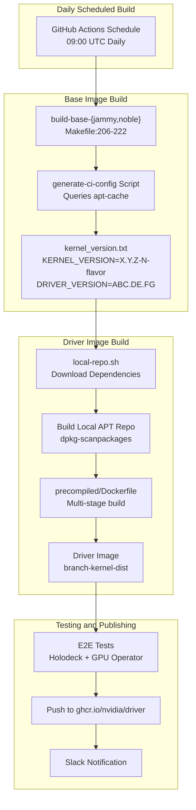
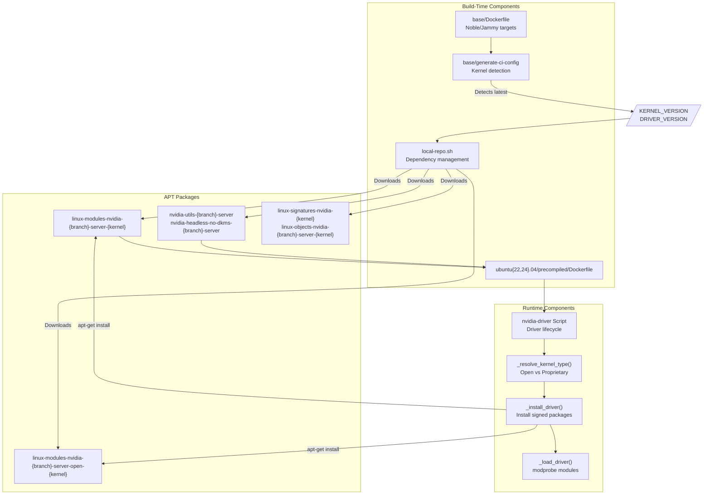
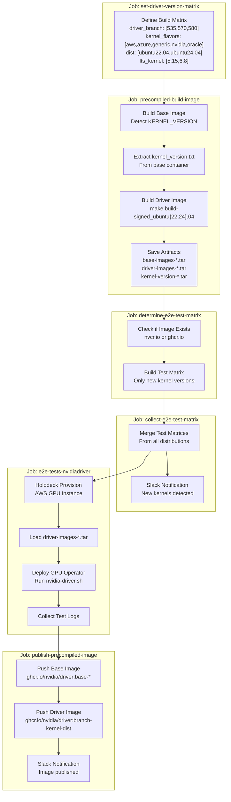
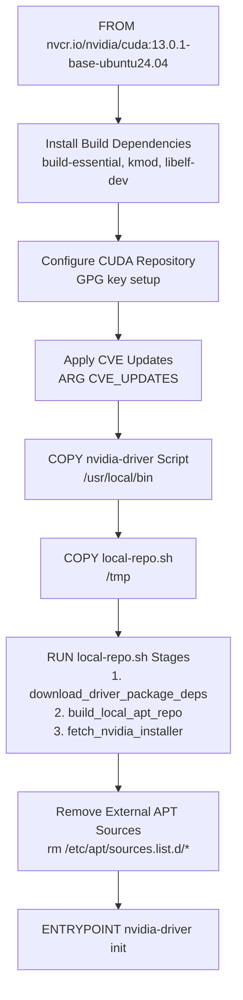
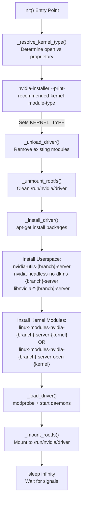
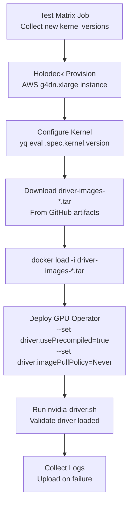

<!-- source: DeepWiki mcp.deepwiki.com · repo NVIDIA/gpu-driver-container · page 4.2 Precompiled Driver Images · fetched 2026-10-26 -->

# Precompiled Driver Images

<details>
<summary>Relevant source files</summary>

The following files were used as context for generating this wiki page:

- [.github/workflows/ci.yaml](.github/workflows/ci.yaml)
- [.github/workflows/precompiled.yaml](.github/workflows/precompiled.yaml)
- [.gitlab-ci.yml](.gitlab-ci.yml)
- [Makefile](Makefile)
- [base/Dockerfile](base/Dockerfile)
- [base/generate-ci-config](base/generate-ci-config)
- [multi-arch.mk](multi-arch.mk)
- [native-only.mk](native-only.mk)
- [scripts/precompiled.sh](scripts/precompiled.sh)
- [tests/scripts/ci-precompiled-helpers.sh](tests/scripts/ci-precompiled-helpers.sh)
- [tests/scripts/findkernelversion.sh](tests/scripts/findkernelversion.sh)
- [tests/scripts/prerequisites.sh](tests/scripts/prerequisites.sh)
- [ubuntu22.04/precompiled/local-repo.sh](ubuntu22.04/precompiled/local-repo.sh)
- [ubuntu22.04/precompiled/nvidia-driver](ubuntu22.04/precompiled/nvidia-driver)
- [ubuntu24.04/precompiled/Dockerfile](ubuntu24.04/precompiled/Dockerfile)
- [ubuntu24.04/precompiled/local-repo.sh](ubuntu24.04/precompiled/local-repo.sh)
- [ubuntu24.04/precompiled/nvidia-driver](ubuntu24.04/precompiled/nvidia-driver)

</details>


## Purpose and Scope

This document describes precompiled driver container images, which contain pre-built, pre-signed NVIDIA kernel modules for specific kernel versions. Unlike standard driver images that compile kernel modules at runtime (see [Standard Driver Images](#4.1)), precompiled images eliminate the compilation step by packaging kernel modules that have been built and signed by Canonical ahead of time.

Precompiled images are currently supported only for **Ubuntu 22.04** and **Ubuntu 24.04**. For information about the build system that generates these images, see [Build System Configuration](#6). For details on the runtime driver management scripts, see [Driver Management Scripts](#5).

## Overview

### Precompiled vs Standard Driver Images

| Aspect | Standard Driver Images | Precompiled Driver Images |
|--------|----------------------|--------------------------|
| **Kernel Module Compilation** | At container startup, compiled against host kernel | Pre-built, embedded in image for specific kernel version |
| **Module Signing** | May require custom signing or disabled Secure Boot | Signed by Canonical, works with Secure Boot out-of-the-box |
| **Startup Time** | Slower (compilation required) | Faster (modules ready to load) |
| **Kernel Compatibility** | Wide range of kernel versions | Specific kernel version only |
| **Image Size** | Smaller base image | Larger (includes all dependencies) |
| **Distribution Support** | All distributions | Ubuntu 22.04, 24.04 only |
| **Network Requirements** | May need external repos at runtime | Self-contained with local apt repository |

### Key Characteristics

Precompiled images have these distinguishing features:

- **Kernel-Specific Tags**: Images are tagged as `<driver-branch>-<kernel-version>-<dist>` (e.g., `570-6.8.0-48-generic-ubuntu24.04`)
- **Canonical-Signed Modules**: Kernel modules are signed by Canonical and distributed via Ubuntu's restricted repositories
- **Local APT Repository**: All dependencies are bundled in `/usr/local/repos` to avoid external network access during installation
- **No DKMS**: Uses pre-built `.ko` files from packages like `linux-modules-nvidia-*-server-<kernel-version>`
- **Automated Daily Builds**: GitHub Actions workflow runs daily to detect new kernel releases and build images

Sources: [ubuntu24.04/precompiled/Dockerfile:1-63](), [ubuntu22.04/precompiled/nvidia-driver:1-522](), [.github/workflows/precompiled.yaml:1-470]()

## Architecture

### Image Build Workflow



**Build Architecture for Precompiled Driver Images**

Sources: [.github/workflows/precompiled.yaml:56-157](), [base/Dockerfile:1-110](), [base/generate-ci-config:1-34]()

### Build Matrix

The precompiled build system generates images across multiple dimensions:

| Dimension | Values | Notes |
|-----------|--------|-------|
| **Driver Branch** | 535, 570, 580 | Ubuntu 24.04 excludes 535 |
| **Distribution** | ubuntu22.04, ubuntu24.04 | Only these distributions supported |
| **Kernel Flavor** | generic, aws, azure, nvidia, oracle | Corresponds to Ubuntu kernel variants |
| **LTS Kernel** | 5.15 (22.04), 6.8 (24.04) | Base kernel version for LTS release |
| **Architecture** | linux/amd64 | Precompiled images are amd64-only |

The GitHub Actions matrix generates approximately **40+ image variants** per daily run (driver branches × flavors × distributions).

Sources: [.github/workflows/precompiled.yaml:23-54](), [Makefile:57-149]()

### Component Relationships



**Component Relationships in Precompiled Image Build and Runtime**

Sources: [ubuntu24.04/precompiled/Dockerfile:1-63](), [ubuntu24.04/precompiled/nvidia-driver:414-444](), [ubuntu24.04/precompiled/local-repo.sh:66-97]()

## Build Process

### Base Image Detection

Base images are lightweight containers that query Canonical's APT repositories to determine the latest available kernel version for a given LTS kernel series and flavor.

**Base Image Build Flow:**

1. **Dockerfile targets**: `noble` (Ubuntu 24.04) or `jammy` (Ubuntu 22.04) [base/Dockerfile:2-37, 39-73]()
2. **Repository configuration**: Sets up official Ubuntu APT sources [base/Dockerfile:24-29, 61-66]()
3. **Script execution**: Runs `generate-ci-config` [base/Dockerfile:31-34, 68-71]()
4. **Kernel detection**: Queries `apt-cache` for latest kernel matching criteria [base/generate-ci-config:19-29]()
5. **Output**: Writes `kernel_version.txt` with `KERNEL_VERSION`, `DRIVER_VERSION`, `DRIVER_VERSIONS` [base/generate-ci-config:32-33]()

**Makefile Target:**

```
make LTS_KERNEL=6.8 KERNEL_FLAVOR=generic DRIVER_BRANCH=570 build-base-noble
```

This builds a base image tagged as `base-noble-6.8-generic-570` [Makefile:206-222]()

Sources: [base/Dockerfile:1-110](), [base/generate-ci-config:1-34](), [Makefile:206-222]()

### GitHub Actions Workflow

The precompiled build is orchestrated by a scheduled GitHub Actions workflow.



**GitHub Actions Precompiled Workflow Job Sequence**

Sources: [.github/workflows/precompiled.yaml:22-470]()

### Local Repository Construction

Precompiled images include a local APT repository to ensure all dependencies are available without external network access.

**Process Flow:**

1. **Download dependencies**: `local-repo.sh download_driver_package_deps` downloads all required `.deb` packages [ubuntu24.04/precompiled/local-repo.sh:66-89]()
2. **Build repository**: `dpkg-scanpackages` generates `Packages.gz` index [ubuntu24.04/precompiled/local-repo.sh:91-97]()
3. **Configure APT**: Replaces `/etc/apt/sources.list` to use only local repository [ubuntu24.04/precompiled/local-repo.sh:95]()
4. **Fetch nvidia-installer**: Downloads and extracts the installer binary for kernel module type detection [ubuntu24.04/precompiled/local-repo.sh:99-106]()

**Downloaded Package Categories:**

| Package Type | Example Packages | Purpose |
|-------------|------------------|---------|
| **Kernel Modules** | `linux-modules-nvidia-570-server-6.8.0-48-generic` | Pre-built `.ko` files |
| **Open Modules** | `linux-modules-nvidia-570-server-open-6.8.0-48-generic` | Open kernel modules |
| **Signatures** | `linux-signatures-nvidia-6.8.0-48-generic` | Module signature metadata |
| **Objects** | `linux-objects-nvidia-570-server-6.8.0-48-generic` | Kernel module objects |
| **Userspace** | `nvidia-utils-570-server`, `nvidia-headless-no-dkms-570-server` | Driver libraries and tools |
| **Fabric Manager** | `nvidia-fabricmanager-570`, `libnvidia-nscq-570` | NVSwitch support |
| **NVLink5** | `nvlsm`, `infiniband-diags` | NVLink5+ support (570+) |
| **IMEX** | `nvidia-imex-570` | Multi-GPU communication (550+) |

Sources: [ubuntu24.04/precompiled/local-repo.sh:66-118](), [ubuntu22.04/precompiled/local-repo.sh:67-90]()

### Dockerfile Structure

The precompiled Dockerfile follows a specific structure:



**Dockerfile Build Stage Sequence**

Sources: [ubuntu24.04/precompiled/Dockerfile:1-63](), [ubuntu22.04/precompiled/Dockerfile:1-63]()

### Build Arguments

| Build Argument | Default | Description |
|----------------|---------|-------------|
| `DRIVER_BRANCH` | 550 | Driver branch (535, 570, 580) |
| `DRIVER_VERSION` | 550.90.12 | Full driver version string |
| `KERNEL_VERSION` | 6.8.0-44-generic | Exact kernel version to build for |
| `BASE_URL` | https://us.download.nvidia.com/tesla | NVIDIA driver download URL |
| `TARGETARCH` | (dynamic) | Target architecture (amd64) |
| `CVE_UPDATES` | (optional) | Packages to upgrade for CVE fixes |

These are passed via the Makefile during the build [Makefile:190-201]()

Sources: [ubuntu24.04/precompiled/Dockerfile:5-14](), [Makefile:190-201]()

## Runtime Behavior

### Installation Process

At container startup, the `nvidia-driver init` command executes the installation sequence:



**Runtime Initialization Flow for Precompiled Images**

Sources: [ubuntu24.04/precompiled/nvidia-driver:414-444](), [ubuntu22.04/precompiled/nvidia-driver:413-443]()

### Kernel Module Type Resolution

The script determines whether to install open or proprietary kernel modules:

1. **Check `KERNEL_MODULE_TYPE` environment variable** [ubuntu24.04/precompiled/nvidia-driver:352-368]()
   - `proprietary`: Forces closed-source modules
   - `open`: Forces open-source modules  
   - `auto` (default): Uses `nvidia-installer` recommendation

2. **Query nvidia-installer** (for `auto` mode):
   ```bash
   kernel_module_type=$(nvidia-installer --print-recommended-kernel-module-type)
   ```
   [ubuntu24.04/precompiled/nvidia-driver:358-363]()

3. **Fallback to driver branch** (if installer fails):
   - Branch < 560: Use `kernel` (proprietary)
   - Branch >= 560: Use `kernel-open` (open)
   [ubuntu24.04/precompiled/nvidia-driver:341-343]()

4. **Install appropriate packages**:
   - Open: `linux-modules-nvidia-{branch}-server-open-{kernel}` [ubuntu24.04/precompiled/nvidia-driver:385-387]()
   - Proprietary: `linux-modules-nvidia-{branch}-server-{kernel}` [ubuntu24.04/precompiled/nvidia-driver:389-393]()

Sources: [ubuntu24.04/precompiled/nvidia-driver:341-395](), [ubuntu22.04/precompiled/nvidia-driver:340-394]()

### Driver Installation

The `_install_driver()` function installs packages from the local APT repository:

**Userspace Components** [ubuntu24.04/precompiled/nvidia-driver:373-380]():
- `nvidia-utils-{DRIVER_BRANCH}-server`: NVIDIA utilities (nvidia-smi, etc.)
- `nvidia-headless-no-dkms-{DRIVER_BRANCH}-server`: Headless driver without DKMS
- `libnvidia-decode-{DRIVER_BRANCH}-server`: Video decode libraries
- `libnvidia-encode-{DRIVER_BRANCH}-server`: Video encode libraries
- `libnvidia-extra-{DRIVER_BRANCH}-server`: Extra libraries
- `libnvidia-fbc1-{DRIVER_BRANCH}-server`: FrameBuffer Capture library

**Kernel Module Packages** [ubuntu24.04/precompiled/nvidia-driver:383-393]():
- For proprietary: `linux-objects-nvidia-{DRIVER_BRANCH}-server-{KERNEL_VERSION}`, `linux-modules-nvidia-{DRIVER_BRANCH}-server-{KERNEL_VERSION}`, `linux-signatures-nvidia-{KERNEL_VERSION}`
- For open: `linux-modules-nvidia-{DRIVER_BRANCH}-server-open-{KERNEL_VERSION}`, `linux-signatures-nvidia-{KERNEL_VERSION}`

Sources: [ubuntu24.04/precompiled/nvidia-driver:371-395]()

### Driver Loading

The `_load_driver()` function loads kernel modules and starts daemons [ubuntu24.04/precompiled/nvidia-driver:168-247]():

1. **Parse module parameters** from `/drivers/*.conf` files [ubuntu24.04/precompiled/nvidia-driver:169-171]()
2. **Configure firmware search path** if `NVreg_EnableGpuFirmware` is not 0 [ubuntu24.04/precompiled/nvidia-driver:173-190]()
3. **Load prerequisite modules**: `i2c_core`, `ipmi_msghandler`, `ipmi_devintf` [ubuntu24.04/precompiled/nvidia-driver:192-193]()
4. **Load NVIDIA modules**: `nvidia`, `nvidia-uvm`, `nvidia-modeset` [ubuntu24.04/precompiled/nvidia-driver:195-200]()
5. **Load nvidia-peermem** if GPUDirect RDMA is enabled [ubuntu24.04/precompiled/nvidia-driver:203-208]()
6. **Start nvidia-persistenced** daemon [ubuntu24.04/precompiled/nvidia-driver:210-211]()
7. **Start Fabric Manager** if NVSwitch/NVLink5 detected [ubuntu24.04/precompiled/nvidia-driver:213-244]()

Sources: [ubuntu24.04/precompiled/nvidia-driver:168-247]()

### Rootfs Mounting

After successful driver loading, the container's root filesystem is mounted to `/run/nvidia/driver` on the host:

```bash
mount --make-runbindable /sys
mount --make-private /sys
mkdir -p ${RUN_DIR}/driver
mount --rbind / ${RUN_DIR}/driver
```

This makes driver libraries and binaries available to the host and other containers [ubuntu24.04/precompiled/nvidia-driver:397-404]()

Sources: [ubuntu24.04/precompiled/nvidia-driver:397-404]()

## Makefile Targets

### Build Targets

**Build precompiled driver image for specific kernel:**
```makefile
make KERNEL_VERSION=6.8.0-48-generic DRIVER_BRANCH=570 build-signed_ubuntu24.04
```

Key Makefile variables for precompiled builds [Makefile:189-201]():
- `DIST`: Set to `ubuntu22.04` or `ubuntu24.04` (not `signed_*` prefix for the actual build)
- `SUBDIR`: Set to `ubuntu22.04/precompiled` or `ubuntu24.04/precompiled`
- `DRIVER_TAG`: Set to `$(DRIVER_BRANCH)` instead of full version
- `IMAGE_TAG`: Includes kernel version: `$(VERSION)-)$(DRIVER_BRANCH)-$(KERNEL_VERSION)-$(DIST)`
- `DOCKER_BUILD_ARGS`: Includes `--build-arg KERNEL_VERSION="$(KERNEL_VERSION)"`

### Push Targets

**Push precompiled image:**
```makefile
make KERNEL_VERSION=6.8.0-48-generic DRIVER_BRANCH=570 push-signed_ubuntu24.04
```

The image tag format for precompiled images is different: `{VERSION}-{DRIVER_BRANCH}-{KERNEL_VERSION}-{DIST}` [Makefile:145-148]()

### Pull and Archive Targets

**Pull precompiled image:**
```makefile
make KERNEL_VERSION=6.8.0-48-generic DRIVER_BRANCH=570 pull-signed_ubuntu24.04
```

**Archive precompiled image:**
```makefile
make KERNEL_VERSION=6.8.0-48-generic DRIVER_BRANCH=570 archive-signed_ubuntu24.04
```

Sources: [Makefile:92-126](), [Makefile:137-149](), [Makefile:184-201]()

## GitLab CI Integration

While the primary precompiled build is handled by GitHub Actions, GitLab CI also supports precompiled builds via the `image-precompiled-ubuntu22.04` and `image-precompiled-ubuntu24.04` jobs:

```yaml
image-precompiled-ubuntu22.04:
  variables:
    DIST: signed_ubuntu22.04
    BASE_TARGET: jammy
    CVE_UPDATES: "curl libc6"
  extends:
    - .driver-versions-precompiled-ubuntu22.04
    - .image-build-precompiled
```

The `PRECOMPILED: "true"` variable triggers the `scripts/precompiled.sh` script instead of the standard Makefile build [.gitlab-ci.yml:103-132]()

**GitLab workflow:**
1. Pull base image from GitHub Container Registry
2. Extract `kernel_version.txt` 
3. Build precompiled driver image
4. Push to staging registry

Sources: [.gitlab-ci.yml:103-132](), [scripts/precompiled.sh:1-114]()

## Helper Scripts

### scripts/precompiled.sh

This script provides helper functions for GitLab CI precompiled builds [scripts/precompiled.sh:1-114]():

| Function | Description |
|----------|-------------|
| `sourceVersions()` | Extracts KERNEL_VERSION, DRIVER_VERSION from base image |
| `buildBaseImage()` | Builds base image to detect kernel version |
| `buildImage()` | Builds precompiled driver image |
| `pushBaseImage()` | Pushes base image to staging registry |
| `pushImage()` | Pushes driver image to output registry (checks for existing tags) |
| `pullImage()` | Pulls precompiled image |
| `archiveImage()` | Saves image to tar archive |
| `imageExists()` | Checks if image exists in registry using regctl |

**Usage:**
```bash
./scripts/precompiled.sh build    # Build base + driver images
./scripts/precompiled.sh push     # Push to registry
./scripts/precompiled.sh version  # Extract versions only
```

Sources: [scripts/precompiled.sh:1-114]()

### tests/scripts/findkernelversion.sh

Determines if a new kernel version needs to be built and tested [tests/scripts/findkernelversion.sh:1-45]():

1. Downloads `kernel-version-*` artifact from GitHub Actions
2. Extracts `KERNEL_VERSION` from artifact
3. Checks if image already exists in `nvcr.io/nvidia/driver` or `ghcr.io/nvidia/driver`
4. Sets `should_continue=true` if image does not exist (new kernel detected)

This script is used by the `determine-e2e-test-matrix` job to build the test matrix [.github/workflows/precompiled.yaml:166-221]()

Sources: [tests/scripts/findkernelversion.sh:1-45](), [tests/scripts/ci-precompiled-helpers.sh:1-32]()

## Distribution Support

### Supported Distributions

| Distribution | LTS Kernel | Driver Branches | Kernel Flavors | Notes |
|-------------|-----------|----------------|----------------|-------|
| **Ubuntu 22.04 (Jammy)** | 5.15 | 535, 570, 580 | generic, aws, azure, nvidia, oracle | Full support |
| **Ubuntu 24.04 (Noble)** | 6.8 | 570, 580 | generic, aws, azure, nvidia, oracle | Driver 535 excluded |

### Exclusions

The build matrix excludes certain combinations [.github/workflows/precompiled.yaml:65-69]():
- Ubuntu 24.04 + Driver 535 (not available for this kernel version)
- LTS Kernel 5.15 + Ubuntu 24.04 (incompatible combination)

Sources: [.github/workflows/precompiled.yaml:60-69]()

## Environment Variables

### Build-Time Variables

| Variable | Default | Description |
|----------|---------|-------------|
| `DRIVER_BRANCH` | 550 | Driver branch to build |
| `DRIVER_VERSION` | 550.90.12 | Full driver version |
| `KERNEL_VERSION` | (required) | Exact kernel version (e.g., 6.8.0-48-generic) |
| `LTS_KERNEL` | (required) | LTS kernel series (5.15 or 6.8) |
| `KERNEL_FLAVOR` | generic | Kernel flavor to build for |
| `BASE_TARGET` | (required) | Dockerfile target (jammy or noble) |
| `CVE_UPDATES` | (optional) | Space-separated list of packages to upgrade |

Sources: [ubuntu24.04/precompiled/Dockerfile:5-14](), [.gitlab-ci.yml:115-131]()

### Runtime Variables

These variables control runtime behavior of the `nvidia-driver` script:

| Variable | Default | Description |
|----------|---------|-------------|
| `KERNEL_MODULE_TYPE` | auto | Module type to install: `auto`, `open`, `proprietary` |
| `GPU_DIRECT_RDMA_ENABLED` | false | Enable GPUDirect RDMA (nvidia-peermem) |
| `USE_HOST_MOFED` | false | Use MOFED drivers from host instead of container |
| `TARGETARCH` | (required) | Target architecture for package selection |

Module parameters can be provided via configuration files mounted at `/drivers/`:
- `/drivers/nvidia.conf` → `NVIDIA_MODULE_PARAMS`
- `/drivers/nvidia-uvm.conf` → `NVIDIA_UVM_MODULE_PARAMS`
- `/drivers/nvidia-modeset.conf` → `NVIDIA_MODESET_MODULE_PARAMS`
- `/drivers/nvidia-peermem.conf` → `NVIDIA_PEERMEM_MODULE_PARAMS`

Sources: [ubuntu24.04/precompiled/nvidia-driver:6-17](), [ubuntu24.04/precompiled/nvidia-driver:136-166]()

## Image Tags and Registries

### Tag Format

Precompiled images use a different tagging scheme than standard images:

```
{registry}/nvidia/driver:{driver-branch}-{kernel-version}-{distribution}
```

**Examples:**
- `ghcr.io/nvidia/driver:570-6.8.0-48-generic-ubuntu24.04`
- `ghcr.io/nvidia/driver:535-5.15.0-125-aws-ubuntu22.04`

Base images use this format:
```
{registry}/nvidia/driver:base-{target}-{lts-kernel}-{flavor}-{driver-branch}
```

**Examples:**
- `ghcr.io/nvidia/driver:base-noble-6.8-generic-570`
- `ghcr.io/nvidia/driver:base-jammy-5.15-aws-535`

Sources: [Makefile:193-201](), [.github/workflows/precompiled.yaml:96-109]()

### Registries

| Registry | Purpose | Push Trigger |
|----------|---------|-------------|
| `ghcr.io/nvidia/driver` | Primary registry for precompiled images | GitHub Actions after E2E tests pass |
| `nvcr.io/nvidia/driver` | Production registry | Manual promotion (not automatic) |

The GitHub Actions workflow checks both registries to avoid rebuilding existing images [tests/scripts/findkernelversion.sh:36-44]()

Sources: [.github/workflows/precompiled.yaml:397-458](), [tests/scripts/findkernelversion.sh:36-44]()

## Testing

### E2E Test Flow



**E2E Test Process for Precompiled Images**

The test runs for each detected new kernel version and each driver branch [.github/workflows/precompiled.yaml:289-395]()

### Test Configuration

Tests use Holodeck to provision AWS instances with specific kernel versions:

```yaml
spec:
  kernel:
    version: "6.8.0-48-generic"  # Set dynamically
```

The `tests/holodeck_ubuntu22.04.yaml` and `tests/holodeck_ubuntu24.04.yaml` files define the instance configuration [.github/workflows/precompiled.yaml:323-338]()

### GPU Operator Options

For precompiled testing, specific GPU Operator options are required:

```bash
--set driver.repository=ghcr.io/nvidia 
--set driver.usePrecompiled=true 
--set driver.imagePullPolicy=Never 
--set driver.version={DRIVER_BRANCH}
```

The `driver.version` is set to the driver branch (535, 570, 580) rather than a full version [.github/workflows/precompiled.yaml:354-377]()

Sources: [.github/workflows/precompiled.yaml:289-395](), [.github/workflows/ci.yaml:26-88]()

## Limitations and Considerations

### Kernel Version Specificity

- Each image supports **exactly one kernel version**
- Host kernel must match image's `KERNEL_VERSION` exactly
- If host kernel changes, a new image must be pulled
- This differs from standard images which compile for any kernel

### Distribution Support

- Only **Ubuntu 22.04** and **Ubuntu 24.04** are supported
- Requires Canonical's signed kernel module packages
- Other distributions (RHEL, Fedora, etc.) cannot use precompiled images

### Architecture Support

- Only **linux/amd64** platform is built [multi-arch.mk:28-31]()
- ARM64 is not supported for precompiled images
- Multi-arch build is explicitly disabled [.github/workflows/precompiled.yaml:80-83]()

### Network Requirements

- Build time: Requires network access to download packages from Ubuntu repositories
- Runtime: No network required (all packages in local APT repository)
- However, Fabric Manager/NSCQ packages may be installed dynamically if NVSwitch detected

### Update Cadence

- Daily builds detect new kernels automatically
- New kernel releases typically published weekly by Canonical
- Not all detected kernels may pass E2E tests on first attempt
- Azure kernel flavor is currently excluded from testing [.github/workflows/precompiled.yaml:265-267]()

Sources: [multi-arch.mk:28-31](), [.github/workflows/precompiled.yaml:265-267]()

---

