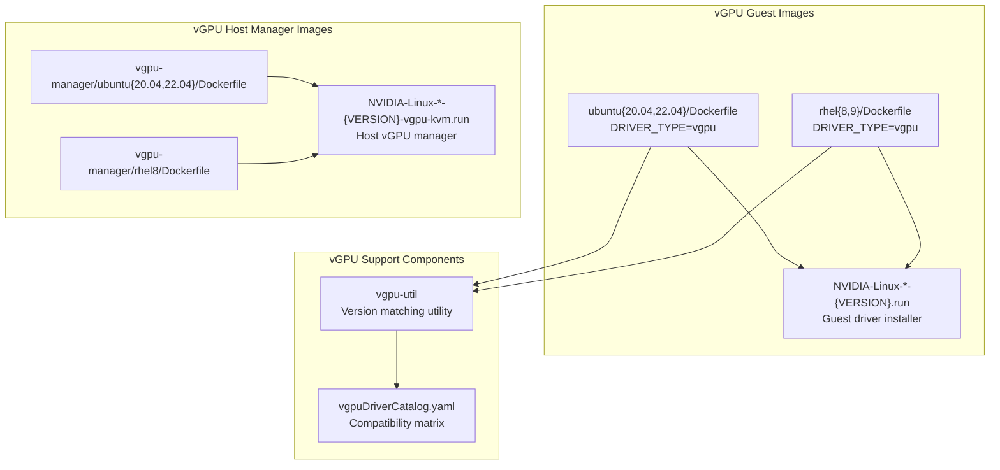
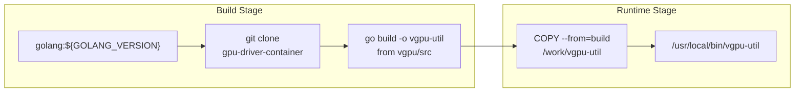
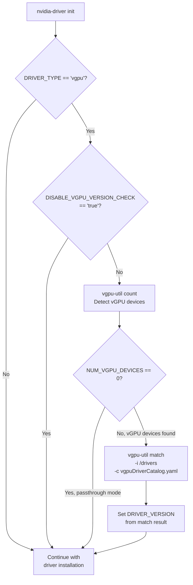
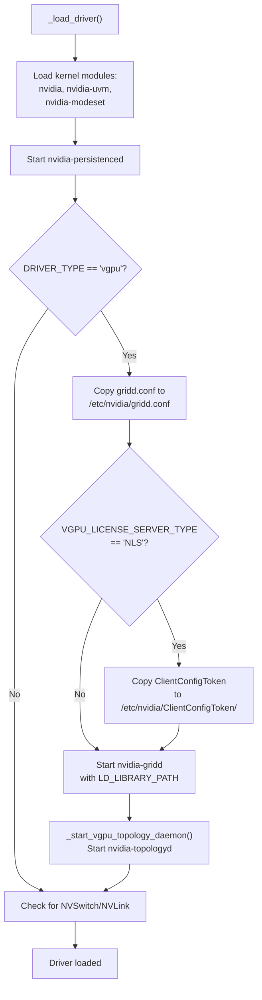
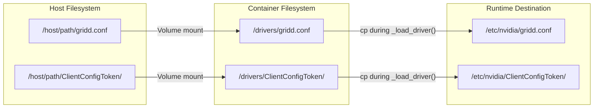

<!-- source: DeepWiki mcp.deepwiki.com · repo NVIDIA/gpu-driver-container · page 4.3 vGPU Images · fetched 2026-10-26 -->

# vGPU Images

<details>
<summary>Relevant source files</summary>

The following files were used as context for generating this wiki page:

- [rhel8/Dockerfile](rhel8/Dockerfile)
- [rhel8/nvidia-driver](rhel8/nvidia-driver)
- [rhel8/precompiled/Dockerfile](rhel8/precompiled/Dockerfile)
- [rhel9/Dockerfile](rhel9/Dockerfile)
- [rhel9/nvidia-driver](rhel9/nvidia-driver)
- [rhel9/precompiled/Dockerfile](rhel9/precompiled/Dockerfile)
- [ubuntu20.04/Dockerfile](ubuntu20.04/Dockerfile)
- [ubuntu20.04/nvidia-driver](ubuntu20.04/nvidia-driver)
- [ubuntu20.04/precompiled/Dockerfile](ubuntu20.04/precompiled/Dockerfile)
- [ubuntu22.04/Dockerfile](ubuntu22.04/Dockerfile)
- [ubuntu22.04/nvidia-driver](ubuntu22.04/nvidia-driver)
- [vgpu-manager/rhel8/Dockerfile](vgpu-manager/rhel8/Dockerfile)
- [vgpu-manager/ubuntu20.04/Dockerfile](vgpu-manager/ubuntu20.04/Dockerfile)
- [vgpu-manager/ubuntu22.04/Dockerfile](vgpu-manager/ubuntu22.04/Dockerfile)

</details>


vGPU images are specialized driver container variants designed to support NVIDIA vGPU (Virtual GPU) technology for virtualized environments. The repository produces two types of vGPU images: **guest driver images** for virtual machines and **host manager images** for hypervisors. For information about standard GPU driver images for bare-metal systems, see [Standard Driver Images](#4.1). For precompiled variants, see [Precompiled Driver Images](#4.2).

## Overview

vGPU images enable GPU sharing and virtualization by providing containerized drivers for both ends of the virtualization stack: guest VMs and host hypervisors.

### Image Types



**Sources:** [rhel8/Dockerfile:39-45](), [ubuntu20.04/Dockerfile:47-56](), [vgpu-manager/ubuntu22.04/Dockerfile:1-50](), [vgpu-manager/rhel8/Dockerfile:1-34]()

## vGPU Guest Driver Images

Guest driver images are deployed inside virtual machines to provide GPU access to workloads running in VMs.

### Build Configuration

vGPU guest images use the same base Dockerfiles as standard images but are built with `DRIVER_TYPE=vgpu`:

| Build Argument | Value | Purpose |
|----------------|-------|---------|
| `DRIVER_TYPE` | `vgpu` | Activates vGPU-specific logic |
| `VGPU_LICENSE_SERVER_TYPE` | `NLS` or other | License server type (NLS = NVIDIA License System) |
| `DISABLE_VGPU_VERSION_CHECK` | `true`/`false` | Controls automatic version compatibility checking |

**Sources:** [rhel8/Dockerfile:39-45](), [ubuntu20.04/Dockerfile:47-56]()

### vGPU Utility Build Process

The `vgpu-util` tool is compiled during the multi-stage build:



**Sources:** [rhel8/Dockerfile:19-23](), [rhel8/Dockerfile:78](), [ubuntu20.04/Dockerfile:30-34](), [ubuntu20.04/Dockerfile:74]()

### Runtime Driver Version Detection

vGPU guest images dynamically select the correct driver version based on the host vGPU manager version using the `_find_vgpu_driver_version()` function:



**Sources:** [rhel8/nvidia-driver:645-679](), [ubuntu20.04/nvidia-driver:526-556]()

The actual implementation in the `_find_vgpu_driver_version()` function:

```bash
_find_vgpu_driver_version() {
    local count=""
    local version=""
    local drivers_path="/drivers"

    if [ "${DISABLE_VGPU_VERSION_CHECK}" = "true" ]; then
        echo "vgpu version compatibility check is disabled"
        return 0
    fi
    # check if vgpu devices are present
    count=$(vgpu-util count)
    if [ $? -ne 0 ]; then
         echo "cannot find vgpu devices on host, pleae check /var/log/vgpu-util.log for more details..."
         return 0
    fi
    NUM_VGPU_DEVICES=$(echo "$count" | awk -F= '{print $2}')
    if [ $NUM_VGPU_DEVICES -eq 0 ]; then
        # no vgpu devices found, treat as passthrough
        return 0
    fi
    echo "found $NUM_VGPU_DEVICES vgpu devices on host"

    # find compatible guest driver using driver catalog
    if [ -d "/mnt/shared-nvidia-driver-toolkit/drivers" ]; then
        drivers_path="/mnt/shared-nvidia-driver-toolkit/drivers"
    fi
    version=$(vgpu-util match -i "${drivers_path}" -c "${drivers_path}/vgpuDriverCatalog.yaml")
    if [ $? -ne 0 ]; then
        echo "cannot find match for compatible vgpu driver from available list, please check /var/log/vgpu-util.log for more details..."
        return 1
    fi
    DRIVER_VERSION=$(echo "$version" | awk -F= '{print $2}')
    echo "vgpu driver version selected: ${DRIVER_VERSION}"
    return 0
}
```

**Sources:** [rhel8/nvidia-driver:645-679](), [ubuntu20.04/nvidia-driver:526-556]()

### vGPU-Specific Daemon Management

When `DRIVER_TYPE=vgpu`, the driver loading process starts additional daemons:



**Sources:** [rhel8/nvidia-driver:387-401](), [ubuntu20.04/nvidia-driver:307-321](), [ubuntu22.04/nvidia-driver:350-364]()

The relevant code sections:

**RHEL8 Implementation:**
```bash
if [ "${DRIVER_TYPE}" = "vgpu" ]; then
    echo "Copying gridd.conf..."
    cp /drivers/gridd.conf /etc/nvidia/gridd.conf
    if [ "${VGPU_LICENSE_SERVER_TYPE}" = "NLS" ]; then
        echo "Copying ClientConfigToken..."
        mkdir -p  /etc/nvidia/ClientConfigToken/
        cp /drivers/ClientConfigToken/* /etc/nvidia/ClientConfigToken/
    fi

    echo "Starting nvidia-gridd.."
    LD_LIBRARY_PATH=/usr/lib64/nvidia/gridd nvidia-gridd

    # Start virtual topology daemon
    _start_vgpu_topology_daemon
fi
```

**Sources:** [rhel8/nvidia-driver:387-401](), [rhel9/nvidia-driver:404-418]()

**Ubuntu Implementation:**
```bash
if [ "${DRIVER_TYPE}" = "vgpu" ]; then
    echo "Copying gridd.conf..."
    cp /drivers/gridd.conf /etc/nvidia/gridd.conf
    if [ "${VGPU_LICENSE_SERVER_TYPE}" = "NLS" ]; then
        echo "Copying ClientConfigToken..."
        mkdir -p  /etc/nvidia/ClientConfigToken/
        cp /drivers/ClientConfigToken/* /etc/nvidia/ClientConfigToken/
    fi

    echo "Starting nvidia-gridd.."
    LD_LIBRARY_PATH=/usr/lib/$DRIVER_ARCH-linux-gnu/nvidia/gridd nvidia-gridd

    # Start virtual topology daemon
    _start_vgpu_topology_daemon
fi
```

**Sources:** [ubuntu20.04/nvidia-driver:307-321](), [ubuntu22.04/nvidia-driver:350-364]()

### Virtual Topology Daemon

The `nvidia-topologyd` daemon is conditionally started if the binary exists:

```bash
_start_vgpu_topology_daemon() {
    type nvidia-topologyd > /dev/null 2>&1 || return 0
    echo "Starting nvidia-topologyd.."
    nvidia-topologyd
}
```

**Sources:** [rhel8/nvidia-driver:681-685](), [ubuntu20.04/nvidia-driver:558-562]()

### Driver Unloading

The `_unload_driver()` function includes vGPU-specific daemon shutdown:

```bash
if [ -f /var/run/nvidia-gridd/nvidia-gridd.pid ]; then
    echo "Stopping NVIDIA grid daemon..."
    local pid=$(< /var/run/nvidia-gridd/nvidia-gridd.pid)

    kill -SIGTERM "${pid}"
    for i in $(seq 1 50); do
        kill -0 "${pid}" 2> /dev/null || break
        sleep 0.1
    done
    if [ $i -eq 50 ]; then
        echo "Could not stop NVIDIA Grid daemon" >&2
        return 1
    fi
fi
```

**Sources:** [rhel8/nvidia-driver:448-461](), [ubuntu20.04/nvidia-driver:355-368]()

## vGPU Host Manager Images

Host manager images are deployed on hypervisor nodes to manage vGPU device allocation and virtualization.

### Dockerfile Structure

vGPU manager images have simplified Dockerfiles in the `vgpu-manager/` directory:

```mermaid
graph TB
    subgraph "Ubuntu vGPU Manager"
        BASE_U["nvcr.io/nvidia/cuda:*-base-ubuntu{20.04,22.04}"]
        DEPS_U["Install build-essential,<br/>kmod, pciutils"]
        INSTALLER_U["ADD NVIDIA-Linux-*-vgpu-kvm.run"]
        SCRIPT_U["COPY nvidia-driver script"]
        ENTRY_U["ENTRYPOINT nvidia-driver init"]
    end
    
    subgraph "RHEL vGPU Manager"
        BASE_R["nvcr.io/nvidia/cuda:*-base-ubi8"]
        INSTALLER_R["COPY NVIDIA-Linux-*-vgpu-kvm.run"]
        SCRIPT_R["COPY nvidia-driver,<br/>ocp_dtk_entrypoint"]
        ENTRY_R["ENTRYPOINT nvidia-driver init"]
    end
    
    BASE_U --> DEPS_U
    DEPS_U --> INSTALLER_U
    INSTALLER_U --> SCRIPT_U
    SCRIPT_U --> ENTRY_U
    
    BASE_R --> INSTALLER_R
    INSTALLER_R --> SCRIPT_R
    SCRIPT_R --> ENTRY_R
```



**Sources:** [vgpu-manager/ubuntu22.04/Dockerfile:1-50](), [vgpu-manager/ubuntu20.04/Dockerfile:1-43](), [vgpu-manager/rhel8/Dockerfile:1-34]()

Key differences from guest images:
- Use `-vgpu-kvm.run` installer instead of standard `.run` file
- No vGPU utility build stage (not needed on host)
- No dynamic version detection logic
- Simplified runtime (no gridd daemon management)

### Expected File Layout

The vGPU manager installer must be manually provided:

```
vgpu-manager/
├── ubuntu20.04/
│   ├── Dockerfile
│   ├── nvidia-driver
│   └── NVIDIA-Linux-x86_64-{VERSION}-vgpu-kvm.run
├── ubuntu22.04/
│   ├── Dockerfile
│   ├── nvidia-driver
│   └── NVIDIA-Linux-x86_64-{VERSION}-vgpu-kvm.run
└── rhel8/
    ├── Dockerfile
    ├── nvidia-driver
    ├── ocp_dtk_entrypoint
    └── NVIDIA-Linux-x86_64-{VERSION}-vgpu-kvm.run
```

**Sources:** [vgpu-manager/ubuntu22.04/Dockerfile:35-36](), [vgpu-manager/ubuntu20.04/Dockerfile:28-29](), [vgpu-manager/rhel8/Dockerfile:10-11]()

## vGPU Licensing Configuration

vGPU requires license configuration, which varies by license server type.

### License Server Types

The `VGPU_LICENSE_SERVER_TYPE` environment variable controls the licensing mode:

| Type | Description | Configuration Files |
|------|-------------|-------------------|
| `NLS` | NVIDIA License System (cloud-based) | `gridd.conf` + `ClientConfigToken/` |
| Other | On-premises license server | `gridd.conf` only |

**Sources:** [rhel8/Dockerfile:41-42](), [ubuntu20.04/Dockerfile:51-52]()

### Configuration File Mounting

Users must mount license configuration into the container:



The runtime script copies these files into place:

```bash
echo "Copying gridd.conf..."
cp /drivers/gridd.conf /etc/nvidia/gridd.conf
if [ "${VGPU_LICENSE_SERVER_TYPE}" = "NLS" ]; then
    echo "Copying ClientConfigToken..."
    mkdir -p  /etc/nvidia/ClientConfigToken/
    cp /drivers/ClientConfigToken/* /etc/nvidia/ClientConfigToken/
fi
```

**Sources:** [rhel8/nvidia-driver:388-394](), [ubuntu20.04/nvidia-driver:308-314]()

## vGPU Precompiled Images

Precompiled vGPU images follow the same kernel-specific model as standard precompiled images but with `DRIVER_TYPE=vgpu`:

| Build Argument | Value | Notes |
|----------------|-------|-------|
| `DRIVER_TYPE` | `vgpu` | Enables vGPU mode |
| `DISABLE_VGPU_VERSION_CHECK` | `true` | Usually disabled for precompiled images |
| `KERNEL_VERSION` | `5.14.0-284.11.1.el9_2.x86_64` | Specific kernel version |

**Sources:** [rhel8/precompiled/Dockerfile:61-75](), [rhel9/precompiled/Dockerfile:86-101]()

## Environment Variables Reference

### Build-Time Variables

| Variable | Default | Description |
|----------|---------|-------------|
| `DRIVER_TYPE` | `passthrough` | Set to `vgpu` for vGPU images |
| `VGPU_LICENSE_SERVER_TYPE` | `NLS` | License server type (`NLS` or other) |
| `DISABLE_VGPU_VERSION_CHECK` | `true` | Skip automatic version detection |
| `DRIVER_VERSION` | (required) | NVIDIA driver version |

**Sources:** [rhel8/Dockerfile:39-45](), [ubuntu20.04/Dockerfile:47-56]()

### Runtime Variables

These are set by the nvidia-driver script during execution:

| Variable | Description |
|----------|-------------|
| `NUM_VGPU_DEVICES` | Number of vGPU devices detected by `vgpu-util count` |
| `DRIVER_VERSION` | Dynamically set by `_find_vgpu_driver_version()` if version check enabled |

**Sources:** [rhel8/nvidia-driver:10](), [rhel8/nvidia-driver:660]()

## Update Command Behavior

The `nvidia-driver update` command behaves differently for vGPU images:

```bash
# vgpu driver version is chosen dynamically during runtime, so pre-compile modules for
# only non-vgpu driver types
if [ "${DRIVER_TYPE}" != "vgpu" ]; then
    if [ ! -e /usr/src/nvidia-${DRIVER_VERSION}/mkprecompiled ]; then
        # Install the userspace components
        sh NVIDIA-Linux-$DRIVER_ARCH-$DRIVER_VERSION.run -x && \
            cd NVIDIA-Linux-$DRIVER_ARCH-$DRIVER_VERSION && \
            sh /tmp/install.sh nvinstall
        # Determine the kernel module type
        _resolve_kernel_type || exit 1
        # Copy the kernel module sources
        mkdir -p /usr/src/nvidia-$DRIVER_VERSION && \
            mv LICENSE mkprecompiled ${KERNEL_TYPE} /usr/src/nvidia-$DRIVER_VERSION && \
            sed '9,${/^\(kernel\|LICENSE\)/!d}' .manifest > /usr/src/nvidia-$DRIVER_VERSION/.manifest
    fi
fi
```

This prevents pre-compilation for vGPU drivers since the version is determined at runtime, not build time.

**Sources:** [rhel8/nvidia-driver:786-801](), [ubuntu20.04/nvidia-driver:646-672]()

## Distribution Support Matrix

### vGPU Guest Images

| Distribution | Dockerfile Path | Architectures |
|--------------|----------------|---------------|
| Ubuntu 20.04 | `ubuntu20.04/Dockerfile` | amd64, arm64 |
| Ubuntu 22.04 | `ubuntu22.04/Dockerfile` | amd64, arm64 |
| RHEL 8 | `rhel8/Dockerfile` | amd64, arm64 |
| RHEL 9 | `rhel9/Dockerfile` | amd64, arm64 |

**Sources:** [ubuntu20.04/Dockerfile:1-106](), [ubuntu22.04/Dockerfile:1-117](), [rhel8/Dockerfile:1-110](), [rhel9/Dockerfile:1-115]()

### vGPU Host Manager Images

| Distribution | Dockerfile Path | Architectures |
|--------------|----------------|---------------|
| Ubuntu 20.04 | `vgpu-manager/ubuntu20.04/Dockerfile` | amd64 |
| Ubuntu 22.04 | `vgpu-manager/ubuntu22.04/Dockerfile` | amd64 |
| RHEL 8 | `vgpu-manager/rhel8/Dockerfile` | amd64 |

**Sources:** [vgpu-manager/ubuntu20.04/Dockerfile:1-43](), [vgpu-manager/ubuntu22.04/Dockerfile:1-50](), [vgpu-manager/rhel8/Dockerfile:1-34]()

## Integration with GPU Operator

vGPU images are typically deployed via the NVIDIA GPU Operator with specific configuration:

```yaml
# Example GPU Operator configuration for vGPU
driver:
  enabled: true
  repository: nvcr.io/nvidia/driver
  image: driver
  version: "535.129.03"
  # Specify vGPU license configuration
  licensingConfig:
    configMapName: licensing-config
    nlsEnabled: true
  # Mount vGPU driver catalog
  env:
    - name: DISABLE_VGPU_VERSION_CHECK
      value: "false"
```

The GPU Operator mounts the required license files and driver catalog into the driver container at `/drivers/`.

**Sources:** [rhel8/nvidia-driver:388-401](), [rhel8/nvidia-driver:645-679]()

---

