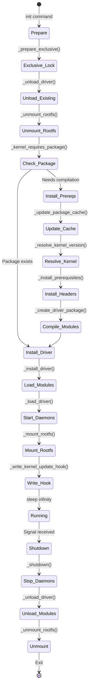
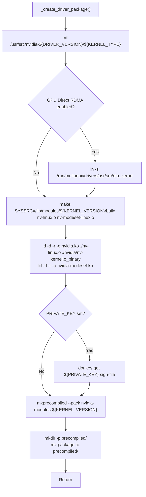
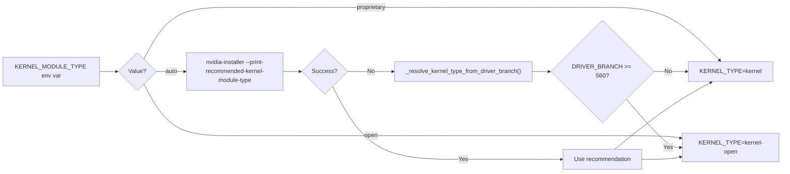
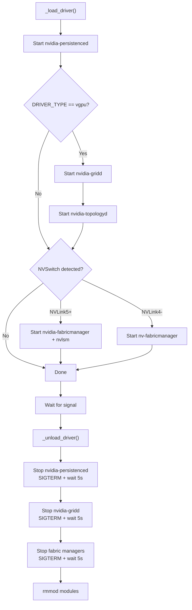

<!-- source: DeepWiki mcp.deepwiki.com · repo NVIDIA/gpu-driver-container · page 5 Driver Management Scripts · fetched 2026-10-26 -->

# Driver Management Scripts

<details>
<summary>Relevant source files</summary>

The following files were used as context for generating this wiki page:

- [rhel7/Dockerfile](rhel7/Dockerfile)
- [rhel7/nvidia-driver](rhel7/nvidia-driver)
- [rhel8/nvidia-driver](rhel8/nvidia-driver)
- [rhel9/nvidia-driver](rhel9/nvidia-driver)
- [ubuntu20.04/nvidia-driver](ubuntu20.04/nvidia-driver)
- [ubuntu22.04/nvidia-driver](ubuntu22.04/nvidia-driver)
- [ubuntu24.04/Dockerfile](ubuntu24.04/Dockerfile)
- [ubuntu24.04/install.sh](ubuntu24.04/install.sh)
- [ubuntu24.04/nvidia-driver](ubuntu24.04/nvidia-driver)

</details>


The driver management scripts are bash scripts that orchestrate the complete lifecycle of NVIDIA GPU drivers inside containers. These scripts handle driver installation, kernel module compilation, daemon management, and graceful shutdown. Each Linux distribution has its own variant of the `nvidia-driver` script tailored to distribution-specific package managers and kernel structures.

For information about the container images that embed these scripts, see [Container Image Types](#4). For details on the build system that packages these scripts, see [Build System Configuration](#6).

## Purpose and Scope

The `nvidia-driver` scripts serve as the primary runtime interface for:

- Installing NVIDIA userspace driver components
- Detecting and resolving host kernel versions
- Compiling kernel modules against the host kernel
- Loading/unloading kernel modules with custom parameters
- Managing NVIDIA daemon processes (persistenced, fabric manager, vGPU grid)
- Mounting the driver rootfs to `/run/nvidia/driver` for host access
- Handling automatic driver updates on kernel changes
- Supporting both standard and vGPU deployment modes

These scripts are executed as the container `ENTRYPOINT` and run with elevated privileges to interact with the host kernel.

**Sources:** [rhel8/nvidia-driver:1-26](), [ubuntu20.04/nvidia-driver:1-25](), [ubuntu24.04/nvidia-driver:1-25]()

## Script Commands

The `nvidia-driver` script accepts the following commands as its first argument:

| Command | Available In | Purpose |
|---------|-------------|---------|
| `init` | All distributions | Complete driver installation: prepare, build, load, and run indefinitely |
| `build` | RHEL 8/9 only | Prepare and build driver without loading (for precompiled images) |
| `load` | RHEL 8/9 only | Load pre-built driver (for precompiled images) |
| `update` | All distributions | Pre-compile modules for a new kernel version |
| `reload_nvidia_peermem` | All distributions | Continuously reload nvidia-peermem module for GPUDirect RDMA |
| `probe_nvidia_peermem` | All distributions | Check if nvidia-peermem module is loaded |

### Command-Line Options

Each command accepts specific flags:

**`init` and `build` options:**
- `-a, --accept-license` - Accept NVIDIA license automatically
- `-m, --max-threads MAX_THREADS` - Maximum threads for kernel module compilation

**`update` options:**
- `-k, --kernel VERSION` - Target kernel version (default: `uname -r`)
- `-s, --sign KEYID` - Private key ID for module signing
- `-t, --tag TAG` - Package tag for precompiled modules
- `-m, --max-threads MAX_THREADS` - Maximum threads for compilation

**Sources:** [rhel8/nvidia-driver:865-914](), [ubuntu20.04/nvidia-driver:737-783]()

## Driver Lifecycle and State Machine

The driver initialization follows a multi-phase lifecycle managed by internal functions:



### Lifecycle Phases

**1. Preparation Phase (`_prepare` / `_prepare_exclusive`)**

The preparation phase extracts the NVIDIA driver installer, installs userspace components, and determines the kernel module type (open vs proprietary):

- Extracts `NVIDIA-Linux-${DRIVER_ARCH}-${DRIVER_VERSION}.run`
- Installs userspace libraries and tools using `nvidia-installer --silent --no-kernel-module`
- Calls `_resolve_kernel_type()` to determine `KERNEL_TYPE` variable (either `kernel` or `kernel-open`)
- Copies kernel module sources to `/usr/src/nvidia-${DRIVER_VERSION}/${KERNEL_TYPE}/`
- Creates PID file at `${PID_FILE}` (`/run/nvidia/nvidia-driver.pid`) with exclusive flock

**Sources:** [rhel8/nvidia-driver:687-724](), [ubuntu20.04/nvidia-driver:564-631](), [ubuntu24.04/nvidia-driver:569-610]()

**2. Build Phase (`_build`)**

The build phase compiles kernel modules if no precompiled package exists:

- Checks if precompiled package exists via `_kernel_requires_package()` 
- If needed, installs prerequisites via `_install_prerequisites()` (kernel-headers, kernel-devel, elfutils)
- Compiles modules via `_create_driver_package()` using `make` and `ld`
- Installs modules via `_install_driver()` using `nvidia-installer --kernel-module-only`

**Sources:** [rhel8/nvidia-driver:726-738](), [ubuntu20.04/nvidia-driver:610-618]()

**3. Load Phase (`_load`)**

The load phase loads kernel modules and starts daemons:

- Parses module parameters from `/drivers/*.conf` files via `_get_module_params()`
- Configures GPU firmware search path in `/sys/module/firmware_class/parameters/path`
- Loads kernel modules: `nvidia`, `nvidia-uvm`, `nvidia-modeset`, optionally `nvidia-peermem`
- Starts `nvidia-persistenced --persistence-mode`
- For vGPU: starts `nvidia-gridd` and `nvidia-topologyd`
- For NVSwitch systems: starts `nv-fabricmanager` or `nvidia-fabricmanager-start.sh`
- Mounts rootfs to `/run/nvidia/driver` via `_mount_rootfs()`
- Writes kernel update hook to `/run/kernel/postinst.d/update-nvidia-driver`

**Sources:** [rhel8/nvidia-driver:740-751](), [ubuntu20.04/nvidia-driver:620-631](), [rhel8/nvidia-driver:343-422]()

**4. Running Phase**

After successful initialization, the script runs `sleep infinity` in the background and waits for signals. This keeps the container alive and maintains the driver state.

**Sources:** [rhel8/nvidia-driver:746-750](), [ubuntu20.04/nvidia-driver:625-630]()

**5. Shutdown Phase (`_shutdown`)**

On receiving SIGTERM or SIGINT:

- Stops all NVIDIA daemons via `_unload_driver()` (sends SIGTERM and waits up to 5 seconds)
- Unloads kernel modules: `nvidia-modeset`, `nvidia-uvm`, `nvidia-peermem`, `nvidia`
- Verifies no module references exist by checking `/sys/module/*/refcnt`
- Unmounts driver rootfs via `_unmount_rootfs()`
- Removes PID file and kernel update hook

**Sources:** [rhel8/nvidia-driver:606-613](), [rhel8/nvidia-driver:424-522]()

## Kernel Module Compilation

The kernel module compilation process occurs in `_create_driver_package()` and involves multiple steps:



### Compilation Details

**1. Source Preparation**

The kernel module sources are located at `/usr/src/nvidia-${DRIVER_VERSION}/${KERNEL_TYPE}/` where `KERNEL_TYPE` is either `kernel` (proprietary) or `kernel-open`:

- `nv-linux.o` - Main nvidia module interface
- `nvidia/nv-kernel.o_binary` - Proprietary core object
- `nv-modeset-linux.o` - Modeset module interface
- `nvidia-modeset/nv-modeset-kernel.o_binary` - Modeset core object
- `nvidia-uvm.ko` - Unified Virtual Memory module

**Sources:** [rhel8/nvidia-driver:196-259](), [ubuntu20.04/nvidia-driver:123-187]()

**2. Kernel Headers Installation**

The `_install_prerequisites()` function installs necessary build dependencies:

**RHEL/CentOS:**
- `kernel-headers-${KERNEL_VERSION}` - Kernel headers
- `kernel-devel-${KERNEL_VERSION}` - Kernel development files
- `kernel-core-${KERNEL_VERSION}` (RHEL 8) or `kernel-${KERNEL_VERSION}` (RHEL 9) - Module files
- `elfutils-libelf-devel` - ELF library development files
- Matching GCC version extracted from `/lib/modules/${KERNEL_VERSION}/proc/version`

**Ubuntu:**
- `linux-headers-${KERNEL_VERSION}` - Kernel headers
- `linux-image-${KERNEL_VERSION}` - Kernel image with vmlinuz
- `linux-modules-${KERNEL_VERSION}` - Additional kernel modules (optional)

**Sources:** [rhel8/nvidia-driver:89-164](), [ubuntu20.04/nvidia-driver:65-92](), [rhel9/nvidia-driver:91-176]()

**3. Compilation Process**

The compilation uses the kernel build system via `make`:

```bash
export IGNORE_CC_MISMATCH=1
make -s -j ${MAX_THREADS} SYSSRC=/lib/modules/${KERNEL_VERSION}/build nv-linux.o nv-modeset-linux.o
```

This produces object files that are then relinked with proprietary binary components:

```bash
ld -d -r -o nvidia.ko ./nv-linux.o ./nvidia/nv-kernel.o_binary
ld -d -r -o nvidia-modeset.ko ./nv-modeset-linux.o ./nvidia-modeset/nv-modeset-kernel.o_binary
```

**Sources:** [rhel8/nvidia-driver:222-228](), [ubuntu20.04/nvidia-driver:150-156]()

**4. Module Signing (Optional)**

If `PRIVATE_KEY` environment variable is set, modules are signed using the `donkey` tool and kernel's `sign-file` script:

```bash
donkey get ${PRIVATE_KEY} sh -c "
  sign-file sha512 \$DONKEY_FILE pubkey.x509 nvidia.ko nvidia.ko.sign &&
  sign-file sha512 \$DONKEY_FILE pubkey.x509 nvidia-modeset.ko nvidia-modeset.ko.sign &&
  sign-file sha512 \$DONKEY_FILE pubkey.x509 nvidia-uvm.ko"
```

**Sources:** [rhel8/nvidia-driver:229-238](), [ubuntu20.04/nvidia-driver:157-166]()

**5. Precompiled Package Creation**

The `mkprecompiled` utility creates a precompiled package containing the built modules:

```bash
../mkprecompiled --pack ${pkg_name} \
  --description ${KERNEL_VERSION} \
  --proc-mount-point /lib/modules/${KERNEL_VERSION}/proc \
  --driver-version ${DRIVER_VERSION} \
  --kernel-interface nv-linux.o \
  --linked-module-name nvidia.ko \
  --core-object-name nvidia/nv-kernel.o_binary \
  ...
```

The package is stored in `precompiled/` directory for reuse.

**Sources:** [rhel8/nvidia-driver:240-257](), [ubuntu20.04/nvidia-driver:169-185]()

## Kernel Module Type Resolution

The script automatically determines whether to use open-source or proprietary kernel modules via `_resolve_kernel_type()`:



The `KERNEL_MODULE_TYPE` environment variable controls this behavior:
- `auto` (default) - Use nvidia-installer's recommendation, fallback to driver branch check
- `open` - Force open-source modules
- `proprietary` - Force proprietary modules

For driver branches >= 560, open-source modules are preferred by default.

**Sources:** [rhel8/nvidia-driver:615-643](), [ubuntu20.04/nvidia-driver:496-524]()

## Daemon Management

The driver scripts manage multiple NVIDIA daemons based on system configuration:

### NVIDIA Persistence Daemon

The `nvidia-persistenced` daemon maintains GPU state across application restarts:

```bash
nvidia-persistenced --persistence-mode
```

PID file: `/var/run/nvidia-persistenced/nvidia-persistenced.pid`

This daemon is always started in `_load_driver()`.

**Sources:** [rhel8/nvidia-driver:384-385](), [ubuntu20.04/nvidia-driver:304-305]()

### vGPU Grid Daemon

For vGPU deployments (`DRIVER_TYPE=vgpu`), the `nvidia-gridd` daemon manages vGPU licensing:

```bash
# Copy configuration
cp /drivers/gridd.conf /etc/nvidia/gridd.conf

# For NLS licensing
cp /drivers/ClientConfigToken/* /etc/nvidia/ClientConfigToken/

# Start daemon
LD_LIBRARY_PATH=/usr/lib64/nvidia/gridd nvidia-gridd
```

PID file: `/var/run/nvidia-gridd/nvidia-gridd.pid`

**Sources:** [rhel8/nvidia-driver:387-401](), [ubuntu20.04/nvidia-driver:307-321]()

### vGPU Topology Daemon

The `nvidia-topologyd` daemon manages virtual GPU topology:

```bash
nvidia-topologyd
```

This daemon is started automatically for vGPU deployments if the binary exists.

**Sources:** [rhel8/nvidia-driver:681-685](), [ubuntu20.04/nvidia-driver:558-562]()

### Fabric Manager

For systems with NVSwitch or NVLink5+ hardware, the fabric manager daemon coordinates multi-GPU fabric:

**NVLink5+ Systems** (detected via `/sys/class/infiniband/*/device/vpd` containing "SW_MNG"):

```bash
/usr/bin/nvidia-fabricmanager-start.sh --mode start \
  --fm-config-file /usr/share/nvidia/nvswitch/fabricmanager.cfg \
  --fm-pid-file /var/run/nvidia-fabricmanager/nv-fabricmanager.pid \
  --nvlsm-config-file /usr/share/nvidia/nvlsm/nvlsm.conf \
  --nvlsm-pid-file /var/run/nvidia-fabricmanager/nvlsm.pid
```

This starts both the fabric manager and NVLink Subnet Manager (nvlsm).

**NVLink4 and Earlier** (detected via `/proc/driver/nvidia-nvswitch/devices/`):

```bash
nv-fabricmanager -c /usr/share/nvidia/nvswitch/fabricmanager.cfg
```

PID files:
- `/var/run/nvidia-fabricmanager/nv-fabricmanager.pid`
- `/var/run/nvidia-fabricmanager/nvlsm.pid` (NVLink5+ only)

**Sources:** [rhel8/nvidia-driver:261-285](), [rhel8/nvidia-driver:403-421](), [ubuntu22.04/nvidia-driver:201-232](), [ubuntu22.04/nvidia-driver:366-384]()

### Daemon Lifecycle



Each daemon is stopped gracefully by sending `SIGTERM` and waiting up to 5 seconds (50 iterations of 0.1s sleep). If the daemon doesn't exit, an error is returned.

**Sources:** [rhel8/nvidia-driver:424-522](), [ubuntu20.04/nvidia-driver:331-416]()

## Module Parameter Configuration

Kernel modules can accept custom parameters via configuration files mounted at `/drivers/`:

| Configuration File | Module | Purpose |
|-------------------|--------|---------|
| `/drivers/nvidia.conf` | nvidia | Main driver parameters |
| `/drivers/nvidia-uvm.conf` | nvidia-uvm | Unified Virtual Memory parameters |
| `/drivers/nvidia-modeset.conf` | nvidia-modeset | Mode setting parameters |
| `/drivers/nvidia-peermem.conf` | nvidia-peermem | GPUDirect RDMA parameters |

The `_get_module_params()` function parses these files:

```bash
# Example: /drivers/nvidia.conf
NVreg_RegistryDwords="PeerMappingOverride=1"
NVreg_EnableStreamMemOPs=1
```

Parameters are stored in bash arrays and passed to `modprobe`:

```bash
modprobe nvidia "${NVIDIA_MODULE_PARAMS[@]}"
```

### Special Module Parameters

**Coherent Driver Memory Management (R580+):**

Starting from driver branch 580, the script automatically adds:

```bash
NVIDIA_MODULE_PARAMS+=("NVreg_CoherentGPUMemoryMode=driver")
```

This prevents GPU memory on coherent systems (GH200, GB200) from being exposed as a NUMA node, avoiding Kubernetes memory over-reporting.

**GPU Firmware Search Path:**

The script configures the firmware search path for GSP firmware:

```bash
echo -n "$RUN_DIR/driver/lib/firmware" > /sys/module/firmware_class/parameters/path
```

This is skipped if `NVreg_EnableGpuFirmware=0` is set in nvidia.conf.

**Sources:** [rhel8/nvidia-driver:305-356](), [ubuntu22.04/nvidia-driver:258-328]()

## GPUDirect RDMA Support

When `GPU_DIRECT_RDMA_ENABLED=true` and Mellanox devices are present, the script enables GPUDirect RDMA:

**1. Detection:**

```bash
_mellanox_devices_present() {
    for dev in /sys/bus/pci/devices/*; do
        read vendor < $dev/vendor
        if [ "$vendor" = "0x15b3" ]; then
            return 0
        fi
    done
    return 1
}
```

**2. MOFED Headers Linking:**

During compilation, the script links MOFED headers:

```bash
ln -s /run/mellanox/drivers/usr/src/ofa_kernel /usr/src/
```

**3. Module Loading:**

The `nvidia-peermem` module is loaded with custom parameters:

```bash
modprobe nvidia-peermem "${NVIDIA_PEERMEM_MODULE_PARAMS[@]}"
```

**4. Continuous Reload:**

The `reload_nvidia_peermem` command continuously monitors and reloads the module:

```bash
# Wait for MOFED and NVIDIA drivers
until [ -f /run/mellanox/drivers/.driver-ready ] && [ -f /run/nvidia/validations/.driver-ctr-ready ]; do
    sleep 10
done

# Load module
chroot /run/nvidia/driver modprobe nvidia-peermem "${NVIDIA_PEERMEM_MODULE_PARAMS[@]}"
sleep inf
```

This handles cases where MOFED drivers are updated while NVIDIA drivers are running.

**Sources:** [ubuntu20.04/nvidia-driver:198-219](), [ubuntu20.04/nvidia-driver:695-722](), [rhel8/nvidia-driver:207-220](), [rhel8/nvidia-driver:824-850]()

## Kernel Update Hook

The `_write_kernel_update_hook()` function creates a script at `/run/kernel/postinst.d/update-nvidia-driver` that automatically recompiles driver modules when the host kernel is updated:

```bash
#!/bin/bash
set -eu
trap 'echo "ERROR: Failed to update the NVIDIA driver" >&2; exit 0' ERR

NVIDIA_DRIVER_PID=$(< /run/nvidia/nvidia-driver.pid)

export "$(grep -z DRIVER_VERSION /proc/${NVIDIA_DRIVER_PID}/environ)"
nsenter -t "${NVIDIA_DRIVER_PID}" -m -- nvidia-driver update --kernel "$1"
```

This script:
1. Reads the driver container's PID from `/run/nvidia/nvidia-driver.pid`
2. Extracts `DRIVER_VERSION` from the container's environment
3. Uses `nsenter` to execute `nvidia-driver update` inside the container's mount namespace
4. Passes the new kernel version as an argument

The hook is invoked automatically by the host's package manager when kernel packages are installed.

**Sources:** [rhel8/nvidia-driver:586-604](), [ubuntu20.04/nvidia-driver:466-485]()

## Distribution-Specific Implementations

While the core logic is shared, each distribution has specific adaptations:

### Ubuntu-Specific Features

**Package Management:**
- Uses `apt-get` and `dpkg`
- Downloads kernel packages with `apt-get download` and extracts with `dpkg -x`

**Kernel Version Resolution:**
- Extracts version from `apt-cache show linux-headers-${KERNEL_VERSION}`
- Handles flavor suffixes (generic, virtual, fips)

**FIPS Support (Ubuntu 22.04+):**

```bash
_enable_fips_if_required() {
    if [[ -n "${UBUNTU_PRO_TOKEN}" && ${KERNEL_VERSION} =~ "fips" ]]; then
        apt-get install ubuntu-advantage-tools
        pro attach --no-auto-enable "${UBUNTU_PRO_TOKEN}"
        pro enable --access-only --assume-yes fips-updates
    fi
}
```

Ubuntu 24.04 additionally installs `ubuntu-fips-userspace` package and sets `OPENSSL_FORCE_FIPS_MODE=0` during Pro token attachment.

**Sources:** [ubuntu20.04/nvidia-driver:1-100](), [ubuntu22.04/nvidia-driver:27-36](), [ubuntu24.04/nvidia-driver:27-46]()

### RHEL-Specific Features

**Package Management:**
- Uses `dnf`/`yum` and `rpm`
- Enables EUS (Extended Update Support) and RHOCP repositories

**RHEL Version Resolution:**

```bash
_get_rhel_version_from_kernel() {
    rhel_version_underscore=$(echo "${KERNEL_VERSION}" | sed 's/.*el\([0-9]\+_[0-9]\+\).*/\1/g')
    IFS='_' read -r -a rhel_version_arr <<< "$rhel_version_underscore"
    RHEL_VERSION="${rhel_version_arr[0]}.${rhel_version_arr[1]}"
}
```

Extracts RHEL version from kernel string like "4.18.0-513.9.1.el8_9" → "8.9"

**Repository Management:**

```bash
dnf config-manager --set-enabled rhel-8-for-$DRIVER_ARCH-baseos-eus-rpms
dnf config-manager --set-enabled rhocp-${OPENSHIFT_VERSION}-for-rhel-8-$DRIVER_ARCH-rpms
```

**GCC Version Matching:**

Installs GCC version matching the kernel build:

```bash
gcc_version=$(cat /lib/modules/${KERNEL_VERSION}/proc/version | grep -Eo "gcc version ([0-9\.]+)")
dnf install -y "gcc-${gcc_version}"
```

**RHEL 9.3+ Video Module:**

```bash
if [[ "$RHEL_MINOR_VERSION" -ge "3" ]]; then
    modprobe video
fi
```

**Sources:** [rhel8/nvidia-driver:46-120](), [rhel9/nvidia-driver:47-175](), [rhel9/nvidia-driver:382-385]()

### Command Variants

| Feature | Ubuntu | RHEL 7 | RHEL 8/9 |
|---------|--------|--------|----------|
| Separate build/load commands | No | No | Yes |
| Init command structure | Single function | Single function | Calls _prepare_exclusive, _build, _load |
| Driver installation | nvidia-installer (20.04)<br/>Run file with options (24.04) | nvidia-installer | nvidia-installer |
| Module compilation source | /usr/src/nvidia-${DRIVER_VERSION}/${KERNEL_TYPE} | /usr/src/nvidia-${DRIVER_VERSION}/kernel | /usr/src/nvidia-${DRIVER_VERSION}/${KERNEL_TYPE} |

**Sources:** [rhel8/nvidia-driver:753-771](), [ubuntu20.04/nvidia-driver:564-631](), [ubuntu24.04/nvidia-driver:569-610]()

## Rootfs Mounting

The driver container mounts its entire filesystem to `/run/nvidia/driver` on the host, making driver files accessible to other containers and the host system:

```bash
_mount_rootfs() {
    mount --make-runbindable /sys
    mount --make-private /sys
    mkdir -p ${RUN_DIR}/driver
    mount --rbind / ${RUN_DIR}/driver
}
```

The `/sys` filesystem is made private to prevent propagation issues.

**SELinux Integration:**

On systems with SELinux enabled, device files are relabeled:

```bash
if [ -e /sys/fs/selinux ]; then
    chcon -R -t container_file_t ${RUN_DIR}/driver/dev
fi
```

This allows other containers to access GPU devices through the mounted rootfs.

**Sources:** [rhel8/nvidia-driver:560-575](), [ubuntu20.04/nvidia-driver:449-456]()

## Error Handling and Locking

### PID File Locking

The script uses `flock` on the PID file to prevent multiple instances:

```bash
exec 3> ${PID_FILE}
if ! flock -n 3; then
    echo "An instance of the NVIDIA driver is already running, aborting"
    exit 1
fi
echo $$ >&3
```

File descriptor 3 remains open for the lifetime of the process, holding the lock.

**Sources:** [rhel8/nvidia-driver:712-717](), [ubuntu20.04/nvidia-driver:597-602]()

### Signal Handling

The script sets up trap handlers for graceful shutdown:

```bash
trap "echo 'Caught signal'; _shutdown && { kill $!; exit 0; }" HUP INT QUIT PIPE TERM
trap "_shutdown" EXIT
```

During normal operation (sleep infinity), signals are caught and trigger `_shutdown()`.

**Sources:** [rhel8/nvidia-driver:719-720](), [rhel8/nvidia-driver:747-748]()

### Module Unload Validation

Before unloading modules, the script verifies no processes are using them:

```bash
nvidia_refs=$(< /sys/module/nvidia/refcnt)
if [ ${nvidia_refs} -gt ${nvidia_deps} ]; then
    echo "Could not unload NVIDIA driver kernel modules, driver is in use" >&2
    return 1
fi
```

Each module's reference count is checked via `/sys/module/*/refcnt`.

**Sources:** [rhel8/nvidia-driver:493-521](), [ubuntu20.04/nvidia-driver:385-415]()

## Common Utility Functions

The RHEL 8/9 scripts source a common utilities file:

```bash
SCRIPT_DIR=$( cd -- "$( dirname -- "${BASH_SOURCE[0]}" )" &> /dev/null && pwd )
source $SCRIPT_DIR/common.sh
```

This `common.sh` file (referenced but not provided in files) contains shared helper functions for RHEL distributions.

**Sources:** [rhel8/nvidia-driver:25-26](), [rhel9/nvidia-driver:26-27]()

---

This documentation covers the core functionality of the driver management scripts. For information about how these scripts are integrated into container images, see [Container Image Types](#4). For details on vGPU-specific behavior, see [vGPU Images](#4.3).

---

