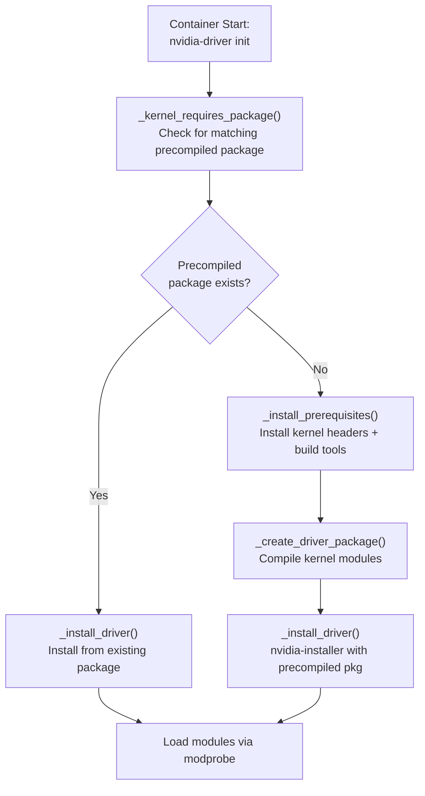
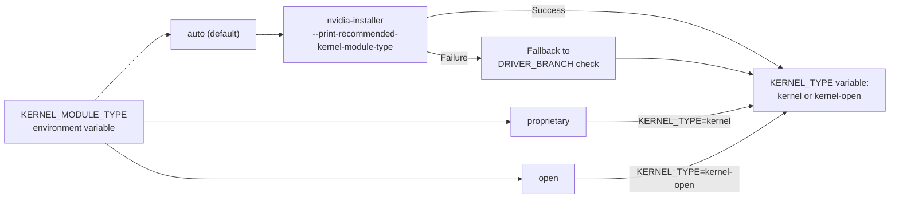
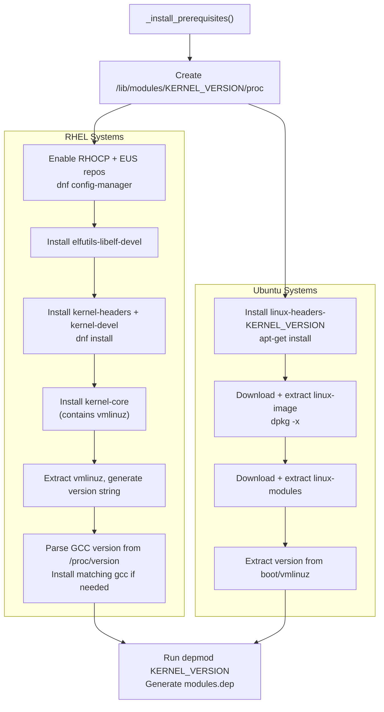
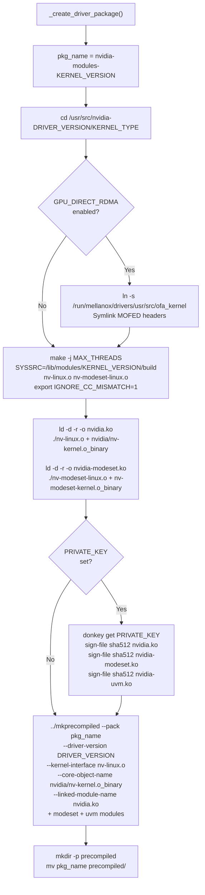
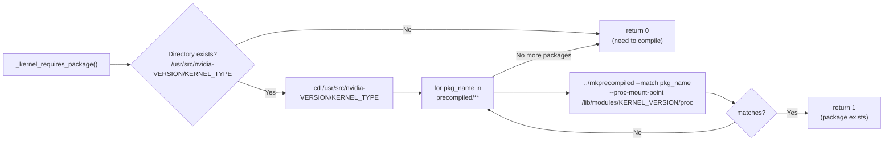
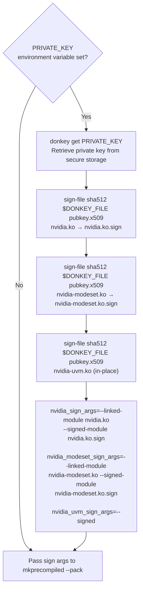
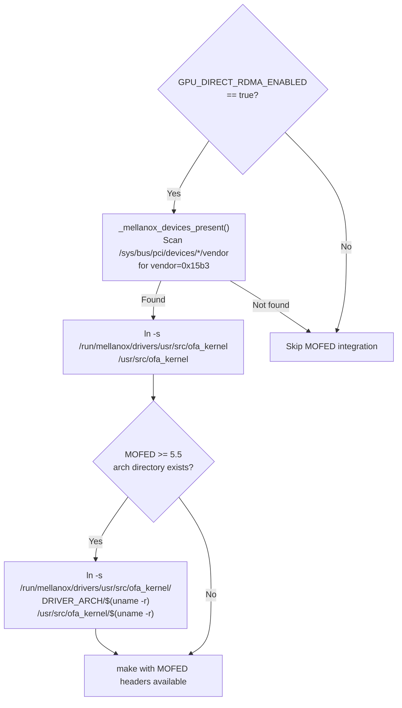
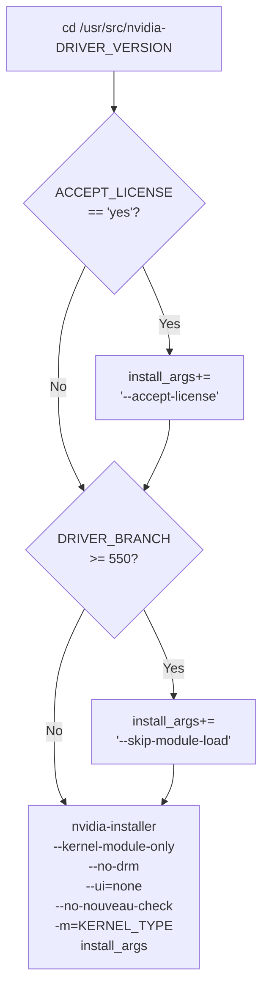

<!-- source: DeepWiki mcp.deepwiki.com · repo NVIDIA/gpu-driver-container · page 5.2 Kernel Module Compilation · fetched 2026-10-26 -->

# Kernel Module Compilation

<details>
<summary>Relevant source files</summary>

The following files were used as context for generating this wiki page:

- [rhel7/Dockerfile](rhel7/Dockerfile)
- [rhel7/nvidia-driver](rhel7/nvidia-driver)
- [rhel8/nvidia-driver](rhel8/nvidia-driver)
- [rhel9/nvidia-driver](rhel9/nvidia-driver)
- [ubuntu20.04/nvidia-driver](ubuntu20.04/nvidia-driver)
- [ubuntu22.04/nvidia-driver](ubuntu22.04/nvidia-driver)
- [ubuntu22.04/precompiled/local-repo.sh](ubuntu22.04/precompiled/local-repo.sh)
- [ubuntu22.04/precompiled/nvidia-driver](ubuntu22.04/precompiled/nvidia-driver)
- [ubuntu24.04/precompiled/Dockerfile](ubuntu24.04/precompiled/Dockerfile)
- [ubuntu24.04/precompiled/local-repo.sh](ubuntu24.04/precompiled/local-repo.sh)
- [ubuntu24.04/precompiled/nvidia-driver](ubuntu24.04/precompiled/nvidia-driver)

</details>


## Purpose and Scope

This document describes the kernel module compilation subsystem within the NVIDIA driver container runtime scripts. It covers the process by which NVIDIA kernel modules (`nvidia.ko`, `nvidia-modeset.ko`, `nvidia-uvm.ko`) are built from source, signed, packaged, and installed for a specific kernel version at runtime. This includes prerequisite installation, the compilation workflow, precompiled package management, and module signing mechanisms.

For information about driver initialization and module loading, see [Initialization and Lifecycle](#5.1). For daemon management after module installation, see [Daemon Management](#5.3). For precompiled driver image variants that skip compilation, see [Precompiled Driver Images](#4.2).

---

## Compilation Architecture Overview

The kernel module compilation system operates in two distinct modes depending on the image type and whether a matching precompiled package already exists.



**Compilation Decision Flow**

Sources: [rhel8/nvidia-driver:176-193](), [ubuntu20.04/nvidia-driver:103-120]()

---

## Kernel Module Type Resolution

The system supports both proprietary (`kernel`) and open-source (`kernel-open`) NVIDIA kernel modules. The `KERNEL_MODULE_TYPE` environment variable controls which type is selected.

### Module Type Determination



**Kernel Module Type Resolution Logic**

The `_resolve_kernel_type()` function determines which module type to use:

| `KERNEL_MODULE_TYPE` | Resolution Method | Result |
|---------------------|-------------------|--------|
| `auto` (default) | Query `nvidia-installer --print-recommended-kernel-module-type` | Uses installer recommendation |
| `auto` (fallback) | Check `DRIVER_BRANCH < 560` | Proprietary for branch < 560, open otherwise |
| `proprietary` | Direct assignment | `KERNEL_TYPE=kernel` |
| `open` | Direct assignment | `KERNEL_TYPE=kernel-open` |

Sources: [rhel8/nvidia-driver:615-643](), [ubuntu20.04/nvidia-driver:496-524](), [ubuntu22.04/nvidia-driver:340-368]()

---

## Compilation Prerequisites

Before kernel modules can be compiled, the system must install kernel headers, development packages, and build tools matching the target kernel version.

### Prerequisite Installation Process

The `_install_prerequisites()` function installs the necessary components:



**Prerequisite Installation Workflow**

### Key Artifacts Created

| Path | Purpose |
|------|---------|
| `/lib/modules/${KERNEL_VERSION}/build` | Symlink to kernel source tree (`/usr/src/kernels/${KERNEL_VERSION}`) |
| `/lib/modules/${KERNEL_VERSION}/proc/version` | Kernel version string extracted from vmlinuz |
| `/lib/modules/${KERNEL_VERSION}/modules.{builtin,order,dep}` | Module dependency metadata |
| `/lib/modules/${KERNEL_VERSION}/kernel/` | Kernel module binaries from package |

Sources: [rhel8/nvidia-driver:89-164](), [ubuntu20.04/nvidia-driver:65-92](), [rhel9/nvidia-driver:91-176]()

---

## Compilation Process

The `_create_driver_package()` function performs the actual kernel module compilation and packaging.

### Compilation Steps



**Kernel Module Compilation Workflow**

### Build System Details

The compilation uses a two-stage process:

1. **Stage 1: Kernel Interface Layer Compilation**
   - Compiles `nv-linux.o` and `nv-modeset-linux.o` against the running kernel headers
   - Uses `make` with `SYSSRC=/lib/modules/${KERNEL_VERSION}/build`
   - Produces kernel-specific interface objects

2. **Stage 2: Final Module Linking**
   - Links interface objects with pre-built core binaries (`nv-kernel.o_binary`, `nv-modeset-kernel.o_binary`)
   - Uses `ld -d -r` to create relocatable object files
   - Results in `nvidia.ko`, `nvidia-modeset.ko` ready for installation

### Compiler Version Matching

The scripts parse the GCC version requirement from the kernel version string and install a matching GCC compiler if necessary:

```bash
# Example from rhel8/nvidia-driver:154-163
local gcc_version=$(cat /lib/modules/${KERNEL_VERSION}/proc/version | \
    grep -Eo "gcc version ([0-9\.]+)" | grep -Eo "([0-9\.]+)")
local current_gcc=$(rpm -qa gcc)

if ! [[ "${current_gcc}" =~ "gcc-${gcc_version}"-.* ]]; then
    dnf install -q -y --releasever=${DNF_RELEASEVER} "gcc-${gcc_version}"
fi
```

This ensures the compiled modules are compatible with the kernel's ABI.

Sources: [rhel8/nvidia-driver:196-259](), [ubuntu20.04/nvidia-driver:123-187](), [rhel9/nvidia-driver:208-271]()

---

## Precompiled Package Management

The `mkprecompiled` utility creates self-contained package archives that can be verified and extracted by `nvidia-installer`.

### Package Structure and Verification

The `_kernel_requires_package()` function determines if an existing precompiled package matches the current kernel:



**Precompiled Package Verification Logic**

### Package Contents

A precompiled package created by `mkprecompiled --pack` contains:

| Component | Description |
|-----------|-------------|
| Kernel interface objects | `nv-linux.o`, `nv-modeset-linux.o` |
| Linked module binaries | `nvidia.ko`, `nvidia-modeset.ko` |
| UVM module | `nvidia-uvm.ko` |
| Signed variants (optional) | `nvidia.ko.sign`, `nvidia-modeset.ko.sign` |
| Metadata | Driver version, kernel version, description |

The `--match` operation compares the package's kernel version string with `/lib/modules/${KERNEL_VERSION}/proc/version` to verify compatibility.

Sources: [rhel8/nvidia-driver:176-193](), [ubuntu20.04/nvidia-driver:103-120](), [rhel7/nvidia-driver:92-109]()

---

## Module Signing for Secure Boot

When the `PRIVATE_KEY` environment variable is set, the system signs compiled kernel modules to enable loading on Secure Boot systems.

### Signing Process



**Module Signing Workflow**

### Signing Details

- **Signing Tool**: The `sign-file` script from the kernel source tree (`/usr/src/linux-headers-${KERNEL_VERSION}/scripts/sign-file`)
- **Hash Algorithm**: SHA-512
- **Key Retrieval**: Uses `donkey` utility to fetch the private key from secure storage
- **Public Key**: Embedded in the Docker image at build time as `pubkey.x509`

The signed modules are packaged with the `--signed-module` arguments to `mkprecompiled`, which instructs `nvidia-installer` to use the signed variants when loading.

Sources: [rhel8/nvidia-driver:229-238](), [ubuntu20.04/nvidia-driver:157-166](), [ubuntu22.04/nvidia-driver:169-178]()

---

## GPUDirect RDMA Integration

When GPUDirect RDMA is enabled (`GPU_DIRECT_RDMA_ENABLED=true`), the compilation process links against Mellanox OFED headers to build the `nvidia-peermem` kernel module.

### MOFED Header Integration



**GPUDirect RDMA Header Linking Logic**

The MOFED headers are mounted into the container from the host at `/run/mellanox/drivers/usr/src/ofa_kernel`. The compilation process creates symlinks to make these headers available to the NVIDIA driver build system.

### Peermem Module Loading

After compilation, the `nvidia-peermem` module is loaded during the driver load phase:

```bash
# From rhel8/nvidia-driver:377-382
if _gpu_direct_rdma_enabled; then
    echo "Loading NVIDIA Peer Memory kernel module..."
    set -o xtrace +o nounset
    modprobe -a nvidia-peermem "${NVIDIA_PEERMEM_MODULE_PARAMS[@]}"
    set +o xtrace -o nounset
fi
```

Sources: [rhel8/nvidia-driver:207-220](), [ubuntu20.04/nvidia-driver:134-147](), [ubuntu22.04/nvidia-driver:146-159]()

---

## Driver Installation

The `_install_driver()` function invokes the NVIDIA installer to install the compiled or precompiled kernel modules.

### Standard Image Installation

For standard (non-precompiled) images, the installation uses `nvidia-installer` with the precompiled package:



**nvidia-installer Invocation Logic**

### Precompiled Image Installation

For Ubuntu precompiled images, the installation uses native package management:

```bash
# From ubuntu22.04/precompiled/nvidia-driver:372-394
_install_driver() {
    # Install userspace packages
    apt-get install -y --no-install-recommends \
        nvidia-utils-${DRIVER_BRANCH}-server \
        nvidia-headless-no-dkms-${DRIVER_BRANCH}-server \
        libnvidia-decode-${DRIVER_BRANCH}-server \
        libnvidia-extra-${DRIVER_BRANCH}-server \
        libnvidia-encode-${DRIVER_BRANCH}-server \
        libnvidia-fbc1-${DRIVER_BRANCH}-server

    # Install precompiled kernel modules signed by Canonical
    if [ "$KERNEL_TYPE" = "kernel-open" ]; then
        apt-get install --no-install-recommends -y \
            linux-signatures-nvidia-${KERNEL_VERSION} \
            linux-modules-nvidia-${DRIVER_BRANCH}-server-open-${KERNEL_VERSION}
    else
        apt-get install --no-install-recommends -y \
            linux-objects-nvidia-${DRIVER_BRANCH}-server-${KERNEL_VERSION} \
            linux-signatures-nvidia-${KERNEL_VERSION} \
            linux-modules-nvidia-${DRIVER_BRANCH}-server-${KERNEL_VERSION}
    fi
}
```

The precompiled image approach leverages Canonical's signed kernel modules, eliminating the need for runtime compilation and custom signing.

Sources: [rhel8/nvidia-driver:524-557](), [ubuntu20.04/nvidia-driver:419-447](), [ubuntu22.04/precompiled/nvidia-driver:371-394](), [ubuntu24.04/precompiled/nvidia-driver:371-395]()

---

## Distribution-Specific Variations

### Package Manager Commands

| Distribution | Package Update | Package Install | Package Search |
|--------------|----------------|-----------------|----------------|
| **RHEL/CentOS** | `yum -q makecache` | `dnf install -q -y --releasever=${DNF_RELEASEVER}` | `yum -q list available --showduplicates` |
| **Ubuntu** | `apt-get -qq update` | `apt-get -qq install --no-install-recommends` | `apt-cache show` |

### Kernel Version Resolution

**RHEL-based systems** query the yum repository:

```bash
# From rhel8/nvidia-driver:76-86
local version=$(yum -q list available --showduplicates kernel-headers |
    awk -v arch=$(uname -m) 'NR>1 {print $2"."arch}' | tac | 
    grep -E -m1 "^${KERNEL_VERSION/latest/.*}")
```

**Ubuntu systems** query the apt cache:

```bash
# From ubuntu20.04/nvidia-driver:48-61
local version=$(apt-cache show "linux-headers-${KERNEL_VERSION}" 2> /dev/null |
    sed -nE 's/^Version:\s+(([0-9]+\.){2}[0-9]+)[-.]([0-9]+).*/\1-\3/p' | head -1)
local kernel_flavor=$(echo ${KERNEL_VERSION} | sed 's/[^a-z]*//')
KERNEL_VERSION="${version}-${kernel_flavor}"
```

### vmlinuz Extraction

**RHEL 8** uses `extract-vmlinux` or `gunzip`:

```bash
# From rhel8/nvidia-driver:143-147
if [ "$TARGETARCH" = "arm64" ]; then
    gunzip -c /lib/modules/${KERNEL_VERSION}/vmlinuz | strings | ...
else
    extract-vmlinux /lib/modules/${KERNEL_VERSION}/vmlinuz | strings | ...
fi
```

**RHEL 9** adds `unzboot` as a fallback:

```bash
# From rhel9/nvidia-driver:144-163
extract-vmlinux /lib/modules/${KERNEL_VERSION}/vmlinuz | strings | ...

if [ -z "$(<version)" ]; then
    echo "extract-vmlinux failed. Falling back to unzboot..."
    unzboot /lib/modules/${KERNEL_VERSION}/vmlinuz vmlinuz.out
    < vmlinuz.out strings | ...
fi

if [ -z "$(<version)" ]; then
    echo "unzboot failed. Falling back to gunzip..."
    gunzip -c /lib/modules/${KERNEL_VERSION}/vmlinuz | strings | ...
fi
```

**Ubuntu** extracts the version string directly from the package:

```bash
# From ubuntu20.04/nvidia-driver:86-91
ls -1 boot/vmlinuz-* | sed 's/\/boot\/vmlinuz-//g' - > version
```

Sources: [rhel8/nvidia-driver:28-86](), [rhel9/nvidia-driver:29-176](), [ubuntu20.04/nvidia-driver:26-92](), [ubuntu22.04/nvidia-driver:27-104]()

---

## Compilation Environment Variables

| Variable | Purpose | Default | Used By |
|----------|---------|---------|---------|
| `DRIVER_VERSION` | NVIDIA driver version to compile | Required | All distributions |
| `KERNEL_VERSION` | Target kernel version | `$(uname -r)` | All distributions |
| `KERNEL_MODULE_TYPE` | Module type selection | `auto` | All distributions |
| `MAX_THREADS` | Parallel compilation threads | Unset (single-threaded) | `make -j` flag |
| `PRIVATE_KEY` | Secure boot signing key | Unset (no signing) | Module signing |
| `PACKAGE_TAG` | Precompiled package tag | Unset | Package naming |
| `IGNORE_CC_MISMATCH` | Bypass compiler version checks | `1` | RHEL/Ubuntu make |
| `GPU_DIRECT_RDMA_ENABLED` | Enable MOFED integration | `false` | Peermem module |

Sources: [rhel8/nvidia-driver:1-26](), [ubuntu20.04/nvidia-driver:1-25]()

---

