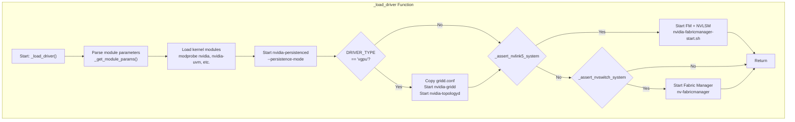
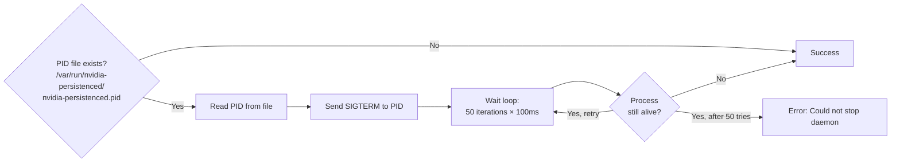
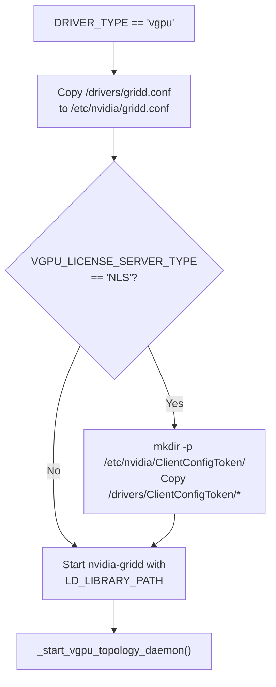
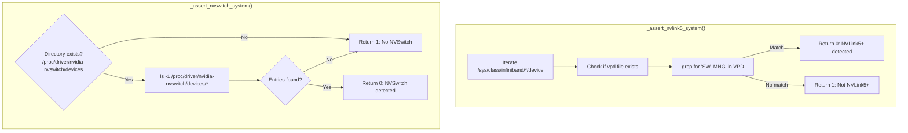
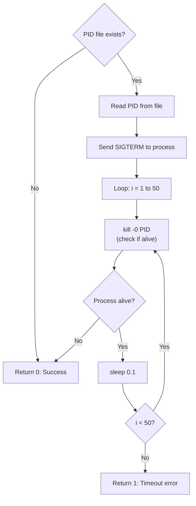

<!-- source: DeepWiki mcp.deepwiki.com · repo NVIDIA/gpu-driver-container · page 5.3 Daemon Management · fetched 2026-10-26 -->

# Daemon Management

<details>
<summary>Relevant source files</summary>

The following files were used as context for generating this wiki page:

- [rhel7/Dockerfile](rhel7/Dockerfile)
- [rhel7/nvidia-driver](rhel7/nvidia-driver)
- [rhel8/nvidia-driver](rhel8/nvidia-driver)
- [rhel9/nvidia-driver](rhel9/nvidia-driver)
- [ubuntu20.04/nvidia-driver](ubuntu20.04/nvidia-driver)
- [ubuntu22.04/nvidia-driver](ubuntu22.04/nvidia-driver)
- [ubuntu24.04/Dockerfile](ubuntu24.04/Dockerfile)
- [ubuntu24.04/install.sh](ubuntu24.04/install.sh)
- [ubuntu24.04/nvidia-driver](ubuntu24.04/nvidia-driver)

</details>


This page documents the NVIDIA daemon processes managed by the driver container runtime scripts. These daemons provide essential services for GPU functionality including persistence mode, vGPU license management, and multi-GPU fabric coordination. For information about kernel module loading and compilation, see [Kernel Module Compilation](#5.2). For the overall driver initialization sequence, see [Initialization and Lifecycle](#5.1).

## Overview

The driver container manages four primary daemon types that are conditionally started based on system configuration and hardware detection:

| Daemon | Purpose | Startup Condition |
|--------|---------|-------------------|
| `nvidia-persistenced` | Maintains GPU state across process lifecycles | Always started |
| `nvidia-gridd` | vGPU guest license management | `DRIVER_TYPE=vgpu` |
| `nvidia-topologyd` | vGPU virtual topology daemon | `DRIVER_TYPE=vgpu` and binary present |
| `nv-fabricmanager` | NVSwitch fabric coordination (NVLink4 and below) | NVSwitch devices detected |
| `nvidia-fabricmanager-start.sh` + `nvlsm` | Fabric Manager and NVLink Subnet Manager (NVLink5+) | NVLink5+ system detected |

All daemons are started during the `_load_driver()` phase and stopped during `_unload_driver()` to ensure clean shutdown.

Sources: [rhel8/nvidia-driver:343-422](), [ubuntu20.04/nvidia-driver:263-329](), [rhel9/nvidia-driver:355-439]()

## Daemon Lifecycle Flow



Sources: [rhel8/nvidia-driver:343-422](), [ubuntu22.04/nvidia-driver:306-387]()

## NVIDIA Persistence Daemon

The `nvidia-persistenced` daemon is always started to maintain GPU initialization state when no client processes are using the GPU. This reduces driver load/unload latency for subsequent applications.

### Startup

The daemon is started immediately after kernel modules are loaded using the `--persistence-mode` flag:

```bash
nvidia-persistenced --persistence-mode
```

**Code location:** [rhel8/nvidia-driver:384-385](), [ubuntu20.04/nvidia-driver:304-305](), [ubuntu22.04/nvidia-driver:347-348]()

### Shutdown

The shutdown procedure sends `SIGTERM` and waits up to 5 seconds (50 iterations × 100ms) for graceful termination:



**Code location:** [rhel8/nvidia-driver:433-446](), [ubuntu20.04/nvidia-driver:340-353]()

Sources: [rhel8/nvidia-driver:384-385](), [rhel8/nvidia-driver:433-446](), [ubuntu20.04/nvidia-driver:304-305](), [ubuntu20.04/nvidia-driver:340-353]()

## vGPU Daemons

When `DRIVER_TYPE=vgpu`, two additional daemons are started to support vGPU licensing and topology management.

### nvidia-gridd (vGPU Grid Daemon)

The Grid daemon handles vGPU license acquisition and validation. It supports two license server types controlled by the `VGPU_LICENSE_SERVER_TYPE` environment variable.

#### Configuration Setup



**Configuration paths:**
- Grid configuration: `/etc/nvidia/gridd.conf` (copied from `/drivers/gridd.conf`)
- NLS tokens: `/etc/nvidia/ClientConfigToken/*` (for NLS license server type)

**Library path:**
- RHEL: `LD_LIBRARY_PATH=/usr/lib64/nvidia/gridd`
- Ubuntu: `LD_LIBRARY_PATH=/usr/lib/$DRIVER_ARCH-linux-gnu/nvidia/gridd`

**Code location:** [rhel8/nvidia-driver:387-400](), [ubuntu20.04/nvidia-driver:307-321]()

#### Shutdown

The shutdown procedure is identical to nvidia-persistenced, using PID file `/var/run/nvidia-gridd/nvidia-gridd.pid`:

**Code location:** [rhel8/nvidia-driver:448-461](), [ubuntu20.04/nvidia-driver:355-368]()

### nvidia-topologyd (Virtual Topology Daemon)

The `_start_vgpu_topology_daemon()` function conditionally starts the topology daemon if the binary is available:

```bash
type nvidia-topologyd > /dev/null 2>&1 || return 0
echo "Starting nvidia-topologyd.."
nvidia-topologyd
```

This daemon is only present in certain vGPU configurations and the function gracefully handles its absence.

**Code location:** [rhel8/nvidia-driver:681-685](), [ubuntu20.04/nvidia-driver:558-562]()

Sources: [rhel8/nvidia-driver:387-400](), [rhel8/nvidia-driver:448-461](), [rhel8/nvidia-driver:681-685](), [ubuntu20.04/nvidia-driver:307-321]()

## Fabric Manager and NVLink Management

Multi-GPU systems with NVSwitch or NVLink require fabric management daemons to coordinate GPU-to-GPU communication. The driver container detects the system type and starts the appropriate daemon.

### System Detection

Two detection functions determine which fabric manager to start:



**Code locations:**
- `_assert_nvlink5_system()`: [rhel8/nvidia-driver:270-285](), [ubuntu22.04/nvidia-driver:209-224]()
- `_assert_nvswitch_system()`: [rhel8/nvidia-driver:261-268](), [ubuntu20.04/nvidia-driver:189-195]()

### NVLink5+ Systems

NVLink5+ systems (e.g., GB200, GH200 with NVLink5) require both Fabric Manager and NVLink Subnet Manager (NVLSM). These systems are identified by the presence of `SW_MNG` in the InfiniBand VPD files.

#### Prerequisites

Before starting the fabric daemons, the system must wait for Mellanox kernel modules:

```bash
until lsmod | grep mlx5_core > /dev/null 2>&1 && lsmod | grep ib_umad > /dev/null 2>&1;
do
    echo "waiting for the mlx5_core and ib_umad kernel modules to be loaded"
    sleep 10
done
```

**Code location:** [rhel8/nvidia-driver:287-293](), [ubuntu22.04/nvidia-driver:226-232]()

#### Startup

The startup uses `nvidia-fabricmanager-start.sh` with configuration files:

```bash
fm_config_file=/usr/share/nvidia/nvswitch/fabricmanager.cfg
fm_pid_file=/var/run/nvidia-fabricmanager/nv-fabricmanager.pid
nvlsm_config_file=/usr/share/nvidia/nvlsm/nvlsm.conf
nvlsm_pid_file=/var/run/nvidia-fabricmanager/nvlsm.pid

/usr/bin/nvidia-fabricmanager-start.sh --mode start \
    --fm-config-file $fm_config_file \
    --fm-pid-file $fm_pid_file \
    --nvlsm-config-file $nvlsm_config_file \
    --nvlsm-pid-file $nvlsm_pid_file
```

**Code location:** [rhel8/nvidia-driver:403-415](), [ubuntu22.04/nvidia-driver:366-378]()

#### Shutdown

Both Fabric Manager and NVLSM must be stopped separately:

| Daemon | PID File | Code Reference |
|--------|----------|----------------|
| Fabric Manager | `/var/run/nvidia-fabricmanager/nv-fabricmanager.pid` | [rhel8/nvidia-driver:463-476]() |
| NVLSM | `/var/run/nvidia-fabricmanager/nvlsm.pid` | [rhel8/nvidia-driver:478-491]() |

Each uses the same SIGTERM + wait loop pattern with 5-second timeout.

### NVSwitch Systems (NVLink4 and Below)

Older NVSwitch systems (NVLink4 and below) use a simpler single-daemon approach:

```bash
nv-fabricmanager -c /usr/share/nvidia/nvswitch/fabricmanager.cfg
```

This is started only if `_assert_nvswitch_system()` returns true AND `_assert_nvlink5_system()` returns false (the elif branch).

**Code location:** [rhel8/nvidia-driver:418-420](), [ubuntu20.04/nvidia-driver:323-325]()

**Shutdown:** Uses PID file `/var/run/nvidia-fabricmanager/nv-fabricmanager.pid` with the standard SIGTERM pattern.

**Code location:** [rhel8/nvidia-driver:463-476](), [ubuntu20.04/nvidia-driver:370-383]()

Sources: [rhel8/nvidia-driver:261-285](), [rhel8/nvidia-driver:287-293](), [rhel8/nvidia-driver:403-421](), [rhel8/nvidia-driver:463-491]()

## Process Management Details

### PID File Locations

All daemons write PID files to standard locations for process tracking:

| Daemon | PID File Path |
|--------|---------------|
| nvidia-persistenced | `/var/run/nvidia-persistenced/nvidia-persistenced.pid` |
| nvidia-gridd | `/var/run/nvidia-gridd/nvidia-gridd.pid` |
| nv-fabricmanager | `/var/run/nvidia-fabricmanager/nv-fabricmanager.pid` |
| nvlsm | `/var/run/nvidia-fabricmanager/nvlsm.pid` |

### Shutdown Pattern

All daemon shutdown operations follow a consistent pattern implemented in `_unload_driver()`:



This provides a 5-second grace period (50 × 100ms) for each daemon to shut down cleanly before failing with an error.

Sources: [rhel8/nvidia-driver:424-522](), [ubuntu20.04/nvidia-driver:331-416]()

## Configuration Files

### vGPU Configuration

| File | Source | Destination | Purpose |
|------|--------|-------------|---------|
| `gridd.conf` | `/drivers/gridd.conf` | `/etc/nvidia/gridd.conf` | vGPU Grid daemon configuration |
| `ClientConfigToken/*` | `/drivers/ClientConfigToken/*` | `/etc/nvidia/ClientConfigToken/*` | NLS license tokens |

The files must be mounted into the container at `/drivers/` before the init process runs.

**Code location:** [rhel8/nvidia-driver:388-393](), [ubuntu20.04/nvidia-driver:308-314]()

### Fabric Manager Configuration

| File | Path | Purpose |
|------|------|---------|
| `fabricmanager.cfg` | `/usr/share/nvidia/nvswitch/fabricmanager.cfg` | Fabric Manager configuration |
| `nvlsm.conf` | `/usr/share/nvidia/nvlsm/nvlsm.conf` | NVLink Subnet Manager configuration (NVLink5+) |

These files are installed via distribution packages during the container build:

**Ubuntu 24.04:** [ubuntu24.04/install.sh:47-53]() - `nvidia-fabricmanager` package installation  
**Ubuntu 24.04:** [ubuntu24.04/install.sh:74-78]() - `nvlsm` package installation (driver branch ≥ 550)

Sources: [rhel8/nvidia-driver:388-393](), [ubuntu24.04/install.sh:47-53](), [ubuntu24.04/install.sh:74-78]()

## Distribution-Specific Differences

### RHEL 9 Video Module Loading

RHEL 9.3+ requires loading the `video` kernel module before loading NVIDIA modules:

```bash
if [[ "$RHEL_MINOR_VERSION" -ge "3" ]]; then
    echo "Loading the video kernel module..."
    modprobe video
fi
```

This is specific to RHEL 9.3+ and not present in other distributions.

**Code location:** [rhel9/nvidia-driver:382-385]()

### Library Path Differences

The vGPU Grid daemon requires distribution-specific library paths:

| Distribution | LD_LIBRARY_PATH |
|--------------|-----------------|
| RHEL 7/8/9 | `/usr/lib64/nvidia/gridd` |
| Ubuntu 20.04/22.04/24.04 | `/usr/lib/$DRIVER_ARCH-linux-gnu/nvidia/gridd` |

where `$DRIVER_ARCH` is `x86_64` or `aarch64`.

**Code locations:** 
- RHEL: [rhel8/nvidia-driver:397]()
- Ubuntu: [ubuntu20.04/nvidia-driver:317](), [ubuntu22.04/nvidia-driver:360]()

### Fabric Manager Package Versions

The fabric manager installation differs by driver branch:

```bash
# Driver branch >= 580
apt-get install -y nvidia-fabricmanager=${DRIVER_VERSION}-1

# Driver branch < 580
apt-get install -y nvidia-fabricmanager-${DRIVER_BRANCH}=${DRIVER_VERSION}-1
```

This branch-based logic applies to several packages including `libnvidia-nscq`, `libnvsdm`, and `nvidia-imex`.

**Code location:** [ubuntu24.04/install.sh:47-86]()

Sources: [rhel9/nvidia-driver:382-385](), [rhel8/nvidia-driver:397](), [ubuntu20.04/nvidia-driver:317](), [ubuntu24.04/install.sh:47-86]()

## Daemon Startup Summary Table

The following table summarizes when each daemon is started during `_load_driver()`:

| Daemon | Started When | Configuration Required | Dependencies |
|--------|-------------|------------------------|--------------|
| `nvidia-persistenced` | Always | None | Kernel modules loaded |
| `nvidia-gridd` | `DRIVER_TYPE=vgpu` | `/drivers/gridd.conf`<br/>Optional: `/drivers/ClientConfigToken/*` | nvidia-persistenced running |
| `nvidia-topologyd` | `DRIVER_TYPE=vgpu` and binary exists | None | nvidia-gridd running |
| `nv-fabricmanager` | NVSwitch detected, not NVLink5+ | `/usr/share/nvidia/nvswitch/fabricmanager.cfg` | Kernel modules loaded |
| `nvidia-fabricmanager-start.sh` + `nvlsm` | NVLink5+ detected | `/usr/share/nvidia/nvswitch/fabricmanager.cfg`<br/>`/usr/share/nvidia/nvlsm/nvlsm.conf` | `mlx5_core` and `ib_umad` modules loaded |

Sources: [rhel8/nvidia-driver:343-422](), [ubuntu22.04/nvidia-driver:306-387]()

---

