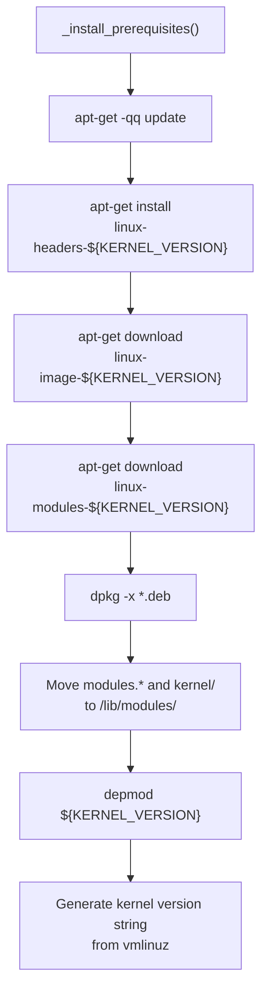
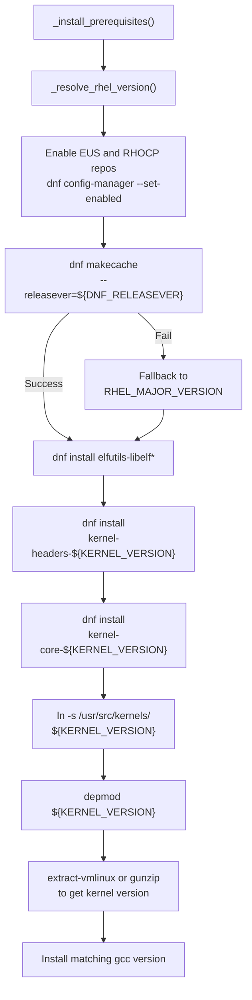
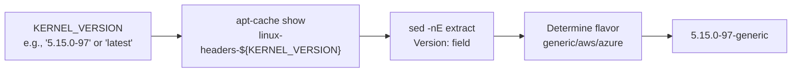
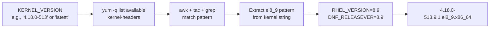
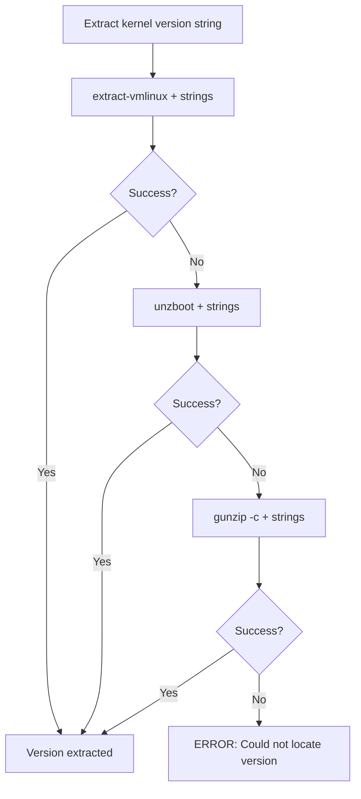
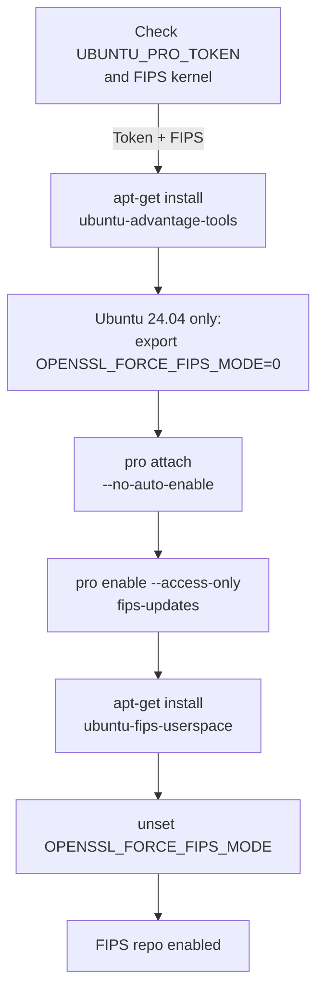
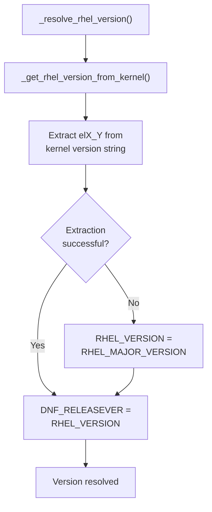
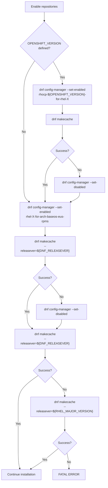
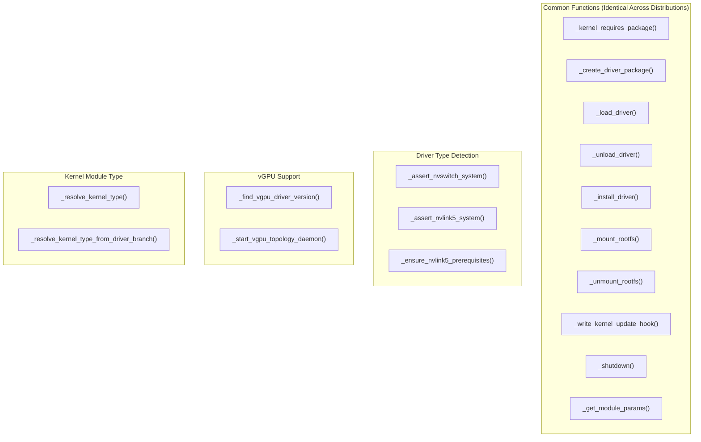

<!-- source: DeepWiki mcp.deepwiki.com · repo NVIDIA/gpu-driver-container · page 5.4 Distribution-Specific Implementations · fetched 2026-10-26 -->

# Distribution-Specific Implementations

<details>
<summary>Relevant source files</summary>

The following files were used as context for generating this wiki page:

- [coreos/Dockerfile](coreos/Dockerfile)
- [fedora/Dockerfile](fedora/Dockerfile)
- [photon3.0/Dockerfile](photon3.0/Dockerfile)
- [rhel7/Dockerfile](rhel7/Dockerfile)
- [rhel7/nvidia-driver](rhel7/nvidia-driver)
- [rhel8/nvidia-driver](rhel8/nvidia-driver)
- [rhel9/nvidia-driver](rhel9/nvidia-driver)
- [sle15/Dockerfile](sle15/Dockerfile)
- [ubuntu20.04/nvidia-driver](ubuntu20.04/nvidia-driver)
- [ubuntu22.04/nvidia-driver](ubuntu22.04/nvidia-driver)
- [ubuntu24.04/Dockerfile](ubuntu24.04/Dockerfile)
- [ubuntu24.04/install.sh](ubuntu24.04/install.sh)
- [ubuntu24.04/nvidia-driver](ubuntu24.04/nvidia-driver)

</details>


## Purpose and Scope

This page documents the distribution-specific implementations of the `nvidia-driver` scripts across different Linux distributions. Each supported distribution requires a tailored implementation due to differences in package managers, repository structures, kernel conventions, and system configurations.

For general driver lifecycle management patterns that are common across distributions, see [Initialization and Lifecycle](#5.1). For kernel module compilation details, see [Kernel Module Compilation](#5.2). For daemon management, see [Daemon Management](#5.3).

## Overview

The repository maintains separate `nvidia-driver` bash scripts for each major distribution family. While these scripts share common functionality and structure, they diverge significantly in package management, kernel version resolution, and system integration.

### Distribution Script Matrix

```mermaid
graph TB
    subgraph "Debian-based Distributions"
        U2004["ubuntu20.04/nvidia-driver"]
        U2204["ubuntu22.04/nvidia-driver"]
        U2404["ubuntu24.04/nvidia-driver"]
    end
    
    subgraph "RHEL-based Distributions"
        R7["rhel7/nvidia-driver"]
        R8["rhel8/nvidia-driver"]
        R9["rhel9/nvidia-driver"]
        FEDORA["fedora/nvidia-driver"]
    end
    
    subgraph "Other Distributions"
        COREOS["coreos/nvidia-driver"]
        SLES["sle15/nvidia-driver"]
        PHOTON["photon3.0/nvidia-driver"]
    end
    
    U2004 --> APT["apt-get/dpkg"]
    U2204 --> APT
    U2404 --> APT
    
    R7 --> YUM["yum/rpm"]
    R8 --> DNF["dnf/rpm"]
    R9 --> DNF
    FEDORA --> DNF
    
    COREOS --> EXTRACT["extract-vmlinux"]
    SLES --> ZYPPER["zypper"]
    PHOTON --> TDNF["tdnf"]
```



**Sources:** [ubuntu20.04/nvidia-driver](), [ubuntu22.04/nvidia-driver](), [ubuntu24.04/nvidia-driver](), [rhel7/nvidia-driver](), [rhel8/nvidia-driver](), [rhel9/nvidia-driver]()

## Package Management Differences

### Ubuntu/Debian Distributions

Ubuntu distributions use the APT package manager with `.deb` packages. The package management functions follow a consistent pattern across Ubuntu versions.

| Function | Purpose | Key Commands |
|----------|---------|--------------|
| `_update_package_cache` | Refresh package metadata | `apt-get -qq update` |
| `_cleanup_package_cache` | Remove cached package lists | `rm -rf /var/lib/apt/lists/*` |
| `_resolve_kernel_version` | Query kernel package version | `apt-cache show linux-headers-${KERNEL_VERSION}` |

#### Ubuntu Package Installation Flow



**Sources:** [ubuntu20.04/nvidia-driver:65-92](), [ubuntu22.04/nvidia-driver:77-104](), [ubuntu24.04/nvidia-driver:86-114]()

### RHEL/Fedora Distributions

RHEL-based distributions use YUM (RHEL 7) or DNF (RHEL 8/9, Fedora) with `.rpm` packages. These distributions have more complex repository management due to Extended Update Support (EUS) and entitlement requirements.

| Function | Purpose | Key Commands |
|----------|---------|--------------|
| `_update_package_cache` | Refresh package metadata | `yum -q makecache` or `dnf makecache` |
| `_cleanup_package_cache` | Remove cached packages | `rm -rf /var/cache/yum/*` |
| `_resolve_rhel_version` | Determine RHEL minor version | Extract from kernel version string |
| `_get_rhel_version_from_kernel` | Parse RHEL version from kernel | `sed` extraction from `el8_9` pattern |

#### RHEL Package Installation Flow



**Sources:** [rhel8/nvidia-driver:89-164](), [rhel9/nvidia-driver:91-176]()

## Kernel Version Resolution

Each distribution has a unique approach to resolving kernel versions from the package manager.

### Ubuntu Kernel Version Format

Ubuntu kernel versions follow the format: `major.minor.patch-revision-flavor`

Example: `5.15.0-97-generic`



**Implementation details:**
- Uses `apt-cache show "linux-headers-${KERNEL_VERSION}"` to query package metadata
- Extracts version with `sed -nE 's/^Version:\s+(([0-9]+\.){2}[0-9]+)[-.]([0-9]+).*/\1-\3/p'`
- Appends kernel flavor (defaults to `generic`, translates `virtual` to `generic`)
- Handles wildcards like `latest` by matching against available packages

**Sources:** [ubuntu20.04/nvidia-driver:46-62](), [ubuntu22.04/nvidia-driver:58-74](), [ubuntu24.04/nvidia-driver:68-84]()

### RHEL Kernel Version Format

RHEL kernel versions include enterprise Linux version markers: `major.minor.patch-revision.elX_Y.arch`

Example: `4.18.0-513.9.1.el8_9.x86_64`



**Implementation details:**
- Uses `yum -q list available --showduplicates kernel-headers` to list all versions
- Pipes through `awk`, `tac` (reverse order), and `grep` to find matching version
- Extracts RHEL minor version using `sed 's/.*el\([0-9]\+_[0-9]\+\).*/\1/g'`
- Falls back to major version only if minor version cannot be determined

**Sources:** [rhel8/nvidia-driver:46-86](), [rhel9/nvidia-driver:47-88]()

## Prerequisites Installation Differences

### Ubuntu Prerequisites Extraction

Ubuntu distributions download `.deb` packages and extract them using `dpkg -x`:

```bash
# From ubuntu20.04/nvidia-driver:78-80
apt-get -qq download linux-image-${KERNEL_VERSION} && dpkg -x linux-image*.deb .
{ apt-get -qq download linux-modules-${KERNEL_VERSION} && dpkg -x linux-modules*.deb . || true; }
mv lib/modules/${KERNEL_VERSION}/modules.* /lib/modules/${KERNEL_VERSION}
```

**Key characteristics:**
- Downloads `linux-image` and `linux-modules` packages
- Extracts to temporary directory using `dpkg -x`
- Moves `modules.*` files and `kernel/` directory to `/lib/modules/${KERNEL_VERSION}`
- Generates version string from `vmlinuz` filename using `ls -1 boot/vmlinuz-*`

**Sources:** [ubuntu20.04/nvidia-driver:74-92]()

### RHEL Prerequisites Extraction

RHEL distributions use RPM packages and extract them with `rpm2cpio` and `cpio`:

```bash
# From rhel8/nvidia-driver:134-135
dnf -q -y --releasever=${DNF_RELEASEVER} install kernel-core-${KERNEL_VERSION} > /dev/null
```

**RHEL 7 approach (manual extraction):**
```bash
# From rhel7/nvidia-driver:55-57
yum install -y -q kernel-${KERNEL_VERSION} --downloadonly --downloaddir=$(pwd)
cat ./kernel*.rpm | rpm2cpio | cpio -idm --quiet
```

**Key characteristics:**
- RHEL 8/9: Direct installation of `kernel-core` package
- RHEL 7: Downloads kernel RPM, extracts with `rpm2cpio | cpio`
- Creates symlink: `/lib/modules/${KERNEL_VERSION}/build` → `/usr/src/kernels/${KERNEL_VERSION}`
- Uses `extract-vmlinux` to extract kernel image and find version string

**Sources:** [rhel8/nvidia-driver:129-152](), [rhel7/nvidia-driver:50-69]()

## Kernel Version String Extraction

Different distributions use different methods to extract the kernel version string from the kernel image.

### Distribution-Specific Extraction Methods

| Distribution | Primary Method | Fallback Method(s) | Notes |
|--------------|----------------|-------------------|-------|
| Ubuntu 20.04/22.04 | `ls -1 boot/vmlinuz-*` | None | Simplest approach |
| Ubuntu 24.04 | `ls -1 boot/vmlinuz-*` | None | Same as 22.04 |
| RHEL 7 | `extract-vmlinux` + `strings` + `grep` | None | Single method |
| RHEL 8 (x86_64) | `extract-vmlinux` + `strings` + `grep` | None | Architecture-specific |
| RHEL 8 (arm64) | `gunzip -c` + `strings` + `grep` | None | ARM requires gunzip |
| RHEL 9 | `extract-vmlinux` + `strings` | `unzboot`, then `gunzip` | Three-tier fallback |

#### RHEL 9 Multi-Fallback Approach

RHEL 9 implements a sophisticated fallback mechanism:



**Implementation:**
```bash
# From rhel9/nvidia-driver:144-163
extract-vmlinux /lib/modules/${KERNEL_VERSION}/vmlinuz | strings | grep -E '^Linux version' > version

if [ -z "$(<version)" ]; then
    unzboot /lib/modules/${KERNEL_VERSION}/vmlinuz vmlinuz.out
    < vmlinuz.out strings | grep -E '^Linux version' > version
fi

if [ -z "$(<version)" ]; then
    gunzip -c /lib/modules/${KERNEL_VERSION}/vmlinuz | strings | grep -E '^Linux version' > version
fi
```

**Sources:** [rhel9/nvidia-driver:144-164](), [rhel8/nvidia-driver:143-152]()

## Distribution-Specific Features

### Ubuntu Pro and FIPS Support

Ubuntu 22.04 and 24.04 include support for Ubuntu Pro subscriptions and FIPS-compliant kernels.



**Ubuntu 24.04 OpenSSL workaround:**
```bash
# From ubuntu24.04/nvidia-driver:32-44
# This workaround is needed in Ubuntu 24.04 as OpenSSL attempts to leverage the FIPS provider
# when the underlying kernel is FIPS enabled.
export OPENSSL_FORCE_FIPS_MODE=0

pro attach --no-auto-enable "${UBUNTU_PRO_TOKEN}"
pro enable --access-only --assume-yes fips-updates
apt-get -qq install --no-install-recommends ubuntu-fips-userspace > /dev/null

# With the OpenSSL FIPS module installed, OpenSSL can now work with the default settings
unset OPENSSL_FORCE_FIPS_MODE
```

**Sources:** [ubuntu22.04/nvidia-driver:27-36](), [ubuntu24.04/nvidia-driver:27-46]()

### RHEL Repository Management

RHEL 8 and 9 require complex repository management to handle Extended Update Support (EUS) and OpenShift-specific repositories.

#### RHEL Version Resolution



**RHEL version parsing:**
```bash
# From rhel8/nvidia-driver:46-71
_get_rhel_version_from_kernel() {
    local rhel_version_underscore rhel_version_arr
    rhel_version_underscore=$(echo "${KERNEL_VERSION}" | sed 's/.*el\([0-9]\+_[0-9]\+\).*/\1/g')
    # For e.g. :- from the kernel version 4.18.0-513.9.1.el8_9, we expect to extract the string "8_9"
    if [[ ! ${rhel_version_underscore} =~ ^[0-9]+_[0-9]+$ ]]; then
        echo "Unable to resolve RHEL version from kernel version" >&2
        return 1
    fi
    IFS='_' read -r -a rhel_version_arr <<< "$rhel_version_underscore"
    RHEL_VERSION="${rhel_version_arr[0]}.${rhel_version_arr[1]}"
    echo "RHEL VERSION successfully resolved from kernel: ${RHEL_VERSION}"
    return 0
}
```

**Sources:** [rhel8/nvidia-driver:46-71](), [rhel9/nvidia-driver:47-73]()

#### EUS and RHOCP Repository Enablement



**Implementation:**
```bash
# From rhel8/nvidia-driver:98-120
echo "Enabling RHOCP and EUS RPM repos..."
if [ -n "${OPENSHIFT_VERSION:-}" ]; then
    dnf config-manager --set-enabled rhocp-${OPENSHIFT_VERSION}-for-rhel-8-$DRIVER_ARCH-rpms || true
    if ! dnf makecache --releasever=${DNF_RELEASEVER}; then
        dnf config-manager --set-disabled rhocp-${OPENSHIFT_VERSION}-for-rhel-8-$DRIVER_ARCH-rpms || true
    fi
fi

dnf config-manager --set-enabled rhel-8-for-$DRIVER_ARCH-baseos-eus-rpms  || true
if ! dnf makecache --releasever=${DNF_RELEASEVER}; then
    dnf config-manager --set-disabled rhel-8-for-$DRIVER_ARCH-baseos-eus-rpms || true
fi

# try with EUS disabled, if it does not work, then try just major version
if ! dnf makecache --releasever=${DNF_RELEASEVER}; then
    if ! dnf makecache --releasever=${RHEL_MAJOR_VERSION}; then
        echo "FATAL: failed to update the dnf metadata cache after multiple attempts"
        exit 1
    fi
fi
```

**Sources:** [rhel8/nvidia-driver:98-120](), [rhel9/nvidia-driver:100-122]()

### RHEL 9 Video Module Loading

RHEL 9.3+ requires the `video` kernel module to be loaded before NVIDIA modules:

```bash
# From rhel9/nvidia-driver:382-385
if [[ "$RHEL_MINOR_VERSION" -ge "3" ]]; then
    echo "Loading the video kernel module..."
    modprobe video
fi
```

**Sources:** [rhel9/nvidia-driver:382-385]()

### SELinux Context Management

RHEL distributions include SELinux support, requiring device file context changes:

```bash
# From rhel8/nvidia-driver:567-574
echo "Check SELinux status"
if [ -e /sys/fs/selinux ]; then
    echo "SELinux is enabled"
    echo "Change device files security context for selinux compatibility"
    chcon -R -t container_file_t ${RUN_DIR}/driver/dev
else
    echo "SELinux is disabled, skipping..."
fi
```

**Sources:** [rhel8/nvidia-driver:567-574](), [rhel9/nvidia-driver:584-591]()

## Userspace Driver Installation

The approach to installing userspace driver components differs between distributions.

### Ubuntu: Direct nvidia-installer Invocation

Ubuntu distributions call `nvidia-installer` directly during the `init` command:

```bash
# From ubuntu20.04/nvidia-driver:569-584
sh NVIDIA-Linux-$DRIVER_ARCH-$DRIVER_VERSION.run -x && \
    cd NVIDIA-Linux-$DRIVER_ARCH-$DRIVER_VERSION && \
    ./nvidia-installer --silent \
                --no-kernel-module \
                --no-nouveau-check \
                --no-nvidia-modprobe \
                --no-rpms \
                --no-backup \
                --no-check-for-alternate-installs \
                --no-libglx-indirect \
                --no-install-libglvnd \
                --x-prefix=/tmp/null \
                --x-module-path=/tmp/null \
                --x-library-path=/tmp/null \
                --x-sysconfig-path=/tmp/null
```

**Sources:** [ubuntu20.04/nvidia-driver:569-584]()

### RHEL 8+: Separate install.sh Script

RHEL 8 and 9 use a separate `install.sh` script with an `nvinstall` target:

```bash
# From rhel8/nvidia-driver:693-695
sh NVIDIA-Linux-$DRIVER_ARCH-$DRIVER_VERSION.run -x && \
    cd NVIDIA-Linux-$DRIVER_ARCH-$DRIVER_VERSION && \
    sh /tmp/install.sh nvinstall
```

This approach provides better modularity and allows the install logic to be shared with Dockerfiles.

**Sources:** [rhel8/nvidia-driver:693-695]()

## GCC Version Matching

Both Ubuntu and RHEL distributions ensure the correct GCC version is installed to match the kernel's build toolchain.

### GCC Version Detection Pattern

```bash
# From rhel8/nvidia-driver:154-163
# Parse gcc version
# gcc_version is expected to match x.y.z
# current_gcc is expected to match 'gcc-x.y.z-rel.el8.x86_64
local gcc_version=$(cat /lib/modules/${KERNEL_VERSION}/proc/version | grep -Eo "gcc version ([0-9\.]+)" | grep -Eo "([0-9\.]+)")
local current_gcc=$(rpm -qa gcc)
echo "kernel requires gcc version: 'gcc-${gcc_version}', current gcc version is '${current_gcc}'"

if ! [[ "${current_gcc}" =~ "gcc-${gcc_version}"-.* ]]; then
    dnf install -q -y --releasever=${DNF_RELEASEVER} "gcc-${gcc_version}"
fi
```

RHEL 9 uses a slightly different pattern for parsing:
```bash
# From rhel9/nvidia-driver:169-175
local gcc_version=$(cat /lib/modules/${KERNEL_VERSION}/proc/version | grep -Eo "gcc \(GCC\) ([0-9\.]+)" | grep -Eo "([0-9\.]+)")
```

**Sources:** [rhel8/nvidia-driver:154-163](), [rhel9/nvidia-driver:166-175]()

## Function Comparison Table

The following table summarizes the key functions across distributions:

| Function | Ubuntu | RHEL 7 | RHEL 8/9 | Purpose |
|----------|--------|--------|----------|---------|
| `_update_package_cache` | `apt-get update` | `yum makecache` | `yum/dnf makecache` | Refresh package metadata |
| `_cleanup_package_cache` | `rm /var/lib/apt/lists/*` | `rm /var/cache/yum/*` | `rm /var/cache/yum/*` | Clean package cache |
| `_resolve_kernel_version` | Parse `apt-cache show` | Parse `yum list` | Parse `yum list` | Get full kernel version |
| `_install_prerequisites` | Download + `dpkg -x` | Download + `rpm2cpio` | Direct `dnf install` | Install kernel files |
| `_enable_fips_if_required` | Ubuntu 22.04/24.04 only | N/A | N/A | Enable FIPS mode |
| `_resolve_rhel_version` | N/A | N/A | RHEL 8/9 only | Determine RHEL minor version |
| `_get_rhel_version_from_kernel` | N/A | N/A | RHEL 8/9 only | Extract version from kernel string |
| `_update_ca_certificates` | Ubuntu only | N/A | N/A | Update CA certificate store |

**Sources:** [ubuntu20.04/nvidia-driver](), [ubuntu22.04/nvidia-driver](), [ubuntu24.04/nvidia-driver](), [rhel7/nvidia-driver](), [rhel8/nvidia-driver](), [rhel9/nvidia-driver]()

## Common Shared Functionality

Despite distribution differences, several functions maintain consistent implementations across all distributions:

### Shared Core Functions



**Common characteristics:**
- `_kernel_requires_package()`: Uses `mkprecompiled --match` to check for existing packages
- `_create_driver_package()`: Compiles modules, signs them, and creates precompiled packages
- `_load_driver()`: Loads kernel modules with parameters, starts daemons
- `_unload_driver()`: Stops daemons, unloads modules in correct order
- `_install_driver()`: Invokes `nvidia-installer` with appropriate flags
- Module parameters and vGPU support are consistent across distributions

**Sources:** [rhel8/nvidia-driver:176-259](), [ubuntu20.04/nvidia-driver:103-187](), [ubuntu22.04/nvidia-driver:115-199]()

## Common Script Module

Some distributions (RHEL 8, RHEL 9, Fedora) source a shared `common.sh` script:

```bash
# From rhel8/nvidia-driver:25-26
SCRIPT_DIR=$( cd -- "$( dirname -- "${BASH_SOURCE[0]}" )" &> /dev/null && pwd )
source $SCRIPT_DIR/common.sh
```

This pattern allows sharing of common functions like `_gpu_direct_rdma_enabled` across multiple distribution implementations.

**Sources:** [rhel8/nvidia-driver:25-26](), [rhel9/nvidia-driver:26-27]()

## Summary

Distribution-specific implementations primarily differ in:

1. **Package Management**: APT vs YUM/DNF with different package formats and repository structures
2. **Kernel Version Resolution**: Different query mechanisms and version string formats
3. **Prerequisites Extraction**: DEB extraction vs RPM extraction methods
4. **Repository Management**: RHEL requires complex EUS and entitlement handling
5. **Special Features**: Ubuntu Pro/FIPS, SELinux context management, distribution-specific workarounds

The core driver installation, module compilation, and loading logic remains consistent across distributions, demonstrating effective abstraction of platform-specific details while maintaining a common interface.

---

