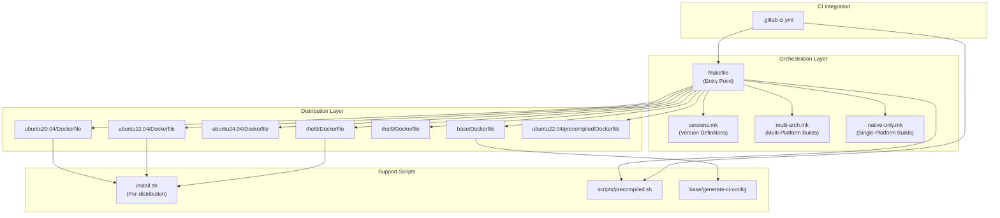
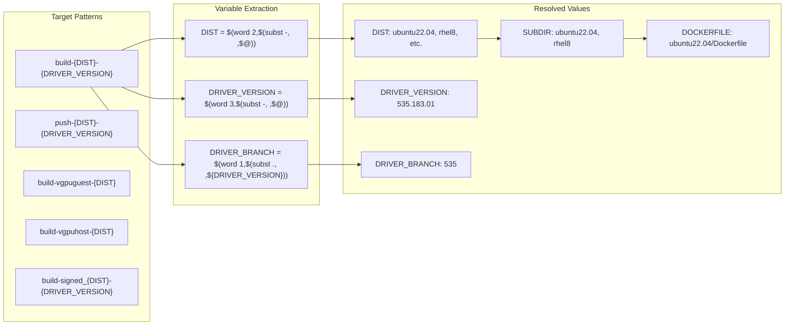
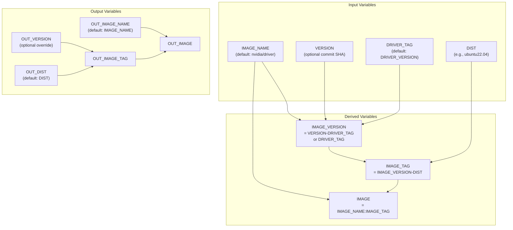
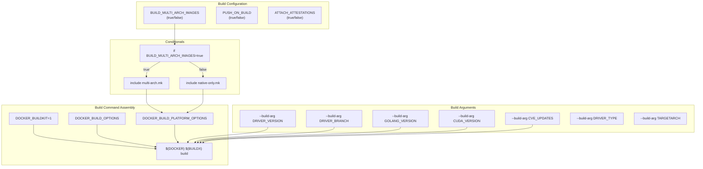
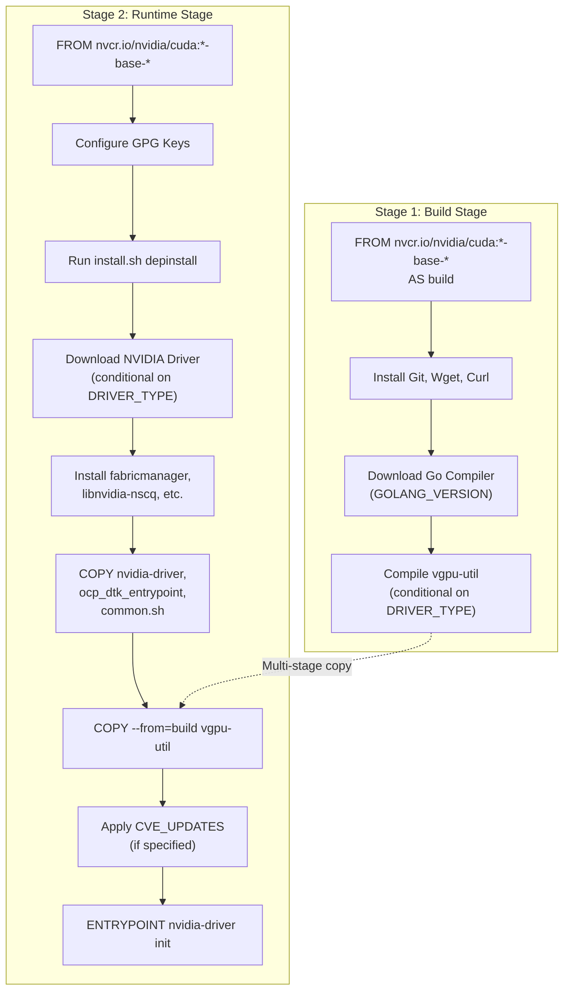
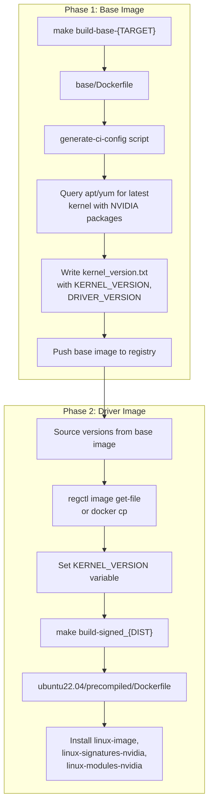

<!-- source: DeepWiki mcp.deepwiki.com · repo NVIDIA/gpu-driver-container · page 6 Build System Configuration · fetched 2026-10-26 -->

# Build System Configuration

<details>
<summary>Relevant source files</summary>

The following files were used as context for generating this wiki page:

- [.gitlab-ci.yml](.gitlab-ci.yml)
- [Makefile](Makefile)
- [base/Dockerfile](base/Dockerfile)
- [base/generate-ci-config](base/generate-ci-config)
- [multi-arch.mk](multi-arch.mk)
- [native-only.mk](native-only.mk)
- [rhel8/Dockerfile](rhel8/Dockerfile)
- [rhel9/Dockerfile](rhel9/Dockerfile)
- [scripts/precompiled.sh](scripts/precompiled.sh)
- [ubuntu20.04/Dockerfile](ubuntu20.04/Dockerfile)
- [ubuntu22.04/Dockerfile](ubuntu22.04/Dockerfile)

</details>


## Purpose and Scope

This document describes the build system configuration that orchestrates the creation of NVIDIA GPU driver container images across multiple Linux distributions, driver versions, and CPU architectures. The build system consists of a Makefile-based orchestration layer, distribution-specific Dockerfiles, and supporting scripts that handle image variants, multi-architecture builds, and precompiled drivers.

For information about how the build system is invoked by CI/CD pipelines, see [CI/CD Pipeline](#3). For details on the types of images produced, see [Container Image Types](#4). For in-depth documentation of specific subsystems, see [Makefile System](#6.1), [Dockerfile Architecture](#6.2), [Build Arguments and Variables](#6.3), and [Distribution Build Matrix](#6.4).

## Build System Architecture

The build system is structured as a three-layer hierarchy: a Makefile orchestration layer, distribution-specific build directories with Dockerfiles, and platform-specific include files that define build behavior.



**Sources:** [Makefile:1-308](), [.gitlab-ci.yml:1-132](), [multi-arch.mk:1-32](), [native-only.mk:1-28](), [scripts/precompiled.sh:1-114]()

## Build Target Resolution

The Makefile defines a matrix of build targets by combining distribution identifiers, driver versions, and build types. Target names follow a predictable pattern that the Makefile parses to extract build parameters.



**Sources:** [Makefile:152-175](), [Makefile:129-131]()

The Makefile uses pattern-based variable assignment to extract parameters from target names:

- **Line 152:** `build-%: DIST = $(word 2,$(subst -, ,$@))` - Extracts distribution from target name
- **Line 153:** `build-%: DRIVER_VERSION = $(word 3,$(subst -, ,$@))` - Extracts driver version
- **Line 154:** `build-%: DRIVER_BRANCH = $(word 1,$(subst ., ,${DRIVER_VERSION}))` - Derives branch from version
- **Line 155:** `build-%: SUBDIR = $(word 2,$(subst -, ,$@))` - Maps distribution to subdirectory
- **Line 156:** `build-%: DOCKERFILE = $(CURDIR)/$(SUBDIR)/Dockerfile` - Constructs Dockerfile path

## Image Naming and Tagging

The build system generates image names and tags based on a configurable hierarchy of variables that allow for both development and production tagging schemes.



**Example Tag Formats:**

| Scenario | VERSION | DRIVER_VERSION | DIST | Resulting IMAGE_TAG |
|----------|---------|----------------|------|---------------------|
| Development Build | `abc1234` | `535.183.01` | `ubuntu22.04` | `abc1234-535.183.01-ubuntu22.04` |
| Production Build | (empty) | `535.183.01` | `ubuntu22.04` | `535.183.01-ubuntu22.04` |
| Precompiled Driver | `abc1234` | `535.183.01` | `ubuntu22.04` | `abc1234-535-5.15.0-91-generic-ubuntu22.04` |

**Sources:** [Makefile:25-54](), [Makefile:30-42]()

## Docker Build Invocation

All distribution builds converge on a common Docker build invocation pattern that passes standardized build arguments and honors multi-architecture build settings.



**Sources:** [Makefile:163-175](), [Makefile:18-20](), [multi-arch.mk:15-18](), [native-only.mk:15]()

The actual build invocation at [Makefile:163-175]() uses Docker BuildKit and conditionally enables buildx for multi-architecture builds:

```
DOCKER_BUILDKIT=1 \
    $(DOCKER) $(BUILDX) build --pull \
        $(DOCKER_BUILD_OPTIONS) \
        $(DOCKER_BUILD_PLATFORM_OPTIONS) \
        --tag $(IMAGE) \
        --build-arg DRIVER_VERSION="$(DRIVER_VERSION)" \
        --build-arg GOLANG_VERSION="$(GOLANG_VERSION)" \
        --build-arg DRIVER_BRANCH="$(DRIVER_BRANCH)" \
        --build-arg CUDA_VERSION="$(CUDA_VERSION)" \
        --build-arg CVE_UPDATES="$(CVE_UPDATES)" \
        $(DOCKER_BUILD_ARGS) \
        --file $(DOCKERFILE) \
        $(CURDIR)/$(SUBDIR)
```

## Multi-Architecture Build Support

When `BUILD_MULTI_ARCH_IMAGES=true`, the build system includes [multi-arch.mk]() which configures Docker buildx to produce both `linux/amd64` and `linux/arm64` images in a single build operation.

**Multi-Architecture Configuration:**

| Variable | Value (multi-arch.mk) | Value (native-only.mk) |
|----------|----------------------|------------------------|
| `DOCKER_BUILD_OPTIONS` | `--output=type=image,push=$(PUSH_ON_BUILD) --provenance=$(ATTACH_ATTESTATIONS) --sbom=$(ATTACH_ATTESTATIONS)` | (not set) |
| `DOCKER_BUILD_PLATFORM_OPTIONS` | `--platform=linux/amd64,linux/arm64` | `--platform=linux/amd64` |
| Push mechanism | `regctl image copy` | `docker tag && docker push` |

**Architecture-Specific Exceptions:**

Several distributions only support single-architecture builds due to base image or tooling limitations:

```makefile
# No multi-arch support for the following distributions
build-ubuntu18.04%: DOCKER_BUILD_PLATFORM_OPTIONS = --platform=linux/amd64
build-signed_ubuntu20.04%: DOCKER_BUILD_PLATFORM_OPTIONS = --platform=linux/amd64
build-signed_ubuntu22.04%: DOCKER_BUILD_PLATFORM_OPTIONS = --platform=linux/amd64
build-signed_ubuntu24.04%: DOCKER_BUILD_PLATFORM_OPTIONS = --platform=linux/amd64
build-sles%: DOCKER_BUILD_PLATFORM_OPTIONS = --platform=linux/amd64
```

**Sources:** [multi-arch.mk:15-31](), [native-only.mk:15]()

## Dockerfile Structure and Patterns

All distribution Dockerfiles follow a common two-stage build pattern that separates build-time dependencies from runtime requirements.



**Sources:** [rhel8/Dockerfile:1-110](), [ubuntu22.04/Dockerfile:1-117](), [rhel9/Dockerfile:1-115]()

### Common Dockerfile Build Arguments

Every Dockerfile accepts a standard set of build arguments that control driver version, architecture, and driver type:

| Build Argument | Purpose | Example Value |
|----------------|---------|---------------|
| `TARGETARCH` | Target CPU architecture | `amd64`, `arm64` |
| `GOLANG_VERSION` | Go compiler version for vgpu-util | `1.20.4` |
| `DRIVER_VERSION` | NVIDIA driver version | `535.183.01` |
| `DRIVER_BRANCH` | Driver major version | `535` |
| `DRIVER_TYPE` | Driver deployment mode | `passthrough`, `vgpu` |
| `VGPU_LICENSE_SERVER_TYPE` | vGPU license server type | `NLS`, `Legacy` |
| `DISABLE_VGPU_VERSION_CHECK` | Skip vGPU version check | `true`, `false` |
| `CVE_UPDATES` | Packages to update for CVE fixes | `curl libc6` |
| `BASE_URL` | Driver download URL | `https://us.download.nvidia.com/tesla` |

**Sources:** [rhel8/Dockerfile:3-46](), [ubuntu22.04/Dockerfile:3-61]()

### Architecture Translation Logic

Dockerfiles translate the `TARGETARCH` build argument (Docker's naming) to distribution-specific architecture names using shell parameter expansion:

**Ubuntu/Debian:**
```dockerfile
# TARGETARCH (amd64/arm64) -> OS_ARCH (x86_64/sbsa) for CUDA repos
OS_ARCH=${TARGETARCH/amd64/x86_64} && OS_ARCH=${OS_ARCH/arm64/sbsa}

# TARGETARCH (amd64/arm64) -> DRIVER_ARCH (x86_64/aarch64) for driver downloads
DRIVER_ARCH=${TARGETARCH/amd64/x86_64} && DRIVER_ARCH=${DRIVER_ARCH/arm64/aarch64}
```

**RHEL/CentOS:**
```dockerfile
# TARGETARCH (amd64/arm64) -> OS_ARCH (x86_64/sbsa) for repo setup
OS_ARCH=${TARGETARCH/amd64/x86_64} && OS_ARCH=${OS_ARCH/arm64/sbsa}

# TARGETARCH (amd64/arm64) -> DRIVER_ARCH (x86_64/aarch64) for driver downloads
DRIVER_ARCH=${TARGETARCH/amd64/x86_64} && DRIVER_ARCH=${DRIVER_ARCH/arm64/aarch64}
```

**Sources:** [ubuntu22.04/Dockerfile:70-71](), [rhel8/Dockerfile:52-53](), [rhel8/Dockerfile:67-68]()

### Conditional Driver Download

Driver download logic branches based on the `DRIVER_TYPE` build argument to support both standard passthrough and vGPU scenarios:

```dockerfile
# Standard passthrough/baremetal driver download
RUN if [ "$DRIVER_TYPE" != "vgpu" ]; then \
    cd drivers && \
    DRIVER_ARCH=${TARGETARCH/amd64/x86_64} && DRIVER_ARCH=${DRIVER_ARCH/arm64/aarch64} && \
    curl -fSsl -O $BASE_URL/$DRIVER_VERSION/NVIDIA-Linux-$DRIVER_ARCH-$DRIVER_VERSION.run && \
    chmod +x  NVIDIA-Linux-$DRIVER_ARCH-$DRIVER_VERSION.run; fi
```

For vGPU builds, the `.run` file must be manually placed in the `drivers/` directory before build, as vGPU drivers require NVIDIA Enterprise licensing.

**Sources:** [rhel8/Dockerfile:65-69](), [ubuntu22.04/Dockerfile:84-86]()

## Precompiled Image Build Flow

Precompiled driver images require a two-phase build process: first building a base image that detects the latest kernel version, then building the driver image with precompiled kernel modules for that specific kernel.



**Sources:** [scripts/precompiled.sh:1-114](), [base/Dockerfile:1-110](), [base/generate-ci-config:1-34](), [Makefile:206-222]()

### Base Image Generation

The base image uses the [generate-ci-config]() script to determine the latest kernel version that has both a `linux-image-*` package and a corresponding `linux-signatures-nvidia-*` package:

```bash
# Generate list of kernels with NVIDIA precompiled packages
SUPPORTED_KERNELS_LINUX_SIGNATURES_LIST=$(apt-cache search "linux-signatures-nvidia.*${LTS_KERNEL}.*${KERNEL_FLAVOR}" ...)

# Generate list of available kernel image packages
SUPPORTED_KERNELS_LINUX_IMAGE_LIST=$(apt-cache search linux-image-${LTS_KERNEL}.*-${KERNEL_FLAVOR} ...)

# Find exact matches and get the latest
SK=$(grep -Fxf <(echo "$SUPPORTED_KERNELS_LINUX_SIGNATURES_LIST") \
              <(echo "$SUPPORTED_KERNELS_LINUX_IMAGE_LIST") | tail -n1)
```

**Sources:** [base/generate-ci-config:19-29]()

### Version File Extraction

The [precompiled.sh]() script extracts kernel version information from the base image using either `regctl` or `docker cp`:

```bash
if command -v regctl; then
    regctl image get-file \
        ghcr.io/nvidia/driver:base-${BASE_TARGET}-${LTS_KERNEL}-${KERNEL_FLAVOR}-${DRIVER_BRANCH} \
        /var/kernel_version.txt kernel_version.txt
else
    docker run --pull=always -d --name base-${BASE_TARGET}-${KERNEL_FLAVOR} ...
    docker cp base-${BASE_TARGET}-${KERNEL_FLAVOR}:/var/kernel_version.txt kernel_version.txt
fi
```

**Sources:** [scripts/precompiled.sh:24-36]()

## Distribution-Specific Build Rules

The Makefile includes special rules for distributions that require non-standard Dockerfile locations or additional build arguments.

### RHCOS (Red Hat CoreOS)

RHCOS images use the RHEL8 Dockerfile but with modified subdirectory mapping:

```makefile
build-rhcos%: SUBDIR = rhel8
```

**Sources:** [Makefile:177]()

### Fedora

Fedora images use a dedicated `fedora/` subdirectory:

```makefile
build-fedora%: SUBDIR = fedora
```

**Sources:** [Makefile:179]()

### SLES (SUSE Linux Enterprise Server)

SLES builds require passing the SLES version as a build argument:

```makefile
build-sles15%: SUBDIR = sle15
build-sles%: DOCKER_BUILD_ARGS = --build-arg SLES_VERSION=$(subst sles,,$(word 2,$(subst -, ,$@)))
```

**Sources:** [Makefile:181-182]()

### Precompiled Ubuntu Images

Precompiled Ubuntu images use a different subdirectory and include the kernel version in the image tag:

```makefile
build-signed_ubuntu22.04%: DIST = ubuntu22.04
build-signed_ubuntu22.04%: SUBDIR = ubuntu22.04/precompiled
build-signed_ubuntu22.04%: DRIVER_TAG = $(DRIVER_BRANCH)
build-signed_ubuntu22.04%: IMAGE_TAG = $(if $(VERSION),$(VERSION)-)$(DRIVER_BRANCH)-$(KERNEL_VERSION)-$(DIST)
build-signed_ubuntu22.04%: DOCKER_BUILD_ARGS = --build-arg KERNEL_VERSION="$(KERNEL_VERSION)"
```

**Sources:** [Makefile:190-194]()

## vGPU Build Targets

The build system provides separate target families for vGPU guest and host drivers, which require different Dockerfiles and build configurations.

### vGPU Guest Driver Builds

vGPU guest drivers are built using the standard distribution Dockerfiles with `DRIVER_TYPE=vgpu`:

```makefile
$(VGPU_GUEST_DRIVER_BUILD_TARGETS):
    DOCKER_BUILDKIT=1 \
        $(DOCKER) $(BUILDX) build --pull \
            $(DOCKER_BUILD_OPTIONS) \
            $(DOCKER_BUILD_PLATFORM_OPTIONS) \
            --tag $(IMAGE) \
            --build-arg DRIVER_TYPE=vgpu \
            --build-arg VGPU_LICENSE_SERVER_TYPE=NLS \
            --build-arg DRIVER_VERSION="$(DRIVER_VERSION)" \
            --build-arg DRIVER_BRANCH="$(DRIVER_BRANCH)" \
            ...
```

The driver version must include the `-grid` suffix, which is automatically added and stripped as needed:

```makefile
build-vgpuguest-%: DRIVER_VERSION := $(addsuffix -grid,$(VGPU_GUEST_DRIVER_VERSION:-grid=))
build-vgpuguest-%: DRIVER_TAG = $(DRIVER_VERSION:-grid=)
```

**Sources:** [Makefile:234-262](), [Makefile:238-244]()

### vGPU Host Driver Builds

vGPU host (vGPU Manager) images use dedicated Dockerfiles under `vgpu-manager/`:

```makefile
build-vgpuhost-%: DOCKERFILE = $(CURDIR)/vgpu-manager/$(SUBDIR)/Dockerfile
```

**Sources:** [Makefile:272-298](), [Makefile:281]()

## CI/CD Integration Points

The GitLab CI pipeline invokes the build system through two primary mechanisms:

### Standard Image Builds

GitLab CI jobs call Makefile targets directly:

```yaml
.image-build-generic:
  stage: image-build
  script:
    - if [[ "${PRECOMPILED}" == "true" ]]; then 
        ./scripts/precompiled.sh build; 
      else 
        make build-${DIST}-${DRIVER_VERSION}; 
      fi
```

**Sources:** [.gitlab-ci.yml:19-34]()

### Precompiled Image Builds

Precompiled builds invoke the [precompiled.sh]() wrapper script:

```yaml
.image-build-precompiled:
  extends: .image-build-generic
  variables:
    IN_REGISTRY: "${STAGING_REGISTRY}"
    IN_IMAGE_NAME: driver
    OUT_REGISTRY_USER: "${CI_REGISTRY_USER}"
    OUT_REGISTRY_TOKEN: "${CI_REGISTRY_PASSWORD}"
    OUT_REGISTRY: "${CI_REGISTRY}"
    OUT_IMAGE_NAME: "${CI_REGISTRY_IMAGE}/staging/driver"
    PRECOMPILED: "true"
```

**Sources:** [.gitlab-ci.yml:103-113]()

## Environment Variable Summary

The build system uses a hierarchical set of environment variables that can be overridden at multiple levels:

| Variable | Default | Defined In | Purpose |
|----------|---------|-----------|---------|
| `BUILD_MULTI_ARCH_IMAGES` | `no` | Makefile:15 | Enable multi-architecture builds |
| `DOCKER` | `docker` | Makefile:16 | Docker command |
| `PLATFORM` | `linux/amd64` | Makefile:103 | Platform for pull operations |
| `PUSH_ON_BUILD` | `false` | multi-arch.mk:15 | Push images during build |
| `ATTACH_ATTESTATIONS` | `false` | multi-arch.mk:16 | Attach provenance and SBOM |
| `IMAGE_NAME` | `nvidia/driver` | Makefile:26-27 | Base image name |
| `VERSION` | (empty) | Makefile:35 | Commit SHA for dev builds |
| `OUT_IMAGE_NAME` | `IMAGE_NAME` | Makefile:44 | Output image name |
| `OUT_VERSION` | (empty) | Makefile:46 | Override output version |
| `OUT_DIST` | `DIST` | Makefile:52 | Override output distribution |
| `LTS_KERNEL` | `""` | Makefile:205 | LTS kernel version for base images |
| `KERNEL_FLAVOR` | (varies) | base/generate-ci-config:11 | Kernel flavor (generic, lowlatency) |
| `VGPU_GUEST_DRIVER_VERSION` | `""` | Makefile:235 | vGPU guest driver version |
| `VGPU_HOST_DRIVER_VERSION` | `""` | Makefile:275 | vGPU host driver version |

**Sources:** [Makefile:15-54](), [multi-arch.mk:15-16](), [base/generate-ci-config:6-11]()

## Build Artifacts and Intermediate Files

The build system generates several intermediate files during the precompiled build process:

| File | Generated By | Contains | Used By |
|------|-------------|----------|---------|
| `/var/kernel_version.txt` | generate-ci-config | `KERNEL_VERSION`, `DRIVER_VERSION`, `DRIVER_VERSIONS` | Base image |
| `kernel_version.txt` | precompiled.sh | Extracted version variables | CI pipeline |
| `archive.tar` | `make archive-*` | Docker image archive | Artifact storage |

**Sources:** [base/generate-ci-config:32-33](), [scripts/precompiled.sh:6-37](), [Makefile:124-125]()

---

