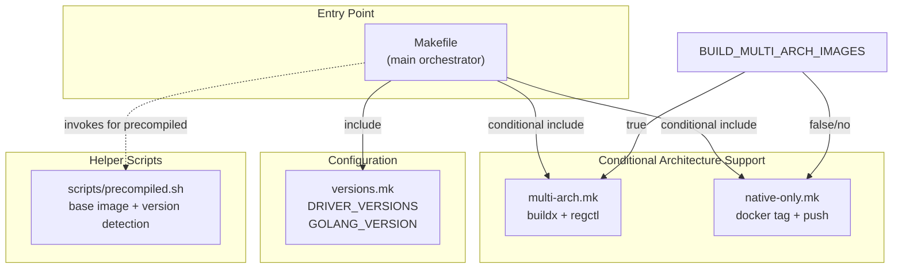
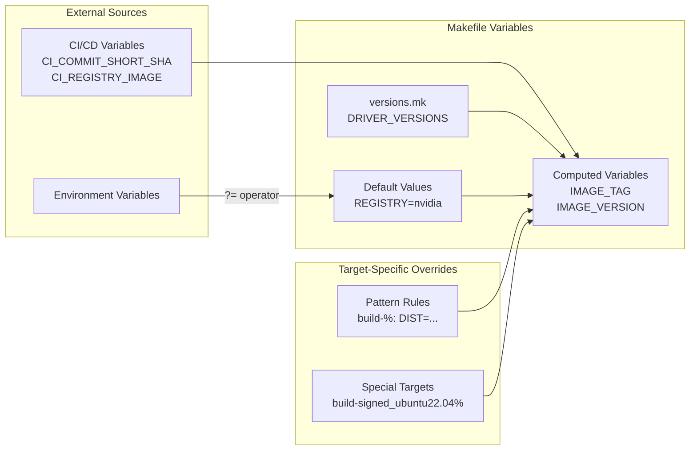
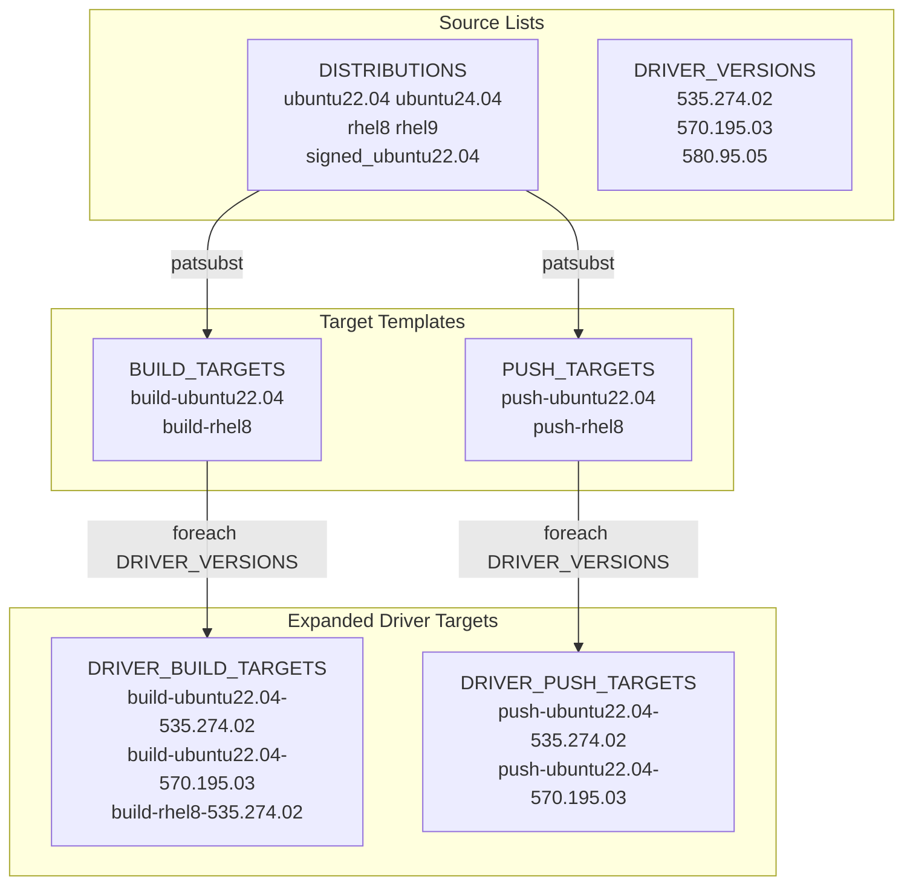
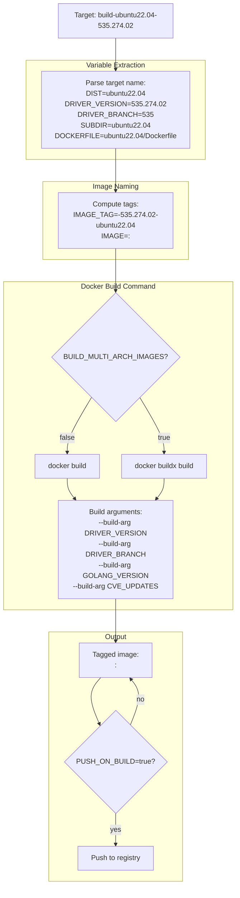
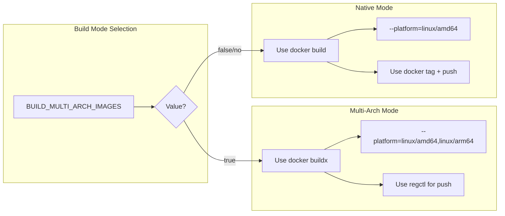
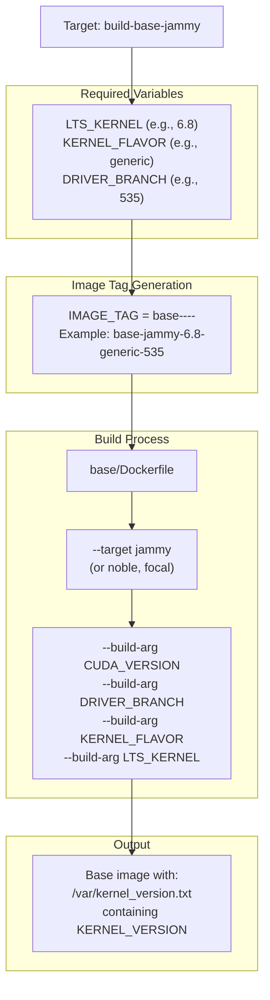
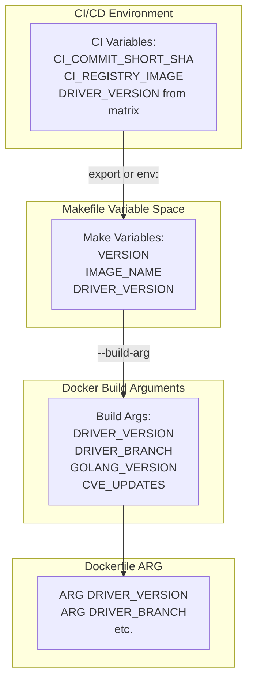

<!-- source: DeepWiki mcp.deepwiki.com · repo NVIDIA/gpu-driver-container · page 6.1 Makefile System · fetched 2026-10-26 -->

# Makefile System

<details>
<summary>Relevant source files</summary>

The following files were used as context for generating this wiki page:

- [.common-ci.yml](.common-ci.yml)
- [.github/workflows/image.yaml](.github/workflows/image.yaml)
- [.gitlab-ci.yml](.gitlab-ci.yml)
- [.nvidia-ci.yml](.nvidia-ci.yml)
- [Makefile](Makefile)
- [base/Dockerfile](base/Dockerfile)
- [base/generate-ci-config](base/generate-ci-config)
- [multi-arch.mk](multi-arch.mk)
- [native-only.mk](native-only.mk)
- [scripts/precompiled.sh](scripts/precompiled.sh)
- [versions.mk](versions.mk)

</details>


## Purpose and Scope

The Makefile System orchestrates the building, pushing, pulling, and archiving of driver container images across multiple Linux distributions, driver versions, and architectures. It provides a unified interface for local development and CI/CD pipelines, with pattern-based target generation that creates hundreds of specific build targets from a compact set of rules.

This document covers the Makefile structure, variable resolution, target generation patterns, and multi-architecture support. For build arguments and their effects, see [Build Arguments and Variables](#6.3). For the supported distribution matrix, see [Distribution Build Matrix](#6.4). For Dockerfile structure, see [Dockerfile Architecture](#6.2).

## Makefile Architecture

The Makefile system is composed of four files that work together:



**Sources:** [Makefile:15-84](), [versions.mk:1-19](), [multi-arch.mk:1-32](), [native-only.mk:1-28]()

### File Responsibilities

| File | Primary Responsibility | Key Variables/Targets |
|------|----------------------|---------------------|
| `Makefile` | Target generation, variable setup, pattern matching | `DISTRIBUTIONS`, `DRIVER_BUILD_TARGETS`, `IMAGE_NAME` |
| `versions.mk` | Version configuration | `DRIVER_VERSIONS`, `GOLANG_VERSION` |
| `multi-arch.mk` | Multi-arch builds using buildx | `DOCKER_BUILD_PLATFORM_OPTIONS`, `PUSH_ON_BUILD` |
| `native-only.mk` | Single-arch builds using docker | Platform override to `linux/amd64` |

**Sources:** [Makefile:1-308](), [versions.mk:1-19](), [multi-arch.mk:1-32](), [native-only.mk:1-28]()

## Variable Resolution System

Variables in the Makefile follow a hierarchical resolution pattern, allowing CI/CD systems and local developers to override defaults:



**Sources:** [Makefile:15-55](), [versions.mk:15-16]()

### Core Variable Flow

The primary variables follow this resolution order:

1. **Driver Version** (`DRIVER_VERSION`): Extracted from target name or set from `DRIVER_VERSIONS` list
   ```makefile
   DRIVER_VERSIONS ?= 535.274.02 570.195.03 580.95.05
   ```
   [versions.mk:16]()

2. **Image Name** (`IMAGE_NAME`): Defaults to `nvidia/driver`, can be overridden
   ```makefile
   ifeq ($(IMAGE_NAME),)
   REGISTRY ?= nvidia
   IMAGE_NAME := $(REGISTRY)/driver
   endif
   ```
   [Makefile:25-28]()

3. **Image Tag** (`IMAGE_TAG`): Combines version, driver version, and distribution
   ```makefile
   IMAGE_VERSION = $(VERSION)-$(DRIVER_TAG)
   IMAGE_TAG = $(IMAGE_VERSION)-$(DIST)
   IMAGE = $(IMAGE_NAME):$(IMAGE_TAG)
   ```
   [Makefile:36-42]()

4. **Output Image** (`OUT_IMAGE`): Separate output name/version for registry promotion
   ```makefile
   OUT_IMAGE_NAME ?= $(IMAGE_NAME)
   OUT_IMAGE_TAG = $(OUT_IMAGE_VERSION)-$(OUT_DIST)
   OUT_IMAGE = $(OUT_IMAGE_NAME):$(OUT_IMAGE_TAG)
   ```
   [Makefile:44-54]()

**Sources:** [Makefile:22-55](), [versions.mk:15-18]()

## Target Generation and Naming Conventions

The Makefile uses pattern-based target generation to create specific targets from distribution and driver version lists:

### Target Generation Pattern



**Sources:** [Makefile:57-77]()

### Target Pattern Parsing

Targets are parsed using Make's pattern substitution to extract components:

```makefile
# build-ubuntu22.04-535.274.02 is parsed as:
build-%: DIST = $(word 2,$(subst -, ,$@))          # ubuntu22.04
build-%: DRIVER_VERSION = $(word 3,$(subst -, ,$@)) # 535.274.02
build-%: DRIVER_BRANCH = $(word 1,$(subst ., ,${DRIVER_VERSION})) # 535
build-%: SUBDIR = $(word 2,$(subst -, ,$@))        # ubuntu22.04
build-%: DOCKERFILE = $(CURDIR)/$(SUBDIR)/Dockerfile
```

**Sources:** [Makefile:152-156]()

### Hierarchical Target Dependencies

Targets have hierarchical dependencies that allow building all versions or specific ones:

| Target Type | Example | Effect |
|------------|---------|--------|
| Distribution shorthand | `make ubuntu22.04` | Builds all driver versions for ubuntu22.04 |
| Distribution target | `make build-ubuntu22.04` | Builds all driver versions for ubuntu22.04 |
| Specific version | `make build-ubuntu22.04-535.274.02` | Builds single specific image |
| Push all | `make push-ubuntu22.04` | Pushes all driver versions for ubuntu22.04 |
| Push specific | `make push-ubuntu22.04-535.274.02` | Pushes single specific image |

**Sources:** [Makefile:159-162]()

## Build Process Flow

The standard build process involves constructing the docker build command with appropriate arguments:



**Sources:** [Makefile:162-176](), [multi-arch.mk:15-18]()

### Build Target Implementation

The actual build targets execute Docker with computed parameters:

```makefile
$(DRIVER_BUILD_TARGETS):
	DOCKER_BUILDKIT=1 \
		$(DOCKER) $(BUILDX) build --pull \
				$(DOCKER_BUILD_OPTIONS) \
				$(DOCKER_BUILD_PLATFORM_OPTIONS) \
				--tag $(IMAGE) \
				--build-arg DRIVER_VERSION="$(DRIVER_VERSION)" \
				--build-arg GOLANG_VERSION="$(GOLANG_VERSION)" \
				--build-arg DRIVER_BRANCH="$(DRIVER_BRANCH)" \
				--build-arg CUDA_VERSION="$(CUDA_VERSION)" \
				--build-arg CVE_UPDATES="$(CVE_UPDATES)" \
				$(DOCKER_BUILD_ARGS) \
				--file $(DOCKERFILE) \
				$(CURDIR)/$(SUBDIR)
```

**Sources:** [Makefile:162-176]()

## Multi-Architecture Build Support

The build system supports both single-architecture and multi-architecture builds through conditional inclusion:

### Architecture Selection



**Sources:** [Makefile:15-84](), [multi-arch.mk:1-32](), [native-only.mk:1-28]()

### Multi-Architecture Configuration

When `BUILD_MULTI_ARCH_IMAGES=true`, the system includes `multi-arch.mk`:

```makefile
# From multi-arch.mk
PUSH_ON_BUILD ?= false
DOCKER_BUILD_OPTIONS = --output=type=image,push=$(PUSH_ON_BUILD)
DOCKER_BUILD_PLATFORM_OPTIONS = --platform=linux/amd64,linux/arm64

$(DRIVER_PUSH_TARGETS): push-%:
	$(REGCTL) image copy $(IMAGE) $(OUT_IMAGE)
```

**Sources:** [multi-arch.mk:15-24]()

### Platform Restrictions

Certain distributions only support single-architecture builds:

```makefile
# No multi-arch support for the following distributions
build-ubuntu18.04%: DOCKER_BUILD_PLATFORM_OPTIONS = --platform=linux/amd64
build-signed_ubuntu20.04%: DOCKER_BUILD_PLATFORM_OPTIONS = --platform=linux/amd64
build-signed_ubuntu22.04%: DOCKER_BUILD_PLATFORM_OPTIONS = --platform=linux/amd64
build-signed_ubuntu24.04%: DOCKER_BUILD_PLATFORM_OPTIONS = --platform=linux/amd64
build-sles%: DOCKER_BUILD_PLATFORM_OPTIONS = --platform=linux/amd64
```

**Sources:** [multi-arch.mk:27-31]()

### Native-Only Configuration

When multi-arch is disabled, simpler docker commands are used:

```makefile
# From native-only.mk
DOCKER_BUILD_PLATFORM_OPTIONS = --platform=linux/amd64

$(DRIVER_PUSH_TARGETS): push-%:
	$(DOCKER) tag "$(IMAGE)" "$(OUT_IMAGE)"
	$(DOCKER) push "$(OUT_IMAGE)"
```

**Sources:** [native-only.mk:15-19]()

## Special Target Types

The Makefile defines several specialized target types beyond standard driver images:

### Base Image Targets

Base images are used for precompiled driver builds to detect kernel versions:



**Sources:** [Makefile:206-222](), [base/Dockerfile:1-110]()

The base image build targets have a specific pattern:

```makefile
LTS_KERNEL ?= ""
build-base-%: $(if $(LTS_KERNEL),,$(error "LTS_KERNEL is not set"))
build-base-%: DOCKERFILE = $(CURDIR)/base/Dockerfile
build-base-%: TARGET = $(word 3,$(subst -, ,$@))
build-base-%: IMAGE_TAG = base-$(word 3,$(subst -, ,$@))-$(LTS_KERNEL)-$(KERNEL_FLAVOR)-$(DRIVER_BRANCH)
```

**Sources:** [Makefile:205-209]()

### Precompiled Driver Targets

Precompiled driver images use pre-built kernel modules and follow a different naming convention:

```makefile
# ubuntu22.04 Precompiled Driver
build-signed_ubuntu22.04%: DIST = ubuntu22.04
build-signed_ubuntu22.04%: SUBDIR = ubuntu22.04/precompiled
build-signed_ubuntu22.04%: DRIVER_TAG = $(DRIVER_BRANCH)
build-signed_ubuntu22.04%: IMAGE_TAG = $(if $(VERSION),$(VERSION)-)$(DRIVER_BRANCH)-$(KERNEL_VERSION)-$(DIST)
build-signed_ubuntu22.04%: DOCKER_BUILD_ARGS = --build-arg KERNEL_VERSION="$(KERNEL_VERSION)"
```

**Sources:** [Makefile:189-194]()

Key differences for precompiled targets:
- Image tag includes `KERNEL_VERSION` instead of full `DRIVER_VERSION`
- Uses `DRIVER_BRANCH` (e.g., "535") instead of full version
- Tag format: `<VERSION>-<DRIVER_BRANCH>-<KERNEL_VERSION>-<DIST>`

**Sources:** [Makefile:184-201]()

### vGPU Driver Targets

vGPU builds support both guest and host drivers with different patterns:

#### vGPU Guest Driver

```makefile
VGPU_GUEST_DRIVER_VERSION ?= ""
build-vgpuguest-%: $(if $(VGPU_GUEST_DRIVER_VERSION),,$(error "VGPU_GUEST_DRIVER_VERSION is not set"))
build-vgpuguest-%: DRIVER_VERSION := $(addsuffix -grid,$(VGPU_GUEST_DRIVER_VERSION:-grid=))
build-vgpuguest-%: DRIVER_TAG = $(DRIVER_VERSION:-grid=)

$(VGPU_GUEST_DRIVER_BUILD_TARGETS):
	DOCKER_BUILDKIT=1 \
		$(DOCKER) $(BUILDX) build --pull \
				--build-arg DRIVER_TYPE=vgpu \
				--build-arg VGPU_LICENSE_SERVER_TYPE=NLS \
				--build-arg DRIVER_VERSION="$(DRIVER_VERSION)" \
				...
```

**Sources:** [Makefile:235-262]()

#### vGPU Host Driver

```makefile
VGPU_HOST_DRIVER_VERSION ?= ""
build-vgpuhost-%: $(if $(VGPU_HOST_DRIVER_VERSION),,$(error "VGPU_HOST_DRIVER_VERSION is not set"))
build-vgpuhost-%: DRIVER_VERSION := $(VGPU_HOST_DRIVER_VERSION)
build-vgpuhost-%: DOCKERFILE = $(CURDIR)/vgpu-manager/$(SUBDIR)/Dockerfile
```

**Sources:** [Makefile:275-298]()

### Distribution-Specific Subdirectory Mapping

Some distributions use different subdirectories:

```makefile
build-rhcos%: SUBDIR = rhel8
build-fedora%: SUBDIR = fedora
build-sles15%: SUBDIR = sle15
```

**Sources:** [Makefile:177-181]()

## Integration with CI/CD

The Makefile serves as the primary interface between CI/CD systems and the build process:

### GitLab CI Integration

GitLab CI jobs invoke Makefile targets with environment variables:

```yaml
.image-build-generic:
  variables:
    IMAGE_NAME: "${CI_REGISTRY_IMAGE}"
    VERSION: "${CI_COMMIT_SHORT_SHA}"
    PUSH_ON_BUILD: "true"
  script:
    - if [[ "${PRECOMPILED}" == "true" ]]; then 
        ./scripts/precompiled.sh build; 
      else 
        make build-${DIST}-${DRIVER_VERSION}; 
      fi
```

**Sources:** [.gitlab-ci.yml:19-33]()

### GitHub Actions Integration

GitHub Actions use the Makefile directly with computed variables:

```yaml
- name: Build image
  env:
    IMAGE_NAME: ghcr.io/${LOWERCASE_REPO_OWNER}/driver
    VERSION: ${COMMIT_SHORT_SHA}
  run: |
    DRIVER_VERSIONS=${{ matrix.driver }} make build-${{ matrix.dist }}-${{ matrix.driver }}
```

**Sources:** [.github/workflows/image.yaml:86-92]()

### Variable Propagation Pattern



**Sources:** [.gitlab-ci.yml:19-33](), [Makefile:162-176]()

### Pull and Archive Operations

The Makefile also supports pull and archive operations used in scanning workflows:

```makefile
$(DRIVER_PULL_TARGETS): pull-%:
	$(DOCKER) pull "--platform=$(PLATFORM)" "$(IMAGE)"

$(DRIVER_ARCHIVE_TARGETS): archive-%:
	$(DOCKER) save "$(IMAGE)" -o "archive.tar"
```

**Sources:** [Makefile:104-125]()

These are used in security scanning:

```yaml
.scan-generic:
  script:
    - make pull-${DIST}-${DRIVER_VERSION}
    - make archive-${DIST}-${DRIVER_VERSION}
    - pulse-cli scan -i "archive.tar"
```

**Sources:** [.nvidia-ci.yml:169-176]()

### Precompiled Build Workflow

Precompiled builds use the helper script which internally calls Makefile targets:

```bash
# From scripts/precompiled.sh
function buildImage(){
    # Build the image
    make DRIVER_VERSIONS=${DRIVER_VERSIONS} DRIVER_BRANCH=${DRIVER_BRANCH} build-${DIST}-${DRIVER_VERSION}
}

function pushImage(){
    # push the image
    make DRIVER_VERSIONS=${DRIVER_VERSIONS} DRIVER_BRANCH=${DRIVER_BRANCH} push-${DIST}
}
```

**Sources:** [scripts/precompiled.sh:44-72]()

The script coordinates base image building and version detection before invoking Makefile targets:

```bash
case $1 in
    build)
        buildBaseImage
        pushBaseImage
        sourceVersions
        buildImage
        ;;
    push)
        sourceVersions
        pushImage
        ;;
```

**Sources:** [scripts/precompiled.sh:88-113]()

---

