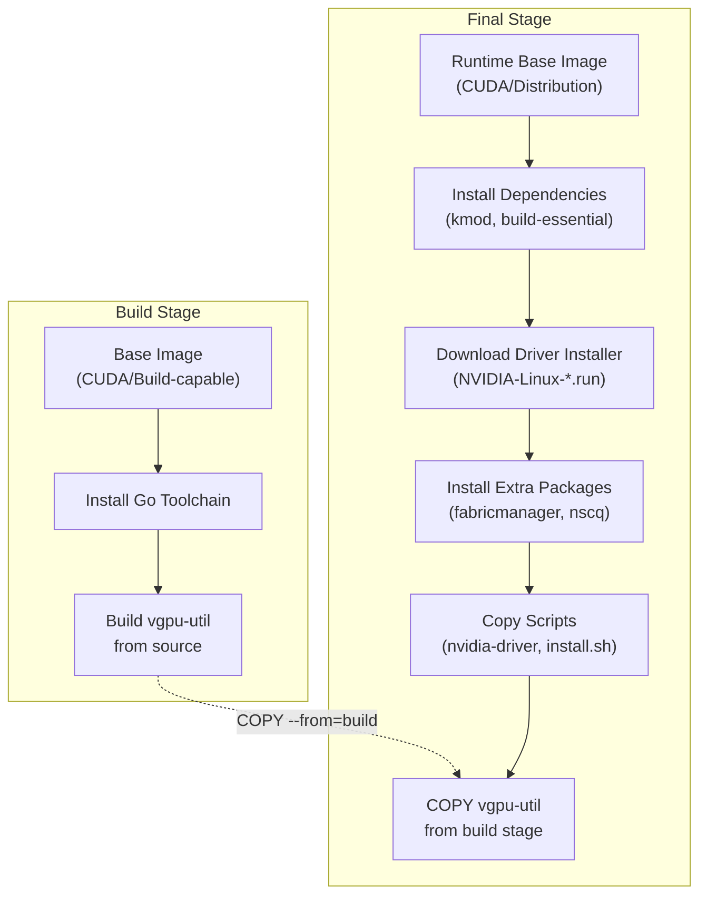
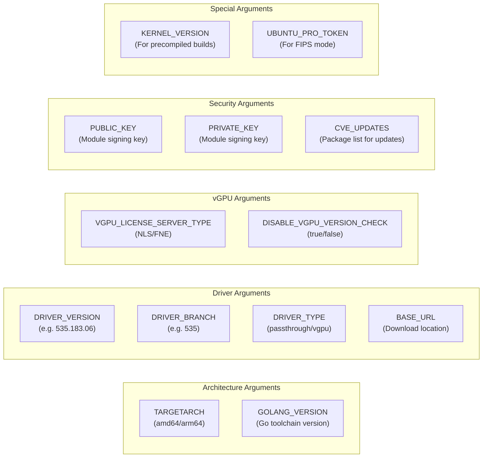
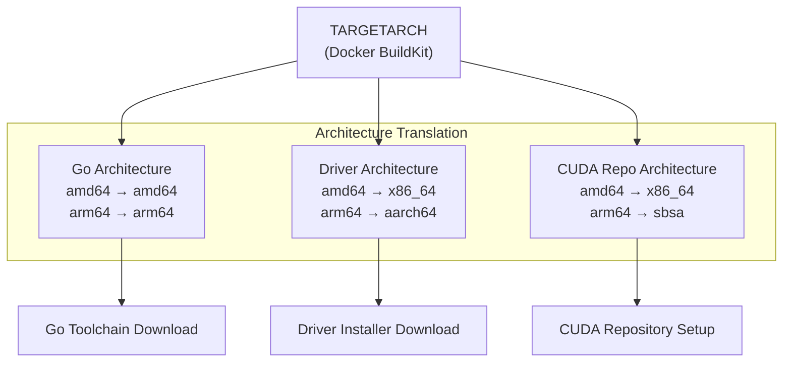
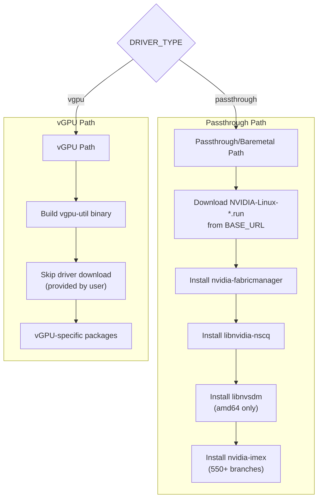
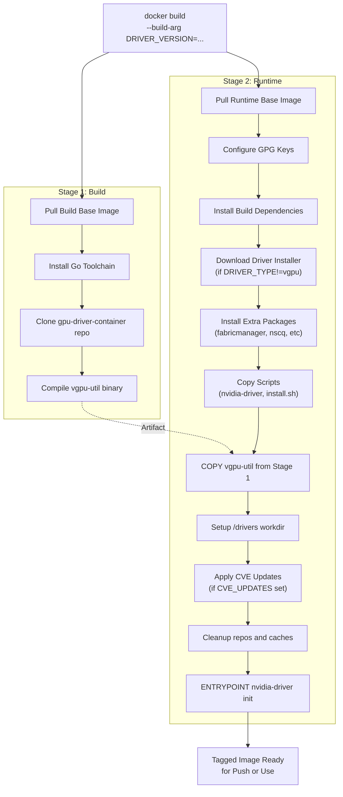

<!-- source: DeepWiki mcp.deepwiki.com · repo NVIDIA/gpu-driver-container · page 6.2 Dockerfile Architecture · fetched 2026-10-26 -->

# Dockerfile Architecture

<details>
<summary>Relevant source files</summary>

The following files were used as context for generating this wiki page:

- [coreos/Dockerfile](coreos/Dockerfile)
- [fedora/Dockerfile](fedora/Dockerfile)
- [photon3.0/Dockerfile](photon3.0/Dockerfile)
- [rhel8/Dockerfile](rhel8/Dockerfile)
- [rhel9/Dockerfile](rhel9/Dockerfile)
- [sle15/Dockerfile](sle15/Dockerfile)
- [ubuntu20.04/Dockerfile](ubuntu20.04/Dockerfile)
- [ubuntu22.04/Dockerfile](ubuntu22.04/Dockerfile)
- [ubuntu24.04/Dockerfile](ubuntu24.04/Dockerfile)
- [ubuntu24.04/install.sh](ubuntu24.04/install.sh)
- [ubuntu24.04/nvidia-driver](ubuntu24.04/nvidia-driver)

</details>


This page documents the structure, patterns, and conventions used across the Dockerfile implementations in the gpu-driver-container repository. Each supported Linux distribution has its own Dockerfile that follows common architectural patterns while accommodating distribution-specific requirements.

For information about the Makefile system that orchestrates Dockerfile builds, see [Makefile System](#6.1). For details on specific build arguments and their effects, see [Build Arguments and Variables](#6.3). For runtime script architecture, see [Driver Management Scripts](#5).

## Multi-Stage Build Pattern

All Dockerfiles follow a multi-stage build pattern to separate build-time dependencies from the final runtime image. This reduces final image size and attack surface while maintaining the flexibility to compile Go utilities and prepare build artifacts.



**Sources:** [rhel8/Dockerfile:1-23](), [ubuntu20.04/Dockerfile:1-34](), [ubuntu22.04/Dockerfile:1-39]()

### Build Stage Components

The build stage compiles the `vgpu-util` Go binary, which is used for vGPU driver version detection and compatibility checking at runtime. The build stage pattern is consistent across distributions:

1. **Base Image Selection**: Uses a CUDA base image or distribution-specific build image
2. **Go Installation**: Downloads and extracts the Go toolchain based on `TARGETARCH`
3. **Repository Clone**: Clones the gpu-driver-container repository
4. **Binary Compilation**: Builds `vgpu-util` from [vgpu/src]()
5. **Artifact Staging**: Places the binary in a known location for copying

**Architecture Translation**: The build stage translates Docker's `TARGETARCH` (amd64/arm64) to Go's architecture naming (amd64/arm64):

```dockerfile
RUN OS_ARCH=${TARGETARCH/x86_64/amd64} && OS_ARCH=${OS_ARCH/aarch64/arm64}
```

**Sources:** [rhel8/Dockerfile:1-22](), [ubuntu22.04/Dockerfile:22-28](), [rhel9/Dockerfile:17-29]()

### Conditional vGPU Build

Some distributions conditionally build the vGPU utility only when `DRIVER_TYPE=vgpu`:

```dockerfile
RUN if [ "$DRIVER_TYPE" = "vgpu" ]; then \
    git clone https://github.com/NVIDIA/gpu-driver-container driver && \
    cd driver/vgpu/src && \
    go build -o vgpu-util && \
    mv vgpu-util /work; fi
```

This optimization reduces build time for non-vGPU images by skipping the Go compilation step entirely.

**Sources:** [ubuntu22.04/Dockerfile:34-38](), [rhel9/Dockerfile:25-29](), [ubuntu24.04/Dockerfile:38-42]()

## Base Image Selection

Each distribution uses a base image appropriate for its package management system and runtime requirements. The base image selection determines available packages, GPG keys, and system libraries.

| Distribution | Build Stage Base | Runtime Stage Base | Purpose |
|-------------|------------------|-------------------|---------|
| Ubuntu 20.04 | `cuda:12.9.1-base-ubuntu20.04` | `cuda:12.9.1-base-ubuntu20.04` | CUDA compatibility, apt packages |
| Ubuntu 22.04 | `cuda:13.0.1-base-ubuntu22.04` | `cuda:13.0.1-base-ubuntu22.04` | CUDA compatibility, apt packages |
| Ubuntu 24.04 | `ubuntu:noble-20250925` | `ubuntu:noble-20250925` | Latest Ubuntu, ARG-configurable |
| RHEL 8 | `cuda:13.0.1-base-ubi8` | `cuda:13.0.1-base-ubi8` | CUDA compatibility, dnf packages |
| RHEL 9 | `cuda:13.0.1-base-ubi9` | `cuda:13.0.1-base-ubi9` | CUDA compatibility, dnf packages |
| CoreOS | N/A (single stage with golang image) | `ubuntu:16.04` | Legacy compatibility, older kernel support |
| Fedora | `cuda:13.0.1-base-ubi8` | `fedora:${FEDORA_VERSION}` | Configurable Fedora version |
| SLES 15 | `registry.suse.com/bci/golang:1.25` | `registry.suse.com/suse/sle15:$SLES_VERSION` | SUSE package ecosystem |
| Photon 3.0 | N/A (single stage) | `photon:3.0` | VMware Photon OS |

**Sources:** [ubuntu20.04/Dockerfile:1,35](), [ubuntu22.04/Dockerfile:1,40](), [ubuntu24.04/Dockerfile:1,44](), [rhel8/Dockerfile:1,24](), [rhel9/Dockerfile:1-3,31](), [coreos/Dockerfile:4,11](), [fedora/Dockerfile:3,29](), [sle15/Dockerfile:4,15](), [photon3.0/Dockerfile:3]()

## Build Arguments and Environment Variables

Dockerfiles declare a standard set of build arguments that control image behavior. These arguments are set by the Makefile during builds and can be overridden by users.



**Sources:** [rhel8/Dockerfile:3-4,26-46,82-86,100](), [ubuntu20.04/Dockerfile:3-4,39-56,89-93](), [ubuntu24.04/Dockerfile:5-6,49-65,92]()

### ARG and ENV Pattern

Most build arguments follow a two-step pattern: declare as `ARG`, then promote to `ENV` for runtime availability:

```dockerfile
ARG DRIVER_VERSION
ENV DRIVER_VERSION=$DRIVER_VERSION
ARG DRIVER_BRANCH
ENV DRIVER_BRANCH=$DRIVER_BRANCH
ARG TARGETARCH
ENV TARGETARCH=$TARGETARCH
```

This pattern ensures that:
1. Values can be set at build time (`docker build --build-arg DRIVER_VERSION=...`)
2. Values are available in subsequent Dockerfile layers
3. Values persist into the running container for use by scripts

**Sources:** [rhel8/Dockerfile:26-36](), [ubuntu22.04/Dockerfile:45-61](), [rhel9/Dockerfile:33-54]()

### Critical Environment Variables

Certain environment variables have special significance:

- **`NVIDIA_VISIBLE_DEVICES=void`**: Disables automatic GPU visibility to avoid dependency on nvidia-container-toolkit during driver installation
- **`DEBIAN_FRONTEND=noninteractive`**: Prevents apt from prompting for user input during package installation

**Sources:** [rhel8/Dockerfile:47](), [ubuntu20.04/Dockerfile:44,56](), [ubuntu22.04/Dockerfile:49,61]()

## Architecture Handling

All modern Dockerfiles support multi-architecture builds (amd64/arm64) through architecture translation and conditional logic.



**Sources:** [rhel8/Dockerfile:11-12,52,67-68](), [ubuntu20.04/Dockerfile:22-23,65-66](), [ubuntu24.04/Dockerfile:30-31]()

### Architecture Translation Examples

**Go Toolchain**: Maps to Go's naming convention:
```dockerfile
RUN OS_ARCH=${TARGETARCH/x86_64/amd64} && OS_ARCH=${OS_ARCH/aarch64/arm64}
```

**Driver Installer**: Maps to NVIDIA's naming convention:
```dockerfile
DRIVER_ARCH=${TARGETARCH/amd64/x86_64} && DRIVER_ARCH=${DRIVER_ARCH/arm64/aarch64}
```

**CUDA Repository**: Maps to NVIDIA's repository naming:
```dockerfile
OS_ARCH=${TARGETARCH/amd64/x86_64} && OS_ARCH=${OS_ARCH/arm64/sbsa}
```

**Sources:** [rhel8/Dockerfile:11-12,52,67-68](), [ubuntu22.04/Dockerfile:26-27,70-71](), [ubuntu24.04/install.sh:6,42]()

## Driver Type Conditional Logic

Dockerfiles contain conditional logic to handle different driver types (passthrough/baremetal vs. vGPU). This affects which packages are downloaded and which utilities are built.



**Sources:** [rhel8/Dockerfile:39,65-69,72](), [ubuntu20.04/Dockerfile:47,79-85](), [ubuntu22.04/Dockerfile:7,84-86]()

### Passthrough Driver Download

For passthrough/baremetal driver types, the Dockerfile downloads the official NVIDIA driver installer:

```dockerfile
RUN if [ "$DRIVER_TYPE" != "vgpu" ]; then \
    cd drivers && \
    DRIVER_ARCH=${TARGETARCH/amd64/x86_64} && DRIVER_ARCH=${DRIVER_ARCH/arm64/aarch64} && \
    curl -fSsl -O $BASE_URL/$DRIVER_VERSION/NVIDIA-Linux-$DRIVER_ARCH-$DRIVER_VERSION.run && \
    chmod +x  NVIDIA-Linux-$DRIVER_ARCH-$DRIVER_VERSION.run; fi
```

**Sources:** [rhel8/Dockerfile:65-69](), [rhel9/Dockerfile:73-77](), [fedora/Dockerfile:80-84]()

### Extra Packages Installation

Additional packages are installed conditionally based on driver type, architecture, and driver branch. The `install.sh` script often handles this logic:

```dockerfile
RUN sh /tmp/install.sh extrapkgsinstall
```

Or inline:
```dockerfile
RUN /tmp/install.sh extra_pkgs_install
```

**Sources:** [rhel8/Dockerfile:72](), [rhel9/Dockerfile:80](), [ubuntu22.04/Dockerfile:88](), [ubuntu24.04/Dockerfile:87]()

## Common Installation Patterns

Several patterns are repeated across all distributions to ensure consistent functionality.

### Utility Installation

All Dockerfiles install two critical utilities for kernel inspection and module extraction:

1. **`donkey`**: Utility for working with DKMS-like functionality
2. **`extract-vmlinux`**: Script to extract vmlinux from compressed kernel images

```dockerfile
RUN curl -fsSL -o /usr/local/bin/donkey https://github.com/3XX0/donkey/releases/download/v1.1.0/donkey && \
    curl -fsSL -o /usr/local/bin/extract-vmlinux https://raw.githubusercontent.com/torvalds/linux/master/scripts/extract-vmlinux && \
    chmod +x /usr/local/bin/donkey /usr/local/bin/extract-vmlinux
```

**Sources:** [rhel8/Dockerfile:58-61](), [ubuntu20.04/Dockerfile:69-70](), [rhel9/Dockerfile:65-68](), [coreos/Dockerfile:37-39]()

### Script Installation

Core runtime scripts are copied into the image:

```dockerfile
COPY nvidia-driver /usr/local/bin
COPY ocp_dtk_entrypoint /usr/local/bin  # RHEL-based only
COPY common.sh /usr/local/bin            # Some distributions
```

- **`nvidia-driver`**: Main entrypoint script for driver initialization and lifecycle management
- **`ocp_dtk_entrypoint`**: OpenShift Driver Toolkit compatibility wrapper
- **`common.sh`**: Shared utility functions

**Sources:** [rhel8/Dockerfile:74-76](), [ubuntu20.04/Dockerfile:72](), [rhel9/Dockerfile:82-84](), [ubuntu24.04/Dockerfile:76]()

### vGPU Utility Copying

The `vgpu-util` binary built in the build stage is copied to the runtime image:

```dockerfile
COPY --from=build /work/vgpu-util /usr/local/bin
```

Some distributions use a wildcard to handle conditional builds:
```dockerfile
COPY --from=build /work/vgpu-util* /usr/local/bin
```

**Sources:** [rhel8/Dockerfile:78](), [ubuntu20.04/Dockerfile:74](), [ubuntu22.04/Dockerfile:79](), [rhel9/Dockerfile:86]()

### Working Directory and Driver Staging

All images set a working directory for driver operations:

```dockerfile
ADD drivers drivers/
WORKDIR /drivers
```

This creates a `/drivers` directory where:
- Downloaded driver installers are stored
- User-provided vGPU drivers are mounted
- Configuration files (gridd.conf, ClientConfigToken) are placed

**Sources:** [rhel8/Dockerfile:63,80](), [ubuntu20.04/Dockerfile:76,87](), [ubuntu22.04/Dockerfile:81,90]()

## GPG Key Management

RHEL-based distributions configure NVIDIA GPG keys for package verification:

```dockerfile
RUN NVIDIA_GPGKEY_SUM=d0664fbbdb8c32356d45de36c5984617217b2d0bef41b93ccecd326ba3b80c87 && \
    OS_ARCH=${TARGETARCH/amd64/x86_64} && OS_ARCH=${OS_ARCH/arm64/sbsa} && \
    curl -fsSL "https://developer.download.nvidia.com/compute/cuda/repos/rhel8/$OS_ARCH/D42D0685.pub" | sed '/^Version/d' > /etc/pki/rpm-gpg/RPM-GPG-KEY-NVIDIA && \
    echo "$NVIDIA_GPGKEY_SUM  /etc/pki/rpm-gpg/RPM-GPG-KEY-NVIDIA" | sha256sum -c --strict -
```

Ubuntu distributions handle GPG keys differently:

```dockerfile
RUN apt-key del 7fa2af80 && OS_ARCH=${TARGETARCH/amd64/x86_64} && OS_ARCH=${OS_ARCH/arm64/sbsa} && \
    apt-key adv --fetch-keys "https://developer.download.nvidia.com/compute/cuda/repos/ubuntu2004/${OS_ARCH}/3bf863cc.pub"
```

**Sources:** [rhel8/Dockerfile:51-55](), [rhel9/Dockerfile:58-61](), [ubuntu20.04/Dockerfile:65-66](), [ubuntu22.04/Dockerfile:70-71]()

## Module Signing Support

All Dockerfiles support kernel module signing for Secure Boot compatibility:

```dockerfile
ARG PUBLIC_KEY=empty
COPY ${PUBLIC_KEY} kernel/pubkey.x509

ARG PRIVATE_KEY
ARG KERNEL_VERSION=latest
```

- **`PUBLIC_KEY`**: Public X.509 certificate for module signature verification (copied into image)
- **`PRIVATE_KEY`**: Private key path (not copied, passed to nvidia-driver script at runtime)

The `nvidia-driver` script uses these keys during module compilation to sign kernel modules.

**Sources:** [rhel8/Dockerfile:82-86](), [ubuntu20.04/Dockerfile:89-90](), [ubuntu22.04/Dockerfile:92-93](), [ubuntu24.04/Dockerfile:90]()

## CVE Update Support

All distributions support updating packages to resolve CVEs:

```dockerfile
ARG CVE_UPDATES
RUN if [ -n "${CVE_UPDATES}" ]; then \
        yum update -y ${CVE_UPDATES} && \
        rm -rf /var/cache/yum/*; \
    fi
```

Ubuntu equivalent:
```dockerfile
ARG CVE_UPDATES
RUN if [ -n "${CVE_UPDATES}" ]; then \
        apt-get update && apt-get upgrade -y ${CVE_UPDATES} && \
        rm -rf /var/lib/apt/lists/*; \
    fi
```

This allows the CI/CD pipeline to inject security updates without rebuilding the entire Dockerfile.

**Sources:** [rhel8/Dockerfile:100-104](), [rhel9/Dockerfile:105-109](), [ubuntu20.04/Dockerfile:93-97](), [ubuntu22.04/Dockerfile:104-108]()

## Repository Cleanup

To avoid GPG signature errors during subsequent `apt-get` or `yum` operations, CUDA repositories are removed at the end:

**RHEL-based:**
```dockerfile
RUN rm -f /etc/yum.repos.d/cuda.repo
```

**Ubuntu-based:**
```dockerfile
RUN rm /etc/apt/sources.list.d/cuda.list
```
or
```dockerfile
RUN rm -f /etc/apt/sources.list.d/cuda*
```

**Sources:** [rhel8/Dockerfile:107](), [rhel9/Dockerfile:112](), [ubuntu20.04/Dockerfile:10,100](), [ubuntu22.04/Dockerfile:15,111]()

## License Handling

All images include the NGC Deep Learning Container License:

```dockerfile
RUN mkdir /licenses && mv /NGC-DL-CONTAINER-LICENSE /licenses/NGC-DL-CONTAINER-LICENSE
```

For non-CUDA base images (like SLES, Fedora, CoreOS), the license is copied from a separate build stage:

```dockerfile
FROM nvcr.io/nvidia/cuda:13.0.1-base-ubi8 as license
# ...
COPY --from=license /NGC-DL-CONTAINER-LICENSE /licenses/NGC-DL-CONTAINER-LICENSE
```

**Sources:** [rhel8/Dockerfile:97](), [ubuntu20.04/Dockerfile:103](), [sle15/Dockerfile:2,85](), [fedora/Dockerfile:3,128](), [coreos/Dockerfile:1,91]()

## Container Labels

All images include standardized Kubernetes and OCI labels:

```dockerfile
LABEL io.k8s.display-name="NVIDIA Driver Container"
LABEL name="NVIDIA Driver Container"
LABEL vendor="NVIDIA"
LABEL version="${DRIVER_VERSION}"
LABEL release="N/A"
LABEL summary="Provision the NVIDIA driver through containers"
LABEL description="See summary"
```

These labels are used by Kubernetes and container registries for metadata display.

**Sources:** [rhel8/Dockerfile:88-94](), [rhel9/Dockerfile:96-102](), [fedora/Dockerfile:119-125](), [sle15/Dockerfile:76-82]()

## Entrypoint Standardization

All Dockerfiles use a standardized entrypoint that invokes the `nvidia-driver` script with the `init` command:

```dockerfile
ENTRYPOINT ["nvidia-driver", "init"]
```

Exception: CoreOS uses a bare entrypoint for backward compatibility:
```dockerfile
ENTRYPOINT ["nvidia-driver"]
```

The `init` command triggers the full driver installation and loading sequence documented in [Initialization and Lifecycle](#5.1).

**Sources:** [rhel8/Dockerfile:109](), [ubuntu20.04/Dockerfile:105](), [ubuntu22.04/Dockerfile:116](), [ubuntu24.04/Dockerfile:98](), [coreos/Dockerfile:93]()

## Distribution-Specific Variations

While the overall architecture is consistent, each distribution has unique requirements.

### Ubuntu-Specific Patterns

**Debconf Configuration**: Prevents interactive prompts
```dockerfile
RUN echo 'debconf debconf/frontend select Noninteractive' | debconf-set-selections
```

**Multi-Architecture Package Installation**: Ubuntu handles i386 packages on amd64:
```dockerfile
RUN dpkg --add-architecture i386
```

**GCC Version Management**: Ubuntu 22.04 requires specific GCC versions for certain kernels:
```dockerfile
RUN apt-get update && \
    apt-get install -y --no-install-recommends gcc-12 g++-12 && \
    update-alternatives --install /usr/bin/gcc gcc /usr/bin/gcc-12 12 && \
    update-alternatives --install /usr/bin/g++ g++ /usr/bin/g++-12 12
```

**Sources:** [ubuntu20.04/Dockerfile:8,58](), [ubuntu22.04/Dockerfile:12,63,96-100](), [ubuntu24.04/Dockerfile:14,67]()

### RHEL-Specific Patterns

**Driver Branch Module Enablement**:
```dockerfile
RUN dnf module enable -y nvidia-driver:${DRIVER_BRANCH}-dkms
```

**ldconfig Symlink**: Required for nvidia-installer compatibility:
```dockerfile
RUN ln -s /sbin/ldconfig /sbin/ldconfig.real
```

**OpenShift Support**: RHEL images include the OpenShift Driver Toolkit entrypoint:
```dockerfile
COPY ocp_dtk_entrypoint /usr/local/bin
```

**Sources:** [rhel8/Dockerfile:55,61,75](), [rhel9/Dockerfile:68,83]()

### CoreOS-Specific Patterns

CoreOS uses an older architecture with a different base image and includes `nvidia-container-runtime` building:

```dockerfile
FROM golang:1.25.2 as build-runtime

WORKDIR /go/src/nvidia-container-runtime
COPY nvidia-container-runtime .
RUN go install -v nvidia-container-runtime
```

This pattern is unique to CoreOS and supports systems without the nvidia-container-toolkit installed separately.

**Sources:** [coreos/Dockerfile:4-8,73-81]()

### SLES-Specific Patterns

SLES uses SUSE-specific repositories and package management:

```dockerfile
RUN zypper --non-interactive install -y curl awk tar util-linux-systemd
```

And adds CUDA repositories dynamically:
```dockerfile
zypper --non-interactive addrepo https://developer.download.nvidia.com/compute/cuda/repos/sles15/$DRIVER_ARCH cuda-sles15
```

**Sources:** [sle15/Dockerfile:37,60-62]()

## Dockerfile Architectural Flow

The complete flow from Dockerfile invocation to ready container:



**Sources:** [rhel8/Dockerfile](), [ubuntu22.04/Dockerfile](), [ubuntu24.04/Dockerfile]()

## Key Dockerfile Components by File

The following table maps major Dockerfile components to their locations across distributions:

| Component | RHEL 8 | Ubuntu 20.04 | Ubuntu 22.04 | Ubuntu 24.04 | RHEL 9 | CoreOS | Fedora | SLES 15 |
|-----------|--------|--------------|--------------|--------------|--------|--------|--------|---------|
| Build stage | 1-23 | 1-34 | 1-39 | 3-42 | 3-30 | 4-13 | 3-26 | 4-13 |
| Go installation | 11-15 | 22-26 | 26-30 | 30-34 | 17-21 | N/A | 14-18 | N/A (uses golang base) |
| vgpu-util build | 19-22 | 30-33 | 34-38 | 38-42 | 25-29 | N/A | 22-25 | 10-13 |
| Runtime base | 24 | 35 | 40 | 44 | 31 | 11 | 29 | 15 |
| ARG/ENV setup | 26-47 | 39-56 | 45-61 | 49-65 | 33-54 | 42-45 | 45-59 | 18-33 |
| GPG key setup | 51-55 | 65-66 | 70-71 | N/A | 58-61 | N/A | 66-69 | N/A |
| Dependency install | 57-61 | 68-70 | 73-75 | 74 | 63-68 | 14-39 | 71-75 | 39-43 |
| Driver download | 65-69 | 79-85 | 84-86 | 83-85 | 73-77 | 47-68 | 80-84 | 48-62 |
| Extra packages | 72 | N/A (inline) | 88 | 87 | 80 | N/A | N/A | N/A |
| Script copy | 74-78 | 72,74 | 77,79 | 76,78 | 82-86 | 83 | 102,107,109 | 64,66 |
| Module signing | 82-86 | 89-90 | 92-93 | N/A | 90-94 | 87-88 | 113-117 | 70-74 |
| CVE updates | 100-104 | 93-97 | 104-108 | 92-96 | 105-109 | N/A | 131-135 | N/A |
| Repo cleanup | 107 | 10,100 | 15,111 | N/A | 112 | N/A | 138 | N/A |
| Labels | 88-94 | N/A | N/A | N/A | 96-102 | N/A | 119-125 | 76-82 |
| Entrypoint | 109 | 105 | 116 | 98 | 114 | 93 | 140 | 87 |

**Sources:** [rhel8/Dockerfile](), [ubuntu20.04/Dockerfile](), [ubuntu22.04/Dockerfile](), [ubuntu24.04/Dockerfile](), [rhel9/Dockerfile](), [coreos/Dockerfile](), [fedora/Dockerfile](), [sle15/Dockerfile]()

---

