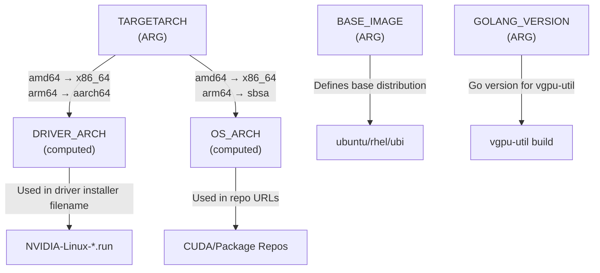
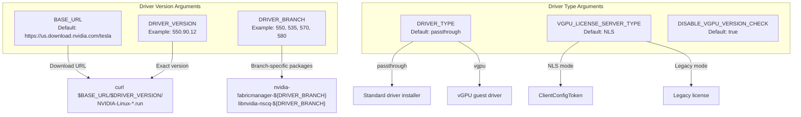
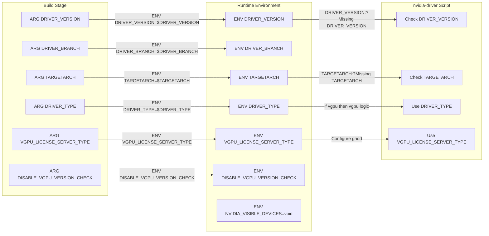
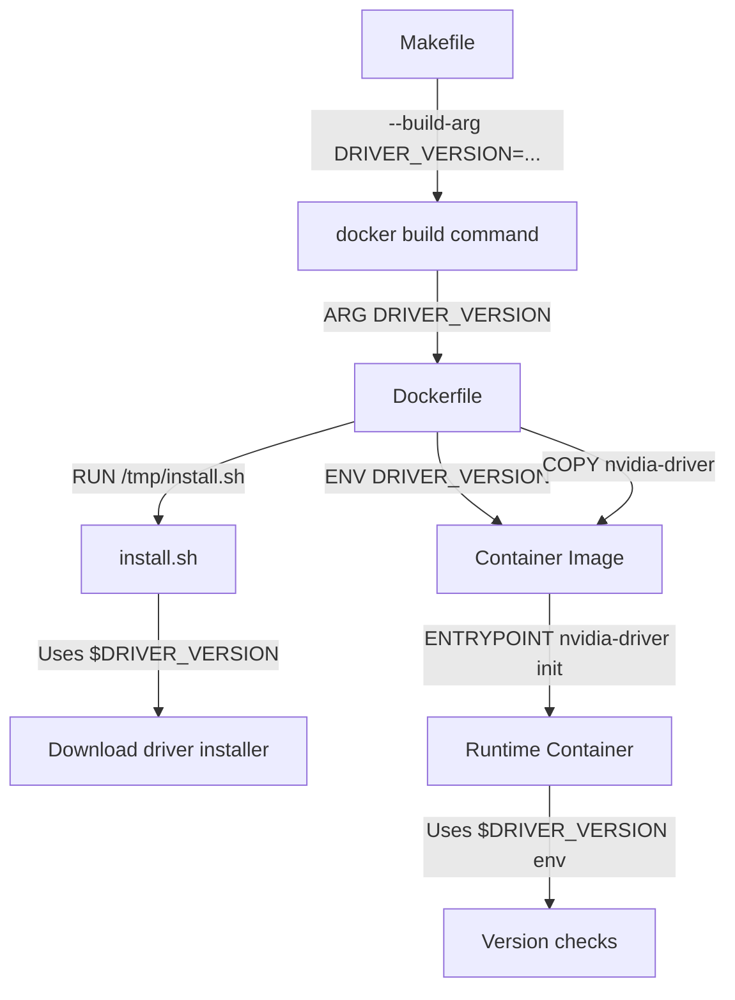
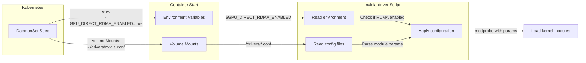

<!-- source: DeepWiki mcp.deepwiki.com · repo NVIDIA/gpu-driver-container · page 6.3 Build Arguments and Variables · fetched 2026-10-26 -->

# Build Arguments and Variables

Relevant source files

The following files were used as context for generating this wiki page:

- [rhel8/Dockerfile](rhel8/Dockerfile)
- [rhel9/Dockerfile](rhel9/Dockerfile)
- [ubuntu20.04/Dockerfile](ubuntu20.04/Dockerfile)
- [ubuntu22.04/Dockerfile](ubuntu22.04/Dockerfile)
- [ubuntu22.04/precompiled/local-repo.sh](ubuntu22.04/precompiled/local-repo.sh)
- [ubuntu22.04/precompiled/nvidia-driver](ubuntu22.04/precompiled/nvidia-driver)
- [ubuntu24.04/Dockerfile](ubuntu24.04/Dockerfile)
- [ubuntu24.04/install.sh](ubuntu24.04/install.sh)
- [ubuntu24.04/nvidia-driver](ubuntu24.04/nvidia-driver)
- [ubuntu24.04/precompiled/Dockerfile](ubuntu24.04/precompiled/Dockerfile)
- [ubuntu24.04/precompiled/local-repo.sh](ubuntu24.04/precompiled/local-repo.sh)
- [ubuntu24.04/precompiled/nvidia-driver](ubuntu24.04/precompiled/nvidia-driver)

## Purpose and Scope

This document provides a comprehensive reference for all build arguments (ARG) and environment variables (ENV) used throughout the driver container build and runtime system. These variables control driver versions, architectures, build modes, security settings, and runtime behavior. For information about how these variables are used in the Makefile build orchestration, see [Makefile System](#6.1). For distribution-specific build configurations, see [Distribution Build Matrix](#6.4).

## Variable Types and Lifecycle

The system uses two primary types of variables that serve different roles in the build and runtime lifecycle:

**Build Arguments (ARG)**: Defined in Dockerfiles using the `ARG` directive. These are only available during image build time and can be passed via `docker build --build-arg`. They control what components are included in the image and how they are configured.

**Environment Variables (ENV)**: Defined using the `ENV` directive or set in runtime scripts. These persist into the running container and control runtime behavior. Many are promoted from build arguments to make them available at runtime.

Sources: [rhel8/Dockerfile:1-110](), [ubuntu20.04/Dockerfile:1-106](), [ubuntu22.04/Dockerfile:1-117](), [ubuntu24.04/Dockerfile:1-99]()

## Core Build Arguments

### Architecture and Platform Arguments

**TARGETARCH Build Argument**

Platform architecture for multi-arch builds. This is automatically set by Docker Buildx and drives architecture-specific logic throughout the build process.

- **Valid values**: `amd64`, `arm64`, `x86_64`, `aarch64`
- **Transformations**:
  - `amd64` → `x86_64` for NVIDIA installer filenames
  - `arm64` → `aarch64` for NVIDIA installer filenames  
  - `amd64` → `x86_64` for repository URLs (RHEL/CentOS)
  - `arm64` → `sbsa` for repository URLs (RHEL/CentOS)

**BASE_IMAGE Build Argument**

Specifies the base container image. Allows overriding the default CUDA base image.

- **Default**: Distribution-specific CUDA images (e.g., `nvcr.io/nvidia/cuda:13.0.1-base-ubuntu22.04`)
- **Used in**: [ubuntu24.04/Dockerfile:1](), [rhel9/Dockerfile:1]()

**GOLANG_VERSION Build Argument**

Version of Go used to compile the vgpu-util binary in the build stage.

- **Usage**: Multi-stage builds download and install this Go version
- **Used in**: [rhel8/Dockerfile:4](), [ubuntu20.04/Dockerfile:4]()

Sources: [rhel8/Dockerfile:3-13](), [ubuntu20.04/Dockerfile:3-24](), [ubuntu22.04/Dockerfile:3-28](), [ubuntu24.04/nvidia-driver:17-25]()

### Driver Configuration Arguments

**BASE_URL**

Base URL for downloading NVIDIA driver installers.

- **Default**: `https://us.download.nvidia.com/tesla`
- **Alternative**: `http://us.download.nvidia.com/XFree86/Linux-x86_64` (commented out in older versions)
- **Used in**: [rhel8/Dockerfile:32](), [ubuntu20.04/Dockerfile:39]()

**DRIVER_VERSION**

Exact version string of the NVIDIA driver to install (e.g., `550.90.12`, `535.129.03`).

- **Required**: Yes (promoted to ENV)
- **Format**: Three-part version number `XXX.YY.ZZ`
- **Usage**: Driver installer filename, package version specifications
- **Runtime**: Available as `${DRIVER_VERSION}` environment variable

**DRIVER_BRANCH**

Driver branch number, typically the major version component.

- **Default**: Distribution-specific (e.g., `535` for Ubuntu 20.04, `550` for Ubuntu 24.04)
- **Valid values**: `535`, `550`, `560`, `570`, `580`, etc.
- **Usage**: Controls which versioned packages are installed, enables branch-specific features
- **Branch-specific logic**: Driver branch `≥ 550` enables `--skip-module-load` flag, `≥ 560` affects kernel type defaults, `≥ 570` enables NVLink5+ packages, `≥ 580` changes package naming conventions

**DRIVER_TYPE**

Specifies the type of GPU driver being built.

- **Default**: `passthrough`
- **Valid values**: 
  - `passthrough` - Standard/baremetal GPU driver
  - `vgpu` - Virtual GPU guest driver
- **Effects**: 
  - Controls whether vgpu-util is built ([ubuntu22.04/Dockerfile:34-38]())
  - Determines if driver installer is downloaded automatically ([ubuntu20.04/Dockerfile:79-85]())
  - Triggers vGPU-specific daemon startup at runtime

**VGPU_LICENSE_SERVER_TYPE**

License server type for vGPU deployments.

- **Default**: `NLS` (NVIDIA License Server)
- **Usage**: Runtime configuration for nvidia-gridd daemon
- **Promoted to ENV**: Yes

**DISABLE_VGPU_VERSION_CHECK**

Controls whether vGPU version compatibility checking is performed.

- **Default**: `true` (checking disabled by default)
- **Usage**: Runtime check via vgpu-util ([ubuntu24.04/nvidia-driver:535-560]())
- **Promoted to ENV**: Yes

Sources: [rhel8/Dockerfile:31-45](), [ubuntu20.04/Dockerfile:39-56](), [ubuntu22.04/Dockerfile:44-60](), [ubuntu24.04/nvidia-driver:531-560]()

### Security and Signing Arguments

| Argument | Purpose | Usage |
|----------|---------|-------|
| `PUBLIC_KEY` | Public key file for kernel module signing | Copied to `kernel/pubkey.x509`, default: `empty` |
| `PRIVATE_KEY` | Private key for module signing | Used in signing process, typically not persisted |
| `KERNEL_VERSION` | Specific kernel version for precompiled builds | Used in OCP/DTK builds and precompiled images |

**PUBLIC_KEY**

Path to a public key file for signing kernel modules (secure boot support).

- **Default**: `empty` (no signing)
- **File location**: Copied to `/drivers/kernel/pubkey.x509`
- **Usage**: [rhel8/Dockerfile:82-83](), [ubuntu20.04/Dockerfile:89-90]()

**PRIVATE_KEY**

Path to a private key file for signing kernel modules.

- **Default**: None (optional argument)
- **Usage**: Paired with PUBLIC_KEY for module signing

**KERNEL_VERSION**

Specific kernel version string for builds targeting a known kernel.

- **Default**: `latest` for standard builds, specific version for precompiled (e.g., `6.8.0-44-generic`)
- **Usage**: 
  - Precompiled builds: Exact kernel module package version ([ubuntu24.04/precompiled/Dockerfile:13-14]())
  - OCP Driver Toolkit: Target kernel for compilation
  - Runtime: Can be overridden via command line argument

Sources: [rhel8/Dockerfile:82-86](), [ubuntu22.04/Dockerfile:92-93](), [ubuntu24.04/precompiled/Dockerfile:13-14]()

## Build-Time to Runtime Variable Promotion

The following diagram shows how build arguments are promoted to environment variables and used at runtime:

Sources: [rhel8/Dockerfile:26-45](), [ubuntu20.04/Dockerfile:36-56](), [ubuntu24.04/nvidia-driver:8-19]()

## Runtime Environment Variables

These environment variables control runtime behavior and can be set when starting the driver container, either via Kubernetes configuration or docker run arguments.

### GPU Configuration Variables

```mermaid
graph TB
    subgraph "Module Behavior Control"
        KMT["KERNEL_MODULE_TYPE<br/>Default: auto"]
        ACCEPT["ACCEPT_LICENSE"]
        MAX_T["MAX_THREADS"]
    end
    
    subgraph "GPU Direct RDMA"
        RDMA["GPU_DIRECT_RDMA_ENABLED<br/>Default: false"]
        MOFED["USE_HOST_MOFED<br/>Default: false"]
    end
    
    subgraph "Module Parameters"
        NVIDIA_CONF["nvidia.conf"]
        UVM_CONF["nvidia-uvm.conf"]
        MODESET_CONF["nvidia-modeset.conf"]
        PEERMEM_CONF["nvidia-peermem.conf"]
    end
    
    KMT -->|"auto/open/proprietary"| RESOLVE["_resolve_kernel_type()"]
    ACCEPT -->|"yes"| INSTALLER["--accept-license flag"]
    MAX_T -->|"N"| CONCURRENCY["--concurrency-level=N"]
    
    RDMA -->|"true + Mellanox present"| LOAD_PM["Load nvidia-peermem"]
    MOFED -->|"true"| HOST["Use host MOFED"]
    MOFED -->|"false"| CONTAINER["Use MOFED container"]
    
    NVIDIA_CONF -->|"Parse params"| LOAD_NVIDIA["modprobe nvidia"]
    UVM_CONF -->|"Parse params"| LOAD_UVM["modprobe nvidia-uvm"]
    MODESET_CONF -->|"Parse params"| LOAD_MODESET["modprobe nvidia-modeset"]
    PEERMEM_CONF -->|"Parse params"| LOAD_PM
```

**KERNEL_MODULE_TYPE**

Controls which kernel module type (open-source or proprietary) to install and load.

- **Default**: `auto`
- **Valid values**:
  - `auto` - Use nvidia-installer to recommend type (falls back to branch-based logic)
  - `open` - Force open-source kernel modules
  - `proprietary` - Force proprietary kernel modules
- **Resolution logic**: [ubuntu24.04/nvidia-driver:444-464](), [ubuntu24.04/precompiled/nvidia-driver:341-368]()
- **Branch defaults**: Driver branch < 560 defaults to proprietary, ≥ 560 defaults to open

**GPU_DIRECT_RDMA_ENABLED**

Enables GPUDirect RDMA support via the nvidia-peermem kernel module.

- **Default**: `false`
- **Valid values**: `true`, `false`
- **Requires**: Mellanox devices present on the system
- **Effects**: Loads nvidia-peermem module if enabled and Mellanox devices detected
- **Detection logic**: [ubuntu24.04/nvidia-driver:176-197]()

**USE_HOST_MOFED**

Controls whether to use MOFED drivers from the host or wait for a MOFED container.

- **Default**: `false`
- **Valid values**: `true`, `false`
- **Usage**: 
  - `true` - Check for host's mlx5_core module
  - `false` - Wait for MOFED container readiness flag at `/run/mellanox/drivers/.driver-ready`
- **Used in**: [ubuntu24.04/nvidia-driver:614-627]()

**ACCEPT_LICENSE**

Automatically accepts the NVIDIA driver license agreement.

- **Valid values**: `yes`, (unset)
- **Usage**: Passed as `--accept-license` to nvidia-installer
- **Used in**: [ubuntu24.04/nvidia-driver:436-438]()

**MAX_THREADS**

Controls the maximum number of threads used during driver compilation.

- **Valid values**: Positive integer
- **Usage**: Passed as `--concurrency-level=${MAX_THREADS}` to nvidia-installer
- **Used in**: [ubuntu24.04/nvidia-driver:440-442]()

Sources: [ubuntu24.04/nvidia-driver:11-19](), [ubuntu24.04/precompiled/nvidia-driver:10-17]()

### Ubuntu Pro and FIPS Variables

**UBUNTU_PRO_TOKEN**

Ubuntu Pro subscription token for enabling FIPS modules and updates.

- **Default**: Empty string (no Ubuntu Pro)
- **Usage**: Enables Ubuntu Pro features when FIPS kernel is detected
- **FIPS enablement**: [ubuntu24.04/nvidia-driver:27-46]()
- **Requirements**: FIPS kernel (kernel version contains "fips" string)
- **Installed packages**: `ubuntu-advantage-tools`, `ubuntu-fips-userspace`

**OPENSSL_FORCE_FIPS_MODE**

Temporarily disables FIPS mode during Ubuntu Pro attachment (Ubuntu 24.04 workaround).

- **Set to**: `0` (temporarily)
- **Purpose**: Prevents OpenSSL errors during `pro attach` on FIPS kernels
- **Unset**: After FIPS modules are installed
- **Used in**: [ubuntu24.04/nvidia-driver:34-44]()

Sources: [ubuntu24.04/nvidia-driver:19](), [ubuntu24.04/nvidia-driver:27-46]()

### Package Management Variables

**PACKAGE_TAG**

Controls package cache behavior.

- **Special value**: `builtin` - Skips package cache updates and cleanup
- **Usage**: 
  - When not set to `builtin`, runs `apt-get update` ([ubuntu24.04/nvidia-driver:48-53]())
  - When not set to `builtin`, runs cleanup after install ([ubuntu24.04/nvidia-driver:55-60]())

Sources: [ubuntu24.04/nvidia-driver:49](), [ubuntu24.04/precompiled/nvidia-driver:62-66]()

### CVE Update Variable

**CVE_UPDATES**

Space-separated list of packages to update for CVE remediation.

- **Usage**: Updates packages during image build
- **RHEL/CentOS**: `yum update -y ${CVE_UPDATES}` ([rhel8/Dockerfile:100-104]())
- **Ubuntu**: `apt-get upgrade -y ${CVE_UPDATES}` ([ubuntu20.04/Dockerfile:93-97]())
- **Cleanup**: Package cache cleaned after update

Sources: [rhel8/Dockerfile:100-104](), [ubuntu20.04/Dockerfile:93-97](), [ubuntu22.04/Dockerfile:103-108](), [ubuntu24.04/Dockerfile:91-96]()

## Kernel Module Configuration Files

The system supports mounting configuration files into `/drivers` to pass custom kernel module parameters:

| Configuration File | Module | Parameter Array | Example Parameters |
|-------------------|--------|-----------------|-------------------|
| `/drivers/nvidia.conf` | nvidia | `NVIDIA_MODULE_PARAMS` | `NVreg_RegistryDwords=...` |
| `/drivers/nvidia-uvm.conf` | nvidia-uvm | `NVIDIA_UVM_MODULE_PARAMS` | UVM-specific parameters |
| `/drivers/nvidia-modeset.conf` | nvidia-modeset | `NVIDIA_MODESET_MODULE_PARAMS` | Modeset parameters |
| `/drivers/nvidia-peermem.conf` | nvidia-peermem | `NVIDIA_PEERMEM_MODULE_PARAMS` | Peer memory parameters |

**Default Parameters**

Starting from driver branch 580, the system automatically adds:
- `NVreg_CoherentGPUMemoryMode=driver` - Prevents GPU coherent memory from being exposed as a NUMA node

**Configuration File Format**

- Each line contains space-delimited parameters
- Parameters on the same line are passed together to modprobe
- Files are parsed in `_get_module_params()` function
- Example: [ubuntu24.04/nvidia-driver:209-245]()

Sources: [ubuntu24.04/nvidia-driver:209-245](), [ubuntu24.04/precompiled/nvidia-driver:135-165]()

## Fixed Environment Variables

These environment variables are set to specific values and should not be modified:

| Variable | Value | Purpose |
|----------|-------|---------|
| `NVIDIA_VISIBLE_DEVICES` | `void` | Prevents container toolkit from managing device visibility |
| `DEBIAN_FRONTEND` | `noninteractive` | Prevents interactive prompts during package installation |
| `RUN_DIR` | `/run/nvidia` | Base directory for runtime state files |
| `PID_FILE` | `${RUN_DIR}/nvidia-driver.pid` | Location of driver process PID file |
| `KERNEL_UPDATE_HOOK` | `/run/kernel/postinst.d/update-nvidia-driver` | Kernel update hook script path |

Sources: [rhel8/Dockerfile:47](), [ubuntu20.04/Dockerfile:56](), [ubuntu24.04/nvidia-driver:6-9]()

## Variable Usage Patterns

### Build-Time Variable Usage Pattern

### Runtime Variable Override Pattern

Sources: [ubuntu24.04/nvidia-driver:189-197](), [ubuntu24.04/nvidia-driver:209-245]()

## Complete Variable Reference Tables

### Build Arguments Reference

| Argument | Type | Default | Distributions | Required |
|----------|------|---------|---------------|----------|
| `TARGETARCH` | string | (auto) | All | Yes |
| `GOLANG_VERSION` | string | varies | All | Yes (build stage) |
| `BASE_IMAGE` | string | dist-specific | ubuntu24.04, rhel9 | No |
| `BASE_URL` | string | `https://us.download.nvidia.com/tesla` | All | No |
| `DRIVER_VERSION` | string | none | All | Yes |
| `DRIVER_BRANCH` | string | dist-specific | All | Yes |
| `DRIVER_TYPE` | string | `passthrough` | All | No |
| `VGPU_LICENSE_SERVER_TYPE` | string | `NLS` | All | No |
| `DISABLE_VGPU_VERSION_CHECK` | string | `true` | All | No |
| `PUBLIC_KEY` | string | `empty` | Standard images | No |
| `PRIVATE_KEY` | string | none | RHEL images | No |
| `KERNEL_VERSION` | string | `latest` | Standard / specific for precompiled | Precompiled: Yes |
| `CVE_UPDATES` | string | none | All | No |

### Runtime Environment Variables Reference

| Variable | Default | Valid Values | Scope | Configurable |
|----------|---------|--------------|-------|--------------|
| `KERNEL_MODULE_TYPE` | `auto` | `auto`, `open`, `proprietary` | init command | Yes |
| `GPU_DIRECT_RDMA_ENABLED` | `false` | `true`, `false` | Global | Yes |
| `USE_HOST_MOFED` | `false` | `true`, `false` | RDMA context | Yes |
| `ACCEPT_LICENSE` | (unset) | `yes`, (unset) | init command | Yes |
| `MAX_THREADS` | (unset) | positive integer | init command | Yes |
| `UBUNTU_PRO_TOKEN` | (empty) | token string | Ubuntu only | Yes |
| `PACKAGE_TAG` | (unset) | `builtin`, (unset) | Package management | Yes |
| `NVIDIA_VISIBLE_DEVICES` | `void` | `void` | Global | No |
| `DEBIAN_FRONTEND` | `noninteractive` | (fixed) | Ubuntu only | No |

Sources: [rhel8/Dockerfile:1-110](), [ubuntu24.04/nvidia-driver:1-698](), [ubuntu24.04/precompiled/nvidia-driver:1-522]()

## Variable Resolution and Transformation Logic

### Architecture Transformation Chain

The following transformations are applied to architecture values:

1. **Docker Buildx → TARGETARCH**: `linux/amd64` → `amd64`, `linux/arm64` → `arm64`
2. **TARGETARCH → DRIVER_ARCH**: `amd64` → `x86_64`, `arm64` → `aarch64` (for driver installer)
3. **TARGETARCH → OS_ARCH**: `amd64` → `x86_64`, `arm64` → `sbsa` (for repo URLs on RHEL/CentOS)

Implementation examples:
- [ubuntu24.04/nvidia-driver:23](): `DRIVER_ARCH=${TARGETARCH/amd64/x86_64} && DRIVER_ARCH=${DRIVER_ARCH/arm64/aarch64}`
- [rhel8/Dockerfile:52](): `OS_ARCH=${TARGETARCH/amd64/x86_64} && OS_ARCH=${OS_ARCH/arm64/sbsa}`

### Kernel Version Resolution

Standard images resolve kernel versions at runtime:

1. Query `apt-cache show linux-headers-${KERNEL_VERSION}`
2. Extract version using sed pattern: `major.minor.patch-revision`
3. Determine flavor from input or default to `generic`
4. Final format: `major.minor.patch-revision-flavor`

Implementation: [ubuntu24.04/nvidia-driver:69-84]()

### Driver Branch Version Logic

Different driver branches enable different features and package naming conventions:

| Driver Branch | Key Changes |
|--------------|-------------|
| `≥ 550` | Enables `--skip-module-load` installer flag |
| `≥ 560` | Default kernel type changes to `open` |
| `≥ 570` | Enables NVLink5+ packages (nvlsm, infiniband-diags) |
| `≥ 580` | Changes package naming (removes branch suffix for many packages) |

Examples:
- [ubuntu24.04/nvidia-driver:462-464](): Skip module load check
- [ubuntu24.04/precompiled/nvidia-driver:341-343](): Kernel type defaults
- [ubuntu24.04/precompiled/local-repo.sh:25-29](): NVLink5+ packages
- [ubuntu24.04/precompiled/local-repo.sh:42-47](): Fabric manager naming

Sources: [ubuntu24.04/nvidia-driver:462-464](), [ubuntu24.04/precompiled/nvidia-driver:341-343](), [ubuntu24.04/precompiled/local-repo.sh:25-47](), [ubuntu24.04/install.sh:47-86]()

---

