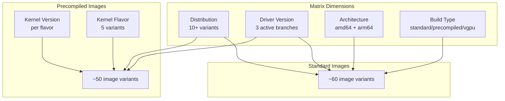
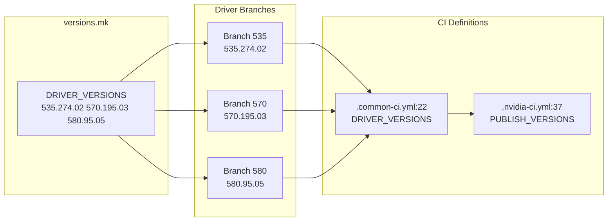
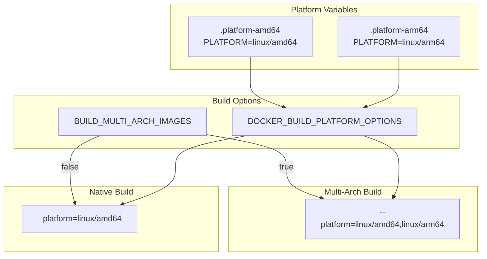
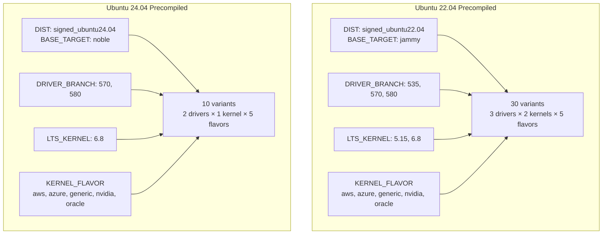
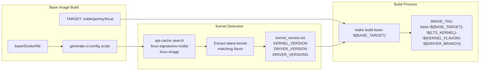
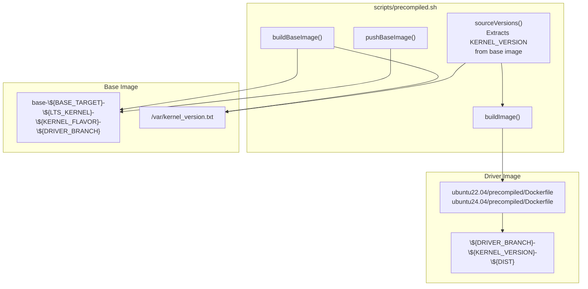
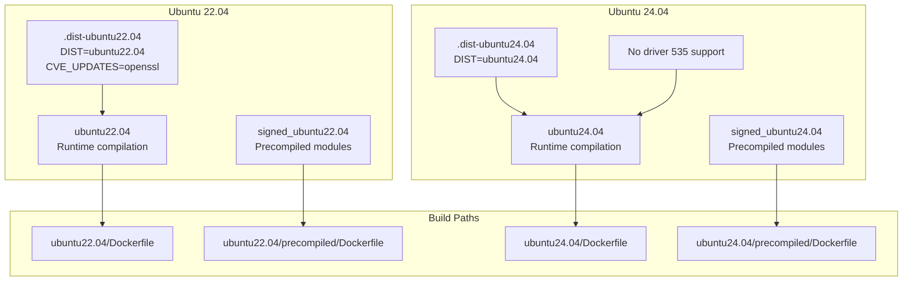
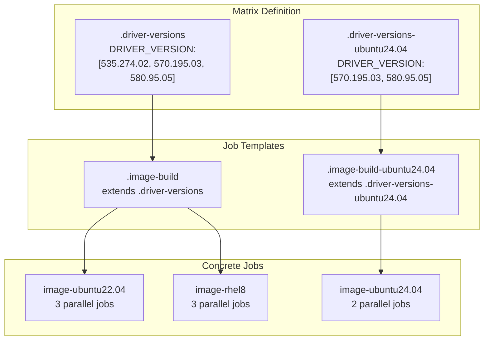

<!-- source: DeepWiki mcp.deepwiki.com · repo NVIDIA/gpu-driver-container · page 6.4 Distribution Build Matrix · fetched 2026-10-26 -->

# Distribution Build Matrix

<details>
<summary>Relevant source files</summary>

The following files were used as context for generating this wiki page:

- [.common-ci.yml](.common-ci.yml)
- [.github/workflows/image.yaml](.github/workflows/image.yaml)
- [.gitlab-ci.yml](.gitlab-ci.yml)
- [.nvidia-ci.yml](.nvidia-ci.yml)
- [Makefile](Makefile)
- [base/Dockerfile](base/Dockerfile)
- [base/generate-ci-config](base/generate-ci-config)
- [multi-arch.mk](multi-arch.mk)
- [native-only.mk](native-only.mk)
- [rhel8/Dockerfile](rhel8/Dockerfile)
- [rhel9/Dockerfile](rhel9/Dockerfile)
- [scripts/precompiled.sh](scripts/precompiled.sh)
- [ubuntu20.04/Dockerfile](ubuntu20.04/Dockerfile)
- [ubuntu22.04/Dockerfile](ubuntu22.04/Dockerfile)
- [versions.mk](versions.mk)

</details>


## Purpose and Scope

This page documents the comprehensive matrix of Linux distributions, driver versions, architectures, and build variants supported by the gpu-driver-container build system. The build matrix defines which combinations of operating systems, NVIDIA driver releases, CPU architectures, and kernel versions are tested and published.

For information about the actual build process and Makefile targets, see [Makefile System](#6.1). For Dockerfile structure across distributions, see [Dockerfile Architecture](#6.2). For build arguments and variables, see [Build Arguments and Variables](#6.3).

## Matrix Dimensions Overview

The build system produces container images across multiple dimensions that combine multiplicatively to create a large set of image variants.

### Core Matrix Dimensions



Sources: [versions.mk:16](), [Makefile:57](), [.common-ci.yml:22](), [.common-ci.yml:82-106]()

## Standard Driver Image Matrix

Standard driver images compile kernel modules at runtime against the host kernel. This approach supports a wide range of kernel versions with a single image per distribution/driver/architecture combination.

### Distribution Support Table

| Distribution | Variable Name | Driver Versions | Architectures | Dockerfile Path |
|--------------|---------------|-----------------|---------------|-----------------|
| Ubuntu 20.04 | `ubuntu20.04` | 535, 570, 580 | amd64, arm64 | `ubuntu20.04/Dockerfile` |
| Ubuntu 22.04 | `ubuntu22.04` | 535, 570, 580 | amd64, arm64 | `ubuntu22.04/Dockerfile` |
| Ubuntu 24.04 | `ubuntu24.04` | 570, 580 | amd64, arm64 | `ubuntu24.04/Dockerfile` |
| RHEL 8 | `rhel8` | 535, 570, 580 | amd64, arm64 | `rhel8/Dockerfile` |
| RHEL 9 | `rhel9` | 535, 570, 580 | amd64, arm64 | `rhel9/Dockerfile` |
| Fedora 36 | `fedora36` | 535, 570, 580 | amd64, arm64 | `fedora/Dockerfile` |

**Note**: Ubuntu 24.04 does not support driver branch 535 (535.274.02).

Sources: [versions.mk:16](), [Makefile:57](), [.common-ci.yml:82-90](), [.gitlab-ci.yml:71-99]()

### Driver Version Definitions



The three driver versions represent active datacenter driver branches. The driver branch number (535, 570, 580) is extracted from the full version using the pattern `$(word 1,$(subst ., ,${DRIVER_VERSION}))`.

Sources: [versions.mk:16](), [.common-ci.yml:22](), [.nvidia-ci.yml:37](), [Makefile:88]()

### Architecture Support



Multi-architecture builds are controlled by the `BUILD_MULTI_ARCH_IMAGES` variable. When enabled, the build system uses Docker Buildx to create manifest lists containing both amd64 and arm64 images.

Sources: [.common-ci.yml:130-136](), [multi-arch.mk:15-18](), [native-only.mk:15](), [Makefile:15-20]()

### Build Target Naming Convention

Build targets follow the pattern: `build-${DIST}-${DRIVER_VERSION}`

Examples:
- `build-ubuntu22.04-535.274.02`
- `build-rhel9-580.95.05`
- `build-ubuntu24.04-570.195.03`

The Makefile parses these targets to extract variables:

```makefile
build-%: DIST = $(word 2,$(subst -, ,$@))
build-%: DRIVER_VERSION = $(word 3,$(subst -, ,$@))
build-%: DRIVER_BRANCH = $(word 1,$(subst ., ,${DRIVER_VERSION}))
```

Sources: [Makefile:150-156](), [Makefile:162-175]()

## Precompiled Driver Image Matrix

Precompiled driver images contain kernel modules built for specific kernel versions, eliminating the need for runtime compilation. This approach requires more image variants but provides faster container startup and smaller runtime dependencies.

### Precompiled Matrix Configuration



Sources: [.common-ci.yml:93-106](), [.github/workflows/image.yaml:93-127]()

### Precompiled Matrix Definitions

The precompiled matrix is defined in `.common-ci.yml` using parallel matrix specifications:

**Ubuntu 22.04 Matrix**:
```yaml
.driver-versions-precompiled-ubuntu22.04:
  parallel:
    matrix:
      - DRIVER_BRANCH: [535, 570, 580]
        KERNEL_FLAVOR: [aws, azure, generic, nvidia, oracle]
        LTS_KERNEL: ["5.15", "6.8"]
```

**Ubuntu 24.04 Matrix**:
```yaml
.driver-versions-precompiled-ubuntu24.04:
  parallel:
    matrix:
      - DRIVER_BRANCH: [570, 580]
        KERNEL_FLAVOR: [aws, azure, generic, nvidia, oracle]
        LTS_KERNEL: ["6.8"]
```

Sources: [.common-ci.yml:93-106]()

### Kernel Flavor Descriptions

| Kernel Flavor | Description | Target Environment |
|---------------|-------------|-------------------|
| `generic` | Standard Ubuntu kernel | General purpose systems |
| `aws` | AWS-optimized kernel | Amazon EC2 instances |
| `azure` | Azure-optimized kernel | Microsoft Azure VMs |
| `nvidia` | NVIDIA-optimized kernel | NVIDIA DGX systems |
| `oracle` | Oracle Cloud kernel | Oracle Cloud Infrastructure |

Each kernel flavor has different patches, configurations, and module ABIs, requiring separate precompiled driver builds.

Sources: [.common-ci.yml:97-105]()

### Base Image Generation

Precompiled builds require base images that detect the latest available kernel version for each flavor:



Sources: [base/Dockerfile:1-110](), [base/generate-ci-config:1-34](), [Makefile:206-222]()

### Precompiled Image Tags

Precompiled images use a different tagging scheme that includes the kernel version:

**Pattern**: `${DRIVER_BRANCH}-${KERNEL_VERSION}-${DIST}`

**Examples**:
- `535-5.15.0-1075-aws-ubuntu22.04`
- `570-6.8.0-1020-azure-ubuntu24.04`
- `580-5.15.0-125-generic-ubuntu22.04`

Sources: [Makefile:96-101](), [Makefile:142-148]()

### Precompiled Build Flow



Sources: [scripts/precompiled.sh:39-46](), [scripts/precompiled.sh:7-37](), [.gitlab-ci.yml:103-131]()

## vGPU Image Matrix

Virtual GPU (vGPU) images support both guest and host driver configurations for virtualized environments.

### vGPU Build Types

| Build Type | Makefile Target Prefix | Environment Variable | Description |
|------------|----------------------|---------------------|-------------|
| vGPU Guest | `build-vgpuguest-${DIST}` | `VGPU_GUEST_DRIVER_VERSION` | Guest driver for VMs |
| vGPU Host | `build-vgpuhost-${DIST}` | `VGPU_HOST_DRIVER_VERSION` | Host driver for hypervisor |

**Key Differences**:
- Guest drivers use standard distribution Dockerfiles with `DRIVER_TYPE=vgpu`
- Host drivers use specialized Dockerfiles in `vgpu-manager/${DIST}/`
- Guest driver versions have a `-grid` suffix that is stripped from image tags

Sources: [Makefile:232-262](), [Makefile:272-298]()

### vGPU Build Arguments

```mermaid
graph TB
    subgraph "vGPU Guest Build"
        GUEST_VERSION["VGPU_GUEST_DRIVER_VERSION<br/>e.g., 535.161.08"]
        GUEST_SUFFIX["Append -grid suffix<br/>535.161.08-grid"]
        GUEST_TYPE["DRIVER_TYPE=vgpu"]
        GUEST_LICENSE["VGPU_LICENSE_SERVER_TYPE=NLS"]
    end
    
    subgraph "vGPU Host Build"
        HOST_VERSION["VGPU_HOST_DRIVER_VERSION<br/>e.g., 550.90.07"]
        HOST_DOCKERFILE["vgpu-manager/\${DIST}/Dockerfile"]
    end
    
    subgraph "Common vGPU Args"
        DISABLE_CHECK["DISABLE_VGPU_VERSION_CHECK=true"]
    end
    
    GUEST_VERSION --> GUEST_SUFFIX
    GUEST_SUFFIX --> GUEST_TYPE
    GUEST_TYPE --> GUEST_LICENSE
    GUEST_LICENSE --> DISABLE_CHECK
    
    HOST_VERSION --> HOST_DOCKERFILE
    HOST_DOCKERFILE --> DISABLE_CHECK
```



Sources: [Makefile:234-262](), [ubuntu22.04/Dockerfile:46-60](), [rhel8/Dockerfile:38-45]()

## Distribution-Specific Configurations

### Ubuntu Distribution Variants



Sources: [.common-ci.yml:108-115](), [Makefile:189-201]()

### RHEL Distribution Variants

RHEL-based distributions share common build logic but produce different image tags for specific RHEL variants:

| RHEL Base | Output Distributions | Registry Tag Pattern |
|-----------|---------------------|---------------------|
| `rhel8` | RHEL 8.10 | `rhel8.10` |
| `rhel9` | RHEL 9.4, 9.6<br/>RHCOS 4.14, 4.15, 4.16, 4.17, 4.18 | `rhel9.4`, `rhcos4.14`, etc. |

The same base image is tagged with multiple distribution identifiers during the release process using the `OUT_DIST` variable.

Sources: [.nvidia-ci.yml:385-439](), [.common-ci.yml:117-123]()

### Distribution Subdir Mapping

Some distributions use different source directories than their identifier:

```makefile
build-rhcos%: SUBDIR = rhel8
build-fedora%: SUBDIR = fedora
build-sles15%: SUBDIR = sle15
```

This allows RHCOS builds to reuse RHEL 8 Dockerfiles since RHCOS is based on RHEL.

Sources: [Makefile:177-182]()

## CI/CD Pipeline Matrix Execution

### GitLab CI Parallel Matrix

The GitLab CI pipeline uses YAML parallel matrix definitions to expand build jobs:



Each concrete job expands into multiple parallel jobs, one per driver version.

Sources: [.common-ci.yml:81-90](), [.gitlab-ci.yml:44-68]()

### GitHub Actions Matrix Strategy

GitHub Actions uses a different matrix syntax but achieves similar expansion:

```yaml
strategy:
  matrix:
    driver: [535.274.02, 570.195.03, 580.95.05]
    dist: [ubuntu22.04, ubuntu24.04, rhel8, rhel9]
    exclude:
      - dist: ubuntu24.04
        driver: 535.274.02
```

Sources: [.github/workflows/image.yaml:28-43]()

## Build Target Reference

### Standard Image Build Targets

| Target Pattern | Example | Variables Set |
|----------------|---------|---------------|
| `build-${DIST}` | `build-ubuntu22.04` | Builds all driver versions |
| `build-${DIST}-${DRIVER_VERSION}` | `build-ubuntu22.04-535.274.02` | Builds specific version |
| `push-${DIST}` | `push-rhel9` | Pushes all driver versions |
| `push-${DIST}-${DRIVER_VERSION}` | `push-rhel9-580.95.05` | Pushes specific version |

Sources: [Makefile:57-77](), [Makefile:128-162]()

### Precompiled Image Build Targets

| Target Pattern | Variables Required | Example |
|----------------|-------------------|---------|
| `build-base-${BASE_TARGET}` | `LTS_KERNEL`, `KERNEL_FLAVOR`, `DRIVER_BRANCH` | `build-base-jammy` |
| `build-signed_ubuntu22.04` | `KERNEL_VERSION`, `DRIVER_BRANCH` | Auto-expanded by matrix |
| `push-signed_ubuntu22.04` | Same as build | Auto-expanded by matrix |

Sources: [Makefile:206-230](), [Makefile:189-201]()

### vGPU Image Build Targets

| Target Pattern | Required Variable | Example |
|----------------|------------------|---------|
| `build-vgpuguest-${DIST}` | `VGPU_GUEST_DRIVER_VERSION` | `build-vgpuguest-ubuntu22.04` |
| `push-vgpuguest-${DIST}` | Same | `push-vgpuguest-rhel8` |
| `build-vgpuhost-${DIST}` | `VGPU_HOST_DRIVER_VERSION` | `build-vgpuhost-ubuntu22.04` |
| `push-vgpuhost-${DIST}` | Same | `push-vgpuhost-rhel9` |

Sources: [Makefile:232-307]()

## CVE Update Configuration

Distributions can specify packages to update for CVE remediation using the `CVE_UPDATES` build argument:

| Distribution | CVE_UPDATES Value | Configured In |
|--------------|------------------|---------------|
| Ubuntu 22.04 | `openssl` | `.common-ci.yml` |
| Ubuntu 22.04 (precompiled) | `curl libc6` | `.gitlab-ci.yml`, `.nvidia-ci.yml` |
| Ubuntu 24.04 (precompiled) | `curl libc6` | `.gitlab-ci.yml`, `.nvidia-ci.yml` |
| RHEL 8 | `libarchive libxml2 pam python3 sqlite-libs` | `.github/workflows/image.yaml` |
| RHEL 9 | `libarchive libxml2 pam python3 sqlite-libs` | `.github/workflows/image.yaml` |

These packages are updated during the Docker build using `apt-get upgrade` or `yum update`.

Sources: [.common-ci.yml:111](), [.gitlab-ci.yml:119-128](), [.github/workflows/image.yaml:68-70](), [ubuntu22.04/Dockerfile:104-108](), [rhel8/Dockerfile:100-104]()

## Matrix Complexity Summary

The complete build matrix generates approximately:

- **Standard Images**: ~60 variants
  - 6 distributions × 3 driver versions (Ubuntu 24.04 has 2) × 2 architectures
  
- **Precompiled Images**: ~40 variants (amd64 only)
  - Ubuntu 22.04: 3 driver branches × 2 LTS kernels × 5 flavors = 30
  - Ubuntu 24.04: 2 driver branches × 1 LTS kernel × 5 flavors = 10

- **Total**: ~100 active image variants maintained in registries

This matrix is managed through a combination of:
- Makefile target expansion and variable substitution
- GitLab CI parallel matrix definitions
- GitHub Actions strategy matrices
- Conditional build logic based on distribution and driver version

Sources: [versions.mk:16](), [.common-ci.yml:82-106](), [Makefile:57-77]()

---

