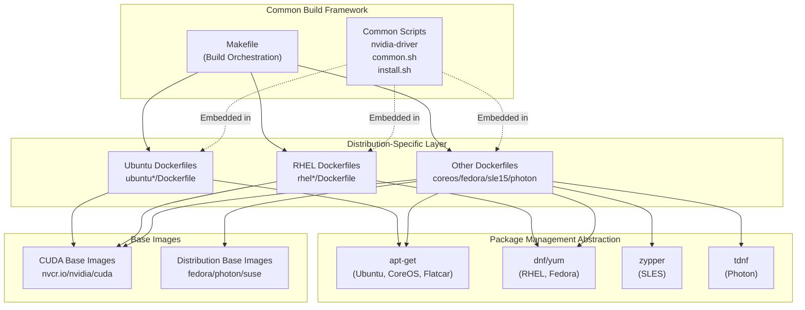
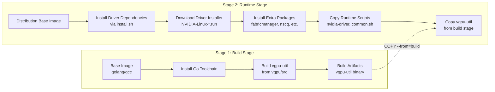
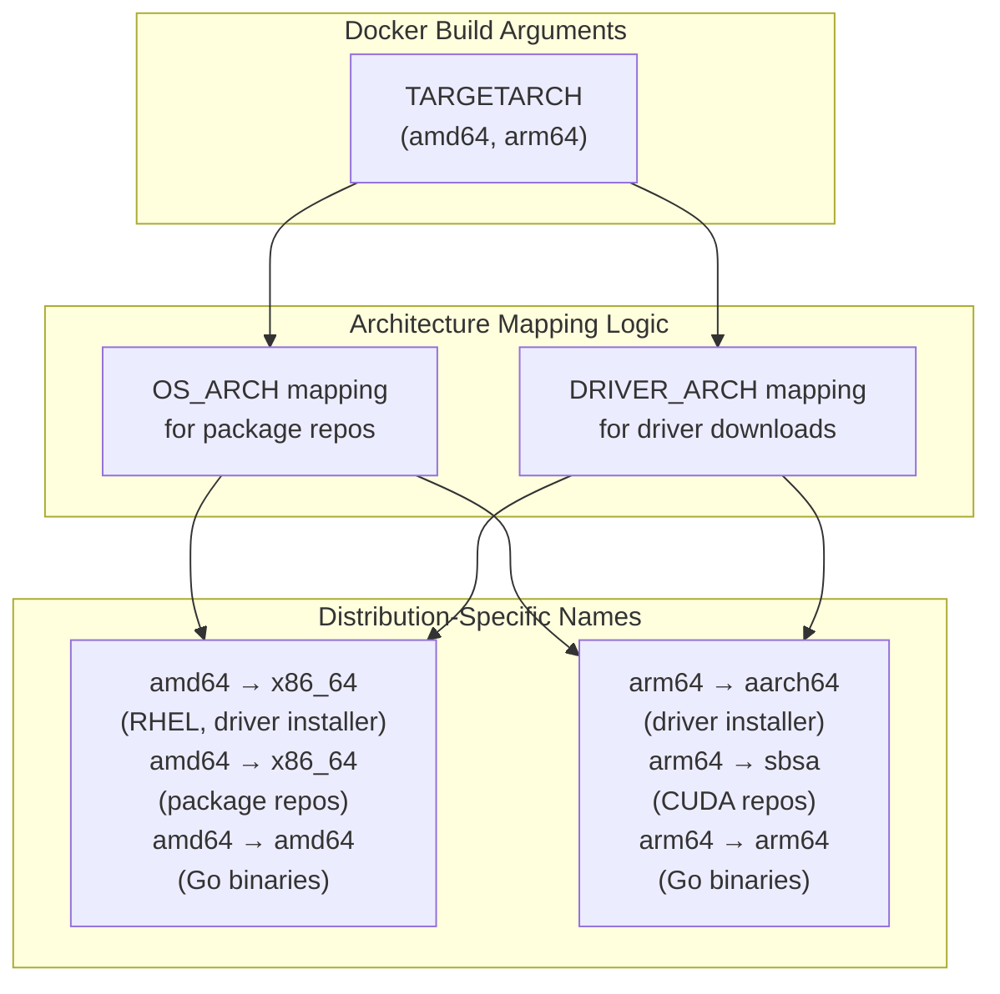
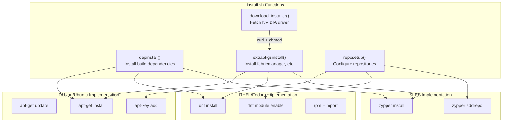
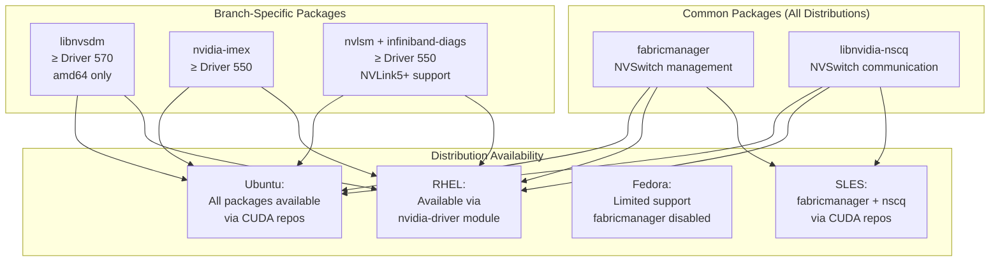
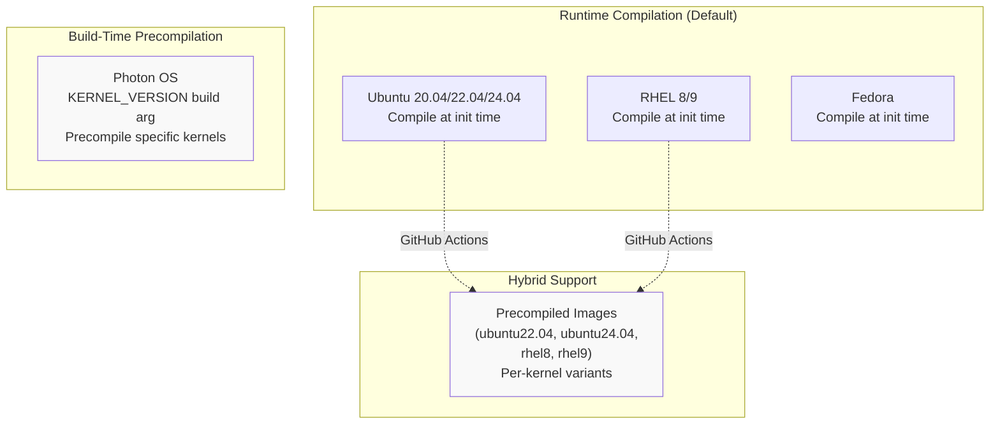

<!-- source: DeepWiki mcp.deepwiki.com · repo NVIDIA/gpu-driver-container · page 7 Distribution Support · fetched 2026-10-26 -->

# Distribution Support

<details>
<summary>Relevant source files</summary>

The following files were used as context for generating this wiki page:

- [coreos/Dockerfile](coreos/Dockerfile)
- [fedora/Dockerfile](fedora/Dockerfile)
- [photon3.0/Dockerfile](photon3.0/Dockerfile)
- [rhel8/Dockerfile](rhel8/Dockerfile)
- [rhel9/Dockerfile](rhel9/Dockerfile)
- [sle15/Dockerfile](sle15/Dockerfile)
- [ubuntu20.04/Dockerfile](ubuntu20.04/Dockerfile)
- [ubuntu22.04/Dockerfile](ubuntu22.04/Dockerfile)
- [ubuntu24.04/Dockerfile](ubuntu24.04/Dockerfile)
- [ubuntu24.04/install.sh](ubuntu24.04/install.sh)
- [ubuntu24.04/nvidia-driver](ubuntu24.04/nvidia-driver)

</details>


## Purpose and Scope

This document provides an overview of the Linux distributions supported by the NVIDIA GPU driver container system, explaining how the build system accommodates different package managers, kernel module systems, and distribution-specific requirements. For detailed information about specific distribution families, see:
- Ubuntu-specific implementations: [Ubuntu Support](#7.1)
- RHEL/CentOS-specific implementations: [RHEL and CentOS Support](#7.2)
- Other distributions (CoreOS, Flatcar, Fedora, SLES, Photon): [Other Distributions](#7.3)

For information about how the runtime scripts vary by distribution, see [Distribution-Specific Implementations](#5.4). For details about the build matrix and image variants, see [Distribution Build Matrix](#6.4).

---

## Distribution Support Matrix

The repository builds driver container images for multiple Linux distributions across different versions, architectures, and driver types. The following table summarizes current distribution support:

| Distribution | Versions | Architectures | Base Image | Package Manager | Dockerfile Location |
|--------------|----------|---------------|------------|-----------------|---------------------|
| Ubuntu | 16.04, 18.04, 20.04, 22.04, 24.04 | amd64, arm64 | nvcr.io/nvidia/cuda (CUDA base) | apt-get | ubuntu*/Dockerfile |
| RHEL/UBI | 7, 8, 9 | amd64, arm64 | nvcr.io/nvidia/cuda (UBI base) | yum/dnf | rhel*/Dockerfile |
| CoreOS | Latest | amd64 | ubuntu:16.04 | apt-get | coreos/Dockerfile |
| Flatcar | Latest | amd64 | ubuntu:16.04 | apt-get | flatcar/Dockerfile |
| Fedora | 36+ | amd64, arm64 | fedora:VERSION | dnf | fedora/Dockerfile |
| SLES | 15.x | amd64 | registry.suse.com/suse/sle15 | zypper | sle15/Dockerfile |
| Photon OS | 3.0 | amd64 | photon:3.0 | tdnf | photon3.0/Dockerfile |

**Sources:** [ubuntu20.04/Dockerfile:1-106](), [ubuntu22.04/Dockerfile:1-117](), [ubuntu24.04/Dockerfile:1-99](), [rhel8/Dockerfile:1-110](), [rhel9/Dockerfile:1-115](), [coreos/Dockerfile:1-94](), [fedora/Dockerfile:1-141](), [sle15/Dockerfile:1-88](), [photon3.0/Dockerfile:1-71]()

---

## Distribution Architecture Overview

The build system uses a unified architecture pattern across all distributions, with distribution-specific adaptations handled through:



**Sources:** [ubuntu20.04/Dockerfile:1-106](), [rhel8/Dockerfile:1-110](), [fedora/Dockerfile:1-141](), [coreos/Dockerfile:1-94]()

---

## Multi-Stage Build Pattern

All distributions follow a consistent multi-stage build pattern to minimize final image size and separate build dependencies from runtime dependencies:



**Sources:** [ubuntu22.04/Dockerfile:1-39](), [rhel8/Dockerfile:1-24](), [fedora/Dockerfile:1-26]()

### Build Stage Components

The build stage is responsible for compiling distribution-agnostic components:

**Ubuntu Build Stage:**
```dockerfile
FROM nvcr.io/nvidia/cuda:13.0.1-base-ubuntu22.04 as build
ARG TARGETARCH
ARG GOLANG_VERSION
# Install git, curl, build tools
# Download and install Go toolchain
# Build vgpu-util from source
```

**RHEL Build Stage:**
```dockerfile
FROM nvcr.io/nvidia/cuda:13.0.1-base-ubi8 as build
ARG TARGETARCH
ARG GOLANG_VERSION
# Install git, wget
# Download and install Go toolchain
# Build vgpu-util from source
```

**Sources:** [ubuntu22.04/Dockerfile:1-38](), [rhel8/Dockerfile:1-23]()

---

## Architecture Support and Mapping

The build system supports multiple CPU architectures with distribution-specific naming conventions:



**Architecture Mapping Examples:**

| Use Case | Ubuntu Variable | RHEL Variable | Mapping Logic |
|----------|----------------|---------------|---------------|
| Go binary download | `${OS_ARCH}` | `${OS_ARCH}` | `amd64`→`amd64`, `arm64`→`arm64` |
| CUDA repo path | `${OS_ARCH}` | `${OS_ARCH}` | `amd64`→`x86_64`, `arm64`→`sbsa` |
| Driver installer | `${DRIVER_ARCH}` | `${DRIVER_ARCH}` | `amd64`→`x86_64`, `arm64`→`aarch64` |

**Sources:** [ubuntu22.04/Dockerfile:26-27](), [rhel8/Dockerfile:11-12](), [ubuntu24.04/nvidia-driver:23]()

---

## Package Management Abstraction

Each distribution uses its native package manager, abstracted through the `install.sh` script:



**Ubuntu install.sh Functions:**
- `depinstall()`: Installs `build-essential`, `kmod`, `libelf-dev`, `libglvnd-dev`
- `setup_cuda_repo()`: Configures CUDA keyring and repository
- `extra_pkgs_install()`: Installs `nvidia-fabricmanager`, `libnvidia-nscq`, `libnvsdm`, `nvidia-imex`
- `download_installer()`: Downloads `NVIDIA-Linux-*.run` installer

**Sources:** [ubuntu24.04/install.sh:1-120](), [ubuntu20.04/Dockerfile:62-85](), [rhel8/Dockerfile:57-72]()

---

## Base Image Strategy

The choice of base image varies by distribution and impacts the driver installation process:

### CUDA Base Images (Ubuntu, RHEL)

Most distributions use NVIDIA CUDA base images which provide:
- Pre-configured CUDA repositories
- NVIDIA GPG keys
- Compatible CUDA libraries
- NGC licensing

```dockerfile
# Ubuntu
FROM nvcr.io/nvidia/cuda:12.9.1-base-ubuntu20.04
FROM nvcr.io/nvidia/cuda:13.0.1-base-ubuntu22.04

# RHEL
FROM nvcr.io/nvidia/cuda:13.0.1-base-ubi8
FROM nvcr.io/nvidia/cuda:13.0.1-base-ubi9
```

**Sources:** [ubuntu20.04/Dockerfile:1](), [ubuntu22.04/Dockerfile:1](), [rhel8/Dockerfile:1](), [rhel9/Dockerfile:1]()

### Native Distribution Images (Fedora, SLES, Photon)

Some distributions use their native base images for better compatibility:

```dockerfile
# Fedora
FROM fedora:${FEDORA_VERSION}

# SLES
FROM registry.suse.com/suse/sle15:$SLES_VERSION

# Photon OS
FROM photon:3.0
```

**Sources:** [fedora/Dockerfile:29](), [sle15/Dockerfile:15](), [photon3.0/Dockerfile:3]()

### Legacy CoreOS/Flatcar Pattern

CoreOS and Flatcar use an older Ubuntu 16.04 base with specialized requirements:

```dockerfile
FROM ubuntu:16.04
# Includes nvidia-container-runtime compilation
# Uses legacy repository configuration
```

**Sources:** [coreos/Dockerfile:11]()

---

## Distribution-Specific Build Arguments

All Dockerfiles accept a common set of build arguments, with distribution-specific handling:

| Build Argument | Purpose | All Distributions | Distribution-Specific |
|----------------|---------|-------------------|----------------------|
| `TARGETARCH` | CPU architecture | ✓ | Mapping varies |
| `DRIVER_VERSION` | NVIDIA driver version | ✓ | - |
| `DRIVER_BRANCH` | Driver branch (535, 550, 570, 580) | ✓ | RHEL uses module selection |
| `DRIVER_TYPE` | passthrough/vgpu | ✓ | - |
| `GOLANG_VERSION` | Go toolchain version | ✓ | - |
| `BASE_URL` | Driver download URL | ✓ | - |
| `CVE_UPDATES` | Security patches | ✓ | Package names vary |
| `KERNEL_VERSION` | For precompiled builds | - | Photon only |
| `PUBLIC_KEY` | Module signing key | ✓ | - |
| `VGPU_LICENSE_SERVER_TYPE` | NLS/FNE | ✓ | Default varies |

**Common Build Arguments:**
```dockerfile
ARG TARGETARCH
ARG DRIVER_VERSION
ARG DRIVER_BRANCH
ARG DRIVER_TYPE=passthrough
ARG VGPU_LICENSE_SERVER_TYPE=NLS
ARG CVE_UPDATES
```

**Sources:** [ubuntu22.04/Dockerfile:45-60](), [rhel8/Dockerfile:26-46](), [fedora/Dockerfile:31-59]()

---

## Additional Package Installation

Different distributions require different additional packages for full functionality:



**Ubuntu Package Installation Logic:**
```bash
# install.sh functions for Ubuntu
fabricmanager_install() {
  if [ "$DRIVER_BRANCH" -ge "580" ]; then
    apt-get install -y nvidia-fabricmanager=${DRIVER_VERSION}-1
  else
    apt-get install -y nvidia-fabricmanager-${DRIVER_BRANCH}=${DRIVER_VERSION}-1
  fi
}

nvsdm_install() {
  if [ "$TARGETARCH" = "amd64" ]; then
    if [ "$DRIVER_BRANCH" -ge "580" ]; then
       apt-get install -y libnvsdm=${DRIVER_VERSION}-1
    elif [ "$DRIVER_BRANCH" -ge "570" ]; then
       apt-get install -y libnvsdm-${DRIVER_BRANCH}=${DRIVER_VERSION}-1
    fi
  fi
}
```

**Sources:** [ubuntu24.04/install.sh:47-106](), [ubuntu20.04/Dockerfile:78-85](), [rhel8/Dockerfile:72](), [sle15/Dockerfile:48-62]()

---

## Runtime Script Distribution Handling

The `nvidia-driver` runtime script adapts to distribution-specific requirements:

### Ubuntu-Specific Features

- **FIPS Support:** Detects FIPS kernels and enables Ubuntu Pro integration
- **Package Resolution:** Uses `apt-cache` to resolve kernel versions
- **Kernel Headers:** Installs via `linux-headers-${KERNEL_VERSION}`

```bash
# Ubuntu FIPS enablement
_enable_fips_if_required() {
    if [[ -n "${UBUNTU_PRO_TOKEN}" && ${KERNEL_VERSION} =~ "fips" ]]; then
      pro attach --no-auto-enable "${UBUNTU_PRO_TOKEN}"
      pro enable --access-only --assume-yes fips-updates
      apt-get install ubuntu-fips-userspace
    fi
}

# Ubuntu kernel version resolution
_resolve_kernel_version() {
    local version=$(apt-cache show "linux-headers-${KERNEL_VERSION}" 2> /dev/null | \
      sed -nE 's/^Version:\s+(([0-9]+\.){2}[0-9]+)[-.]([0-9]+).*/\1-\3/p' | head -1)
    KERNEL_VERSION="${version}-${kernel_flavor}"
}
```

**Sources:** [ubuntu24.04/nvidia-driver:27-84]()

### RHEL-Specific Features

- **Driver Modules:** Uses `dnf module enable nvidia-driver:${DRIVER_BRANCH}`
- **OCP DTK Support:** Includes `ocp_dtk_entrypoint` for OpenShift Driver Toolkit
- **Package Repositories:** Configures CUDA repos differently

**Sources:** [rhel8/Dockerfile:55](), [rhel9/Dockerfile:63-64]()

---

## CVE Updates and Security Patching

All distributions support runtime CVE patching via the `CVE_UPDATES` build argument:

**Ubuntu Pattern:**
```dockerfile
ARG CVE_UPDATES
RUN if [ -n "${CVE_UPDATES}" ]; then \
        apt-get update && apt-get upgrade -y ${CVE_UPDATES} && \
        rm -rf /var/lib/apt/lists/*; \
    fi
```

**RHEL Pattern:**
```dockerfile
ARG CVE_UPDATES
RUN if [ -n "${CVE_UPDATES}" ]; then \
        yum update -y ${CVE_UPDATES} && \
        rm -rf /var/cache/yum/*; \
    fi
```

**Sources:** [ubuntu22.04/Dockerfile:103-108](), [rhel8/Dockerfile:99-104](), [fedora/Dockerfile:131-135]()

---

## Distribution Comparison Matrix

### Dependency Installation Comparison

| Distribution | Build Tools | Kernel Headers | Additional Tools | Cleanup |
|--------------|-------------|----------------|------------------|---------|
| Ubuntu | `build-essential` | `linux-headers-*` | `kmod`, `libelf-dev` | `rm -rf /var/lib/apt/lists/*` |
| RHEL | `gcc`, `make` | Via install.sh | `donkey`, `extract-vmlinux` | `rm -rf /var/cache/yum/*` |
| Fedora | Via `dnf` | Via install.sh | `donkey`, `extract-vmlinux` | `rm -rf /var/cache/yum/*` |
| SLES | Via `zypper` | Via install.sh | `donkey`, `extract-vmlinux` | Automatic |
| Photon | `build-essential` | Via `tdnf` | `donkey`, `extract-vmlinux` | `rm -rf /var/cache/tdnf/*` |

**Sources:** [ubuntu24.04/install.sh:10-38](), [rhel8/Dockerfile:57-61](), [fedora/Dockerfile:71-75](), [sle15/Dockerfile:39-43]()

### Repository Configuration Comparison

| Distribution | NVIDIA Repo Setup | GPG Key Handling | Module System |
|--------------|-------------------|------------------|---------------|
| Ubuntu 20.04+ | `apt-key adv --fetch-keys` | Individual key fetch | N/A |
| Ubuntu 24.04 | `cuda-keyring_*.deb` | Keyring package | N/A |
| RHEL 8/9 | `dnf module enable` | SHA256 verification | Driver branch modules |
| Fedora | CUDA repos | SHA256 verification | Driver branch modules |
| SLES | `zypper addrepo` | Auto-import | N/A |

**Sources:** [ubuntu20.04/Dockerfile:64-66](), [ubuntu24.04/install.sh:40-45](), [rhel8/Dockerfile:51-55](), [sle15/Dockerfile:60]()

---

## Precompiled vs Runtime Compilation

Different distributions have different strategies for kernel module compilation:



**Photon OS Build-Time Compilation:**
```dockerfile
ARG KERNEL_VERSION=latest
# Compile the kernel modules and generate precompiled packages
RUN tdnf makecache -y && \
    for version in $(echo $KERNEL_VERSION | tr ',' ' '); do \
        nvidia-driver update -k $version -t builtin ${PRIVATE_KEY:+"-s ${PRIVATE_KEY}"}; \
    done
```

**Sources:** [photon3.0/Dockerfile:58-65]()

---

## Distribution Selection Criteria

When choosing which distribution to use for a driver container deployment, consider:

1. **Host OS Compatibility:** Match container OS family with host OS family (RHEL container on RHEL host, Ubuntu container on Ubuntu host)
2. **Kernel Version Support:** Check if distribution provides required kernel headers version
3. **Architecture Requirements:** Verify arm64/aarch64 support if needed
4. **Enterprise Features:** RHEL/SLES for enterprise support, Ubuntu Pro for FIPS compliance
5. **Container Orchestration:** OpenShift requires RHEL/UBI images, others more flexible
6. **vGPU Support:** All distributions support vGPU, but licensing requirements vary

---

## Distribution-Specific Known Limitations

| Distribution | Limitations | Workarounds |
|--------------|-------------|-------------|
| Ubuntu 24.04 | Requires gcc-12 for kernels 5.19.x, 6.5.x | Installed automatically |
| RHEL 7 | Older kernel versions | Use RHEL 8+ if possible |
| Fedora | Fabric manager not fully tested | Use RHEL for production |
| CoreOS/Flatcar | Uses Ubuntu 16.04 base | Legacy support only |
| Photon OS | ARM64 not supported | AMD64 only |
| SLES | Limited ARM64 support | Check package availability |

**Sources:** [ubuntu22.04/Dockerfile:95-100]()

---

## Next Steps

For detailed information about specific distributions:
- Ubuntu implementations and FIPS support: [Ubuntu Support](#7.1)
- RHEL, CentOS, and OpenShift DTK integration: [RHEL and CentOS Support](#7.2)
- CoreOS, Flatcar, Fedora, SLES, and Photon details: [Other Distributions](#7.3)

For build-time configuration options: [Build Arguments and Variables](#6.3)

For runtime behavior across distributions: [Distribution-Specific Implementations](#5.4)

---

