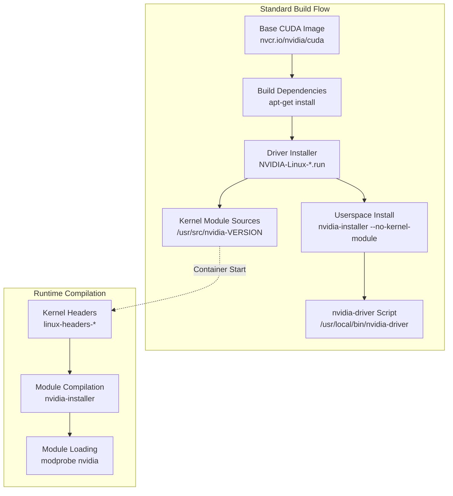
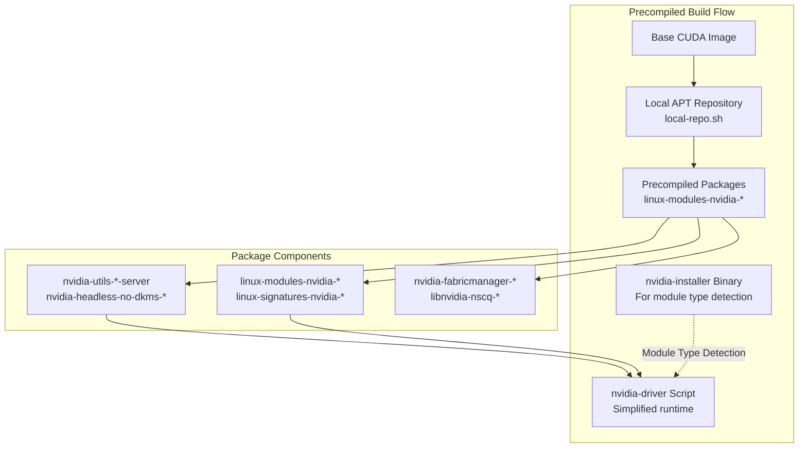
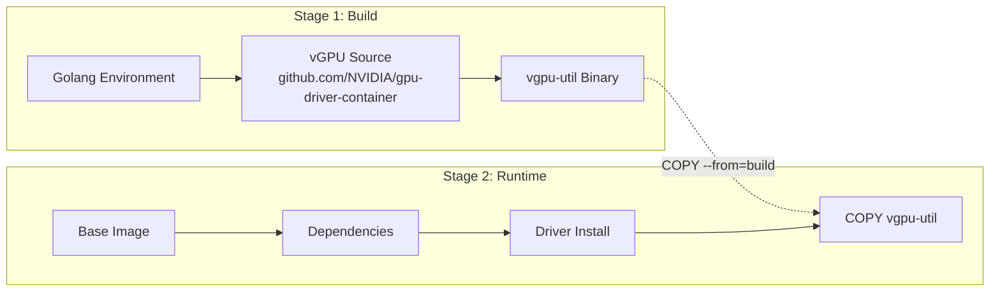
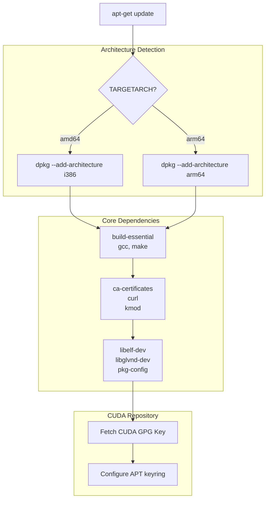
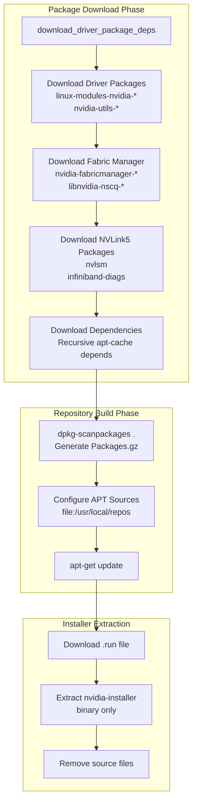

<!-- source: DeepWiki mcp.deepwiki.com · repo NVIDIA/gpu-driver-container · page 7.1 Ubuntu Support · fetched 2026-10-26 -->

# Ubuntu Support

<details>
<summary>Relevant source files</summary>

The following files were used as context for generating this wiki page:

- [centos7/Dockerfile](centos7/Dockerfile)
- [centos8/Dockerfile](centos8/Dockerfile)
- [flatcar/Dockerfile](flatcar/Dockerfile)
- [ubuntu16.04/Dockerfile](ubuntu16.04/Dockerfile)
- [ubuntu18.04/Dockerfile](ubuntu18.04/Dockerfile)
- [ubuntu22.04/precompiled/local-repo.sh](ubuntu22.04/precompiled/local-repo.sh)
- [ubuntu22.04/precompiled/nvidia-driver](ubuntu22.04/precompiled/nvidia-driver)
- [ubuntu24.04/Dockerfile](ubuntu24.04/Dockerfile)
- [ubuntu24.04/install.sh](ubuntu24.04/install.sh)
- [ubuntu24.04/nvidia-driver](ubuntu24.04/nvidia-driver)
- [ubuntu24.04/precompiled/Dockerfile](ubuntu24.04/precompiled/Dockerfile)
- [ubuntu24.04/precompiled/local-repo.sh](ubuntu24.04/precompiled/local-repo.sh)
- [ubuntu24.04/precompiled/nvidia-driver](ubuntu24.04/precompiled/nvidia-driver)

</details>


## Purpose and Scope

This page documents Ubuntu-specific implementations of NVIDIA GPU driver container images in the repository. It covers supported Ubuntu versions (16.04 through 24.04), Dockerfile structures, runtime script implementations, and Ubuntu-specific package management strategies.

For general distribution support overview, see [Distribution Support](#7). For RHEL/CentOS-specific information, see [RHEL and CentOS Support](#7.2). For runtime script architecture across all distributions, see [Distribution-Specific Implementations](#5.4).

## Supported Ubuntu Versions

The repository builds driver images for five Ubuntu LTS releases, each with distinct base images and package repository configurations:

| Ubuntu Version | Codename | Base Image | Standard Images | Precompiled Images | Status |
|----------------|----------|------------|-----------------|-------------------|---------|
| 24.04 LTS | Noble | ubuntu:noble-20250925 | ✓ | ✓ | Current |
| 22.04 LTS | Jammy | nvcr.io/nvidia/cuda:13.0.1-base-ubuntu22.04 | ✓ | ✓ | Current |
| 20.04 LTS | Focal | nvcr.io/nvidia/cuda:11.7.0-base-ubuntu20.04 | ✓ | ✓ | Current |
| 18.04 LTS | Bionic | nvcr.io/nvidia/cuda:12.1.0-base-ubuntu18.04 | ✓ | ✗ | Legacy |
| 16.04 LTS | Xenial | nvcr.io/nvidia/cuda:11.3.0-base-ubuntu16.04 | ✓ | ✗ | Legacy |

Ubuntu 22.04 and 24.04 receive primary support including precompiled kernel module variants, while Ubuntu 18.04 and 16.04 are maintained for legacy compatibility with standard runtime-compiled modules only.

**Sources:** [ubuntu24.04/Dockerfile:1](), [ubuntu22.04/precompiled/Dockerfile:1](), [ubuntu18.04/Dockerfile:1](), [ubuntu16.04/Dockerfile:1]()

## Image Variants

### Standard Driver Images

Standard Ubuntu driver images compile kernel modules at container runtime against the host kernel. This approach provides maximum kernel compatibility with a single image.



**Sources:** [ubuntu24.04/Dockerfile:1-99](), [ubuntu18.04/Dockerfile:1-87]()

The standard Dockerfile performs these operations:

1. **Dependency Installation** - Installs build tools, libraries, and fabric manager packages
2. **Driver Download** - Fetches `NVIDIA-Linux-$DRIVER_ARCH-$DRIVER_VERSION.run` from `BASE_URL`
3. **Userspace Installation** - Runs `nvidia-installer` with `--no-kernel-module` flag
4. **Source Preservation** - Copies kernel module sources to `/usr/src/nvidia-$DRIVER_VERSION`
5. **Script Integration** - Adds `nvidia-driver` script as container entrypoint

**Sources:** [ubuntu24.04/Dockerfile:19-87](), [ubuntu24.04/install.sh:5-106]()

### Precompiled Driver Images

Precompiled Ubuntu images use kernel modules pre-built and signed by Canonical, eliminating runtime compilation. Each image targets a specific kernel version.



**Sources:** [ubuntu24.04/precompiled/Dockerfile:1-63](), [ubuntu22.04/precompiled/Dockerfile:1-63]()

Precompiled images use a local APT repository strategy:

1. **Package Download** - Downloads driver packages and dependencies using `local-repo.sh`
2. **Repository Creation** - Builds local APT repository with `dpkg-scanpackages`
3. **Repository Configuration** - Configures APT to use only the local repository
4. **nvidia-installer Binary** - Extracts only the installer binary for module type detection

This approach ensures offline installation and reproducible builds without external repository dependencies.

**Sources:** [ubuntu24.04/precompiled/local-repo.sh:66-98](), [ubuntu22.04/precompiled/local-repo.sh:67-98]()

## Dockerfile Architecture for Ubuntu

### Multi-Stage Build Structure (Ubuntu 24.04)

Ubuntu 24.04 implements a two-stage build for vGPU support:



**Sources:** [ubuntu24.04/Dockerfile:3-43](), [ubuntu24.04/Dockerfile:44-99]()

The build stage compiles `vgpu-util` only when `DRIVER_TYPE=vgpu`:

```dockerfile
RUN if [ "$DRIVER_TYPE" = "vgpu" ]; then \
    git clone https://github.com/NVIDIA/gpu-driver-container driver && \
    cd driver/vgpu/src && \
    go build -o vgpu-util && \
    mv vgpu-util /work; fi
```

**Sources:** [ubuntu24.04/Dockerfile:38-42]()

### Base Image Selection

Ubuntu images use distribution-specific base images with appropriate CUDA toolkit versions:

| Ubuntu Version | Base Image | CUDA Version |
|----------------|------------|--------------|
| 24.04 | ubuntu:noble-20250925 or nvcr.io/nvidia/cuda:13.0.1-base-ubuntu24.04 | 13.0.1 |
| 22.04 | nvcr.io/nvidia/cuda:13.0.1-base-ubuntu22.04 | 13.0.1 |
| 20.04 | nvcr.io/nvidia/cuda:11.7.0-base-ubuntu20.04 | 11.7.0 |
| 18.04 | nvcr.io/nvidia/cuda:12.1.0-base-ubuntu18.04 | 12.1.0 |

Standard images use plain Ubuntu base images, while precompiled images start from CUDA base images for consistency.

**Sources:** [ubuntu24.04/Dockerfile:1](), [ubuntu24.04/precompiled/Dockerfile:1]()

### Dependency Installation Pattern

Ubuntu images follow a consistent dependency installation pattern:



**Sources:** [ubuntu24.04/install.sh:10-38](), [ubuntu24.04/Dockerfile:19-25]()

The `install.sh` helper script provides modular dependency installation:

- **`depinstall`** - Installs build dependencies based on architecture
- **`setup_cuda_repo`** - Configures CUDA repository with GPG keys
- **`extra_pkgs_install`** - Installs fabric manager, NSCQ, and NVLink5 packages

**Sources:** [ubuntu24.04/install.sh:40-106]()

### CVE Update Mechanism

All Ubuntu Dockerfiles support CVE remediation through build-time package upgrades:

```dockerfile
ARG CVE_UPDATES
RUN if [ -n "${CVE_UPDATES}" ]; then \
        apt-get update && apt-get upgrade -y ${CVE_UPDATES} && \
        rm -rf /var/lib/apt/lists/*; \
    fi
```

The `CVE_UPDATES` build argument accepts space-separated package names to upgrade specific packages addressing security vulnerabilities.

**Sources:** [ubuntu24.04/Dockerfile:92-96](), [ubuntu24.04/precompiled/Dockerfile:43-47]()

## Runtime Script Architecture

### nvidia-driver Script for Ubuntu

The `nvidia-driver` script manages the complete driver lifecycle on Ubuntu systems. It differs between standard and precompiled variants.

**Standard Driver Script Entry Point:**

```bash
#! /bin/bash
# Copyright (c) 2018-2020, NVIDIA CORPORATION. All rights reserved.

set -eu

RUN_DIR=/run/nvidia
PID_FILE=${RUN_DIR}/${0##*/}.pid
DRIVER_VERSION=${DRIVER_VERSION:?"Missing DRIVER_VERSION env"}
KERNEL_UPDATE_HOOK=/run/kernel/postinst.d/update-nvidia-driver
```

**Sources:** [ubuntu24.04/nvidia-driver:1-9]()

Key environment variables:

| Variable | Default | Purpose |
|----------|---------|---------|
| `DRIVER_VERSION` | Required | Driver version to install |
| `TARGETARCH` | Required | Architecture (amd64/arm64) |
| `KERNEL_MODULE_TYPE` | auto | Module type (auto/open/proprietary) |
| `UBUNTU_PRO_TOKEN` | "" | Ubuntu Pro token for FIPS |
| `GPU_DIRECT_RDMA_ENABLED` | false | Enable GPUDirect RDMA |
| `USE_HOST_MOFED` | false | Use host MOFED drivers |

**Sources:** [ubuntu24.04/nvidia-driver:8-19]()

### Initialization Workflow

The `init` command orchestrates the complete driver installation and loading process:

```mermaid
graph TB
    START["nvidia-driver init"]
    
    subgraph "Pre-Installation"
        LOCK["Acquire PID Lock<br/>flock -n $PID_FILE"]
        VGPU_CHECK["_find_vgpu_driver_version<br/>(vGPU only)"]
        UNLOAD["_unload_driver<br/>Remove existing modules"]
        UNMOUNT["_unmount_rootfs<br/>Clean previous mount"]
    end
    
    subgraph "Package Management"
        UPDATE_CA["_update_ca_certificates"]
        UPDATE_PKG["_update_package_cache<br/>apt-get update"]
        FIPS["_enable_fips_if_required<br/>Ubuntu Pro + FIPS kernel"]
    end
    
    subgraph "Kernel Preparation"
        RESOLVE_VER["_resolve_kernel_version<br/>Parse kernel version"]
        INSTALL_PREREQ["_install_prerequisites<br/>Install headers + modules"]
        LINK_OFA["_link_ofa_kernel<br/>GPUDirect RDMA"]
    end
    
    subgraph "Driver Installation"
        INSTALL_DRV["_install_driver<br/>nvidia-installer"]
        LOAD_DRV["_load_driver<br/>modprobe modules"]
        MOUNT["_mount_rootfs<br/>/run/nvidia/driver"]
        HOOK["_write_kernel_update_hook"]
    end
    
    subgraph "Steady State"
        READY["Mark driver ready"]
        SLEEP["sleep infinity"]
    end
    
    START --> LOCK
    LOCK --> VGPU_CHECK
    VGPU_CHECK --> UNLOAD
    UNLOAD --> UNMOUNT
    
    UNMOUNT --> UPDATE_CA
    UPDATE_CA --> UPDATE_PKG
    UPDATE_PKG --> FIPS
    
    FIPS --> RESOLVE_VER
    RESOLVE_VER --> INSTALL_PREREQ
    INSTALL_PREREQ --> LINK_OFA
    
    LINK_OFA --> INSTALL_DRV
    INSTALL_DRV --> LOAD_DRV
    LOAD_DRV --> MOUNT
    MOUNT --> HOOK
    
    HOOK --> READY
    READY --> SLEEP
```



**Sources:** [ubuntu24.04/nvidia-driver:569-610]()

### Ubuntu-Specific Functions

#### Kernel Version Resolution

Ubuntu uses APT metadata to resolve kernel versions to the standard format `major.minor.patch-revision-flavor`:

```bash
_resolve_kernel_version() {
    local version=$(apt-cache show "linux-headers-${KERNEL_VERSION}" 2> /dev/null | \
      sed -nE 's/^Version:\s+(([0-9]+\.){2}[0-9]+)[-.]([0-9]+).*/\1-\3/p' | head -1)
    local kernel_flavor=$(echo ${KERNEL_VERSION} | sed 's/[^a-z]*//')
    kernel_flavor="${kernel_flavor//virtual/generic}"

    echo "Resolving Linux kernel version..."
    if [ -z "${version}" ]; then
        echo "Could not resolve Linux kernel version" >&2
        return 1
    fi

    KERNEL_VERSION="${version}-${kernel_flavor}"
    echo "Proceeding with Linux kernel version ${KERNEL_VERSION}"
    return 0
}
```

This function handles kernel flavor normalization (e.g., `virtual` → `generic`) and extracts precise version strings from APT cache.

**Sources:** [ubuntu24.04/nvidia-driver:69-84]()

#### Prerequisites Installation

The prerequisites installation function prepares the kernel environment:

```bash
_install_prerequisites() (
    local tmp_dir=$(mktemp -d)
    trap "rm -rf ${tmp_dir}" EXIT
    cd ${tmp_dir}

    rm -rf /lib/modules/${KERNEL_VERSION}
    mkdir -p /lib/modules/${KERNEL_VERSION}/proc

    echo "Installing Linux kernel headers..."
    apt-get -qq install --no-install-recommends linux-headers-${KERNEL_VERSION} > /dev/null

    echo "Installing Linux kernel module files..."
    apt-get -qq download linux-image-${KERNEL_VERSION} && dpkg -x linux-image*.deb .
    { apt-get -qq download linux-modules-${KERNEL_VERSION} && dpkg -x linux-modules*.deb . || true; } 2> /dev/null
    mv lib/modules/${KERNEL_VERSION}/modules.* /lib/modules/${KERNEL_VERSION}
    mv lib/modules/${KERNEL_VERSION}/kernel /lib/modules/${KERNEL_VERSION}
    depmod ${KERNEL_VERSION}

    echo "Generating Linux kernel version string..."
    ls -1 boot/vmlinuz-* | sed  's/\/boot\/vmlinuz-//g' - > version
    if [ -z "$(<version)" ]; then
        echo "Could not locate Linux kernel version string" >&2
        return 1
    fi
    mv version /lib/modules/${KERNEL_VERSION}/proc
)
```

This function:
1. Downloads and extracts kernel headers package
2. Extracts kernel module metadata from `linux-image` and `linux-modules` packages
3. Runs `depmod` to generate module dependency information
4. Extracts kernel version string from vmlinuz filename

**Sources:** [ubuntu24.04/nvidia-driver:87-114]()

#### Ubuntu Pro and FIPS Support

Ubuntu 24.04 introduces Ubuntu Pro integration for FIPS-enabled kernels:

```bash
_enable_fips_if_required() {
    if [[ -n "${UBUNTU_PRO_TOKEN}" && ${KERNEL_VERSION} =~ "fips" ]]; then
      echo "Ubuntu Pro token and FIPS kernel detected"
      apt-get -qq install --no-install-recommends ubuntu-advantage-tools > /dev/null

      # This workaround is needed in Ubuntu 24.04 as OpenSSL attempts to leverage the FIPS provider
      # when the underlying kernel is FIPS enabled.
      export OPENSSL_FORCE_FIPS_MODE=0

      echo "Attaching Ubuntu Pro token..."
      pro attach --no-auto-enable "${UBUNTU_PRO_TOKEN}"
      echo "Enabling FIPS apt repo access..."
      pro enable --access-only --assume-yes fips-updates
      echo "Installing the OpenSSL FIPS modules"
      apt-get -qq install --no-install-recommends ubuntu-fips-userspace > /dev/null

      # With the OpenSSL FIPS module installed, OpenSSL can now work with the default settings,
      unset OPENSSL_FORCE_FIPS_MODE
    fi
}
```

This function:
1. Detects FIPS kernel and Ubuntu Pro token presence
2. Temporarily disables FIPS mode for OpenSSL operations
3. Attaches Ubuntu Pro subscription
4. Enables FIPS repository access
5. Installs FIPS-compliant OpenSSL modules

**Sources:** [ubuntu24.04/nvidia-driver:27-46]()

#### Driver Installation Methods

Standard images use `nvidia-installer` with comprehensive flags:

```bash
_install_driver() {
    local install_args=()

    if [ "${ACCEPT_LICENSE}" = "yes" ]; then
        install_args+=("--accept-license")
    fi

    if [ -n "${MAX_THREADS}" ]; then
        install_args+=("--concurrency-level=${MAX_THREADS}")
    fi

    if [[ "${KERNEL_MODULE_TYPE}" == "open"  || "${KERNEL_MODULE_TYPE}" == "proprietary" ]]; then
        [[ "${KERNEL_MODULE_TYPE}" == "open" ]] && kernel_type=kernel-open || kernel_type=kernel
        echo "Proceeding with user-specified kernel module type ${KERNEL_MODULE_TYPE}"
        install_args+=("-m=${kernel_type}")
    fi

    if [ "${DRIVER_BRANCH}" -ge "550" ]; then
        install_args+=("--skip-module-load")
    fi

    # Install the NVIDIA driver in one step
    sh NVIDIA-Linux-$DRIVER_ARCH-$DRIVER_VERSION.run --silent \
                    --ui=none \
                    --no-drm \
                    --no-nouveau-check \
                    --no-nvidia-modprobe \
                    --no-rpms \
                    --no-backup \
                    --no-check-for-alternate-installs \
                    --no-libglx-indirect \
                    --no-install-libglvnd \
                    --x-prefix=/tmp/null \
                    --x-module-path=/tmp/null \
                    --x-library-path=/tmp/null \
                    --x-sysconfig-path=/tmp/null \
                    ${install_args[@]+"${install_args[@]}"}
}
```

**Sources:** [ubuntu24.04/nvidia-driver:433-482]()

### Precompiled Script Differences

The precompiled variant uses APT to install kernel modules:

```bash
_install_driver() {
    # Install necessary driver userspace packages
    apt-get install -y --no-install-recommends \
        nvidia-utils-${DRIVER_BRANCH}-server \
        nvidia-headless-no-dkms-${DRIVER_BRANCH}-server \
        libnvidia-decode-${DRIVER_BRANCH}-server \
        libnvidia-extra-${DRIVER_BRANCH}-server \
        libnvidia-encode-${DRIVER_BRANCH}-server \
        libnvidia-fbc1-${DRIVER_BRANCH}-server

    # Now install the precompiled kernel module packages signed by Canonical
    if [ "$KERNEL_TYPE" = "kernel-open" ]; then
        echo "Installing Open NVIDIA driver kernel modules..."
        apt-get install --no-install-recommends -y \
            linux-signatures-nvidia-${KERNEL_VERSION} \
            linux-modules-nvidia-${DRIVER_BRANCH}-server-open-${KERNEL_VERSION}
    else
        echo "Installing Closed NVIDIA driver kernel modules..."
        apt-get install --no-install-recommends -y \
            linux-objects-nvidia-${DRIVER_BRANCH}-server-${KERNEL_VERSION} \
            linux-signatures-nvidia-${KERNEL_VERSION} \
            linux-modules-nvidia-${DRIVER_BRANCH}-server-${KERNEL_VERSION}
    fi
}
```

**Sources:** [ubuntu24.04/precompiled/nvidia-driver:371-395]()

Key differences from standard variant:

| Aspect | Standard | Precompiled |
|--------|----------|-------------|
| Module compilation | Runtime via nvidia-installer | Pre-built by Canonical |
| Kernel headers | Required | Not required |
| Module signing | Optional via PUBLIC_KEY | Signed by Canonical |
| Kernel specificity | Single image for all kernels | One image per kernel version |
| Installation time | ~2-5 minutes | ~30 seconds |

### Kernel Module Type Resolution

Both variants support automatic kernel module type detection:

```bash
_resolve_kernel_type() {
  if [ "${KERNEL_MODULE_TYPE}" == "proprietary" ]; then
    KERNEL_TYPE=kernel
  elif [ "${KERNEL_MODULE_TYPE}" == "open" ]; then
    KERNEL_TYPE=kernel-open
  elif [ "${KERNEL_MODULE_TYPE}" == "auto" ]; then
    kernel_module_type=$(nvidia-installer --print-recommended-kernel-module-type 2> /dev/null)
    if [ $? -ne 0 ]; then
      echo "failed to retrieve the recommended kernel module type from nvidia-installer, falling back to using the driver branch"
      _resolve_kernel_type_from_driver_branch
      return 0
    fi
    [[ "${kernel_module_type}" == "open" ]] && KERNEL_TYPE=kernel-open || KERNEL_TYPE=kernel
  else
    echo "invalid value for the KERNEL_MODULE_TYPE variable: ${KERNEL_MODULE_TYPE}"
    return 1
  fi
}
```

**Sources:** [ubuntu24.04/precompiled/nvidia-driver:352-369]()

For driver branches where `nvidia-installer` is unavailable, fallback logic applies:

```bash
_resolve_kernel_type_from_driver_branch() {
  [[ "${DRIVER_BRANCH}" -lt 560 ]] && KERNEL_TYPE=kernel || KERNEL_TYPE=kernel-open
}
```

Driver branch 560+ defaults to open-source kernel modules.

**Sources:** [ubuntu24.04/precompiled/nvidia-driver:341-343]()

## Ubuntu Package Management

### Local Repository Creation for Precompiled Images

Precompiled images use `local-repo.sh` to create self-contained APT repositories:



**Sources:** [ubuntu24.04/precompiled/local-repo.sh:66-118]()

The `download_apt_with_dep` function recursively downloads package dependencies:

```bash
download_apt_with_dep () {
  local package_name="$1"
  local package_version
  if [ $# -gt 1 ] && [ -n "$2" ]; then
      package_version="$2"
      apt-get download "${package_name}=${package_version}"
  else
      apt-get download "${package_name}"
  fi

  dependent_pkgs=$(apt-cache depends --recurse --no-recommends --no-suggests \
                   --no-conflicts --no-breaks --no-replaces --no-enhances \
                   "$package_name" | grep "^\w" | grep -v "$package_name" | sort -u)
  if [ -n "$dependent_pkgs" ]; then
      apt-get download $dependent_pkgs
  fi
}
```

**Sources:** [ubuntu24.04/precompiled/local-repo.sh:9-23]()

### Driver Branch-Specific Package Selection

Package names vary by driver branch, requiring conditional installation logic:

```bash
fabricmanager_install() {
  if [ "$DRIVER_BRANCH" -ge "580" ]; then
    apt-get install -y --no-install-recommends nvidia-fabricmanager=${DRIVER_VERSION}-1
  else
    apt-get install -y --no-install-recommends nvidia-fabricmanager-${DRIVER_BRANCH}=${DRIVER_VERSION}-1
  fi
}

nscq_install() {
  if [ "$DRIVER_BRANCH" -ge "580" ]; then
     apt-get install -y --no-install-recommends libnvidia-nscq=${DRIVER_VERSION}-1
  else
    apt-get install -y --no-install-recommends libnvidia-nscq-${DRIVER_BRANCH}=${DRIVER_VERSION}-1
  fi
}
```

**Sources:** [ubuntu24.04/install.sh:47-61]()

Package naming conventions:

| Driver Branch | Naming Pattern | Example |
|---------------|----------------|---------|
| < 580 | `package-${DRIVER_BRANCH}=${DRIVER_VERSION}-1` | `nvidia-fabricmanager-550=550.90.07-1` |
| >= 580 | `package=${DRIVER_VERSION}-1` | `nvidia-fabricmanager=580.20.00-1` |

### Architecture-Specific Package Handling

Some packages are architecture-restricted:

```bash
nvsdm_install() {
  if [ "$TARGETARCH" = "amd64" ]; then
    if [ "$DRIVER_BRANCH" -ge "580" ]; then
       apt-get install -y --no-install-recommends libnvsdm=${DRIVER_VERSION}-1
    elif [ "$DRIVER_BRANCH" -ge "560" ]; then
       apt-get install -y --no-install-recommends libnvsdm-${DRIVER_BRANCH}=${DRIVER_VERSION}-1
    fi
  fi
}
```

`libnvsdm` (NVIDIA Switch Device Manager) packages are only available for amd64 architecture.

**Sources:** [ubuntu24.04/install.sh:64-72]()

## Module Parameter Configuration

Ubuntu images support custom kernel module parameters through configuration files:

```bash
_get_module_params() {
    local base_path="/drivers"

    # Starting from R580, we need to enable the CDMM (Coherent Driver Memory Management) module parameter.
    # This prevents the GPU memory for coherent systems (GH200, GB200 etc) from being exposed as a NUMA node
    # and thereby preventing over-reporting of a Kubernetes node's memory. This is needed for Kubernetes use-cases
    NVIDIA_MODULE_PARAMS+=("NVreg_CoherentGPUMemoryMode=driver")

    # nvidia
    if [ -f "${base_path}/nvidia.conf" ]; then
       while IFS="" read -r param || [ -n "$param" ]; do
           NVIDIA_MODULE_PARAMS+=("$param")
       done <"${base_path}/nvidia.conf"
       echo "Module parameters provided for nvidia: ${NVIDIA_MODULE_PARAMS[@]}"
    fi
    # nvidia-uvm
    if [ -f "${base_path}/nvidia-uvm.conf" ]; then
       while IFS="" read -r param || [ -n "$param" ]; do
           NVIDIA_UVM_MODULE_PARAMS+=("$param")
       done <"${base_path}/nvidia-uvm.conf"
       echo "Module parameters provided for nvidia-uvm: ${NVIDIA_UVM_MODULE_PARAMS[@]}"
    fi
    # nvidia-modeset
    if [ -f "${base_path}/nvidia-modeset.conf" ]; then
       while IFS="" read -r param || [ -n "$param" ]; do
           NVIDIA_MODESET_MODULE_PARAMS+=("$param")
       done <"${base_path}/nvidia-modeset.conf"
       echo "Module parameters provided for nvidia-modeset: ${NVIDIA_MODESET_MODULE_PARAMS[@]}"
    fi
    # nvidia-peermem
    if [ -f "${base_path}/nvidia-peermem.conf" ]; then
       while IFS="" read -r param || [ -n "$param" ]; do
           NVIDIA_PEERMEM_MODULE_PARAMS+=("$param")
       done <"${base_path}/nvidia-peermem.conf"
       echo "Module parameters provided for nvidia-peermem: ${NVIDIA_PEERMEM_MODULE_PARAMS[@]}"
    fi
}
```

Configuration files are mounted at `/drivers` and parsed line-by-line. From driver branch 580+, the `NVreg_CoherentGPUMemoryMode=driver` parameter is automatically added for coherent GPU systems.

**Sources:** [ubuntu24.04/nvidia-driver:209-245]()

## Kernel Update Hooks

Ubuntu images write a kernel update hook that triggers driver recompilation on kernel updates:

```bash
_write_kernel_update_hook() {
    if [ ! -d ${KERNEL_UPDATE_HOOK%/*} ]; then
        return
    fi

    echo "Writing kernel update hook..."
    cat > ${KERNEL_UPDATE_HOOK} <<'EOF'
#!/bin/bash

set -eu
trap 'echo "ERROR: Failed to update the NVIDIA driver" >&2; exit 0' ERR

NVIDIA_DRIVER_PID=$(< /run/nvidia/nvidia-driver.pid)

export "$(grep -z DRIVER_VERSION /proc/${NVIDIA_DRIVER_PID}/environ)"
nsenter -t "${NVIDIA_DRIVER_PID}" -m -- nvidia-driver update --kernel "$1"
EOF
    chmod +x ${KERNEL_UPDATE_HOOK}
}
```

The hook is placed at `/run/kernel/postinst.d/update-nvidia-driver` and triggers automatic recompilation when kernel packages are updated on the host.

**Sources:** [ubuntu24.04/nvidia-driver:502-520]()

## Daemon Management

### Fabric Manager for NVSwitch Systems

Ubuntu images detect NVSwitch systems and start fabric manager automatically:

```bash
if _assert_nvlink5_system; then
    _ensure_nvlink5_prerequisites || return 1
    echo "Starting NVIDIA fabric manager daemon for NVLink5+..."

    fm_config_file=/usr/share/nvidia/nvswitch/fabricmanager.cfg
    fm_pid_file=/var/run/nvidia-fabricmanager/nv-fabricmanager.pid
    nvlsm_config_file=/usr/share/nvidia/nvlsm/nvlsm.conf
    nvlsm_pid_file=/var/run/nvidia-fabricmanager/nvlsm.pid
    /usr/bin/nvidia-fabricmanager-start.sh --mode start \
                                           --fm-config-file $fm_config_file \
                                           --fm-pid-file $fm_pid_file \
                                           --nvlsm-config-file $nvlsm_config_file \
                                           --nvlsm-pid-file $nvlsm_pid_file

elif _assert_nvswitch_system; then
    echo "Starting NVIDIA fabric manager daemon..."
    nv-fabricmanager -c /usr/share/nvidia/nvswitch/fabricmanager.cfg
fi
```

NVLink5+ systems require both fabric manager and NVLink Subnet Manager (nvlsm).

**Sources:** [ubuntu24.04/nvidia-driver:307-325]()

### vGPU Guest Daemon

For vGPU deployments, Ubuntu images start the grid daemon:

```bash
if [ "${DRIVER_TYPE}" = "vgpu" ]; then
    echo "Copying gridd.conf..."
    cp /drivers/gridd.conf /etc/nvidia/gridd.conf
    if [ "${VGPU_LICENSE_SERVER_TYPE}" = "NLS" ]; then
        echo "Copying ClientConfigToken..."
        mkdir -p  /etc/nvidia/ClientConfigToken/
        cp /drivers/ClientConfigToken/* /etc/nvidia/ClientConfigToken/
    fi

    echo "Starting nvidia-gridd.."
    LD_LIBRARY_PATH=/usr/lib/$DRIVER_ARCH-linux-gnu/nvidia/gridd nvidia-gridd

    # Start virtual topology daemon
    _start_vgpu_topology_daemon
fi
```

**Sources:** [ubuntu24.04/nvidia-driver:291-305]()

## Architecture Support

Ubuntu images support both amd64 and arm64 architectures with architecture-specific handling:

### Architecture Variable Transformations

Multiple architecture naming conventions are normalized:

```bash
# Dockerfile build argument
TARGETARCH=${TARGETARCH:?"Missing TARGETARCH env"}

# Convert to driver architecture
DRIVER_ARCH=${TARGETARCH/amd64/x86_64} && DRIVER_ARCH=${DRIVER_ARCH/arm64/aarch64}

# Convert to OS architecture (for CUDA repos)
OS_ARCH=${TARGETARCH/amd64/x86_64} && OS_ARCH=${OS_ARCH/arm64/sbsa}
```

| Context | amd64 | arm64 |
|---------|-------|-------|
| Docker platform | amd64 | arm64 |
| Driver architecture | x86_64 | aarch64 |
| CUDA repository | x86_64 | sbsa |

**Sources:** [ubuntu24.04/nvidia-driver:23](), [ubuntu24.04/install.sh:42]()

### Conditional Package Installation

Architecture-specific packages are installed conditionally:

```bash
dep_install () {
    if [ "$TARGETARCH" = "amd64" ]; then
        dpkg --add-architecture i386 && \
            apt-get update && apt-get install -y --no-install-recommends \
            apt-utils \
            build-essential \
            ca-certificates \
            curl \
            kmod \
            file \
            gnupg \
            libelf-dev \
            libglvnd-dev \
            pkg-config && \
        rm -rf /var/lib/apt/lists/*
    elif [ "$TARGETARCH" = "arm64" ]; then
        dpkg --add-architecture arm64 && \
            apt-get update && apt-get install -y \
            build-essential \
            ca-certificates \
            curl \
            kmod \
            file \
            gnupg \
            libelf-dev \
            libglvnd-dev && \
        rm -rf /var/lib/apt/lists/*
    fi
}
```

Only amd64 builds include i386 compatibility libraries and pkg-config.

**Sources:** [ubuntu24.04/install.sh:10-38]()

## Summary

Ubuntu support in the gpu-driver-container repository provides:

1. **Five LTS versions** - Ubuntu 16.04 through 24.04 with varying feature support
2. **Two image variants** - Standard (runtime compilation) and precompiled (Canonical-signed modules)
3. **Architecture coverage** - Both amd64 and arm64 with conditional package handling
4. **Advanced features** - Ubuntu Pro/FIPS integration, local APT repositories, kernel update hooks
5. **Lifecycle management** - Comprehensive `nvidia-driver` scripts handling init, load, unload, and shutdown
6. **Package flexibility** - Driver branch-aware package selection and CVE remediation

The Ubuntu implementation serves as the primary reference for Debian-based distributions, with modular helper scripts (`install.sh`, `local-repo.sh`) enabling easy adaptation to derivative distributions.

**Sources:** All files cited throughout this document.

---

