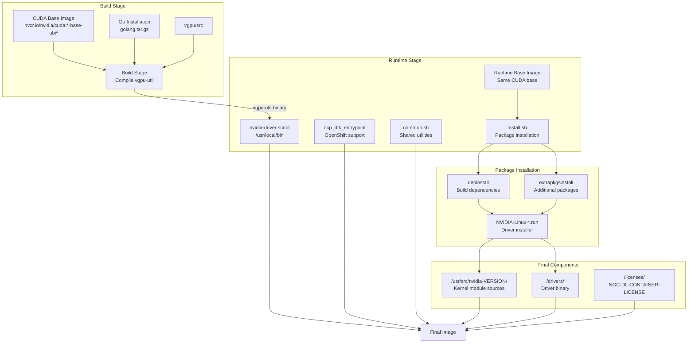
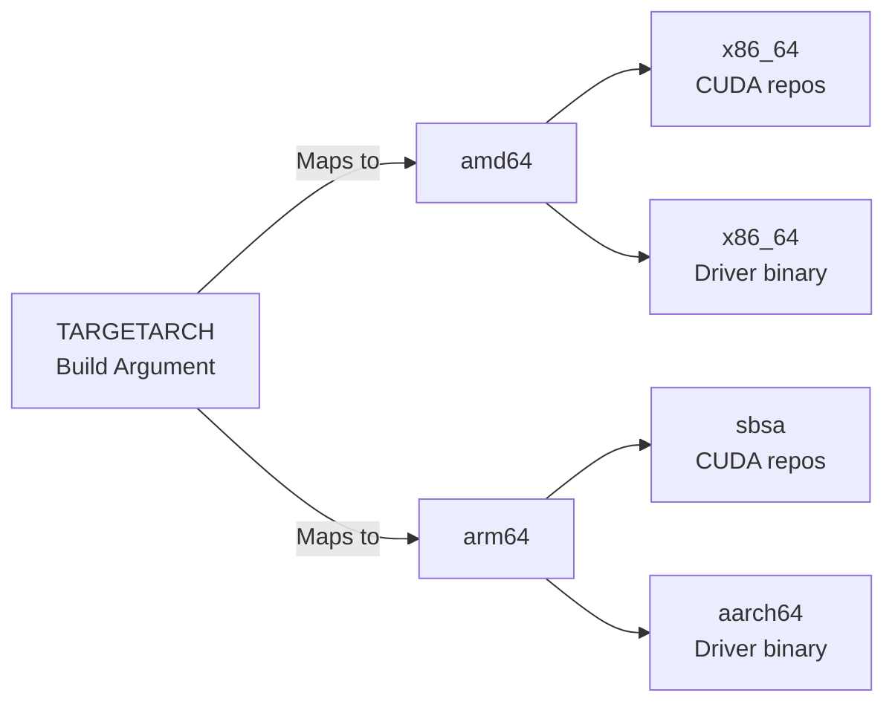
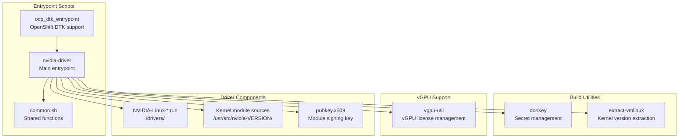
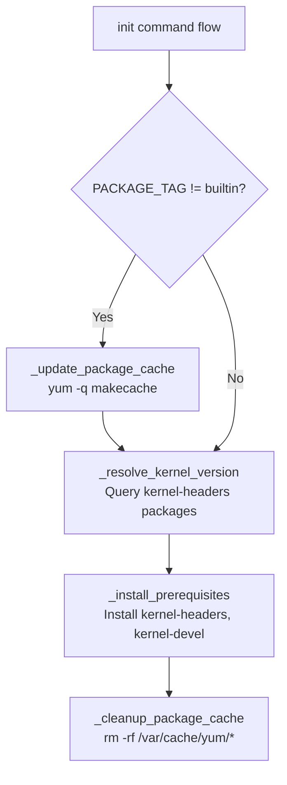
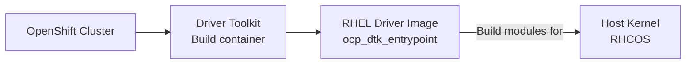
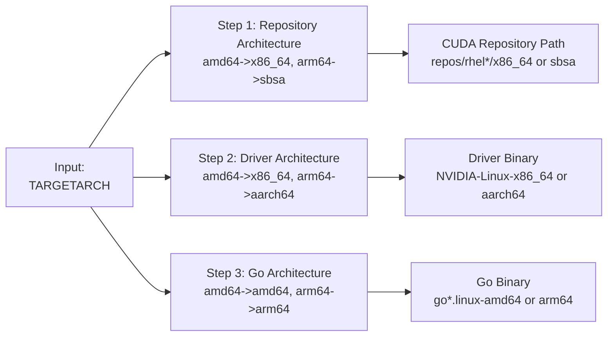

<!-- source: DeepWiki mcp.deepwiki.com · repo NVIDIA/gpu-driver-container · page 7.2 RHEL and CentOS Support · fetched 2026-10-26 -->

# RHEL and CentOS Support

<details>
<summary>Relevant source files</summary>

The following files were used as context for generating this wiki page:

- [centos7/Dockerfile](centos7/Dockerfile)
- [centos8/Dockerfile](centos8/Dockerfile)
- [flatcar/Dockerfile](flatcar/Dockerfile)
- [rhel7/Dockerfile](rhel7/Dockerfile)
- [rhel7/nvidia-driver](rhel7/nvidia-driver)
- [rhel8/Dockerfile](rhel8/Dockerfile)
- [rhel9/Dockerfile](rhel9/Dockerfile)
- [ubuntu16.04/Dockerfile](ubuntu16.04/Dockerfile)
- [ubuntu18.04/Dockerfile](ubuntu18.04/Dockerfile)
- [ubuntu20.04/Dockerfile](ubuntu20.04/Dockerfile)
- [ubuntu22.04/Dockerfile](ubuntu22.04/Dockerfile)

</details>


## Purpose and Scope

This document describes the NVIDIA GPU driver container support for Red Hat Enterprise Linux (RHEL) and CentOS distributions. It covers the build architecture, package management, and runtime behavior specific to RPM-based distributions.

For Ubuntu-based distributions, see [Ubuntu Support](#7.1). For other distributions including RHCOS and Fedora, see [Other Distributions](#7.3). For general driver management script behavior, see [Driver Management Scripts](#5).

## Supported Versions

The repository provides driver containers for the following RHEL and CentOS versions:

| Distribution | Version | Dockerfile Location | Base Image | Package Manager |
|--------------|---------|---------------------|------------|-----------------|
| RHEL | 7 | `rhel7/Dockerfile` | `nvcr.io/nvidia/cuda:11.4.1-base-ubi7` | `yum` |
| RHEL | 8 | `rhel8/Dockerfile` | `nvcr.io/nvidia/cuda:13.0.1-base-ubi8` | `dnf` |
| RHEL | 9 | `rhel9/Dockerfile` | `nvcr.io/nvidia/cuda:13.0.1-base-ubi9` | `dnf` |
| CentOS | 7 | `centos7/Dockerfile` | `nvcr.io/nvidia/cuda:12.4.0-base-centos7` | `yum` |
| CentOS | 8 | `centos8/Dockerfile` | `nvcr.io/nvidia/cuda:11.4.1-base-centos8` | `dnf` |

All versions support both `x86_64` (amd64) and `aarch64` (arm64) architectures through multi-arch builds.

**Sources:** [rhel7/Dockerfile:1](), [rhel8/Dockerfile:1](), [rhel9/Dockerfile:1-3](), [centos7/Dockerfile:1](), [centos8/Dockerfile:1]()

## Build Architecture Overview



**Sources:** [rhel8/Dockerfile:1-24](), [rhel9/Dockerfile:1-30]()

## Base Image Strategy

RHEL-based containers use **Universal Base Images (UBI)** provided by Red Hat, which are freely redistributable and optimized for containerized workloads.

### Image Selection by Architecture

The build process automatically selects the correct architecture variant using the `TARGETARCH` build argument:



Architecture mapping is performed using shell parameter expansion:
- For CUDA repositories: `OS_ARCH=${TARGETARCH/amd64/x86_64} && OS_ARCH=${OS_ARCH/arm64/sbsa}`
- For driver binaries: `DRIVER_ARCH=${TARGETARCH/amd64/x86_64} && DRIVER_ARCH=${DRIVER_ARCH/arm64/aarch64}`

**Sources:** [rhel8/Dockerfile:52-53](), [rhel8/Dockerfile:67-68](), [rhel9/Dockerfile:59-60](), [rhel9/Dockerfile:75-76]()

## Build Process Differences from Ubuntu

### Package Management

RHEL/CentOS distributions use RPM-based package managers (`yum` for RHEL 7/CentOS 7, `dnf` for RHEL 8+):

| Aspect | RHEL/CentOS | Ubuntu |
|--------|-------------|--------|
| Package Manager | `yum` / `dnf` | `apt-get` |
| Repo Setup | GPG key verification via `/etc/pki/rpm-gpg/` | GPG key via `apt-key` |
| Cache Cleanup | `rm -rf /var/cache/yum/*` or `rm -rf /var/cache/dnf/*` | `rm -rf /var/lib/apt/lists/*` |
| Module System | `dnf module enable` for driver streams | APT repositories |
| DKMS Support | Not used | Not used |

### NVIDIA GPG Key Verification

RHEL builds verify the NVIDIA GPG key before adding repositories:

```bash
NVIDIA_GPGKEY_SUM=d0664fbbdb8c32356d45de36c5984617217b2d0bef41b93ccecd326ba3b80c87
curl -fsSL "https://developer.download.nvidia.com/compute/cuda/repos/rhel8/$OS_ARCH/D42D0685.pub" | \
    sed '/^Version/d' > /etc/pki/rpm-gpg/RPM-GPG-KEY-NVIDIA
echo "$NVIDIA_GPGKEY_SUM  /etc/pki/rpm-gpg/RPM-GPG-KEY-NVIDIA" | sha256sum -c --strict -
```

**Sources:** [rhel8/Dockerfile:51-54](), [rhel9/Dockerfile:58-61](), [centos7/Dockerfile:14-16]()

### Driver Stream Modules

RHEL 8 uses DNF module streams to enable specific driver branches:

```bash
dnf module enable -y nvidia-driver:${DRIVER_BRANCH}-dkms
```

This enables the NVIDIA driver repository for the specified branch (e.g., `535-dkms`, `550-dkms`).

**Sources:** [rhel8/Dockerfile:55]()

## Runtime Components and Installation

### Core Runtime Files



**Sources:** [rhel8/Dockerfile:74-78](), [rhel9/Dockerfile:82-86]()

### install.sh Functions for RHEL

The `install.sh` script provides distribution-specific installation functions:

| Function | Purpose | Usage |
|----------|---------|-------|
| `depinstall` | Install build dependencies | Kernel headers, gcc, make, etc. |
| `extrapkgsinstall` | Install additional NVIDIA packages | Fabric Manager, libnvidia-nscq, libnvsdm, IMEX |
| `setup_cuda_repo` | Configure CUDA repository | RHEL 9 only |
| `nvswitch_depinstall` | Install NVSwitch dependencies | CentOS 7 for multi-GPU systems |

**Sources:** [rhel8/Dockerfile:57](), [rhel8/Dockerfile:72](), [rhel9/Dockerfile:63-64](), [rhel9/Dockerfile:80]()

## RHEL-Specific nvidia-driver Implementation

### Package Cache Management

The RHEL `nvidia-driver` script includes functions specific to RPM-based package management:



**Sources:** [rhel7/nvidia-driver:11-23]()

### Kernel Version Resolution

RHEL uses `yum` to query available kernel versions:

```bash
local version=$(yum -q list available --show-duplicates kernel-headers |
  awk -v arch=$(uname -m) 'NR>1 {print $2"."arch}' | tac | grep -E -m1 "^${KERNEL_VERSION/latest/.*}")
```

This differs from Ubuntu's approach of querying APT repositories.

**Sources:** [rhel7/nvidia-driver:26-36]()

### GCC Version Matching

RHEL explicitly matches the GCC version required by the kernel:

```bash
local gcc_version=$(cat /lib/modules/${KERNEL_VERSION}/proc/version | grep -Eo "gcc version ([0-9\.]+)" | grep -Eo "([0-9\.]+)")
local current_gcc=$(rpm -qa gcc)
echo "kernel requires gcc version: 'gcc-${gcc_version}', current gcc version is '${current_gcc}'"

if ! [[ "${current_gcc}" =~ "gcc-${gcc_version}"-.* ]]; then
    yum install -q -y "gcc-${gcc_version}"
fi
```

This ensures kernel module compilation succeeds by installing the exact GCC version used to build the kernel.

**Sources:** [rhel7/nvidia-driver:71-80]()

### Kernel Module Installation

The RHEL version installs kernel packages to extract module metadata:

```bash
echo "Installing Linux kernel module files..."
yum install -y -q kernel-${KERNEL_VERSION} --downloadonly --downloaddir=$(pwd)
cat ./kernel*.rpm | rpm2cpio | cpio -idm --quiet
rm ./*.rpm

mv lib/modules/${KERNEL_VERSION}/modules.* /lib/modules/${KERNEL_VERSION}
mv lib/modules/${KERNEL_VERSION}/kernel /lib/modules/${KERNEL_VERSION}
depmod ${KERNEL_VERSION}
```

**Sources:** [rhel7/nvidia-driver:54-61]()

## OpenShift and Red Hat CoreOS (RHCOS) Support

RHEL 8 and RHEL 9 images include OpenShift-specific components:

### Driver Toolkit (DTK) Entrypoint

The `ocp_dtk_entrypoint` script provides integration with OpenShift's Driver Toolkit:



The Driver Toolkit is a specialized container image that provides kernel headers and build dependencies matching the RHCOS kernel version running on OpenShift nodes.

**Sources:** [rhel8/Dockerfile:75](), [rhel9/Dockerfile:83]()

### RHCOS-Specific Considerations

Red Hat CoreOS (RHCOS) is the operating system used by OpenShift. Key differences:

1. **Immutable OS**: The base OS cannot be modified; all customization must happen in containers
2. **Fixed kernel versions**: Kernel version is tied to RHCOS version
3. **No package manager access**: Cannot use `yum`/`dnf` on the host
4. **Machine Config Operator**: Manages system-level configuration

The driver container must build kernel modules that match the RHCOS kernel exactly, which is why DTK integration is critical.

## Additional NVIDIA Package Installation

### Fabric Manager and NVLink Support

RHEL 8 and 9 images automatically install Fabric Manager for multi-GPU systems:

```bash
# Fetch the installer, fabricmanager, libnvidia-nscq, libnvsdm, imex packages
RUN sh /tmp/install.sh extrapkgsinstall
```

The `extrapkgsinstall` function installs:
- **nvidia-fabricmanager**: Manages NVSwitch and NVLink connections on HGX systems
- **libnvidia-nscq**: NVIDIA System Communication Queue library
- **libnvsdm**: NVIDIA Secure Device Manager
- **IMEX channels**: NVIDIA Inband Multi-Node EXchange channels

**Sources:** [rhel8/Dockerfile:72](), [rhel9/Dockerfile:80]()

### Package Installation Differences by Distribution

| Package | RHEL 7 | RHEL 8 | RHEL 9 |
|---------|--------|--------|--------|
| Fabric Manager | Manual download | `extrapkgsinstall` | `extrapkgsinstall` |
| libnvidia-nscq | Not included | `extrapkgsinstall` | `extrapkgsinstall` |
| libnvsdm | Not available | Not included | `extrapkgsinstall` |
| IMEX | Not available | Not included | `extrapkgsinstall` |
| CUDA repository | Manual setup | Manual setup | `setup_cuda_repo` function |

## Security and CVE Updates

### CVE Update Mechanism

RHEL images support CVE updates via the `CVE_UPDATES` build argument:

```bash
ARG CVE_UPDATES
RUN if [ -n "${CVE_UPDATES}" ]; then \
        yum update -y ${CVE_UPDATES} && \
        rm -rf /var/cache/yum/*; \
    fi
```

This allows specific packages to be updated to resolve security vulnerabilities without rebuilding the entire image. The CI pipeline can trigger builds with specific package versions when CVEs are discovered.

**Sources:** [rhel8/Dockerfile:100-104](), [rhel9/Dockerfile:105-109](), [centos7/Dockerfile:58-62]()

### Repository Cleanup

All RHEL/CentOS images remove CUDA repositories at the end of the build to prevent GPG signature errors during runtime package operations:

```bash
# Remove cuda repository to avoid GPG errors
RUN rm -f /etc/yum.repos.d/cuda.repo
```

**Sources:** [rhel8/Dockerfile:107](), [rhel9/Dockerfile:112](), [centos7/Dockerfile:64]()

## Multi-Architecture Support

### Architecture Transformation Pipeline



### Architecture Variable Mapping

The build process uses shell parameter expansion to map `TARGETARCH` values:

```bash
# For CUDA repositories
OS_ARCH=${TARGETARCH/amd64/x86_64} && OS_ARCH=${OS_ARCH/arm64/sbsa}

# For driver binaries
DRIVER_ARCH=${TARGETARCH/amd64/x86_64} && DRIVER_ARCH=${DRIVER_ARCH/arm64/aarch64}

# For Go binaries
OS_ARCH=${TARGETARCH/x86_64/amd64} && OS_ARCH=${OS_ARCH/aarch64/arm64}
```

**Sources:** [rhel8/Dockerfile:11-12](), [rhel8/Dockerfile:52-53](), [rhel8/Dockerfile:67-68](), [rhel9/Dockerfile:17-18](), [rhel9/Dockerfile:59-60](), [rhel9/Dockerfile:75-76]()

## vGPU Support Conditional Build

### vGPU Build Logic

RHEL 9 introduced conditional vGPU utility building to reduce image size when vGPU is not needed:

```bash
ARG DRIVER_TYPE=passthrough
ENV DRIVER_TYPE=$DRIVER_TYPE

# In build stage
RUN if [ "$DRIVER_TYPE" = "vgpu" ]; then \
    git clone https://github.com/NVIDIA/gpu-driver-container driver && \
    cd driver/vgpu/src && \
    go build -o vgpu-util && \
    mv vgpu-util /work; fi

# In runtime stage
COPY --from=build /work/vgpu-util* /usr/local/bin
```

The wildcard (`vgpu-util*`) ensures the COPY succeeds even when the file doesn't exist (for passthrough builds).

**Sources:** [rhel9/Dockerfile:9-29](), [rhel9/Dockerfile:86](), [ubuntu22.04/Dockerfile:7-38](), [ubuntu22.04/Dockerfile:79]()

## Build Arguments Reference

### Common Build Arguments

| Argument | Purpose | Default Value | Example |
|----------|---------|---------------|---------|
| `BASE_URL` | Driver download URL | `https://us.download.nvidia.com/tesla` | - |
| `DRIVER_VERSION` | NVIDIA driver version | (required) | `535.104.05` |
| `DRIVER_BRANCH` | Driver branch for modules | `535` | `550` |
| `DRIVER_TYPE` | Driver type | `passthrough` | `vgpu` |
| `TARGETARCH` | Target architecture | (set by buildx) | `amd64`, `arm64` |
| `GOLANG_VERSION` | Go version for vgpu-util | (required) | `1.20.5` |
| `PUBLIC_KEY` | Public key for module signing | `empty` | `pubkey.x509` |
| `PRIVATE_KEY` | Private key for module signing | (empty) | Secret reference |
| `KERNEL_VERSION` | Kernel version to precompile | `latest` | `4.18.0-425.el8.x86_64` |
| `CVE_UPDATES` | Packages to update for CVEs | (empty) | `systemd curl` |

**Sources:** [rhel8/Dockerfile:32-36](), [rhel8/Dockerfile:38-45](), [rhel8/Dockerfile:82-86](), [rhel8/Dockerfile:100]()

### RHEL-Specific Arguments

| Argument | RHEL 7 | RHEL 8 | RHEL 9 | Purpose |
|----------|--------|--------|--------|---------|
| `BASE_IMAGE` | No | No | Yes | Override base image |
| `VGPU_LICENSE_SERVER_TYPE` | No | Yes | Yes | License server type (NLS/CLS) |
| `DISABLE_VGPU_VERSION_CHECK` | No | Yes | Yes | Disable vGPU version compatibility check |

**Sources:** [rhel9/Dockerfile:1](), [rhel8/Dockerfile:41-45](), [rhel9/Dockerfile:48-52]()

## Comparison: RHEL vs CentOS Builds

### Key Differences

| Aspect | RHEL | CentOS |
|--------|------|--------|
| Base Image | UBI (Universal Base Image) | CentOS base |
| Support Status | Officially supported by Red Hat | CentOS 7: EOL, CentOS 8: Discontinued, CentOS Stream: Rolling |
| OpenShift Integration | Full DTK support | Limited |
| License Requirements | Red Hat subscription for updates | Free |
| Security Updates | Via Red Hat subscription | Community updates |
| Base Image Source | `nvcr.io/nvidia/cuda:*-base-ubi*` | `nvcr.io/nvidia/cuda:*-base-centos*` |

### When to Use Each

- **RHEL Images**: Production environments, OpenShift clusters, enterprise deployments requiring support
- **CentOS 7 Images**: Legacy systems still running CentOS 7
- **CentOS 8/Stream**: Testing and development environments

**Sources:** [rhel7/Dockerfile:1](), [rhel8/Dockerfile:1](), [rhel9/Dockerfile:1-3](), [centos7/Dockerfile:1](), [centos8/Dockerfile:1]()

## Example Build Commands

### Building RHEL 8 Driver Container

```bash
# Standard passthrough driver
docker build -t nvidia-driver:535.104.05-rhel8 \
    --build-arg DRIVER_VERSION=535.104.05 \
    --build-arg DRIVER_BRANCH=535 \
    --build-arg GOLANG_VERSION=1.20.5 \
    -f rhel8/Dockerfile .

# vGPU driver with license server
docker build -t nvidia-driver:535.104.05-vgpu-rhel8 \
    --build-arg DRIVER_VERSION=535.104.05 \
    --build-arg DRIVER_BRANCH=535 \
    --build-arg DRIVER_TYPE=vgpu \
    --build-arg VGPU_LICENSE_SERVER_TYPE=NLS \
    --build-arg GOLANG_VERSION=1.20.5 \
    -f rhel8/Dockerfile .
```

### Building with CVE Updates

```bash
docker build -t nvidia-driver:535.104.05-rhel8-patched \
    --build-arg DRIVER_VERSION=535.104.05 \
    --build-arg DRIVER_BRANCH=535 \
    --build-arg CVE_UPDATES="systemd curl openssl" \
    --build-arg GOLANG_VERSION=1.20.5 \
    -f rhel8/Dockerfile .
```

### Multi-Architecture Build

```bash
docker buildx build --platform linux/amd64,linux/arm64 \
    -t nvidia-driver:535.104.05-rhel9 \
    --build-arg DRIVER_VERSION=535.104.05 \
    --build-arg DRIVER_BRANCH=535 \
    --build-arg GOLANG_VERSION=1.20.5 \
    -f rhel9/Dockerfile .
```

---

