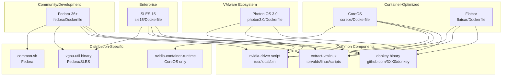
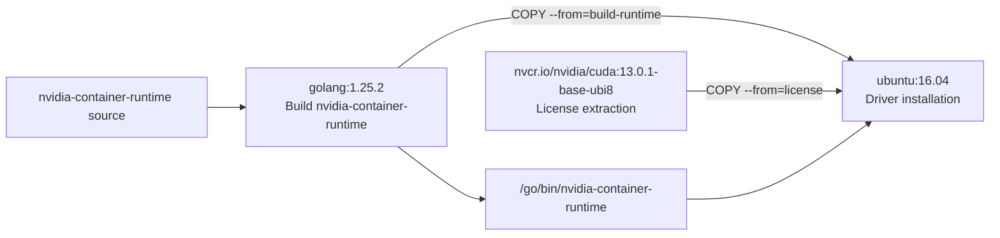
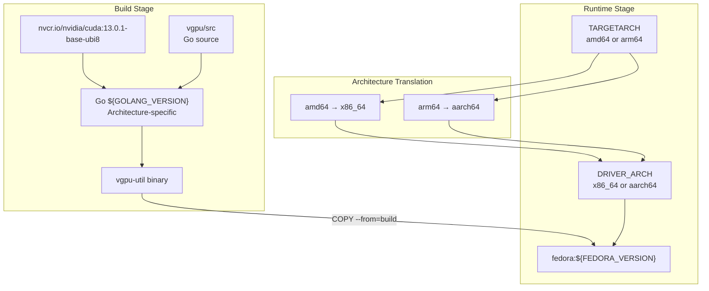
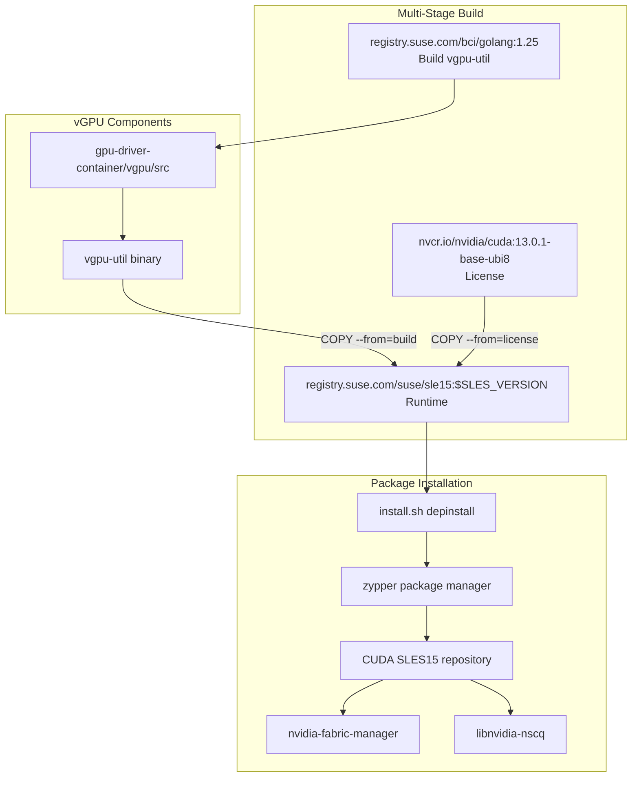
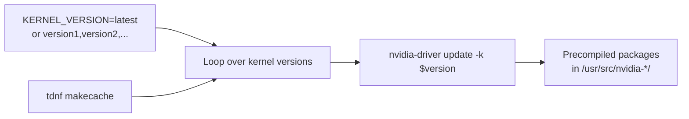
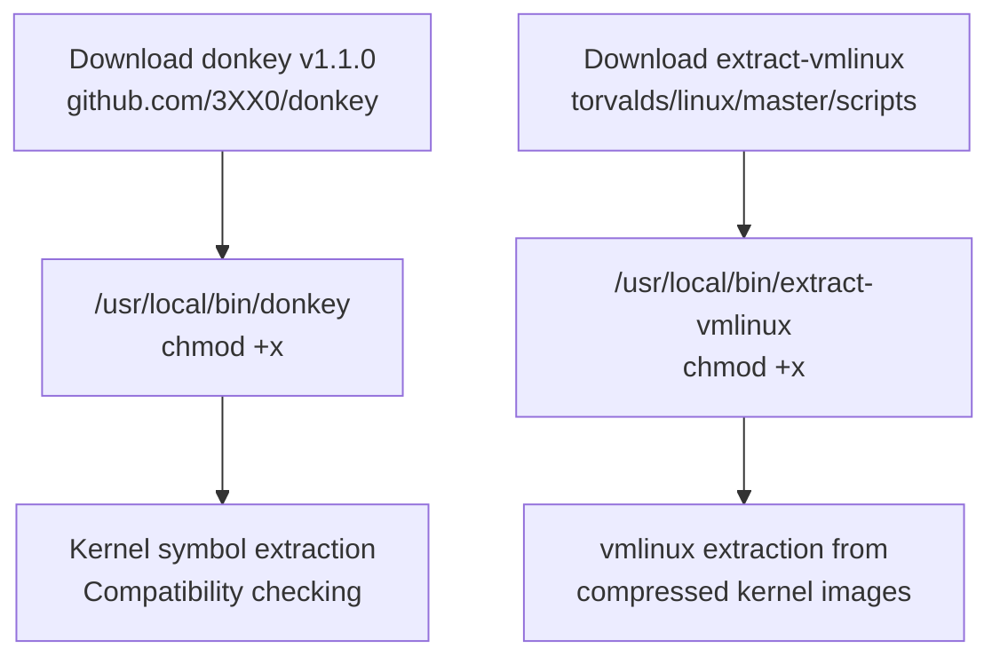
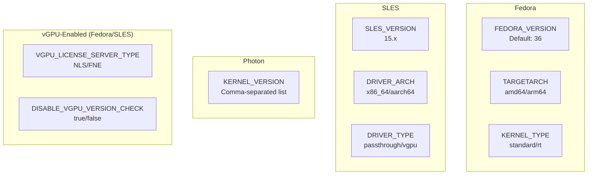
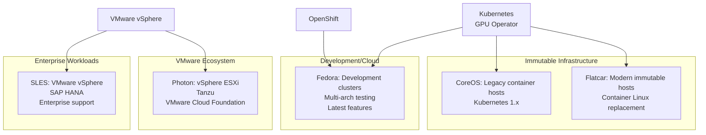

<!-- source: DeepWiki mcp.deepwiki.com · repo NVIDIA/gpu-driver-container · page 7.3 Other Distributions · fetched 2026-10-26 -->

# Other Distributions

<details>
<summary>Relevant source files</summary>

The following files were used as context for generating this wiki page:

- [centos7/Dockerfile](centos7/Dockerfile)
- [centos8/Dockerfile](centos8/Dockerfile)
- [coreos/Dockerfile](coreos/Dockerfile)
- [fedora/Dockerfile](fedora/Dockerfile)
- [flatcar/Dockerfile](flatcar/Dockerfile)
- [photon3.0/Dockerfile](photon3.0/Dockerfile)
- [sle15/Dockerfile](sle15/Dockerfile)
- [ubuntu16.04/Dockerfile](ubuntu16.04/Dockerfile)
- [ubuntu18.04/Dockerfile](ubuntu18.04/Dockerfile)

</details>


This page documents NVIDIA GPU driver container support for Linux distributions beyond Ubuntu and RHEL/CentOS. These include container-optimized distributions (CoreOS, Flatcar), community distributions (Fedora), enterprise distributions (SUSE Linux Enterprise), and VMware-specific distributions (Photon OS). For Ubuntu support, see [Ubuntu Support](#7.1). For RHEL and CentOS support, see [RHEL and CentOS Support](#7.2).

## Overview

The repository provides driver container images for five additional Linux distribution families, each with unique characteristics and build requirements:

| Distribution | Base Image | Package Manager | Primary Use Case | vGPU Support |
|-------------|------------|-----------------|------------------|--------------|
| CoreOS | Ubuntu 16.04 | apt | Immutable container hosts | No |
| Flatcar | Ubuntu 22.04 | apt | Immutable container hosts | No |
| Fedora | Fedora 36+ | dnf | Kubernetes, multi-arch | Yes |
| SLES | SLE15 | zypper | Enterprise VMware/SAP | Yes |
| Photon OS | Photon 3.0 | tdnf | VMware environments | No |

These distributions are differentiated from the primary Ubuntu/RHEL support by their specialized use cases, ranging from immutable infrastructure (CoreOS/Flatcar) to VMware integration (Photon OS) to enterprise workloads (SLES).

Sources: [coreos/Dockerfile:1-94](), [flatcar/Dockerfile:1-76](), [fedora/Dockerfile:1-141](), [sle15/Dockerfile:1-88](), [photon3.0/Dockerfile:1-71]()

## Distribution Architecture Overview



**Diagram: Distribution Support Matrix and Component Dependencies**

Sources: [coreos/Dockerfile:37-39](), [flatcar/Dockerfile:31-33](), [fedora/Dockerfile:72-74](), [sle15/Dockerfile:40-43](), [photon3.0/Dockerfile:17-19]()

## Container-Optimized Distributions

### CoreOS

CoreOS driver containers have a unique architecture due to their historical role as one of the first immutable container-optimized Linux distributions. The CoreOS Dockerfile includes special integration with `nvidia-container-runtime`.

#### Multi-Stage Build Architecture

The CoreOS build uses three stages:

1. **License stage**: Extracts NGC license from CUDA base image
2. **Build-runtime stage**: Compiles `nvidia-container-runtime` from source using golang:1.25.2
3. **Driver stage**: Builds the final driver container on Ubuntu 16.04



**Diagram: CoreOS Multi-Stage Build Pipeline**

Sources: [coreos/Dockerfile:1-8](), [coreos/Dockerfile:73]()

#### nvidia-container-runtime Integration

CoreOS is the only distribution that builds and embeds `nvidia-container-runtime` directly within the driver container. This integration includes:

- Custom build of the runtime binary at [coreos/Dockerfile:4-8]()
- Installation of `nvidia-container-runtime-hook` from NVIDIA repos at [coreos/Dockerfile:75-81]()
- Special `config.toml` configuration that patches ldconfig paths to work with the containerized driver

The configuration modifies the default behavior to use the driver container's ldconfig:

```
sed -i 's/^#root/root/; s;@/sbin/ldconfig.real;@/run/nvidia/driver/sbin/ldconfig.real;' /etc/nvidia-container-runtime/config.toml
```

This ensures that when the container runtime calls ldconfig, it uses the version provided by the driver container mounted at `/run/nvidia/driver`, not the host's version.

Sources: [coreos/Dockerfile:70-81]()

#### Driver Installation Process

CoreOS follows the standard driver installation pattern:

1. Download `NVIDIA-Linux-x86_64-$DRIVER_VERSION.run` from [coreos/Dockerfile:42]()
2. Execute silent installation with `nvidia-installer` at [coreos/Dockerfile:51-64]()
3. Copy kernel module sources to `/usr/src/nvidia-$DRIVER_VERSION` at [coreos/Dockerfile:65-67]()
4. Generate `.manifest` file from the installer's manifest at [coreos/Dockerfile:67]()

The default driver version is 450.80.02, specified at [coreos/Dockerfile:43]().

Sources: [coreos/Dockerfile:42-68]()

### Flatcar

Flatcar Linux is a fork of CoreOS Container Linux and shares many architectural similarities but with a more modern base and simplified build process.

#### Differences from CoreOS

Flatcar's Dockerfile differs from CoreOS in several key ways:

| Aspect | CoreOS | Flatcar |
|--------|--------|---------|
| Base Image | Ubuntu 16.04 | Ubuntu 22.04 |
| nvidia-container-runtime | Built from source | Not included |
| Entrypoint | `nvidia-driver` | `nvidia-driver` |
| Default Driver | 450.80.02 | 460.32.03 |
| Repository Sources | Bionic (18.04) | Jammy (22.04) |

The simplified architecture means Flatcar relies on the host system or Kubernetes GPU Operator to provide container runtime integration, rather than embedding it in the driver container.

Sources: [flatcar/Dockerfile:1](), [coreos/Dockerfile:11](), [flatcar/Dockerfile:37-38](), [coreos/Dockerfile:43]()

#### Build Configuration

Flatcar uses a modern Ubuntu 22.04 CUDA base and configures apt sources for Jammy:

```
FROM nvcr.io/nvidia/cuda:13.0.1-base-ubuntu22.04
```

The apt repository configuration at [flatcar/Dockerfile:26-29]() points to Ubuntu Jammy repositories, and the `_apt` user is modified to run with root privileges for downloading packages during the build.

Sources: [flatcar/Dockerfile:1-29]()

## Fedora Support

Fedora driver containers provide the most feature-complete implementation among the "other distributions," with full multi-architecture support, vGPU capabilities, and flexible kernel type handling.

### Multi-Architecture Build System



**Diagram: Fedora Multi-Architecture Build Flow**

The architecture handling involves multiple translation steps:

1. **Build stage**: Download Go binary for target architecture using `TARGETARCH` substitution at [fedora/Dockerfile:14-16]()
2. **Runtime stage**: Translate `TARGETARCH` to NVIDIA driver architecture naming at [fedora/Dockerfile:82]()
3. **Driver download**: Use translated architecture in driver filename

The translation logic uses bash parameter substitution:
```bash
DRIVER_ARCH=${TARGETARCH/amd64/x86_64} && DRIVER_ARCH=${DRIVER_ARCH/arm64/aarch64}
```

Sources: [fedora/Dockerfile:5](), [fedora/Dockerfile:14-16](), [fedora/Dockerfile:31-32](), [fedora/Dockerfile:82-84]()

### vGPU Support Implementation

Fedora includes full vGPU support through the `vgpu-util` binary and environment variables:

| Environment Variable | Default Value | Purpose |
|---------------------|---------------|---------|
| `DRIVER_TYPE` | `passthrough` | Set to `vgpu` for vGPU mode |
| `VGPU_LICENSE_SERVER_TYPE` | `NLS` | License server type (NLS/FNE) |
| `DISABLE_VGPU_VERSION_CHECK` | `true` | Disable version compatibility check |

The vGPU utility is built from source at [fedora/Dockerfile:22-25]() and copied to the runtime image at [fedora/Dockerfile:109](). For more details on vGPU functionality, see [vGPU Images](#4.3).

Sources: [fedora/Dockerfile:50-57](), [fedora/Dockerfile:109]()

### Dependency Installation

Fedora uses the `install.sh` script for dependency management. The script is copied at [fedora/Dockerfile:64]() and executed at [fedora/Dockerfile:71]():

```bash
sh /tmp/install.sh depinstall
```

This installs all required packages for kernel module compilation, including build tools, kernel headers management, and SELinux dependencies. See [Distribution-Specific Implementations](#5.4) for details on the `install.sh` script.

Sources: [fedora/Dockerfile:62-75]()

### Kernel Type Support

Fedora provides a `KERNEL_TYPE` build argument at [fedora/Dockerfile:34-35]() to support different kernel variants:

- Standard Fedora kernels
- RT (Real-Time) kernels
- Custom kernel builds

This is passed through to the driver compilation process and affects which kernel headers are installed during the initialization phase.

Sources: [fedora/Dockerfile:34-35]()

### Fabric Manager Commented Out

The Dockerfile contains commented-out Fabric Manager installation code at [fedora/Dockerfile:86-100](). This suggests Fabric Manager support is planned but not yet implemented for Fedora, unlike RHEL-based distributions where it is fully functional. The comment states:

```dockerfile
# ******************************************************************************
# REMOVED FABRIC MANAGER RHEL WORK FOR NOW - HAVEN'T ATTEMPTED INCLUSION
# ******************************************************************************
```

Sources: [fedora/Dockerfile:86-100]()

## SUSE Linux Enterprise (SLES)

SLES driver containers are designed for enterprise environments, particularly VMware and SAP deployments, with full vGPU and Fabric Manager support.

### Build Architecture



**Diagram: SLES Build Pipeline with Fabric Manager**

Sources: [sle15/Dockerfile:2-13](), [sle15/Dockerfile:15](), [sle15/Dockerfile:39-62]()

### Driver Type Detection

SLES supports both passthrough and vGPU driver types. The driver fetch logic at [sle15/Dockerfile:48-62]() conditionally downloads the driver installer only for passthrough types:

```bash
if [ "$DRIVER_TYPE" != "vgpu" ]; then
    # Download driver and install Fabric Manager packages
fi
```

For vGPU deployments, drivers are provided separately through the vGPU manager and not bundled in the container.

Sources: [sle15/Dockerfile:24-31](), [sle15/Dockerfile:48-62]()

### Fabric Manager Package Selection

SLES implements intelligent Fabric Manager package selection based on driver version at [sle15/Dockerfile:49-56]():

```bash
versionArray=(${DRIVER_VERSION//./ });
DRIVER_BRANCH=${versionArray[0]};
if [ ${versionArray[0]} -ge 470 ] || ([ ${versionArray[0]} == 460 ] && [ ${versionArray[1]} -ge 91 ]); then
  fmPackage=nvidia-fabric-manager-${DRIVER_VERSION}-1;
else
  fmPackage=nvidia-fabricmanager-${DRIVER_BRANCH}-${DRIVER_VERSION}-1;
fi;
```

This handles the package naming change that occurred in driver version 460.91 and 470+, where the package name changed from `nvidia-fabricmanager-<branch>-<version>` to `nvidia-fabric-manager-<version>`.

Additionally, the NSCQ (NVSwitch Configuration and Query) library is installed:
```bash
nscqPackage=libnvidia-nscq-${DRIVER_BRANCH}-${DRIVER_VERSION}-1;
```

Sources: [sle15/Dockerfile:49-62]()

### CUDA Repository Configuration

SLES adds the CUDA repository dynamically during the build at [sle15/Dockerfile:60-62]():

```bash
zypper --non-interactive addrepo https://developer.download.nvidia.com/compute/cuda/repos/sles15/$DRIVER_ARCH cuda-sles15
zypper --gpg-auto-import-keys --non-interactive install -y ${fmPackage} ${nscqPackage}
zypper removerepo cuda-sles15
```

The repository is removed after package installation to keep the final image clean and prevent repository-related issues at runtime.

Sources: [sle15/Dockerfile:60-62]()

### Architecture Support

SLES supports both x86_64 and arm64 architectures through the `DRIVER_ARCH` build argument at [sle15/Dockerfile:21-22]():

```dockerfile
ARG DRIVER_ARCH=x86_64
ENV DRIVER_ARCH=$DRIVER_ARCH
```

This affects both driver download URLs and package repository paths.

Sources: [sle15/Dockerfile:21-22]()

## VMware Photon OS

Photon OS is VMware's minimal Linux container host, optimized for VMware environments and cloud-native applications.

### Precompiled Module Strategy

Unlike other distributions that defer kernel module compilation to runtime, Photon OS can precompile modules at build time using the `KERNEL_VERSION` build argument:



**Diagram: Photon OS Precompilation Flow**

The precompilation logic at [photon3.0/Dockerfile:61-65]() executes:

```bash
for version in $(echo $KERNEL_VERSION | tr ',' ' '); do
    nvidia-driver update -k $version -t builtin ${PRIVATE_KEY:+"-s ${PRIVATE_KEY}"};
done
```

This compiles kernel modules for all specified kernel versions during the image build, creating precompiled packages that can be installed quickly at runtime without requiring build tools on the host.

Sources: [photon3.0/Dockerfile:58](), [photon3.0/Dockerfile:61-65]()

### Package Management with tdnf

Photon OS uses `tdnf` (Tiny Dandified YUM), a lightweight package manager. The Dockerfile installs build dependencies at [photon3.0/Dockerfile:5-15]():

```dockerfile
RUN tdnf install -y \
    build-essential \
    ca-certificates \
    curl \
    tar \
    util-linux \
    coreutils \
    rpm \
    findutils \
    kmod
```

These packages provide the minimal toolchain needed for driver compilation.

Sources: [photon3.0/Dockerfile:5-15]()

### Module Signing Support

Photon OS supports kernel module signing through the `PRIVATE_KEY` build argument at [photon3.0/Dockerfile:57]():

```dockerfile
ARG PRIVATE_KEY
```

When provided, this is passed to the `nvidia-driver update` command with the `-s` flag to sign the compiled modules. For more details on module signing, see [Security and Module Signing](#8.1).

Sources: [photon3.0/Dockerfile:57](), [photon3.0/Dockerfile:63]()

## Common Build Patterns

### Donkey and extract-vmlinux

All five distributions install two critical utilities for kernel introspection:



**Diagram: Kernel Introspection Utilities**

These tools are installed identically across all distributions:

```bash
curl -fsSL -o /usr/local/bin/donkey https://github.com/3XX0/donkey/releases/download/v1.1.0/donkey
curl -fsSL -o /usr/local/bin/extract-vmlinux https://raw.githubusercontent.com/torvalds/linux/master/scripts/extract-vmlinux
chmod +x /usr/local/bin/donkey /usr/local/bin/extract-vmlinux
```

**donkey** extracts kernel configuration and symbols from running kernels, even when `/proc/config.gz` is not available. This is essential for determining kernel features and module dependencies.

**extract-vmlinux** extracts the uncompressed vmlinux ELF binary from compressed kernel images (bzImage, vmlinuz), enabling analysis of kernel symbols and version strings.

Sources: [coreos/Dockerfile:37-39](), [flatcar/Dockerfile:31-33](), [fedora/Dockerfile:72-74](), [sle15/Dockerfile:40-42](), [photon3.0/Dockerfile:17-19]()

### nvidia-installer Silent Installation

All distributions use the NVIDIA installer with a consistent set of flags for userspace component installation:

| Flag | Purpose |
|------|---------|
| `--silent` | Non-interactive installation |
| `--no-kernel-module` | Skip kernel module installation (compiled separately) |
| `--install-compat32-libs` | Install 32-bit compatibility libraries |
| `--no-nouveau-check` | Skip nouveau driver conflict check |
| `--no-nvidia-modprobe` | Skip nvidia-modprobe installation |
| `--no-rpms` | Don't package components as RPMs |
| `--no-backup` | Don't backup existing files |
| `--no-check-for-alternate-installs` | Skip alternate installation check |
| `--no-libglx-indirect` | Don't install indirect GLX support |
| `--no-install-libglvnd` | Don't install libglvnd (use system version) |
| `--x-prefix=/tmp/null` | Disable X11 components |
| `--x-module-path=/tmp/null` | Disable X11 module path |
| `--x-library-path=/tmp/null` | Disable X11 library path |
| `--x-sysconfig-path=/tmp/null` | Disable X11 sysconfig path |

This standardized installation approach ensures consistent behavior across distributions while minimizing dependencies.

Sources: [coreos/Dockerfile:51-64](), [flatcar/Dockerfile:46-59](), [photon3.0/Dockerfile:31-44]()

### Kernel Module Source Organization

After installation, all distributions organize kernel module sources consistently:

```
/usr/src/nvidia-$DRIVER_VERSION/
├── LICENSE          # Driver license
├── kernel/          # Kernel module sources
│   └── pubkey.x509  # Optional public key for signing
├── mkprecompiled    # Script to create precompiled packages
└── .manifest        # Manifest of installed files
```

The manifest is generated by filtering the installer's `.manifest` file to include only kernel and license entries at [coreos/Dockerfile:67]():

```bash
sed '9,${/^\(kernel\|LICENSE\)/!d}' .manifest > /usr/src/nvidia-$DRIVER_VERSION/.manifest
```

Sources: [coreos/Dockerfile:65-67](), [flatcar/Dockerfile:60-63](), [photon3.0/Dockerfile:45-48]()

### Public Key Integration

All distributions support optional kernel module signing through the `PUBLIC_KEY` build argument:

```dockerfile
ARG PUBLIC_KEY=empty
COPY ${PUBLIC_KEY} kernel/pubkey.x509
```

The public key is copied into the kernel module sources at `kernel/pubkey.x509`, where it will be used during module compilation if present. The default value `empty` means no signing occurs unless explicitly provided. See [Security and Module Signing](#8.1) for implementation details.

Sources: [coreos/Dockerfile:87-88](), [flatcar/Dockerfile:69-70](), [fedora/Dockerfile:113-114](), [sle15/Dockerfile:70-71](), [photon3.0/Dockerfile:54-55]()

### NGC License

All distributions include the NGC Deep Learning Container License by copying it from the CUDA base image:

```dockerfile
COPY --from=license /NGC-DL-CONTAINER-LICENSE /licenses/NGC-DL-CONTAINER-LICENSE
```

This ensures compliance with NVIDIA's licensing requirements for redistributing driver containers.

Sources: [coreos/Dockerfile:91](), [flatcar/Dockerfile:73](), [fedora/Dockerfile:128](), [sle15/Dockerfile:85](), [photon3.0/Dockerfile:68]()

## Build Arguments and Configuration

### Common Build Arguments

All distributions support a core set of build arguments:

| Build Argument | Purpose | Default/Example |
|---------------|---------|-----------------|
| `BASE_URL` | NVIDIA driver download URL | `https://us.download.nvidia.com/tesla` |
| `DRIVER_VERSION` | Driver version to install | Required (e.g., `535.129.03`) |
| `PUBLIC_KEY` | Public key for module signing | `empty` |
| `PRIVATE_KEY` | Private key for module signing | Not set |

Sources: [coreos/Dockerfile:41-44](), [flatcar/Dockerfile:35-38](), [fedora/Dockerfile:44-48](), [sle15/Dockerfile:17-20](), [photon3.0/Dockerfile:21-24]()

### Distribution-Specific Arguments



**Diagram: Distribution-Specific Build Arguments**

#### Fedora-Specific

- `FEDORA_VERSION`: Base Fedora version at [fedora/Dockerfile:1](), [fedora/Dockerfile:27]()
- `TARGETARCH`: Target architecture for multi-arch builds at [fedora/Dockerfile:5](), [fedora/Dockerfile:31]()
- `KERNEL_TYPE`: Kernel variant (standard/RT) at [fedora/Dockerfile:34-35]()
- `HTTP_PROXY` / `HTTPS_PROXY`: Proxy configuration at [fedora/Dockerfile:37-40]()

#### SLES-Specific

- `SLES_VERSION`: SLE15 minor version at [sle15/Dockerfile:1]()
- `DRIVER_ARCH`: Architecture (x86_64/aarch64) at [sle15/Dockerfile:21-22]()
- `DRIVER_TYPE`: Driver type (passthrough/vgpu) at [sle15/Dockerfile:25-26]()
- `VGPU_LICENSE_SERVER_TYPE`: FNE (FlexNet) or NLS at [sle15/Dockerfile:27-28]()
- `DISABLE_VGPU_VERSION_CHECK`: Disable vGPU version checks at [sle15/Dockerfile:30-31]()

#### Photon-Specific

- `KERNEL_VERSION`: Comma-separated list of kernel versions to precompile at [photon3.0/Dockerfile:58]()

Sources: [fedora/Dockerfile:1-40](), [sle15/Dockerfile:1-31](), [photon3.0/Dockerfile:58]()

### Environment Variables

All distributions set the critical `NVIDIA_VISIBLE_DEVICES=void` environment variable to prevent automatic GPU enumeration by the container runtime. This is essential because driver containers should not themselves request GPU access; they only provide drivers to other containers.

Sources: [coreos/Dockerfile:71](), [flatcar/Dockerfile:3](), [fedora/Dockerfile:59](), [sle15/Dockerfile:33](), [photon3.0/Dockerfile:24]()

## Distribution Comparison Matrix

### Feature Support

| Feature | CoreOS | Flatcar | Fedora | SLES | Photon |
|---------|--------|---------|--------|------|--------|
| Multi-architecture | No | No | Yes | Yes | No |
| vGPU support | No | No | Yes | Yes | No |
| Fabric Manager | No | No | Planned | Yes | No |
| Precompiled modules | No | No | No | No | Yes |
| nvidia-container-runtime | Yes | No | No | No | No |
| Module signing | Yes | Yes | Yes | Yes | Yes |

### Base Image Characteristics

| Distribution | Base Image Family | Base Image Version | Package Manager | Init System Support |
|-------------|-------------------|-------------------|-----------------|-------------------|
| CoreOS | Ubuntu | 16.04 | apt | systemd (via host) |
| Flatcar | Ubuntu | 22.04 | apt | systemd (via host) |
| Fedora | Fedora | 36+ | dnf | systemd (via host) |
| SLES | SUSE SLE | 15.x | zypper | systemd (via host) |
| Photon | VMware Photon | 3.0 | tdnf | systemd (via host) |

### Use Case Mapping



**Diagram: Distribution Use Case Mapping**

Sources: All Dockerfiles analyzed

## Best Practices and Considerations

### Distribution Selection Criteria

When choosing a distribution for GPU driver containers:

1. **Immutable Infrastructure**: Use CoreOS or Flatcar for truly immutable container hosts with minimal attack surface
2. **Enterprise Support**: Use SLES when VMware support, SAP certification, or commercial support contracts are required
3. **Multi-Architecture**: Use Fedora or SLES for ARM64 deployments alongside x86_64
4. **vGPU Requirements**: Use Fedora or SLES for virtual GPU environments; other distributions only support passthrough
5. **VMware Integration**: Use Photon OS for native VMware vSphere, ESXi, and Tanzu environments
6. **Precompiled Optimization**: Use Photon OS when kernel versions are stable and known in advance

### Build Performance Considerations

The precompilation approach used by Photon OS has different tradeoffs:

**Advantages:**
- Faster runtime initialization (no compilation needed)
- Smaller runtime image (no build tools required)
- Predictable deployment times

**Disadvantages:**
- Larger build-time image
- Must rebuild for new kernel versions
- Limited flexibility for kernel updates

For distributions that defer compilation to runtime (CoreOS, Flatcar, Fedora, SLES), the tradeoffs are inverted: larger runtime images but greater flexibility.

Sources: [photon3.0/Dockerfile:61-65]()

### Security Considerations

1. **Module Signing**: All distributions support module signing, but it must be configured at build time. See [Security and Module Signing](#8.1)
2. **CVE Updates**: Only some distributions support the `CVE_UPDATES` build argument for patching vulnerabilities at build time
3. **GPG Key Verification**: Fedora and SLES verify NVIDIA repository GPG keys during package installation
4. **Minimal Base Images**: Photon OS and Flatcar provide the smallest base images, reducing attack surface

Sources: [fedora/Dockerfile:66-69](), [sle15/Dockerfile:60]()

---

