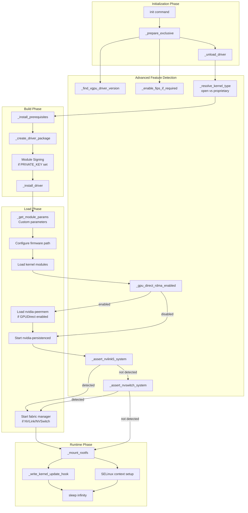
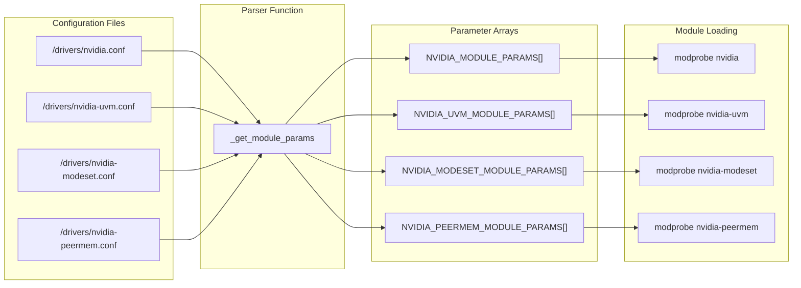
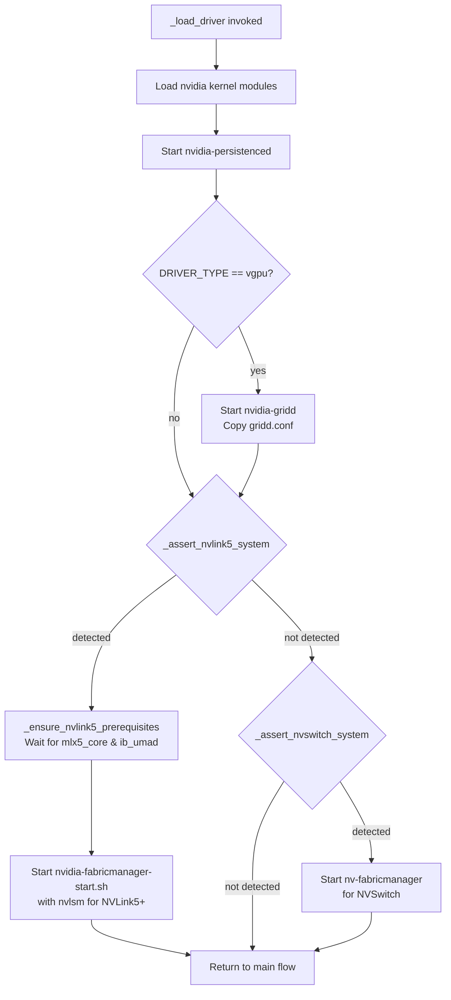
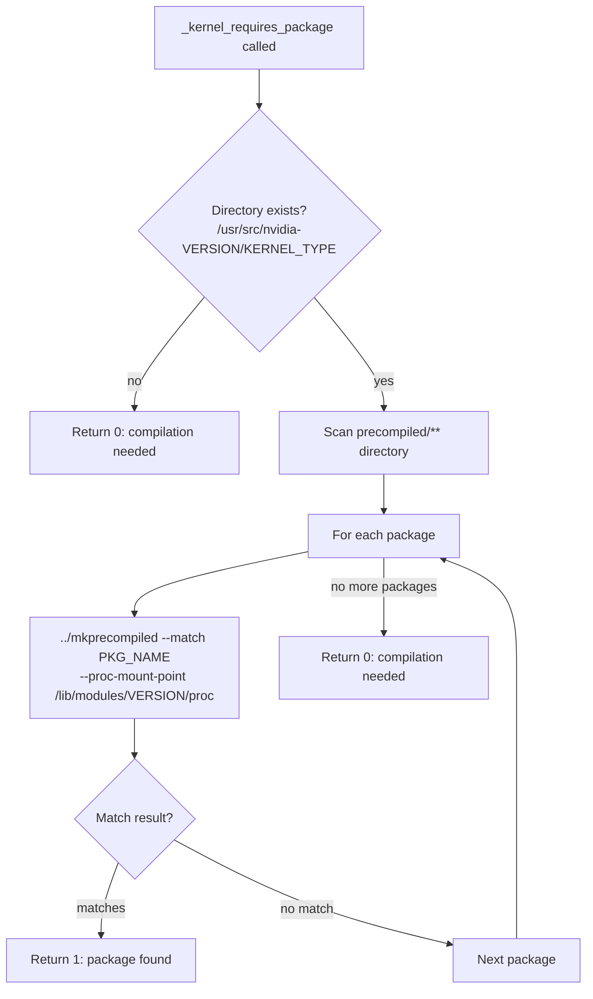
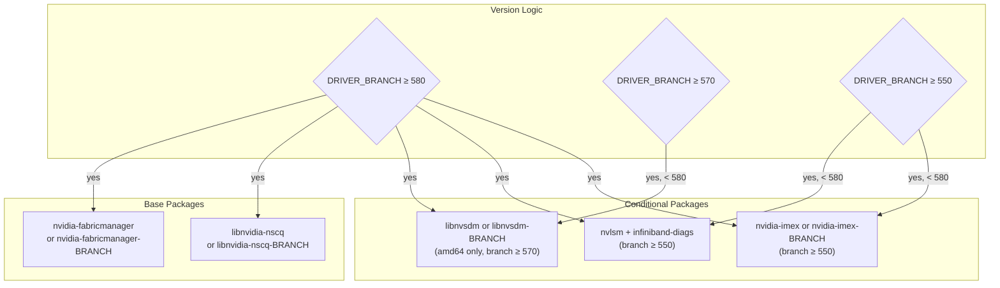

<!-- source: DeepWiki mcp.deepwiki.com · repo NVIDIA/gpu-driver-container · page 8 Advanced Topics · fetched 2026-10-26 -->

# Advanced Topics

<details>
<summary>Relevant source files</summary>

The following files were used as context for generating this wiki page:

- [rhel8/nvidia-driver](rhel8/nvidia-driver)
- [rhel9/nvidia-driver](rhel9/nvidia-driver)
- [ubuntu20.04/nvidia-driver](ubuntu20.04/nvidia-driver)
- [ubuntu22.04/nvidia-driver](ubuntu22.04/nvidia-driver)
- [ubuntu24.04/Dockerfile](ubuntu24.04/Dockerfile)
- [ubuntu24.04/install.sh](ubuntu24.04/install.sh)
- [ubuntu24.04/nvidia-driver](ubuntu24.04/nvidia-driver)

</details>


This page provides an overview of advanced features and specialized configurations supported by the GPU driver container system. These features enable enterprise-grade security, high-performance networking, multi-GPU fabric topologies, compliance requirements, and automatic driver maintenance.

For basic driver installation and runtime management, see [Driver Management Scripts](#5). For standard driver image types, see [Container Image Types](#4).

## Purpose and Scope

This page introduces specialized driver features that extend beyond basic GPU driver installation and loading. Each subsection provides an overview with references to dedicated child pages for detailed implementation information:

- **Security and Module Signing** ([8.1](#8.1)): Kernel module signing for secure boot environments
- **GPUDirect RDMA** ([8.2](#8.2)): High-performance GPU-to-NIC communication via `nvidia-peermem`
- **NVLink and Fabric Manager** ([8.3](#8.3)): Multi-GPU fabric management for NVSwitch and NVLink topologies
- **FIPS and Ubuntu Pro** ([8.4](#8.4)): Federal Information Processing Standards compliance
- **Kernel Update Hooks** ([8.5](#8.5)): Automatic driver recompilation on kernel updates

## Advanced Feature Architecture

The following diagram shows how advanced features integrate into the standard driver initialization flow:

**Driver Lifecycle with Advanced Features**



Sources: [rhel8/nvidia-driver:753-771](), [ubuntu24.04/nvidia-driver:569-610]()

## Feature Configuration Matrix

The following table summarizes how advanced features are configured and detected:

| Feature | Environment Variable | Detection Method | Distributions |
|---------|---------------------|------------------|---------------|
| Kernel Module Signing | `PRIVATE_KEY` | Presence of private key | All |
| GPUDirect RDMA | `GPU_DIRECT_RDMA_ENABLED` | Mellanox device detection | All |
| NVSwitch Fabric | None (auto-detected) | `/proc/driver/nvidia-nvswitch` | All |
| NVLink5+ Fabric | None (auto-detected) | VPD file `SW_MNG` string | All |
| FIPS Mode | `UBUNTU_PRO_TOKEN` | FIPS kernel string match | Ubuntu 22.04+ |
| Kernel Update Hook | None (auto-enabled) | `/run/kernel/postinst.d` existence | All |
| Module Parameters | Config files in `/drivers` | File presence | All |
| SELinux Context | None (auto-detected) | `/sys/fs/selinux` existence | RHEL/CentOS |
| Host MOFED | `USE_HOST_MOFED` | User configuration | All |
| Kernel Module Type | `KERNEL_MODULE_TYPE` | `nvidia-installer --print-recommended-kernel-module-type` | All |

Sources: [rhel8/nvidia-driver:8-21](), [ubuntu22.04/nvidia-driver:8-20](), [ubuntu24.04/nvidia-driver:8-19]()

## Module Parameter Configuration

Custom kernel module parameters can be passed to the NVIDIA driver modules through configuration files. The `_get_module_params` function parses these files and applies parameters during module loading.

**Module Parameter Configuration Flow**



Sources: [rhel8/nvidia-driver:305-341](), [ubuntu24.04/nvidia-driver:209-245]()

### Default Module Parameters

Starting from driver branch 580, the system automatically configures the Coherent Driver Memory Management (CDMM) parameter:

```bash
NVIDIA_MODULE_PARAMS+=("NVreg_CoherentGPUMemoryMode=driver")
```

This prevents GPU memory on coherent systems (GH200, GB200) from being exposed as a NUMA node, preventing Kubernetes node memory over-reporting.

Sources: [rhel8/nvidia-driver:308-311](), [rhel9/nvidia-driver:320-323](), [ubuntu22.04/nvidia-driver:271-274]()

## Feature Detection Functions

The driver scripts implement several detection functions that determine which advanced features to enable:

### Hardware Detection Functions

| Function | Purpose | Detection Method | File References |
|----------|---------|------------------|-----------------|
| `_assert_nvswitch_system` | Detect NVSwitch presence | Check `/proc/driver/nvidia-nvswitch/devices` | [rhel8/nvidia-driver:261-268]() |
| `_assert_nvlink5_system` | Detect NVLink5+ fabric | Search for `SW_MNG` in VPD files | [rhel8/nvidia-driver:270-285]() |
| `_mellanox_devices_present` | Detect Mellanox NICs | Scan PCI devices for vendor `0x15b3` | [ubuntu24.04/nvidia-driver:176-187]() |
| `_gpu_direct_rdma_enabled` | Check GPUDirect RDMA eligibility | Combine env var and hardware detection | [ubuntu24.04/nvidia-driver:189-197]() |

### Software Environment Detection

| Function | Purpose | Detection Method | File References |
|----------|---------|------------------|-----------------|
| `_resolve_kernel_type` | Determine open vs proprietary module | Use `nvidia-installer --print-recommended-kernel-module-type` | [rhel8/nvidia-driver:615-643]() |
| `_enable_fips_if_required` | Enable FIPS mode | Check `UBUNTU_PRO_TOKEN` and FIPS kernel | [ubuntu24.04/nvidia-driver:27-46]() |
| `_get_rhel_version_from_kernel` | Extract RHEL version | Parse kernel version string | [rhel8/nvidia-driver:46-62]() |

Sources: [rhel8/nvidia-driver:261-285](), [ubuntu24.04/nvidia-driver:142-197]()

## Advanced Daemon Management

The driver container manages multiple NVIDIA daemons based on system configuration:

**Daemon Startup Decision Tree**



Sources: [rhel8/nvidia-driver:343-422](), [ubuntu24.04/nvidia-driver:247-328]()

### Daemon Lifecycle Management

All daemons are gracefully shutdown during driver unload by the `_unload_driver` function:

1. **nvidia-persistenced**: Maintains GPU state across container restarts
2. **nvidia-gridd**: Manages vGPU licensing (vGPU mode only)
3. **nv-fabricmanager**: Manages NVSwitch fabric (NVSwitch systems)
4. **nvidia-fabricmanager-start.sh**: Manages NVLink5+ fabric with NVLSM daemon
5. **nvidia-topologyd**: Manages virtual GPU topology (vGPU mode only)

Each daemon is sent `SIGTERM` and the script waits up to 5 seconds for graceful shutdown before declaring failure.

Sources: [rhel8/nvidia-driver:424-522](), [ubuntu24.04/nvidia-driver:330-430]()

## SELinux Integration

For RHEL-based distributions, the driver automatically configures SELinux security contexts when SELinux is enabled:

```bash
echo "Check SELinux status"
if [ -e /sys/fs/selinux ]; then
    echo "SELinux is enabled"
    echo "Change device files security context for selinux compatibility"
    chcon -R -t container_file_t ${RUN_DIR}/driver/dev
else
    echo "SELinux is disabled, skipping..."
fi
```

This ensures GPU device files are accessible to containers in SELinux-enforcing environments.

Sources: [rhel8/nvidia-driver:567-574](), [rhel9/nvidia-driver:584-591]()

## Firmware Loading Configuration

The driver configures the Linux firmware loader to search for GPU firmware in the driver container's filesystem:

```bash
local nv_fw_search_path="$RUN_DIR/driver/lib/firmware"
local fw_path_config_file="/sys/module/firmware_class/parameters/path"

if [[ "$set_fw_path" == "true" ]]; then
    echo "Configuring the following firmware search path in '$fw_path_config_file': $nv_fw_search_path"
    echo -n "$nv_fw_search_path" > $fw_path_config_file
fi
```

This configuration can be disabled by setting the module parameter `NVreg_EnableGpuFirmware=0`.

Sources: [rhel8/nvidia-driver:348-365](), [ubuntu24.04/nvidia-driver:252-269]()

## Precompiled Package Management

The system supports precompiled kernel modules to avoid compilation overhead. The `_kernel_requires_package` function checks if a matching precompiled package exists:

**Precompiled Package Match Flow**



The `mkprecompiled` utility compares the kernel interface signature in the precompiled package against the current kernel to determine compatibility.

Sources: [rhel8/nvidia-driver:175-193](), [ubuntu20.04/nvidia-driver:102-120]()

## Advanced Installation Features (Ubuntu 24.04)

Ubuntu 24.04 introduces a streamlined installation process using `nvidia-installer` with additional flags:

```bash
# Specify the --skip-module-load flag for versions of the nvidia-installer that
# support it. This prevents a subtle bug where the nvidia-installer fails to unload
# the NVIDIA kernel modules after the test load. The modules will remain loaded and
# any custom NVIDIA module parameters configured as input to the driver container
# will not be applied.
if [ "${DRIVER_BRANCH}" -ge "550" ]; then
    install_args+=("--skip-module-load")
fi

# Install the NVIDIA driver in one step
sh NVIDIA-Linux-$DRIVER_ARCH-$DRIVER_VERSION.run --silent \
                --ui=none \
                --no-drm \
                --no-nouveau-check \
                --no-nvidia-modprobe \
                --no-rpms \
                --no-backup \
                --no-check-for-alternate-installs \
                --no-libglx-indirect \
                --no-install-libglvnd \
                --x-prefix=/tmp/null \
                --x-module-path=/tmp/null \
                --x-library-path=/tmp/null \
                --x-sysconfig-path=/tmp/null \
                ${install_args[@]+"${install_args[@]}"}
```

This performs both userspace and kernel module installation in a single invocation, simplifying the installation flow compared to earlier Ubuntu versions.

Sources: [ubuntu24.04/nvidia-driver:432-482]()

## Additional Package Installation

For certain advanced features, additional packages are installed from the CUDA repository:

**Additional Packages by Feature**



Sources: [ubuntu24.04/install.sh:47-106]()

These packages support:
- **nvidia-fabricmanager**: NVSwitch and NVLink fabric management
- **libnvidia-nscq**: NVIDIA Scalable Coherent Interface Query library
- **libnvsdm**: NVIDIA Switch Diagnostic Manager (x86_64 only)
- **nvlsm**: NVLink Subnet Manager for NVLink5+ systems
- **nvidia-imex**: In-Memory Execution and Communication library

## Summary

Advanced features in the GPU driver container system provide:

1. **Enterprise Security**: Module signing, FIPS compliance, SELinux integration
2. **High-Performance Networking**: GPUDirect RDMA with automatic MOFED integration
3. **Multi-GPU Fabric**: Automatic detection and management of NVSwitch and NVLink topologies
4. **Automatic Maintenance**: Kernel update hooks for seamless driver updates
5. **Flexible Configuration**: Custom module parameters and detection overrides

Each advanced feature is implemented through conditional logic in the driver management scripts, with automatic detection and graceful fallback when hardware or software requirements are not met. For detailed information on each feature, refer to the corresponding child pages.

---

