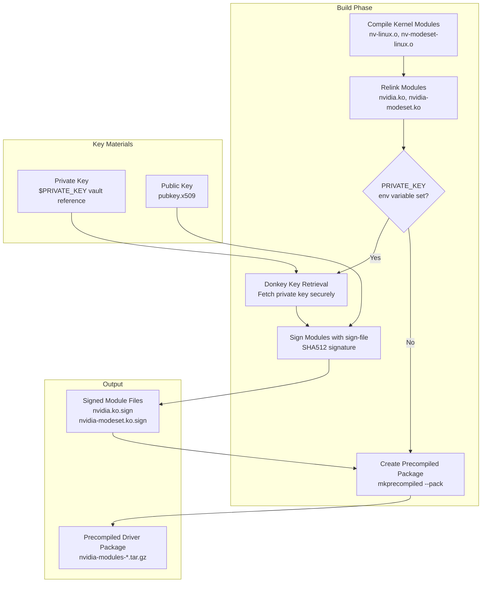
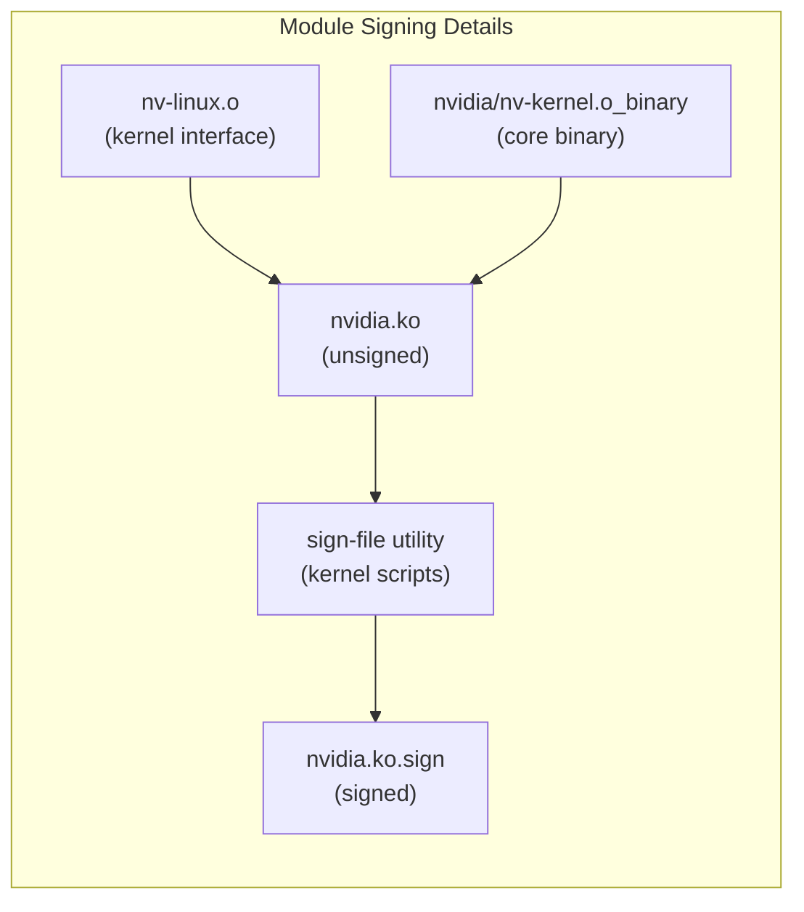
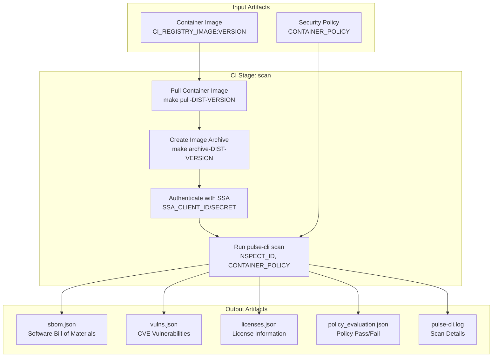
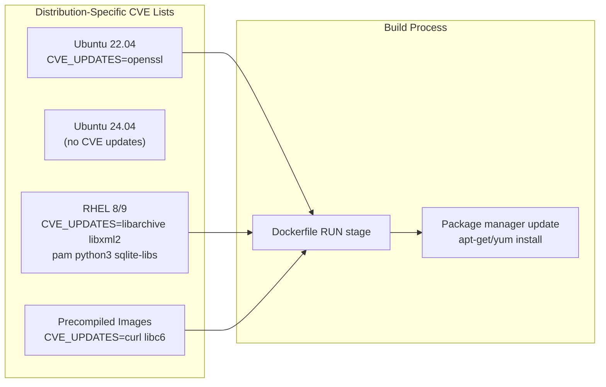
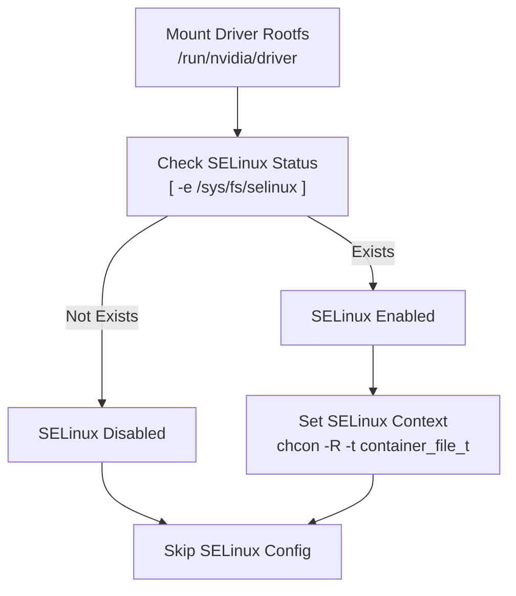
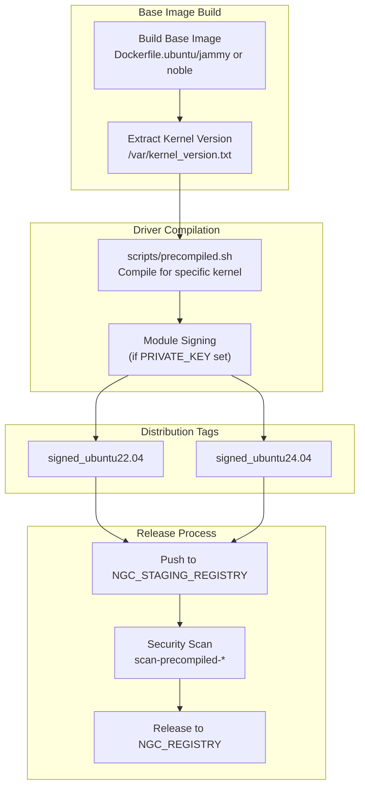
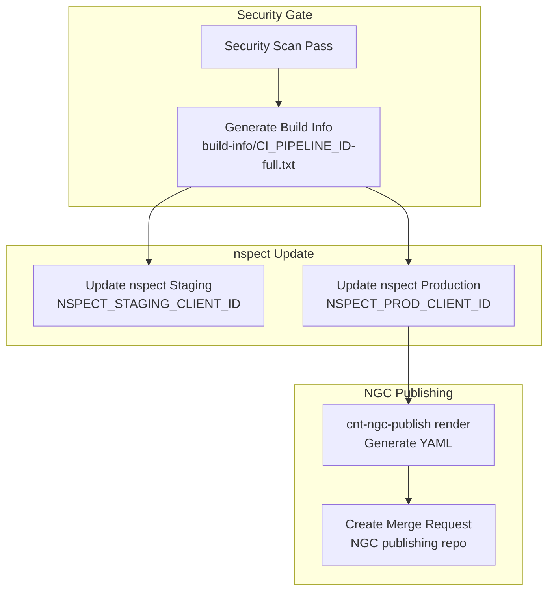

<!-- source: DeepWiki mcp.deepwiki.com · repo NVIDIA/gpu-driver-container · page 8.1 Security and Module Signing · fetched 2026-10-26 -->

# Security and Module Signing

<details>
<summary>Relevant source files</summary>

The following files were used as context for generating this wiki page:

- [.common-ci.yml](.common-ci.yml)
- [.github/workflows/image.yaml](.github/workflows/image.yaml)
- [.nvidia-ci.yml](.nvidia-ci.yml)
- [rhel7/Dockerfile](rhel7/Dockerfile)
- [rhel7/nvidia-driver](rhel7/nvidia-driver)
- [rhel8/nvidia-driver](rhel8/nvidia-driver)
- [rhel9/nvidia-driver](rhel9/nvidia-driver)
- [ubuntu20.04/nvidia-driver](ubuntu20.04/nvidia-driver)
- [ubuntu22.04/nvidia-driver](ubuntu22.04/nvidia-driver)
- [versions.mk](versions.mk)

</details>


## Purpose and Scope

This page documents the security mechanisms and kernel module signing processes implemented in the gpu-driver-container system. It covers how NVIDIA kernel modules are cryptographically signed for Secure Boot compatibility, how images are scanned for vulnerabilities, and how security contexts are managed across different Linux distributions.

For information about the driver compilation process itself, see [Kernel Module Compilation](#5.2). For distribution-specific security requirements, see [Distribution Support](#7).

## Kernel Module Signing Overview

Kernel module signing is a security feature that enables systems with UEFI Secure Boot to verify the authenticity of kernel modules before loading them. The gpu-driver-container system optionally signs NVIDIA kernel modules during the driver package creation phase to support hosts with Secure Boot enabled.

### Signing Workflow



**Sources:** [rhel8/nvidia-driver:196-259](), [ubuntu22.04/nvidia-driver:135-199](), [ubuntu20.04/nvidia-driver:123-187]()

### Signing Process Implementation

The module signing process occurs in the `_create_driver_package()` function across all distribution-specific nvidia-driver scripts. The process follows these steps:

1. **Kernel Module Compilation**: The kernel interface files (`nv-linux.o`, `nv-modeset-linux.o`) are compiled against the target kernel
2. **Module Relinking**: Compiled interface objects are linked with binary core objects to create `.ko` files
3. **Conditional Signing**: If `PRIVATE_KEY` environment variable is set, modules are signed
4. **Package Creation**: The `mkprecompiled` utility creates a precompiled driver package with signed modules



**Key Code Locations:**

| Distribution | Signing Logic | Line Numbers |
|--------------|---------------|--------------|
| RHEL 8 | `_create_driver_package()` | [rhel8/nvidia-driver:229-238]() |
| RHEL 9 | `_create_driver_package()` | [rhel9/nvidia-driver:241-250]() |
| Ubuntu 22.04 | `_create_driver_package()` | [ubuntu22.04/nvidia-driver:169-178]() |
| Ubuntu 20.04 | `_create_driver_package()` | [ubuntu20.04/nvidia-driver:157-166]() |

**Sources:** [rhel8/nvidia-driver:196-259](), [rhel9/nvidia-driver:208-271](), [ubuntu22.04/nvidia-driver:135-199](), [ubuntu20.04/nvidia-driver:123-187]()

### Key Management with Donkey

The system uses the `donkey` utility to securely retrieve private keys from a secrets management system. This ensures that private keys are never stored in container images or version control.

**Donkey Integration Example:**
```bash
donkey get ${PRIVATE_KEY} sh -c "PATH=${PATH}:/usr/src/linux-headers-${KERNEL_VERSION}/scripts && \
  sign-file sha512 \$DONKEY_FILE pubkey.x509 nvidia.ko nvidia.ko.sign &&                          \
  sign-file sha512 \$DONKEY_FILE pubkey.x509 nvidia-modeset.ko nvidia-modeset.ko.sign &&          \
  sign-file sha512 \$DONKEY_FILE pubkey.x509 nvidia-uvm.ko"
```

The public key is embedded in the container image during build time and placed at `kernel/pubkey.x509`:

**Sources:** [rhel8/nvidia-driver:230-234](), [rhel7/Dockerfile:53-54]()

### Module Signing Arguments

When creating precompiled packages, the `mkprecompiled` utility receives different arguments depending on whether modules are signed:

| Module | Unsigned Arguments | Signed Arguments |
|--------|-------------------|------------------|
| nvidia.ko | `--kernel-interface nv-linux.o`<br/>`--linked-module-name nvidia.ko`<br/>`--core-object-name nvidia/nv-kernel.o_binary` | Same as unsigned, plus:<br/>`--linked-module nvidia.ko`<br/>`--signed-module nvidia.ko.sign` |
| nvidia-modeset.ko | `--kernel-interface nv-modeset-linux.o`<br/>`--linked-module-name nvidia-modeset.ko`<br/>`--core-object-name nvidia-modeset/nv-modeset-kernel.o_binary` | Same as unsigned, plus:<br/>`--linked-module nvidia-modeset.ko`<br/>`--signed-module nvidia-modeset.ko.sign` |
| nvidia-uvm.ko | `--kernel-module nvidia-uvm.ko` | Same as unsigned, plus:<br/>`--signed` |

**Sources:** [rhel8/nvidia-driver:241-256](), [ubuntu22.04/nvidia-driver:181-196]()

## Security Scanning and SBOM Generation

The CI/CD pipeline performs comprehensive security scanning on all built container images before they are released. This process uses NVIDIA's `pulse-cli` tool to generate Software Bill of Materials (SBOM) and vulnerability reports.

### Scanning Workflow



**Sources:** [.nvidia-ci.yml:151-186]()

### Scan Stage Configuration

The scan stage is defined in the GitLab CI configuration and runs for each distribution, driver version, and platform combination:

**Key Variables:**
- `SSA_CLIENT_ID` / `SSA_CLIENT_SECRET`: Authentication credentials for NVIDIA Security Services
- `SSA_ISSUER_URL`: Token endpoint for authentication
- `NSPECT_ID`: Project identifier in the security scanning system
- `CONTAINER_POLICY`: Security policy to evaluate against
- `PULSE_IMAGE`: Container image containing the pulse-cli scanning tool

**Scan Execution:**
```bash
# Authenticate
AuthHeader=$(echo -n $SSA_CLIENT_ID:$SSA_CLIENT_SECRET | base64 -w0)
export SSA_TOKEN=$(curl --request POST --header "Authorization: Basic $AuthHeader" \
  --header "Content-Type: application/x-www-form-urlencoded" ${SSA_ISSUER_URL} | jq ".access_token")

# Perform scan
pulse-cli -n $NSPECT_ID --ssa $SSA_TOKEN scan -i "archive.tar" -p $CONTAINER_POLICY -o
```

**Sources:** [.nvidia-ci.yml:171-176]()

### Scan Matrix

The CI system scans multiple image variants in parallel:

| Job Pattern | Distribution | Architectures | Driver Versions |
|-------------|--------------|---------------|-----------------|
| `scan-ubuntu22.04-{arch}` | Ubuntu 22.04 | amd64, arm64 | 535, 570, 580 |
| `scan-ubuntu24.04-{arch}` | Ubuntu 24.04 | amd64, arm64 | 570, 580 |
| `scan-rhel8-{arch}` | RHEL 8 | amd64, arm64 | 535, 570, 580 |
| `scan-rhel9-{arch}` | RHEL 9 | amd64, arm64 | 535, 570, 580 |
| `scan-precompiled-ubuntu22.04-amd64` | Ubuntu 22.04 (precompiled) | amd64 | 535, 570, 580 |
| `scan-precompiled-ubuntu24.04-amd64` | Ubuntu 24.04 (precompiled) | amd64 | 570, 580 |

**Sources:** [.nvidia-ci.yml:254-302]()

### Scan Artifacts

Each scan job produces five artifact files retained for one week:

1. **sbom.json**: Complete Software Bill of Materials listing all software components
2. **vulns.json**: List of CVE vulnerabilities detected in the image
3. **licenses.json**: License information for all components
4. **policy_evaluation.json**: Pass/fail results against the security policy
5. **pulse-cli.log**: Detailed log output from the scanning tool

**Sources:** [.nvidia-ci.yml:177-185]()

## CVE Updates and Patching

The build system includes a mechanism to apply security updates for specific packages with known CVE vulnerabilities. This is configured through the `CVE_UPDATES` variable in the CI configuration.

### CVE Update Configuration



**CVE Update Variables by Distribution:**

| Distribution | CVE_UPDATES Value | Location |
|--------------|-------------------|----------|
| Ubuntu 22.04 | `openssl` | [.common-ci.yml:111]() |
| Ubuntu 24.04 | (none) | [.common-ci.yml:115]() |
| RHEL 8/9 | `libarchive libxml2 pam python3 sqlite-libs` | [.github/workflows/image.yaml:69]() |
| Precompiled Ubuntu 22.04 | `curl libc6` | [.nvidia-ci.yml:120]() |
| Precompiled Ubuntu 24.04 | `curl libc6` | [.nvidia-ci.yml:96]() |

**Sources:** [.common-ci.yml:108-124](), [.github/workflows/image.yaml:68-70](), [.nvidia-ci.yml:96-127]()

## SELinux Integration

For RHEL-based distributions, the system includes SELinux context management to ensure device files are accessible when SELinux is enabled on the host.

### SELinux Context Configuration

When the driver container mounts its rootfs to `/run/nvidia/driver`, it sets appropriate SELinux contexts on device files:



**Implementation:**
```bash
echo "Check SELinux status"
if [ -e /sys/fs/selinux ]; then
    echo "SELinux is enabled"
    echo "Change device files security context for selinux compatibility"
    chcon -R -t container_file_t ${RUN_DIR}/driver/dev
else
    echo "SELinux is disabled, skipping..."
fi
```

This ensures that device files under `/run/nvidia/driver/dev` have the `container_file_t` SELinux type, allowing containerized processes to access GPU device nodes.

**Sources:** [rhel8/nvidia-driver:567-574](), [rhel9/nvidia-driver:584-591](), [rhel7/nvidia-driver:250-257]()

## Precompiled Module Signing Process

Precompiled driver images undergo a specialized build and signing workflow to support specific kernel versions across multiple kernel flavors (aws, azure, generic, nvidia, oracle).

### Precompiled Signing Workflow



**Build Matrix for Precompiled Images:**

| Distribution | Driver Branches | Kernel Flavors | LTS Kernels |
|--------------|-----------------|----------------|-------------|
| Ubuntu 22.04 | 535, 570, 580 | aws, azure, generic, nvidia, oracle | 5.15, 6.8 |
| Ubuntu 24.04 | 570, 580 | aws, azure, generic, nvidia, oracle | 6.8 |

**Sources:** [.common-ci.yml:92-106](), [.github/workflows/image.yaml:93-194]()

### Precompiled Release Jobs

Precompiled images use a distinct release workflow:

**Configuration Variables:**
- `DIST`: Set to `signed_ubuntu22.04` or `signed_ubuntu24.04`
- `BASE_TARGET`: Set to `jammy` (22.04) or `noble` (24.04)
- `PRECOMPILED`: Set to `"true"` to use precompiled script paths
- `DRIVER_BRANCH`: Numeric branch (535, 570, 580)
- `KERNEL_FLAVOR`: Kernel variant (aws, azure, generic, nvidia, oracle)
- `LTS_KERNEL`: Kernel series (5.15, 6.8)

**Release Execution:**
```bash
# For precompiled images
if [[ "${PRECOMPILED}" == "true" ]]; then 
    ./scripts/precompiled.sh push
else 
    make push-${DIST}-${DRIVER_VERSION}
fi
```

**Sources:** [.common-ci.yml:325-367](), [.nvidia-ci.yml:91-127]()

## Security Best Practices

The gpu-driver-container system implements several security best practices:

### Build-Time Security

1. **Multi-Stage Builds**: Separate compilation environments from runtime environments
2. **Minimal Base Images**: Use distro-minimal base images (e.g., `ubi7`, `ubi8`, `ubi9`)
3. **No Secrets in Images**: Private keys fetched via `donkey` at runtime, never baked into images
4. **Public Key Embedding**: Only public keys are embedded in container images for verification

### Runtime Security

1. **Capability Management**: Container runs with specific Linux capabilities for kernel module loading
2. **Read-Only Root Filesystem**: Where possible, filesystems are mounted read-only
3. **SELinux Compatibility**: Proper security contexts for RHEL/Fedora systems
4. **Secure Boot Support**: Module signing enables operation on Secure Boot systems

### Supply Chain Security

1. **SBOM Generation**: Every image has a complete software bill of materials
2. **Vulnerability Scanning**: Automated CVE scanning before release
3. **Policy Enforcement**: Security policy evaluation gates image promotion
4. **Audit Trail**: All scans produce logs retained as CI artifacts

**Sources:** [.nvidia-ci.yml:151-186](), [.nvidia-ci.yml:458-495]()

## NGC Publishing and Security Metadata

After successful security scanning, image metadata is published to NGC (NVIDIA GPU Cloud) with security information included.

### NGC Publishing Workflow



The `nspect` system tracks security scan results and SBOM data for all published images, ensuring that security metadata is maintained alongside container images throughout their lifecycle.

**NGC Publishing Configuration:**

| Environment | Variable | Purpose |
|-------------|----------|---------|
| Staging | `NSPECT_STAGING_CLIENT_ID` | Authentication for staging nspect |
| Production | `NSPECT_PROD_CLIENT_ID` | Authentication for production nspect |
| Production | `OSRB_BUG_ID` | Open Source Review Board tracking |
| Both | `CNT_NGC_PUBLISH_IMAGE` | Container with publishing tools |

**Sources:** [.nvidia-ci.yml:458-533]()

---

