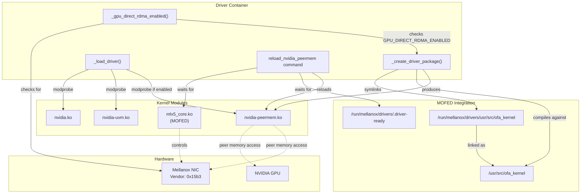
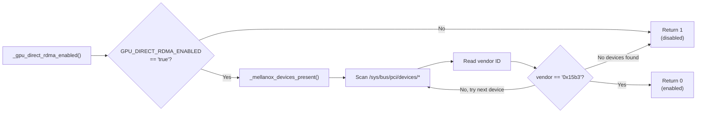
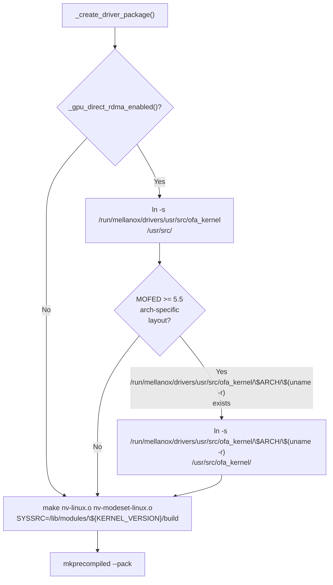
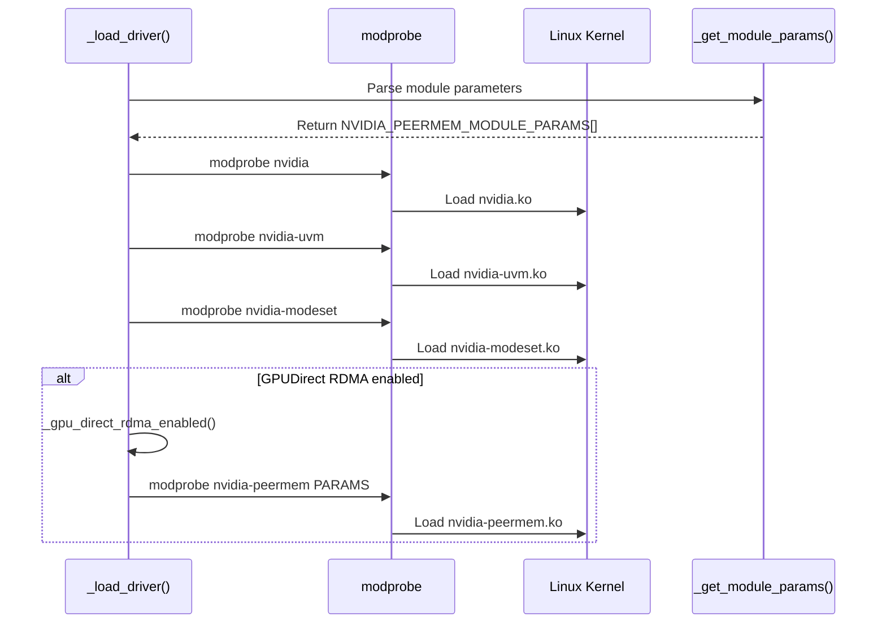
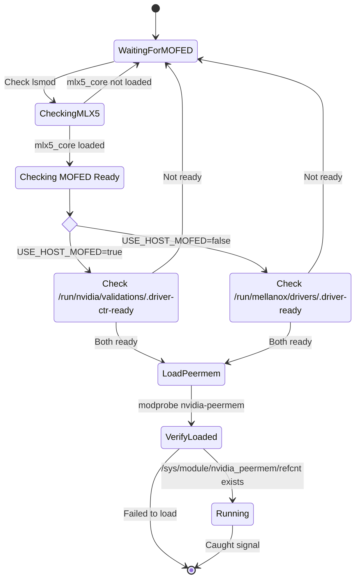
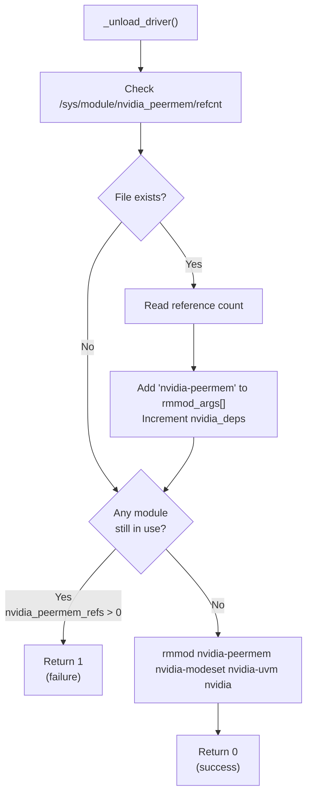

<!-- source: DeepWiki mcp.deepwiki.com · repo NVIDIA/gpu-driver-container · page 8.2 GPUDirect RDMA · fetched 2026-10-26 -->

# GPUDirect RDMA

<details>
<summary>Relevant source files</summary>

The following files were used as context for generating this wiki page:

- [rhel8/nvidia-driver](rhel8/nvidia-driver)
- [rhel9/nvidia-driver](rhel9/nvidia-driver)
- [ubuntu20.04/nvidia-driver](ubuntu20.04/nvidia-driver)
- [ubuntu22.04/nvidia-driver](ubuntu22.04/nvidia-driver)
- [ubuntu24.04/Dockerfile](ubuntu24.04/Dockerfile)
- [ubuntu24.04/install.sh](ubuntu24.04/install.sh)
- [ubuntu24.04/nvidia-driver](ubuntu24.04/nvidia-driver)

</details>


## Overview

GPUDirect RDMA is an NVIDIA technology that enables direct memory access between GPU memory and third-party network devices (primarily Mellanox InfiniBand/Ethernet adapters) without CPU involvement. This page documents how the gpu-driver-container system detects, builds, and manages the `nvidia-peermem` kernel module that provides GPUDirect RDMA functionality.

For information about NVLink fabric management, see [NVLink and Fabric Manager](#8.3). For general kernel module compilation and management, see [Kernel Module Compilation](#5.2).

## Architecture

GPUDirect RDMA support requires coordination between NVIDIA GPU drivers, Mellanox OFED (MOFED) drivers, and the Linux kernel. The system supports two deployment modes:

1. **Host MOFED mode**: Uses MOFED drivers already installed on the host system
2. **Container MOFED mode**: Coordinates with a separate MOFED driver container



**Sources**: [rhel8/nvidia-driver:1-918](), [ubuntu20.04/nvidia-driver:1-785](), [rhel9/nvidia-driver:1-963]()

## Environment Variables and Configuration

The system uses several environment variables to control GPUDirect RDMA behavior:

| Variable | Default | Purpose |
|----------|---------|---------|
| `GPU_DIRECT_RDMA_ENABLED` | `false` | Master enable flag for GPUDirect RDMA support |
| `USE_HOST_MOFED` | `false` | Use host's MOFED drivers instead of container MOFED |
| `NVIDIA_PEERMEM_MODULE_PARAMS` | `[]` | Custom parameters for nvidia-peermem module |

Custom module parameters can be provided via a configuration file mounted at `/drivers/nvidia-peermem.conf`. Each line in the file contains space-delimited parameters passed to `modprobe`.

**Sources**: [rhel8/nvidia-driver:11-16](), [ubuntu20.04/nvidia-driver:11-12](), [rhel9/nvidia-driver:14-16]()

## Detection and Enablement

### Hardware Detection

The system detects Mellanox devices by scanning PCI devices for vendor ID `0x15b3`:



**Sources**: [ubuntu20.04/nvidia-driver:198-219](), [ubuntu22.04/nvidia-driver:235-256](), [ubuntu24.04/nvidia-driver:175-197]()

### Function: `_gpu_direct_rdma_enabled()`

This function determines whether GPUDirect RDMA should be enabled:

- **Location**: [ubuntu20.04/nvidia-driver:211-219](), [rhel8/nvidia-driver:207-220]()
- **Logic**:
  1. Check if `GPU_DIRECT_RDMA_ENABLED` environment variable is set to `"true"`
  2. If true, verify presence of Mellanox hardware via `_mellanox_devices_present()`
  3. Return 0 (success) if both conditions are met, 1 (failure) otherwise

### Function: `_mellanox_devices_present()`

Scans the PCI bus for Mellanox devices:

- **Location**: [ubuntu20.04/nvidia-driver:198-209](), [ubuntu22.04/nvidia-driver:235-246]()
- **Path scanned**: `/sys/bus/pci/devices/*/vendor`
- **Vendor ID**: `0x15b3` (Mellanox Technologies)

## Build-Time Integration

When GPUDirect RDMA is enabled, the kernel module compilation process links against MOFED kernel headers.

### MOFED Header Integration



**Sources**: [rhel8/nvidia-driver:196-259](), [ubuntu20.04/nvidia-driver:123-187]()

### Path Structure

MOFED version 5.5 and later use an architecture-specific directory layout that requires additional symlink handling:

```
/run/mellanox/drivers/usr/src/ofa_kernel/
├── default -> /etc/alternatives/ofa_kernel_headers
├── x86_64/
│   ├── 5.4.0-90-generic/
│   └── 5.15.0-56-generic/
└── aarch64/
    └── 5.15.0-56-generic/
```

The compilation code creates symlinks to ensure the NVIDIA driver installer finds headers in expected locations:
- Base symlink: `/usr/src/ofa_kernel` -> `/run/mellanox/drivers/usr/src/ofa_kernel`
- Kernel-specific symlink (MOFED >= 5.5): `/usr/src/ofa_kernel/$(uname -r)` -> `/run/mellanox/drivers/usr/src/ofa_kernel/$ARCH/$(uname -r)`

**Sources**: [rhel8/nvidia-driver:207-220](), [ubuntu20.04/nvidia-driver:134-147](), [ubuntu22.04/nvidia-driver:146-159]()

### Ubuntu 24.04 Implementation

Ubuntu 24.04 uses a refactored approach with a dedicated `_link_ofa_kernel()` function:

- **Location**: [ubuntu24.04/nvidia-driver:126-140]()
- **Called from**: [ubuntu24.04/nvidia-driver:595]()
- **Purpose**: Separates MOFED header linking logic from the main driver installation flow

## Runtime Module Loading

### Module Load Sequence

The `nvidia-peermem` module is loaded conditionally after core NVIDIA modules:



**Sources**: [rhel8/nvidia-driver:344-382](), [ubuntu20.04/nvidia-driver:264-302](), [rhel9/nvidia-driver:356-399]()

### Function: `_load_driver()`

Loads all NVIDIA kernel modules including `nvidia-peermem`:

- **Location**: [rhel8/nvidia-driver:344-422](), [ubuntu20.04/nvidia-driver:264-329]()
- **Key steps**:
  1. Parse module parameters via `_get_module_params()`
  2. Load core modules: `nvidia`, `nvidia-uvm`, `nvidia-modeset`
  3. If `_gpu_direct_rdma_enabled()` returns true, load `nvidia-peermem` with custom parameters
  4. Start nvidia-persistenced daemon
  5. Start fabric manager if NVSwitch/NVLink5+ system detected

### Module Parameters

Custom parameters for `nvidia-peermem` can be specified in `/drivers/nvidia-peermem.conf`:

- **Parser**: [rhel8/nvidia-driver:334-340](), [ubuntu20.04/nvidia-driver:254-260]()
- **Format**: Each line contains space-delimited parameters
- **Storage**: Accumulated in `NVIDIA_PEERMEM_MODULE_PARAMS` array
- **Usage**: Passed to `modprobe nvidia-peermem "${NVIDIA_PEERMEM_MODULE_PARAMS[@]}"`

**Sources**: [rhel8/nvidia-driver:305-341](), [ubuntu20.04/nvidia-driver:231-261]()

## MOFED Driver Coordination

The system coordinates with MOFED drivers using readiness files and module presence checks.

### Reload Mechanism

The `reload_nvidia_peermem` command provides a reload mechanism for handling MOFED driver updates:



**Sources**: [rhel8/nvidia-driver:823-850](), [ubuntu20.04/nvidia-driver:695-722](), [ubuntu22.04/nvidia-driver:774-801]()

### Function: `reload_nvidia_peermem()`

Waits for MOFED drivers and loads `nvidia-peermem`:

- **Location**: [rhel8/nvidia-driver:823-850](), [ubuntu24.04/nvidia-driver:612-639]()
- **Purpose**: Handle MOFED driver updates that unload `nvidia-peermem`
- **Wait conditions**:
  - If `USE_HOST_MOFED=true`: Wait for `mlx5_core` module and `/run/nvidia/validations/.driver-ctr-ready`
  - If `USE_HOST_MOFED=false`: Wait for `/run/mellanox/drivers/.driver-ready` and `/run/nvidia/validations/.driver-ctr-ready`
- **Action**: Load `nvidia-peermem` with custom parameters via `chroot /run/nvidia/driver`
- **Behavior**: Sleeps indefinitely after successful load; used as a daemon process

### Function: `probe_nvidia_peermem()`

Health check for GPU Operator liveness/startup probes:

- **Location**: [rhel8/nvidia-driver:852-863](), [ubuntu20.04/nvidia-driver:724-735]()
- **Logic**:
  1. Check if `mlx5_core` module is loaded
  2. If loaded, verify `/sys/module/nvidia_peermem/refcnt` exists
  3. If `mlx5_core` not loaded, skip check to avoid container restarts
  4. Return 0 (success) if check passes or is skipped, 1 (failure) otherwise

**Sources**: [rhel8/nvidia-driver:852-863](), [ubuntu22.04/nvidia-driver:803-814](), [ubuntu24.04/nvidia-driver:641-652]()

## Command Interface

The nvidia-driver script supports three GPUDirect RDMA-related commands:

| Command | Purpose | Usage |
|---------|---------|-------|
| `init` | Standard initialization including peermem if enabled | `nvidia-driver init [-a] [-m MAX_THREADS]` |
| `reload_nvidia_peermem` | Reload peermem after MOFED update | `nvidia-driver reload_nvidia_peermem` |
| `probe_nvidia_peermem` | Health check for GPU Operator | `nvidia-driver probe_nvidia_peermem` |

### Command Parsing

The script accepts these commands via case statement:

- **Location**: [rhel8/nvidia-driver:882-890](), [ubuntu20.04/nvidia-driver:752-758]()
- **Options parsing**: Uses `getopt` for `init` command; no options for reload/probe commands
- **Validation**: Returns usage error if invalid command specified

**Sources**: [rhel8/nvidia-driver:865-918](), [ubuntu20.04/nvidia-driver:737-785](), [ubuntu24.04/nvidia-driver:654-698]()

## Module Unloading

The `nvidia-peermem` module is tracked during driver unload to prevent removal while in use:



**Sources**: [rhel8/nvidia-driver:424-522](), [ubuntu20.04/nvidia-driver:331-416](), [ubuntu22.04/nvidia-driver:389-489]()

### Function: `_unload_driver()`

Unloads NVIDIA kernel modules in reverse dependency order:

- **Location**: [rhel8/nvidia-driver:424-522](), [ubuntu24.04/nvidia-driver:331-430]()
- **Reference counting**:
  - Reads `/sys/module/nvidia_peermem/refcnt` to check if module is in use
  - Increments `nvidia_deps` counter for dependency tracking
  - Fails if any module has non-zero reference count
- **Unload order**: `nvidia-peermem` → `nvidia-modeset` → `nvidia-uvm` → `nvidia`

**Sources**: [rhel8/nvidia-driver:424-522](), [ubuntu20.04/nvidia-driver:331-416](), [rhel9/nvidia-driver:441-539]()

## Integration with GPU Operator

When used with the NVIDIA GPU Operator, the GPUDirect RDMA support integrates with the operator's lifecycle management:

1. **Startup**: GPU Operator starts MOFED container (if not using host MOFED)
2. **Readiness**: MOFED container writes `.driver-ready` file
3. **Driver Load**: Driver container loads NVIDIA modules including `nvidia-peermem`
4. **Validation**: Driver container writes `.driver-ctr-ready` file
5. **Monitoring**: GPU Operator runs `probe_nvidia_peermem` for liveness checks
6. **Updates**: If MOFED updates, `reload_nvidia_peermem` sidecar reloads the module

The probe command prevents container restarts during MOFED initialization by skipping checks when `mlx5_core` is not yet loaded.

**Sources**: [rhel8/nvidia-driver:852-863](), [ubuntu22.04/nvidia-driver:803-814]()

---

