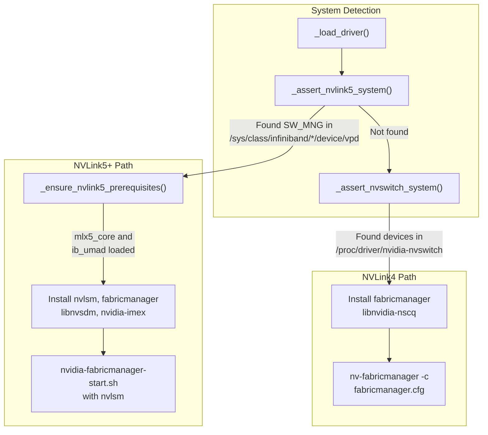
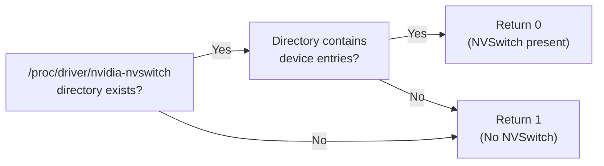
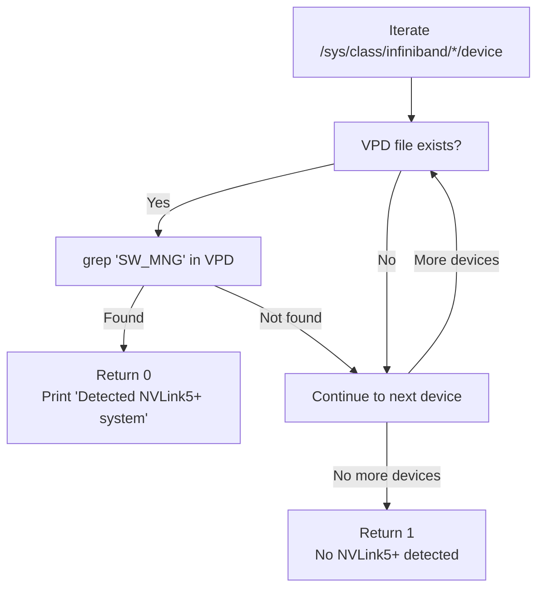
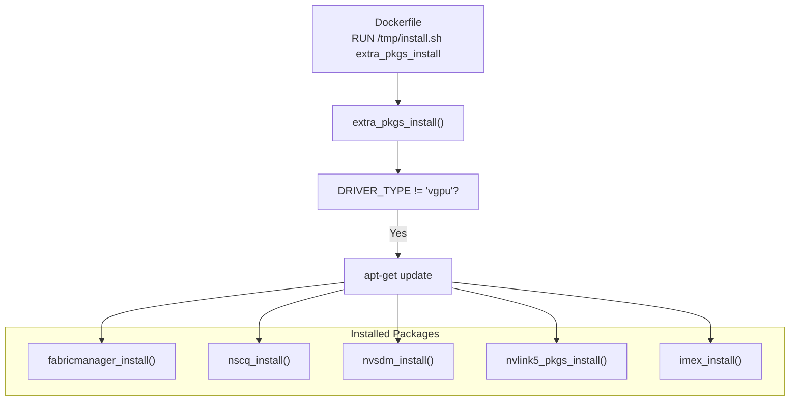
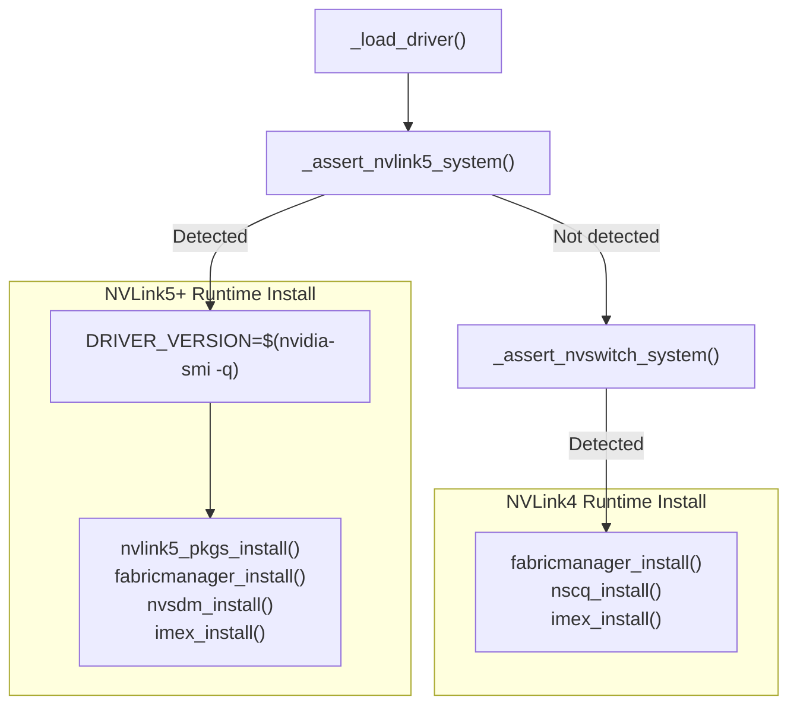
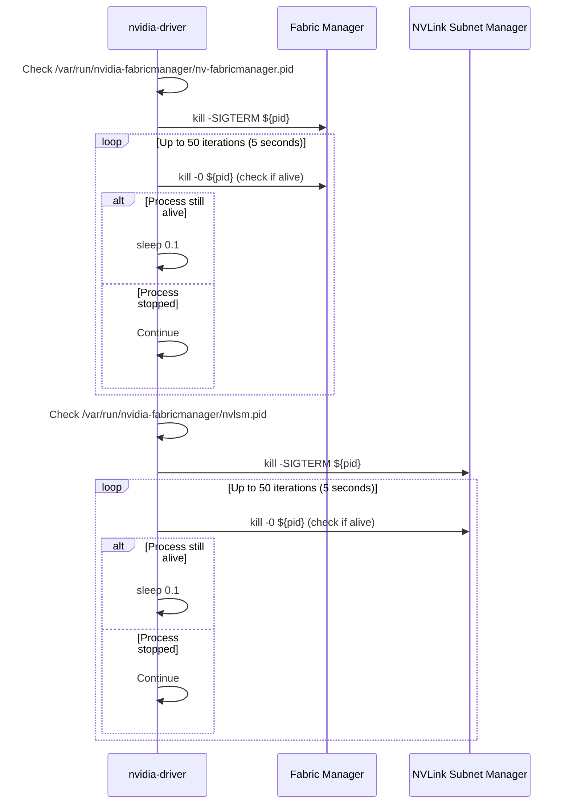

<!-- source: DeepWiki mcp.deepwiki.com · repo NVIDIA/gpu-driver-container · page 8.3 NVLink and Fabric Manager · fetched 2026-10-26 -->

# NVLink and Fabric Manager

<details>
<summary>Relevant source files</summary>

The following files were used as context for generating this wiki page:

- [rhel8/nvidia-driver](rhel8/nvidia-driver)
- [rhel9/nvidia-driver](rhel9/nvidia-driver)
- [ubuntu20.04/nvidia-driver](ubuntu20.04/nvidia-driver)
- [ubuntu22.04/nvidia-driver](ubuntu22.04/nvidia-driver)
- [ubuntu22.04/precompiled/local-repo.sh](ubuntu22.04/precompiled/local-repo.sh)
- [ubuntu22.04/precompiled/nvidia-driver](ubuntu22.04/precompiled/nvidia-driver)
- [ubuntu24.04/Dockerfile](ubuntu24.04/Dockerfile)
- [ubuntu24.04/install.sh](ubuntu24.04/install.sh)
- [ubuntu24.04/nvidia-driver](ubuntu24.04/nvidia-driver)
- [ubuntu24.04/precompiled/Dockerfile](ubuntu24.04/precompiled/Dockerfile)
- [ubuntu24.04/precompiled/local-repo.sh](ubuntu24.04/precompiled/local-repo.sh)
- [ubuntu24.04/precompiled/nvidia-driver](ubuntu24.04/precompiled/nvidia-driver)

</details>


This document describes the NVLink detection logic and NVIDIA Fabric Manager daemon management in the GPU driver container system. It covers how the system identifies NVSwitch and NVLink-enabled systems, installs the necessary fabric manager software, and manages the lifecycle of fabric manager daemons.

For information about other NVIDIA daemons like nvidia-persistenced and nvidia-gridd, see [Daemon Management](#5.3).

## Overview

NVLink is NVIDIA's high-speed interconnect technology that enables direct GPU-to-GPU communication. Systems with NVSwitch hardware (multi-GPU servers with NVLink fabrics) require the NVIDIA Fabric Manager daemon to manage the NVSwitch devices and configure the NVLink topology.

The driver container system automatically:
- Detects whether the host system has NVSwitch/NVLink hardware
- Determines the NVLink generation (NVLink4 vs NVLink5+)
- Installs appropriate fabric manager packages
- Starts and manages fabric manager daemons



**Sources:** [rhel8/nvidia-driver:261-421](), [ubuntu20.04/nvidia-driver:189-327](), [rhel9/nvidia-driver:273-438]()

## System Detection

### NVSwitch Detection

The `_assert_nvswitch_system()` function checks for NVSwitch hardware by examining the `/proc/driver/nvidia-nvswitch/devices` directory.



**Implementation Details:**

| Distribution | File Location | Line Numbers |
|--------------|---------------|--------------|
| RHEL 8 | rhel8/nvidia-driver | 261-268 |
| RHEL 9 | rhel9/nvidia-driver | 273-280 |
| Ubuntu 20.04 | ubuntu20.04/nvidia-driver | 189-195 |
| Ubuntu 22.04 | ubuntu22.04/nvidia-driver | 201-207 |
| Ubuntu 24.04 | ubuntu24.04/nvidia-driver | 142-148 |

**Sources:** [rhel8/nvidia-driver:261-268](), [ubuntu20.04/nvidia-driver:189-195](), [rhel9/nvidia-driver:273-280]()

### NVLink5+ Detection

The `_assert_nvlink5_system()` function identifies NVLink5+ systems by searching for the `SW_MNG` string in VPD (Vital Product Data) files under InfiniBand device directories.



The VPD file path pattern is: `/sys/class/infiniband/*/device/vpd`

**Sources:** [rhel8/nvidia-driver:270-285](), [ubuntu20.04/nvidia-driver:209-224](), [rhel9/nvidia-driver:282-297]()

### Detection Order and Logic

The driver loading function `_load_driver()` performs detection in this order:

1. **Check for NVLink5+ first** using `_assert_nvlink5_system()`
   - If detected, ensure prerequisites and start NVLink5+ components
2. **Check for NVSwitch (NVLink4 and below)** using `_assert_nvswitch_system()`
   - If detected, start standard fabric manager
3. **If neither detected**, no fabric manager is started

**Sources:** [rhel8/nvidia-driver:403-421](), [ubuntu20.04/nvidia-driver:323-327](), [rhel9/nvidia-driver:420-438]()

## NVLink5+ Prerequisites

Before starting fabric manager on NVLink5+ systems, the `_ensure_nvlink5_prerequisites()` function waits for required Mellanox kernel modules to be loaded.


**Required kernel modules:**
- `mlx5_core` - Mellanox ConnectX driver core
- `ib_umad` - InfiniBand user MAD (Management Datagram) interface

This polling loop ensures that the InfiniBand/Mellanox infrastructure is ready before fabric manager initialization.

**Sources:** [rhel8/nvidia-driver:287-293](), [ubuntu22.04/nvidia-driver:226-232](), [rhel9/nvidia-driver:299-305]()

## Fabric Manager Installation

### Build-Time Installation (Standard Images)

In standard driver images, fabric manager packages are installed during the container build phase via the `install.sh` script.



**Package Installation Functions:**

| Function | Driver Branch | Package Name Pattern |
|----------|---------------|---------------------|
| `fabricmanager_install()` | 580+ | `nvidia-fabricmanager=${DRIVER_VERSION}-1` |
| `fabricmanager_install()` | <580 | `nvidia-fabricmanager-${DRIVER_BRANCH}=${DRIVER_VERSION}-1` |
| `nscq_install()` | 580+ | `libnvidia-nscq=${DRIVER_VERSION}-1` |
| `nscq_install()` | <580 | `libnvidia-nscq-${DRIVER_BRANCH}=${DRIVER_VERSION}-1` |
| `nvsdm_install()` | 580+ | `libnvsdm=${DRIVER_VERSION}-1` (amd64 only) |
| `nvsdm_install()` | 560-579 | `libnvsdm-${DRIVER_BRANCH}=${DRIVER_VERSION}-1` (amd64 only) |
| `nvlink5_pkgs_install()` | 550+ | `nvlsm`, `infiniband-diags` |
| `imex_install()` | 580+ | `nvidia-imex=${DRIVER_VERSION}-1` |
| `imex_install()` | 550-579 | `nvidia-imex-${DRIVER_BRANCH}=${DRIVER_VERSION}-1` |

**Sources:** [ubuntu24.04/install.sh:88-106](), [ubuntu24.04/install.sh:47-86]()

### Runtime Installation (Precompiled Images)

Precompiled driver images defer fabric manager installation to runtime in the `_load_driver()` function. This is necessary because:
- The driver version is determined at runtime by querying `nvidia-smi`
- The system type (NVLink5+ vs NVLink4) is only known after hardware detection



In precompiled images, packages are downloaded during build and served from a local APT repository at `/usr/local/repos`.

**Sources:** [ubuntu22.04/precompiled/nvidia-driver:212-243](), [ubuntu24.04/precompiled/nvidia-driver:213-244]()

## Fabric Manager Daemon Lifecycle

### Daemon Startup

#### NVLink5+ Startup

For NVLink5+ systems, the startup sequence involves both the fabric manager and NVLink Subnet Manager (nvlsm):

```bash
/usr/bin/nvidia-fabricmanager-start.sh --mode start \
    --fm-config-file /usr/share/nvidia/nvswitch/fabricmanager.cfg \
    --fm-pid-file /var/run/nvidia-fabricmanager/nv-fabricmanager.pid \
    --nvlsm-config-file /usr/share/nvidia/nvlsm/nvlsm.conf \
    --nvlsm-pid-file /var/run/nvidia-fabricmanager/nvlsm.pid
```

**Configuration Files:**
- Fabric Manager: `/usr/share/nvidia/nvswitch/fabricmanager.cfg`
- NVLSM: `/usr/share/nvidia/nvlsm/nvlsm.conf`

**PID Files:**
- Fabric Manager: `/var/run/nvidia-fabricmanager/nv-fabricmanager.pid`
- NVLSM: `/var/run/nvidia-fabricmanager/nvlsm.pid`

**Sources:** [rhel8/nvidia-driver:405-415](), [ubuntu22.04/nvidia-driver:366-378](), [rhel9/nvidia-driver:422-432]()

#### NVLink4 Startup

For NVLink4 and below systems, only the fabric manager daemon is started:

```bash
nv-fabricmanager -c /usr/share/nvidia/nvswitch/fabricmanager.cfg
```

**Sources:** [rhel8/nvidia-driver:418-420](), [ubuntu20.04/nvidia-driver:323-325](), [ubuntu22.04/nvidia-driver:381-383]()

### Daemon Shutdown

The `_unload_driver()` function stops all NVIDIA daemons in the correct order. For fabric manager, it stops both the main daemon and nvlsm if running.



**Shutdown Process:**
1. Send `SIGTERM` to the process
2. Poll up to 50 times (0.1 second intervals) to check if process has stopped
3. If process still alive after 5 seconds, return error
4. Continue to next daemon

**Sources:** [rhel8/nvidia-driver:463-491](), [ubuntu20.04/nvidia-driver:370-383](), [rhel9/nvidia-driver:480-508]()

## Package Dependencies by Driver Branch

The fabric manager and related packages have different names and availability depending on the driver branch:

| Component | Driver Branch | Package Pattern | Notes |
|-----------|---------------|-----------------|-------|
| **Fabric Manager** | 580+ | `nvidia-fabricmanager=${VERSION}` | Simplified naming |
| | <580 | `nvidia-fabricmanager-${BRANCH}=${VERSION}` | Branch-specific |
| **NSCQ** | 580+ | `libnvidia-nscq=${VERSION}` | For NVLink4 and below |
| | <580 | `libnvidia-nscq-${BRANCH}=${VERSION}` | |
| **NVSDM** | 580+ | `libnvsdm=${VERSION}` | For NVLink5+, amd64 only |
| | 560-579 | `libnvsdm-${BRANCH}=${VERSION}` | For NVLink5+, amd64 only |
| | <560 | Not available | |
| **NVLSM** | 550+ | `nvlsm` | For NVLink5+ |
| | <550 | Not available | |
| **IMEX** | 580+ | `nvidia-imex=${VERSION}` | For NVLink fabrics |
| | 550-579 | `nvidia-imex-${BRANCH}=${VERSION}` | |
| | <550 | Not available | |
| **InfiniBand Diags** | 550+ | `infiniband-diags` | For NVLink5+ |

**Sources:** [ubuntu24.04/install.sh:47-86](), [ubuntu22.04/precompiled/local-repo.sh:25-65](), [ubuntu24.04/precompiled/local-repo.sh:25-64]()

## Configuration Files

### Fabric Manager Configuration

The fabric manager daemon reads its configuration from `/usr/share/nvidia/nvswitch/fabricmanager.cfg`. This file contains settings for:
- NVSwitch device management
- Fabric topology configuration
- Logging and monitoring settings

### NVLSM Configuration

For NVLink5+ systems, the NVLink Subnet Manager uses `/usr/share/nvidia/nvlsm/nvlsm.conf` for:
- Subnet management policies
- InfiniBand integration settings
- Routing configuration

These configuration files are provided by the respective packages and are typically not modified by the driver container.

**Sources:** [rhel8/nvidia-driver:407-414](), [ubuntu22.04/nvidia-driver:370-377]()

## Standard vs Precompiled Image Differences

| Aspect | Standard Images | Precompiled Images |
|--------|----------------|-------------------|
| **Package Installation** | Build-time via `install.sh` | Runtime via `nvidia-driver` script |
| **Version Detection** | Known at build time via `DRIVER_VERSION` env | Runtime via `nvidia-smi -q` |
| **Package Source** | Ubuntu/RHEL repositories | Local APT repo at `/usr/local/repos` |
| **Installation Trigger** | `Dockerfile RUN` command | `_load_driver()` function |
| **Hardware Detection** | Not performed at build | Performed before installation |

The key difference is that precompiled images must detect the hardware and driver version at runtime before installing the appropriate fabric manager packages.

**Sources:** [ubuntu24.04/Dockerfile:82-86](), [ubuntu22.04/precompiled/nvidia-driver:212-243](), [ubuntu22.04/precompiled/local-repo.sh:67-90]()

## Error Handling

### Daemon Startup Failures

If fabric manager daemon fails to start, the `_load_driver()` function returns with an error code, which causes the container initialization to fail. This prevents the system from running with an incomplete NVLink fabric configuration.

### Daemon Shutdown Timeout

During driver unload, if a fabric manager daemon doesn't respond to `SIGTERM` within 5 seconds (50 × 0.1s), the shutdown fails with an error message:
- "Could not stop NVIDIA fabric manager daemon"
- "Could not stop NVLink Subnet Manager daemon"

This prevents kernel module unloading when daemons are still holding resources.

**Sources:** [rhel8/nvidia-driver:463-491](), [ubuntu20.04/nvidia-driver:370-383]()

## Integration with Driver Loading

The fabric manager startup is integrated into the main driver loading sequence in `_load_driver()`:

1. Load kernel modules (nvidia, nvidia-uvm, nvidia-modeset)
2. Start nvidia-persistenced
3. **Detect and start fabric manager** (if NVSwitch present)
4. Mount driver rootfs
5. Write kernel update hooks

This ensures fabric manager is running before the driver is fully operational.

**Sources:** [rhel8/nvidia-driver:343-422](), [ubuntu20.04/nvidia-driver:264-329](), [rhel9/nvidia-driver:356-439]()

---

