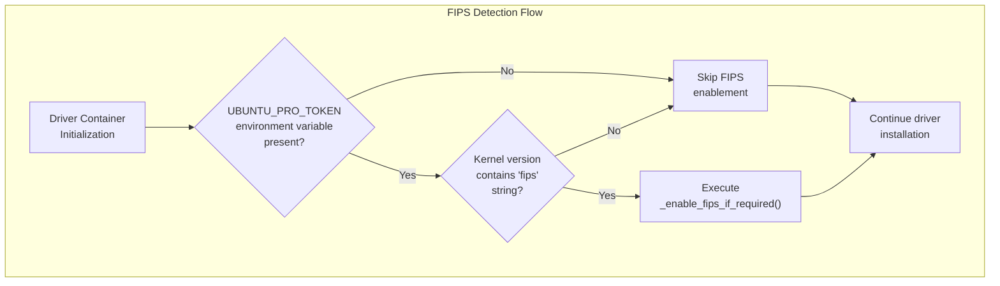
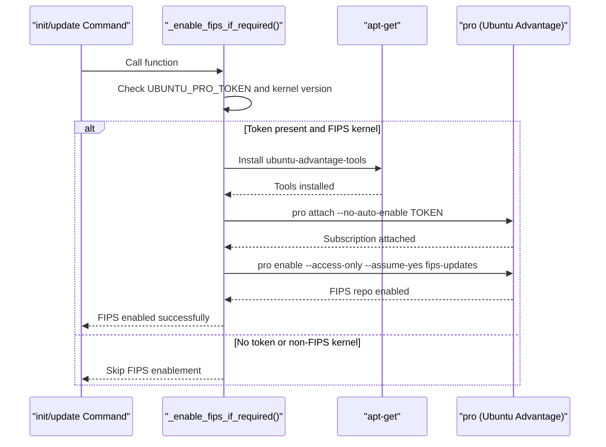
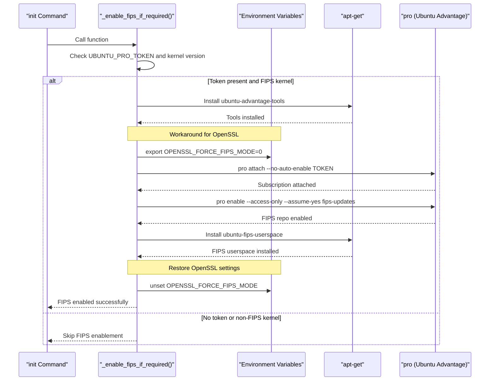
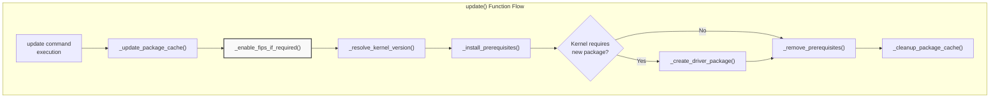

<!-- source: DeepWiki mcp.deepwiki.com · repo NVIDIA/gpu-driver-container · page 8.4 FIPS and Ubuntu Pro · fetched 2026-10-26 -->

# FIPS and Ubuntu Pro

<details>
<summary>Relevant source files</summary>

The following files were used as context for generating this wiki page:

- [rhel8/nvidia-driver](rhel8/nvidia-driver)
- [rhel9/nvidia-driver](rhel9/nvidia-driver)
- [ubuntu20.04/nvidia-driver](ubuntu20.04/nvidia-driver)
- [ubuntu22.04/nvidia-driver](ubuntu22.04/nvidia-driver)
- [ubuntu24.04/Dockerfile](ubuntu24.04/Dockerfile)
- [ubuntu24.04/install.sh](ubuntu24.04/install.sh)
- [ubuntu24.04/nvidia-driver](ubuntu24.04/nvidia-driver)

</details>


## Purpose and Scope

This page documents the FIPS (Federal Information Processing Standards) mode enablement functionality integrated into the NVIDIA driver container for Ubuntu distributions. FIPS mode ensures cryptographic operations meet U.S. government security standards. This feature requires an Ubuntu Pro subscription and is only applicable to Ubuntu-based driver containers (22.04 and 24.04) running on FIPS-enabled kernels.

For general Ubuntu distribution support, see [Ubuntu Support](#7.1). For security-related module signing functionality, see [Security and Module Signing](#8.1).

## Overview

The driver container automatically detects FIPS-enabled kernels and, when provided with an Ubuntu Pro token, configures access to FIPS-compliant packages and FIPS-enabled apt repositories. This ensures kernel headers and build dependencies installed during driver compilation are FIPS-compliant.



**Sources:** [ubuntu22.04/nvidia-driver:27-36](), [ubuntu24.04/nvidia-driver:27-46](), [ubuntu22.04/nvidia-driver:687-696](), [ubuntu24.04/nvidia-driver:589-598]()

## Requirements

| Requirement | Description |
|------------|-------------|
| **Distribution** | Ubuntu 22.04 or Ubuntu 24.04 only |
| **Kernel** | FIPS-enabled kernel (version string contains "fips") |
| **Subscription** | Valid Ubuntu Pro subscription |
| **Environment Variable** | `UBUNTU_PRO_TOKEN` set with subscription token |
| **Network Access** | Container must reach Ubuntu Pro repositories |

**Sources:** [ubuntu22.04/nvidia-driver:19](), [ubuntu24.04/nvidia-driver:19](), [ubuntu22.04/nvidia-driver:28](), [ubuntu24.04/nvidia-driver:28]()

## FIPS Enablement Function

The `_enable_fips_if_required()` function implements the FIPS enablement logic. This function is invoked during both initial installation (`init` command) and driver updates (`update` command for Ubuntu 22.04).

### Ubuntu 22.04 Implementation



**Implementation Details:**

The Ubuntu 22.04 implementation is straightforward:

1. Installs `ubuntu-advantage-tools` package
2. Attaches the Ubuntu Pro subscription using the provided token
3. Enables access-only mode for the `fips-updates` repository
4. Does not enable FIPS globally, only repository access

**Sources:** [ubuntu22.04/nvidia-driver:27-36](), [ubuntu22.04/nvidia-driver:690](), [ubuntu22.04/nvidia-driver:759]()

### Ubuntu 24.04 Implementation

Ubuntu 24.04 requires additional OpenSSL-related workarounds due to changes in how OpenSSL interacts with FIPS-enabled kernels.



**Implementation Details:**

The Ubuntu 24.04 implementation includes critical OpenSSL workarounds:

1. **OpenSSL Workaround Pre-Attachment**: Sets `OPENSSL_FORCE_FIPS_MODE=0` to prevent OpenSSL from attempting to use FIPS provider before it's installed
2. **Standard Pro Attachment**: Same as Ubuntu 22.04 (install tools, attach token, enable repository)
3. **FIPS Userspace Installation**: Installs `ubuntu-fips-userspace` package containing OpenSSL FIPS modules
4. **OpenSSL Workaround Removal**: Unsets `OPENSSL_FORCE_FIPS_MODE` after FIPS modules are installed

This workaround addresses a compatibility issue where Ubuntu 24.04's OpenSSL detects a FIPS-enabled kernel and attempts to use FIPS cryptographic providers before they are installed, causing failures during the `pro attach` operation.

**Sources:** [ubuntu24.04/nvidia-driver:27-46](), [ubuntu24.04/nvidia-driver:592]()

## Integration with Driver Installation Workflow

FIPS enablement is integrated at a specific point in the driver installation and update workflows.

### init Command Flow

```mermaid
graph TB
    subgraph "init() Function Flow"
        START["init command<br/>execution"]
        VGPU["Check vGPU<br/>driver version"]
        PID["Acquire PID file<br/>lock"]
        UNLOAD["_unload_driver()"]
        UNMOUNT["_unmount_rootfs()"]
        UPDATE_CA["_update_ca_certificates()"]
        UPDATE_CACHE["_update_package_cache()"]
        FIPS["_enable_fips_if_required()"]
        RESOLVE_KERNEL["_resolve_kernel_version()"]
        PREREQ["_install_prerequisites()"]
        BUILD["Compile/install<br/>driver modules"]
        LOAD["_load_driver()"]
        MOUNT["_mount_rootfs()"]
        
        START --> VGPU
        VGPU --> PID
        PID --> UNLOAD
        UNLOAD --> UNMOUNT
        UNMOUNT --> UPDATE_CA
        UPDATE_CA --> UPDATE_CACHE
        UPDATE_CACHE --> FIPS
        FIPS --> RESOLVE_KERNEL
        RESOLVE_KERNEL --> PREREQ
        PREREQ --> BUILD
        BUILD --> LOAD
        LOAD --> MOUNT
    end
    
    style FIPS fill:#f9f9f9,stroke:#333,stroke-width:2px
```



**Critical Timing**: FIPS enablement occurs **after** package cache updates but **before** kernel version resolution and prerequisite installation. This ensures that when the system installs kernel headers and build dependencies, they are sourced from FIPS-enabled repositories.

**Sources:** [ubuntu22.04/nvidia-driver:641-709](), [ubuntu24.04/nvidia-driver:569-610]()

### update Command Flow (Ubuntu 22.04 only)

For Ubuntu 22.04, the `update` command also invokes FIPS enablement to handle kernel updates on FIPS systems:



**Note**: Ubuntu 24.04's `update` command does not exist in the provided nvidia-driver script, suggesting a different update mechanism or that functionality was consolidated into `init`.

**Sources:** [ubuntu22.04/nvidia-driver:711-772]()

## Environment Variables

### UBUNTU_PRO_TOKEN

| Attribute | Value |
|-----------|-------|
| **Variable Name** | `UBUNTU_PRO_TOKEN` |
| **Type** | String |
| **Default** | Empty string (`""`) |
| **Required** | Yes (for FIPS enablement) |
| **Format** | Ubuntu Pro subscription token |
| **Scope** | Container environment |
| **Validation** | Presence check only; validity verified during `pro attach` |

**Usage Example:**

```bash
docker run --gpus all \
  -e UBUNTU_PRO_TOKEN="C1xxxxxxxxxxxxxx" \
  nvcr.io/nvidia/driver:550.54.15-ubuntu22.04
```

**Sources:** [ubuntu22.04/nvidia-driver:19](), [ubuntu24.04/nvidia-driver:19]()

## FIPS Package Access

When FIPS mode is enabled, the driver installation process gains access to FIPS-compliant versions of critical packages:

| Package Category | Purpose | FIPS Requirement |
|-----------------|---------|------------------|
| `linux-headers-*` | Kernel headers for module compilation | Must be FIPS-compliant |
| `linux-image-*` | Kernel image packages | Must be FIPS-compliant |
| `gcc` | Compiler toolchain | Version must match FIPS kernel |
| `elfutils-libelf-devel` | ELF library development files | FIPS-compliant version |

The `--access-only` flag used with `pro enable` ensures that only repository access is granted without enabling full system-wide FIPS enforcement, maintaining compatibility with the containerized environment.

**Sources:** [ubuntu22.04/nvidia-driver:33-34](), [ubuntu24.04/nvidia-driver:38-39]()

## Distribution-Specific Differences

### Comparison Table

| Aspect | Ubuntu 22.04 | Ubuntu 24.04 | RHEL/CentOS |
|--------|--------------|--------------|-------------|
| **FIPS Function** | `_enable_fips_if_required()` | `_enable_fips_if_required()` | Not implemented |
| **OpenSSL Workaround** | Not required | Required (`OPENSSL_FORCE_FIPS_MODE`) | N/A |
| **FIPS Userspace Package** | Not installed | `ubuntu-fips-userspace` | N/A |
| **update Command Support** | Yes | No `update` command | Different mechanism |
| **Token Variable** | `UBUNTU_PRO_TOKEN` | `UBUNTU_PRO_TOKEN` | N/A |

**Sources:** [ubuntu22.04/nvidia-driver:27-36](), [ubuntu24.04/nvidia-driver:27-46](), [rhel8/nvidia-driver:1-919](), [rhel9/nvidia-driver:1-924]()

## Error Handling

The FIPS enablement function does not include explicit error handling. If any step fails:

1. **ubuntu-advantage-tools installation fails**: `apt-get` will return non-zero, causing script to exit due to `set -eu`
2. **pro attach fails**: Invalid token or network issues will terminate execution
3. **pro enable fails**: Repository access issues will halt the script
4. **ubuntu-fips-userspace installation fails** (24.04 only): Package unavailability will cause failure

Since the driver initialization script uses `set -eu` ([ubuntu22.04/nvidia-driver:4](), [ubuntu24.04/nvidia-driver:4]()), any command failure in the FIPS enablement process will immediately terminate the container initialization, preventing driver installation on improperly configured FIPS systems.

**Sources:** [ubuntu22.04/nvidia-driver:4](), [ubuntu24.04/nvidia-driver:4](), [ubuntu22.04/nvidia-driver:27-36](), [ubuntu24.04/nvidia-driver:27-46]()

## Code Entity Reference

### Key Functions

| Function | Location | Purpose |
|----------|----------|---------|
| `_enable_fips_if_required` | [ubuntu22.04/nvidia-driver:27-36]() | Enables FIPS repository access (Ubuntu 22.04) |
| `_enable_fips_if_required` | [ubuntu24.04/nvidia-driver:27-46]() | Enables FIPS with OpenSSL workaround (Ubuntu 24.04) |
| `init` | [ubuntu22.04/nvidia-driver:641-709]() | Main initialization that calls FIPS function |
| `init` | [ubuntu24.04/nvidia-driver:569-610]() | Main initialization that calls FIPS function |
| `update` | [ubuntu22.04/nvidia-driver:711-772]() | Update workflow that calls FIPS function |

### Key Variables

| Variable | Location | Purpose |
|----------|----------|---------|
| `UBUNTU_PRO_TOKEN` | [ubuntu22.04/nvidia-driver:19]() | Stores Ubuntu Pro subscription token |
| `UBUNTU_PRO_TOKEN` | [ubuntu24.04/nvidia-driver:19]() | Stores Ubuntu Pro subscription token |
| `KERNEL_VERSION` | [ubuntu22.04/nvidia-driver:845]() | Used to detect FIPS kernel |
| `KERNEL_VERSION` | [ubuntu24.04/nvidia-driver:681]() | Used to detect FIPS kernel |
| `OPENSSL_FORCE_FIPS_MODE` | [ubuntu24.04/nvidia-driver:34,44]() | OpenSSL workaround flag (24.04 only) |

**Sources:** Multiple files as referenced in table

## Troubleshooting Considerations

### Common Issues

| Issue | Likely Cause | Resolution |
|-------|--------------|------------|
| Container fails to start on FIPS kernel | Token not provided | Set `UBUNTU_PRO_TOKEN` environment variable |
| `pro attach` fails | Invalid or expired token | Verify token validity with Ubuntu Pro subscription |
| Network timeout during FIPS setup | Repository unreachable | Check container network access to `ubuntu.com` domains |
| OpenSSL errors (24.04) | FIPS module installation failed | Check `ubuntu-fips-userspace` package availability |
| Wrong package versions installed | FIPS not enabled before prerequisites | Ensure `_enable_fips_if_required()` executes before `_install_prerequisites()` |

### Verification

To verify FIPS enablement occurred correctly, examine container logs for:

```
Ubuntu Pro token and FIPS kernel detected
Attaching Ubuntu Pro token...
Enabling FIPS apt repo access...
```

For Ubuntu 24.04, additionally verify:
```
Installing the OpenSSL FIPS modules
```

**Sources:** [ubuntu22.04/nvidia-driver:29,31,33](), [ubuntu24.04/nvidia-driver:29,36,38,40]()

---

