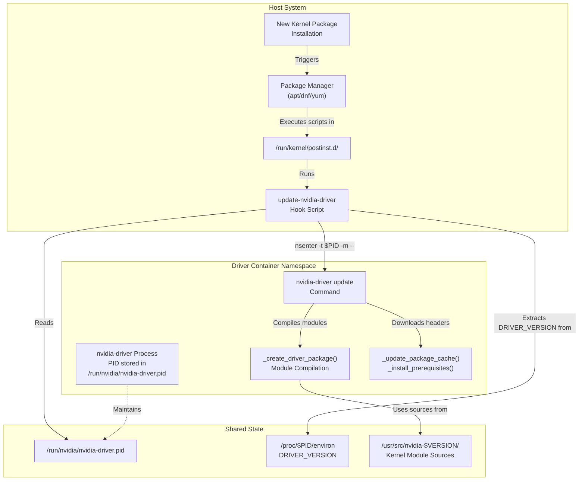
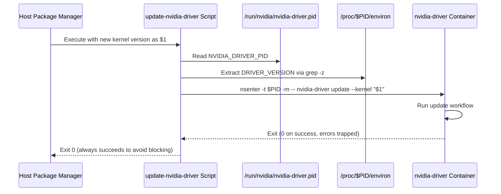
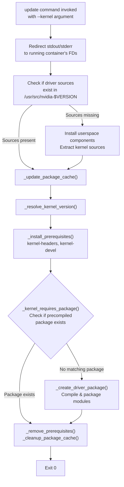
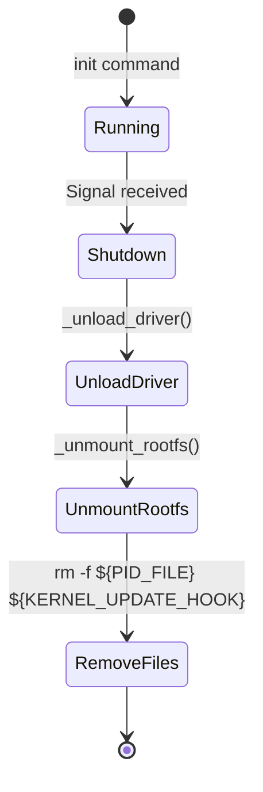
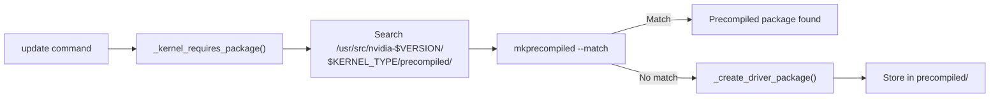

<!-- source: DeepWiki mcp.deepwiki.com · repo NVIDIA/gpu-driver-container · page 8.5 Kernel Update Hooks · fetched 2026-10-26 -->

# Kernel Update Hooks

<details>
<summary>Relevant source files</summary>

The following files were used as context for generating this wiki page:

- [rhel7/Dockerfile](rhel7/Dockerfile)
- [rhel7/nvidia-driver](rhel7/nvidia-driver)
- [rhel8/nvidia-driver](rhel8/nvidia-driver)
- [rhel9/nvidia-driver](rhel9/nvidia-driver)
- [ubuntu20.04/nvidia-driver](ubuntu20.04/nvidia-driver)
- [ubuntu22.04/nvidia-driver](ubuntu22.04/nvidia-driver)

</details>


## Overview

The kernel update hook system provides automatic recompilation of NVIDIA driver kernel modules when the host operating system installs a new kernel version. This mechanism functions similarly to DKMS (Dynamic Kernel Module Support), ensuring that driver modules remain compatible with the host kernel without requiring manual intervention or container restart.

This page covers the hook installation and execution mechanism. For information about the driver compilation process itself, see [Kernel Module Compilation](#5.2). For details on the overall driver lifecycle, see [Initialization and Lifecycle](#5.1).

## Purpose and Scope

When a host system receives a kernel update through package managers (apt, dnf, yum), the kernel update hook automatically triggers the driver container to:

1. Detect the new kernel version
2. Download and install necessary build prerequisites
3. Compile kernel modules against the new kernel
4. Create a precompiled driver package for future use

This automation eliminates the need to rebuild or restart the driver container after kernel updates, maintaining continuous GPU availability.

**Sources:** [rhel8/nvidia-driver:586-604](), [ubuntu20.04/nvidia-driver:466-485]()

## System Architecture



**Sources:** [rhel8/nvidia-driver:1-19](), [ubuntu20.04/nvidia-driver:1-18]()

## Hook Installation Process

### Hook File Path and Detection

The hook script is written to `/run/kernel/postinst.d/update-nvidia-driver`, a standard location where Linux package managers execute post-installation scripts after kernel updates.

**Hook Path Variable:**
- Defined as: `KERNEL_UPDATE_HOOK=/run/kernel/postinst.d/update-nvidia-driver`
- Located in: [rhel8/nvidia-driver:9](), [ubuntu20.04/nvidia-driver:9](), [rhel9/nvidia-driver:9]()

### Installation Function

The `_write_kernel_update_hook()` function creates the hook script during the driver initialization phase:

| Step | Action | File Reference |
|------|--------|---------------|
| 1 | Check if parent directory exists | [rhel8/nvidia-driver:587-589]() |
| 2 | Write hook script content | [rhel8/nvidia-driver:592-602]() |
| 3 | Set executable permissions | [rhel8/nvidia-driver:603]() |

If the `/run/kernel/postinst.d/` directory does not exist, the function returns silently without creating the hook. This is expected behavior on systems that do not support automatic kernel update hooks.

**Sources:** [rhel8/nvidia-driver:586-604](), [ubuntu20.04/nvidia-driver:466-485](), [rhel9/nvidia-driver:602-621]()

## Hook Script Contents



### Hook Script Structure

The generated hook script performs the following operations:

```bash
#!/bin/bash
set -eu
trap 'echo "ERROR: Failed to update the NVIDIA driver" >&2; exit 0' ERR

NVIDIA_DRIVER_PID=$(< /run/nvidia/nvidia-driver.pid)
export "$(grep -z DRIVER_VERSION /proc/${NVIDIA_DRIVER_PID}/environ)"
nsenter -t "${NVIDIA_DRIVER_PID}" -m -- nvidia-driver update --kernel "$1"
```

| Component | Purpose |
|-----------|---------|
| `set -eu` | Exit on errors, treat unset variables as errors |
| `trap ... ERR` | Catch errors but exit 0 to avoid blocking kernel installation |
| `NVIDIA_DRIVER_PID` | Read the container's main process ID |
| `grep -z DRIVER_VERSION` | Extract driver version from process environment (null-delimited) |
| `nsenter -t $PID -m` | Enter the container's mount namespace |
| `--kernel "$1"` | Pass the new kernel version from package manager |

**Critical Design Note:** The error trap ensures the hook always exits with status 0, even on failure. This prevents a failed driver update from blocking kernel installation on the host system.

**Sources:** [rhel8/nvidia-driver:592-602](), [ubuntu22.04/nvidia-driver:550-560]()

## Update Command Workflow

When the hook invokes `nvidia-driver update --kernel <version>`, the update command executes the following sequence:



**Sources:** [rhel8/nvidia-driver:773-821](), [ubuntu20.04/nvidia-driver:633-693]()

### Output Redirection Mechanism

The update command redirects its output to the file descriptors of the running driver container process, ensuring all logs appear in the container's output stream:

```bash
exec 3>&2
if exec 2> /dev/null 4< ${PID_FILE}; then
    if ! flock -n 4 && read pid <&4 && kill -0 "${pid}"; then
        exec > >(tee -a "/proc/${pid}/fd/1")
        exec 2> >(tee -a "/proc/${pid}/fd/2" >&3)
    else
        exec 2>&3
    fi
    exec 4>&-
fi
exec 3>&-
```

This allows administrators monitoring container logs to see the kernel update compilation progress in real-time.

**Sources:** [rhel8/nvidia-driver:774-784](), [rhel9/nvidia-driver:791-801]()

## Hook Lifecycle Management

### Installation Timing

The hook is written during the `init` command after:

1. Driver modules are installed
2. Driver modules are loaded into the kernel
3. Driver rootfs is mounted to `/run/nvidia/driver`

**Installation location in init flow:**
- [rhel8/nvidia-driver:743]() - Part of `_load()` function
- [ubuntu20.04/nvidia-driver:623]() - Part of `init()` function

### Removal Timing

The hook is deleted during shutdown:



**Sources:** [rhel8/nvidia-driver:606-613](), [ubuntu20.04/nvidia-driver:487-494](), [rhel9/nvidia-driver:623-630]()

## Distribution-Specific Behavior

### Ubuntu Distributions

Ubuntu-based implementations include FIPS mode support during kernel updates:

| Distribution | FIPS Support | Additional Steps |
|-------------|--------------|------------------|
| Ubuntu 20.04 | No | Standard workflow |
| Ubuntu 22.04 | Yes | Calls `_enable_fips_if_required()` before prerequisites |

**FIPS Integration:** [ubuntu22.04/nvidia-driver:759]() calls FIPS enablement before installing prerequisites.

**Sources:** [ubuntu20.04/nvidia-driver:1-785](), [ubuntu22.04/nvidia-driver:1-864]()

### RHEL-based Distributions

RHEL distributions handle extended update support (EUS) repositories during updates:

| Distribution | Feature | Implementation |
|-------------|---------|---------------|
| RHEL 7 | Basic repo management | [rhel7/nvidia-driver:355-356]() |
| RHEL 8 | EUS repo auto-detection | [rhel8/nvidia-driver:98-120]() |
| RHEL 9 | EUS + unzboot fallback | [rhel9/nvidia-driver:100-122](), [rhel9/nvidia-driver:149-157]() |

RHEL 8 and 9 implementations automatically enable and try RHOCP (Red Hat OpenShift Container Platform) and EUS repositories, falling back gracefully if they are unavailable.

**Sources:** [rhel8/nvidia-driver:1-919](), [rhel9/nvidia-driver:1-879]()

## Interaction with vGPU Drivers

For vGPU driver types, the update command skips kernel module compilation:

```bash
if [ "${DRIVER_TYPE}" != "vgpu" ]; then
    # Only precompile modules for non-vGPU driver types
    if [ ! -e /usr/src/nvidia-${DRIVER_VERSION}/mkprecompiled ]; then
        # Install userspace components and sources
        # ...
    fi
fi
```

This is because vGPU driver versions are selected dynamically at runtime based on the hypervisor version, making precompilation for arbitrary kernel versions impractical.

**Sources:** [rhel8/nvidia-driver:788-801](), [ubuntu20.04/nvidia-driver:646-672]()

## Prerequisites Management

The update workflow installs the following packages for kernel module compilation:

| Package Type | Ubuntu Packages | RHEL Packages | Purpose |
|-------------|----------------|---------------|---------|
| Kernel Headers | `linux-headers-${KERNEL_VERSION}` | `kernel-headers-${KERNEL_VERSION}` | Kernel API definitions |
| Kernel Development | Included in headers | `kernel-devel-${KERNEL_VERSION}` | Build scripts and configs |
| Kernel Modules | `linux-modules-${KERNEL_VERSION}` | `kernel-core-${KERNEL_VERSION}` | Module metadata files |
| ELF Utilities | Included in base | `elfutils-libelf-devel` | ELF file processing |
| GCC Matching | Auto-detected | Auto-detected by version | Compiler version match |

After compilation completes, the update command removes these prerequisites to minimize disk space usage:

- Ubuntu: [ubuntu20.04/nvidia-driver:688]()
- RHEL: [rhel8/nvidia-driver:816]()

**Sources:** [ubuntu20.04/nvidia-driver:65-92](), [rhel8/nvidia-driver:89-164]()

## Error Handling and Reliability

### Non-Blocking Errors

The hook script uses an ERR trap to ensure kernel installation proceeds even if driver compilation fails:

```bash
trap 'echo "ERROR: Failed to update the NVIDIA driver" >&2; exit 0' ERR
```

This design choice prioritizes system stability - a failed driver update should not prevent kernel security updates from being applied.

### Compilation Prerequisites Validation

Before attempting compilation, the update workflow verifies that:

1. Package repositories are accessible: [rhel8/nvidia-driver:31-35]()
2. Required packages are available: [rhel8/nvidia-driver:76-86]()
3. Kernel headers match the target kernel version: [ubuntu20.04/nvidia-driver:60-62]()

If any prerequisite check fails, the update command exits with an error that is caught by the ERR trap.

**Sources:** [rhel8/nvidia-driver:28-44](), [ubuntu20.04/nvidia-driver:26-44]()

## Hook Installation Guard

The `_write_kernel_update_hook()` function includes a directory existence check:

```bash
if [ ! -d ${KERNEL_UPDATE_HOOK%/*} ]; then
    return
fi
```

This check determines whether the host system supports kernel update hooks. The `/run/kernel/postinst.d/` directory typically only exists on:

- Systems with systemd-based package managers
- Distributions that implement kernel post-install hooks
- Container runtime configurations that mount `/run` from the host

On systems without this directory, the driver functions normally but does not provide automatic recompilation on kernel updates.

**Sources:** [rhel8/nvidia-driver:587-589](), [ubuntu22.04/nvidia-driver:545-547]()

## Integration with Precompiled Packages

The update workflow integrates with the precompiled package system:



If a precompiled package already exists for the new kernel version, compilation is skipped. This optimization occurs when:

- The same kernel version was previously compiled
- A precompiled driver image includes the kernel version
- The update command ran previously for this kernel

**Sources:** [rhel8/nvidia-driver:176-193](), [ubuntu20.04/nvidia-driver:103-120]()

## nsenter Namespace Entry

The hook uses `nsenter` to execute the update command within the driver container's mount namespace:

```bash
nsenter -t "${NVIDIA_DRIVER_PID}" -m -- nvidia-driver update --kernel "$1"
```

| Flag | Purpose |
|------|---------|
| `-t ${NVIDIA_DRIVER_PID}` | Target the driver container's process ID |
| `-m` | Enter the mount namespace only |
| `--` | Separator before the command to execute |

This approach allows the update command to:
- Access the container's filesystem and driver sources
- Use the container's package manager configuration
- Write compiled modules to the container's `/usr/src` directory
- Avoid interfering with the host system's filesystem

The mount namespace isolation ensures that package installations and kernel headers downloaded during the update do not affect the host system.

**Sources:** [rhel8/nvidia-driver:601](), [ubuntu20.04/nvidia-driver:482]()

---

