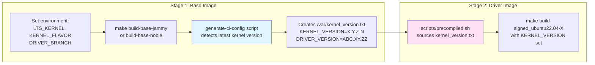
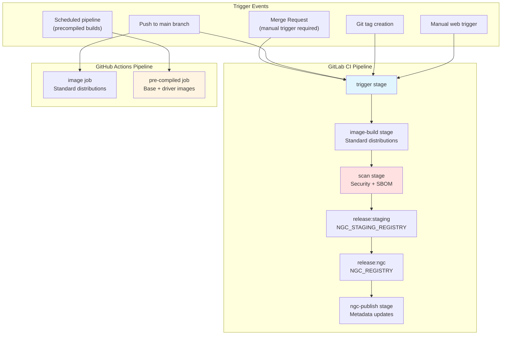
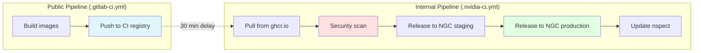
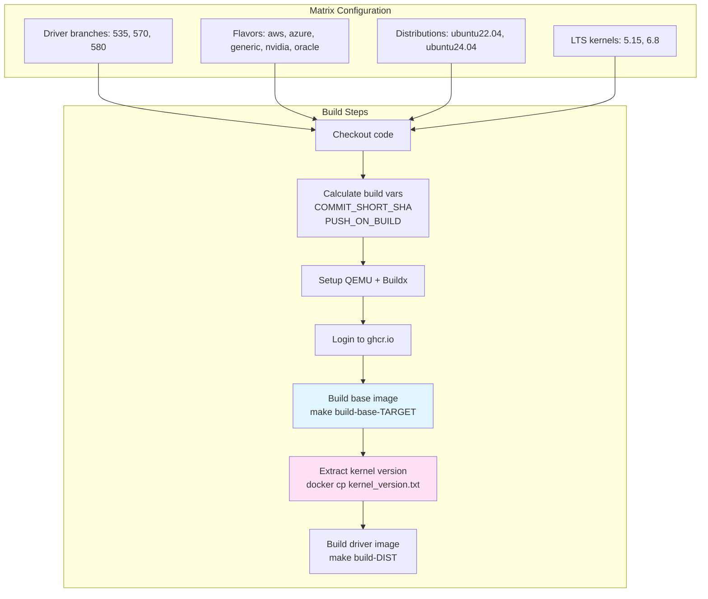
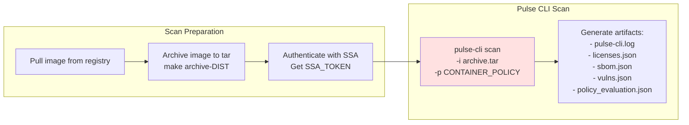
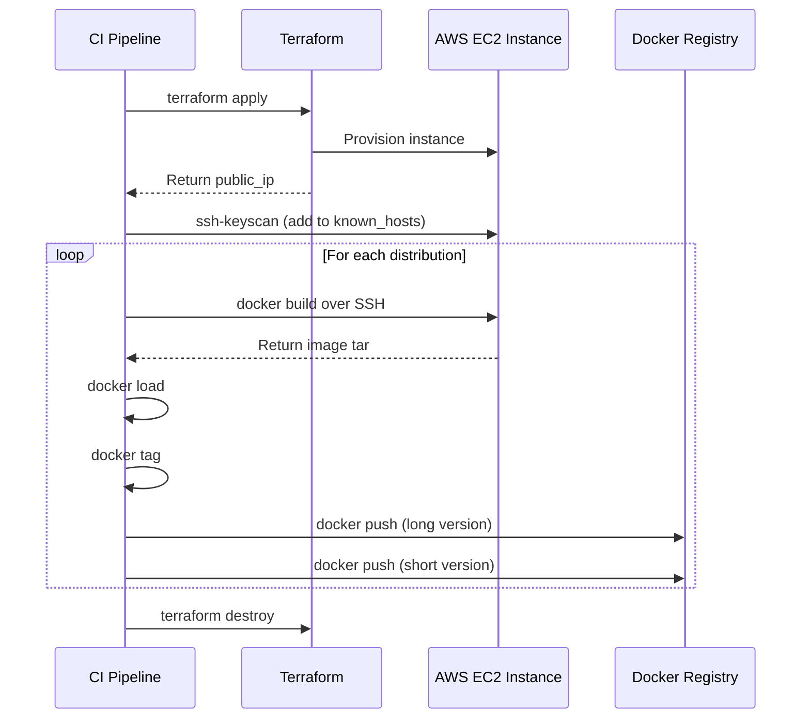
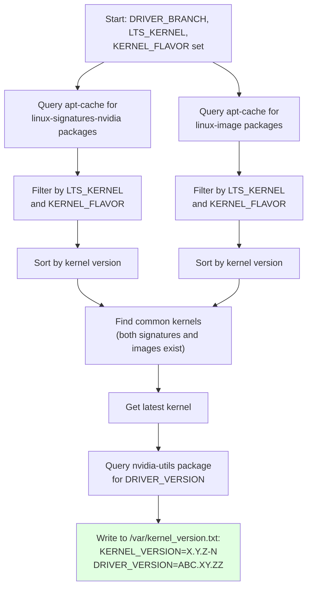

<!-- source: DeepWiki mcp.deepwiki.com · repo NVIDIA/gpu-driver-container · page 9 Development and Contributing · fetched 2026-10-26 -->

# Development and Contributing

<details>
<summary>Relevant source files</summary>

The following files were used as context for generating this wiki page:

- [.common-ci.yml](.common-ci.yml)
- [.github/workflows/image.yaml](.github/workflows/image.yaml)
- [.gitlab-ci.yml](.gitlab-ci.yml)
- [.nvidia-ci.yml](.nvidia-ci.yml)
- [Makefile](Makefile)
- [base/Dockerfile](base/Dockerfile)
- [base/generate-ci-config](base/generate-ci-config)
- [ci/flatcar/build.sh](ci/flatcar/build.sh)
- [ci/localbuild.sh](ci/localbuild.sh)
- [ci/run.sh](ci/run.sh)
- [ci/terraform.tf](ci/terraform.tf)
- [multi-arch.mk](multi-arch.mk)
- [native-only.mk](native-only.mk)
- [scripts/precompiled.sh](scripts/precompiled.sh)
- [versions.mk](versions.mk)

</details>


This page provides guidance for developers working on the gpu-driver-container repository. It covers local development workflows, build processes, CI/CD pipeline understanding, and contribution guidelines. For information about the runtime behavior of driver containers, see [Runtime Architecture](#2.3). For CI/CD pipeline details from an operational perspective, see [CI/CD Pipeline](#3).

## Purpose and Scope

This document is intended for developers who want to:
- Build and test driver container images locally
- Understand the CI/CD automation that validates contributions
- Add support for new distributions or driver versions
- Troubleshoot build issues
- Contribute code improvements

## Local Development Environment

### Prerequisites

To build driver container images locally, you need:

| Component | Purpose | Minimum Version |
|-----------|---------|----------------|
| Docker | Container build and runtime | 20.10+ |
| Docker Buildx | Multi-architecture builds (optional) | 0.16.2+ |
| Make | Build orchestration | 3.81+ |
| Bash | Script execution | 4.0+ |
| Git | Version control | 2.0+ |

For multi-architecture builds, QEMU user-mode emulation must be configured:

```bash
docker run --rm --privileged multiarch/qemu-user-static --reset -p yes
```

Sources: [.common-ci.yml:139-147](), [.github/workflows/image.yaml:72-79]()

### Repository Structure for Developers

```mermaid
graph TB
    subgraph "Build Configuration"
        Makefile["Makefile<br/>Build orchestration"]
        VersionsMk["versions.mk<br/>Driver version definitions"]
        MultiArchMk["multi-arch.mk<br/>Multi-arch build rules"]
        NativeOnlyMk["native-only.mk<br/>Single-arch build rules"]
    end
    
    subgraph "CI Configuration"
        CommonCI[".common-ci.yml<br/>Shared CI templates"]
        NvidiaCI[".nvidia-ci.yml<br/>Internal NVIDIA CI"]
        GitLabCI[".gitlab-ci.yml<br/>Public CI"]
        GithubActions[".github/workflows/image.yaml<br/>GitHub Actions"]
    end
    
    subgraph "Distribution Dockerfiles"
        Ubuntu2204["ubuntu22.04/Dockerfile"]
        Ubuntu2404["ubuntu24.04/Dockerfile"]
        RHEL8["rhel8/Dockerfile"]
        RHEL9["rhel9/Dockerfile"]
        PrecompiledUbuntu22["ubuntu22.04/precompiled/Dockerfile"]
        PrecompiledUbuntu24["ubuntu24.04/precompiled/Dockerfile"]
    end
    
    subgraph "Build Scripts"
        PrecompiledSh["scripts/precompiled.sh<br/>Precompiled image handling"]
        GenerateCI["base/generate-ci-config<br/>Kernel version detection"]
    end
    
    subgraph "CI Infrastructure"
        TerraformTF["ci/terraform.tf<br/>AWS provisioning"]
        RunSh["ci/run.sh<br/>Legacy CI runner"]
        LocalBuildSh["ci/localbuild.sh<br/>Local build helper"]
    end
    
    Makefile --> VersionsMk
    Makefile --> MultiArchMk
    Makefile --> NativeOnlyMk
    
    CommonCI --> NvidiaCI
    CommonCI --> GitLabCI
    
    Makefile --> Ubuntu2204
    Makefile --> Ubuntu2404
    Makefile --> RHEL8
    Makefile --> RHEL9
    Makefile --> PrecompiledUbuntu22
    Makefile --> PrecompiledUbuntu24
    
    PrecompiledSh --> PrecompiledUbuntu22
    PrecompiledSh --> PrecompiledUbuntu24
    PrecompiledSh --> GenerateCI
    
    style Makefile fill:#e1f5ff
    style PrecompiledSh fill:#ffe1f5
    style CommonCI fill:#e1ffe1
```



Sources: [Makefile:1-308](), [versions.mk:1-19](), [.common-ci.yml:1-367]()

## Building Images Locally

### Basic Build Commands

The [`Makefile`]() provides targets for building driver images. Build targets follow the pattern `build-<dist>-<driver_version>`:

```bash
# Build a specific distribution and driver version
make build-ubuntu22.04-535.274.02

# Build all driver versions for a distribution
make build-ubuntu22.04

# Set custom image name and version
IMAGE_NAME=myregistry/driver VERSION=dev make build-ubuntu22.04-535.274.02
```

**Key Makefile Variables:**

| Variable | Default | Description |
|----------|---------|-------------|
| `IMAGE_NAME` | `nvidia/driver` | Container image name |
| `VERSION` | (empty) | Image version prefix (e.g., git SHA) |
| `DRIVER_VERSIONS` | `535.274.02 570.195.03 580.95.05` | Space-separated driver versions |
| `BUILD_MULTI_ARCH_IMAGES` | `no` | Enable multi-arch builds (`true`/`false`) |
| `PUSH_ON_BUILD` | `false` | Push images during build |
| `CVE_UPDATES` | (varies) | Packages to update for CVE fixes |

Sources: [Makefile:15-84](), [versions.mk:15-18]()

### Multi-Architecture Builds

To build for both `linux/amd64` and `linux/arm64`:

```bash
BUILD_MULTI_ARCH_IMAGES=true make build-ubuntu22.04-535.274.02
```

Multi-architecture builds use Docker Buildx and are configured in [`multi-arch.mk`]():

- **Platform options**: `--platform=linux/amd64,linux/arm64`
- **Output type**: `type=image,push=<PUSH_ON_BUILD>`
- **Provenance/SBOM**: Controlled by `ATTACH_ATTESTATIONS`

**Exceptions**: Some distributions only support `linux/amd64`:
- `ubuntu18.04`
- Signed/precompiled Ubuntu images
- SLES distributions

Sources: [multi-arch.mk:1-32](), [Makefile:80-84]()

### Building Precompiled Images

Precompiled driver images require a two-stage process:



**Example workflow:**

```bash
# Step 1: Build base image for kernel detection
LTS_KERNEL=6.8 KERNEL_FLAVOR=generic DRIVER_BRANCH=580 \
  make build-base-noble

# Step 2: Extract kernel version
docker run --rm ghcr.io/nvidia/driver:base-noble-6.8-generic-580 \
  cat /var/kernel_version.txt > kernel_version.txt
source kernel_version.txt

# Step 3: Build precompiled driver image
DIST=signed_ubuntu24.04 make build-${DIST}-${DRIVER_VERSION}
```

The [`scripts/precompiled.sh`]() script automates this workflow:

```bash
BASE_TARGET=jammy LTS_KERNEL=6.8 KERNEL_FLAVOR=generic \
  DRIVER_BRANCH=580 DIST=signed_ubuntu22.04 \
  ./scripts/precompiled.sh build
```

Sources: [scripts/precompiled.sh:1-114](), [base/generate-ci-config:1-34](), [Makefile:206-223]()

### Local Build Script

For rapid iteration, [`ci/localbuild.sh`]() builds multiple distribution variants:

```bash
# Set driver version
export DRIVER_VERSION=535.274.02

# Build all Ubuntu variants
ci/localbuild.sh
```

This script:
1. Builds images for Ubuntu 18.04, 20.04, and RHEL 7, 8, 9
2. Tags images as `nvidia/driver:<version>-<distro>`
3. Optionally scans images for vulnerabilities
4. Optionally pushes to Docker Hub or NGC

**Configuration variables:**

| Variable | Purpose |
|----------|---------|
| `DRIVER_VERSION` | Driver version to build (required) |
| `REGISTRY` | Image registry prefix (default: `nvidia/driver`) |
| `DOCKERHUB_RELEASE` | Set to `yes` to push to Docker Hub |
| `NGC_STAGING_RELEASE` | Set to value to push to NGC staging |
| `NGC_PROD_RELEASE` | Set to `yes` to push to NGC production |
| `PULSE_DIR` | Path to pulse-scanner for security scans |
| `NSPECT_ID` | Nspect project ID for scanning |
| `SSA_CLIENT_SECRET` | SSA authentication secret |

Sources: [ci/localbuild.sh:1-146]()

## Understanding the CI/CD Pipeline

### Pipeline Entry Points and Triggers

The repository uses both GitLab CI and GitHub Actions with different responsibilities:



**GitLab CI Workflow Rules** ([.common-ci.yml:33-49]()):

| Condition | Behavior |
|-----------|----------|
| Merge request event | Manual trigger required |
| Schedule event | Automatic for precompiled builds |
| Push to `main` | Automatic |
| Git tag | Automatic |
| Manual web trigger | Automatic |

**GitHub Actions Workflow Triggers** ([.github/workflows/image.yaml:18-24]()):

- Push to `main` branch
- Push to `release-*` branches  
- Push to `pull-request/[0-9]+` branches

Sources: [.common-ci.yml:42-49](), [.github/workflows/image.yaml:18-24](), [.nvidia-ci.yml:39-90]()

### GitLab CI Architecture

The GitLab CI pipeline is split across two configuration files:

**`.common-ci.yml`**: Shared templates and job definitions
- Stage definitions: `trigger`, `image-build`, `scan`, `release`, `ngc-publish`
- Driver version matrices
- Distribution-specific job templates
- Registry configuration for staging and production

**`.nvidia-ci.yml`**: NVIDIA-internal pipeline extensions
- Image pull jobs (reuse public build artifacts)
- Security scanning with pulse-cli
- NGC release jobs
- Nspect metadata updates



**Key Configuration Details:**

The `.common-ci.yml` defines parallel build matrices:

- **Standard builds**: 3 driver versions × multiple distributions × 2 architectures
- **Precompiled builds**: 3 driver branches × 5 kernel flavors × 2 LTS kernels
- **Distribution targets**: ubuntu22.04, ubuntu24.04, rhel8, rhel9, fedora36

**Build Matrix Examples** ([.common-ci.yml:82-106]()):

```yaml
# Standard driver versions
.driver-versions:
  parallel:
    matrix:
      - DRIVER_VERSION: [535.274.02, 570.195.03, 580.95.05]

# Precompiled Ubuntu 22.04
.driver-versions-precompiled-ubuntu22.04:
  parallel:
    matrix:
      - DRIVER_BRANCH: [535, 570, 580]
        KERNEL_FLAVOR: [aws, azure, generic, nvidia, oracle]
        LTS_KERNEL: ["5.15", "6.8"]
```

Sources: [.common-ci.yml:15-367](), [.nvidia-ci.yml:1-533](), [.gitlab-ci.yml:1-132]()

### GitHub Actions Precompiled Build Workflow

The GitHub Actions workflow handles precompiled driver builds daily:

**Workflow Structure** ([.github/workflows/image.yaml:93-194]()):



**Key Environment Variables** ([.github/workflows/image.yaml:48-70]()):

| Variable | Source | Purpose |
|----------|--------|---------|
| `COMMIT_SHORT_SHA` | `${GITHUB_SHA:0:8}` | Short commit SHA for versioning |
| `LOWERCASE_REPO_OWNER` | Derived from repo | Registry organization name |
| `PUSH_ON_BUILD` | Conditional logic | Whether to push images |
| `BUILD_MULTI_ARCH_IMAGES` | Conditional logic | Enable multi-arch builds |
| `CVE_UPDATES` | Per-distribution | Packages to update |

**Pull Request Handling**:
- For PRs from forks: artifacts are not generated
- For PRs from same repo: artifacts are generated and pushed
- Dependabot PRs: artifacts are not generated

Sources: [.github/workflows/image.yaml:1-194]()

### Security Scanning Integration

Security scans use NVIDIA's pulse-cli tool integrated into GitLab CI:

**Scan Process** ([.nvidia-ci.yml:151-185]()):



**Scan Rules and Conditions** ([.nvidia-ci.yml:187-253]()):

Scans are skipped when:
- Commit message contains `[skip scans]` or `[skip_scans]`
- `SKIP_SCANS=yes` environment variable is set
- Pipeline is scheduled (precompiled builds)

**Scan Matrix**:
- Ubuntu 22.04: amd64 and arm64
- Ubuntu 24.04: amd64 and arm64
- RHEL 8: amd64 and arm64
- RHEL 9: amd64 and arm64
- Precompiled Ubuntu: amd64 only

**Artifacts Retention**: 1 week

Sources: [.nvidia-ci.yml:151-335]()

## CI Testing Infrastructure

### Terraform-Based Test Environment

The repository includes Terraform configuration for provisioning AWS test infrastructure:

**Infrastructure Components** ([ci/terraform.tf:1-151]()):

| Resource | Purpose | Instance Type |
|----------|---------|---------------|
| AWS EC2 (Ubuntu 16.04) | Docker host for builds | c4.4xlarge |
| AWS EC2 (Flatcar) | CoreOS variant testing | (variable) |
| Security Group | SSH access (port 22) | N/A |
| Cloud-init | Docker CE installation | N/A |

**Variables**:

```bash
ssh_key_pub      # Path to public SSH key
project_name     # Project identifier (e.g., "driver")
ci_pipeline_id   # Unique pipeline identifier
flatcar_channel  # Flatcar release channel (default: "stable")
```

**Usage in CI** ([ci/run.sh:115-124]()):

```bash
# Generate terraform.tfvars
cat << EOF > terraform.tfvars
ssh_key_pub = "${SSH_KEY}.pub"
project_name = "driver"
ci_pipeline_id = "${CI_PIPELINE_ID}"
EOF

# Provision infrastructure
terraform apply -auto-approve

# Extract instance IPs
public_ip_ubuntu16_04=$(terraform output public_ip_ubuntu16_04)
```

Sources: [ci/terraform.tf:1-151](), [ci/run.sh:107-130]()

### Legacy CI Runner Script

The [`ci/run.sh`]() script demonstrates an older CI approach using Docker over SSH:

**Workflow Pattern**:



**Key Functions** ([ci/run.sh:48-100]()):

- `latest_ubuntu_kernel()`: Queries latest kernel version for Ubuntu
- `latest_rhel_kernel()`: Queries latest kernel version for RHEL
- `docker_ssh()`: Executes Docker commands over SSH
- `build()`: Builds image on remote host and pulls back

**Distribution Testing**:
- Ubuntu 16.04, 18.04, 20.04 (generic, HWE, AWS kernels)
- RHEL 7, 8, 9
- RHCOS 4.1, 4.2, 4.3, 4.4 (tagged from RHEL 8)

Sources: [ci/run.sh:1-181]()

## Common Development Tasks

### Adding a New Distribution

To add support for a new Linux distribution:

1. **Create distribution directory and Dockerfile**:

```bash
mkdir -p <newdist>
touch <newdist>/Dockerfile
```

2. **Add distribution to Makefile** ([Makefile:57-77]()):

```makefile
# Add to DISTRIBUTIONS variable
DISTRIBUTIONS := ... <newdist>

# Optionally add special subdir mapping
build-<newdist>%: SUBDIR = <actual_subdir>

# Add any special build arguments
build-<newdist>%: DOCKER_BUILD_ARGS = --build-arg DIST_VERSION=X.Y
```

3. **Add CI job definitions**:

In `.common-ci.yml`:
```yaml
.dist-<newdist>:
  variables:
    DIST: <newdist>
    CVE_UPDATES: "package1 package2"  # Optional
```

4. **Add build and release jobs**:

```yaml
image-<newdist>:
  extends:
    - .image-build
    - .dist-<newdist>

release:staging-<newdist>:
  extends:
    - .release:staging
    - .dist-<newdist>
  needs:
    - image-<newdist>
```

5. **Add GitHub Actions support** (if applicable):

Add to matrix in [.github/workflows/image.yaml:34-38]():
```yaml
matrix:
  dist:
    - <newdist>
```

Sources: [Makefile:57-84](), [.common-ci.yml:108-128](), [.gitlab-ci.yml:71-102]()

### Updating Driver Versions

Driver versions are centrally managed in [`versions.mk`]():

**Step 1**: Update version list ([versions.mk:16]()):

```makefile
DRIVER_VERSIONS ?= 535.274.02 570.195.03 580.95.05 590.123.45
```

**Step 2**: Update CI matrices ([.common-ci.yml:22](), [.common-ci.yml:84]()):

```yaml
variables:
  DRIVER_VERSIONS: 535.274.02 570.195.03 580.95.05 590.123.45

.driver-versions:
  parallel:
    matrix:
      - DRIVER_VERSION: [535.274.02, 570.195.03, 580.95.05, 590.123.45]
```

**Step 3**: Update GitHub Actions ([.github/workflows/image.yaml:30-33]()):

```yaml
matrix:
  driver:
    - 535.274.02
    - 570.195.03
    - 580.95.05
    - 590.123.45
```

**Step 4**: For precompiled builds, update branch lists ([.common-ci.yml:96](), [.common-ci.yml:104]()):

```yaml
.driver-versions-precompiled-ubuntu22.04:
  parallel:
    matrix:
      - DRIVER_BRANCH: [535, 570, 580, 590]
```

**Step 5**: Update NGC publishing versions ([.nvidia-ci.yml:37]()):

```yaml
variables:
  PUBLISH_VERSIONS: 535.274.02 570.195.03 580.95.05 590.123.45
```

Sources: [versions.mk:15-18](), [.common-ci.yml:22-90](), [.github/workflows/image.yaml:30-33]()

### Working with Precompiled Images

**Kernel Version Detection Process**:

The [`base/generate-ci-config`]() script runs inside base images to detect the latest kernel:



**Script Logic** ([base/generate-ci-config:17-33]()):

1. Query `linux-signatures-nvidia-*` packages (ensures precompiled drivers exist)
2. Query `linux-image-*` packages (ensures kernel exists)
3. Find intersection (kernel with both image and signatures)
4. Select latest kernel version
5. Query NVIDIA driver package version
6. Export to environment file

**Consuming the Version Information**:

The [`scripts/precompiled.sh`]() script reads this file:

```bash
# Function sourceVersions()
if [ -f kernel_version.txt ]; then
    source kernel_version.txt
    return 0
fi

# Alternatives:
# - Use regctl to extract from image
# - Use docker run to copy from running container
```

Sources: [base/generate-ci-config:1-34](), [scripts/precompiled.sh:6-37]()

### Testing Changes Locally

**Standard Image Testing**:

```bash
# Build an image
make build-ubuntu22.04-535.274.02

# Run the container (requires NVIDIA GPU)
docker run --rm -it \
  --privileged \
  --pid=host \
  -v /run/nvidia:/run/nvidia:shared \
  nvidia/driver:535.274.02-ubuntu22.04

# Inside container, check driver loading
nvidia-smi
```

**Precompiled Image Testing**:

```bash
# Build base and precompiled images
LTS_KERNEL=6.8 KERNEL_FLAVOR=generic DRIVER_BRANCH=580 \
  BASE_TARGET=noble DIST=signed_ubuntu24.04 \
  ./scripts/precompiled.sh build

# Extract kernel version
source kernel_version.txt
echo "Testing with KERNEL_VERSION=${KERNEL_VERSION}"

# Run on matching kernel
docker run --rm -it \
  --privileged \
  --pid=host \
  -v /run/nvidia:/run/nvidia:shared \
  nvidia/driver:580-${KERNEL_VERSION}-ubuntu24.04
```

**Validation Checklist**:

- [ ] Container starts without errors
- [ ] Kernel modules compile or load successfully
- [ ] `nvidia-smi` shows GPU information
- [ ] Daemons start (nvidia-persistenced, fabric manager if applicable)
- [ ] User-space libraries are present in `/run/nvidia/driver`
- [ ] Multi-arch builds work (if applicable)

Sources: [Makefile:162-176](), [scripts/precompiled.sh:38-96]()

## Contributing Guidelines

### Code Review Process

All changes must go through merge request review:

**Merge Request Checklist**:

- [ ] Title clearly describes the change
- [ ] Description explains motivation and approach
- [ ] All CI jobs pass (or failures are explained)
- [ ] Security scans pass (or CVEs are documented)
- [ ] Multi-architecture builds succeed (if applicable)
- [ ] Changes are tested locally

**Triggering CI Pipelines**:

- Merge requests require manual pipeline trigger ([.common-ci.yml:71-74]()):
  ```yaml
  - if: $CI_PIPELINE_SOURCE == 'merge_request_event'
    when: manual
    allow_failure: false
  ```

- To skip security scans during development, use commit message:
  ```
  [skip scans] Fix dockerfile formatting
  ```

Sources: [.common-ci.yml:66-78]()

### Testing Requirements

**Required Testing**:

1. **Local build verification**: All changed distributions must build locally
2. **CI pipeline success**: All jobs in GitLab CI must pass
3. **Security scan pass**: No new critical CVEs introduced
4. **Multi-arch verification**: For distributions supporting multi-arch

**Optional Testing**:

- E2E testing with GPU Operator (for runtime changes)
- Precompiled image validation on target kernels
- vGPU image testing (if applicable)

### Commit Message Guidelines

Follow conventional commit format:

```
<type>(<scope>): <subject>

<body>

<footer>
```

**Types**:
- `feat`: New feature (e.g., new distribution support)
- `fix`: Bug fix
- `docs`: Documentation changes
- `ci`: CI/CD pipeline changes
- `build`: Build system changes (Makefile, Dockerfiles)
- `refactor`: Code refactoring

**Scopes**:
- Distribution name (e.g., `ubuntu22.04`, `rhel9`)
- Component name (e.g., `precompiled`, `ci`, `makefile`)

**Examples**:

```
feat(ubuntu24.04): Add support for Ubuntu 24.04 Noble

- Add Dockerfile for Ubuntu 24.04
- Update CI matrix to include ubuntu24.04
- Add precompiled build support for Noble

Closes #123
```

```
fix(precompiled): Correct kernel version detection for HWE kernels

The generate-ci-config script was not properly filtering HWE kernel
signatures. Update regex to match linux-signatures-nvidia-*-hwe-*.

Fixes #456
```

### Documentation Updates

When making changes that affect users or developers, update:

- **README.md**: For user-facing changes
- **Wiki pages**: For architectural or process changes
- **Inline comments**: For complex code logic
- **Commit messages**: Always include rationale

Sources: [.common-ci.yml:157-161](), [.nvidia-ci.yml:188-228]()

### Release Process

Releases are tag-driven:

**Creating a Release**:

1. Update `DRIVER_VERSIONS` in [`versions.mk`]() if needed
2. Create and push a git tag:
   ```bash
   git tag -a v1.2.3 -m "Release v1.2.3"
   git push origin v1.2.3
   ```

3. GitLab CI automatically:
   - Builds all images
   - Runs security scans
   - Pushes to NGC staging registry
   - Creates NGC release candidate
   - Updates nspect metadata

4. Manual promotion to NGC production (NVIDIA-internal)

**Release Versioning**:

Images are tagged as:
- Development: `<commit-sha>-<driver-version>-<dist>`
- Release: `<driver-version>-<dist>`

Sources: [.common-ci.yml:258-283](), [.nvidia-ci.yml:486-496]()

## Troubleshooting Development Issues

### Common Build Failures

**Issue**: Docker build fails with "no space left on device"

**Solution**: Clean up Docker build cache:
```bash
docker system prune -a --volumes
docker builder prune -a
```

---

**Issue**: Multi-arch build fails with QEMU errors

**Solution**: Re-initialize QEMU binfmt:
```bash
docker run --rm --privileged multiarch/qemu-user-static --reset -p yes
docker buildx create --use --platform=linux/amd64,linux/arm64
```

---

**Issue**: Precompiled build fails with "kernel_version.txt not found"

**Solution**: Ensure base image was built successfully:
```bash
# Verify base image exists
docker images | grep base-

# Rebuild base image
LTS_KERNEL=6.8 KERNEL_FLAVOR=generic DRIVER_BRANCH=580 \
  make build-base-noble
```

---

**Issue**: CI pipeline stuck on "delayed" for 30 minutes

**Explanation**: NVIDIA-internal CI waits for public builds to complete ([.nvidia-ci.yml:41-43]()):
```yaml
rules:
  - when: delayed
    start_in: 30 minutes
```

This is expected behavior for the internal pipeline.

Sources: [.common-ci.yml:139-147](), [.nvidia-ci.yml:39-78](), [scripts/precompiled.sh:6-37]()

### CI/CD Debugging

**Accessing Pipeline Artifacts**:

- GitLab CI artifacts are stored for 1 week ([.nvidia-ci.yml:177-185]())
- Download artifacts from job page in GitLab UI
- Artifacts include: `pulse-cli.log`, `sbom.json`, `vulns.json`, `policy_evaluation.json`

**Re-running Failed Jobs**:

- Manual retry in GitLab UI
- Re-trigger entire pipeline from merge request
- Check logs for specific error messages

**Investigating Security Scan Failures**:

1. Download scan artifacts
2. Check `policy_evaluation.json` for policy violations
3. Review `vulns.json` for CVE details
4. Update `CVE_UPDATES` variable if patching is needed

**Precompiled Pipeline Debugging**:

The precompiled workflow logs kernel detection:
```bash
# Check base image logs
docker logs <base-container-id>

# Manually run generate-ci-config
docker run --rm <base-image> /usr/local/bin/generate-ci-config
```

Sources: [.nvidia-ci.yml:177-185](), [base/generate-ci-config:1-34]()

---

## Summary

This document covered the essential workflows for contributing to gpu-driver-container:

- **Local Development**: Using Makefile targets and environment variables to build images
- **CI/CD Understanding**: How GitLab CI and GitHub Actions work together
- **Testing Infrastructure**: Terraform-based test environments and security scanning
- **Common Tasks**: Adding distributions, updating versions, working with precompiled images
- **Contributing**: Code review process, testing requirements, and release procedures

For runtime behavior of driver containers, see [Runtime Architecture](#2.3). For detailed CI/CD pipeline operation, see [CI/CD Pipeline](#3). For specific distribution details, see [Distribution Support](#7).

---

