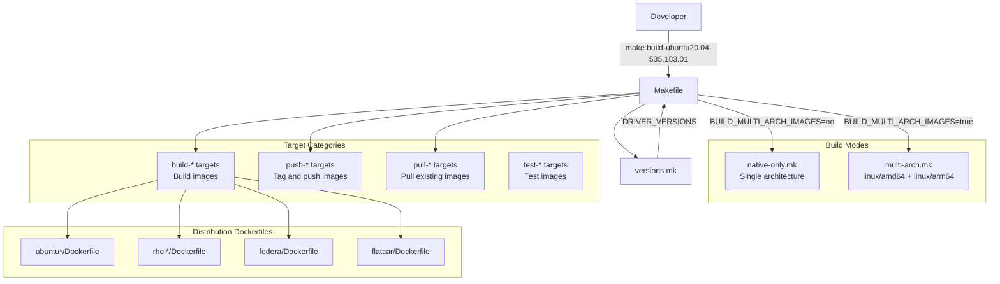
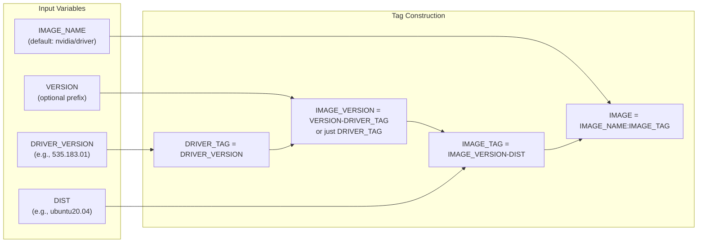
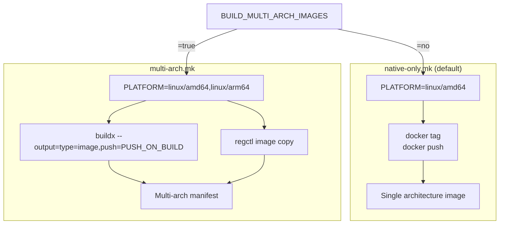
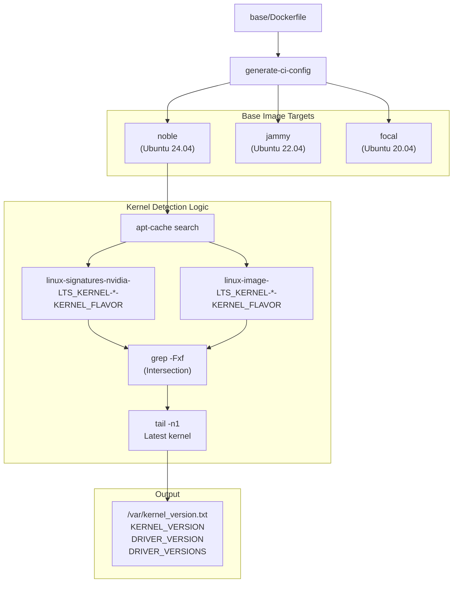
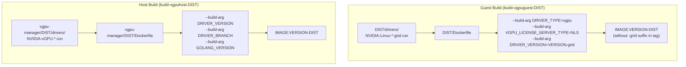
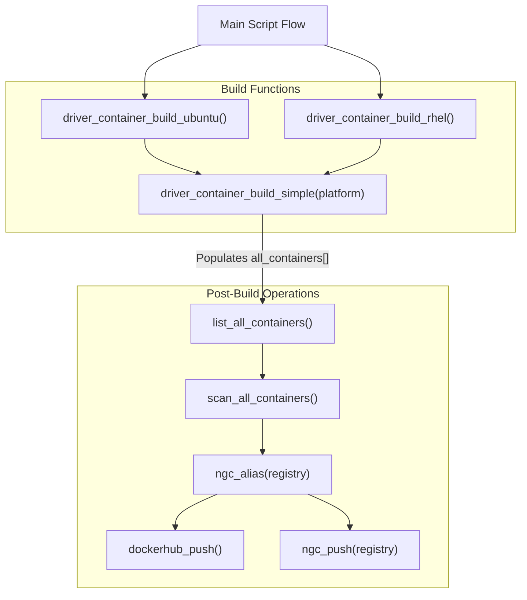

<!-- source: DeepWiki mcp.deepwiki.com · repo NVIDIA/gpu-driver-container · page 9.1 Local Development · fetched 2026-10-26 -->

# Local Development

<details>
<summary>Relevant source files</summary>

The following files were used as context for generating this wiki page:

- [.gitlab-ci.yml](.gitlab-ci.yml)
- [Makefile](Makefile)
- [base/Dockerfile](base/Dockerfile)
- [base/generate-ci-config](base/generate-ci-config)
- [ci/flatcar/build.sh](ci/flatcar/build.sh)
- [ci/localbuild.sh](ci/localbuild.sh)
- [ci/run.sh](ci/run.sh)
- [ci/terraform.tf](ci/terraform.tf)
- [multi-arch.mk](multi-arch.mk)
- [native-only.mk](native-only.mk)
- [scripts/precompiled.sh](scripts/precompiled.sh)

</details>


## Purpose and Scope

This page explains how to build and test GPU driver container images locally on your development machine. It covers the Makefile build system, local build scripts, environment configuration, and common development workflows.

For information about the automated CI/CD pipeline that runs on merge requests and releases, see [CI/CD Pipeline](#3). For details about the Terraform-based test infrastructure used in CI, see [CI Testing Infrastructure](#9.2).

## Prerequisites

### Required Tools

- **Docker**: Version 20.10 or later with BuildKit support
- **GNU Make**: For executing Makefile targets
- **Git**: For cloning the repository

### Optional Tools

- **Docker Buildx**: Required for multi-architecture builds (linux/amd64, linux/arm64)
- **regctl**: Used for efficient image manipulation in multi-arch builds
- **Terraform**: Only needed if provisioning AWS test infrastructure locally

## Build System Overview

The repository uses a Makefile-based build system that generates container images for multiple distributions, driver versions, and architectures. The build system is modular and supports both native-only builds and multi-architecture builds.

### Build System Architecture



Sources: [Makefile:1-308](), [multi-arch.mk:1-32](), [native-only.mk:1-28]()

## Basic Build Commands

### Building Standard Driver Images

The Makefile provides targets in the form `build-<DIST>-<DRIVER_VERSION>`. Each distribution also has a convenience target that builds all driver versions.

**Building a specific driver version for Ubuntu 20.04:**
```bash
make build-ubuntu20.04-535.183.01
```

**Building all driver versions for Ubuntu 20.04:**
```bash
make build-ubuntu20.04
# or simply
make ubuntu20.04
```

**Building for RHEL 8:**
```bash
make build-rhel8-535.183.01
```

Sources: [Makefile:150-176]()

### Supported Distributions

The `DISTRIBUTIONS` variable defines all supported distribution targets:

| Distribution | Makefile Target | Subdirectory |
|-------------|----------------|--------------|
| Ubuntu 18.04 | `ubuntu18.04` | `ubuntu18.04/` |
| Ubuntu 20.04 | `ubuntu20.04` | `ubuntu20.04/` |
| Ubuntu 22.04 | `ubuntu22.04` | `ubuntu22.04/` |
| Ubuntu 24.04 | `ubuntu24.04` | `ubuntu24.04/` |
| RHEL 8 | `rhel8` | `rhel8/` |
| RHEL 9 | `rhel9` | `rhel9/` |
| Fedora 36 | `fedora36` | `fedora/` |
| SLES 15.3 | `sles15.3` | `sle15/` |
| Flatcar | `flatcar` | `flatcar/` |
| Precompiled Ubuntu 20.04 | `signed_ubuntu20.04` | `ubuntu20.04/precompiled/` |
| Precompiled Ubuntu 22.04 | `signed_ubuntu22.04` | `ubuntu22.04/precompiled/` |
| Precompiled Ubuntu 24.04 | `signed_ubuntu24.04` | `ubuntu24.04/precompiled/` |

Sources: [Makefile:57-59]()

### Build Variables

Key variables that control the build process:

| Variable | Default | Purpose | Example |
|----------|---------|---------|---------|
| `DRIVER_VERSION` | From `versions.mk` | Driver version to build | `535.183.01` |
| `IMAGE_NAME` | `nvidia/driver` | Target image name | `myregistry/driver` |
| `VERSION` | (empty) | Prefix for image tags | `dev-abc1234` |
| `DIST` | Set by target | Distribution identifier | `ubuntu20.04` |
| `BUILD_MULTI_ARCH_IMAGES` | `no` | Enable multi-arch builds | `true` |
| `DOCKER` | `docker` | Docker command to use | `podman` |

**Example with custom variables:**
```bash
make IMAGE_NAME=myregistry/driver VERSION=dev-test build-ubuntu20.04-535.183.01
```

This builds an image tagged as `myregistry/driver:dev-test-535.183.01-ubuntu20.04`.

Sources: [Makefile:15-54]()

### Image Tag Resolution



Sources: [Makefile:30-54]()

## Multi-Architecture Builds

### Enabling Multi-Arch

Set `BUILD_MULTI_ARCH_IMAGES=true` to build for both `linux/amd64` and `linux/arm64`:

```bash
BUILD_MULTI_ARCH_IMAGES=true make build-ubuntu20.04-535.183.01
```

This requires:
- Docker Buildx enabled
- QEMU configured for cross-platform emulation (for ARM builds on x86)

### Platform-Specific Behavior



Sources: [Makefile:15-21](), [multi-arch.mk:15-31](), [native-only.mk:15-27]()

### Distribution-Specific Platform Support

Some distributions only support `linux/amd64`:

- `ubuntu18.04` - [multi-arch.mk:27]()
- `signed_ubuntu20.04` - [multi-arch.mk:28]()
- `signed_ubuntu22.04` - [multi-arch.mk:29]()
- `signed_ubuntu24.04` - [multi-arch.mk:30]()
- `sles*` - [multi-arch.mk:31]()

Sources: [multi-arch.mk:26-31]()

## Precompiled Driver Images

Precompiled images contain driver modules pre-built for specific kernel versions, eliminating runtime compilation.

### Building Precompiled Images

Precompiled builds use a two-stage process:

1. **Build base image** - Queries package repositories for latest kernel version
2. **Build driver image** - Uses kernel version from base image

**Using the precompiled script:**
```bash
DIST=signed_ubuntu22.04 \
DRIVER_BRANCH=535 \
BASE_TARGET=jammy \
KERNEL_FLAVOR=generic \
LTS_KERNEL=5.15 \
./scripts/precompiled.sh build
```

**Manual process:**
```bash
# Step 1: Build base image
make LTS_KERNEL=5.15 KERNEL_FLAVOR=generic DRIVER_BRANCH=535 build-base-jammy

# Step 2: Extract kernel version
docker run --rm ghcr.io/nvidia/driver:base-jammy-5.15-generic-535 \
    cat /var/kernel_version.txt > kernel_version.txt
source kernel_version.txt

# Step 3: Build precompiled image
make KERNEL_VERSION=$KERNEL_VERSION build-signed_ubuntu22.04-535.183.01
```

Sources: [scripts/precompiled.sh:39-47](), [Makefile:189-201]()

### Base Image Architecture

The base images query Ubuntu package repositories to determine the latest available kernel version with precompiled NVIDIA driver modules.



The intersection ensures that both the kernel image and precompiled NVIDIA modules are available for the detected version.

Sources: [base/Dockerfile:1-110](), [base/generate-ci-config:18-33]()

### Precompiled Script Operations

The `scripts/precompiled.sh` script provides operations for precompiled image workflows:

| Operation | Command | Purpose |
|-----------|---------|---------|
| `build` | `./scripts/precompiled.sh build` | Build base image, extract versions, build driver image |
| `push` | `./scripts/precompiled.sh push` | Source versions and push driver image |
| `pull` | `./scripts/precompiled.sh pull` | Source versions and pull driver image |
| `archive` | `./scripts/precompiled.sh archive` | Source versions and archive driver image |
| `version` | `./scripts/precompiled.sh version` | Source and display versions only |

Sources: [scripts/precompiled.sh:88-113]()

## vGPU Driver Images

### vGPU Guest Drivers

Guest drivers run inside virtual machines with vGPU. The `.run` file must be placed in the distribution directory before building.

```bash
# Set the vGPU guest driver version
export VGPU_GUEST_DRIVER_VERSION=535.183.06

# Place the .run file in the distribution directory
cp NVIDIA-Linux-x86_64-535.183.06-grid.run ubuntu20.04/drivers/

# Build the image
make build-vgpuguest-ubuntu20.04
```

The build automatically appends `-grid` suffix internally when needed and removes it from the final tag.

Sources: [Makefile:232-262]()

### vGPU Host Drivers

Host drivers (vGPU Manager) run on the hypervisor for GPU virtualization:

```bash
export VGPU_HOST_DRIVER_VERSION=535.183.06

# Place the vGPU manager .run file
cp NVIDIA-vGPU-rhel-535.183.06.run vgpu-manager/rhel8/drivers/

# Build the image
make build-vgpuhost-rhel8
```

Sources: [Makefile:272-298]()

### vGPU Build Flow Diagram



Sources: [Makefile:236-298]()

## Local Build Script

The repository includes `ci/localbuild.sh` for convenient local testing with multiple distributions and optional security scanning.

### Script Configuration

Key environment variables for `ci/localbuild.sh`:

| Variable | Default | Purpose |
|----------|---------|---------|
| `DRIVER_VERSION` | `460.73.01` | Driver version to build |
| `REGISTRY` | `nvidia/driver` | Target registry |
| `DOCKERHUB_RELEASE` | (empty) | Set to `yes` to push to Docker Hub |
| `NGC_STAGING_RELEASE` | (empty) | Set to release to NGC staging |
| `NGC_PROD_RELEASE` | (empty) | Set to `yes` for NGC production |
| `PULSE_DIR` | `$HOME/git/pulse-scanner` | Path to pulse security scanner |
| `NSPECT_ID` | (empty) | Nspect ID for security scanning |
| `SSA_CLIENT_SECRET` | (empty) | SSA client secret for scanning |

### Usage Example

```bash
# Build all Ubuntu and RHEL variants
DRIVER_VERSION=535.183.01 ./ci/localbuild.sh

# Build and push to NGC staging
DRIVER_VERSION=535.183.01 \
NGC_STAGING_RELEASE=yes \
./ci/localbuild.sh
```

Sources: [ci/localbuild.sh:10-28]()

### Script Build Functions



| Function | Lines | Purpose |
|----------|-------|---------|
| `driver_container_build_simple(platform)` | [36-48]() | Build single distribution using docker build |
| `driver_container_build_ubuntu()` | [50-55]() | Build Ubuntu 16.04, 18.04, 20.04 |
| `driver_container_build_rhel()` | [57-62]() | Build RHEL 7, 8, 9 |
| `list_all_containers()` | [64-70]() | Display all built image tags |
| `scan_all_containers()` | [72-83]() | Security scan with pulse-cli |
| `dockerhub_push()` | [86-91]() | Push all images to Docker Hub |
| `ngc_alias(registry)` | [94-100]() | Create NGC registry aliases |
| `ngc_push(registry)` | [103-109]() | Push to specified NGC registry |

Sources: [ci/localbuild.sh:36-144]()

## Testing Driver Images

### Manual Testing

After building an image, test it manually by running it with privileges:

```bash
# Build the image
make build-ubuntu20.04-535.183.01

# Run the driver container
docker run --rm -it \
    --privileged \
    --pid=host \
    -v /run/nvidia:/run/nvidia:shared \
    nvidia/driver:535.183.01-ubuntu20.04
```

The container will:
1. Compile kernel modules (if not precompiled)
2. Load the NVIDIA kernel modules
3. Start nvidia-persistenced
4. Mount userspace libraries to `/run/nvidia/driver`

### Pulling Images for Testing

To test pre-built images from registries:

```bash
# Pull a specific image
make pull-ubuntu20.04-535.183.01

# Pull all driver versions for a distribution
make pull-ubuntu20.04
```

Sources: [Makefile:86-105]()

### Archiving Images

Save images to tar archives for offline transfer:

```bash
# Archive a specific image
make archive-ubuntu20.04-535.183.01
# Creates archive.tar

# Archive all driver versions
make archive-ubuntu20.04
```

Sources: [Makefile:107-125]()

## Common Development Workflows

### Workflow 1: Build and Test a New Driver Version

```bash
# 1. Update versions.mk with the new driver version
echo "DRIVER_VERSIONS ?= 535.183.01 550.54.15" >> versions.mk

# 2. Build for your test distribution
make build-ubuntu22.04-550.54.15

# 3. Run the container on a GPU host
docker run --rm --privileged --pid=host \
    -v /run/nvidia:/run/nvidia:shared \
    nvidia/driver:550.54.15-ubuntu22.04

# 4. Verify driver loaded correctly
docker exec <container-id> nvidia-smi
```

### Workflow 2: Develop with Custom Registry

```bash
# Set custom registry for all builds
export IMAGE_NAME=myregistry.example.com/gpu-driver

# Build with version prefix
make VERSION=$(git rev-parse --short HEAD) \
     build-ubuntu20.04-535.183.01

# Result: myregistry.example.com/gpu-driver:abc1234-535.183.01-ubuntu20.04
```

### Workflow 3: Test Multi-Arch Build

```bash
# Install buildx if needed
docker buildx create --name multiarch --use

# Build for both architectures
BUILD_MULTI_ARCH_IMAGES=true \
PUSH_ON_BUILD=false \
make build-ubuntu22.04-535.183.01

# Inspect the manifest
docker buildx imagetools inspect nvidia/driver:535.183.01-ubuntu22.04
```

### Workflow 4: Build Precompiled for Custom Kernel

```bash
# 1. Determine your target kernel
CUSTOM_KERNEL=6.2.0-37-generic

# 2. Build precompiled image
make KERNEL_VERSION=$CUSTOM_KERNEL \
     DRIVER_BRANCH=535 \
     build-signed_ubuntu22.04-535.183.01

# 3. Tag includes kernel version
# Result: nvidia/driver:535-6.2.0-37-generic-ubuntu22.04
```

### Workflow 5: Build and Test Flatcar Image

```bash
# Flatcar uses a special build script
cd ci/flatcar

# Build for specific kernel
./build.sh 535.183.01 container-version nvidia/driver

# Result includes kernel version in tag
# nvidia/driver:535.183.01-<kernel-version>-flatcar
```

Sources: [ci/flatcar/build.sh:1-28]()

## Build Customization

### Docker Build Arguments

The Makefile passes build arguments to Dockerfiles:

| Build Arg | Source | Example | Lines |
|-----------|--------|---------|-------|
| `DRIVER_VERSION` | Target specification | `535.183.01` | [168]() |
| `DRIVER_BRANCH` | Derived from version | `535` | [170]() |
| `CUDA_VERSION` | `versions.mk` | `12.9.1` | [171]() |
| `GOLANG_VERSION` | `versions.mk` | `1.22.0` | [169]() |
| `CVE_UPDATES` | Distribution-specific | `curl libc6` | [172]() |
| `KERNEL_VERSION` | Precompiled only | `5.15.0-91-generic` | [194]() |
| `DRIVER_TYPE` | vGPU builds only | `vgpu` | [254]() |
| `VGPU_LICENSE_SERVER_TYPE` | vGPU guest only | `NLS` | [255]() |

Sources: [Makefile:163-175](), [Makefile:189-201](), [Makefile:248-262]()

### Adding CVE Updates

For critical security fixes during builds:

```bash
# Build with package updates
make CVE_UPDATES="curl libc6 openssl" \
     build-ubuntu22.04-535.183.01
```

Sources: [.gitlab-ci.yml:119-131]()

### Custom Dockerfile Location

The build system derives Dockerfile paths from the target:

```bash
# For build-ubuntu20.04:
# SUBDIR = ubuntu20.04
# DOCKERFILE = ./ubuntu20.04/Dockerfile

# For build-rhcos (mapped to rhel8):
# SUBDIR = rhel8
# DOCKERFILE = ./rhel8/Dockerfile

# For build-fedora36:
# SUBDIR = fedora
# DOCKERFILE = ./fedora/Dockerfile
```

Sources: [Makefile:152-182]()

## Environment Variable Reference

### Required for Standard Builds

- `DRIVER_VERSION` - Specific driver version (e.g., `535.183.01`)
- `DIST` - Distribution identifier (usually derived from target)

### Required for Precompiled Builds

- `KERNEL_VERSION` - Target kernel version (e.g., `5.15.0-91-generic`)
- `DRIVER_BRANCH` - Major driver version (e.g., `535`)
- `LTS_KERNEL` - LTS kernel series for base image (e.g., `5.15`)
- `KERNEL_FLAVOR` - Kernel flavor (e.g., `generic`, `aws`, `azure`)
- `BASE_TARGET` - Ubuntu codename (e.g., `jammy`, `noble`, `focal`)

### Required for vGPU Builds

- `VGPU_GUEST_DRIVER_VERSION` - vGPU guest driver version
- `VGPU_HOST_DRIVER_VERSION` - vGPU host driver version

### Optional Build Configuration

- `IMAGE_NAME` - Override default registry/image name (default: `nvidia/driver`)
- `VERSION` - Prefix for image tags (e.g., commit SHA)
- `OUT_IMAGE_NAME` - Separate output image name for push operations
- `OUT_VERSION` - Separate output version prefix
- `OUT_DIST` - Override output distribution identifier
- `BUILD_MULTI_ARCH_IMAGES` - Enable multi-arch builds (`true`/`false`)
- `DOCKER` - Docker command to use (`docker`, `podman`)
- `CVE_UPDATES` - Space-separated list of packages to update during build
- `DOCKER_BUILD_ARGS` - Additional docker build arguments

### Push Configuration

- `PUSH_ON_BUILD` - Push images during build (for buildx, default `false`)
- `ATTACH_ATTESTATIONS` - Attach provenance/SBOM (default `false`)
- `REGCTL` - regctl command for multi-arch push (default `regctl`)

Sources: [Makefile:15-308](), [multi-arch.mk:15-20]()

## Troubleshooting

### Common Issues and Solutions

**Issue**: `make: *** No rule to make target 'build-ubuntu20.04-535.183.01'`

**Solution**: Check that `535.183.01` is listed in `DRIVER_VERSIONS` in `versions.mk`. The Makefile generates targets dynamically based on this list.

---

**Issue**: BuildKit error during multi-arch build

**Solution**: Ensure Docker Buildx is installed and a builder instance exists:
```bash
docker buildx create --name multiarch --use
docker buildx inspect --bootstrap
```

---

**Issue**: Precompiled build fails with "KERNEL_VERSION is not set"

**Solution**: Source the kernel version from the base image:
```bash
source kernel_version.txt
```
or use `scripts/precompiled.sh` which handles this automatically via the `sourceVersions()` function.

---

**Issue**: "Cannot connect to the Docker daemon"

**Solution**: Ensure Docker daemon is running and your user has permissions:
```bash
sudo systemctl start docker
sudo usermod -aG docker $USER
# Log out and back in
```

---

**Issue**: Cross-platform build extremely slow

**Solution**: Multi-arch builds use QEMU emulation for non-native architectures. This is expected behavior. Consider building on native ARM hardware for ARM images, or use the CI pipeline which has dedicated runners.

---

**Issue**: vGPU build fails with "VGPU_GUEST_DRIVER_VERSION is not set"

**Solution**: The Makefile enforces this variable to prevent accidental builds. Set it explicitly:
```bash
VGPU_GUEST_DRIVER_VERSION=535.183.06 make build-vgpuguest-ubuntu20.04
```

Sources: [Makefile:236]()

---

**Issue**: Base image pull fails in precompiled build

**Solution**: Ensure the base image exists in the registry. Build it first:
```bash
make LTS_KERNEL=5.15 KERNEL_FLAVOR=generic DRIVER_BRANCH=535 build-base-jammy
make IMAGE_NAME=ghcr.io/nvidia/driver push-base-jammy
```

Sources: [scripts/precompiled.sh:24-34]()

## Quick Reference

### Most Common Build Commands

```bash
# Build single distribution, single driver version
make build-ubuntu22.04-535.183.01

# Build all driver versions for a distribution
make build-ubuntu22.04

# Build with custom registry
IMAGE_NAME=myregistry/driver make build-ubuntu22.04

# Build multi-architecture
BUILD_MULTI_ARCH_IMAGES=true make build-ubuntu22.04

# Build and push (multi-arch only)
BUILD_MULTI_ARCH_IMAGES=true PUSH_ON_BUILD=true make build-ubuntu22.04

# Build precompiled
DIST=signed_ubuntu22.04 DRIVER_BRANCH=535 BASE_TARGET=jammy \
    KERNEL_FLAVOR=generic LTS_KERNEL=5.15 \
    ./scripts/precompiled.sh build

# Build vGPU guest
VGPU_GUEST_DRIVER_VERSION=535.183.06 make build-vgpuguest-ubuntu20.04

# Build vGPU host
VGPU_HOST_DRIVER_VERSION=535.183.06 make build-vgpuhost-rhel8

# Test locally with script
DRIVER_VERSION=535.183.01 ./ci/localbuild.sh
```

### Makefile Target Patterns

| Target Pattern | Example | Purpose |
|----------------|---------|---------|
| `build-DIST-VERSION` | `build-ubuntu20.04-535.183.01` | Build specific version for distribution |
| `build-DIST` | `build-ubuntu20.04` | Build all versions for distribution |
| `DIST` | `ubuntu20.04` | Alias for `build-DIST` |
| `push-DIST-VERSION` | `push-ubuntu20.04-535.183.01` | Tag and push specific version |
| `push-DIST` | `push-ubuntu20.04` | Push all versions for distribution |
| `pull-DIST-VERSION` | `pull-ubuntu20.04-535.183.01` | Pull specific version from registry |
| `archive-DIST-VERSION` | `archive-ubuntu20.04-535.183.01` | Save to tar archive |
| `build-vgpuguest-DIST` | `build-vgpuguest-ubuntu20.04` | Build vGPU guest driver |
| `build-vgpuhost-DIST` | `build-vgpuhost-rhel8` | Build vGPU host driver |
| `build-base-TARGET` | `build-base-jammy` | Build precompiled base image |
| `push-base-TARGET` | `push-base-jammy` | Push precompiled base image |

Sources: [Makefile:56-77](), [Makefile:204-230]()

---

