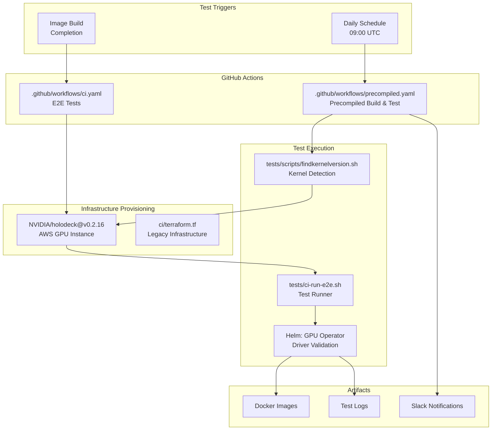
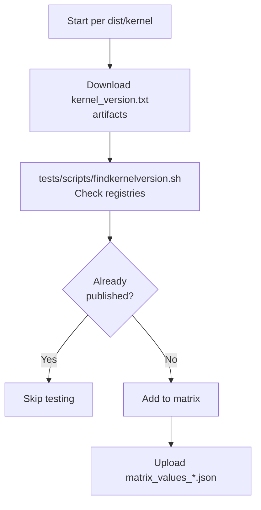
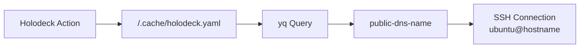
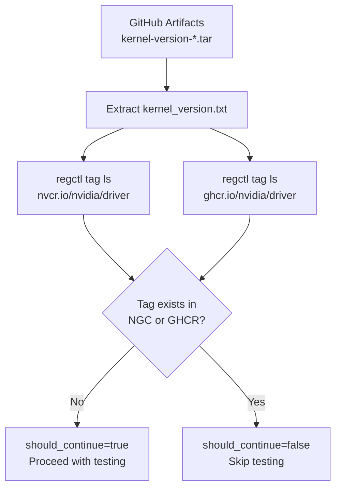

<!-- source: DeepWiki mcp.deepwiki.com · repo NVIDIA/gpu-driver-container · page 9.2 CI Testing Infrastructure · fetched 2026-10-26 -->

# CI Testing Infrastructure

<details>
<summary>Relevant source files</summary>

The following files were used as context for generating this wiki page:

- [.github/workflows/ci.yaml](.github/workflows/ci.yaml)
- [.github/workflows/precompiled.yaml](.github/workflows/precompiled.yaml)
- [ci/flatcar/build.sh](ci/flatcar/build.sh)
- [ci/localbuild.sh](ci/localbuild.sh)
- [ci/run.sh](ci/run.sh)
- [ci/terraform.tf](ci/terraform.tf)
- [tests/scripts/ci-precompiled-helpers.sh](tests/scripts/ci-precompiled-helpers.sh)
- [tests/scripts/findkernelversion.sh](tests/scripts/findkernelversion.sh)
- [tests/scripts/prerequisites.sh](tests/scripts/prerequisites.sh)

</details>


## Purpose and Scope

This document describes the automated testing infrastructure used to validate NVIDIA GPU driver container images. The infrastructure provisions GPU-enabled virtual machines on AWS, executes end-to-end tests, and validates driver functionality across multiple kernel versions and distributions.

For information about the overall CI/CD pipeline stages and release workflow, see [CI/CD Pipeline](#3). For details on build system configuration, see [Build System Configuration](#6).

## Overview

The testing infrastructure consists of three primary components:

1. **GitHub Actions Workflows** - Orchestrate precompiled driver builds and E2E tests
2. **Holodeck Provisioning** - Dynamically provision AWS GPU instances for testing
3. **Kernel Version Detection** - Identify new kernel releases that require testing

The infrastructure supports two testing modes:
- **Scheduled Testing**: Daily precompiled driver builds that detect and test new kernel versions
- **On-Demand Testing**: E2E tests triggered by image build completion



**Sources:** [.github/workflows/precompiled.yaml:1-470](), [.github/workflows/ci.yaml:1-89](), [ci/terraform.tf:1-151]()

## GitHub Actions Workflows

### Precompiled Image Workflow

The `precompiled.yaml` workflow runs daily to build precompiled driver images for new kernel versions and validate them through E2E tests.

#### Workflow Structure

```mermaid
graph LR
    subgraph "Matrix Setup"
        SET_MATRIX["set-driver-version-matrix<br/>Define build matrix"]
    end
    
    subgraph "Build Phase"
        BUILD["precompiled-build-image<br/>Matrix: driver × flavor × dist × kernel"]
        BASE["Build base image<br/>ghcr.io/nvidia/driver:base-*"]
        DRIVER["Build driver image<br/>ghcr.io/nvidia/driver:branch-version-dist"]
    end
    
    subgraph "Test Matrix Determination"
        DETERMINE["determine-e2e-test-matrix<br/>Per dist/kernel"]
        COLLECT["collect-e2e-test-matrix<br/>Aggregate results"]
    end
    
    subgraph "Testing"
        E2E["e2e-tests-nvidiadriver<br/>Matrix: kernel_version"]
        PUBLISH["publish-precompiled-image<br/>Matrix: driver × kernel"]
    end
    
    SET_MATRIX --> BUILD
    BUILD --> BASE
    BASE --> DRIVER
    DRIVER --> DETERMINE
    DETERMINE --> COLLECT
    COLLECT --> E2E
    E2E --> PUBLISH
```



**Sources:** [.github/workflows/precompiled.yaml:18-470]()

#### Job: set-driver-version-matrix

This job defines the build matrix variables used throughout the workflow.

**Matrix Dimensions:**
| Variable | Values | Description |
|----------|--------|-------------|
| `driver_branch` | `535`, `570`, `580` | NVIDIA driver branches |
| `kernel_flavors` | `aws`, `azure`, `generic`, `nvidia`, `oracle` | Ubuntu kernel variants |
| `dist` | `ubuntu22.04`, `ubuntu24.04` | Supported distributions |
| `lts_kernel` | `5.15`, `6.8` | LTS kernel versions |

**Exclusions:**
- Ubuntu 24.04 with driver branch 535 (not supported)
- Ubuntu 24.04 with LTS kernel 5.15 (not applicable)

**Sources:** [.github/workflows/precompiled.yaml:23-54]()

#### Job: precompiled-build-image

Builds base and driver images for each matrix combination.

**Build Process:**

1. **Calculate Build Variables** - Determines repository owner and image source labels [.github/workflows/precompiled.yaml:73-82]()
2. **Setup Docker Buildx** - Configures multi-architecture build support with QEMU [.github/workflows/precompiled.yaml:84-89]()
3. **Build Base Image** - Creates distribution-specific base image with kernel headers [.github/workflows/precompiled.yaml:96-114]()
4. **Extract Kernel Version** - Retrieves `kernel_version.txt` from base image container [.github/workflows/precompiled.yaml:108-114]()
5. **Build Driver Image** - Compiles driver against specific kernel version [.github/workflows/precompiled.yaml:115-122]()
6. **Save Artifacts** - Exports images and metadata as tar archives [.github/workflows/precompiled.yaml:124-164]()

**Key Environment Variables:**
- `IMAGE_NAME`: `ghcr.io/nvidia/driver`
- `PRECOMPILED`: `"true"`
- `DIST`: `signed_ubuntu22.04` or `signed_ubuntu24.04`

**Sources:** [.github/workflows/precompiled.yaml:56-164]()

#### Job: determine-e2e-test-matrix

Determines which kernel versions require E2E testing by checking for unpublished images.



**Registry Checks:**
- `nvcr.io/nvidia/driver` - Production NGC registry
- `ghcr.io/nvidia/driver` - Staging GHCR registry

**Sources:** [.github/workflows/precompiled.yaml:166-221](), [tests/scripts/ci-precompiled-helpers.sh:1-31](), [tests/scripts/findkernelversion.sh:1-45]()

#### Job: e2e-tests-nvidiadriver

Executes end-to-end tests on AWS GPU instances using Holodeck provisioning.

**Test Execution Flow:**

| Step | Description | Key Parameters |
|------|-------------|----------------|
| Checkout | Clone repository | `actions/checkout@v5` |
| Setup Holodeck | Provision GPU instance | `NVIDIA/holodeck@v0.2.16` |
| Extract DNS | Get instance hostname | `yq` query on `.cache/holodeck.yaml` |
| Download Images | Fetch driver image artifacts | `gh run download` |
| Run E2E Test | Execute test case | `tests/ci-run-e2e.sh` |
| Archive Logs | Upload failure logs | Retention: 15 days |

**GPU Operator Configuration:**
```bash
--set driver.repository=ghcr.io/nvidia
--set driver.usePrecompiled=true
--set driver.imagePullPolicy=Never
--set driver.version=${DRIVER_BRANCH}
```

**Sources:** [.github/workflows/precompiled.yaml:289-395]()

### E2E Tests Workflow

The `ci.yaml` workflow runs E2E tests after standard (non-precompiled) image builds complete.

**Trigger:** Workflow run completion of `image` workflow on `main` branch [.github/workflows/ci.yaml:17-23]()

**Test Configuration:**
- Uses `holodeck_ubuntu22.04.yaml` configuration
- Tests all driver versions from `versions.mk`
- Driver image tag format: `${COMMIT_SHORT_SHA}-${DRIVER_VERSION}`

**Sources:** [.github/workflows/ci.yaml:26-88]()

## Holodeck Integration

Holodeck is an NVIDIA tool for provisioning GPU-enabled virtual machines on AWS for testing purposes.

### Configuration Files

Test configurations are stored in `tests/holodeck_*.yaml` files:

```yaml
spec:
  kernel:
    version: <KERNEL_VERSION>  # Set dynamically during testing
```

The kernel version is injected at runtime using `yq`:
```bash
yq eval '.spec += {"kernel": {"version": strenv(KERNEL_VERSION)}}' -i tests/holodeck_$DIST.yaml
```

**Sources:** [.github/workflows/precompiled.yaml:323-325]()

### Instance Provisioning

Holodeck provisioning occurs through the `NVIDIA/holodeck@v0.2.16` GitHub Action:

**Required Secrets:**
- `AWS_SECRET_ACCESS_KEY` - AWS credentials for instance provisioning
- `AWS_ACCESS_KEY_ID` - AWS access key
- `AWS_SSH_KEY` - SSH private key for instance access

**Output:** Holodeck creates `.cache/holodeck.yaml` with instance details including the public DNS name.

**Sources:** [.github/workflows/precompiled.yaml:327-346](), [.github/workflows/ci.yaml:33-49]()

### Instance Access



**Query Command:**
```bash
yq '.status.properties[] | select(.name == "public-dns-name") | .value' /github/workspace/.cache/holodeck.yaml
```

**Connection Format:**
```bash
instance_hostname=ubuntu@${public_dns_name}
private_key=${GITHUB_WORKSPACE}/key.pem
```

**Sources:** [.github/workflows/precompiled.yaml:339-346](), [.github/workflows/ci.yaml:45-55]()

## Kernel Version Detection System

The kernel detection system identifies new kernel releases that require precompiled driver builds.

### Detection Pipeline



**Sources:** [tests/scripts/findkernelversion.sh:1-45]()

### Script: findkernelversion.sh

**Parameters:**
1. `KERNEL_FLAVOR` - Kernel variant (aws, azure, generic, nvidia, oracle)
2. `DRIVER_BRANCH` - Driver branch (535, 570, 580)
3. `DIST` - Distribution (ubuntu22.04, ubuntu24.04)
4. `LTS_KERNEL` - LTS kernel version (5.15, 6.8)

**Artifact Resolution:**
```bash
prefix="kernel-version-${DRIVER_BRANCH}-${LTS_KERNEL}"
suffix="${kernel_flavor}-${DIST}"
```

The script searches for artifacts matching pattern: `kernel-version-${DRIVER_BRANCH}-${LTS_KERNEL}-*-${kernel_flavor}-${DIST}`

**Registry Check Using regctl:**
```bash
regctl tag ls nvcr.io/nvidia/driver | grep "^${DRIVER_BRANCH}-${KERNEL_VERSION}-${DIST}$"
regctl tag ls ghcr.io/nvidia/driver | grep "^${DRIVER_BRANCH}-${KERNEL_VERSION}-${DIST}$"
```

**Sources:** [tests/scripts/findkernelversion.sh:1-45]()

### Helper: ci-precompiled-helpers.sh

The `get_kernel_versions_to_test` function aggregates kernel versions across flavors and driver branches:

**Function Signature:**
```bash
get_kernel_versions_to_test KERNEL_FLAVORS[@] DRIVER_BRANCHES[@] DIST LTS_KERNEL
```

**Logic:**
1. Iterate through each kernel flavor
2. For each flavor, check all driver branches
3. If any driver branch lacks the kernel version, mark for testing
4. Break early when unpublished version found
5. Deduplicate kernel versions
6. Append distribution suffix

**Output Format:** Space-separated list: `5.15.0-123-generic-ubuntu22.04 5.15.0-123-aws-ubuntu22.04 ...`

**Sources:** [tests/scripts/ci-precompiled-helpers.sh:1-31]()

## Test Execution Framework

### Test Runner: ci-run-e2e.sh

The `ci-run-e2e.sh` script orchestrates E2E test execution on remote GPU instances.

**Expected Arguments:**
1. `TEST_CASE` - Path to test case script (e.g., `./tests/cases/nvidia-driver.sh`)
2. `TEST_CASE_ARGS` - Arguments to pass to test case (GPU Operator Helm options)
3. `IMAGE_PATH` (optional) - Path to driver image tar archive

**Execution Pattern:**
```bash
./tests/ci-run-e2e.sh "${TEST_CASE}" "${TEST_CASE_ARGS}" ${IMAGE_PATH}
```

**Remote Execution:** The script uses SSH to execute tests on the Holodeck-provisioned instance with the following context:
- `instance_hostname` - SSH target (e.g., `ubuntu@ec2-xxx.compute.amazonaws.com`)
- `private_key` - SSH private key path (e.g., `key.pem`)
- `LOG_DIR=/tmp/logs` - Remote log directory

**Sources:** [.github/workflows/precompiled.yaml:353-387](), [.github/workflows/ci.yaml:61-80]()

### Test Case: nvidia-driver.sh

The primary E2E test validates GPU driver installation and functionality through the GPU Operator.

**Test Sequence:**
1. **Prerequisites** - Execute `tests/scripts/prerequisites.sh` to install dependencies
2. **Image Loading** - Load driver image tar if provided
3. **GPU Operator Deployment** - Deploy GPU Operator with driver configuration via Helm
4. **Driver Validation** - Wait for driver pods to reach Ready state
5. **Functionality Check** - Verify GPU accessibility and driver operation
6. **Log Collection** - Pull logs using `tests/scripts/pull.sh`

**Sources:** [.github/workflows/precompiled.yaml:353-387]()

### Prerequisites Installation

The `prerequisites.sh` script sets up the test environment:

**Installed Components:**
- `jq` - JSON parsing for test scripts
- `helm` - Kubernetes package manager for GPU Operator deployment
- Kernel modules: `i2c_core`, `ipmi_msghandler`

**Environment Variables:**
- `SKIP_PREREQUISITES` - Set to `"true"` to skip installation
- `LOG_DIR` - Directory for test logs

**Sources:** [tests/scripts/prerequisites.sh:1-24]()

## Legacy Terraform Infrastructure

The repository includes legacy Terraform-based infrastructure provisioning, now largely replaced by Holodeck.

### Terraform Configuration

The `ci/terraform.tf` file provisions:

**EC2 Instances:**

| Instance | AMI | Type | Purpose |
|----------|-----|------|---------|
| `ubuntu16_04` | Ubuntu Xenial 16.04 | `c4.4xlarge` | Docker build host |
| `flatcar` (not shown) | Flatcar Pro | - | CoreOS-compatible testing |

**Networking:**
- Security group: `allow_ssh` - Permits SSH (port 22) from all IPs
- Public IP assignment for remote access

**User Data:** Cloud-init configuration installs Docker CE and creates `nvidia` user with passwordless sudo.

**Sources:** [ci/terraform.tf:1-151]()

### Legacy Build Script: run.sh

The `ci/run.sh` script orchestrates Terraform-based builds:

**Workflow:**
1. **Provision Infrastructure** - `terraform apply` creates AWS instances [ci/run.sh:121-124]()
2. **Configure SSH** - Add instance IPs to `known_hosts` [ci/run.sh:126-129]()
3. **Build Images** - Execute Docker builds on remote instances [ci/run.sh:74-100]()
4. **Transfer Images** - Save images to tar and load locally [ci/run.sh:85-87]()
5. **Push to Registry** - Upload to Docker registry [ci/run.sh:90-91]()
6. **Cleanup** - `terraform destroy` on exit [ci/run.sh:102-105]()

**Kernel Version Detection:**
```bash
latest_ubuntu_kernel() {
  docker run --rm ubuntu:"${1}" /bin/bash -c \
    "apt update && apt-cache show linux-headers-${2} | ..."
}

latest_rhel_kernel() {
  docker run --rm centos:"${1}" /bin/bash -c \
    "dnf repoquery -q --latest-limit 1 kernel-headers | ..."
}
```

**Sources:** [ci/run.sh:1-181]()

### Local Build Script: localbuild.sh

The `ci/localbuild.sh` script enables local testing without CI infrastructure:

**Build Functions:**
- `driver_container_build_simple` - Build single platform image
- `driver_container_build_ubuntu` - Build all Ubuntu variants
- `driver_container_build_rhel` - Build all RHEL variants

**Optional Steps:**
1. **Security Scanning** - Using Pulse scanner if `NSPECT_ID` and `SSA_CLIENT_SECRET` are set
2. **NGC Staging Push** - If `NGC_STAGING_RELEASE` is set
3. **NGC Production Push** - If `NGC_PROD_RELEASE="yes"`
4. **DockerHub Push** - If `DOCKERHUB_RELEASE="yes"`

**Sources:** [ci/localbuild.sh:1-146]()

## Notification System

The precompiled workflow includes Slack notifications for key events:

### Kernel Detection Notification

Sent when new kernel versions are detected before E2E tests begin:

```json
{
  "channel": "${{ secrets.SLACK_CHANNEL_ID }}",
  "text": "Detected new precompiled kernel: <kernel_versions>\nDetails: <github_run_url>"
}
```

**Trigger:** After `collect-e2e-test-matrix` job if `matrix_values_not_empty == '1'`

**Sources:** [.github/workflows/precompiled.yaml:276-287]()

### Image Publication Notification

Sent after successful image publication to GHCR:

```json
{
  "channel": "${{ secrets.SLACK_CHANNEL_ID }}",
  "text": "Published precompiled image: ghcr.io/nvidia/driver:<tag>"
}
```

**Trigger:** After each successful image publication in `publish-precompiled-image` job

**Sources:** [.github/workflows/precompiled.yaml:459-469]()

## Testing Matrix and Exclusions

### Current Matrix Configuration

**Precompiled Builds:**

| Dimension | Values | Notes |
|-----------|--------|-------|
| Driver Branches | 535, 570, 580 | 535 excluded for Ubuntu 24.04 |
| Kernel Flavors | aws, azure, generic, nvidia, oracle | Azure currently excluded from E2E |
| Distributions | ubuntu22.04, ubuntu24.04 | |
| LTS Kernels | 5.15, 6.8 | 5.15 excluded for Ubuntu 24.04 |

**Matrix Exclusions:**
```yaml
exclude:
  - dist: ubuntu24.04
    driver_branch: 535
  - lts_kernel: 5.15
    dist: ubuntu24.04
  - kernel_version: *-azure-*  # E2E tests only
```

**Total Combinations:** ~40 build configurations per workflow run (5 flavors × 2 distributions × 2 kernels × 2 driver branches, accounting for exclusions)

**Sources:** [.github/workflows/precompiled.yaml:59-70](), [.github/workflows/precompiled.yaml:265-268](), [.github/workflows/precompiled.yaml:295-298]()

---

