# Page: Overview

# Overview

<details>
<summary>Relevant source files</summary>

The following files were used as context for generating this wiki page:

- [.common-ci.yml](.common-ci.yml)
- [.github/workflows/image.yaml](.github/workflows/image.yaml)
- [.nvidia-ci.yml](.nvidia-ci.yml)
- [rhel8/Dockerfile](rhel8/Dockerfile)
- [rhel8/nvidia-driver](rhel8/nvidia-driver)
- [rhel9/Dockerfile](rhel9/Dockerfile)
- [rhel9/nvidia-driver](rhel9/nvidia-driver)
- [ubuntu20.04/Dockerfile](ubuntu20.04/Dockerfile)
- [ubuntu20.04/nvidia-driver](ubuntu20.04/nvidia-driver)
- [ubuntu22.04/Dockerfile](ubuntu22.04/Dockerfile)
- [ubuntu22.04/nvidia-driver](ubuntu22.04/nvidia-driver)
- [versions.mk](versions.mk)

</details>


This document introduces the NVIDIA GPU Driver Container repository, a system for building and distributing containerized NVIDIA GPU drivers across multiple Linux distributions. This page provides context for understanding the repository's architecture, build system, and runtime behavior.

For information about specific subsystems, see:
- CI/CD pipeline details: [CI/CD Pipeline](#3)
- Container image variants: [Container Image Types](#4)
- Runtime driver management: [Driver Management Scripts](#5)
- Build system configuration: [Build System Configuration](#6)

## Purpose and Scope

The gpu-driver-container repository builds container images that install and manage NVIDIA GPU drivers on host systems. These driver containers enable:

1. **Containerized driver deployment** - GPU drivers packaged as containers that install kernel modules on the host
2. **Kernel compatibility** - Support for runtime compilation against arbitrary host kernels or precompiled modules for specific kernels
3. **Multi-distribution support** - Single build system producing images for Ubuntu, RHEL, CoreOS, Flatcar, and Fedora
4. **Automated updates** - CI/CD pipelines that rebuild drivers for new kernel versions and security patches
5. **Integration with Kubernetes** - Designed for use with the NVIDIA GPU Operator and OpenShift Driver Toolkit

This repository does **not** contain the NVIDIA driver source code itself. It downloads driver installers from NVIDIA repositories and packages them into containers with appropriate runtime scripts.

Sources: [.common-ci.yml:1-367](), [versions.mk:1-19](), [rhel8/nvidia-driver:1-50]()

## The Driver Container Pattern

Traditional GPU driver installation requires compiling kernel modules directly on the host system. Driver containers reverse this approach: the container holds the driver sources and toolchain, compiles modules for the host kernel, then installs them from within the container.

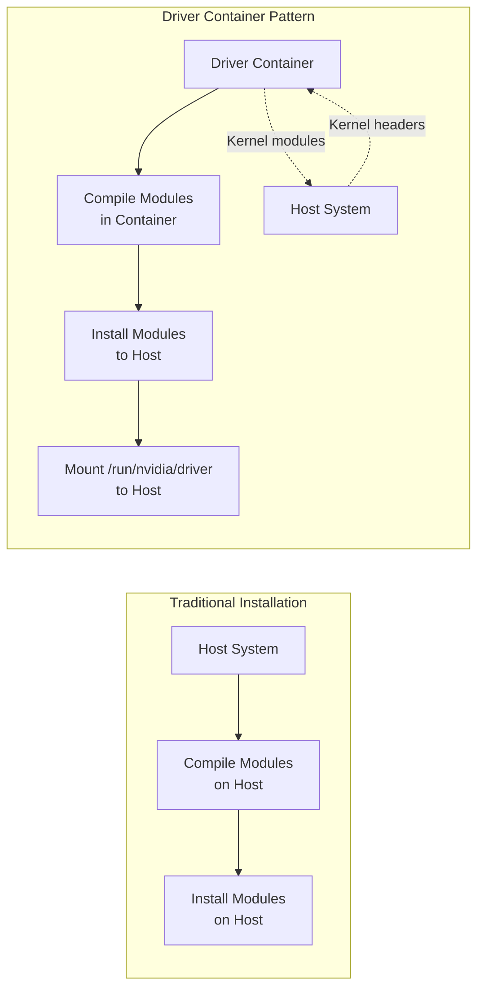

**Sources:** [rhel8/nvidia-driver:559-583](), [ubuntu22.04/Dockerfile:1-117]()

### Container Lifecycle

The driver container follows this lifecycle:

1. **Initialization** (`nvidia-driver init`) - Extracts driver sources, determines kernel module type, prepares for compilation
2. **Build** - Downloads kernel headers, compiles modules against host kernel, optionally signs modules
3. **Load** - Loads kernel modules with `modprobe`, starts daemons (persistenced, fabric manager, vGPU grid)
4. **Mount** - Bind-mounts container filesystem to `/run/nvidia/driver` for host access to libraries
5. **Running** - Sleeps indefinitely while monitoring for shutdown signals

**Sources:** [rhel8/nvidia-driver:753-759](), [rhel9/nvidia-driver:770-776](), [ubuntu22.04/nvidia-driver:641-709]()

## Deployment Modes

The system supports three distinct deployment modes based on GPU virtualization requirements:

| Deployment Mode | Description | Use Case | Driver Type |
|----------------|-------------|----------|-------------|
| **Passthrough/Baremetal** | Standard GPU pass-through to containers or bare metal workloads | Kubernetes pods, Docker containers, physical servers | `DRIVER_TYPE=passthrough` |
| **vGPU Guest** | Virtual GPU guest drivers for VMs | Virtual machines with vGPU | `DRIVER_TYPE=vgpu` with guest components |
| **vGPU Host** | Virtual GPU host drivers for hypervisors | ESXi, KVM hypervisors managing vGPUs | `DRIVER_TYPE=vgpu` with host components |

```mermaid
graph TB
    subgraph "Passthrough Mode"
        PASS_CONTAINER["nvidia-driver Container<br/>DRIVER_TYPE=passthrough"]
        PASS_HOST["Host Kernel"]
        PASS_GPU["Physical GPU"]
        
        PASS_CONTAINER -->|"modprobe nvidia"| PASS_HOST
        PASS_HOST -->|Direct access| PASS_GPU
    end
    
    subgraph "vGPU Guest Mode"
        VGPU_G_CONTAINER["nvidia-driver Container<br/>DRIVER_TYPE=vgpu"]
        VGPU_G_VM["Guest VM Kernel"]
        VGPU_DEVICE["vGPU Device"]
        
        VGPU_G_CONTAINER -->|"modprobe nvidia"| VGPU_G_VM
        VGPU_G_CONTAINER -->|"nvidia-gridd"| VGPU_LICENSE["License Server"]
        VGPU_G_VM -->|Virtual access| VGPU_DEVICE
    end
    
    subgraph "vGPU Host Mode"
        VGPU_H_CONTAINER["nvidia-driver Container<br/>DRIVER_TYPE=vgpu<br/>Host components"]
        VGPU_H_HOST["Hypervisor Kernel"]
        VGPU_H_GPU["Physical GPU"]
        
        VGPU_H_CONTAINER -->|"modprobe nvidia-vgpu-vfio"| VGPU_H_HOST
        VGPU_H_HOST -->|Create vGPUs| VGPU_H_GPU
    end
```

**Sources:** [rhel8/Dockerfile:38-45](), [rhel8/nvidia-driver:387-401](), [ubuntu20.04/nvidia-driver:307-321]()

## Build Modes: Standard vs Precompiled

### Standard Images (Runtime Compilation)

Standard images contain driver sources and compile kernel modules at container startup against the host's kernel.

**Advantages:**
- Single image supports many kernel versions
- Smaller image size (no precompiled modules)
- Flexibility for custom kernels

**Disadvantages:**
- Slower startup time (compilation required)
- Requires kernel headers on host or downloaded at runtime
- Requires build toolchain in container

**Sources:** [rhel8/nvidia-driver:196-259](), [ubuntu22.04/nvidia-driver:135-199]()

### Precompiled Images (Pre-built Modules)

Precompiled images contain kernel modules built for specific kernel versions, eliminating runtime compilation.

**Advantages:**
- Fast startup (no compilation)
- No kernel headers required
- Smaller attack surface (no build tools)

**Disadvantages:**
- Larger total footprint (many images for many kernels)
- Requires exact kernel version match
- Only supported on Ubuntu 22.04, 24.04 and RHEL 9

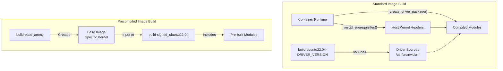

**Sources:** [.github/workflows/image.yaml:93-194](), [.common-ci.yml:92-107](), [.nvidia-ci.yml:115-128]()

## Distribution Support Matrix

The system builds images for multiple Linux distributions and architectures:

| Distribution | Versions | Architectures | Precompiled Support | Driver Branches |
|-------------|----------|---------------|---------------------|-----------------|
| **Ubuntu** | 20.04, 22.04, 24.04 | amd64, arm64 | 22.04, 24.04 only | 535, 570, 580 (535 not on 24.04) |
| **RHEL** | 8, 9 | amd64, arm64 | No | 535, 570, 580 |
| **CoreOS** | Various | amd64, arm64 | No | 535, 570, 580 |
| **Flatcar** | Various | amd64, arm64 | No | 535, 570, 580 |
| **Fedora** | 36+ | amd64, arm64 | No | 535, 570, 580 |

**Sources:** [.common-ci.yml:22-23](), [versions.mk:15-16](), [.github/workflows/image.yaml:34-44]()

## Repository Structure and Key Files

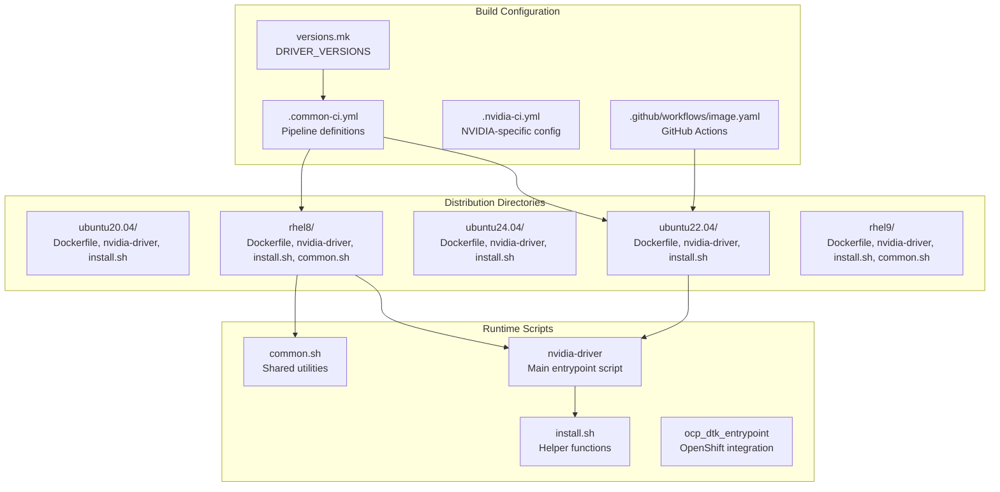

**Key directories and their purposes:**

- **Distribution directories** (`ubuntu20.04/`, `rhel8/`, etc.) - Per-distribution Dockerfiles and runtime scripts
- **CI/CD configuration** (`.common-ci.yml`, `.nvidia-ci.yml`, `.github/workflows/`) - Build and release automation
- **Runtime scripts** (`nvidia-driver`, `common.sh`, `install.sh`) - Driver lifecycle management
- **Build configuration** (`versions.mk`, `Makefile`) - Version definitions and build orchestration

**Sources:** [versions.mk:1-19](), [.common-ci.yml:1-50](), [rhel8/Dockerfile:1-110]()

## Image Naming and Versioning

Driver container images follow a consistent naming scheme:

### Standard Images

Format: `{registry}/driver:{version}-{driver_version}-{dist}`

Example: `nvcr.io/nvidia/driver:550.90.07-ubuntu22.04`

Components:
- **registry**: `nvcr.io/nvidia` (production), `ghcr.io/nvidia` (staging)
- **version**: Git commit SHA or release tag
- **driver_version**: NVIDIA driver version (e.g., `535.274.02`, `570.195.03`, `580.95.05`)
- **dist**: Distribution identifier (e.g., `ubuntu22.04`, `rhel9`)

### Precompiled Images

Format: `{registry}/driver:{version}-{driver_version}-{kernel_version}-{dist}`

Example: `nvcr.io/nvidia/driver:550.90.07-6.8.0-1014-aws-signed_ubuntu22.04`

Additional components:
- **kernel_version**: Specific kernel version (e.g., `6.8.0-1014-aws`)
- **dist**: Includes `signed_` prefix (e.g., `signed_ubuntu22.04`)

**Sources:** [.common-ci.yml:163-184](), [.nvidia-ci.yml:45-69]()

## CI/CD Pipeline Overview

The build and release process uses a dual-pipeline architecture:

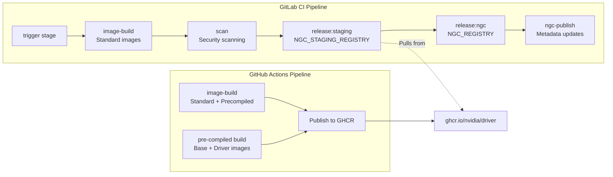

**Pipeline triggers:**
- **Merge requests** - Build and scan only
- **Main branch commits** - Build, scan, and push to staging
- **Git tags** - Full release to NGC production
- **Scheduled** (GitHub) - Daily precompiled builds for new kernels

**Sources:** [.common-ci.yml:25-50](), [.nvidia-ci.yml:39-148](), [.github/workflows/image.yaml:18-24]()

## Runtime Architecture and Key Scripts

The driver container's runtime behavior is controlled by the `nvidia-driver` script, which exists in distribution-specific versions but follows a common structure:

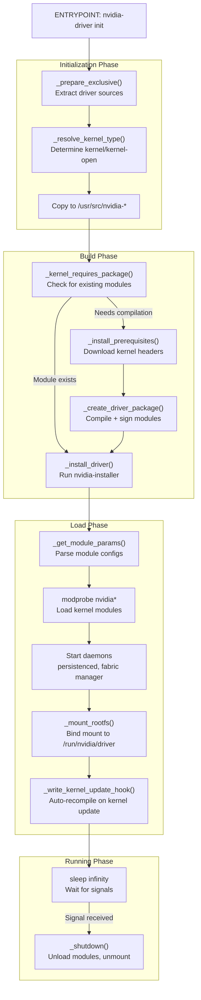

**Key functions by phase:**

| Phase | Function | Purpose | Location |
|-------|----------|---------|----------|
| Initialization | `_prepare_exclusive()` | Extract driver installer, acquire lock | [rhel8/nvidia-driver:709-724]() |
| Initialization | `_resolve_kernel_type()` | Choose kernel vs kernel-open modules | [rhel8/nvidia-driver:615-643]() |
| Build | `_kernel_requires_package()` | Check if modules need recompilation | [rhel8/nvidia-driver:176-193]() |
| Build | `_create_driver_package()` | Compile, sign, package modules | [rhel8/nvidia-driver:196-259]() |
| Build | `_install_driver()` | Run nvidia-installer | [rhel8/nvidia-driver:525-557]() |
| Load | `_get_module_params()` | Parse custom module parameters | [rhel8/nvidia-driver:305-341]() |
| Load | `_load_driver()` | Load modules and start daemons | [rhel8/nvidia-driver:344-422]() |
| Load | `_mount_rootfs()` | Mount container filesystem to host | [rhel8/nvidia-driver:560-575]() |
| Running | `_shutdown()` | Clean unload and unmount | [rhel8/nvidia-driver:606-613]() |

**Sources:** [rhel8/nvidia-driver:753-820](), [rhel9/nvidia-driver:770-838](), [ubuntu22.04/nvidia-driver:641-772]()

## Integration Points

The driver container integrates with several external systems:

### Kubernetes GPU Operator

The NVIDIA GPU Operator deploys driver containers as DaemonSets on Kubernetes clusters. The operator:
- Manages driver container lifecycle
- Handles kernel updates via the update command
- Validates driver installation via readiness probes
- Integrates with the NVIDIA Device Plugin

### OpenShift Driver Toolkit

For Red Hat OpenShift, the driver container can use the Driver Toolkit to obtain exact kernel headers:
- `ocp_dtk_entrypoint` script provides DTK-specific initialization
- Mounts shared driver toolkit from `/mnt/shared-nvidia-driver-toolkit`
- Supports OpenShift-specific kernel versions (RHCOS)

### Container Registries

Images are published to two registries with different purposes:

| Registry | Purpose | Access | Usage |
|----------|---------|--------|-------|
| `nvcr.io/nvidia/driver` | Production distribution | Public | GPU Operator default |
| `ghcr.io/nvidia/driver` | Staging and development | Public | CI/CD artifacts, testing |

**Sources:** [.common-ci.yml:159-184](), [.nvidia-ci.yml:336-384](), [rhel8/ocp_dtk_entrypoint:1-50]()

## Driver Version Support

Current supported driver branches (as of latest update):

| Branch | Version | Status | Key Features |
|--------|---------|--------|--------------|
| **535** | 535.274.02 | Production | Legacy support, LTS |
| **570** | 570.195.03 | Production | Current production branch |
| **580** | 580.95.05 | Production | Latest features, R580+ |

The repository maintains the latest version in each active datacenter driver branch. Driver versions are defined in [versions.mk:16]() and referenced throughout the build system.

**Sources:** [versions.mk:15-16](), [.common-ci.yml:22]()

## Next Steps

For detailed information about specific subsystems, continue to:

- **[Architecture](#2)** - Detailed system architecture and component interactions
- **[CI/CD Pipeline](#3)** - In-depth pipeline configuration and workflows
- **[Container Image Types](#4)** - Specifications for each image variant
- **[Driver Management Scripts](#5)** - Complete script reference and lifecycle management
- **[Build System Configuration](#6)** - Makefile, Dockerfile, and build variable reference

---

# Page: Architecture

# Architecture

<details>
<summary>Relevant source files</summary>

The following files were used as context for generating this wiki page:

- [.common-ci.yml](.common-ci.yml)
- [.github/workflows/image.yaml](.github/workflows/image.yaml)
- [.gitlab-ci.yml](.gitlab-ci.yml)
- [.nvidia-ci.yml](.nvidia-ci.yml)
- [Makefile](Makefile)
- [base/Dockerfile](base/Dockerfile)
- [base/generate-ci-config](base/generate-ci-config)
- [multi-arch.mk](multi-arch.mk)
- [native-only.mk](native-only.mk)
- [rhel8/Dockerfile](rhel8/Dockerfile)
- [rhel8/nvidia-driver](rhel8/nvidia-driver)
- [rhel9/Dockerfile](rhel9/Dockerfile)
- [rhel9/nvidia-driver](rhel9/nvidia-driver)
- [scripts/precompiled.sh](scripts/precompiled.sh)
- [ubuntu20.04/Dockerfile](ubuntu20.04/Dockerfile)
- [ubuntu20.04/nvidia-driver](ubuntu20.04/nvidia-driver)
- [ubuntu22.04/Dockerfile](ubuntu22.04/Dockerfile)
- [ubuntu22.04/nvidia-driver](ubuntu22.04/nvidia-driver)
- [versions.mk](versions.mk)

</details>


This page provides a high-level architectural overview of the NVIDIA GPU Driver Container build and delivery system. It describes the major components, their relationships, and the key design patterns that enable building and distributing containerized GPU drivers across multiple Linux distributions, driver versions, and hardware architectures.

For specific implementation details of the CI/CD pipeline, see [CI/CD Pipeline](#3). For runtime driver management details, see [Driver Management Scripts](#5). For build system configuration specifics, see [Build System Configuration](#6).

## System Overview

The gpu-driver-container repository implements an automated system for packaging NVIDIA GPU drivers as container images. The system supports three primary driver deployment modes:

| Deployment Mode | Description | Primary Use Case |
|----------------|-------------|------------------|
| **Passthrough/Baremetal** | Standard GPU drivers for bare-metal or VM passthrough | Kubernetes clusters, bare-metal systems |
| **vGPU Guest** | Virtual GPU drivers for guest VMs | Virtualized GPU workloads |
| **vGPU Host** | Hypervisor-level vGPU manager | Virtual GPU infrastructure |

The architecture separates concerns into three distinct layers: CI/CD automation, image build orchestration, and runtime driver management. This separation enables independent evolution of each layer while maintaining a cohesive delivery pipeline.

**Sources:** [.common-ci.yml:1-50](), [Makefile:1-84](), [rhel8/nvidia-driver:1-50]()

## Architectural Layers

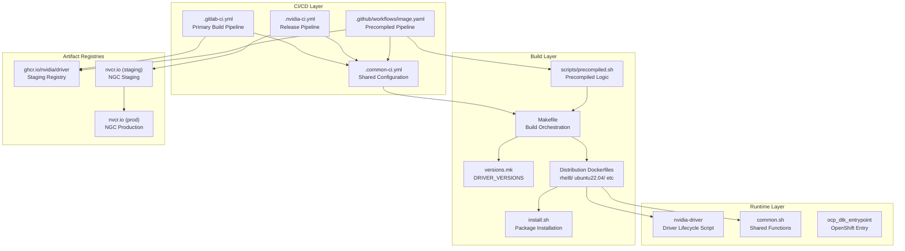

**Sources:** [.gitlab-ci.yml:1-132](), [.nvidia-ci.yml:1-100](), [.github/workflows/image.yaml:1-194](), [Makefile:1-308](), [rhel8/nvidia-driver:1-30]()

### CI/CD Layer

The CI/CD layer consists of two parallel automation pipelines:

1. **GitLab CI Pipeline** ([.gitlab-ci.yml](), [.nvidia-ci.yml]()): Handles standard driver image builds for all distributions and performs release management to NGC registries. Executes on every merge request, commit to main, and tagged releases.

2. **GitHub Actions Pipeline** ([.github/workflows/image.yaml]()): Manages precompiled driver builds that include pre-built kernel modules for specific kernel versions. Runs on schedule (daily) and on pull requests.

Both pipelines share common configuration from [.common-ci.yml]() which defines:
- Driver version matrix: `DRIVER_VERSIONS ?= 535.274.02 570.195.03 580.95.05` ([versions.mk:16]())
- Distribution matrix: ubuntu20.04, ubuntu22.04, ubuntu24.04, rhel8, rhel9
- Architecture matrix: `linux/amd64`, `linux/arm64` ([.common-ci.yml:132-136]())
- Pipeline stages: `trigger`, `image-build`, `scan`, `release`, `ngc-publish` ([.common-ci.yml:25-31]())

**Sources:** [.common-ci.yml:1-367](), [.gitlab-ci.yml:1-132](), [.nvidia-ci.yml:1-533](), [.github/workflows/image.yaml:1-194]()

### Build Layer

The build layer orchestrates multi-distribution, multi-architecture image construction through a sophisticated Makefile-based system:

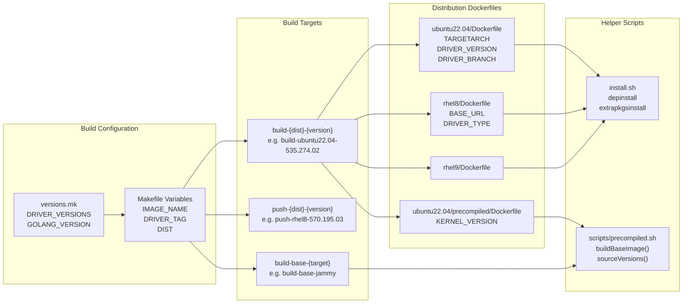

The Makefile implements a pattern-based target system where:
- `$(DRIVER_BUILD_TARGETS)` expands to all distribution-version combinations ([Makefile:64-65]())
- Each target parses its name to extract `DIST` and `DRIVER_VERSION` ([Makefile:152-154]())
- Distribution-specific rules override variables (e.g., `build-rhcos%: SUBDIR = rhel8` [Makefile:177]())
- Multi-arch builds conditionally use Docker Buildx based on `BUILD_MULTI_ARCH_IMAGES` ([Makefile:15-20]())

**Sources:** [Makefile:1-308](), [versions.mk:1-19](), [ubuntu22.04/Dockerfile:1-117](), [rhel8/Dockerfile:1-110](), [scripts/precompiled.sh:1-114]()

### Runtime Layer

The runtime layer manages driver installation, kernel module compilation, and daemon lifecycle through distribution-specific `nvidia-driver` scripts:

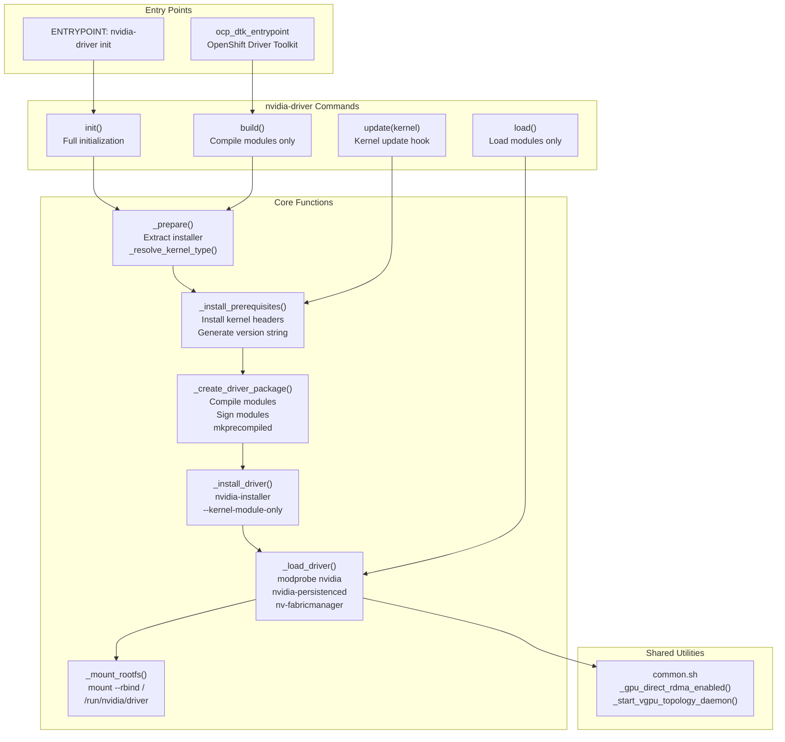

Each `nvidia-driver` script implements a state machine with distinct phases:

1. **Preparation**: Extract NVIDIA installer `.run` file, install userspace components, determine kernel module type (open vs proprietary) via `_resolve_kernel_type()` ([rhel8/nvidia-driver:622-639]())

2. **Build**: Check if precompiled package exists with `_kernel_requires_package()` ([rhel8/nvidia-driver:176-193]()), compile modules if needed with `_create_driver_package()` ([rhel8/nvidia-driver:196-259]())

3. **Installation**: Run `nvidia-installer --kernel-module-only` to install compiled modules ([rhel8/nvidia-driver:525-557]())

4. **Loading**: Load kernel modules via `modprobe`, start `nvidia-persistenced`, conditionally start `nv-fabricmanager` for NVSwitch systems ([rhel8/nvidia-driver:344-422]())

5. **Mounting**: Bind-mount driver rootfs to `/run/nvidia/driver` for host access ([rhel8/nvidia-driver:560-575]())

**Sources:** [rhel8/nvidia-driver:1-850](), [rhel9/nvidia-driver:1-850](), [ubuntu22.04/nvidia-driver:1-800](), [ubuntu20.04/nvidia-driver:1-700]()

## Data Flow Architecture

The following diagram shows how artifacts flow through the system from source code to production registries, including the distinction between standard and precompiled build paths:

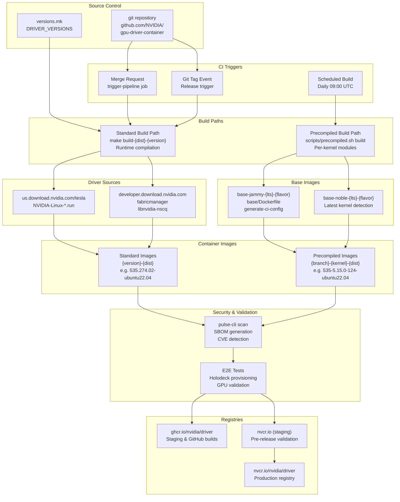

**Standard build path** ([.gitlab-ci.yml:19-99]()):
1. Trigger from merge request or tag
2. Execute `make build-${DIST}-${DRIVER_VERSION}` for each distribution-version pair
3. Download NVIDIA installer from `us.download.nvidia.com` during image build ([rhel8/Dockerfile:65-69]())
4. Run security scans via `pulse-cli` ([.nvidia-ci.yml:151-186]())
5. Push to staging registry `ghcr.io/nvidia/driver` ([.nvidia-ci.yml:45-69]())
6. Promote to NGC staging, then production ([.nvidia-ci.yml:336-419]())

**Precompiled build path** ([scripts/precompiled.sh:1-114]()):
1. Daily schedule triggers GitHub Actions workflow ([.github/workflows/image.yaml:18-24]())
2. Build base images with `build-base-{jammy|noble}` to detect latest kernel ([Makefile:206-222]())
3. Execute `scripts/precompiled.sh build` which sources kernel version from base image ([scripts/precompiled.sh:8-37]())
4. Build per-kernel images with pre-compiled modules ([.gitlab-ci.yml:103-132]())
5. Follow same scan and promotion path as standard builds

**Sources:** [.gitlab-ci.yml:1-132](), [.nvidia-ci.yml:1-533](), [.github/workflows/image.yaml:1-194](), [scripts/precompiled.sh:1-114](), [Makefile:206-230]()

## Build-Time Architecture

The build process uses multi-stage Dockerfiles to separate build dependencies from runtime artifacts:

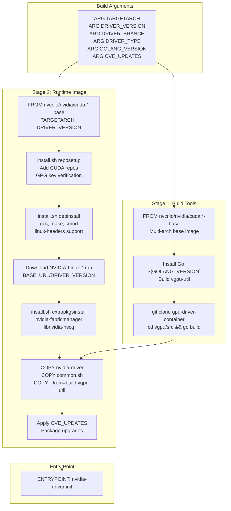

Key build-time patterns:

1. **Multi-architecture support**: Uses `TARGETARCH` ARG to download architecture-specific binaries ([rhel8/Dockerfile:26-27](), [ubuntu22.04/Dockerfile:45-46]())

2. **Late binding**: Driver `.run` file downloaded during build but not extracted ([rhel8/Dockerfile:65-69]()), actual installation happens at container runtime

3. **Conditional vGPU support**: vGPU utility only built when `DRIVER_TYPE=vgpu` ([ubuntu22.04/Dockerfile:34-38]())

4. **Security hardening**: CVE updates applied via `CVE_UPDATES` build arg ([.common-ci.yml:111](), [ubuntu22.04/Dockerfile:104-108]())

5. **Distribution abstraction**: `install.sh` script abstracts package manager differences between apt (Ubuntu) and dnf (RHEL) ([rhel8/Dockerfile:57](), [ubuntu22.04/Dockerfile:73]())

**Sources:** [rhel8/Dockerfile:1-110](), [ubuntu22.04/Dockerfile:1-117](), [rhel9/Dockerfile:1-115](), [ubuntu20.04/Dockerfile:1-106]()

## Runtime Architecture

At container startup, the `nvidia-driver init` command executes a carefully orchestrated sequence to install and load drivers on the host:

```mermaid
graph TB
    subgraph "Container Startup"
        START["Container starts<br/>ENTRYPOINT: nvidia-driver init"]
        LOCK["Acquire PID lock<br/>/run/nvidia/nvidia-driver.pid"]
    end
    
    subgraph "Driver Preparation Phase"
        EXTRACT["Extract NVIDIA-Linux-*.run<br/>nvidia-installer -x"]
        USERSPACE["Install userspace components<br/>Libraries to /usr/lib64<br/>Binaries to /usr/bin"]
        RESOLVE_TYPE["_resolve_kernel_type()<br/>nvidia-installer --print-recommended<br/>KERNEL_TYPE=kernel|kernel-open"]
        COPY_SOURCES["Copy kernel module sources<br/>/usr/src/nvidia-${DRIVER_VERSION}/<br/>kernel/ or kernel-open/"]
    end
    
    subgraph "Module Build Phase"
        CHECK_PKG["_kernel_requires_package()<br/>Check precompiled/*/"]
        GET_HEADERS["_install_prerequisites()<br/>dnf install kernel-headers<br/>kernel-devel kernel-core"]
        COMPILE["_create_driver_package()<br/>make nv-linux.o<br/>ld -r -o nvidia.ko<br/>mkprecompiled --pack"]
        INSTALLER["_install_driver()<br/>nvidia-installer<br/>--kernel-module-only<br/>--skip-module-load"]
    end
    
    subgraph "Module Load Phase"
        GET_PARAMS["_get_module_params()<br/>Parse /drivers/*.conf<br/>NVIDIA_MODULE_PARAMS"]
        LOAD_MODS["modprobe nvidia<br/>modprobe nvidia-uvm<br/>modprobe nvidia-modeset"]
        LOAD_PEERMEM["if GPU_DIRECT_RDMA_ENABLED<br/>modprobe nvidia-peermem"]
        START_PERSIST["nvidia-persistenced<br/>--persistence-mode"]
        START_GRIDD["if DRIVER_TYPE=vgpu<br/>nvidia-gridd"]
        START_FABRIC["if NVSwitch detected<br/>nv-fabricmanager"]
    end
    
    subgraph "Host Integration Phase"
        MOUNT["_mount_rootfs()<br/>mount --rbind /<br/>/run/nvidia/driver"]
        HOOK["_write_kernel_update_hook()<br/>/run/kernel/postinst.d/"]
        SELINUX["if SELinux enabled<br/>chcon -R -t container_file_t"]
    end
    
    subgraph "Steady State"
        WAIT["sleep infinity &<br/>trap signals for shutdown"]
    end
    
    START --> LOCK
    LOCK --> EXTRACT
    EXTRACT --> USERSPACE
    USERSPACE --> RESOLVE_TYPE
    RESOLVE_TYPE --> COPY_SOURCES
    
    COPY_SOURCES --> CHECK_PKG
    CHECK_PKG -->|"No precompiled package"| GET_HEADERS
    CHECK_PKG -->|"Precompiled exists"| INSTALLER
    GET_HEADERS --> COMPILE
    COMPILE --> INSTALLER
    
    INSTALLER --> GET_PARAMS
    GET_PARAMS --> LOAD_MODS
    LOAD_MODS --> LOAD_PEERMEM
    LOAD_PEERMEM --> START_PERSIST
    START_PERSIST --> START_GRIDD
    START_GRIDD --> START_FABRIC
    
    START_FABRIC --> MOUNT
    MOUNT --> HOOK
    HOOK --> SELINUX
    SELINUX --> WAIT
```

**Kernel module type resolution** ([rhel8/nvidia-driver:622-643]()):
- For driver branch >= 560: Defaults to open kernel modules (`kernel-open`)
- For driver branch < 560: Defaults to proprietary modules (`kernel`)
- Can be overridden via `KERNEL_MODULE_TYPE` environment variable
- Uses `nvidia-installer --print-recommended-kernel-module-type` to determine optimal choice

**Module parameter configuration** ([rhel8/nvidia-driver:305-341]()):
- Reads configuration files from `/drivers/*.conf`
- Supports: `nvidia.conf`, `nvidia-uvm.conf`, `nvidia-modeset.conf`, `nvidia-peermem.conf`
- Starting from driver 580, automatically adds `NVreg_CoherentGPUMemoryMode=driver` ([rhel8/nvidia-driver:311]())
- Parameters passed to `modprobe` during module loading

**Daemon management**:
- `nvidia-persistenced`: Always started for persistence mode ([rhel8/nvidia-driver:385]())
- `nvidia-gridd`: Started only when `DRIVER_TYPE=vgpu` ([rhel8/nvidia-driver:387-401]())
- `nv-fabricmanager`: Started when NVSwitch devices detected ([rhel8/nvidia-driver:418-421]())
- NVLink5+ systems: Both `nv-fabricmanager` and `nvlsm` started ([rhel8/nvidia-driver:403-416]())

**Host integration**:
- Driver files mounted to `/run/nvidia/driver` via bind mount ([rhel8/nvidia-driver:560-575]())
- SELinux contexts applied if enabled ([rhel8/nvidia-driver:567-574]())
- Kernel update hook installed to `/run/kernel/postinst.d/` for automatic recompilation ([rhel8/nvidia-driver:586-604]())

**Sources:** [rhel8/nvidia-driver:753-759](), [rhel8/nvidia-driver:622-643](), [rhel8/nvidia-driver:305-341](), [rhel8/nvidia-driver:344-422](), [rhel8/nvidia-driver:560-604](), [ubuntu22.04/nvidia-driver:564-750]()

## Key Design Patterns

### Late Binding Pattern

Driver kernel modules are compiled at container runtime rather than build time, enabling a single container image to support multiple kernel versions:

```
Image Build Time:
  - Include NVIDIA-Linux-*.run (installer)
  - Include kernel module source code
  - Include mkprecompiled tool

Container Runtime:
  - Detect host kernel version
  - Install kernel headers matching host
  - Compile modules against host kernel
  - Install and load modules
```

This pattern is implemented in `_kernel_requires_package()` ([rhel8/nvidia-driver:176-193]()), which checks if a precompiled package already exists for the current kernel before triggering compilation.

**Sources:** [rhel8/nvidia-driver:176-193](), [rhel8/nvidia-driver:196-259](), [ubuntu22.04/nvidia-driver:115-132]()

### Distribution Abstraction Pattern

Common driver logic is shared via `common.sh` while distribution-specific implementations handle package management differences:

| Function | Ubuntu Implementation | RHEL Implementation |
|----------|----------------------|---------------------|
| Package cache update | `apt-get -qq update` | `yum -q makecache` |
| Install headers | `apt-get install linux-headers-*` | `dnf install kernel-headers-*` |
| Resolve kernel version | Parse `apt-cache show` output | Parse `yum list available` output |
| Extract vmlinuz | Direct `strings` on decompressed kernel | `extract-vmlinux` then `strings` |

Each distribution's `nvidia-driver` script sources `common.sh` ([rhel8/nvidia-driver:26]()) and implements distribution-specific functions with the same interface.

**Sources:** [rhel8/nvidia-driver:28-45](), [ubuntu22.04/nvidia-driver:38-74](), [rhel9/nvidia-driver:29-88]()

### Matrix Build Pattern

The Makefile implements a matrix expansion pattern to generate all distribution-version-architecture combinations:

```makefile
DISTRIBUTIONS := ubuntu18.04 ubuntu20.04 ubuntu22.04 ubuntu24.04 rhel8 rhel9
DRIVER_VERSIONS := 535.274.02 570.195.03 580.95.05

# Generates: build-ubuntu22.04-535.274.02, build-ubuntu22.04-570.195.03, ...
BUILD_TARGETS := $(patsubst %, build-%, $(DISTRIBUTIONS))
DRIVER_BUILD_TARGETS := $(foreach build_target, $(BUILD_TARGETS), 
                        $(addprefix $(build_target)-, $(DRIVER_VERSIONS)))
```

Target names are parsed using Make's `subst` and `word` functions to extract variables ([Makefile:152-156]()):

```makefile
build-%: DIST = $(word 2,$(subst -, ,$@))
build-%: DRIVER_VERSION = $(word 3,$(subst -, ,$@))
build-%: DRIVER_BRANCH = $(word 1,$(subst ., ,${DRIVER_VERSION}))
```

**Sources:** [Makefile:57-77](), [Makefile:150-176](), [.common-ci.yml:81-99]()

### Precompiled Optimization Pattern

For production deployments with known kernel versions, precompiled images skip runtime compilation:

```
Base Image Build (daily):
  - Launch temporary container with target kernel flavor
  - Query package repositories for latest kernel
  - Write KERNEL_VERSION to /var/kernel_version.txt

Precompiled Image Build:
  - Source KERNEL_VERSION from base image
  - Install exact kernel headers at build time
  - Compile and sign modules during image build
  - Package modules in precompiled/ directory

Container Runtime:
  - Skip compilation (_kernel_requires_package returns false)
  - Directly install pre-built modules
  - Load modules and start daemons
```

This pattern reduces container startup time from ~5 minutes to ~30 seconds for kernel module installation.

**Implementation**: [scripts/precompiled.sh:8-37](), [base/generate-ci-config:1-34](), [.github/workflows/image.yaml:165-194]()

**Sources:** [scripts/precompiled.sh:1-114](), [base/generate-ci-config:1-34](), [base/Dockerfile:1-110](), [.github/workflows/image.yaml:93-194]()

### Security Scanning Pattern

Every image passes through automated security validation before promotion to production:

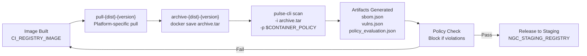

The scan stage runs for each platform (`linux/amd64`, `linux/arm64`) and generates:
- Software Bill of Materials (SBOM) in SPDX format
- Vulnerability scan results
- License compliance report
- Policy evaluation results

Scans can be skipped via commit message `[skip scans]` or environment variable `SKIP_SCANS=yes` ([.nvidia-ci.yml:158-161]()).

**Sources:** [.nvidia-ci.yml:151-253](), [.common-ci.yml:218-228]()

---

# Page: System Components

# System Components

<details>
<summary>Relevant source files</summary>

The following files were used as context for generating this wiki page:

- [.common-ci.yml](.common-ci.yml)
- [.github/workflows/image.yaml](.github/workflows/image.yaml)
- [.gitlab-ci.yml](.gitlab-ci.yml)
- [.nvidia-ci.yml](.nvidia-ci.yml)
- [Makefile](Makefile)
- [base/Dockerfile](base/Dockerfile)
- [base/generate-ci-config](base/generate-ci-config)
- [multi-arch.mk](multi-arch.mk)
- [native-only.mk](native-only.mk)
- [rhel8/nvidia-driver](rhel8/nvidia-driver)
- [rhel9/nvidia-driver](rhel9/nvidia-driver)
- [scripts/precompiled.sh](scripts/precompiled.sh)
- [ubuntu20.04/nvidia-driver](ubuntu20.04/nvidia-driver)
- [ubuntu22.04/nvidia-driver](ubuntu22.04/nvidia-driver)
- [versions.mk](versions.mk)

</details>


## Purpose and Scope

This page describes the major subsystems within the gpu-driver-container repository and how they interact to produce, test, and distribute containerized NVIDIA GPU drivers. The three primary subsystems are:

1. **CI/CD Automation Subsystem** - Orchestrates builds, tests, and releases
2. **Build System Subsystem** - Generates container images across multiple distributions
3. **Runtime System Subsystem** - Manages driver lifecycle within containers

For details on specific CI/CD workflows, see [CI/CD Pipeline](#3). For build configuration specifics, see [Build System Configuration](#6). For runtime behavior and driver management, see [Driver Management Scripts](#5).

---

## System Architecture Overview

The repository implements a multi-layer system where CI/CD pipelines trigger builds that produce container images containing runtime scripts. These components are loosely coupled through well-defined interfaces: environment variables, container registries, and file system conventions.

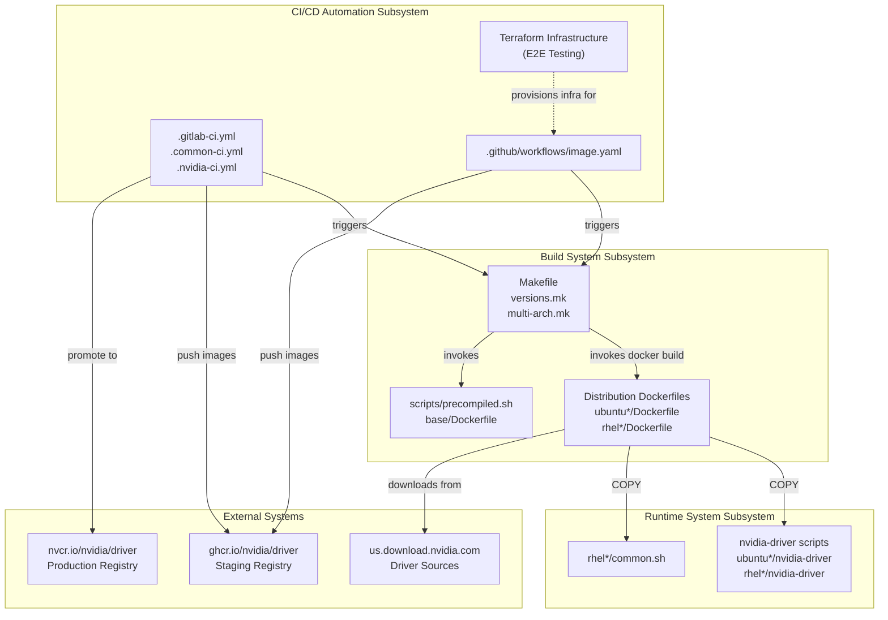

**Component Interaction Model**

Sources: [.common-ci.yml:1-367](), [.nvidia-ci.yml:1-533](), [.github/workflows/image.yaml:1-194](), [Makefile:1-308](), [rhel8/nvidia-driver:1-20]()

---

## CI/CD Automation Subsystem

The CI/CD subsystem consists of two parallel automation pipelines with distinct responsibilities.

### GitLab CI Pipeline

The GitLab CI pipeline is the primary automation system for standard driver images and NGC releases.

**Key Files:**
- [.common-ci.yml:1-367]() - Shared pipeline definitions and stages
- [.nvidia-ci.yml:1-533]() - NVIDIA-internal pipeline configuration
- [.gitlab-ci.yml:1-132]() - Public pipeline configuration

**Pipeline Stages:**

| Stage | Purpose | Key Jobs |
|-------|---------|----------|
| `trigger` | Pipeline entry gate | `trigger-pipeline` |
| `image-build` | Build container images | `image-ubuntu22.04`, `image-rhel8`, `image-precompiled-ubuntu22.04` |
| `scan` | Security scanning | `scan-ubuntu22.04-amd64`, `scan-rhel8-arm64` |
| `release:staging` | Push to staging registry | `release:staging-ubuntu22.04`, `release:staging-precompiled-ubuntu22.04` |
| `release:ngc` | Push to production | `release:ngc-ubuntu22.04`, `release:ngc-rhcos4.14` |
| `ngc-publish` | Update metadata | `update-nspect`, `ngc-image-publish` |

**Pipeline Trigger Rules:**

The pipeline is activated through multiple triggers defined in [.common-ci.yml:33-49]():

```yaml
workflow:
  rules:
    - if: $CI_PIPELINE_SOURCE == 'merge_request_event'
    - if: $CI_PIPELINE_SOURCE == 'schedule'
    - if: $CI_PIPELINE_SOURCE == "web"
    - if: $CI_COMMIT_BRANCH == "main"
    - if: $CI_COMMIT_TAG && $CI_COMMIT_TAG != ""
```

**Driver Version Matrix:**

Driver versions are defined in [.common-ci.yml:22]() and [versions.mk:16]():
```
DRIVER_VERSIONS: 535.274.02 570.195.03 580.95.05
```

The matrix expansion is handled through job inheritance patterns in [.common-ci.yml:81-106](). For example, the Ubuntu 22.04 precompiled builds use:

```yaml
.driver-versions-precompiled-ubuntu22.04:
  parallel:
    matrix:
      - DRIVER_BRANCH: [535, 570, 580]
        KERNEL_FLAVOR: [aws, azure, generic, nvidia, oracle]
        LTS_KERNEL: ["5.15", "6.8"]
```

This creates 30 parallel jobs per architecture (3 branches × 5 flavors × 2 kernels).

Sources: [.common-ci.yml:15-107](), [.gitlab-ci.yml:19-132](), [versions.mk:15-16]()

### GitHub Actions Workflows

GitHub Actions handles precompiled driver builds and end-to-end testing.

**Primary Workflow:** [.github/workflows/image.yaml:1-194]()

**Key Job Matrices:**

1. **Standard Images** ([.github/workflows/image.yaml:26-92]()):
   - Dimensions: `driver` × `dist` 
   - Produces 11 image variants (3 drivers × 4 dists, minus excluded combinations)

2. **Precompiled Images** ([.github/workflows/image.yaml:93-194]()):
   - Dimensions: `driver` × `flavor` × `dist` × `lts_kernel`
   - Produces up to 60 image variants (3 drivers × 5 flavors × 2 dists × 2 kernels)

**Workflow Trigger Conditions:**

```yaml
on:
  push:
    branches:
      - main
      - "pull-request/[0-9]+"
      - release-*
```

**Base Image Build Step:**

For precompiled images, GitHub Actions first builds a base image that queries package repositories for the latest kernel version:

```yaml
- name: Build base image and get kernel version
  run: |
    make DRIVER_BRANCH=${{ matrix.driver }} KERNEL_FLAVOR=${{ matrix.flavor }} \
         LTS_KERNEL=${LTS_KERNEL} build-base-${BASE_TARGET}
    docker run -d --name base-${BASE_TARGET}-${{ matrix.flavor }} \
      ghcr.io/nvidia/driver:base-${BASE_TARGET}-${LTS_KERNEL}-${{ matrix.flavor }}-${{ matrix.driver }}
    docker cp base-${BASE_TARGET}-${{ matrix.flavor }}:/var/kernel_version.txt kernel_version.txt
```

The base image generation is defined in [base/Dockerfile:1-110]() and [base/generate-ci-config:1-34]().

Sources: [.github/workflows/image.yaml:16-194](), [base/Dockerfile:1-110](), [base/generate-ci-config:1-34]()

### Terraform CI Infrastructure

Terraform provisions temporary GPU-enabled infrastructure for E2E testing. While the Terraform configuration files are not included in the provided files, the integration point is visible in the high-level architecture diagrams where Terraform provisions AWS EC2 instances for GitHub Actions runners.

---

## Build System Subsystem

The build system transforms source distributions and driver binaries into multi-architecture container images.

### Makefile Orchestration

The [Makefile:1-308]() serves as the build orchestration layer, providing targets for each distribution and driver version combination.

**Build Target Naming Convention:**

```
build-<DIST>-<DRIVER_VERSION>
```

Examples:
- `build-ubuntu22.04-535.274.02`
- `build-rhel9-570.195.03`
- `build-signed_ubuntu22.04-580.95.05` (precompiled)

**Key Makefile Variables:**

| Variable | Source | Purpose |
|----------|--------|---------|
| `DRIVER_VERSIONS` | [versions.mk:16]() | List of supported driver versions |
| `IMAGE_NAME` | [Makefile:26-27]() | Target registry and image name |
| `VERSION` | [Makefile:35-39]() | Image version tag (commit SHA or release) |
| `DIST` | Parsed from target | Distribution identifier |
| `BUILD_MULTI_ARCH_IMAGES` | [Makefile:15]() | Enable cross-platform builds |

**Target Resolution Logic:**

The Makefile uses pattern matching to extract parameters from targets ([Makefile:152-156]()):

```makefile
build-%: DIST = $(word 2,$(subst -, ,$@))
build-%: DRIVER_VERSION = $(word 3,$(subst -, ,$@))
build-%: DRIVER_BRANCH = $(word 1,$(subst ., ,${DRIVER_VERSION}))
build-%: SUBDIR = $(word 2,$(subst -, ,$@))
build-%: DOCKERFILE = $(CURDIR)/$(SUBDIR)/Dockerfile
```

**Multi-Architecture Support:**

When `BUILD_MULTI_ARCH_IMAGES=true`, the Makefile includes [multi-arch.mk:1-32]() which configures Docker Buildx:

```makefile
DOCKER_BUILD_PLATFORM_OPTIONS = --platform=linux/amd64,linux/arm64
```

Otherwise, it includes [native-only.mk:1-28]() for single-architecture builds.

**Precompiled Image Targets:**

Precompiled images use special naming conventions ([Makefile:189-201]()):

```makefile
build-signed_ubuntu22.04%: DIST = ubuntu22.04
build-signed_ubuntu22.04%: SUBDIR = ubuntu22.04/precompiled
build-signed_ubuntu22.04%: DRIVER_TAG = $(DRIVER_BRANCH)
build-signed_ubuntu22.04%: IMAGE_TAG = $(if $(VERSION),$(VERSION)-)$(DRIVER_BRANCH)-$(KERNEL_VERSION)-$(DIST)
```

The `signed_` prefix indicates that these images contain pre-signed kernel modules for specific kernel versions.

Sources: [Makefile:1-308](), [versions.mk:1-19](), [multi-arch.mk:1-32](), [native-only.mk:1-28]()

### Dockerfile Architecture

Each supported distribution has its own Dockerfile that follows a common multi-stage pattern:

1. **Base Stage** - Install build dependencies
2. **Build Stage** - Download and prepare NVIDIA driver installer
3. **Runtime Stage** - Copy runtime components and scripts

**Distribution-Specific Dockerfiles:**

- Ubuntu: `ubuntu20.04/Dockerfile`, `ubuntu22.04/Dockerfile`, `ubuntu24.04/Dockerfile`
- RHEL: `rhel8/Dockerfile`, `rhel9/Dockerfile`
- Others: `fedora/Dockerfile`, `sle15/Dockerfile`, `flatcar/Dockerfile`

**Build Arguments:**

All Dockerfiles accept these common build arguments ([Makefile:168-172]()):

```dockerfile
ARG DRIVER_VERSION
ARG GOLANG_VERSION
ARG DRIVER_BRANCH
ARG CUDA_VERSION
ARG CVE_UPDATES
```

**Precompiled Dockerfiles:**

Precompiled images use different Dockerfiles located in `<dist>/precompiled/Dockerfile` and add:

```dockerfile
ARG KERNEL_VERSION
```

This allows building images for specific kernel versions.

Sources: [Makefile:163-175](), [Makefile:189-201]()

### Precompiled Image Workflow

Precompiled images follow a two-stage build process managed by [scripts/precompiled.sh:1-114]().

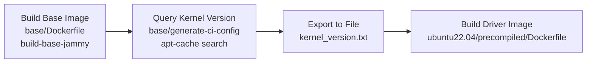

**Base Image Kernel Detection:**

The [base/generate-ci-config:1-34]() script queries package repositories for the latest kernel version with pre-signed NVIDIA modules:

```bash
SUPPORTED_KERNELS_LINUX_SIGNATURES_LIST=$(apt-cache search \
  "linux-signatures-nvidia.*${LTS_KERNEL}.*${KERNEL_FLAVOR}" | \
  awk '{print $1}' | sed -e "s/^.*${LTS_KERNEL}/${LTS_KERNEL}/" | \
  sort -n -t'-' -k2 | grep "${KERNEL_FLAVOR}$")
```

The script writes the discovered kernel version to `/var/kernel_version.txt` inside the container.

**Version Extraction:**

The [scripts/precompiled.sh:7-37]() `sourceVersions()` function extracts the kernel version:

```bash
function sourceVersions(){
    if [ -f kernel_version.txt ]; then
        source kernel_version.txt
        return 0
    fi
    regctl image get-file ghcr.io/nvidia/driver:base-${BASE_TARGET}-${LTS_KERNEL}-${KERNEL_FLAVOR}-${DRIVER_BRANCH} \
      /var/kernel_version.txt kernel_version.txt
    source kernel_version.txt
}
```

This approach ensures precompiled images target the exact kernel version available in distribution repositories at build time.

Sources: [scripts/precompiled.sh:1-114](), [base/Dockerfile:1-110](), [base/generate-ci-config:1-34]()

---

## Runtime System Subsystem

The runtime system consists of bash scripts that execute inside driver containers to manage the complete driver lifecycle.

### nvidia-driver Script Architecture

Each distribution provides an `nvidia-driver` script that implements a common interface:

- Ubuntu: [ubuntu20.04/nvidia-driver:1-700](), [ubuntu22.04/nvidia-driver:1-700]()
- RHEL: [rhel8/nvidia-driver:1-900](), [rhel9/nvidia-driver:1-900]()

**Command Interface:**

```bash
nvidia-driver init      # Install, compile, load, and mount driver
nvidia-driver build     # Only compile kernel modules
nvidia-driver load      # Only load kernel modules
nvidia-driver update    # Recompile for new kernel version
```

**Script Entry Points:**

All scripts follow this structure ([rhel8/nvidia-driver:753-821]()):

```bash
init() {
    _prepare_exclusive
    _build
    _load
}

build() {
    _prepare
    _build
}

load() {
    _prepare_exclusive
    _load
}

update() {
    # Kernel update hook logic
}
```

The script is invoked as the container `ENTRYPOINT` with the command as an argument.

Sources: [rhel8/nvidia-driver:753-821](), [ubuntu22.04/nvidia-driver:564-631]()

### Driver Lifecycle Functions

The core lifecycle is implemented through private functions that follow a consistent pattern across distributions.

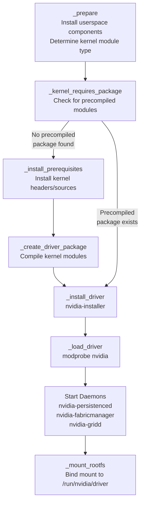

**Function Descriptions:**

| Function | Location | Purpose |
|----------|----------|---------|
| `_prepare` | [rhel8/nvidia-driver:687-707]() | Extract driver installer, install userspace components, copy kernel module sources |
| `_kernel_requires_package` | [rhel8/nvidia-driver:176-193]() | Check if a precompiled package exists for the current kernel |
| `_install_prerequisites` | [rhel8/nvidia-driver:89-164]() | Install kernel headers, kernel modules, generate version string |
| `_create_driver_package` | [rhel8/nvidia-driver:196-259]() | Compile kernel modules, sign if needed, package with `mkprecompiled` |
| `_install_driver` | [rhel8/nvidia-driver:525-557]() | Run `nvidia-installer` to install kernel modules |
| `_load_driver` | [rhel8/nvidia-driver:344-422]() | Load kernel modules with `modprobe`, start daemons |
| `_mount_rootfs` | [rhel8/nvidia-driver:560-575]() | Bind mount container rootfs to `/run/nvidia/driver` |

**Kernel Module Type Resolution:**

Starting with driver branch 560, NVIDIA provides both proprietary (`kernel`) and open-source (`kernel-open`) module variants. The `_resolve_kernel_type` function ([rhel8/nvidia-driver:615-643]()) determines which to install:

```bash
_resolve_kernel_type() {
  if [ "${KERNEL_MODULE_TYPE}" == "proprietary" ]; then
    KERNEL_TYPE=kernel
  elif [ "${KERNEL_MODULE_TYPE}" == "open" ]; then
    KERNEL_TYPE=kernel-open
  elif [ "${KERNEL_MODULE_TYPE}" == "auto" ]; then
    kernel_module_type=$(nvidia-installer --print-recommended-kernel-module-type)
    [[ "${kernel_module_type}" == "open" ]] && KERNEL_TYPE=kernel-open || KERNEL_TYPE=kernel
  fi
}
```

The `KERNEL_MODULE_TYPE` environment variable (default: `auto`) controls this behavior.

Sources: [rhel8/nvidia-driver:687-707](), [rhel8/nvidia-driver:176-193](), [rhel8/nvidia-driver:89-164](), [rhel8/nvidia-driver:196-259](), [rhel8/nvidia-driver:525-557](), [rhel8/nvidia-driver:344-422](), [rhel8/nvidia-driver:615-643]()

### Module Parameter Configuration

The `_get_module_params` function ([rhel8/nvidia-driver:305-341]()) reads custom module parameters from configuration files:

**Configuration File Locations:**
- `/drivers/nvidia.conf` → `NVIDIA_MODULE_PARAMS` array
- `/drivers/nvidia-uvm.conf` → `NVIDIA_UVM_MODULE_PARAMS` array
- `/drivers/nvidia-modeset.conf` → `NVIDIA_MODESET_MODULE_PARAMS` array
- `/drivers/nvidia-peermem.conf` → `NVIDIA_PEERMEM_MODULE_PARAMS` array

**Automatic Parameter Injection (R580+):**

For driver versions 580 and above, the script automatically adds the coherent GPU memory management parameter ([rhel8/nvidia-driver:308-311]()):

```bash
NVIDIA_MODULE_PARAMS+=("NVreg_CoherentGPUMemoryMode=driver")
```

This prevents coherent GPU memory (on GH200, GB200 systems) from being exposed as a NUMA node in Kubernetes.

**Module Loading:**

Parameters are passed to `modprobe` during driver loading ([rhel8/nvidia-driver:370-382]()):

```bash
modprobe nvidia "${NVIDIA_MODULE_PARAMS[@]}"
modprobe nvidia-uvm "${NVIDIA_UVM_MODULE_PARAMS[@]}"
modprobe nvidia-modeset "${NVIDIA_MODESET_MODULE_PARAMS[@]}"
```

Sources: [rhel8/nvidia-driver:305-341](), [rhel8/nvidia-driver:308-311](), [rhel8/nvidia-driver:370-382](), [ubuntu22.04/nvidia-driver:268-304]()

### Distribution-Specific Implementation Differences

While the overall structure is consistent, distributions have unique requirements:

**RHEL-Specific Features:**

1. **DNF Release Version Management** ([rhel8/nvidia-driver:64-71]()):
   ```bash
   _resolve_rhel_version() {
       _get_rhel_version_from_kernel || RHEL_VERSION="${RHEL_MAJOR_VERSION}"
       if [[ -z "${DNF_RELEASEVER}" ]]; then
           DNF_RELEASEVER="${RHEL_VERSION}"
       fi
   }
   ```

2. **EUS Repository Enablement** ([rhel8/nvidia-driver:98-120]()):
   ```bash
   dnf config-manager --set-enabled rhel-8-for-$DRIVER_ARCH-baseos-eus-rpms || true
   ```

3. **Video Module Loading (RHEL9.3+)** ([rhel9/nvidia-driver:382-385]()):
   ```bash
   if [[ "$RHEL_MINOR_VERSION" -ge "3" ]]; then
       modprobe video
   fi
   ```

**Ubuntu-Specific Features:**

1. **FIPS Mode Support** ([ubuntu22.04/nvidia-driver:27-36]()):
   ```bash
   _enable_fips_if_required() {
       if [[ -n "${UBUNTU_PRO_TOKEN}" && ${KERNEL_VERSION} =~ "fips" ]]; then
           pro attach --no-auto-enable "${UBUNTU_PRO_TOKEN}"
           pro enable --access-only --assume-yes fips-updates
       fi
   }
   ```

2. **Kernel Flavor Normalization** ([ubuntu22.04/nvidia-driver:59-73]()):
   ```bash
   kernel_flavor="${kernel_flavor//virtual/generic}"
   KERNEL_VERSION="${version}-${kernel_flavor}"
   ```

Sources: [rhel8/nvidia-driver:64-71](), [rhel8/nvidia-driver:98-120](), [rhel9/nvidia-driver:382-385](), [ubuntu22.04/nvidia-driver:27-36](), [ubuntu22.04/nvidia-driver:59-73]()

### Common Functionality Library

RHEL distributions share common functionality through [rhel8/common.sh]() (referenced in [rhel8/nvidia-driver:26]()):

```bash
SCRIPT_DIR=$( cd -- "$( dirname -- "${BASH_SOURCE[0]}" )" &> /dev/null && pwd )
source $SCRIPT_DIR/common.sh
```

This library provides:
- `_gpu_direct_rdma_enabled()` - Check for GPUDirect RDMA support
- `MAX_THREADS` - Parallel compilation thread count
- Shared utility functions

Sources: [rhel8/nvidia-driver:25-26]()

---

## Component Interaction Patterns

The subsystems interact through well-defined interfaces and conventions.

### Environment Variable Contract

Components communicate through standardized environment variables:

**Build-Time Variables:**

| Variable | Set By | Used By | Purpose |
|----------|--------|---------|---------|
| `DRIVER_VERSION` | Makefile | Dockerfile, nvidia-driver | Driver version to install |
| `DRIVER_BRANCH` | Makefile | Dockerfile, nvidia-driver | Driver branch (535, 570, 580) |
| `KERNEL_VERSION` | Base image | Precompiled Dockerfile | Target kernel version |
| `BUILD_MULTI_ARCH_IMAGES` | CI | Makefile | Enable cross-platform builds |
| `CVE_UPDATES` | CI | Dockerfile | Packages to update for CVE fixes |

**Runtime Variables:**

| Variable | Set By | Used By | Purpose |
|----------|--------|---------|---------|
| `DRIVER_VERSION` | Dockerfile ENV | nvidia-driver | Driver version installed in image |
| `KERNEL_MODULE_TYPE` | User/Operator | nvidia-driver | Module type selection (auto/open/proprietary) |
| `GPU_DIRECT_RDMA_ENABLED` | User/Operator | nvidia-driver | Enable GPUDirect RDMA |
| `UBUNTU_PRO_TOKEN` | User/Operator | nvidia-driver | Ubuntu Pro authentication |
| `TARGETARCH` | Docker | nvidia-driver | Container architecture |

Sources: [Makefile:168-172](), [rhel8/nvidia-driver:8-20](), [ubuntu22.04/nvidia-driver:8-19]()

### Registry Workflow

Container images flow through multiple registries during their lifecycle:

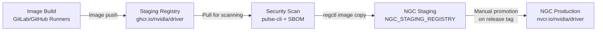

**Registry Variables:**

Defined in [.common-ci.yml:159-184]() and [.nvidia-ci.yml:27-37]():

```yaml
IMAGE_NAME: "${CI_REGISTRY_IMAGE}"
OUT_IMAGE_NAME: "${NGC_STAGING_REGISTRY}/driver"
STAGING_REGISTRY: ghcr.io/nvidia
NGC_REGISTRY: nvcr.io/nvidia
```

**Image Copy Operation:**

The `.release-generic` job template ([.common-ci.yml:159-184]()) uses `regctl` to copy images:

```bash
regctl image copy $(IMAGE) $(OUT_IMAGE)
```

This preserves multi-architecture manifests and attestations.

Sources: [.common-ci.yml:159-184](), [.nvidia-ci.yml:34-37](), [multi-arch.mk:21-24]()

### File System Conventions

The runtime system relies on specific file system locations:

**Driver Installation Paths:**

| Path | Content | Created By |
|------|---------|------------|
| `/usr/src/nvidia-${DRIVER_VERSION}` | Kernel module sources | `_prepare` function |
| `/usr/src/nvidia-${DRIVER_VERSION}/${KERNEL_TYPE}` | Kernel module type directory | `_prepare` function |
| `/usr/src/nvidia-${DRIVER_VERSION}/${KERNEL_TYPE}/precompiled` | Precompiled packages | `_create_driver_package` |
| `/lib/modules/${KERNEL_VERSION}` | Installed kernel modules | `nvidia-installer` |
| `/run/nvidia/driver` | Mounted driver rootfs | `_mount_rootfs` |
| `/run/nvidia/nvidia-driver.pid` | Driver container PID file | `init` function |

**Configuration Paths:**

| Path | Content | Mounted By |
|------|---------|------------|
| `/drivers/nvidia.conf` | nvidia.ko module parameters | User/Operator |
| `/drivers/gridd.conf` | vGPU licensing configuration | User/Operator (vGPU only) |
| `/drivers/ClientConfigToken/*` | NLS license tokens | User/Operator (vGPU only) |

**Temporary Paths:**

| Path | Content | Purpose |
|------|---------|---------|
| `/lib/modules/${KERNEL_VERSION}/proc/version` | Kernel version string | Module compilation matching |
| `/run/kernel/postinst.d/update-nvidia-driver` | Kernel update hook | Automatic recompilation |

Sources: [rhel8/nvidia-driver:687-707](), [rhel8/nvidia-driver:560-575](), [rhel8/nvidia-driver:586-604](), [ubuntu22.04/nvidia-driver:467-485]()

---

## Summary

The gpu-driver-container repository implements a three-tier architecture:

1. **CI/CD Automation** ([.common-ci.yml](), [.nvidia-ci.yml](), [.github/workflows/image.yaml]()) orchestrates builds across platforms
2. **Build System** ([Makefile](), [versions.mk](), Dockerfiles) generates images for 9+ distributions × 3 driver branches × 2 architectures
3. **Runtime System** (nvidia-driver scripts) manages kernel module compilation, loading, and lifecycle within containers

These subsystems communicate through:
- Environment variables (build and runtime configuration)
- Container registries (image distribution)
- File system conventions (driver installation and configuration)

The architecture supports both standard (runtime compilation) and precompiled (pre-signed modules) driver deployment modes, with distribution-specific implementations sharing common patterns and interfaces.

---

# Page: Build Pipeline Flow

# Build Pipeline Flow

<details>
<summary>Relevant source files</summary>

The following files were used as context for generating this wiki page:

- [.common-ci.yml](.common-ci.yml)
- [.github/workflows/image.yaml](.github/workflows/image.yaml)
- [.gitlab-ci.yml](.gitlab-ci.yml)
- [.nvidia-ci.yml](.nvidia-ci.yml)
- [Makefile](Makefile)
- [base/Dockerfile](base/Dockerfile)
- [base/generate-ci-config](base/generate-ci-config)
- [multi-arch.mk](multi-arch.mk)
- [native-only.mk](native-only.mk)
- [rhel8/Dockerfile](rhel8/Dockerfile)
- [rhel9/Dockerfile](rhel9/Dockerfile)
- [scripts/precompiled.sh](scripts/precompiled.sh)
- [ubuntu20.04/Dockerfile](ubuntu20.04/Dockerfile)
- [ubuntu22.04/Dockerfile](ubuntu22.04/Dockerfile)
- [versions.mk](versions.mk)

</details>


## Purpose and Scope

This document explains how source code and configuration flows through the build pipeline stages to produce containerized NVIDIA GPU driver images. It covers both the GitLab CI and GitHub Actions workflows, the role of the Makefile build orchestration system, and the different paths taken by standard versus precompiled driver images.

For information about the runtime behavior of driver containers after they are built, see [Runtime Architecture](#2.3). For detailed documentation of individual CI/CD systems, see [GitLab CI Workflows](#3.1) and [GitHub Actions Workflows](#3.2).

## Build Pipeline Entry Points

The build pipeline can be triggered through multiple entry points, each serving different purposes and following slightly different execution paths.

### Pipeline Trigger Mechanisms

**Diagram: Pipeline Entry Points and Trigger Rules**

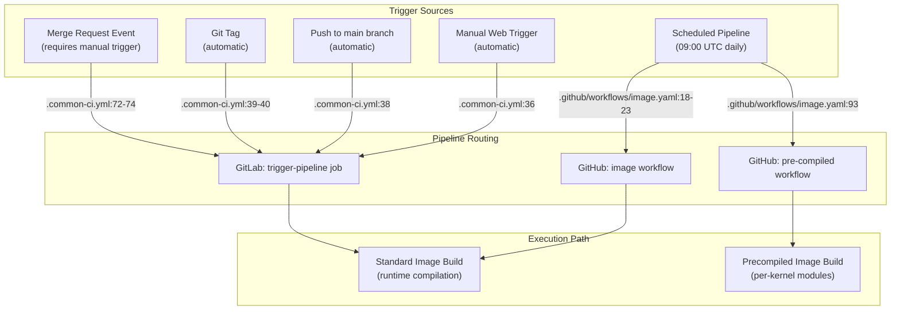

Sources: [.common-ci.yml:33-79](), [.github/workflows/image.yaml:18-24]()

The pipeline uses conditional execution based on the trigger source:

| Trigger Type | Target System | Build Type | Notes |
|--------------|---------------|------------|-------|
| Merge Request | GitLab CI | Standard | Requires manual approval ([.common-ci.yml:72-74]()) |
| Git Tag | GitLab CI | Standard | Triggers release flow ([.common-ci.yml:39-40]()) |
| Push to main | GitLab CI | Standard | Automatic build ([.common-ci.yml:38]()) |
| Daily Schedule | GitHub Actions | Precompiled | Runs at 09:00 UTC ([.common-ci.yml:47]()) |
| Manual | GitLab CI | Standard | Triggered via web UI ([.common-ci.yml:36]()) |

## Build Stages Overview

The GitLab CI pipeline defines six sequential stages that process images from initial build through final publication.

**Diagram: GitLab CI Stage Sequence**

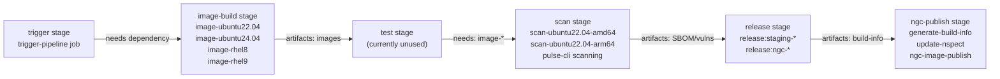

Sources: [.common-ci.yml:25-31](), [.gitlab-ci.yml:70-94](), [.nvidia-ci.yml:254-334]()

### Stage Descriptions

1. **trigger stage**: Single gating job that controls pipeline execution ([.common-ci.yml:66-78]())
2. **image-build stage**: Parallel matrix builds across distributions, driver versions, and architectures ([.gitlab-ci.yml:19-33]())
3. **test stage**: Reserved for future E2E tests (currently no jobs defined) ([.common-ci.yml:28]())
4. **scan stage**: Security scanning with `pulse-cli`, generates SBOM and vulnerability reports ([.nvidia-ci.yml:151-185]())
5. **release stage**: Push images to staging and production registries ([.common-ci.yml:159-184]())
6. **ngc-publish stage**: Update metadata in NGC catalog and create publication merge requests ([.nvidia-ci.yml:441-532]())

## Standard Image Build Flow

Standard driver images compile kernel modules at runtime against the host kernel. The build process follows a multi-stage approach defined in distribution-specific Dockerfiles.

**Diagram: Standard Build Flow - Code Entity Mapping**

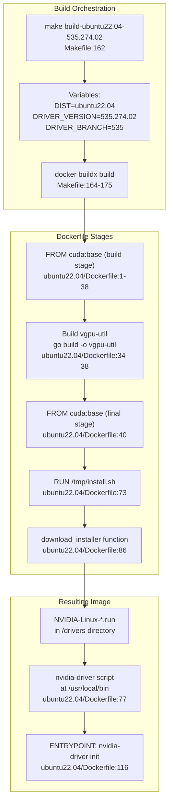

Sources: [Makefile:150-175](), [ubuntu22.04/Dockerfile:1-116]()

### Build Process Steps

The standard build flow executes these steps:

1. **Makefile Target Resolution**: The target `build-ubuntu22.04-535.274.02` is parsed to extract `DIST`, `DRIVER_VERSION`, and `DRIVER_BRANCH` ([Makefile:152-154]())

2. **Docker Build Invocation**: `docker buildx build` is called with build arguments ([Makefile:163-175]()):
   - `DRIVER_VERSION`: e.g., "535.274.02"
   - `GOLANG_VERSION`: from [versions.mk:18]()
   - `DRIVER_BRANCH`: extracted from driver version (e.g., "535")
   - `CVE_UPDATES`: packages to update for security fixes

3. **Multi-Stage Dockerfile Execution**:
   - **Build stage**: Compiles Go utilities like `vgpu-util` ([ubuntu22.04/Dockerfile:1-38]())
   - **Final stage**: Sets up the driver installation environment ([ubuntu22.04/Dockerfile:40-116]())

4. **Driver Download**: The `install.sh` script's `download_installer` function fetches the driver `.run` file from `https://us.download.nvidia.com/tesla` ([ubuntu22.04/Dockerfile:86]())

5. **Package Installation**: Additional packages are installed:
   - `nvidia-fabricmanager-${DRIVER_BRANCH}` (for multi-GPU fabrics)
   - `libnvidia-nscq-${DRIVER_BRANCH}` (for network scaling)
   - ([ubuntu22.04/Dockerfile:88]())

6. **Image Tagging**: Result is tagged as `${IMAGE_NAME}:${VERSION}-${DRIVER_VERSION}-${DIST}` ([Makefile:38-42]())

### Distribution-Specific Variations

Different distributions follow the same general pattern but with variations:

| Distribution | Dockerfile | Base Image | Package Manager |
|--------------|-----------|------------|-----------------|
| Ubuntu 22.04 | [ubuntu22.04/Dockerfile:1-116]() | `cuda:13.0.1-base-ubuntu22.04` | apt-get |
| Ubuntu 24.04 | Similar structure | `cuda:base-ubuntu24.04` | apt-get |
| RHEL 8 | [rhel8/Dockerfile:1-110]() | `cuda:13.0.1-base-ubi8` | dnf |
| RHEL 9 | [rhel9/Dockerfile:1-114]() | `cuda:13.0.1-base-ubi9` | dnf |

Sources: [ubuntu22.04/Dockerfile:1-116](), [rhel8/Dockerfile:1-110](), [rhel9/Dockerfile:1-114]()

## Precompiled Image Build Flow

Precompiled images contain kernel modules built for specific kernel versions, eliminating the need for runtime compilation. This flow is more complex and involves a two-stage process.

**Diagram: Precompiled Build Flow - Two-Stage Process**

```mermaid
flowchart TB
    subgraph "Stage 1: Base Image Build"
        SCRIPT_BUILD["scripts/precompiled.sh build<br/>precompiled.sh:89-93"]
        MAKE_BASE["make build-base-jammy<br/>Makefile:206-222"]
        BASE_DOCKERFILE["base/Dockerfile<br/>Target: jammy"]
        GENERATE_CI["generate-ci-config script<br/>base/generate-ci-config:1-34"]
        KERNEL_DETECTION["apt-cache search<br/>linux-signatures-nvidia<br/>linux-image packages"]
        KERNEL_VERSION_FILE["kernel_version.txt:<br/>KERNEL_VERSION=5.15.0-XXX-generic<br/>DRIVER_VERSION=535.XXX.XX"]
    end
    
    subgraph "Stage 2: Driver Image Build"
        SOURCE_VERSIONS["sourceVersions function<br/>precompiled.sh:7-37"]
        MAKE_SIGNED["make build-signed_ubuntu22.04<br/>Makefile:189-194"]
        PRECOMP_DOCKERFILE["ubuntu22.04/precompiled/Dockerfile"]
        INSTALL_PRECOMP["Install precompiled packages:<br/>linux-objects-nvidia-*<br/>linux-signatures-nvidia-*"]
    end
    
    subgraph "Resulting Image"
        PRECOMP_MODULES["Pre-built kernel modules<br/>in /lib/modules/"]
        IMAGE_TAG["Image tag:<br/>535-5.15.0-XXX-generic-ubuntu22.04"]
    end
    
    SCRIPT_BUILD --> MAKE_BASE
    MAKE_BASE --> BASE_DOCKERFILE
    BASE_DOCKERFILE --> GENERATE_CI
    GENERATE_CI --> KERNEL_DETECTION
    KERNEL_DETECTION --> KERNEL_VERSION_FILE
    KERNEL_VERSION_FILE --> SOURCE_VERSIONS
    SOURCE_VERSIONS --> MAKE_SIGNED
    MAKE_SIGNED --> PRECOMP_DOCKERFILE
    PRECOMP_DOCKERFILE --> INSTALL_PRECOMP
    INSTALL_PRECOMP --> PRECOMP_MODULES
    PRECOMP_MODULES --> IMAGE_TAG
```

Sources: [scripts/precompiled.sh:1-113](), [Makefile:204-222](), [base/Dockerfile:38-73](), [base/generate-ci-config:1-34]()

### Precompiled Build Process

The precompiled build follows these detailed steps:

1. **Base Image Creation** ([scripts/precompiled.sh:39-42]()):
   - Target: `build-base-jammy` or `build-base-noble`
   - Uses [base/Dockerfile:38-73]() for Ubuntu 22.04 (jammy)
   - Dockerfile target is specified via `--target` flag ([Makefile:215]())

2. **Kernel Version Detection** ([base/generate-ci-config:1-34]()):
   - Queries Ubuntu repositories for available kernels
   - Matches kernels with NVIDIA precompiled packages: `apt-cache search "linux-signatures-nvidia.*${LTS_KERNEL}.*${KERNEL_FLAVOR}"` ([base/generate-ci-config:19]())
   - Intersects with available `linux-image` packages ([base/generate-ci-config:21-29]())
   - Writes result to `/var/kernel_version.txt` ([base/generate-ci-config:32]())

3. **Version Extraction** ([scripts/precompiled.sh:7-37]()):
   - The `sourceVersions` function retrieves kernel version from base image
   - Uses `regctl` or `docker cp` to extract the file ([scripts/precompiled.sh:24-34]())
   - Sources the file to set `KERNEL_VERSION`, `DRIVER_VERSION`, `DRIVER_VERSIONS` ([scripts/precompiled.sh:36]())

4. **Driver Image Build** ([scripts/precompiled.sh:44-47]()):
   - Invokes `make build-signed_ubuntu22.04` with extracted versions
   - Makefile overrides for precompiled builds ([Makefile:189-201]()):
     - `DIST = ubuntu22.04`
     - `SUBDIR = ubuntu22.04/precompiled`
     - `DRIVER_TAG = $(DRIVER_BRANCH)` (e.g., "535" instead of full version)
     - `IMAGE_TAG` includes kernel version: `${DRIVER_BRANCH}-${KERNEL_VERSION}-${DIST}`

5. **Precompiled Package Installation**:
   - The precompiled Dockerfile installs Ubuntu's signed precompiled packages
   - Packages include `linux-objects-nvidia-${DRIVER_BRANCH}-${KERNEL_VERSION}` and `linux-signatures-nvidia-${DRIVER_BRANCH}-${KERNEL_VERSION}`
   - These contain pre-built `.ko` modules for the specific kernel

6. **Image Push** ([scripts/precompiled.sh:57-72]()):
   - Uses `make push-signed_ubuntu22.04`
   - Tag format: `${DRIVER_BRANCH}-${KERNEL_VERSION}-${DIST}` (e.g., `535-5.15.0-125-generic-ubuntu22.04`)
   - Checks if image already exists before pushing ([scripts/precompiled.sh:62-69]())

### Build Matrix for Precompiled Images

Precompiled builds execute in a matrix across multiple dimensions:

**Matrix Configuration** ([.common-ci.yml:92-106]()):

```
Ubuntu 22.04 x {
  DRIVER_BRANCH: [535, 570, 580]
  KERNEL_FLAVOR: [aws, azure, generic, nvidia, oracle]
  LTS_KERNEL: ["5.15", "6.8"]
}

Ubuntu 24.04 x {
  DRIVER_BRANCH: [570, 580]  # 535 excluded
  KERNEL_FLAVOR: [aws, azure, generic, nvidia, oracle]
  LTS_KERNEL: ["6.8"]  # 5.15 not supported
}
```

This results in:
- Ubuntu 22.04: 3 branches × 5 flavors × 2 LTS kernels = **30 job variations**
- Ubuntu 24.04: 2 branches × 5 flavors × 1 LTS kernel = **10 job variations**

Sources: [.common-ci.yml:92-106](), [.github/workflows/image.yaml:93-127]()

## Multi-Architecture Build Process

The build system supports both single-architecture and multi-architecture image builds through conditional configuration.

**Diagram: Multi-Arch Build Decision Flow**

```mermaid
flowchart TB
    BUILD_VAR["BUILD_MULTI_ARCH_IMAGES variable<br/>Makefile:15"]
    
    CONDITION{{"BUILD_MULTI_ARCH_IMAGES<br/>== true?"}}
    
    MULTI["Include multi-arch.mk<br/>Makefile:81"]
    NATIVE["Include native-only.mk<br/>Makefile:83"]
    
    BUILDX["Use docker buildx<br/>BUILDX = buildx<br/>Makefile:19"]
    DOCKER["Use docker<br/>BUILDX = (empty)<br/>Makefile:17"]
    
    PLATFORMS["Build for:<br/>linux/amd64, linux/arm64<br/>multi-arch.mk:18"]
    PLATFORM["Build for:<br/>linux/amd64 only<br/>native-only.mk:15"]
    
    REGCTL["Push with regctl<br/>regctl image copy<br/>multi-arch.mk:22-24"]
    DOCKER_PUSH["Push with docker push<br/>docker tag + docker push<br/>native-only.mk:17-19"]
    
    BUILD_VAR --> CONDITION
    CONDITION -->|"true"| MULTI
    CONDITION -->|"false"| NATIVE
    
    MULTI --> BUILDX
    MULTI --> PLATFORMS
    MULTI --> REGCTL
    
    NATIVE --> DOCKER
    NATIVE --> PLATFORM
    NATIVE --> DOCKER_PUSH
```

Sources: [Makefile:15-84](), [multi-arch.mk:1-32](), [native-only.mk:1-28]()

### Multi-Arch Configuration

The build system uses makefile includes to switch between build modes:

**Multi-Architecture Mode** ([multi-arch.mk:1-32]()):
- Enabled when `BUILD_MULTI_ARCH_IMAGES=true` ([Makefile:18-20]())
- Uses Docker Buildx with `--platform=linux/amd64,linux/arm64` ([multi-arch.mk:18]())
- Build and push in single step: `--output=type=image,push=$(PUSH_ON_BUILD)` ([multi-arch.mk:17]())
- Uses `regctl` for manifest manipulation ([multi-arch.mk:20-24]())

**Native-Only Mode** ([native-only.mk:1-28]()):
- Default mode when `BUILD_MULTI_ARCH_IMAGES` is not set or false ([Makefile:15]())
- Builds for host architecture only: `--platform=linux/amd64` ([native-only.mk:15]())
- Separate tag and push steps using standard `docker` commands ([native-only.mk:17-19]())

### Architecture-Specific Handling

Some distributions only support single architecture:

```makefile
# No multi-arch support for the following distributions
build-ubuntu18.04%: DOCKER_BUILD_PLATFORM_OPTIONS = --platform=linux/amd64
build-signed_ubuntu20.04%: DOCKER_BUILD_PLATFORM_OPTIONS = --platform=linux/amd64
build-signed_ubuntu22.04%: DOCKER_BUILD_PLATFORM_OPTIONS = --platform=linux/amd64
build-signed_ubuntu24.04%: DOCKER_BUILD_PLATFORM_OPTIONS = --platform=linux/amd64
build-sles%: DOCKER_BUILD_PLATFORM_OPTIONS = --platform=linux/amd64
```

Sources: [multi-arch.mk:26-31]()

Precompiled images are AMD64-only because they contain specific kernel binaries.

## Build Matrix and Variants

The build system generates a matrix of images across multiple dimensions: distributions, driver versions, driver types, and architectures.

**Diagram: Complete Build Matrix**

```mermaid
graph TB
    subgraph "Driver Versions<br/>versions.mk:16"
        V535["535.274.02"]
        V570["570.195.03"]
        V580["580.95.05"]
    end
    
    subgraph "Distributions<br/>Makefile:57"
        U2004["ubuntu20.04"]
        U2204["ubuntu22.04"]
        U2404["ubuntu24.04"]
        R8["rhel8"]
        R9["rhel9"]
        F36["fedora36"]
        SIGNED_U22["signed_ubuntu22.04<br/>(precompiled)"]
        SIGNED_U24["signed_ubuntu24.04<br/>(precompiled)"]
    end
    
    subgraph "Driver Types"
        PASSTHROUGH["passthrough<br/>(DRIVER_TYPE=passthrough)"]
        VGPU_GUEST["vgpu guest<br/>(DRIVER_TYPE=vgpu)"]
        VGPU_HOST["vgpu host<br/>(vgpu-manager)"]
    end
    
    subgraph "Architectures"
        AMD64["linux/amd64"]
        ARM64["linux/arm64"]
    end
    
    V535 & V570 & V580 --> U2004
    V535 & V570 & V580 --> U2204
    V570 & V580 --> U2404
    V535 & V570 & V580 --> R8
    V535 & V570 & V580 --> R9
    V535 & V570 & V580 --> F36
    
    U2004 & U2204 & U2404 & R8 & R9 & F36 --> PASSTHROUGH
    U2004 & U2204 & U2404 & R8 & R9 --> VGPU_GUEST
    U2004 & U2204 & U2404 & R8 & R9 --> VGPU_HOST
    
    SIGNED_U22 --> PASSTHROUGH
    SIGNED_U24 --> PASSTHROUGH
    
    PASSTHROUGH --> AMD64
    PASSTHROUGH --> ARM64
    VGPU_GUEST --> AMD64
    VGPU_GUEST --> ARM64
    VGPU_HOST --> AMD64
    
    SIGNED_U22 --> AMD64
    SIGNED_U24 --> AMD64
```

Sources: [versions.mk:16](), [Makefile:57](), [.common-ci.yml:22-23](), [.common-ci.yml:81-106]()

### Build Target Generation

The Makefile generates build targets dynamically:

1. **Base Distributions**: Defined in [Makefile:57]()
   ```makefile
   DISTRIBUTIONS := ubuntu18.04 ubuntu20.04 ubuntu22.04 ubuntu24.04 \
                    signed_ubuntu20.04 signed_ubuntu22.04 signed_ubuntu24.04 \
                    rhel8 rhel9 flatcar fedora36 sles15.3 precompiled_rhcos
   ```

2. **Driver Versions**: Defined in [versions.mk:16]()
   ```makefile
   DRIVER_VERSIONS ?= 535.274.02 570.195.03 580.95.05
   ```

3. **Target Matrix Expansion**: [Makefile:63-76]()
   - `BUILD_TARGETS`: `build-ubuntu22.04`, `build-rhel8`, etc.
   - `DRIVER_BUILD_TARGETS`: Cross product of distributions and driver versions
   - Example: `build-ubuntu22.04-535.274.02`, `build-ubuntu22.04-570.195.03`, etc.

4. **vGPU Target Variants**: [Makefile:61-67]()
   - `VGPU_GUEST_DRIVER_BUILD_TARGETS`: `build-vgpuguest-ubuntu22.04`, etc.
   - `VGPU_HOST_DRIVER_BUILD_TARGETS`: `build-vgpuhost-ubuntu22.04`, etc.

### Image Tag Naming Convention

Image tags follow a structured format:

**Standard Images**:
```
${IMAGE_NAME}:${VERSION}-${DRIVER_VERSION}-${DIST}
# Example: nvidia/driver:abc123de-535.274.02-ubuntu22.04
```
Sources: [Makefile:38-42]()

**Precompiled Images**:
```
${IMAGE_NAME}:${VERSION}-${DRIVER_BRANCH}-${KERNEL_VERSION}-${DIST}
# Example: nvidia/driver:abc123de-535-5.15.0-125-generic-ubuntu22.04
```
Sources: [Makefile:118-122]()

**Base Images** (for precompiled builds):
```
${IMAGE_NAME}:base-${TARGET}-${LTS_KERNEL}-${KERNEL_FLAVOR}-${DRIVER_BRANCH}
# Example: nvidia/driver:base-jammy-5.15-generic-535
```
Sources: [Makefile:209]()

## Registry Flow and Image Promotion

Images flow through multiple registries from initial build to final production deployment.

**Diagram: Registry Promotion Flow**

```mermaid
flowchart LR
    subgraph "Build Stage"
        GITLAB["GitLab Internal Registry<br/>CI_REGISTRY_IMAGE"]
        GHCR["GitHub Container Registry<br/>ghcr.io/nvidia/driver"]
    end
    
    subgraph "Staging Stage"
        NGC_STAGING["NGC Staging Registry<br/>NGC_STAGING_REGISTRY/driver<br/>.common-ci.yml:228"]
    end
    
    subgraph "Production Stage"
        NGC_PROD["NGC Production Registry<br/>nvcr.io/nvidia/driver<br/>.nvidia-ci.yml:340-341"]
    end
    
    subgraph "CI Actions"
        IMAGE_BUILD["image-build jobs<br/>.gitlab-ci.yml:19-33"]
        RELEASE_STAGING["release:staging jobs<br/>.common-ci.yml:221-246"]
        RELEASE_NGC["release:ngc jobs<br/>.nvidia-ci.yml:343-419"]
        NGC_PUBLISH["ngc-image-publish job<br/>.nvidia-ci.yml:509-519"]
    end
    
    IMAGE_BUILD -->|"builds to"| GITLAB
    IMAGE_BUILD -->|"GitHub Actions<br/>builds to"| GHCR
    
    GITLAB -->|"push-${DIST}-${DRIVER_VERSION}<br/>regctl image copy"| NGC_STAGING
    GHCR -->|"push-${DIST}-${DRIVER_VERSION}<br/>regctl image copy"| NGC_STAGING
    
    RELEASE_STAGING --> NGC_STAGING
    RELEASE_NGC --> NGC_PROD
    
    NGC_STAGING -->|"manual promotion<br/>on git tag"| NGC_PROD
    NGC_PROD -->|"metadata update"| NGC_PUBLISH
```

Sources: [.common-ci.yml:159-228](), [.nvidia-ci.yml:336-383](), [.nvidia-ci.yml:497-532]()

### Registry Stages

1. **Build Registry** ([.gitlab-ci.yml:22-24]()):
   - GitLab CI builds push to `${CI_REGISTRY_IMAGE}` (internal GitLab registry)
   - GitHub Actions builds push to `ghcr.io/nvidia/driver` ([.github/workflows/image.yaml:80-85]())
   - Images are tagged with commit SHA ([.gitlab-ci.yml:23]())

2. **Staging Registry** ([.common-ci.yml:221-228]()):
   - Target: `${NGC_STAGING_REGISTRY}/driver`
   - All successful builds are promoted to staging ([.common-ci.yml:192-216]())
   - Authentication via `NGC_REGISTRY_USER` and `NGC_REGISTRY_TOKEN` ([.common-ci.yml:225-226]())

3. **Production Registry** ([.nvidia-ci.yml:336-383]()):
   - Target: `nvcr.io/nvidia/driver` (NGC production registry)
   - Only triggered on git tags ([.nvidia-ci.yml:490]())
   - Multiple distribution aliases published:
     - `rhcos4.14`, `rhcos4.15`, `rhcos4.16` from RHEL9 base ([.nvidia-ci.yml:385-418]())
     - `rhel8.10`, `rhel9.4`, `rhel9.6` specific minor versions ([.nvidia-ci.yml:420-439]())

4. **Metadata Publication** ([.nvidia-ci.yml:497-532]()):
   - Job: `ngc-image-publish`
   - Generates YAML manifest with `cnt-ngc-publish render` ([.nvidia-ci.yml:505]())
   - Creates merge request to NGC publishing repository ([.nvidia-ci.yml:506]())
   - Updates nspect security catalog ([.nvidia-ci.yml:441-495]())

### Image Push Implementation

**GitLab CI Push** ([.common-ci.yml:176-184]()):
```bash
regctl registry login "${OUT_REGISTRY}" -u "${OUT_REGISTRY_USER}" -p "${OUT_REGISTRY_TOKEN}"
if [[ "${PRECOMPILED}" == "true" ]]; then 
    ./scripts/precompiled.sh push
else 
    make push-${DIST}-${DRIVER_VERSION}
fi
```

**Make Target Execution** ([Makefile:129-148]()):
- Parses target to extract `DIST` and `DRIVER_VERSION`
- Calls distribution-specific push rules
- For multi-arch: uses `regctl image copy` ([multi-arch.mk:22-24]())
- For native: uses `docker tag` + `docker push` ([native-only.mk:17-19]())

**Precompiled Push** ([scripts/precompiled.sh:57-72]()):
- Checks if image already exists: `regctl manifest get $out_image`
- Honors `FORCE_PUSH` flag to overwrite existing images
- Invokes `make push-signed_ubuntu22.04` with correct variables

Sources: [.common-ci.yml:176-184](), [Makefile:129-148](), [scripts/precompiled.sh:57-72](), [multi-arch.mk:20-24](), [native-only.mk:17-19]()

## Summary of Build Flow Variations

The system implements three distinct build flows:

| Build Type | Trigger | Compilation | Image Tag Format | Registry Path |
|------------|---------|-------------|------------------|---------------|
| Standard (GitLab) | MR, tag, main push | Runtime | `${VERSION}-${DRIVER_VERSION}-${DIST}` | GitLab → NGC Staging → NGC Prod |
| Standard (GitHub) | Push to branch | Runtime | Same | GHCR → NGC Staging |
| Precompiled | Daily schedule | Pre-built modules | `${DRIVER_BRANCH}-${KERNEL_VERSION}-${DIST}` | GHCR → NGC Staging → NGC Prod |

All flows converge at the NGC Staging Registry, providing a unified testing point before production promotion.

Sources: [.gitlab-ci.yml:1-132](), [.github/workflows/image.yaml:1-194](), [.common-ci.yml:159-367]()

---

# Page: Runtime Architecture

# Runtime Architecture

<details>
<summary>Relevant source files</summary>

The following files were used as context for generating this wiki page:

- [rhel8/Dockerfile](rhel8/Dockerfile)
- [rhel8/nvidia-driver](rhel8/nvidia-driver)
- [rhel9/Dockerfile](rhel9/Dockerfile)
- [rhel9/nvidia-driver](rhel9/nvidia-driver)
- [ubuntu20.04/Dockerfile](ubuntu20.04/Dockerfile)
- [ubuntu20.04/nvidia-driver](ubuntu20.04/nvidia-driver)
- [ubuntu22.04/Dockerfile](ubuntu22.04/Dockerfile)
- [ubuntu22.04/nvidia-driver](ubuntu22.04/nvidia-driver)
- [ubuntu24.04/Dockerfile](ubuntu24.04/Dockerfile)
- [ubuntu24.04/install.sh](ubuntu24.04/install.sh)
- [ubuntu24.04/nvidia-driver](ubuntu24.04/nvidia-driver)

</details>


This page documents how NVIDIA GPU driver containers operate at runtime and interact with the host system. It covers the container lifecycle from initialization through steady-state operation, including kernel module management, daemon startup, and host system integration.

For information about how these containers are built, see [Build Pipeline Flow](#2.2). For detailed documentation of the `nvidia-driver` script commands, see [Initialization and Lifecycle](#5.1).

## Runtime Execution Model

The driver container operates as a long-running privileged container that manages the NVIDIA driver lifecycle on the host system. The container's entrypoint is set to `nvidia-driver init`, which orchestrates the entire driver installation and loading process.

**Container Lifecycle Phases:**

```mermaid
graph TB
    START["Container Start<br/>ENTRYPOINT: nvidia-driver init"]
    PREPARE["Preparation Phase<br/>_prepare_exclusive()"]
    BUILD["Build Phase<br/>_build()"]
    LOAD["Load Phase<br/>_load()"]
    RUNNING["Running Phase<br/>sleep infinity"]
    SHUTDOWN["Shutdown Phase<br/>_shutdown()"]
    
    START --> PREPARE
    PREPARE --> BUILD
    BUILD --> LOAD
    LOAD --> RUNNING
    RUNNING --> SHUTDOWN
    
    PREPARE -.->|"Creates PID file<br/>Unloads existing drivers"| PREPARE
    BUILD -.->|"Compiles/installs modules<br/>if needed"| BUILD
    LOAD -.->|"modprobe modules<br/>Start daemons<br/>Mount rootfs"| LOAD
    RUNNING -.->|"Waits for SIGTERM"| RUNNING
    SHUTDOWN -.->|"Cleanup and exit"| SHUTDOWN
```

Sources: [rhel8/nvidia-driver:753-759](), [ubuntu20.04/nvidia-driver:564-631]()

## Initialization Phase

The initialization phase ensures exclusive driver management and prepares the host environment.

### Exclusive Lock Acquisition

The driver container uses a PID file to ensure only one instance manages the driver at a time:

| File Path | Purpose |
|-----------|---------|
| `/run/nvidia/nvidia-driver.pid` | Stores container PID for exclusive lock |
| `/run/kernel/postinst.d/update-nvidia-driver` | Kernel update hook for automatic recompilation |

The lock mechanism uses `flock` to prevent concurrent driver operations:

```mermaid
graph LR
    INIT["init() function"]
    FLOCK["flock -n PID_FILE"]
    ABORT["Abort: Driver already running"]
    CONTINUE["Continue initialization"]
    
    INIT --> FLOCK
    FLOCK -->|"Lock acquired"| CONTINUE
    FLOCK -->|"Lock failed"| ABORT
```

Sources: [rhel8/nvidia-driver:712-717](), [ubuntu22.04/nvidia-driver:674-679]()

### Driver Unloading

Before installing new drivers, any existing drivers must be safely unloaded:

```mermaid
flowchart TD
    START["_unload_driver()"]
    STOP_DAEMONS["Stop Running Daemons"]
    PERSIST["nvidia-persistenced"]
    GRIDD["nvidia-gridd"]
    FABRIC["nv-fabricmanager"]
    NVLSM["nvlsm"]
    CHECK_REFS["Check Module References"]
    RMMOD["rmmod Modules"]
    SUCCESS["Return 0"]
    FAIL["Return 1: Driver in use"]
    
    START --> STOP_DAEMONS
    STOP_DAEMONS --> PERSIST
    STOP_DAEMONS --> GRIDD
    STOP_DAEMONS --> FABRIC
    STOP_DAEMONS --> NVLSM
    PERSIST --> CHECK_REFS
    GRIDD --> CHECK_REFS
    FABRIC --> CHECK_REFS
    NVLSM --> CHECK_REFS
    CHECK_REFS -->|"refcnt == 0"| RMMOD
    CHECK_REFS -->|"refcnt > 0"| FAIL
    RMMOD --> SUCCESS
```

**Module Unload Order:**
1. `nvidia-modeset`
2. `nvidia-uvm`
3. `nvidia-peermem` (if loaded)
4. `nvidia` (core module)

Sources: [rhel8/nvidia-driver:424-522](), [ubuntu22.04/nvidia-driver:390-489]()

## Build Phase

The build phase compiles kernel modules against the host kernel if precompiled modules are not available.

### Kernel Module Type Resolution

Starting with driver branch 560, the system determines whether to use open-source or proprietary kernel modules:

```mermaid
graph TB
    START["_resolve_kernel_type()"]
    CHECK_TYPE{"KERNEL_MODULE_TYPE"}
    PROP["Set KERNEL_TYPE=kernel"]
    OPEN["Set KERNEL_TYPE=kernel-open"]
    AUTO["Call nvidia-installer<br/>--print-recommended-kernel-module-type"]
    FALLBACK["_resolve_kernel_type_from_driver_branch()"]
    BRANCH_CHECK{"DRIVER_BRANCH < 560?"}
    BRANCH_PROP["KERNEL_TYPE=kernel"]
    BRANCH_OPEN["KERNEL_TYPE=kernel-open"]
    
    START --> CHECK_TYPE
    CHECK_TYPE -->|"proprietary"| PROP
    CHECK_TYPE -->|"open"| OPEN
    CHECK_TYPE -->|"auto"| AUTO
    AUTO -->|"Success"| OPEN
    AUTO -->|"Failure"| FALLBACK
    FALLBACK --> BRANCH_CHECK
    BRANCH_CHECK -->|"Yes"| BRANCH_PROP
    BRANCH_CHECK -->|"No"| BRANCH_OPEN
```

Sources: [rhel8/nvidia-driver:615-643](), [ubuntu22.04/nvidia-driver:573-601]()

### Prerequisite Installation

Before compilation, the system installs necessary packages:

**Ubuntu Prerequisites:**
- `linux-headers-${KERNEL_VERSION}`
- `linux-image-${KERNEL_VERSION}`
- `linux-modules-${KERNEL_VERSION}`

**RHEL Prerequisites:**
- `kernel-headers-${KERNEL_VERSION}`
- `kernel-devel-${KERNEL_VERSION}`
- `kernel-core-${KERNEL_VERSION}` (RHEL 8)
- `kernel-${KERNEL_VERSION}` (RHEL 9)
- `elfutils-libelf` and `elfutils-libelf-devel`
- GCC matching kernel compilation version

Sources: [rhel8/nvidia-driver:89-164](), [ubuntu22.04/nvidia-driver:76-104]()

### Module Compilation and Packaging

The compilation process creates a precompiled driver package:

```mermaid
flowchart LR
    START["_create_driver_package()"]
    COMPILE["make nv-linux.o nv-modeset-linux.o"]
    RELINK["ld -r -o nvidia.ko nvidia-modeset.ko"]
    SIGN{"PRIVATE_KEY set?"}
    SIGN_MODS["sign-file sha512 modules"]
    PACKAGE["mkprecompiled --pack"]
    END["Store in precompiled/"]
    
    START --> COMPILE
    COMPILE --> RELINK
    RELINK --> SIGN
    SIGN -->|"Yes"| SIGN_MODS
    SIGN -->|"No"| PACKAGE
    SIGN_MODS --> PACKAGE
    PACKAGE --> END
```

**Compilation Environment Variables:**
- `SYSSRC=/lib/modules/${KERNEL_VERSION}/build`
- `IGNORE_CC_MISMATCH=1`
- `MAX_THREADS` (parallelization)

Sources: [rhel8/nvidia-driver:196-259](), [ubuntu22.04/nvidia-driver:135-199]()

### Driver Installation

The `nvidia-installer` binary performs the final installation:

```mermaid
graph TD
    START["_install_driver()"]
    CD["cd /usr/src/nvidia-VERSION"]
    ARGS["Build install_args array"]
    LICENSE{"ACCEPT_LICENSE?"}
    SKIP_LOAD{"DRIVER_BRANCH >= 550?"}
    INSTALLER["nvidia-installer --kernel-module-only"]
    
    START --> CD
    CD --> ARGS
    ARGS --> LICENSE
    LICENSE -->|"yes"| SKIP_LOAD
    LICENSE -->|"no"| SKIP_LOAD
    SKIP_LOAD -->|"Yes"| INSTALLER
    SKIP_LOAD -->|"No"| INSTALLER
    
    INSTALLER -.->|"--skip-module-load<br/>--no-drm<br/>--ui=none<br/>-m=KERNEL_TYPE"| INSTALLER
```

Sources: [rhel8/nvidia-driver:524-557](), [ubuntu22.04/nvidia-driver:492-524]()

## Load Phase

The load phase activates the installed drivers and starts necessary daemons.

### Module Parameter Configuration

Kernel modules accept custom parameters via configuration files:

| Configuration File | Module | Purpose |
|-------------------|--------|---------|
| `/drivers/nvidia.conf` | `nvidia` | Core driver parameters |
| `/drivers/nvidia-uvm.conf` | `nvidia-uvm` | Unified memory parameters |
| `/drivers/nvidia-modeset.conf` | `nvidia-modeset` | Modesetting parameters |
| `/drivers/nvidia-peermem.conf` | `nvidia-peermem` | GPUDirect RDMA parameters |

**Automatic Parameters (Driver Branch >= 580):**
- `NVreg_CoherentGPUMemoryMode=driver` - Prevents GPU memory over-reporting in Kubernetes

Sources: [rhel8/nvidia-driver:305-341](), [ubuntu22.04/nvidia-driver:268-304]()

### Firmware Search Path Configuration

The driver configures the kernel firmware loader to find GPU firmware:

```mermaid
graph LR
    START["_load_driver()"]
    CHECK_PARAM{"NVreg_EnableGpuFirmware==0?"}
    SKIP["Skip firmware configuration"]
    CHECK_PATH{"Path already configured?"}
    WARN["Issue warning"]
    SET["echo path > /sys/module/firmware_class/parameters/path"]
    CONTINUE["Continue loading"]
    
    START --> CHECK_PARAM
    CHECK_PARAM -->|"Yes"| SKIP
    CHECK_PARAM -->|"No"| CHECK_PATH
    CHECK_PATH -->|"Yes"| WARN
    CHECK_PATH -->|"No"| SET
    SKIP --> CONTINUE
    WARN --> CONTINUE
    SET --> CONTINUE
```

**Firmware Path:** `/run/nvidia/driver/lib/firmware`

Sources: [rhel8/nvidia-driver:348-365](), [ubuntu22.04/nvidia-driver:311-328]()

### Module Loading Sequence

Kernel modules are loaded in a specific order:

```mermaid
graph TD
    START["modprobe sequence"]
    I2C["modprobe i2c_core ipmi_msghandler ipmi_devintf"]
    VIDEO["modprobe video<br/>(RHEL 9.3+ only)"]
    NVIDIA["modprobe nvidia + params"]
    UVM["modprobe nvidia-uvm + params"]
    MODESET["modprobe nvidia-modeset + params"]
    PEERMEM{"GPUDirect RDMA enabled?"}
    PEER["modprobe nvidia-peermem + params"]
    DONE["Modules loaded"]
    
    START --> I2C
    I2C --> VIDEO
    VIDEO --> NVIDIA
    NVIDIA --> UVM
    UVM --> MODESET
    MODESET --> PEERMEM
    PEERMEM -->|"Yes"| PEER
    PEERMEM -->|"No"| DONE
    PEER --> DONE
```

Sources: [rhel8/nvidia-driver:367-382](), [rhel9/nvidia-driver:379-399]()

### Daemon Management

Multiple daemons may be started depending on system configuration:

```mermaid
graph TD
    START["Start Daemons"]
    PERSIST["nvidia-persistenced --persistence-mode"]
    VGPU_CHECK{"DRIVER_TYPE == vgpu?"}
    GRIDD["nvidia-gridd"]
    TOPO["nvidia-topologyd"]
    NVLINK5{"_assert_nvlink5_system()?"}
    FM5["nvidia-fabricmanager-start.sh<br/>+ nvlsm"]
    NVSWITCH{"_assert_nvswitch_system()?"}
    FM4["nv-fabricmanager"]
    DONE["All daemons started"]
    
    START --> PERSIST
    PERSIST --> VGPU_CHECK
    VGPU_CHECK -->|"Yes"| GRIDD
    VGPU_CHECK -->|"No"| NVLINK5
    GRIDD --> TOPO
    TOPO --> NVLINK5
    NVLINK5 -->|"Yes"| FM5
    NVLINK5 -->|"No"| NVSWITCH
    FM5 --> DONE
    NVSWITCH -->|"Yes"| FM4
    NVSWITCH -->|"No"| DONE
    FM4 --> DONE
```

**Daemon Detection Logic:**

- **NVLink5+ Systems:** Check for `SW_MNG` string in `/sys/class/infiniband/*/device/vpd`
- **NVSwitch Systems:** Check for entries in `/proc/driver/nvidia-nvswitch/devices/`
- **vGPU Systems:** Determined by `DRIVER_TYPE` environment variable

Sources: [rhel8/nvidia-driver:384-422](), [rhel9/nvidia-driver:420-438]()

## Host System Integration

### Root Filesystem Mounting

The driver container mounts its entire filesystem (except `/sys`) to the host at a shared location:

```mermaid
graph LR
    CONTAINER["/"]
    HOST["/run/nvidia/driver"]
    SYS["/sys<br/>(excluded)"]
    
    CONTAINER -->|"mount --rbind"| HOST
    SYS -.->|"mount --make-private"| SYS
```

**Mount Operations:**
1. `mount --make-runbindable /sys` - Prevent sysfs from propagating
2. `mount --make-private /sys` - Isolate sysfs
3. `mount --rbind / /run/nvidia/driver` - Recursive bind mount

This makes userspace libraries and binaries available to the host:
- `/usr/lib64/libcuda.so*` (RHEL)
- `/usr/lib/x86_64-linux-gnu/libcuda.so*` (Ubuntu)
- `/usr/bin/nvidia-smi`
- `/etc/nvidia/*` configuration files

Sources: [rhel8/nvidia-driver:560-575](), [ubuntu22.04/nvidia-driver:527-533]()

### SELinux Integration

On RHEL-based systems with SELinux enabled, device files require proper security contexts:

```bash
# Detect SELinux
if [ -e /sys/fs/selinux ]; then
    # Apply container_file_t context
    chcon -R -t container_file_t ${RUN_DIR}/driver/dev
fi
```

Sources: [rhel8/nvidia-driver:567-574]()

### Kernel Update Hook

The container installs a hook script to handle host kernel updates:

**Hook Location:** `/run/kernel/postinst.d/update-nvidia-driver`

```bash
#!/bin/bash
set -eu
trap 'echo "ERROR: Failed to update the NVIDIA driver" >&2; exit 0' ERR

NVIDIA_DRIVER_PID=$(< /run/nvidia/nvidia-driver.pid)
export "$(grep -z DRIVER_VERSION /proc/${NVIDIA_DRIVER_PID}/environ)"
nsenter -t "${NVIDIA_DRIVER_PID}" -m -- nvidia-driver update --kernel "$1"
```

This script:
1. Reads the container's PID from the PID file
2. Extracts `DRIVER_VERSION` from the container's environment
3. Uses `nsenter` to execute `nvidia-driver update` in the container's namespace

Sources: [rhel8/nvidia-driver:586-604](), [ubuntu22.04/nvidia-driver:544-562]()

## Running Phase

Once initialization completes, the container enters a steady state:

```mermaid
stateDiagram-v2
    [*] --> Waiting
    Waiting: sleep infinity &
    Waiting --> SignalReceived: SIGTERM/SIGINT/etc
    SignalReceived --> Shutdown: _shutdown()
    Shutdown --> UnloadDrivers
    UnloadDrivers --> UnmountRootfs
    UnmountRootfs --> Cleanup
    Cleanup: Remove PID file and hook
    Cleanup --> [*]
```

**Signal Handling:**
- Trap: `HUP INT QUIT PIPE TERM`
- Handler: `_shutdown && { kill $!; exit 0; }`
- The `sleep infinity` process is tracked and killed on shutdown

Sources: [rhel8/nvidia-driver:745-750](), [ubuntu22.04/nvidia-driver:703-708]()

## Special Runtime Features

### GPUDirect RDMA Support

When `GPU_DIRECT_RDMA_ENABLED=true` and Mellanox devices are present:

```mermaid
graph TD
    CHECK["_gpu_direct_rdma_enabled()"]
    ENV{"GPU_DIRECT_RDMA_ENABLED==true?"}
    DETECT["_mellanox_devices_present()"]
    SCAN["Scan /sys/bus/pci/devices"]
    VENDOR{"vendor==0x15b3?"}
    LINK["ln -s /run/mellanox/drivers/usr/src/ofa_kernel"]
    COMPILE["Compile with MOFED headers"]
    LOAD["modprobe nvidia-peermem"]
    
    CHECK --> ENV
    ENV -->|"Yes"| DETECT
    ENV -->|"No"| FAIL["Return false"]
    DETECT --> SCAN
    SCAN --> VENDOR
    VENDOR -->|"Yes"| LINK
    VENDOR -->|"No"| FAIL
    LINK --> COMPILE
    COMPILE --> LOAD
```

The `nvidia-peermem` module enables GPUDirect RDMA for NCCL and other MPI libraries.

Sources: [ubuntu20.04/nvidia-driver:198-219](), [rhel8/nvidia-driver:207-220]()

### vGPU Driver Selection

For vGPU deployments, the driver version is determined dynamically at runtime:

```mermaid
flowchart TD
    START["_find_vgpu_driver_version()"]
    DISABLED{"DISABLE_VGPU_VERSION_CHECK?"}
    COUNT["vgpu-util count"]
    CHECK_COUNT{"NUM_VGPU_DEVICES > 0?"}
    MATCH["vgpu-util match<br/>-c vgpuDriverCatalog.yaml"]
    SET_VERSION["Set DRIVER_VERSION"]
    PASSTHROUGH["Treat as passthrough"]
    
    START --> DISABLED
    DISABLED -->|"true"| PASSTHROUGH
    DISABLED -->|"false"| COUNT
    COUNT --> CHECK_COUNT
    CHECK_COUNT -->|"Yes"| MATCH
    CHECK_COUNT -->|"No"| PASSTHROUGH
    MATCH --> SET_VERSION
```

The `vgpu-util` tool (compiled from Go source) queries the host's vGPU configuration and selects a compatible guest driver version.

Sources: [rhel8/nvidia-driver:645-679](), [ubuntu22.04/nvidia-driver:603-633]()

### FIPS Mode (Ubuntu Pro)

Ubuntu 22.04+ with FIPS kernels requires Ubuntu Pro subscription:

```bash
if [[ -n "${UBUNTU_PRO_TOKEN}" && ${KERNEL_VERSION} =~ "fips" ]]; then
    apt-get install ubuntu-advantage-tools
    pro attach --no-auto-enable "${UBUNTU_PRO_TOKEN}"
    pro enable --access-only --assume-yes fips-updates
fi
```

Ubuntu 24.04 requires additional OpenSSL workarounds:
```bash
export OPENSSL_FORCE_FIPS_MODE=0  # Before pro attach
apt-get install ubuntu-fips-userspace
unset OPENSSL_FORCE_FIPS_MODE     # After installation
```

Sources: [ubuntu22.04/nvidia-driver:27-36](), [ubuntu24.04/nvidia-driver:27-46]()

## Runtime Environment Variables

The following environment variables control runtime behavior:

| Variable | Default | Purpose |
|----------|---------|---------|
| `DRIVER_VERSION` | Required | Driver version to install |
| `DRIVER_BRANCH` | Required | Driver branch (535, 550, 570, 580) |
| `DRIVER_TYPE` | `passthrough` | Driver type: `passthrough` or `vgpu` |
| `KERNEL_VERSION` | `uname -r` | Target kernel version |
| `KERNEL_MODULE_TYPE` | `auto` | Module type: `auto`, `open`, `proprietary` |
| `GPU_DIRECT_RDMA_ENABLED` | `false` | Enable nvidia-peermem |
| `USE_HOST_MOFED` | `false` | Use MOFED from host vs container |
| `ACCEPT_LICENSE` | - | Auto-accept NVIDIA license |
| `MAX_THREADS` | - | Parallel compilation threads |
| `PRIVATE_KEY` | - | Key for module signing |
| `VGPU_LICENSE_SERVER_TYPE` | `NLS` | vGPU license server type |
| `DISABLE_VGPU_VERSION_CHECK` | `true` | Skip vGPU version validation |
| `UBUNTU_PRO_TOKEN` | - | Ubuntu Pro token for FIPS |

Sources: [rhel8/nvidia-driver:1-21](), [ubuntu22.04/nvidia-driver:1-19](), [ubuntu24.04/nvidia-driver:1-19]()

## Runtime File Locations

Key files and directories used at runtime:

| Path | Purpose |
|------|---------|
| `/run/nvidia/nvidia-driver.pid` | Container PID for lock management |
| `/run/nvidia/driver/` | Mounted container rootfs |
| `/run/nvidia/validations/.driver-ctr-ready` | Readiness indicator |
| `/run/kernel/postinst.d/update-nvidia-driver` | Kernel update hook |
| `/run/mellanox/drivers/.driver-ready` | MOFED readiness (GPUDirect) |
| `/usr/src/nvidia-${DRIVER_VERSION}/` | Driver source and precompiled modules |
| `/lib/modules/${KERNEL_VERSION}/` | Kernel headers and modules |
| `/var/run/nvidia-persistenced/` | Persistence daemon PID |
| `/var/run/nvidia-fabricmanager/` | Fabric manager PID files |
| `/var/run/nvidia-gridd/` | vGPU grid daemon PID |
| `/drivers/` | Configuration mount point |
| `/drivers/gridd.conf` | vGPU license configuration |
| `/drivers/ClientConfigToken/` | vGPU NLS tokens |

Sources: [rhel8/nvidia-driver:6-9](), [ubuntu20.04/nvidia-driver:6-9]()

---

# Page: CI/CD Pipeline

# CI/CD Pipeline

<details>
<summary>Relevant source files</summary>

The following files were used as context for generating this wiki page:

- [.common-ci.yml](.common-ci.yml)
- [.github/workflows/image.yaml](.github/workflows/image.yaml)
- [.gitlab-ci.yml](.gitlab-ci.yml)
- [.nvidia-ci.yml](.nvidia-ci.yml)
- [Makefile](Makefile)
- [base/Dockerfile](base/Dockerfile)
- [base/generate-ci-config](base/generate-ci-config)
- [multi-arch.mk](multi-arch.mk)
- [native-only.mk](native-only.mk)
- [scripts/precompiled.sh](scripts/precompiled.sh)
- [versions.mk](versions.mk)

</details>


## Purpose and Scope

This document provides a comprehensive overview of the automated build, test, and release pipeline for the gpu-driver-container repository. The CI/CD system orchestrates the creation of driver container images across multiple Linux distributions, driver versions, and CPU architectures, with integrated security scanning and multi-stage release workflows.

For detailed information about specific subsystems:
- GitLab CI implementation details: see [GitLab CI Workflows](#3.1)
- GitHub Actions implementation details: see [GitHub Actions Workflows](#3.2)
- Security scanning and E2E testing: see [Testing and Validation](#3.3)
- Image promotion and NGC publishing: see [Registry Management](#3.4)

**Sources:** [.common-ci.yml:1-367](), [.nvidia-ci.yml:1-533](), [.gitlab-ci.yml:1-132](), [.github/workflows/image.yaml:1-194]()

## CI/CD Architecture

The repository employs a dual-CI architecture with GitLab CI and GitHub Actions serving complementary roles:

**GitLab CI** handles standard driver image builds with runtime kernel module compilation. It includes a public pipeline (`.gitlab-ci.yml`) that builds images and pushes to `ghcr.io/nvidia/driver`, and an internal NVIDIA pipeline (`.nvidia-ci.yml`) that pulls those images, performs security scanning, and releases to NGC registries.

**GitHub Actions** handles precompiled driver image builds, which require detecting the latest kernel versions from Ubuntu repositories and building per-kernel driver variants. It also manages end-to-end testing infrastructure provisioning.

```mermaid
graph TB
    subgraph "GitLab CI Domain"
        PUBLIC[".gitlab-ci.yml<br/>Public Pipeline"]
        NVIDIA[".nvidia-ci.yml<br/>Internal Pipeline"]
        COMMON[".common-ci.yml<br/>Shared Configuration"]
    end
    
    subgraph "GitHub Actions Domain"
        GHA["image.yaml<br/>Workflow"]
    end
    
    subgraph "Build Configuration"
        MAKEFILE["Makefile"]
        VERSIONS["versions.mk"]
        MULTIARCH["multi-arch.mk"]
        NATIVE["native-only.mk"]
    end
    
    subgraph "Registries"
        GHCR["ghcr.io/nvidia/driver<br/>Staging Registry"]
        NGC["nvcr.io/nvidia/driver<br/>Production Registry"]
    end
    
    PUBLIC -->|includes| COMMON
    NVIDIA -->|includes| COMMON
    PUBLIC -->|invokes| MAKEFILE
    NVIDIA -->|pulls from| GHCR
    GHA -->|invokes| MAKEFILE
    
    MAKEFILE -->|includes| VERSIONS
    MAKEFILE -->|includes| MULTIARCH
    MAKEFILE -->|includes| NATIVE
    
    PUBLIC -->|pushes to| GHCR
    GHA -->|pushes to| GHCR
    NVIDIA -->|releases to| NGC
    
    COMMON -.->|defines| STAGES["Stages: trigger<br/>image-build<br/>scan<br/>release<br/>ngc-publish"]
```

**Sources:** [.common-ci.yml:15-16](), [.gitlab-ci.yml:15-16](), [.nvidia-ci.yml:15-16](), [.github/workflows/image.yaml:16-24](), [Makefile:1-308]()

## Pipeline Entry Points and Triggers

The CI/CD system activates through multiple entry points defined in [.common-ci.yml:33-78]():

| Trigger Type | Pipeline Source | Behavior | Configuration |
|-------------|----------------|----------|---------------|
| Merge Request | `merge_request_event` | Manual trigger required | [.common-ci.yml:44-45,71-74]() |
| Main Branch Push | `push` on `main` | Automatic execution | [.common-ci.yml:38]() |
| Tag Creation | `CI_COMMIT_TAG` | Automatic release flow | [.common-ci.yml:40]() |
| Manual Trigger | `web` | Immediate execution | [.common-ci.yml:36]() |
| Scheduled | `schedule` | Daily 09:00 UTC for precompiled | [.common-ci.yml:47,61-64]() |

The `trigger-pipeline` job acts as a gate for merge requests, requiring manual approval before proceeding to subsequent stages [.common-ci.yml:66-78]().

```mermaid
flowchart LR
    subgraph "Entry Points"
        MR["Merge Request<br/>CI_PIPELINE_SOURCE=<br/>merge_request_event"]
        MAIN["Main Branch<br/>CI_COMMIT_BRANCH=main"]
        TAG["Git Tag<br/>CI_COMMIT_TAG"]
        MANUAL["Manual<br/>CI_PIPELINE_SOURCE=web"]
        SCHEDULE["Schedule<br/>CI_PIPELINE_SOURCE=schedule"]
    end
    
    subgraph "Gates"
        TRIGGER["trigger-pipeline<br/>job"]
    end
    
    subgraph "Execution Paths"
        STANDARD["Standard Build<br/>ubuntu22.04, ubuntu24.04<br/>rhel8, rhel9"]
        PRECOMPILED["Precompiled Build<br/>signed_ubuntu22.04<br/>signed_ubuntu24.04"]
    end
    
    MR -->|manual trigger| TRIGGER
    MAIN --> TRIGGER
    TAG --> TRIGGER
    MANUAL --> TRIGGER
    SCHEDULE -->|skip trigger| PRECOMPILED
    
    TRIGGER --> STANDARD
```

**Sources:** [.common-ci.yml:33-78](), [.common-ci.yml:58-64]()

## Pipeline Stages and Job Flow

The GitLab CI pipeline consists of six stages defined in [.common-ci.yml:25-31]():

```mermaid
graph LR
    TRIGGER["trigger<br/>trigger-pipeline"]
    BUILD["image-build<br/>image-ubuntu22.04<br/>image-ubuntu24.04<br/>image-rhel8<br/>image-rhel9<br/>image-precompiled-*"]
    TEST["test<br/>(reserved)"]
    SCAN["scan<br/>scan-*-amd64<br/>scan-*-arm64"]
    RELEASE_STAGING["release<br/>release:staging-*"]
    NGC_PUBLISH["ngc-publish<br/>generate-build-info<br/>update-nspect<br/>ngc-image-publish"]
    
    TRIGGER --> BUILD
    BUILD --> TEST
    TEST --> SCAN
    SCAN --> RELEASE_STAGING
    RELEASE_STAGING --> NGC_PUBLISH
```

**Sources:** [.common-ci.yml:25-31]()

### Stage 1: trigger

The `trigger-pipeline` job validates pipeline execution conditions. For merge requests, it requires manual approval to prevent accidental resource consumption [.common-ci.yml:66-78]().

### Stage 2: image-build

This stage builds driver container images using a parallel matrix configuration. Each job invokes `make build-${DIST}-${DRIVER_VERSION}` [.gitlab-ci.yml:33]().

**Driver Version Matrix** defined in [.common-ci.yml:81-106]():

```mermaid
graph TB
    subgraph "Standard Builds"
        VERSIONS_STANDARD["driver-versions<br/>535.274.02<br/>570.195.03<br/>580.95.05"]
    end
    
    subgraph "Ubuntu 24.04 Builds"
        VERSIONS_U2404["driver-versions-ubuntu24.04<br/>570.195.03<br/>580.95.05"]
    end
    
    subgraph "Ubuntu 22.04 Precompiled"
        PRECOMP_U2204["driver-versions-precompiled-ubuntu22.04<br/>DRIVER_BRANCH: 535, 570, 580<br/>KERNEL_FLAVOR: aws, azure, generic, nvidia, oracle<br/>LTS_KERNEL: 5.15, 6.8"]
    end
    
    subgraph "Ubuntu 24.04 Precompiled"
        PRECOMP_U2404["driver-versions-precompiled-ubuntu24.04<br/>DRIVER_BRANCH: 570, 580<br/>KERNEL_FLAVOR: aws, azure, generic, nvidia, oracle<br/>LTS_KERNEL: 6.8"]
    end
    
    VERSIONS_STANDARD -.->|"excludes 535.274.02"| VERSIONS_U2404
```

**Build Job Configuration** [.gitlab-ci.yml:19-33]():

- **Variables:**
  - `IMAGE_NAME`: `${CI_REGISTRY_IMAGE}` (GitLab container registry)
  - `VERSION`: `${CI_COMMIT_SHORT_SHA}` (8-character Git commit hash)
  - `PUSH_ON_BUILD`: `"true"` (auto-push after build)
- **Setup:**
  - Installs `buildx` for multi-architecture support [.common-ci.yml:139-147]()
  - Installs `regctl` for registry operations [.common-ci.yml:150-157]()
  - Authenticates to `CI_REGISTRY` [.gitlab-ci.yml:31]()
- **Execution:**
  - Standard builds: `make build-${DIST}-${DRIVER_VERSION}` [.gitlab-ci.yml:33]()
  - Precompiled builds: `./scripts/precompiled.sh build` [.gitlab-ci.yml:33]()

**Sources:** [.common-ci.yml:81-106](), [.gitlab-ci.yml:19-132](), [.common-ci.yml:139-157]()

### Stage 3: scan

Security scanning jobs execute on NVIDIA-internal runners using the `pulse-cli` tool. Each job scans a specific distribution and architecture combination [.nvidia-ci.yml:151-185]().

**Scan Process:**
1. Pull image from CI registry [.nvidia-ci.yml:169]()
2. Archive image to `archive.tar` [.nvidia-ci.yml:170]()
3. Obtain SSA authentication token [.nvidia-ci.yml:171-174]()
4. Execute `pulse-cli` scan [.nvidia-ci.yml:176]()
5. Generate artifacts:
   - `sbom.json` (Software Bill of Materials)
   - `vulns.json` (Vulnerability report)
   - `licenses.json` (License information)
   - `policy_evaluation.json` (Policy compliance)

**Scan jobs only execute when:**
- Commit message does NOT contain `[skip scans]` [.nvidia-ci.yml:158-161]()
- `SKIP_SCANS` variable is NOT set to "yes" [.nvidia-ci.yml:160-161]()
- Pipeline is NOT a scheduled run [.nvidia-ci.yml:201-202]()

**Sources:** [.nvidia-ci.yml:151-253]()

### Stage 4: release

The release stage handles image promotion between registries:

**Staging Release** [.common-ci.yml:221-256]():
- Pushes all images to `${NGC_STAGING_REGISTRY}/driver`
- Executes for all pipelines except scheduled runs [.common-ci.yml:192,199-200,207-208]()
- Uses `regctl image copy` or `make push-${DIST}-${DRIVER_VERSION}` [.common-ci.yml:182]()

**NGC Release** [.nvidia-ci.yml:344-440]():
- Executes only when `CI_COMMIT_TAG` is set [.common-ci.yml:262]()
- Pushes to production NGC registry with distribution-specific tags
- Creates RHCOS variants from RHEL9 images [.nvidia-ci.yml:385-418]()

**Sources:** [.common-ci.yml:159-367](), [.nvidia-ci.yml:336-440]()

### Stage 5: ngc-publish

This stage updates NGC metadata and creates GitLab merge requests for final publication [.nvidia-ci.yml:441-533]().

**Workflow:**
1. `generate-build-info`: Aggregates release information from all release jobs [.nvidia-ci.yml:441-456]()
2. `update-nspect`: Updates NVIDIA's security tracking system [.nvidia-ci.yml:458-495]()
3. `ngc-image-publish`: Creates merge request to NGC publishing repository [.nvidia-ci.yml:509-520]()

```mermaid
graph LR
    subgraph "release stage outputs"
        ARTIFACTS["build-info/*.txt<br/>files"]
    end
    
    subgraph "ngc-publish stage"
        GENERATE["generate-build-info<br/>Consolidates release info"]
        NSPECT["update-nspect<br/>Security tracking"]
        PUBLISH["ngc-image-publish<br/>Create MR"]
    end
    
    ARTIFACTS --> GENERATE
    GENERATE --> NSPECT
    GENERATE --> PUBLISH
    NSPECT --> PUBLISH
```

**Sources:** [.nvidia-ci.yml:441-533]()

## Build System Integration

The CI/CD pipeline delegates actual image building to the Makefile system, which supports both native and multi-architecture builds.

**Build Mode Selection** [Makefile:15-20,80-84]():

```mermaid
graph TB
    BUILD_MULTI_ARCH["BUILD_MULTI_ARCH_IMAGES<br/>environment variable"]
    
    CHECK{{"value = 'true'?"}}
    
    MULTIARCH["multi-arch.mk<br/>--platform=linux/amd64,linux/arm64<br/>--output=type=image,push=true"]
    NATIVE["native-only.mk<br/>--platform=linux/amd64<br/>docker tag + docker push"]
    
    BUILD_MULTI_ARCH --> CHECK
    CHECK -->|yes| MULTIARCH
    CHECK -->|no| NATIVE
```

**Driver Version Configuration** [versions.mk:15-16]():
- `DRIVER_VERSIONS`: Space-separated list of driver versions (currently `535.274.02 570.195.03 580.95.05`)
- Referenced by CI via `${DRIVER_VERSIONS}` variable

**Build Target Pattern** [Makefile:150-175]():
- Format: `build-${DIST}-${DRIVER_VERSION}`
- Example: `build-ubuntu22.04-535.274.02`
- Parses target name to extract distribution and driver version
- Invokes `docker buildx build` with appropriate build arguments

**Sources:** [Makefile:15-84,150-175](), [versions.mk:15-16](), [multi-arch.mk:1-32](), [native-only.mk:1-28]()

## Precompiled Driver Build Flow

Precompiled driver images require special handling because they build kernel modules for specific kernel versions detected at build time.

```mermaid
flowchart TD
    SCHEDULE["Scheduled Pipeline<br/>Daily 09:00 UTC"]
    
    BASE_BUILD["Build Base Image<br/>base/Dockerfile<br/>generate-ci-config script"]
    
    DETECT["Detect Latest Kernel<br/>Query Ubuntu repos<br/>apt-cache search"]
    
    WRITE["Write kernel_version.txt<br/>KERNEL_VERSION=X.Y.Z<br/>DRIVER_VERSION=ABC"]
    
    BASE_PUSH["Push Base Image<br/>ghcr.io/nvidia/driver:base-*"]
    
    DRIVER_BUILD["Build Driver Image<br/>scripts/precompiled.sh build"]
    
    SOURCE["Source kernel_version.txt<br/>Extract variables"]
    
    COMPILE["Compile Driver<br/>make build-signed_ubuntu*"]
    
    SCHEDULE --> BASE_BUILD
    BASE_BUILD --> DETECT
    DETECT --> WRITE
    WRITE --> BASE_PUSH
    BASE_PUSH --> DRIVER_BUILD
    DRIVER_BUILD --> SOURCE
    SOURCE --> COMPILE
```

**Base Image Process** [base/Dockerfile:1-110]():
1. Start from CUDA base image (`nvcr.io/nvidia/cuda:12.9.1-base-ubuntu*`)
2. Configure Ubuntu apt repositories [base/Dockerfile:24-29,61-66]()
3. Install `generate-ci-config` script [base/Dockerfile:31-34]()
4. Script queries apt repositories for latest kernel versions [base/generate-ci-config:19-29]()
5. Writes `KERNEL_VERSION` and `DRIVER_VERSION` to `/var/kernel_version.txt` [base/generate-ci-config:32]()

**Driver Image Process** [scripts/precompiled.sh:1-113]():
1. `sourceVersions()` function extracts kernel version from base image [scripts/precompiled.sh:7-37]()
2. `buildImage()` invokes `make build-${DIST}-${DRIVER_VERSION}` [scripts/precompiled.sh:44-46]()
3. Dockerfile builds driver against specific `KERNEL_VERSION` [Makefile:189-201]()

**Variable Propagation:**
- Base image: `DRIVER_BRANCH`, `KERNEL_FLAVOR`, `LTS_KERNEL` → `kernel_version.txt`
- Driver build: Source `kernel_version.txt` → `KERNEL_VERSION`, `DRIVER_VERSION`, `DRIVER_VERSIONS`
- Image tag includes kernel version: `${DRIVER_BRANCH}-${KERNEL_VERSION}-${DIST}` [Makefile:142-148]()

**Sources:** [scripts/precompiled.sh:1-113](), [base/Dockerfile:1-110](), [base/generate-ci-config:1-34](), [Makefile:189-201](), [.common-ci.yml:93-106]()

## GitHub Actions Workflow

The GitHub Actions workflow in [.github/workflows/image.yaml]() handles both standard and precompiled image builds for pull requests and pushes to main/release branches.

**Trigger Conditions** [.github/workflows/image.yaml:18-23]():
- Push to `main` branch
- Push to `pull-request/[0-9]+` branches
- Push to `release-*` branches

**Standard Image Job Matrix** [.github/workflows/image.yaml:28-44]():
- **Driver versions:** 535.274.02, 570.195.03, 580.95.05
- **Distributions:** ubuntu22.04, ubuntu24.04, rhel8, rhel9
- **Exclusion:** ubuntu24.04 does not support driver 535.274.02
- **Fail-fast:** Disabled to allow parallel jobs to complete independently

**Precompiled Image Job Matrix** [.github/workflows/image.yaml:95-127]():
- **Driver branches:** 535, 570, 580
- **Kernel flavors:** aws, azure, generic, nvidia, oracle
- **Distributions:** ubuntu22.04, ubuntu24.04
- **LTS kernels:** 5.15, 6.8
- **Pull request optimizations:** azure, aws, nvidia, oracle flavors excluded for PRs [.github/workflows/image.yaml:117-123]()

**Build Process:**
1. Checkout repository [.github/workflows/image.yaml:46-47]()
2. Calculate build variables (commit SHA, repository owner) [.github/workflows/image.yaml:48-70]()
3. Setup QEMU for cross-platform emulation [.github/workflows/image.yaml:72-75]()
4. Setup Docker Buildx [.github/workflows/image.yaml:76-79]()
5. Login to GitHub Container Registry [.github/workflows/image.yaml:80-85]()
6. Build base image (precompiled only) and extract kernel version [.github/workflows/image.yaml:165-184]()
7. Build driver image [.github/workflows/image.yaml:86-92,185-193]()

**Environment Variables:**
- `IMAGE_NAME`: `ghcr.io/${LOWERCASE_REPO_OWNER}/driver`
- `VERSION`: First 8 characters of `GITHUB_SHA`
- `PUSH_ON_BUILD`: Set to "true" for non-dependabot PRs from same repo and all pushes [.github/workflows/image.yaml:57-66]()
- `BUILD_MULTI_ARCH_IMAGES`: Same condition as `PUSH_ON_BUILD` [.github/workflows/image.yaml:66]()

**Sources:** [.github/workflows/image.yaml:1-194]()

## Build Configuration Reference

**Key Variables** used across CI systems:

| Variable | Source | Purpose | Example Value |
|----------|--------|---------|---------------|
| `DRIVER_VERSIONS` | [versions.mk:16]() | List of driver versions to build | `535.274.02 570.195.03 580.95.05` |
| `DRIVER_VERSION` | CI matrix | Specific driver version for single job | `535.274.02` |
| `DRIVER_BRANCH` | Derived from `DRIVER_VERSION` | Major version number | `535` |
| `DIST` | CI job configuration | Target distribution | `ubuntu22.04`, `rhel9` |
| `IMAGE_NAME` | CI environment | Base image name | `${CI_REGISTRY_IMAGE}` |
| `VERSION` | CI environment | Image version tag | `${CI_COMMIT_SHORT_SHA}` |
| `BUILD_MULTI_ARCH_IMAGES` | CI environment | Enable multi-arch builds | `true` or `false` |
| `PLATFORM` | CI job configuration | Target platform for scanning | `linux/amd64`, `linux/arm64` |
| `KERNEL_VERSION` | Base image output | Specific kernel for precompiled | `6.8.0-48-generic` |
| `KERNEL_FLAVOR` | Precompiled configuration | Kernel variant | `aws`, `azure`, `generic` |
| `LTS_KERNEL` | Precompiled configuration | LTS kernel series | `5.15`, `6.8` |

**Distribution Configurations** [.common-ci.yml:108-127]():

```mermaid
graph TB
    subgraph "Ubuntu"
        U2204[".dist-ubuntu22.04<br/>DIST=ubuntu22.04<br/>CVE_UPDATES=openssl"]
        U2404[".dist-ubuntu24.04<br/>DIST=ubuntu24.04"]
    end
    
    subgraph "RHEL"
        R8[".dist-rhel8<br/>DIST=rhel8"]
        R9[".dist-rhel9<br/>DIST=rhel9"]
    end
    
    subgraph "Others"
        F36[".dist-fedora36<br/>DIST=fedora36"]
    end
    
    subgraph "Platform"
        AMD64[".platform-amd64<br/>PLATFORM=linux/amd64"]
        ARM64[".platform-arm64<br/>PLATFORM=linux/arm64"]
    end
```

**Sources:** [versions.mk:15-18](), [.common-ci.yml:108-136](), [Makefile:22-55]()

## CI/CD Pipeline Summary

The gpu-driver-container CI/CD system coordinates two complementary automation platforms:

**GitLab CI** orchestrates the primary build and release workflow with six stages (trigger, image-build, scan, release, ngc-publish), building standard driver images for 4 distributions across 3 driver versions and 2 architectures.

**GitHub Actions** handles precompiled driver builds that require dynamic kernel version detection, building per-kernel variants for Ubuntu 22.04 and 24.04 across 5 kernel flavors and 2 LTS kernel series.

Both systems push images to the staging registry (`ghcr.io/nvidia/driver`), from which the internal NVIDIA pipeline performs security scanning and promotes to production NGC registries (`nvcr.io/nvidia/driver`).

The build matrix generates approximately 100+ image variants, with intelligent caching and conditional execution preventing unnecessary rebuilds. The entire pipeline supports manual triggers, merge request validation, scheduled builds, and tag-based releases.

**Sources:** [.common-ci.yml:1-367](), [.nvidia-ci.yml:1-533](), [.gitlab-ci.yml:1-132](), [.github/workflows/image.yaml:1-194]()

---

# Page: GitLab CI Workflows

# GitLab CI Workflows

<details>
<summary>Relevant source files</summary>

The following files were used as context for generating this wiki page:

- [.common-ci.yml](.common-ci.yml)
- [.github/workflows/image.yaml](.github/workflows/image.yaml)
- [.gitlab-ci.yml](.gitlab-ci.yml)
- [.nvidia-ci.yml](.nvidia-ci.yml)
- [Makefile](Makefile)
- [base/Dockerfile](base/Dockerfile)
- [base/generate-ci-config](base/generate-ci-config)
- [multi-arch.mk](multi-arch.mk)
- [native-only.mk](native-only.mk)
- [scripts/precompiled.sh](scripts/precompiled.sh)
- [versions.mk](versions.mk)

</details>


## Purpose and Scope

This document details the GitLab CI pipeline workflows that orchestrate the build, scan, and release processes for standard GPU driver container images. The pipeline handles multiple Linux distributions (Ubuntu, RHEL, Fedora), driver versions (535, 570, 580 branches), and architectures (amd64, arm64) in a matrix build configuration. 

For precompiled driver builds and end-to-end testing, see [GitHub Actions Workflows](#3.2). For security scanning and validation processes, see [Testing and Validation](#3.3). For registry management and NGC publishing, see [Registry Management](#3.4).

## Pipeline Overview

The GitLab CI system consists of two configuration files: `.gitlab-ci.yml` for public builds and `.nvidia-ci.yml` for internal NVIDIA builds. Both extend `.common-ci.yml` which defines shared templates, stages, and variables.

### Pipeline Stages

```mermaid
graph LR
    TRIGGER["trigger<br/>trigger-pipeline"]
    IMAGE_BUILD["image-build<br/>image-ubuntu22.04<br/>image-ubuntu24.04<br/>image-rhel8<br/>image-rhel9<br/>image-fedora36<br/>image-precompiled-*"]
    SCAN["scan<br/>scan-*-amd64<br/>scan-*-arm64<br/>scan-precompiled-*"]
    RELEASE["release<br/>release:staging-*<br/>release:staging-precompiled-*"]
    NGC_PUBLISH["ngc-publish<br/>generate-build-info<br/>update-nspect<br/>ngc-image-publish"]
    
    TRIGGER --> IMAGE_BUILD
    IMAGE_BUILD --> SCAN
    SCAN --> RELEASE
    RELEASE --> NGC_PUBLISH
    
    IMAGE_BUILD -.->|"needs:<br/>image artifacts"| SCAN
    SCAN -.->|"needs:<br/>scan results"| RELEASE
    RELEASE -.->|"artifacts:<br/>build-info"| NGC_PUBLISH
```

**Sources:** [.common-ci.yml:25-31](), [.gitlab-ci.yml:1-132](), [.nvidia-ci.yml:1-533]()

## Pipeline Trigger Rules

The pipeline activates based on specific Git events and sources:

| Trigger Type | Condition | Behavior |
|--------------|-----------|----------|
| Merge Request | `CI_PIPELINE_SOURCE == 'merge_request_event'` | Manual trigger required |
| Schedule | `CI_PIPELINE_SOURCE == 'schedule'` | Auto-executes (precompiled builds) |
| Web/Manual | `CI_PIPELINE_SOURCE == "web"` | Auto-executes |
| Main Branch | `CI_COMMIT_BRANCH == "main"` | Auto-executes |
| Tag/Release | `CI_COMMIT_TAG && CI_COMMIT_TAG != ""` | Auto-executes (triggers NGC release) |

The `trigger-pipeline` job serves as a gate for merge requests, requiring manual approval before proceeding.

**Sources:** [.common-ci.yml:33-78]()

## Image Build Stage

### Build Job Configuration

The image-build stage executes parallel builds using a matrix configuration. Jobs extend templates that define driver versions, distributions, and platforms.

```mermaid
graph TB
    subgraph "Template Hierarchy"
        GENERIC[".image-build-generic<br/>stage: image-build"]
        BUILD[".image-build<br/>extends: .driver-versions"]
        U22[".image-build-ubuntu22.04<br/>extends: .driver-versions"]
        U24[".image-build-ubuntu24.04<br/>extends: .driver-versions-ubuntu24.04"]
    end
    
    subgraph "Concrete Jobs"
        JOB_U22["image-ubuntu22.04<br/>extends: .image-build-ubuntu22.04, .dist-ubuntu22.04"]
        JOB_U24["image-ubuntu24.04<br/>extends: .image-build-ubuntu24.04, .dist-ubuntu24.04"]
        JOB_RHEL8["image-rhel8<br/>extends: .image-build, .dist-rhel8"]
        JOB_RHEL9["image-rhel9<br/>extends: .image-build-rhel9, .dist-rhel9"]
    end
    
    GENERIC --> BUILD
    GENERIC --> U22
    GENERIC --> U24
    BUILD --> JOB_RHEL8
    U22 --> JOB_U22
    U24 --> JOB_U24
    GENERIC --> JOB_RHEL9
```

**Sources:** [.gitlab-ci.yml:19-95](), [.common-ci.yml:81-136]()

### Driver Version Matrix Expansion

The `.driver-versions` template creates parallel jobs for each driver version:

```mermaid
graph LR
    subgraph "Matrix Template"
        TEMPLATE[".driver-versions<br/>parallel:<br/>matrix:<br/>DRIVER_VERSION"]
    end
    
    subgraph "Expanded Jobs"
        TEMPLATE --> V535["DRIVER_VERSION=535.274.02"]
        TEMPLATE --> V570["DRIVER_VERSION=570.195.03"]
        TEMPLATE --> V580["DRIVER_VERSION=580.95.05"]
    end
    
    subgraph "For Ubuntu 24.04"
        TEMPLATE24[".driver-versions-ubuntu24.04"]
        TEMPLATE24 --> V570_24["DRIVER_VERSION=570.195.03"]
        TEMPLATE24 --> V580_24["DRIVER_VERSION=580.95.05"]
    end
```

Each concrete job (e.g., `image-ubuntu22.04`) expands into multiple parallel jobs, one per driver version. Ubuntu 24.04 excludes driver 535 as it's not supported on that distribution.

**Sources:** [.common-ci.yml:81-106]()

### Build Script Execution

The build script uses Docker Buildx for multi-architecture support:

```mermaid
sequenceDiagram
    participant Job as "GitLab Job"
    participant Setup as "before_script"
    participant Docker as "Docker Buildx"
    participant Registry as "CI_REGISTRY"
    
    Job->>Setup: Execute .buildx-setup
    Setup->>Setup: Install buildx v0.16.2
    Setup->>Setup: Create builder (amd64,arm64)
    Setup->>Setup: Setup QEMU for emulation
    
    Job->>Setup: Execute .regctl-setup
    Setup->>Setup: Install regctl v0.7.1
    
    Job->>Docker: Login to CI_REGISTRY
    Job->>Docker: make build-${DIST}-${DRIVER_VERSION}
    Docker->>Docker: docker buildx build --platform=linux/amd64,linux/arm64
    Docker->>Registry: Push image (if PUSH_ON_BUILD=true)
```

The build process:
1. Sets up Docker Buildx with multi-arch support ([.common-ci.yml:139-148]())
2. Logs into the CI registry ([.gitlab-ci.yml:31]())
3. Invokes `make build-${DIST}-${DRIVER_VERSION}` ([.gitlab-ci.yml:33]())
4. Builds images for both amd64 and arm64 platforms ([multi-arch.mk:18]())

**Sources:** [.gitlab-ci.yml:19-34](), [.common-ci.yml:139-148](), [Makefile:162-175]()

### Precompiled Image Builds

Precompiled builds handle per-kernel driver packages with a more complex matrix:

```mermaid
graph TB
    PRECOMP[".image-build-precompiled<br/>PRECOMPILED=true<br/>extends: .image-build-generic"]
    
    subgraph "Ubuntu 22.04 Matrix"
        U22_MATRIX[".driver-versions-precompiled-ubuntu22.04<br/>DRIVER_BRANCH: [535, 570, 580]<br/>KERNEL_FLAVOR: [aws, azure, generic, nvidia, oracle]<br/>LTS_KERNEL: [5.15, 6.8]"]
    end
    
    subgraph "Ubuntu 24.04 Matrix"
        U24_MATRIX[".driver-versions-precompiled-ubuntu24.04<br/>DRIVER_BRANCH: [570, 580]<br/>KERNEL_FLAVOR: [aws, azure, generic, nvidia, oracle]<br/>LTS_KERNEL: [6.8]"]
    end
    
    PRECOMP --> U22_JOB["image-precompiled-ubuntu22.04<br/>DIST=signed_ubuntu22.04<br/>BASE_TARGET=jammy"]
    PRECOMP --> U24_JOB["image-precompiled-ubuntu24.04<br/>DIST=signed_ubuntu24.04<br/>BASE_TARGET=noble"]
    
    U22_MATRIX -.->|"extends"| U22_JOB
    U24_MATRIX -.->|"extends"| U24_JOB
```

The precompiled matrix creates jobs for:
- 3 driver branches (535, 570, 580) or 2 for Ubuntu 24.04
- 5 kernel flavors (aws, azure, generic, nvidia, oracle)
- 1-2 LTS kernel versions per distribution

This results in 30 parallel jobs for Ubuntu 22.04 and 10 for Ubuntu 24.04.

**Sources:** [.gitlab-ci.yml:103-132](), [.common-ci.yml:93-106]()

## Variable Configuration

### Build Variables

Key variables controlling the build process:

| Variable | Default | Purpose | Source |
|----------|---------|---------|--------|
| `DRIVER_VERSIONS` | `535.274.02 570.195.03 580.95.05` | Driver versions to build | [.common-ci.yml:22]() |
| `BUILD_MULTI_ARCH_IMAGES` | `"true"` | Enable amd64+arm64 builds | [.common-ci.yml:23]() |
| `IMAGE_NAME` | `${CI_REGISTRY_IMAGE}` | Target image name | [.gitlab-ci.yml:22]() |
| `VERSION` | `${CI_COMMIT_SHORT_SHA}` | Image version tag | [.gitlab-ci.yml:23]() |
| `PUSH_ON_BUILD` | `"true"` | Push images during build | [.gitlab-ci.yml:25]() |
| `CVE_UPDATES` | Varies by dist | Packages to update for CVE fixes | [.common-ci.yml:111]() |

**Sources:** [.common-ci.yml:21-24](), [.gitlab-ci.yml:21-26](), [versions.mk:15-16]()

### Distribution Variables

Distribution-specific templates set `DIST` variable:

```mermaid
graph LR
    subgraph "Distribution Templates"
        U22[".dist-ubuntu22.04<br/>DIST=ubuntu22.04<br/>CVE_UPDATES=openssl"]
        U24[".dist-ubuntu24.04<br/>DIST=ubuntu24.04"]
        R8[".dist-rhel8<br/>DIST=rhel8"]
        R9[".dist-rhel9<br/>DIST=rhel9"]
        F36[".dist-fedora36<br/>DIST=fedora36"]
    end
    
    subgraph "Jobs Extend Templates"
        U22 --> JOB1["image-ubuntu22.04"]
        U24 --> JOB2["image-ubuntu24.04"]
        R8 --> JOB3["image-rhel8"]
        R9 --> JOB4["image-rhel9"]
        F36 --> JOB5["image-fedora36"]
    end
```

**Sources:** [.common-ci.yml:108-127]()

### Platform Variables

Platform templates control architecture targeting:

```mermaid
graph TB
    PLATFORM_AMD[".platform-amd64<br/>PLATFORM=linux/amd64"]
    PLATFORM_ARM[".platform-arm64<br/>PLATFORM=linux/arm64"]
    
    PLATFORM_AMD --> SCAN_AMD["scan-ubuntu22.04-amd64"]
    PLATFORM_ARM --> SCAN_ARM["scan-ubuntu22.04-arm64"]
    
    PLATFORM_AMD -.->|"used for pull/archive"| PULL["pull-% jobs"]
```

**Sources:** [.common-ci.yml:130-136]()

## Image Pull Workflow (NVIDIA Internal)

The `.nvidia-ci.yml` configuration adds an image-pull workflow for internal builds:

```mermaid
sequenceDiagram
    participant Public as "Public GitLab<br/>(.gitlab-ci.yml)"
    participant Staging as "STAGING_REGISTRY<br/>(ghcr.io/nvidia)"
    participant Internal as "Internal GitLab<br/>(.nvidia-ci.yml)"
    participant CI_Reg as "CI_REGISTRY"
    
    Public->>Public: Build images
    Public->>Staging: Push to ghcr.io/nvidia
    
    Note over Internal: Delayed start: 30 minutes
    
    Internal->>Staging: Pull from ghcr.io/nvidia
    Internal->>CI_Reg: Push to internal registry
    Internal->>Internal: Run security scans
    Internal->>Internal: Release to NGC
```

The image-pull jobs:
1. Wait 30 minutes for public pipeline to complete ([.nvidia-ci.yml:42-43]())
2. Pull from `ghcr.io/nvidia/driver` ([.nvidia-ci.yml:48-50]())
3. Push to internal CI registry ([.nvidia-ci.yml:51-54]())
4. Enable security scanning and NGC releases

**Sources:** [.nvidia-ci.yml:39-148]()

## Scan Stage

The scan stage performs security scanning on built images for each distribution and architecture:

```mermaid
graph TB
    subgraph "Scan Job Matrix"
        SCAN_BASE[".scan-generic<br/>stage: scan<br/>image: PULSE_IMAGE"]
        
        SCAN_U22[".scan-ubuntu22.04<br/>extends: .driver-versions"]
        SCAN_U24[".scan-ubuntu24.04<br/>extends: .driver-versions-ubuntu24.04"]
        
        SCAN_BASE --> SCAN_U22
        SCAN_BASE --> SCAN_U24
    end
    
    subgraph "Concrete Scan Jobs"
        SCAN_U22 --> JOB1["scan-ubuntu22.04-amd64<br/>extends: .platform-amd64<br/>needs: image-ubuntu22.04"]
        SCAN_U22 --> JOB2["scan-ubuntu22.04-arm64<br/>extends: .platform-arm64<br/>needs: image-ubuntu22.04"]
        
        SCAN_U24 --> JOB3["scan-ubuntu24.04-amd64<br/>needs: image-ubuntu24.04"]
        SCAN_U24 --> JOB4["scan-ubuntu24.04-arm64<br/>needs: image-ubuntu24.04"]
    end
    
    subgraph "Scan Execution"
        JOB1 --> PULL["docker pull --platform"]
        PULL --> ARCHIVE["docker save archive.tar"]
        ARCHIVE --> PULSE["pulse-cli scan -i archive.tar"]
    end
```

### Scan Script Workflow

The scan process:
1. Pulls the specific platform image ([.nvidia-ci.yml:169]())
2. Saves image as tar archive ([.nvidia-ci.yml:170]())
3. Authenticates with SSA (Security Scanning API) ([.nvidia-ci.yml:171-174]())
4. Executes `pulse-cli` scan ([.nvidia-ci.yml:176]())
5. Generates artifacts: `sbom.json`, `vulns.json`, `policy_evaluation.json` ([.nvidia-ci.yml:177-185]())

**Sources:** [.nvidia-ci.yml:151-185](), [.nvidia-ci.yml:254-334]()

### Scan Rules and Skip Conditions

Scans can be skipped via:

```
[skip scans]
[skip-scans]
[skip_scans]
```

in the commit message, or by setting `SKIP_SCANS=yes` environment variable.

**Sources:** [.nvidia-ci.yml:158-161](), [.nvidia-ci.yml:189-192]()

## Release Workflows

### Staging Release

The staging release pushes images to NGC staging registry for internal validation:

```mermaid
graph TB
    subgraph "Release Staging Templates"
        RELEASE_GENERIC[".release-generic<br/>stage: release<br/>IMAGE_NAME: CI_REGISTRY_IMAGE<br/>VERSION: CI_COMMIT_SHORT_SHA"]
        
        RELEASE_BASE[".release<br/>extends: .driver-versions"]
        
        RELEASE_STAGING[".release:staging<br/>OUT_REGISTRY: NGC_REGISTRY<br/>OUT_IMAGE_NAME: NGC_STAGING_REGISTRY/driver"]
    end
    
    RELEASE_GENERIC --> RELEASE_BASE
    RELEASE_BASE --> RELEASE_STAGING
    
    subgraph "Staging Jobs"
        RELEASE_STAGING --> JOB1["release:staging-ubuntu22.04<br/>needs: image-ubuntu22.04"]
        RELEASE_STAGING --> JOB2["release:staging-ubuntu24.04<br/>needs: image-ubuntu24.04"]
        RELEASE_STAGING --> JOB3["release:staging-rhel8<br/>needs: image-rhel8"]
        RELEASE_STAGING --> JOB4["release:staging-rhel9<br/>needs: image-rhel9"]
    end
    
    subgraph "Execution"
        JOB1 --> LOGIN["regctl registry login"]
        LOGIN --> PUSH["make push-${DIST}-${DRIVER_VERSION}"]
        PUSH --> ARTIFACT["Artifact: build-info/*.txt"]
    end
```

The staging release:
1. Logs into NGC registry using `NGC_REGISTRY_USER` and `NGC_REGISTRY_TOKEN` ([.common-ci.yml:178-180]())
2. Copies images from CI registry to NGC staging ([.common-ci.yml:182]())
3. Generates build info artifact for NGC publishing ([.common-ci.yml:183-184]())

**Sources:** [.common-ci.yml:159-256](), [.common-ci.yml:297-323]()

### NGC Production Release

Production releases are triggered on Git tags and push to the public NGC registry:

```mermaid
graph TB
    subgraph "Release Conditions"
        TAG["CI_COMMIT_TAG<br/>(Git tag exists)"]
        BRANCH["CI_COMMIT_BRANCH == RELEASE_DEVEL_BRANCH<br/>(Development branch)"]
    end
    
    TAG --> EXTERNAL[".release:external<br/>OUT_VERSION: empty (use tag)<br/>or<br/>OUT_VERSION: DEVEL_RELEASE_IMAGE_VERSION"]
    BRANCH --> EXTERNAL
    
    subgraph "NGC Release Jobs"
        EXTERNAL --> NGC[".release:ngc<br/>extends: .release:external, .release:ngc-variables"]
        
        NGC --> JOB1["release:ngc-ubuntu22.04"]
        NGC --> JOB2["release:ngc-ubuntu24.04"]
        NGC --> JOB3["release:ngc-rhcos4.14 - 4.18"]
        NGC --> JOB4["release:ngc-rhel8.10, rhel9.4, rhel9.6"]
    end
    
    subgraph "Output Image Naming"
        JOB1 --> OUT["OUT_IMAGE_NAME:<br/>NGC_STAGING_REGISTRY/driver"]
        JOB3 --> OUT_RHCOS["OUT_DIST: rhcos4.14<br/>(override distribution)"]
    end
```

NGC release jobs:
1. Only execute on Git tags ([.nvidia-ci.yml:262-263]())
2. Set `OUT_VERSION` to empty string to use the tag name ([.common-ci.yml:264-265]())
3. Push to NGC staging registry first ([.nvidia-ci.yml:337-341]())
4. Generate RHCOS variants from RHEL9 base images ([.nvidia-ci.yml:385-418]())

**Sources:** [.common-ci.yml:258-270](), [.nvidia-ci.yml:336-440]()

### Build Info Generation and NGC Publishing

```mermaid
sequenceDiagram
    participant Release as "release:* jobs"
    participant Artifact as "build-info/*.txt"
    participant Gen as "generate-build-info"
    participant Nspect as "update-nspect"
    participant Publish as "ngc-image-publish"
    
    Release->>Artifact: Write build-info/${CI_PIPELINE_ID}-${DRIVER_VERSION}-${DIST}.txt
    Release->>Artifact: Contains: CI_COMMIT_SHORT_SHA-VERSION DRIVER_VERSION-DIST
    
    Gen->>Artifact: Collect all build-info files
    Gen->>Gen: Concatenate to build-info/${CI_PIPELINE_ID}-full.txt
    
    Gen->>Nspect: Pass artifacts
    Nspect->>Nspect: cnt-ngc-publish nspect --versions-file
    Nspect->>Nspect: Update NGC metadata
    
    Nspect->>Publish: Trigger on success
    Publish->>Publish: cnt-ngc-publish render
    Publish->>Publish: cnt-ngc-publish merge-request
    Publish->>Publish: Create MR to NGC publishing repo
```

The NGC publishing workflow:
1. Each release job writes a build info file ([.common-ci.yml:183-184]())
2. `generate-build-info` aggregates all files ([.nvidia-ci.yml:441-456]())
3. `update-nspect-staging` updates staging metadata ([.nvidia-ci.yml:475-483]())
4. `update-nspect` updates production metadata (tags only) ([.nvidia-ci.yml:486-495]())
5. `ngc-image-publish` creates MR to publishing repo ([.nvidia-ci.yml:509-532]())

**Sources:** [.nvidia-ci.yml:441-533](), [.common-ci.yml:183-184]()

## Precompiled Release Workflow

Precompiled images follow a distinct release path:

```mermaid
graph TB
    subgraph "Precompiled Build"
        BUILD["image-precompiled-ubuntu22.04<br/>image-precompiled-ubuntu24.04<br/>Matrix: DRIVER_BRANCH × KERNEL_FLAVOR × LTS_KERNEL"]
    end
    
    subgraph "Precompiled Scan"
        SCAN["scan-precompiled-ubuntu22.04-amd64<br/>scan-precompiled-ubuntu24.04-amd64<br/>PRECOMPILED=true<br/>DIST=signed_ubuntu*"]
    end
    
    subgraph "Precompiled Release"
        RELEASE["release:staging-precompiled-ubuntu22.04<br/>release:staging-precompiled-ubuntu24.04<br/>PRECOMPILED=true"]
        
        NGC_RELEASE["release:ngc-precompiled-ubuntu22.04<br/>release:ngc-precompiled-ubuntu24.04"]
    end
    
    BUILD --> SCAN
    SCAN --> RELEASE
    RELEASE --> NGC_RELEASE
    
    BUILD -.->|"uses scripts/precompiled.sh build"| SCRIPT["scripts/precompiled.sh"]
    RELEASE -.->|"uses scripts/precompiled.sh push"| SCRIPT
```

Precompiled-specific variables:
- `PRECOMPILED="true"` - Enables precompiled workflow ([.gitlab-ci.yml:113]())
- `DIST="signed_ubuntu22.04"` or `"signed_ubuntu24.04"` ([.gitlab-ci.yml:117](), [.gitlab-ci.yml:126]())
- `BASE_TARGET="jammy"` or `"noble"` - Base Ubuntu codename ([.gitlab-ci.yml:118](), [.gitlab-ci.yml:127]())
- `CVE_UPDATES="curl libc6"` - Packages to update ([.gitlab-ci.yml:119](), [.gitlab-ci.yml:128]())

The precompiled workflow:
1. Runs on scheduled pipelines only ([.common-ci.yml:58-64]())
2. Uses `scripts/precompiled.sh` for build/push operations ([.gitlab-ci.yml:33]())
3. Includes kernel version in image tag: `${DRIVER_BRANCH}-${KERNEL_VERSION}-${DIST}` ([Makefile:142-143]())

**Sources:** [.gitlab-ci.yml:103-132](), [.common-ci.yml:325-366](), [scripts/precompiled.sh:1-114]()

## Docker Buildx and Multi-Arch Support

### Buildx Setup

```mermaid
graph LR
    SETUP[".buildx-setup<br/>before_script"]
    
    SETUP --> INSTALL["Install docker-buildx v0.16.2"]
    INSTALL --> CREATE["docker buildx create --use"]
    CREATE --> PLATFORMS["--platform=linux/amd64,linux/arm64"]
    PLATFORMS --> QEMU["docker run multiarch/qemu-user-static"]
```

The buildx setup:
1. Downloads buildx v0.16.2 binary ([.common-ci.yml:141-145]())
2. Creates a buildx builder with multi-platform support ([.common-ci.yml:146]())
3. Runs QEMU for cross-platform emulation ([.common-ci.yml:147]())

When `BUILD_MULTI_ARCH_IMAGES=true`:
- Uses `docker buildx build` with `--platform=linux/amd64,linux/arm64` ([multi-arch.mk:18]())
- Pushes images directly during build ([multi-arch.mk:17]())
- Uses `regctl image copy` for release pushes ([multi-arch.mk:22-24]())

**Sources:** [.common-ci.yml:139-148](), [multi-arch.mk:15-32]()

### Platform-Specific Overrides

Some distributions only support amd64:

```makefile
build-ubuntu18.04%: DOCKER_BUILD_PLATFORM_OPTIONS = --platform=linux/amd64
build-signed_ubuntu20.04%: DOCKER_BUILD_PLATFORM_OPTIONS = --platform=linux/amd64
build-signed_ubuntu22.04%: DOCKER_BUILD_PLATFORM_OPTIONS = --platform=linux/amd64
build-signed_ubuntu24.04%: DOCKER_BUILD_PLATFORM_OPTIONS = --platform=linux/amd64
build-sles%: DOCKER_BUILD_PLATFORM_OPTIONS = --platform=linux/amd64
```

**Sources:** [multi-arch.mk:27-31]()

## Manual-Only Distributions

Certain distributions are marked as manual-only to reduce pipeline load:

```mermaid
graph TB
    RULES[".manual-only<br/>rules"]
    
    RULES --> CHECK{"CI_PIPELINE_SOURCE<br/>!= schedule?"}
    CHECK -->|Yes| MANUAL["when: manual"]
    CHECK -->|No| AUTO["when: always"]
    
    MANUAL --> FEDORA["image-fedora36<br/>extends: .manual-only"]
```

Jobs extending `.manual-only` require manual triggering unless run on a schedule. This reduces resource usage for less commonly used distributions.

**Sources:** [.common-ci.yml:53-56](), [.gitlab-ci.yml:96-101]()

## Pipeline Execution Flow

### Standard Build Pipeline

```mermaid
sequenceDiagram
    participant Dev as "Developer"
    participant MR as "Merge Request"
    participant Trigger as "trigger-pipeline"
    participant Build as "image-build"
    participant Registry as "CI_REGISTRY"
    participant Scan as "scan"
    participant Release as "release:staging"
    participant NGC as "NGC_STAGING_REGISTRY"
    
    Dev->>MR: Create merge request
    MR->>Trigger: Manual trigger required
    Dev->>Trigger: Click "Run"
    Trigger->>Build: Start matrix builds
    
    par Build Matrix
        Build->>Build: ubuntu22.04 × 3 drivers × 2 archs
        Build->>Build: ubuntu24.04 × 2 drivers × 2 archs
        Build->>Build: rhel8 × 3 drivers × 2 archs
        Build->>Build: rhel9 × 3 drivers × 2 archs
    end
    
    Build->>Registry: Push images
    Registry->>Scan: Pull images for scanning
    
    par Scan Jobs
        Scan->>Scan: pulse-cli scan (per platform)
    end
    
    Scan->>Scan: Generate SBOM, vulns.json
    Scan->>Release: Trigger release
    Release->>NGC: Push to staging registry
    Release->>Release: Generate build-info artifacts
```

**Sources:** [.common-ci.yml:66-78](), [.gitlab-ci.yml:71-95](), [.nvidia-ci.yml:149-335]()

### Tag-Based Release Pipeline

```mermaid
sequenceDiagram
    participant Dev as "Developer"
    participant Git as "Git Tag"
    participant Trigger as "trigger-pipeline"
    participant Build as "image-build"
    participant Scan as "scan"
    participant NGC_Staging as "release:ngc-*"
    participant NGC_Publish as "ngc-image-publish"
    participant Nspect as "update-nspect"
    participant PublishRepo as "NGC Publishing Repo"
    
    Dev->>Git: git tag v1.2.3 && git push --tags
    Git->>Trigger: Auto-trigger (no manual gate)
    Trigger->>Build: Build all distributions
    Build->>Scan: Security scanning
    Scan->>NGC_Staging: Push to NGC staging
    
    par Generate Artifacts
        NGC_Staging->>NGC_Staging: Create build-info files
    end
    
    NGC_Staging->>Nspect: Aggregate build info
    Nspect->>Nspect: Update NGC metadata (prod)
    Nspect->>NGC_Publish: Trigger publishing
    NGC_Publish->>NGC_Publish: cnt-ngc-publish render
    NGC_Publish->>PublishRepo: Create merge request
```

**Sources:** [.common-ci.yml:40](), [.nvidia-ci.yml:262-269](), [.nvidia-ci.yml:509-532]()

## Key CI Variables Reference

### Global Variables

| Variable | Value | Set In |
|----------|-------|--------|
| `CI_REGISTRY_IMAGE` | GitLab's default | GitLab |
| `CI_COMMIT_SHORT_SHA` | First 8 chars of commit | GitLab |
| `CI_COMMIT_TAG` | Git tag name | GitLab |
| `CI_PIPELINE_SOURCE` | Trigger source | GitLab |
| `DRIVER_VERSIONS` | `535.274.02 570.195.03 580.95.05` | [.common-ci.yml:22]() |
| `BUILD_MULTI_ARCH_IMAGES` | `"true"` | [.common-ci.yml:23]() |

### Registry Variables

| Variable | Value | Purpose |
|----------|-------|---------|
| `NGC_REGISTRY` | `nvcr.io` | NGC registry URL |
| `NGC_STAGING_REGISTRY` | `nvcr.io/nvidia/staging` | Staging registry path |
| `NGC_REGISTRY_USER` | Secret | NGC authentication |
| `NGC_REGISTRY_TOKEN` | Secret | NGC authentication |
| `STAGING_REGISTRY` | `ghcr.io/nvidia` | Public staging registry |
| `STAGING_VERSION` | `${CI_COMMIT_SHORT_SHA}` | Public staging version |

### Security Scanning Variables

| Variable | Value | Purpose |
|----------|-------|---------|
| `PULSE_IMAGE` | Internal scanner image | Container for pulse-cli |
| `SSA_CLIENT_ID` | Secret | Security scanning auth |
| `SSA_CLIENT_SECRET` | Secret | Security scanning auth |
| `SSA_ISSUER_URL` | SSA token endpoint | Authentication |
| `NSPECT_ID` | Project ID | NGC metadata system |
| `CONTAINER_POLICY` | Policy name | Scan policy to apply |

**Sources:** [.nvidia-ci.yml:27-37](), [.nvidia-ci.yml:154-174](), [.common-ci.yml:225-228]()

## Integration with Makefile

GitLab CI jobs delegate to Makefile targets:

```mermaid
graph LR
    subgraph "GitLab CI Job"
        JOB["image-ubuntu22.04<br/>DIST=ubuntu22.04<br/>DRIVER_VERSION=535.274.02"]
    end
    
    subgraph "Makefile Invocation"
        JOB --> MAKE["make build-${DIST}-${DRIVER_VERSION}"]
        MAKE --> TARGET["build-ubuntu22.04-535.274.02"]
    end
    
    subgraph "Makefile Execution"
        TARGET --> PARSE["Parse target:<br/>DIST=ubuntu22.04<br/>DRIVER_VERSION=535.274.02<br/>DRIVER_BRANCH=535<br/>SUBDIR=ubuntu22.04"]
        PARSE --> DOCKER["docker buildx build<br/>--build-arg DRIVER_VERSION=535.274.02<br/>--build-arg DRIVER_BRANCH=535<br/>--file ubuntu22.04/Dockerfile"]
    end
```

The Makefile:
1. Parses target name to extract `DIST` and `DRIVER_VERSION` ([Makefile:152-156]())
2. Computes `DRIVER_BRANCH` from first component of version ([Makefile:154]())
3. Constructs image tag: `${VERSION}-${DRIVER_TAG}-${DIST}` ([Makefile:41-42]())
4. Invokes Docker buildx with build args ([Makefile:163-175]())

For precompiled images, `scripts/precompiled.sh` handles the build logic:
- Builds base image with kernel detection ([scripts/precompiled.sh:39-42]())
- Sources kernel version from base image ([scripts/precompiled.sh:7-37]())
- Builds final driver image with specific kernel ([scripts/precompiled.sh:44-47]())

**Sources:** [Makefile:150-175](), [scripts/precompiled.sh:38-47](), [.gitlab-ci.yml:33]()

---

# Page: GitHub Actions Workflows

# GitHub Actions Workflows

<details>
<summary>Relevant source files</summary>

The following files were used as context for generating this wiki page:

- [.common-ci.yml](.common-ci.yml)
- [.github/workflows/ci.yaml](.github/workflows/ci.yaml)
- [.github/workflows/image.yaml](.github/workflows/image.yaml)
- [.github/workflows/precompiled.yaml](.github/workflows/precompiled.yaml)
- [.nvidia-ci.yml](.nvidia-ci.yml)
- [tests/scripts/ci-precompiled-helpers.sh](tests/scripts/ci-precompiled-helpers.sh)
- [tests/scripts/findkernelversion.sh](tests/scripts/findkernelversion.sh)
- [tests/scripts/prerequisites.sh](tests/scripts/prerequisites.sh)
- [versions.mk](versions.mk)

</details>


## Purpose and Scope

This document describes the GitHub Actions CI/CD workflows used in the gpu-driver-container repository. These workflows handle the automated building, testing, and publishing of driver container images for pull requests, main branch commits, and scheduled builds. 

For information about the complementary GitLab CI pipeline which handles production releases and NGC publishing, see [GitLab CI Workflows](#3.1). For details on the testing infrastructure provisioned by these workflows, see [Testing and Validation](#3.3).

## Overview

The GitHub Actions workflows serve distinct purposes:

1. **image.yaml** - Builds and publishes standard and precompiled driver images on pull requests and main branch pushes
2. **precompiled.yaml** - Scheduled daily workflow that detects new kernel versions, builds precompiled driver images, runs E2E tests, and publishes validated images
3. **ci.yaml** - End-to-end validation workflow triggered after image builds complete

All workflows publish artifacts to `ghcr.io/nvidia/driver` (or `ghcr.io/<user>/driver` for forks) and use self-hosted GitHub runners with the tag `linux-amd64-cpu4`.

Sources: [.github/workflows/image.yaml:1-194](), [.github/workflows/precompiled.yaml:1-470](), [.github/workflows/ci.yaml:1-89]()

## Workflow Architecture

```mermaid
graph TB
    subgraph "Trigger Events"
        PR["Pull Request"]
        PUSH["Push to main/release-*"]
        SCHEDULE["Daily Schedule<br/>09:00 UTC"]
        IMAGE_COMPLETE["Image Build Complete"]
    end
    
    subgraph "image.yaml Workflow"
        IMAGE_JOB["image job<br/>Standard images"]
        PRECOMP_JOB["pre-compiled job<br/>Precompiled images"]
    end
    
    subgraph "precompiled.yaml Workflow"
        SET_MATRIX["set-driver-version-matrix"]
        BUILD_PRECOMP["precompiled-build-image"]
        DETERMINE_E2E["determine-e2e-test-matrix"]
        COLLECT_E2E["collect-e2e-test-matrix"]
        E2E_TEST["e2e-tests-nvidiadriver"]
        PUBLISH["publish-precompiled-image"]
    end
    
    subgraph "ci.yaml Workflow"
        E2E_VALIDATE["e2e-tests-nvidiadriver"]
    end
    
    subgraph "External Systems"
        GHCR["ghcr.io/nvidia/driver"]
        HOLODECK["Holodeck<br/>AWS GPU Instances"]
        SLACK["Slack Notifications"]
    end
    
    PR --> IMAGE_JOB
    PR --> PRECOMP_JOB
    PUSH --> IMAGE_JOB
    PUSH --> PRECOMP_JOB
    
    SCHEDULE --> SET_MATRIX
    SET_MATRIX --> BUILD_PRECOMP
    BUILD_PRECOMP --> DETERMINE_E2E
    DETERMINE_E2E --> COLLECT_E2E
    COLLECT_E2E --> E2E_TEST
    E2E_TEST --> PUBLISH
    
    IMAGE_COMPLETE --> E2E_VALIDATE
    
    IMAGE_JOB --> GHCR
    PRECOMP_JOB --> GHCR
    PUBLISH --> GHCR
    
    E2E_TEST --> HOLODECK
    E2E_VALIDATE --> HOLODECK
    
    COLLECT_E2E --> SLACK
    PUBLISH --> SLACK
```

**Diagram: GitHub Actions Workflow Architecture**

Sources: [.github/workflows/image.yaml:18-24](), [.github/workflows/precompiled.yaml:18-21](), [.github/workflows/ci.yaml:17-24]()

## Image Workflow (image.yaml)

The `image` workflow builds driver container images for pull requests and pushes to main or release branches. It consists of two primary jobs that run in parallel.

### Trigger Conditions

```yaml
on:
  push:
    branches:
      - main
      - "pull-request/[0-9]+"
      - release-*
```

Sources: [.github/workflows/image.yaml:18-24]()

### Job: image

Builds standard driver images across a matrix of distributions and driver versions.

**Build Matrix:**

| Parameter | Values |
|-----------|--------|
| `driver` | 535.274.02, 570.195.03, 580.95.05 |
| `dist` | ubuntu22.04, ubuntu24.04, rhel8, rhel9 |
| `ispr` | Indicates if running on PR |

**Exclusions:**
- ubuntu24.04 is excluded for driver 535.274.02

The job performs the following steps:

1. **Calculate build vars** - Sets environment variables including `COMMIT_SHORT_SHA`, `LOWERCASE_REPO_OWNER`, and determines whether to push images based on context
2. **Set up multi-arch build** - Configures QEMU and Docker Buildx for cross-platform builds
3. **Login to GHCR** - Authenticates to GitHub Container Registry
4. **Build image** - Executes `make build-${dist}-${driver}` with appropriate environment variables

**Key Environment Variables:**

| Variable | Description |
|----------|-------------|
| `IMAGE_NAME` | Target registry path (ghcr.io/${LOWERCASE_REPO_OWNER}/driver) |
| `VERSION` | Short commit SHA for image tagging |
| `PUSH_ON_BUILD` | Whether to push images (false for dependabot, true for internal PRs and pushes) |
| `BUILD_MULTI_ARCH_IMAGES` | Enable multi-architecture builds (amd64 and arm64) |
| `CVE_UPDATES` | Distribution-specific packages to update for security patches |

Sources: [.github/workflows/image.yaml:26-92]()

### Job: pre-compiled

Builds precompiled driver images with kernel modules pre-built for specific kernel versions.

**Build Matrix:**

| Parameter | Values |
|-----------|--------|
| `driver` | 535, 570, 580 (driver branches) |
| `flavor` | aws, azure, generic, nvidia, oracle |
| `dist` | ubuntu22.04, ubuntu24.04 |
| `lts_kernel` | 5.15, 6.8 |

**Exclusions for Pull Requests:**
- Only `generic` flavor is built on PRs (others are manual/scheduled)
- Driver 535 excluded for ubuntu24.04
- Kernel 5.15 excluded for ubuntu24.04

**Build Process:**

```mermaid
graph LR
    BASE["Build base image<br/>build-base-jammy/noble"]
    EXTRACT["Extract kernel_version.txt<br/>from base container"]
    BUILD["Build driver image<br/>build-signed_ubuntu-VERSION"]
    
    BASE --> EXTRACT
    EXTRACT --> BUILD
```

**Diagram: Precompiled Build Process**

The workflow:

1. Builds a base image for the target distribution, kernel flavor, and LTS kernel version
2. Runs the base image as a container and extracts `/var/kernel_version.txt` which contains `KERNEL_VERSION` and `DRIVER_VERSIONS`
3. Sources the kernel version file and builds the signed precompiled driver image

Sources: [.github/workflows/image.yaml:93-194]()

## Precompiled Workflow (precompiled.yaml)

The scheduled `precompiled` workflow runs daily at 09:00 UTC to detect new kernel releases, build precompiled driver images, validate them with E2E tests, and publish successful builds.

### Job Flow

```mermaid
graph TB
    SET["set-driver-version-matrix<br/>Define build matrix"]
    BUILD["precompiled-build-image<br/>Build images for all flavors"]
    DETERMINE["determine-e2e-test-matrix<br/>Detect new kernels per dist"]
    COLLECT["collect-e2e-test-matrix<br/>Aggregate test matrix"]
    E2E["e2e-tests-nvidiadriver<br/>Validate on AWS GPU instances"]
    PUBLISH["publish-precompiled-image<br/>Push to ghcr.io"]
    
    SET --> BUILD
    SET --> DETERMINE
    BUILD --> DETERMINE
    DETERMINE --> COLLECT
    COLLECT --> E2E
    E2E --> PUBLISH
    
    COLLECT -.->|"Slack: New kernels detected"| SLACK1["Slack Notification"]
    PUBLISH -.->|"Slack: Image published"| SLACK2["Slack Notification"]
```

**Diagram: Precompiled Workflow Job Dependencies**

Sources: [.github/workflows/precompiled.yaml:22-470]()

### Job: set-driver-version-matrix

Outputs matrix values for subsequent jobs:

- `driver_branch`: ["535", "570", "580"]
- `kernel_flavors`: ["aws", "azure", "generic", "nvidia", "oracle"]
- `dist`: ["ubuntu22.04", "ubuntu24.04"]
- `lts_kernel`: ["5.15", "6.8"]

Sources: [.github/workflows/precompiled.yaml:23-54]()

### Job: precompiled-build-image

Builds precompiled images for all matrix combinations and saves artifacts for later testing.

**Build Steps:**

1. Build base image with `make DRIVER_BRANCH=<branch> KERNEL_FLAVOR=<flavor> LTS_KERNEL=<kernel> build-base-<target>`
2. Extract kernel version from running base container at `/var/kernel_version.txt`
3. Build driver image with `make DRIVER_VERSIONS=${DRIVER_VERSIONS} DRIVER_BRANCH=<branch> build-signed_<dist>-<version>`
4. Save three artifacts per build:
   - `base-images-<branch>-<kernel_version>-<dist>.tar` - Base image tarball
   - `driver-images-<branch>-<kernel_version>-<dist>.tar` - Driver image tarball
   - `kernel-version-<branch>-<kernel_version>-<dist>.tar` - Kernel version metadata

Artifacts are retained for 1 day for use in testing and publishing jobs.

Sources: [.github/workflows/precompiled.yaml:56-164]()

### Job: determine-e2e-test-matrix

Determines which kernel versions require E2E testing by comparing built images against published registries.

**Key Script: ci-precompiled-helpers.sh**

The `get_kernel_versions_to_test` function:

1. Iterates through kernel flavors and driver branches
2. For each combination, sources `findkernelversion.sh` which:
   - Downloads the kernel version artifact from the current workflow run
   - Checks if `${DRIVER_BRANCH}-${KERNEL_VERSION}-${DIST}` already exists in `nvcr.io/nvidia/driver` or `ghcr.io/nvidia/driver`
   - Sets `should_continue=true` if the image doesn't exist
3. Collects unique kernel versions that need testing
4. Outputs matrix as JSON artifact

Sources: [.github/workflows/precompiled.yaml:166-221](), [tests/scripts/ci-precompiled-helpers.sh:1-32](), [tests/scripts/findkernelversion.sh:1-45]()

### Job: collect-e2e-test-matrix

Aggregates test matrices from all distributions and kernels, downloads artifacts, and sends Slack notification if new kernels are detected.

**Matrix Collection Logic:**

```mermaid
graph LR
    DOWNLOAD["Download matrix-values<br/>artifacts per dist/kernel"]
    MERGE["Merge kernel_versions arrays"]
    DEDUPE["Remove duplicates"]
    OUTPUT["Output combined matrix"]
    SLACK["Send Slack notification"]
    
    DOWNLOAD --> MERGE
    MERGE --> DEDUPE
    DEDUPE --> OUTPUT
    OUTPUT --> SLACK
```

**Diagram: Matrix Collection Process**

The job sets `matrix_values_not_empty=1` if any new kernels are detected, which controls whether subsequent E2E tests execute.

Sources: [.github/workflows/precompiled.yaml:223-287]()

### Job: e2e-tests-nvidiadriver

Runs end-to-end validation tests on AWS GPU instances using Holodeck for infrastructure provisioning.

**Test Execution Flow:**

```mermaid
graph TB
    PROVISION["Provision Holodeck instance<br/>with specific kernel version"]
    PARSE["Parse kernel version and dist<br/>from matrix value"]
    DOWNLOAD["Download driver image artifacts<br/>for each driver branch"]
    INSTALL["Install GitHub CLI<br/>for artifact downloads"]
    TEST["Run E2E test per driver branch<br/>tests/cases/nvidia-driver.sh"]
    CLEANUP["Pull logs from instance<br/>tests/scripts/pull.sh"]
    
    PROVISION --> PARSE
    PARSE --> INSTALL
    INSTALL --> DOWNLOAD
    DOWNLOAD --> TEST
    TEST --> CLEANUP
```

**Diagram: E2E Test Execution Flow**

**Test Configuration:**

The test modifies `tests/holodeck_<dist>.yaml` to set the target kernel version:

```yaml
spec:
  kernel:
    version: "<KERNEL_VERSION>"
```

**GPU Operator Installation:**

Tests install the NVIDIA GPU Operator with custom settings:

```bash
GPU_OPERATOR_OPTIONS="--set driver.repository=ghcr.io/nvidia \
  --set driver.usePrecompiled=true \
  --set driver.imagePullPolicy=Never \
  --set driver.version=<DRIVER_BRANCH>"
```

The test validates that:
1. Driver pods start successfully
2. GPU devices are detected
3. Driver modules load correctly

Sources: [.github/workflows/precompiled.yaml:289-395]()

### Job: publish-precompiled-image

Publishes validated images to `ghcr.io/nvidia/driver` after successful E2E tests.

For each validated kernel version and driver branch:

1. Downloads base and driver image artifacts
2. Loads images with `docker load -i <tarball>`
3. Pushes to registry:
   - Base: `ghcr.io/nvidia/driver:base-<target>-<lts_kernel>-<flavor>-<branch>`
   - Driver: `ghcr.io/nvidia/driver:<branch>-<kernel_version>`
4. Sends Slack notification with published image details

Sources: [.github/workflows/precompiled.yaml:397-469]()

## End-to-End Testing Workflow (ci.yaml)

The `ci` workflow provides E2E validation for standard (non-precompiled) driver images built by the image workflow.

### Trigger

```yaml
on:
  workflow_run:
    workflows: [image]
    types:
      - completed
    branches:
      - main
```

This workflow runs automatically after the `image` workflow completes on the main branch.

Sources: [.github/workflows/ci.yaml:17-24]()

### Job: e2e-tests-nvidiadriver

**Test Infrastructure:**

Uses Holodeck to provision AWS EC2 GPU instances with configuration from `tests/holodeck_ubuntu22.04.yaml`.

**Test Execution:**

```bash
for DRIVER_VERSION in ${DRIVER_VERSIONS}; do
  OPERATOR_OPTIONS="--set driver.repository=ghcr.io/nvidia \
    --set driver.version=${COMMIT_SHORT_SHA}-${DRIVER_VERSION}"
  ./tests/ci-run-e2e.sh "${TEST_CASE}" "${OPERATOR_OPTIONS}"
done
```

Tests iterate through all driver versions defined in `versions.mk` and validate each with the GPU Operator test case at `tests/cases/nvidia-driver.sh`.

Sources: [.github/workflows/ci.yaml:26-89](), [versions.mk:16]()

## Environment Variables and Configuration

### Common Variables

| Variable | Source | Description |
|----------|--------|-------------|
| `COMMIT_SHORT_SHA` | `${GITHUB_SHA:0:8}` | 8-character commit hash for image tagging |
| `LOWERCASE_REPO_OWNER` | Repository owner | Normalized repository owner for registry paths |
| `IMAGE_NAME` | Workflow | Full registry path (ghcr.io/nvidia/driver) |
| `DRIVER_VERSIONS` | versions.mk or kernel_version.txt | Space-separated driver versions to build |
| `PRIVATE_REGISTRY` | Workflow | Registry URL (ghcr.io) |

### Build Control Variables

| Variable | Purpose | Values |
|----------|---------|--------|
| `PUSH_ON_BUILD` | Control image push on build | true/false |
| `BUILD_MULTI_ARCH_IMAGES` | Enable multi-architecture builds | true/false |
| `PRECOMPILED` | Indicate precompiled build | "true"/"" |
| `CVE_UPDATES` | Security package updates | Distribution-specific package list |

### Matrix Variables

| Variable | Usage | Example Values |
|----------|-------|----------------|
| `DRIVER_BRANCH` | Precompiled builds | 535, 570, 580 |
| `KERNEL_FLAVOR` | Kernel variant | aws, azure, generic, nvidia, oracle |
| `LTS_KERNEL` | LTS kernel series | 5.15, 6.8 |
| `BASE_TARGET` | Ubuntu codename | jammy (22.04), noble (24.04) |

Sources: [.github/workflows/image.yaml:48-70](), [.github/workflows/precompiled.yaml:74-82]()

## Integration with External Systems

### GitHub Container Registry (ghcr.io)

All workflows authenticate to GHCR using the GitHub token:

```yaml
- name: Login to GitHub Container Registry
  uses: docker/login-action@v3
  with:
    registry: ghcr.io
    username: ${{ github.actor }}
    password: ${{ secrets.GITHUB_TOKEN }}
```

Images are pushed to:
- Standard builds: `ghcr.io/nvidia/driver:<commit_sha>-<driver_version>-<dist>`
- Precompiled builds: `ghcr.io/nvidia/driver:<driver_branch>-<kernel_version>`
- Base images: `ghcr.io/nvidia/driver:base-<target>-<lts_kernel>-<flavor>-<branch>`

Sources: [.github/workflows/image.yaml:80-85](), [.github/workflows/precompiled.yaml:90-95]()

### Holodeck (AWS GPU Provisioning)

Holodeck is used to provision temporary AWS EC2 GPU instances for E2E testing:

```yaml
- name: Set up Holodeck
  uses: NVIDIA/holodeck@v0.2.16
  with:
    aws_access_key_id: ${{ secrets.AWS_ACCESS_KEY_ID }}
    aws_secret_access_key: ${{ secrets.AWS_SECRET_ACCESS_KEY }}
    aws_ssh_key: ${{ secrets.AWS_SSH_KEY }}
    holodeck_config: "tests/holodeck_<dist>.yaml"
```

The workflow retrieves the provisioned instance's public DNS name and uses SSH to run test scripts on the GPU instance.

Sources: [.github/workflows/precompiled.yaml:327-338](), [.github/workflows/ci.yaml:33-43]()

### Slack Notifications

The precompiled workflow sends Slack notifications at two critical points:

1. **New Kernel Detection** - After collecting E2E test matrix, notifies channel of newly detected kernel versions
2. **Image Publication** - After successfully publishing each validated precompiled image

Both use the `slackapi/slack-github-action@v2.1.1` action with secrets:
- `SLACK_BOT_TOKEN` - Bot authentication token
- `SLACK_CHANNEL_ID` - Target channel ID
- Custom message templates

Sources: [.github/workflows/precompiled.yaml:276-287](), [.github/workflows/precompiled.yaml:459-469]()

## Workflow Configuration Files

### Runner Configuration

All jobs use self-hosted runners with label `linux-amd64-cpu4`:

```yaml
runs-on: linux-amd64-cpu4
```

### Docker Buildx Configuration

Multi-architecture builds require Buildx with custom config at `/etc/buildkit/buildkitd.toml`:

```yaml
- name: Set up QEMU
  uses: docker/setup-qemu-action@v3
  with:
    image: tonistiigi/binfmt:qemu-v6.2.0
- name: Set up Docker Buildx
  uses: docker/setup-buildx-action@v3
  with:
    buildkitd-config: /etc/buildkit/buildkitd.toml
```

### Artifact Retention

Build artifacts (image tarballs, kernel version files) are retained for 1 day to minimize storage costs while allowing dependent jobs to execute:

```yaml
retention-days: 1
```

Test log artifacts are retained for 15 days for debugging:

```yaml
retention-days: 15
```

Sources: [.github/workflows/image.yaml:27](), [.github/workflows/image.yaml:72-79](), [.github/workflows/precompiled.yaml:150](), [.github/workflows/ci.yaml:88]()

## Comparison with GitLab CI

| Aspect | GitHub Actions | GitLab CI |
|--------|----------------|-----------|
| **Purpose** | PR validation, scheduled precompiled builds | Production releases, NGC publishing |
| **Registry** | ghcr.io/nvidia/driver | nvcr.io/nvidia/driver (production), ghcr.io (staging) |
| **Build Types** | Standard + Precompiled | Standard + Precompiled + vGPU |
| **Distribution Coverage** | ubuntu22.04, ubuntu24.04, rhel8, rhel9 | All distributions including CoreOS, Flatcar, Fedora |
| **Testing** | Holodeck E2E tests | Security scanning (pulse-cli) + E2E tests |
| **Scheduling** | Daily at 09:00 UTC | Daily + manual triggers + tag-based releases |
| **Release Process** | Automatic publish after tests pass | Multi-stage: staging → NGC → metadata updates |

The GitHub Actions workflows focus on rapid iteration and validation, while GitLab CI handles the full production release pipeline. For production release details, see [GitLab CI Workflows](#3.1).

Sources: [.github/workflows/precompiled.yaml:20](), [.common-ci.yml:221-256](), [.nvidia-ci.yml:34-37]()

---

# Page: Testing and Validation

# Testing and Validation

<details>
<summary>Relevant source files</summary>

The following files were used as context for generating this wiki page:

- [.common-ci.yml](.common-ci.yml)
- [.github/workflows/ci.yaml](.github/workflows/ci.yaml)
- [.github/workflows/image.yaml](.github/workflows/image.yaml)
- [.github/workflows/precompiled.yaml](.github/workflows/precompiled.yaml)
- [.nvidia-ci.yml](.nvidia-ci.yml)
- [ci/flatcar/build.sh](ci/flatcar/build.sh)
- [ci/localbuild.sh](ci/localbuild.sh)
- [ci/run.sh](ci/run.sh)
- [ci/terraform.tf](ci/terraform.tf)
- [tests/scripts/ci-precompiled-helpers.sh](tests/scripts/ci-precompiled-helpers.sh)
- [tests/scripts/findkernelversion.sh](tests/scripts/findkernelversion.sh)
- [tests/scripts/prerequisites.sh](tests/scripts/prerequisites.sh)
- [versions.mk](versions.mk)

</details>


## Purpose and Scope

This document covers the testing and validation infrastructure that ensures the quality and security of GPU driver container images before they are released. This includes security scanning with SBOM generation, end-to-end testing on GPU instances, and kernel version detection for precompiled images.

For information about the overall CI/CD pipeline structure, see [CI/CD Pipeline](#3). For registry management and image promotion workflows, see [Registry Management](#3.4).

## Security Scanning

All driver container images undergo security scanning before release using the pulse-cli tool integrated with NVIDIA's Security Scanning Automation (SSA) service. Scanning generates Software Bill of Materials (SBOM) documents, vulnerability reports, and policy evaluation results.

### Scan Stage Configuration

Security scanning occurs in the `scan` stage of the GitLab CI pipeline after images are built and pulled from the internal registry. The scan jobs are organized by distribution, driver version, and platform architecture.

```mermaid
graph TB
    subgraph "Image Build Stage"
        BUILD["image-build jobs<br/>Build container images"]
    end
    
    subgraph "Scan Stage"
        PULL["Pull image from<br/>CI_REGISTRY"]
        ARCHIVE["Create archive.tar<br/>from image"]
        AUTH["Authenticate with SSA<br/>SSA_TOKEN"]
        SCAN["pulse-cli scan<br/>NSPECT_ID + CONTAINER_POLICY"]
    end
    
    subgraph "Scan Artifacts"
        SBOM["sbom.json<br/>Software components"]
        VULNS["vulns.json<br/>CVE information"]
        LICENSES["licenses.json<br/>License data"]
        POLICY["policy_evaluation.json<br/>Pass/fail result"]
        LOG["pulse-cli.log<br/>Scan output"]
    end
    
    BUILD --> PULL
    PULL --> ARCHIVE
    ARCHIVE --> AUTH
    AUTH --> SCAN
    SCAN --> SBOM
    SCAN --> VULNS
    SCAN --> LICENSES
    SCAN --> POLICY
    SCAN --> LOG
    
    style SCAN fill:#f9f9f9
    style POLICY fill:#f9f9f9
```

**Sources:** [.nvidia-ci.yml:149-186]()

### Scan Job Implementation

The `.scan-generic` template defines the base scanning logic that is extended for each distribution and architecture combination:

[.nvidia-ci.yml:151-186]()

Key scan job components:
- **Image Pull**: Downloads the image from `CI_REGISTRY` using regctl
- **Archive Creation**: Creates `archive.tar` file from the Docker image
- **SSA Authentication**: Obtains an access token using `SSA_CLIENT_ID` and `SSA_CLIENT_SECRET`
- **Pulse-CLI Execution**: Runs `pulse-cli -n $NSPECT_ID --ssa $SSA_TOKEN scan -i "archive.tar" -p $CONTAINER_POLICY -o`
- **Artifact Collection**: Saves SBOM, vulnerabilities, licenses, policy evaluation, and logs

### Scan Rules and Triggers

```mermaid
graph LR
    subgraph "Scan Trigger Conditions"
        MR["Merge Request<br/>Event"]
        PIPELINE["Pipeline Trigger<br/>web/main/tag"]
        SKIP_MSG["Commit message<br/>[skip-scans]"]
        SKIP_VAR["SKIP_SCANS=yes"]
        SCHEDULE["Schedule<br/>Precompiled builds"]
    end
    
    subgraph "Scan Execution Decision"
        CHECK{{"Check Rules"}}
        EXECUTE["Execute Scan"]
        NEVER["Never Execute"]
    end
    
    SKIP_MSG --> CHECK
    SKIP_VAR --> CHECK
    SCHEDULE --> CHECK
    MR --> CHECK
    PIPELINE --> CHECK
    
    CHECK -->|"skip message<br/>or skip var"| NEVER
    CHECK -->|"schedule"| NEVER
    CHECK -->|"MR or trigger"| EXECUTE
    
    style EXECUTE fill:#f9f9f9
    style NEVER fill:#f9f9f9
```

**Sources:** [.nvidia-ci.yml:187-228]()

Scan jobs are skipped when:
- Commit message contains `[skip-scans]` or `[skip_scans]` or `[skip scans]`
- Environment variable `SKIP_SCANS=yes` is set
- Pipeline source is `schedule` (precompiled builds have separate scan schedule)

### Scan Matrix

The scanning system creates a matrix of jobs across multiple dimensions:

| Dimension | Values | Example Jobs |
|-----------|--------|--------------|
| Distribution | ubuntu22.04, ubuntu24.04, rhel8, rhel9, signed_ubuntu22.04, signed_ubuntu24.04 | `scan-ubuntu22.04-amd64` |
| Driver Version | 535.274.02, 570.195.03, 580.95.05 | `scan-ubuntu22.04-amd64` with DRIVER_VERSION=535.274.02 |
| Architecture | linux/amd64, linux/arm64 | `scan-ubuntu22.04-arm64` |
| Image Type | Standard, Precompiled | `scan-precompiled-ubuntu22.04-amd64` |

**Sources:** [.nvidia-ci.yml:254-334]()

## End-to-End Testing

End-to-end tests validate that driver containers work correctly on real GPU instances by deploying them through the NVIDIA GPU Operator and verifying GPU functionality.

### E2E Test Architecture

```mermaid
graph TB
    subgraph "GitHub Actions Workflows"
        IMAGE_WF["image.yaml workflow<br/>Standard driver builds"]
        PRECOMP_WF["precompiled.yaml workflow<br/>Precompiled driver builds"]
    end
    
    subgraph "E2E Test Orchestration"
        CI_WF["ci.yaml workflow<br/>Standard E2E tests"]
        E2E_JOB["e2e-tests-nvidiadriver job<br/>Precompiled E2E tests"]
    end
    
    subgraph "Holodeck Infrastructure"
        HOLODECK["Holodeck@v0.2.16<br/>AWS instance provisioning"]
        CONFIG["holodeck_ubuntu22.04.yaml<br/>holodeck_ubuntu24.04.yaml"]
        INSTANCE["AWS EC2 GPU Instance<br/>ubuntu@public-dns-name"]
    end
    
    subgraph "Test Execution"
        SCRIPT["ci-run-e2e.sh"]
        CASE["nvidia-driver.sh test case"]
        GPU_OP["GPU Operator install<br/>Helm deployment"]
        VALIDATE["GPU validation<br/>nvidia-smi, deviceQuery"]
    end
    
    IMAGE_WF -->|"triggers on completion"| CI_WF
    PRECOMP_WF --> E2E_JOB
    
    CI_WF --> HOLODECK
    E2E_JOB --> HOLODECK
    
    HOLODECK --> CONFIG
    CONFIG --> INSTANCE
    
    INSTANCE --> SCRIPT
    SCRIPT --> CASE
    CASE --> GPU_OP
    GPU_OP --> VALIDATE
    
    style HOLODECK fill:#f9f9f9
    style VALIDATE fill:#f9f9f9
```

**Sources:** [.github/workflows/ci.yaml:1-89](), [.github/workflows/precompiled.yaml:289-395]()

### Standard Driver E2E Tests

Standard driver E2E tests run after the `image.yaml` workflow completes on the main branch. The test workflow provisions a GPU instance using Holodeck, installs the GPU Operator, and validates driver functionality.

[.github/workflows/ci.yaml:26-88]()

Test execution flow:
1. **Holodeck Provisioning**: Uses `NVIDIA/holodeck@v0.2.16` action with AWS credentials
2. **Instance Configuration**: Reads `tests/holodeck_ubuntu22.04.yaml` for instance specifications
3. **DNS Extraction**: Retrieves public DNS name using `yq` from holodeck state
4. **Driver Version Matrix**: Tests all versions from `versions.mk` (535.274.02, 570.195.03, 580.95.05)
5. **GPU Operator Deployment**: Installs via Helm with custom driver repository and version
6. **Validation**: Executes `tests/cases/nvidia-driver.sh` test case
7. **Log Collection**: Pulls logs from `/tmp/logs` on failure

**Sources:** [.github/workflows/ci.yaml:26-88]()

### Precompiled Driver E2E Tests

Precompiled driver E2E tests are more complex because they must validate that precompiled kernel modules work correctly with specific kernel versions detected during the build process.

```mermaid
graph TB
    subgraph "Kernel Detection Phase"
        DETECT["determine-e2e-test-matrix job"]
        ARTIFACTS["Download kernel-version artifacts"]
        HELPERS["ci-precompiled-helpers.sh"]
        CHECK["Check if image exists<br/>nvcr.io or ghcr.io"]
        MATRIX_OUT["Output matrix_values<br/>kernel versions to test"]
    end
    
    subgraph "Matrix Collection"
        COLLECT["collect-e2e-test-matrix job"]
        MERGE["Merge matrices from<br/>ubuntu22.04 and ubuntu24.04"]
        NOTIFY["Slack notification<br/>New kernel detected"]
    end
    
    subgraph "Test Execution"
        E2E["e2e-tests-nvidiadriver job"]
        PROVISION["Holodeck provision<br/>with kernel version"]
        DOWNLOAD["Download driver-images<br/>artifacts"]
        LOAD["Load images to instance"]
        INSTALL["GPU Operator install<br/>usePrecompiled=true"]
        VALIDATE["Driver validation"]
    end
    
    DETECT --> ARTIFACTS
    ARTIFACTS --> HELPERS
    HELPERS --> CHECK
    CHECK --> MATRIX_OUT
    
    MATRIX_OUT --> COLLECT
    COLLECT --> MERGE
    MERGE --> NOTIFY
    
    NOTIFY --> E2E
    E2E --> PROVISION
    PROVISION --> DOWNLOAD
    DOWNLOAD --> LOAD
    LOAD --> INSTALL
    INSTALL --> VALIDATE
    
    style CHECK fill:#f9f9f9
    style VALIDATE fill:#f9f9f9
```

**Sources:** [.github/workflows/precompiled.yaml:166-395]()

#### Kernel Version Detection

The `determine-e2e-test-matrix` job detects new kernel versions that need testing by comparing built images against existing images in registries:

[.github/workflows/precompiled.yaml:166-221]()

Detection process:
1. **Download Kernel Artifacts**: Gets `kernel-version-*` artifacts from the build phase
2. **Execute Helper Script**: Runs `tests/scripts/ci-precompiled-helpers.sh` with kernel flavors and driver branches
3. **Check Registry**: Uses `tests/scripts/findkernelversion.sh` to query `nvcr.io/nvidia/driver` and `ghcr.io/nvidia/driver` with regctl
4. **Generate Matrix**: Creates `matrix_values_*.json` files with kernel versions that don't exist in registries

The kernel detection logic in `tests/scripts/findkernelversion.sh`:

[tests/scripts/findkernelversion.sh:1-45]()

Key variables:
- `KERNEL_VERSION`: Extracted from artifact kernel_version.txt file
- `should_continue`: Set to `true` if image doesn't exist in either registry
- `DRIVER_BRANCH`: Driver branch being tested (535, 570, 580)

**Sources:** [tests/scripts/findkernelversion.sh:1-45](), [tests/scripts/ci-precompiled-helpers.sh:1-32]()

#### E2E Test Execution

The precompiled E2E test job executes for each detected kernel version with special considerations:

[.github/workflows/precompiled.yaml:289-395]()

Execution details:
- **Kernel Configuration**: Sets kernel version in holodeck config using `yq eval`
- **Driver Branch Matrix**: Tests all driver branches (535, 570, 580) except 535 for ubuntu24.04
- **Image Loading**: Downloads and loads driver-images artifacts for each driver branch
- **GPU Operator Options**: Sets `--set driver.usePrecompiled=true --set driver.imagePullPolicy=Never`
- **Test Script**: Executes `tests/ci-run-e2e.sh` with test case `tests/cases/nvidia-driver.sh`
- **Multi-Version Testing**: Iterates through all driver branches for each kernel version

**Sources:** [.github/workflows/precompiled.yaml:289-395]()

### Holodeck Integration

Holodeck is an infrastructure-as-code tool that provisions AWS EC2 GPU instances for testing. The integration uses version `v0.2.16` of the Holodeck GitHub Action.

Configuration files define instance specifications:
- `tests/holodeck_ubuntu22.04.yaml`: Ubuntu 22.04 GPU instance configuration
- `tests/holodeck_ubuntu24.04.yaml`: Ubuntu 24.04 GPU instance configuration

Common Holodeck workflow steps:
1. **Action Setup**: `uses: NVIDIA/holodeck@v0.2.16` with AWS credentials
2. **Config Specification**: `holodeck_config: "tests/holodeck_ubuntu22.04.yaml"`
3. **State File**: Holodeck writes state to `/github/workspace/.cache/holodeck.yaml`
4. **DNS Extraction**: `yq '.status.properties[] | select(.name == "public-dns-name") | .value'`
5. **SSH Connection**: Test scripts connect via `ubuntu@<public-dns-name>` with AWS SSH key

**Sources:** [.github/workflows/ci.yaml:33-49](), [.github/workflows/precompiled.yaml:327-346]()

## Test Infrastructure

### Test Script Architecture

```mermaid
graph LR
    subgraph "Test Entry Point"
        CI_RUN["ci-run-e2e.sh"]
    end
    
    subgraph "Prerequisites"
        PREREQ["prerequisites.sh"]
        MODULES["Load kernel modules<br/>i2c_core, ipmi_msghandler"]
        DEPS["Install dependencies<br/>jq, helm"]
    end
    
    subgraph "Test Case Execution"
        NVIDIA_DRIVER["nvidia-driver.sh"]
        GPU_OP_INSTALL["Install GPU Operator<br/>with driver options"]
        VALIDATION["GPU validation logic"]
    end
    
    subgraph "Log Collection"
        PULL_LOGS["pull.sh"]
        REMOTE_LOGS["/tmp/logs on instance"]
        LOCAL_LOGS["./logs/ in workspace"]
    end
    
    CI_RUN --> PREREQ
    PREREQ --> MODULES
    PREREQ --> DEPS
    
    DEPS --> NVIDIA_DRIVER
    NVIDIA_DRIVER --> GPU_OP_INSTALL
    GPU_OP_INSTALL --> VALIDATION
    
    VALIDATION --> PULL_LOGS
    PULL_LOGS --> REMOTE_LOGS
    REMOTE_LOGS --> LOCAL_LOGS
    
    style GPU_OP_INSTALL fill:#f9f9f9
    style VALIDATION fill:#f9f9f9
```

**Sources:** [tests/scripts/prerequisites.sh:1-24]()

#### Prerequisites Setup

The `tests/scripts/prerequisites.sh` script prepares the test environment:

[tests/scripts/prerequisites.sh:1-24]()

Setup steps:
1. **Log Directory**: Creates `LOG_DIR` for test output
2. **Kernel Modules**: Loads `i2c_core` and `ipmi_msghandler` modules required for GPUs
3. **Dependencies**: Installs `jq` for JSON processing and Helm for GPU Operator deployment
4. **Skip Option**: Can be bypassed with `SKIP_PREREQUISITES=true`

**Sources:** [tests/scripts/prerequisites.sh:1-24]()

## Quality Gates

Quality gates ensure that only validated, secure images are released to production registries.

### Release Blocking Conditions

```mermaid
graph TB
    subgraph "Build Stage"
        BUILD["Image Build Complete"]
    end
    
    subgraph "Quality Gates"
        SCAN_GATE{{"Security Scan<br/>Pass/Fail"}}
        E2E_GATE{{"E2E Tests<br/>Pass/Fail"}}
    end
    
    subgraph "Release Stages"
        STAGING["release:staging<br/>NGC_STAGING_REGISTRY"]
        NGC["release:ngc<br/>NGC_REGISTRY"]
        PUBLISH["ngc-publish<br/>Metadata update"]
    end
    
    subgraph "Blocked States"
        SCAN_FAIL["Scan Failed<br/>Policy violation"]
        E2E_FAIL["E2E Failed<br/>Driver validation"]
    end
    
    BUILD --> SCAN_GATE
    SCAN_GATE -->|"Pass"| E2E_GATE
    SCAN_GATE -->|"Fail"| SCAN_FAIL
    
    E2E_GATE -->|"Pass"| STAGING
    E2E_GATE -->|"Fail"| E2E_FAIL
    
    STAGING --> NGC
    NGC --> PUBLISH
    
    style SCAN_GATE fill:#f9f9f9
    style E2E_GATE fill:#f9f9f9
    style SCAN_FAIL fill:#f9f9f9
    style E2E_FAIL fill:#f9f9f9
```

### Scan Policy Enforcement

Security scanning uses the `CONTAINER_POLICY` variable to enforce vulnerability and licensing policies. Policy evaluation results are captured in `policy_evaluation.json` artifact.

Policy violations block the pipeline by causing the scan job to fail with exit code 1. The pulse-cli tool evaluates:
- **CVE Severity Thresholds**: Critical and high-severity vulnerabilities
- **License Compliance**: Restricted licenses that are not approved
- **SBOM Completeness**: Verification that all components are identified

**Sources:** [.nvidia-ci.yml:151-186]()

### E2E Test Requirements

E2E tests must pass for all driver versions in the test matrix before images are promoted to NGC production registry:

| Test Type | Validation Requirements |
|-----------|------------------------|
| Standard Driver | GPU Operator deployment successful, nvidia-smi returns device info, CUDA deviceQuery runs |
| Precompiled Driver | Kernel modules load without compilation, nvidia-smi returns device info, driver version matches |
| Multi-Version | All driver branches (535, 570, 580) pass for each kernel version |

Test failures are captured in:
- **Logs**: Archived as `nvidiadriver-e2e-test-logs` or `nvidiadriver-Precompiled-e2e-test-logs` artifacts
- **Exit Codes**: Non-zero exit codes halt the pipeline and prevent promotion
- **Slack Notifications**: Failed tests trigger notifications to monitoring channels

**Sources:** [.github/workflows/ci.yaml:82-88](), [.github/workflows/precompiled.yaml:389-395]()

### Release Stage Dependencies

GitLab CI pipeline stages enforce sequential execution with job dependencies:

```mermaid
graph LR
    IMAGE_BUILD["image-build stage"]
    SCAN["scan stage"]
    RELEASE_STAGING["release:staging stage"]
    RELEASE_NGC["release:ngc stage"]
    NGC_PUBLISH["ngc-publish stage"]
    
    IMAGE_BUILD --> SCAN
    SCAN --> RELEASE_STAGING
    RELEASE_STAGING --> RELEASE_NGC
    RELEASE_NGC --> NGC_PUBLISH
    
    style SCAN fill:#f9f9f9
    style RELEASE_NGC fill:#f9f9f9
```

Job needs declarations:
- `scan-*` jobs need corresponding `image-*` jobs
- `release:staging-*` jobs need scan jobs (implicit stage dependency)
- `release:ngc-*` jobs only run on tagged releases
- `ngc-publish` jobs need `generate-build-info` job

**Sources:** [.common-ci.yml:25-31](), [.nvidia-ci.yml:254-335]()

### Notification and Monitoring

The precompiled workflow includes Slack notifications for key events:

1. **New Kernel Detection**: Notifies when new kernel versions are detected before E2E tests
2. **Image Publication**: Notifies when new precompiled images are published to GHCR
3. **Test Failures**: Implicit notifications via workflow failure monitoring

Notification configuration uses:
- `SLACK_BOT_TOKEN`: Authentication for Slack API
- `SLACK_CHANNEL_ID`: Target channel for notifications
- `DETECTED_PRECOMPILED_KERNEL_MESSAGE`: Message template for kernel detection
- `PUBLISHED_PRECOMPILED_IMAGE_MESSAGE`: Message template for image publication

**Sources:** [.github/workflows/precompiled.yaml:276-287](), [.github/workflows/precompiled.yaml:459-469]()

## Driver Version Matrix

The testing system validates multiple driver versions across different distributions:

| Driver Version | Ubuntu 22.04 | Ubuntu 24.04 | RHEL 8 | RHEL 9 |
|----------------|--------------|--------------|--------|--------|
| 535.274.02 | ✓ | ✗ | ✓ | ✓ |
| 570.195.03 | ✓ | ✓ | ✓ | ✓ |
| 580.95.05 | ✓ | ✓ | ✓ | ✓ |

Driver versions are defined in:
- `versions.mk`: [versions.mk:16]() - `DRIVER_VERSIONS ?= 535.274.02 570.195.03 580.95.05`
- `.common-ci.yml`: [.common-ci.yml:22]() - `DRIVER_VERSIONS: 535.274.02 570.195.03 580.95.05`
- GitLab CI matrix: [.common-ci.yml:82-90]() - `.driver-versions` and `.driver-versions-ubuntu24.04` templates

Ubuntu 24.04 excludes driver 535 due to kernel compatibility requirements.

**Sources:** [versions.mk:16](), [.common-ci.yml:22](), [.common-ci.yml:82-90]()

---

# Page: Registry Management

# Registry Management

<details>
<summary>Relevant source files</summary>

The following files were used as context for generating this wiki page:

- [.common-ci.yml](.common-ci.yml)
- [.github/workflows/image.yaml](.github/workflows/image.yaml)
- [.gitlab-ci.yml](.gitlab-ci.yml)
- [.nvidia-ci.yml](.nvidia-ci.yml)
- [Makefile](Makefile)
- [base/Dockerfile](base/Dockerfile)
- [base/generate-ci-config](base/generate-ci-config)
- [multi-arch.mk](multi-arch.mk)
- [native-only.mk](native-only.mk)
- [scripts/precompiled.sh](scripts/precompiled.sh)
- [versions.mk](versions.mk)

</details>


## Purpose and Scope

This document describes the container image registry architecture, release workflows, and publishing mechanisms used in the GPU driver container project. It covers the staging and production registry environments, image promotion processes, and NGC catalog integration. 

For information about the build process that produces these images, see [Build Pipeline Flow](#2.2). For testing and validation before registry promotion, see [Testing and Validation](#3.3).

## Registry Architecture

The project employs a two-tier registry strategy with distinct staging and production environments to ensure image quality and enable controlled releases.

### Registry Flow Diagram

```mermaid
graph TB
    subgraph "Build Stage"
        CI_REGISTRY["CI_REGISTRY<br/>gitlab.com/registry"]
        GHCR["STAGING_REGISTRY<br/>ghcr.io/nvidia"]
    end
    
    subgraph "Release Stages"
        NGC_STAGING["NGC_STAGING_REGISTRY<br/>nvcr.io/nvstaging/nvidia"]
        NGC_PROD["NGC_REGISTRY<br/>nvcr.io/nvidia"]
    end
    
    subgraph "Metadata Services"
        NSPECT_STAGE["nspect staging<br/>environment"]
        NSPECT_PROD["nspect production<br/>environment"]
        NGC_API["NGC Publishing API<br/>Merge Request"]
    end
    
    CI_REGISTRY -->|"image-build stage"| CI_REGISTRY
    GHCR -->|"GitHub Actions"| GHCR
    CI_REGISTRY -->|"release:staging"| NGC_STAGING
    NGC_STAGING -->|"release:ngc<br/>(on tag only)"| NGC_PROD
    
    NGC_STAGING -->|"update-nspect-staging"| NSPECT_STAGE
    NGC_PROD -->|"update-nspect"| NSPECT_PROD
    NGC_PROD -->|"ngc-image-publish"| NGC_API
    
    style NGC_PROD fill:#f9f9f9
    style NGC_STAGING fill:#f0f0f0
```

**Sources:** [.common-ci.yml:218-367](), [.nvidia-ci.yml:336-533]()

## Registry Endpoints

The system uses multiple registry endpoints for different stages of the release pipeline:

| Registry | Variable | Purpose | Access |
|----------|----------|---------|--------|
| GitLab Container Registry | `CI_REGISTRY` | Internal CI build artifacts | CI pipeline only |
| GitHub Container Registry | `STAGING_REGISTRY=ghcr.io/nvidia` | Public staging for GitHub Actions | Public read |
| NGC Staging | `NGC_STAGING_REGISTRY` | Pre-production validation | Authenticated access |
| NGC Production | `NGC_REGISTRY=nvcr.io/nvidia` | Public production distribution | Public read |

### Registry Variables

```
CI_REGISTRY_IMAGE         # GitLab internal registry image name
IMAGE_NAME                # Build-time image name (defaults to nvidia/driver)
OUT_IMAGE_NAME            # Target registry image name for promotion
OUT_REGISTRY              # Target registry for image push
OUT_VERSION               # Target version tag for promoted images
```

**Sources:** [.common-ci.yml:21-38](), [.nvidia-ci.yml:27-37](), [Makefile:25-54]()

## Image Release Workflow

The release workflow consists of multiple stages that progressively promote images from build artifacts to production registries.

### Staging Release

The `release:staging` jobs push images to the NGC staging registry after successful builds and scans. This occurs on all pipeline triggers (merge requests, main branch, tags).

```mermaid
graph LR
    BUILD["image-build stage<br/>CI_REGISTRY"] --> SCAN["scan stage<br/>Security validation"]
    SCAN --> STAGING["release:staging<br/>NGC_STAGING_REGISTRY"]
    
    BUILD -.->|"Image artifact"| STAGING
```

**Key Configuration:**

```yaml
# From .common-ci.yml
.release:staging:
  variables:
    OUT_REGISTRY_USER: "${NGC_REGISTRY_USER}"
    OUT_REGISTRY_TOKEN: "${NGC_REGISTRY_TOKEN}"
    OUT_REGISTRY: "${NGC_REGISTRY}"
    OUT_IMAGE_NAME: "${NGC_STAGING_REGISTRY}/driver"
```

The staging release job performs:
1. Login to both CI and NGC registries using `regctl`
2. Copy image from `CI_REGISTRY` to `NGC_STAGING_REGISTRY`
3. Generate build information artifact for tracking

**Sources:** [.common-ci.yml:218-256](), [.common-ci.yml:159-185]()

### Production Release (NGC)

Production releases to the NGC public registry only occur when a Git tag is created. The `release:ngc` jobs extend the external release template with NGC-specific variables.

```mermaid
graph TB
    TAG["Git Tag Created"]
    
    subgraph "release:ngc Jobs"
        UBUNTU22["release:ngc-ubuntu22.04"]
        UBUNTU24["release:ngc-ubuntu24.04"]
        RHEL_VARIANTS["release:ngc-rhcos4.14<br/>release:ngc-rhcos4.15<br/>...rhcos4.18<br/>release:ngc-rhel8.10<br/>release:ngc-rhel9.4/9.6"]
        PRECOMP22["release:ngc-precompiled-ubuntu22.04"]
        PRECOMP24["release:ngc-precompiled-ubuntu24.04"]
    end
    
    TAG --> UBUNTU22
    TAG --> UBUNTU24
    TAG --> RHEL_VARIANTS
    TAG --> PRECOMP22
    TAG --> PRECOMP24
    
    UBUNTU22 --> NGC_PROD["NGC_REGISTRY<br/>nvcr.io/nvidia/driver"]
    UBUNTU24 --> NGC_PROD
    RHEL_VARIANTS --> NGC_PROD
    PRECOMP22 --> NGC_PROD
    PRECOMP24 --> NGC_PROD
```

**Distribution Aliasing:**

The release process supports publishing the same image under multiple distribution aliases. For example, RHEL9 images are published as multiple RHCOS variants:

```yaml
# From .nvidia-ci.yml:385-418
release:ngc-rhcos4.14:
  extends:
    - .release:ngc
    - .dist-rhel9
  variables:
    OUT_DIST: "rhcos4.14"
```

This allows one base RHEL9 image to appear as `rhcos4.14`, `rhcos4.15`, `rhcos4.16`, `rhcos4.17`, and `rhcos4.18` in the NGC catalog.

**Sources:** [.nvidia-ci.yml:344-440](), [.common-ci.yml:257-295]()

### GitHub Actions Registry Flow

GitHub Actions workflows publish directly to `ghcr.io` for both standard and precompiled images. These serve as staging artifacts that are later pulled into the GitLab pipeline.

```mermaid
graph LR
    GH_BUILD["GitHub Actions<br/>image workflow"] --> GHCR["ghcr.io/nvidia/driver"]
    GHCR -->|"image-pull jobs"| CI_REGISTRY["GitLab CI_REGISTRY"]
    CI_REGISTRY --> SCAN["scan stage"]
    SCAN --> STAGING["NGC_STAGING_REGISTRY"]
```

The GitHub workflow authenticates using `GITHUB_TOKEN` and pushes to `ghcr.io/${LOWERCASE_REPO_OWNER}/driver`:

**Sources:** [.github/workflows/image.yaml:80-92](), [.nvidia-ci.yml:45-128]()

## Release Job Implementation

### Generic Release Template

The `.release-generic` template defines the core release logic used by all distribution-specific release jobs:

```yaml
# From .common-ci.yml:159-185
.release-generic:
  stage: release
  variables:
    IMAGE_NAME: "${CI_REGISTRY_IMAGE}"
    VERSION: "${CI_COMMIT_SHORT_SHA}"
    OUT_VERSION: "${CI_COMMIT_SHORT_SHA}"
    OUT_DIST: "${DIST}"
```

**Release Script Logic:**

1. **Registry Authentication**
   - Login to source registry (`CI_REGISTRY`)
   - Login to destination registry (`OUT_REGISTRY`) if different

2. **Image Push**
   - For precompiled images: `./scripts/precompiled.sh push`
   - For standard images: `make push-${DIST}-${DRIVER_VERSION}`

3. **Build Info Generation**
   - Creates artifact `build-info/${CI_PIPELINE_ID}-${DRIVER_VERSION}-${OUT_DIST}.txt`
   - Contains mapping: `${CI_COMMIT_SHORT_SHA}-${DRIVER_VERSION}-${DIST} ${DRIVER_VERSION}-${OUT_DIST}`

**Sources:** [.common-ci.yml:159-185]()

### Precompiled Image Release

Precompiled images follow a specialized release path due to their kernel-specific nature:

```yaml
# From .common-ci.yml:325-367
.release:staging-precompiled:
  stage: release
  variables:
    IN_REGISTRY: "${STAGING_REGISTRY}"
    IN_IMAGE_NAME: driver
    OUT_REGISTRY_USER: "${NGC_REGISTRY_USER}"
    OUT_REGISTRY_TOKEN: "${NGC_REGISTRY_TOKEN}"
    OUT_REGISTRY: "${NGC_REGISTRY}"
    OUT_IMAGE_NAME: "${NGC_STAGING_REGISTRY}/driver"
    PRECOMPILED: "true"
```

The precompiled release jobs iterate over a matrix of driver branches, kernel flavors, and LTS kernels, generating unique image tags for each combination.

**Sources:** [.common-ci.yml:325-367](), [scripts/precompiled.sh:57-72]()

## NGC Publishing and Metadata Updates

After images are pushed to the NGC registry, additional jobs update metadata systems and raise merge requests for catalog publication.

### Build Information Aggregation

```mermaid
graph TB
    REL_JOBS["Multiple release:ngc jobs"]
    
    REL_JOBS -->|"Artifacts:<br/>build-info/*.txt"| GENERATE["generate-build-info job"]
    
    GENERATE -->|"Consolidated:<br/>build-info/full.txt"| NSPECT["update-nspect job"]
    GENERATE -->|"Consolidated:<br/>build-info/full.txt"| PUBLISH["ngc-image-publish job"]
    
    NSPECT -->|"cnt-ngc-publish nspect"| NSPECT_API["nspect API"]
    PUBLISH -->|"cnt-ngc-publish merge-request"| NGC_REPO["NGC Publishing<br/>GitLab Repo"]
```

**Sources:** [.nvidia-ci.yml:441-533]()

### Generate Build Info Job

The `generate-build-info` job consolidates all individual build information artifacts:

```yaml
# From .nvidia-ci.yml:441-456
generate-build-info:
  stage: ngc-publish
  script:
    - |
      for DRIVER_VERSION in ${PUBLISH_VERSIONS}; do
        for file in build-info/${CI_PIPELINE_ID}-${DRIVER_VERSION}-*; do
          cat "$file" >> build-info/${CI_PIPELINE_ID}-full.txt
        done
      done
```

This creates a consolidated mapping file used by downstream publishing jobs.

**Sources:** [.nvidia-ci.yml:441-456]()

### nspect Updates

The `update-nspect` jobs register driver container metadata with NVIDIA's security and compliance tracking system:

```yaml
# From .nvidia-ci.yml:458-495
.update-nspect:
  stage: ngc-publish
  image: 
    name: "${CNT_NGC_PUBLISH_IMAGE}"
  variables:
    PROJECT_NAME: "gpu-driver-container"
    REPO_URL: "https://github.com/NVIDIA/gpu-driver-container.git"
  script:
    - cnt-ngc-publish nspect --versions-file "build-info/${CI_PIPELINE_ID}-full.txt"
```

Two variants exist:
- `update-nspect-staging`: Updates staging environment for testing (except on tags)
- `update-nspect`: Updates production environment (only on tags with `OSRB_BUG_ID`)

**Sources:** [.nvidia-ci.yml:458-495]()

### NGC Catalog Publication

The final step raises a merge request to the NGC publishing repository to make images discoverable in the NGC catalog:

```yaml
# From .nvidia-ci.yml:497-533
.publish-images:
  stage: ngc-publish
  image:
    name: "${CNT_NGC_PUBLISH_IMAGE}"
  script:
    - cnt-ngc-publish render --project-name "gpu-driver-container" 
        --versions-file "build-info/${CI_PIPELINE_ID}-full.txt" 
        --output gpu-driver-container.yaml
    - cnt-ngc-publish merge-request --files "gpu-driver-container.yaml"
```

The `ngc-image-publish` job runs only on Git tags and creates an MR to `NGC_PUBLISHING_PROD_PROJECT_PATH`. The `mock-image-publish` job creates test MRs for validation.

**Sources:** [.nvidia-ci.yml:497-533]()

## Image Tagging Conventions

### Standard Image Tags

Standard (non-precompiled) images use the following tag format:

```
[VERSION-]DRIVER_VERSION-DIST
```

Examples:
- `535.274.02-ubuntu22.04` (production)
- `a1b2c3d4-535.274.02-ubuntu22.04` (development)
- `535.274.02-rhcos4.16` (RHEL9 published as RHCOS)

**Sources:** [Makefile:30-54]()

### Precompiled Image Tags

Precompiled images include kernel version information:

```
[VERSION-]DRIVER_BRANCH-KERNEL_VERSION-DIST
```

Examples:
- `535-5.15.0-119-generic-ubuntu22.04`
- `a1b2c3d4-580-6.8.0-1015-aws-ubuntu24.04`

The `DRIVER_BRANCH` (e.g., 535, 570, 580) is used instead of full driver version since precompiled packages are keyed by branch.

**Sources:** [Makefile:92-148](), [.common-ci.yml:346-367]()

### Base Image Tags

Base images used for kernel version detection have specialized tags:

```
base-TARGET-LTS_KERNEL-KERNEL_FLAVOR-DRIVER_BRANCH
```

Example:
- `base-jammy-6.8-generic-535`
- `base-noble-6.8-aws-570`

**Sources:** [Makefile:206-230]()

## Image Push Implementation

### Makefile Push Targets

The Makefile provides push targets that handle image promotion between registries:

```makefile
# From Makefile:129-148
push-%: DIST = $(word 2,$(subst -, ,$@))
push-%: DRIVER_VERSION = $(word 3,$(subst -, ,$@))
push-%: DRIVER_BRANCH = $(word 1,$(subst ., ,${DRIVER_VERSION}))

push-signed_ubuntu22.04%: DIST = ubuntu22.04
push-signed_ubuntu22.04%: DRIVER_TAG = $(DRIVER_BRANCH)
push-signed_ubuntu22.04%: IMAGE_TAG = $(if $(VERSION),$(VERSION)-)$(DRIVER_BRANCH)-$(KERNEL_VERSION)-$(DIST)
push-signed_ubuntu22.04%: OUT_IMAGE_TAG = $(if $(VERSION),$(VERSION)-)$(DRIVER_BRANCH)-$(KERNEL_VERSION)-$(DIST)
```

**Push Methods:**

The actual push implementation differs based on multi-arch support:

**Multi-arch (using regctl):**
```makefile
# From multi-arch.mk:20-24
$(DRIVER_PUSH_TARGETS): push-%:
	$(REGCTL) \
		image copy \
		$(IMAGE) $(OUT_IMAGE)
```

**Native-only (using docker):**
```makefile
# From native-only.mk:17-19
$(DRIVER_PUSH_TARGETS): push-%:
	$(DOCKER) tag "$(IMAGE)" "$(OUT_IMAGE)"
	$(DOCKER) push "$(OUT_IMAGE)"
```

**Sources:** [Makefile:129-148](), [multi-arch.mk:20-24](), [native-only.mk:17-19]()

### Precompiled Push Script

The `scripts/precompiled.sh` script handles precompiled image pushing with additional validation:

```bash
# From scripts/precompiled.sh:57-72
function pushImage(){
	# check if image exists in output registry
	local out_image=${OUT_IMAGE_NAME}:${DRIVER_BRANCH}-${KERNEL_VERSION}-${DIST##*_}
	if imageExists "$out_image"; then
		echo "image tag already exists in output registry - $out_image"
		if [ "$FORCE_PUSH" != "true" ]; then
			echo "exiting"
			return 0
		fi
		echo "overwriting image tag - $out_image"
	fi
    # push the image
    make DRIVER_VERSIONS=${DRIVER_VERSIONS} DRIVER_BRANCH=${DRIVER_BRANCH} push-${DIST}
}
```

This function:
1. Checks if the target tag already exists using `regctl manifest get`
2. Skips push if image exists (unless `FORCE_PUSH=true`)
3. Delegates to Makefile push targets

**Sources:** [scripts/precompiled.sh:57-86]()

## Authentication and Credentials

### GitLab CI Registry Authentication

```yaml
# Variables used:
CI_REGISTRY              # GitLab registry URL (automatic)
CI_REGISTRY_USER         # Username for GitLab registry (automatic)
CI_REGISTRY_PASSWORD     # Token for GitLab registry (automatic)
```

### NGC Registry Authentication

```yaml
# Variables used:
NGC_REGISTRY             # Production: nvcr.io
NGC_REGISTRY_USER        # Service account username
NGC_REGISTRY_TOKEN       # Service account API key
NGC_STAGING_REGISTRY     # Staging environment path
```

### GitHub Container Registry Authentication

```yaml
# From .github/workflows/image.yaml:80-85
- name: Login to GitHub Container Registry
  uses: docker/login-action@v3
  with:
    registry: ghcr.io
    username: ${{ github.actor }}
    password: ${{ secrets.GITHUB_TOKEN }}
```

**Sources:** [.common-ci.yml:177-180](), [.github/workflows/image.yaml:80-85]()

## Registry Tools and Utilities

### regctl

The project uses `regctl` from the regclient project for registry operations:

```yaml
# From .common-ci.yml:149-157
.regctl-setup:
  before_script:
    - export REGCTL_VERSION=v0.7.1
    - apk add --no-cache curl
    - mkdir -p bin
    - curl -sSLo bin/regctl https://github.com/regclient/regclient/releases/download/${REGCTL_VERSION}/regctl-linux-amd64
    - chmod a+x bin/regctl
    - export PATH=$(pwd)/bin:${PATH}
```

**Key operations:**
- `regctl registry login`: Authenticate to registries
- `regctl image copy`: Copy images between registries (preserves multi-arch manifests)
- `regctl manifest get --list`: Check if image exists
- `regctl image get-file`: Extract files from images without running them

**Sources:** [.common-ci.yml:149-157](), [scripts/precompiled.sh:24-34]()

### Image Pull from Staging

The `.image-pull-generic` jobs demonstrate pulling images from the public staging registry into the internal CI registry:

```yaml
# From .nvidia-ci.yml:45-68
.image-pull-generic:
  stage: image-build
  variables:
    IN_REGISTRY: "${STAGING_REGISTRY}"
    IN_IMAGE_NAME: driver
    IN_VERSION: "${STAGING_VERSION}"
    OUT_REGISTRY_USER: "${CI_REGISTRY_USER}"
    OUT_REGISTRY_TOKEN: "${CI_REGISTRY_PASSWORD}"
    OUT_REGISTRY: "${CI_REGISTRY}"
    OUT_IMAGE_NAME: "${CI_REGISTRY_IMAGE}"
  script:
    - regctl registry login "${OUT_REGISTRY}" -u "${OUT_REGISTRY_USER}" -p "${OUT_REGISTRY_TOKEN}"
    - make IMAGE_NAME=${IN_REGISTRY}/${IN_IMAGE_NAME} VERSION=${IN_VERSION} push-${DIST}-${DRIVER_VERSION}
```

This allows the NVIDIA internal pipeline to consume images built by the public GitHub Actions workflow, enabling consistent scanning and promotion through both pipelines.

**Sources:** [.nvidia-ci.yml:45-68]()

## Summary

The registry management system implements a multi-tier release strategy:

1. **Build artifacts** initially stored in `CI_REGISTRY` or `ghcr.io`
2. **Staging release** to `NGC_STAGING_REGISTRY` after scan validation
3. **Production release** to `NGC_REGISTRY` only on Git tags
4. **Metadata updates** to nspect and NGC catalog
5. **Automated promotion** using `regctl` for multi-arch support

This workflow ensures all images undergo security scanning before staging, and only tagged releases reach production, maintaining high quality standards for publicly distributed GPU driver containers.

---

# Page: Container Image Types

# Container Image Types

<details>
<summary>Relevant source files</summary>

The following files were used as context for generating this wiki page:

- [rhel8/Dockerfile](rhel8/Dockerfile)
- [rhel8/precompiled/Dockerfile](rhel8/precompiled/Dockerfile)
- [rhel9/Dockerfile](rhel9/Dockerfile)
- [rhel9/precompiled/Dockerfile](rhel9/precompiled/Dockerfile)
- [ubuntu20.04/Dockerfile](ubuntu20.04/Dockerfile)
- [ubuntu20.04/precompiled/Dockerfile](ubuntu20.04/precompiled/Dockerfile)
- [ubuntu22.04/Dockerfile](ubuntu22.04/Dockerfile)
- [ubuntu22.04/precompiled/local-repo.sh](ubuntu22.04/precompiled/local-repo.sh)
- [ubuntu22.04/precompiled/nvidia-driver](ubuntu22.04/precompiled/nvidia-driver)
- [ubuntu24.04/precompiled/Dockerfile](ubuntu24.04/precompiled/Dockerfile)
- [ubuntu24.04/precompiled/local-repo.sh](ubuntu24.04/precompiled/local-repo.sh)
- [ubuntu24.04/precompiled/nvidia-driver](ubuntu24.04/precompiled/nvidia-driver)
- [vgpu-manager/rhel8/Dockerfile](vgpu-manager/rhel8/Dockerfile)
- [vgpu-manager/ubuntu20.04/Dockerfile](vgpu-manager/ubuntu20.04/Dockerfile)
- [vgpu-manager/ubuntu22.04/Dockerfile](vgpu-manager/ubuntu22.04/Dockerfile)

</details>


## Purpose and Scope

This document provides an overview of the different types of NVIDIA GPU driver container images produced by the gpu-driver-container build system. It describes the three main image categories, their distinguishing characteristics, build-time configurations, and use cases.

For detailed information about the build pipeline that produces these images, see [CI/CD Pipeline](#3). For information about the runtime behavior and driver lifecycle management, see [Runtime Architecture](#2.3).

## Image Type Classification

The gpu-driver-container repository produces three distinct categories of container images, each optimized for different deployment scenarios:

| Image Type | Compilation Strategy | Primary Use Case | Kernel Flexibility |
|------------|---------------------|------------------|-------------------|
| **Standard** | Runtime compilation | General-purpose bare metal/VM GPU workloads | High - compiles against actual host kernel |
| **Precompiled** | Build-time compilation | Ubuntu environments with Canonical-signed modules | Low - kernel version must match exactly |
| **vGPU** | Runtime compilation | Virtualized GPU environments (both guest and host) | High (guest) / Medium (host) |

**Sources:** [rhel8/Dockerfile:38-40](), [ubuntu22.04/Dockerfile:7-8](), [ubuntu24.04/precompiled/Dockerfile:1-15](), [vgpu-manager/ubuntu22.04/Dockerfile:1-6]()

### Image Type Determination Flow

```mermaid
flowchart TD
    START["Build Image"] --> VGPU_CHECK{"DRIVER_TYPE<br/>== 'vgpu'?"}
    
    VGPU_CHECK -->|Yes| VGPU_ROLE{"Image in<br/>vgpu-manager/<br/>directory?"}
    VGPU_CHECK -->|No| PRECOMP_CHECK{"Image in<br/>precompiled/<br/>directory?"}
    
    VGPU_ROLE -->|Yes| VGPU_HOST["vGPU Host Image<br/>(Hypervisor Driver)"]
    VGPU_ROLE -->|No| VGPU_GUEST["vGPU Guest Image<br/>(VM Driver)"]
    
    PRECOMP_CHECK -->|Yes| PRECOMPILED["Precompiled Image<br/>KERNEL_VERSION specified"]
    PRECOMP_CHECK -->|No| STANDARD["Standard Image<br/>Runtime compilation"]
    
    PRECOMPILED --> KERN_TYPE{"KERNEL_MODULE_TYPE"}
    STANDARD --> COMPILE_TIME["Runtime: nvidia-installer"]
    VGPU_GUEST --> COMPILE_TIME
    VGPU_HOST --> COMPILE_TIME
    
    KERN_TYPE --> |"open"| OPEN_MOD["linux-modules-nvidia-*-server-open"]
    KERN_TYPE --> |"proprietary"| PROP_MOD["linux-modules-nvidia-*-server"]
    KERN_TYPE --> |"auto"| AUTO_SELECT["nvidia-installer decides"]
    
    style VGPU_HOST fill:#f0f0f0
    style VGPU_GUEST fill:#f0f0f0
    style PRECOMPILED fill:#f0f0f0
    style STANDARD fill:#f0f0f0
```

**Sources:** [rhel8/Dockerfile:38-48](), [ubuntu22.04/Dockerfile:6-8](), [ubuntu24.04/precompiled/Dockerfile:1-14](), [vgpu-manager/ubuntu22.04/Dockerfile:1-6]()

### Build Arguments Common to All Image Types

All image types share a core set of build arguments that control their configuration:

| Build Argument | Purpose | Example Values | Default |
|----------------|---------|----------------|---------|
| `DRIVER_VERSION` | NVIDIA driver version to install | `535.183.01`, `550.90.07` | Required |
| `DRIVER_BRANCH` | Driver major version | `535`, `550`, `580` | Required |
| `DRIVER_TYPE` | Driver deployment mode | `passthrough`, `vgpu` | `passthrough` |
| `TARGETARCH` | Target architecture | `amd64`, `arm64` | Required |
| `CVE_UPDATES` | Packages to update for CVE fixes | Space-separated package names | Empty |

**Sources:** [rhel8/Dockerfile:33-48](), [ubuntu20.04/Dockerfile:42-56](), [ubuntu22.04/Dockerfile:47-61]()

### Dockerfile Location Structure

```mermaid
graph TB
    ROOT["Repository Root"]
    
    ROOT --> DIST1["ubuntu20.04/"]
    ROOT --> DIST2["ubuntu22.04/"]
    ROOT --> DIST3["ubuntu24.04/"]
    ROOT --> DIST4["rhel8/"]
    ROOT --> DIST5["rhel9/"]
    ROOT --> VGPU["vgpu-manager/"]
    
    DIST1 --> U20_STD["Dockerfile<br/>(Standard)"]
    DIST1 --> U20_PRE["precompiled/<br/>Dockerfile"]
    
    DIST2 --> U22_STD["Dockerfile<br/>(Standard)"]
    DIST2 --> U22_PRE["precompiled/<br/>Dockerfile"]
    
    DIST3 --> U24_STD["Dockerfile<br/>(Standard)"]
    DIST3 --> U24_PRE["precompiled/<br/>Dockerfile"]
    
    DIST4 --> R8_STD["Dockerfile<br/>(Standard)"]
    DIST4 --> R8_PRE["precompiled/<br/>Dockerfile"]
    
    DIST5 --> R9_STD["Dockerfile<br/>(Standard)"]
    DIST5 --> R9_PRE["precompiled/<br/>Dockerfile"]
    
    VGPU --> VGPU_U20["ubuntu20.04/<br/>Dockerfile"]
    VGPU --> VGPU_U22["ubuntu22.04/<br/>Dockerfile"]
    VGPU --> VGPU_R8["rhel8/<br/>Dockerfile"]
    
    style U20_STD fill:#e8f4f8
    style U22_STD fill:#e8f4f8
    style U24_STD fill:#e8f4f8
    style R8_STD fill:#e8f4f8
    style R9_STD fill:#e8f4f8
    
    style U20_PRE fill:#fff4e6
    style U22_PRE fill:#fff4e6
    style U24_PRE fill:#fff4e6
    style R8_PRE fill:#fff4e6
    style R9_PRE fill:#fff4e6
    
    style VGPU_U20 fill:#f0e6ff
    style VGPU_U22 fill:#f0e6ff
    style VGPU_R8 fill:#f0e6ff
```

**Sources:** [ubuntu20.04/Dockerfile:1](), [ubuntu22.04/precompiled/Dockerfile:1](), [vgpu-manager/ubuntu22.04/Dockerfile:1]()

## Key Differentiators

### Standard Images vs Precompiled Images

The fundamental difference between standard and precompiled images lies in **when kernel modules are compiled**:

#### Standard Images
- Download `NVIDIA-Linux-*.run` installer at build time
- Extract kernel module sources to `/usr/src/nvidia-*`
- Compile kernel modules at **runtime** against host kernel headers
- Single image supports multiple kernel versions
- Larger image size due to build toolchain

**Runtime Compilation Pattern (Standard):**
```mermaid
sequenceDiagram
    participant Container as "Driver Container"
    participant Host as "Host System"
    participant Installer as "nvidia-installer"
    
    Container->>Host: Detect kernel version (uname -r)
    Container->>Host: Check for kernel headers
    Container->>Installer: nvidia-installer --kernel-source-path
    Installer->>Installer: Compile nvidia.ko, nvidia-uvm.ko, etc.
    Installer->>Host: Install compiled modules
    Container->>Host: modprobe nvidia
```

**Sources:** [ubuntu20.04/Dockerfile:78-86](), [rhel8/Dockerfile:63-72]()

#### Precompiled Images
- Download pre-built kernel module packages from Canonical (Ubuntu) or build RPMs (RHEL)
- Modules are already compiled for specific `KERNEL_VERSION`
- Install via APT/DNF at **runtime** (no compilation)
- Separate image required for each kernel version
- Smaller runtime image, no build toolchain needed

**Package Installation Pattern (Precompiled):**
```mermaid
sequenceDiagram
    participant Container as "Driver Container"
    participant LocalRepo as "Local APT/YUM Repo"
    participant PackageMgr as "apt-get / dnf"
    
    Container->>Container: Validate KERNEL_VERSION matches host
    Container->>LocalRepo: Query linux-modules-nvidia-*-KERNEL_VERSION
    LocalRepo->>PackageMgr: Provide .deb / .rpm packages
    PackageMgr->>Container: Install precompiled nvidia.ko
    Container->>Container: modprobe nvidia
```

**Sources:** [ubuntu22.04/precompiled/nvidia-driver:371-394](), [ubuntu24.04/precompiled/nvidia-driver:371-395]()

### vGPU Images: Guest vs Host

vGPU images come in two distinct flavors based on their role in the virtualization stack:

| Aspect | vGPU Guest (VM) | vGPU Host (Hypervisor) |
|--------|-----------------|------------------------|
| **Base Dockerfile** | Standard distribution Dockerfile | `vgpu-manager/` directory |
| **DRIVER_TYPE** | `vgpu` | `passthrough` (implicit) |
| **Installer File** | `NVIDIA-Linux-*.run` | `NVIDIA-Linux-*-vgpu-kvm.run` |
| **License Server** | Required | Not required |
| **Additional Component** | `vgpu-util` Go binary | None |
| **Target Environment** | Inside VM | Hypervisor host |

**vGPU Architecture:**
```mermaid
graph TB
    subgraph HypervisorHost["Hypervisor Host (KVM/ESXi)"]
        VGPU_MGR["vGPU Manager Container<br/>NVIDIA-Linux-*-vgpu-kvm.run<br/>nvidia-driver init"]
        VGPU_DRIVER["vGPU Manager Driver<br/>nvidia-vgpu-vfio.ko<br/>nvidia.ko"]
        
        VGPU_MGR -->|Installs| VGPU_DRIVER
    end
    
    subgraph VM1["Virtual Machine 1"]
        GUEST_CONTAINER1["vGPU Guest Container<br/>DRIVER_TYPE=vgpu<br/>nvidia-driver init"]
        GUEST_DRIVER1["Guest Driver<br/>nvidia.ko<br/>nvidia-uvm.ko"]
        VGPU_UTIL1["vgpu-util<br/>License validation"]
        
        GUEST_CONTAINER1 -->|Installs| GUEST_DRIVER1
        GUEST_CONTAINER1 -->|Uses| VGPU_UTIL1
    end
    
    subgraph VM2["Virtual Machine 2"]
        GUEST_CONTAINER2["vGPU Guest Container<br/>DRIVER_TYPE=vgpu"]
        GUEST_DRIVER2["Guest Driver"]
    end
    
    VGPU_DRIVER -.->|"Presents vGPU devices"| GUEST_DRIVER1
    VGPU_DRIVER -.->|"Presents vGPU devices"| GUEST_DRIVER2
    
    VGPU_UTIL1 -.->|Communicates| LICENSE_SERVER["vGPU License Server<br/>NLS/CLS/DLS"]
```

**Sources:** [rhel8/Dockerfile:38-48](), [vgpu-manager/ubuntu22.04/Dockerfile:1-50](), [rhel8/Dockerfile:78]()

### vgpu-util Component

The `vgpu-util` binary is compiled from Go source code and included only in vGPU guest images:

**Build Process:**
```mermaid
flowchart LR
    SRC["vgpu/src/<br/>Go source code"] --> BUILD["go build -o vgpu-util"]
    BUILD --> STAGE["Build stage<br/>/work/vgpu-util"]
    STAGE --> COPY["COPY --from=build<br/>/work/vgpu-util<br/>/usr/local/bin"]
    COPY --> FINAL["Final image<br/>/usr/local/bin/vgpu-util"]
```

**Sources:** [rhel8/Dockerfile:19-22](), [rhel8/Dockerfile:78](), [ubuntu20.04/Dockerfile:30-33](), [ubuntu22.04/Dockerfile:34-38]()

### vGPU License Server Configuration

vGPU guest images support license server configuration through environment variables:

| Variable | Purpose | Values | Default |
|----------|---------|--------|---------|
| `VGPU_LICENSE_SERVER_TYPE` | Type of license server | `NLS`, `CLS`, `DLS` | `NLS` |
| `DISABLE_VGPU_VERSION_CHECK` | Skip version compatibility check | `true`, `false` | `true` |

**Sources:** [rhel8/Dockerfile:41-45](), [ubuntu20.04/Dockerfile:51-55]()

## Driver Installer Downloads

Standard images download the NVIDIA driver installer during build time, while the method differs between distribution families:

### Ubuntu Standard Images

Ubuntu images download the `.run` installer from the Tesla download site:

```dockerfile
# Download logic in Dockerfile
RUN if [ "$DRIVER_TYPE" != "vgpu" ]; then \
    cd drivers && \
    /tmp/install.sh download_installer && \
    apt-get update && \
    apt-get install -y --no-install-recommends nvidia-fabricmanager-${DRIVER_BRANCH}=${DRIVER_VERSION}-1 \
    libnvidia-nscq-${DRIVER_BRANCH}=${DRIVER_VERSION}-1 && \
    rm -rf /var/lib/apt/lists/*; fi
```

**Sources:** [ubuntu20.04/Dockerfile:78-86](), [ubuntu22.04/Dockerfile:84-88]()

### RHEL Standard Images

RHEL images download directly using `curl`:

```dockerfile
RUN if [ "$DRIVER_TYPE" != "vgpu" ]; then \
    cd drivers && \
    DRIVER_ARCH=${TARGETARCH/amd64/x86_64} && DRIVER_ARCH=${DRIVER_ARCH/arm64/aarch64} && \
    curl -fSsl -O $BASE_URL/$DRIVER_VERSION/NVIDIA-Linux-$DRIVER_ARCH-$DRIVER_VERSION.run && \
    chmod +x  NVIDIA-Linux-$DRIVER_ARCH-$DRIVER_VERSION.run; fi
```

**Sources:** [rhel8/Dockerfile:65-69](), [rhel9/Dockerfile:73-77]()

### vGPU Host Images

vGPU manager images expect the installer to be provided via `ADD` or `COPY` at build time (not downloaded):

```dockerfile
WORKDIR /driver
ADD NVIDIA-Linux-${DRIVER_ARCH}-${DRIVER_VERSION}-vgpu-kvm.run .
RUN chmod +x NVIDIA-Linux-${DRIVER_ARCH}-${DRIVER_VERSION}-vgpu-kvm.run
```

**Sources:** [vgpu-manager/ubuntu22.04/Dockerfile:33-36](), [vgpu-manager/rhel8/Dockerfile:8-11]()

## Precompiled Image Architecture

Precompiled images use a fundamentally different build and runtime approach. For Ubuntu precompiled images, packages are downloaded and cached in a local APT repository.

### Local Repository Build Process

Ubuntu precompiled images create a self-contained local APT repository:

```mermaid
flowchart TD
    START["local-repo.sh"] --> DOWNLOAD["download_driver_package_deps()"]
    
    DOWNLOAD --> PKG1["linux-modules-nvidia-*-KERNEL_VERSION"]
    DOWNLOAD --> PKG2["linux-signatures-nvidia-KERNEL_VERSION"]
    DOWNLOAD --> PKG3["nvidia-utils-*-server"]
    DOWNLOAD --> PKG4["nvidia-fabricmanager-*"]
    DOWNLOAD --> PKG5["libnvidia-nscq-*"]
    
    PKG1 & PKG2 & PKG3 & PKG4 & PKG5 --> DEPS["Download dependencies<br/>apt-cache depends"]
    
    DEPS --> SCANPKG["dpkg-scanpackages<br/>Build Packages.gz"]
    SCANPKG --> LOCALREPO["Local APT repo<br/>/usr/local/repos"]
    
    LOCALREPO --> SOURCES["Replace /etc/apt/sources.list<br/>Point to local repo only"]
    SOURCES --> RUNTIME["Runtime: apt-get install"]
```

**Sources:** [ubuntu22.04/precompiled/local-repo.sh:1-118](), [ubuntu24.04/precompiled/local-repo.sh:1-118]()

### Precompiled Package Types

Ubuntu precompiled images distinguish between **open** and **proprietary** kernel modules:

| Module Type | Package Pattern | KERNEL_MODULE_TYPE |
|-------------|-----------------|-------------------|
| **Open** | `linux-modules-nvidia-*-server-open-${KERNEL_VERSION}` | `open` or `auto` (if recommended) |
| **Proprietary** | `linux-modules-nvidia-*-server-${KERNEL_VERSION}` | `proprietary` or `auto` (if recommended) |

**Module Type Resolution:**
```mermaid
flowchart TD
    START["_resolve_kernel_type()"] --> CHECK{"KERNEL_MODULE_TYPE"}
    
    CHECK -->|"proprietary"| PROP["KERNEL_TYPE=kernel"]
    CHECK -->|"open"| OPEN["KERNEL_TYPE=kernel-open"]
    CHECK -->|"auto"| DETECT["nvidia-installer<br/>--print-recommended-kernel-module-type"]
    
    DETECT --> DETCHECK{"Recommendation<br/>available?"}
    DETCHECK -->|Yes| USERECOM["Use recommendation"]
    DETCHECK -->|No| FALLBACK["_resolve_kernel_type_from_driver_branch()"]
    
    FALLBACK --> BRANCHCHECK{"DRIVER_BRANCH<br/>< 560?"}
    BRANCHCHECK -->|Yes| PROP
    BRANCHCHECK -->|No| OPEN
    
    PROP --> INSTALL_PROP["apt-get install<br/>linux-modules-nvidia-*-server"]
    OPEN --> INSTALL_OPEN["apt-get install<br/>linux-modules-nvidia-*-server-open"]
    USERECOM --> INSTALL_PROP
    USERECOM --> INSTALL_OPEN
```

**Sources:** [ubuntu22.04/precompiled/nvidia-driver:340-368](), [ubuntu24.04/precompiled/nvidia-driver:341-369]()

### RHEL Precompiled Images

RHEL precompiled images build kernel module RPMs using a multi-stage build:

#### Stage 1: Builder Stage

```dockerfile
FROM ${DRIVER_TOOLKIT_IMAGE} as builder
# Clone yum-packaging-precompiled-kmod
# Download NVIDIA-Linux-*.run
# Extract kernel modules
# Build kmod-nvidia RPM with rpmbuild
```

**Sources:** [rhel8/precompiled/Dockerfile:4-54](), [rhel9/precompiled/Dockerfile:5-71]()

#### Stage 2: Runtime Stage

```dockerfile
FROM nvcr.io/nvidia/cuda:*
# Copy built RPM from builder
# Install with dnf
# Register with RHSM and install userspace components
```

**Sources:** [rhel8/precompiled/Dockerfile:56-151](), [rhel9/precompiled/Dockerfile:73-185]()

### Precompiled vs Standard: Storage Comparison

```mermaid
graph TB
    subgraph Standard["Standard Image Contents"]
        STD_INSTALLER["NVIDIA-Linux-*.run<br/>~300MB"]
        STD_TOOLCHAIN["Build toolchain<br/>gcc, make, kernel-headers<br/>~500MB"]
        STD_SCRIPTS["nvidia-driver scripts"]
        STD_TOTAL["Total: ~1.5GB"]
    end
    
    subgraph Precompiled["Precompiled Image Contents"]
        PRE_PACKAGES["Precompiled .deb/.rpm<br/>~100MB"]
        PRE_INSTALLER["nvidia-installer binary<br/>~5MB"]
        PRE_SCRIPTS["nvidia-driver scripts"]
        PRE_TOTAL["Total: ~800MB"]
    end
    
    STD_INSTALLER -.->|"Extracted at runtime"| STD_MODULES["Kernel modules<br/>compiled on host"]
    PRE_PACKAGES -.->|"Installed at runtime"| PRE_MODULES["Kernel modules<br/>pre-compiled"]
```

## Container Entrypoints

All image types use the same entrypoint command but with different runtime behaviors:

```dockerfile
ENTRYPOINT ["nvidia-driver", "init"]
```

The `nvidia-driver` script adapts its behavior based on:
- Whether precompiled packages are available
- The `DRIVER_TYPE` environment variable
- The presence of the vGPU installer

**Entrypoint Dispatch:**
```mermaid
flowchart TD
    ENTRY["nvidia-driver init"] --> PRECOMP_CHECK{"Precompiled<br/>packages?"}
    
    PRECOMP_CHECK -->|Yes| INSTALL_PKG["_install_driver()<br/>apt-get install linux-modules-nvidia-*"]
    PRECOMP_CHECK -->|No| INSTALLER_CHECK{"nvidia-installer<br/>available?"}
    
    INSTALLER_CHECK -->|Yes| RUN_INSTALLER["Run nvidia-installer<br/>with --kernel-source-path"]
    INSTALLER_CHECK -->|No| VGPU_CHECK{"vgpu-kvm.run<br/>available?"}
    
    VGPU_CHECK -->|Yes| RUN_VGPU["Run NVIDIA-Linux-*-vgpu-kvm.run"]
    VGPU_CHECK -->|No| ERROR["Error: No installer found"]
    
    INSTALL_PKG --> LOAD["_load_driver()<br/>modprobe nvidia"]
    RUN_INSTALLER --> LOAD
    RUN_VGPU --> LOAD
    
    LOAD --> MOUNT["_mount_rootfs()<br/>mount --rbind / /run/nvidia/driver"]
    MOUNT --> WAIT["sleep infinity"]
```

**Sources:** [ubuntu22.04/precompiled/nvidia-driver:413-443](), [rhel8/Dockerfile:109](), [vgpu-manager/ubuntu22.04/Dockerfile:50]()

## Environment Variables by Image Type

### Standard Images

| Variable | Purpose | Standard Images | Precompiled Images | vGPU Images |
|----------|---------|-----------------|-------------------|-------------|
| `DRIVER_VERSION` | Driver version installed | ✓ | ✓ | ✓ |
| `DRIVER_BRANCH` | Driver branch (535, 550, etc.) | ✓ | ✓ | ✓ |
| `DRIVER_TYPE` | `passthrough` or `vgpu` | ✓ | ✓ | ✓ |
| `TARGETARCH` | `amd64` or `arm64` | ✓ | ✓ | ✓ |
| `KERNEL_VERSION` | Host kernel version (runtime) | - | ✓ (build arg) | - |
| `VGPU_LICENSE_SERVER_TYPE` | License server type | - | - | ✓ |
| `DISABLE_VGPU_VERSION_CHECK` | Skip version check | - | - | ✓ |
| `NVIDIA_VISIBLE_DEVICES` | Set to `void` (no GPU needed in container) | ✓ | ✓ | ✓ |
| `KERNEL_MODULE_TYPE` | `auto`, `open`, or `proprietary` | - | ✓ | - |

**Sources:** [rhel8/Dockerfile:33-48](), [ubuntu24.04/precompiled/Dockerfile:6-16](), [ubuntu22.04/precompiled/nvidia-driver:6-17]()

## Additional Components by Image Type

### Fabric Manager and NSCQ

All non-vGPU images include support for NVIDIA Fabric Manager (for NVSwitch systems) and libnvidia-nscq:

**Version-based Installation Pattern:**
```mermaid
flowchart TD
    CHECK["Check DRIVER_BRANCH"] --> VER580{"DRIVER_BRANCH >= 580?"}
    
    VER580 -->|Yes| FM580["nvidia-fabricmanager=DRIVER_VERSION-1"]
    VER580 -->|No| FM_OLD["nvidia-fabricmanager-DRIVER_BRANCH=DRIVER_VERSION-1"]
    
    VER580 -->|Yes| NSCQ580["libnvidia-nscq=DRIVER_VERSION-1"]
    VER580 -->|No| NSCQ_OLD["libnvidia-nscq-DRIVER_BRANCH=DRIVER_VERSION-1"]
    
    FM580 & FM_OLD --> INSTALL["Install at runtime<br/>if NVSwitch detected"]
    NSCQ580 & NSCQ_OLD --> INSTALL
```

**Sources:** [ubuntu22.04/precompiled/nvidia-driver:19-33](), [ubuntu24.04/precompiled/nvidia-driver:20-34]()

### nvlsm (NVLink Subnet Manager)

For driver branches 570+ and 550+ (Ubuntu 24.04), NVLink5+ support includes additional packages:

- `nvlsm` - NVLink Subnet Manager
- `infiniband-diags` - InfiniBand diagnostic tools

**Sources:** [ubuntu22.04/precompiled/nvidia-driver:43-48](), [ubuntu24.04/precompiled/nvidia-driver:44-49]()

### libnvsdm

The `libnvsdm` library is included for driver branches 560+ but **only on amd64 architecture** (not available for arm64):

**Sources:** [ubuntu22.04/precompiled/nvidia-driver:50-59](), [ubuntu24.04/precompiled/nvidia-driver:51-60]()

## Image Labeling

All images include standard Kubernetes and OCI labels:

```dockerfile
LABEL io.k8s.display-name="NVIDIA Driver Container"
LABEL name="NVIDIA Driver Container"
LABEL vendor="NVIDIA"
LABEL version="${DRIVER_VERSION}"
LABEL release="N/A"
LABEL summary="Provision the NVIDIA driver through containers"
LABEL description="See summary"
```

vGPU manager images use slightly different labels:

```dockerfile
LABEL io.k8s.display-name="NVIDIA vGPU Manager Container"
LABEL name="NVIDIA vGPU Manager Container"
LABEL summary="Provision the NVIDIA vGPU Manager through containers"
```

**Sources:** [rhel8/Dockerfile:88-94](), [vgpu-manager/rhel8/Dockerfile:16-22]()

## Security: CVE Updates

All image types support CVE remediation through the `CVE_UPDATES` build argument:

**Ubuntu:**
```dockerfile
ARG CVE_UPDATES
RUN if [ -n "${CVE_UPDATES}" ]; then \
        apt-get update && apt-get upgrade -y ${CVE_UPDATES} && \
        rm -rf /var/lib/apt/lists/*; \
    fi
```

**RHEL:**
```dockerfile
ARG CVE_UPDATES
RUN if [ -n "${CVE_UPDATES}" ]; then \
        yum update -y ${CVE_UPDATES} && \
        rm -rf /var/cache/yum/*; \
    fi
```

**Sources:** [ubuntu20.04/Dockerfile:93-97](), [rhel8/Dockerfile:100-104](), [vgpu-manager/ubuntu22.04/Dockerfile:41-45]()

---

# Page: Standard Driver Images

# Standard Driver Images

<details>
<summary>Relevant source files</summary>

The following files were used as context for generating this wiki page:

- [coreos/Dockerfile](coreos/Dockerfile)
- [fedora/Dockerfile](fedora/Dockerfile)
- [photon3.0/Dockerfile](photon3.0/Dockerfile)
- [rhel8/Dockerfile](rhel8/Dockerfile)
- [rhel9/Dockerfile](rhel9/Dockerfile)
- [sle15/Dockerfile](sle15/Dockerfile)
- [ubuntu20.04/Dockerfile](ubuntu20.04/Dockerfile)
- [ubuntu22.04/Dockerfile](ubuntu22.04/Dockerfile)
- [ubuntu24.04/Dockerfile](ubuntu24.04/Dockerfile)
- [ubuntu24.04/install.sh](ubuntu24.04/install.sh)
- [ubuntu24.04/nvidia-driver](ubuntu24.04/nvidia-driver)

</details>


## Purpose and Scope

This document describes standard driver container images that compile NVIDIA GPU kernel modules at runtime against the host's running kernel. Standard driver images provide maximum kernel compatibility by performing late-binding compilation when the container starts, allowing a single image to support multiple kernel versions within a distribution.

For information about precompiled driver images with pre-built kernel modules, see [Precompiled Driver Images](#4.2). For vGPU-specific configurations, see [vGPU Images](#4.3). For details about the runtime driver management scripts, see [Driver Management Scripts](#5).

## Overview

Standard driver images are the primary distribution mechanism for containerized NVIDIA GPU drivers. They follow a "compile at runtime" approach where kernel modules are built during container initialization, enabling broad kernel compatibility without maintaining per-kernel image variants.

**Key Characteristics:**

| Aspect | Description |
|--------|-------------|
| Compilation | Runtime, against host kernel |
| Kernel Support | Multiple kernel versions per image |
| Image Size | Larger (includes build tools) |
| Startup Time | Slower (compilation required) |
| Kernel Updates | Automatic recompilation via hooks |
| Driver Types | Passthrough, vGPU Guest, vGPU Host |

```mermaid
graph TB
    subgraph "Build Time"
        BASE["Base Image<br/>(CUDA/UBI/Distribution)"]
        DEPS["Build Dependencies<br/>gcc, make, kmod, headers tools"]
        INSTALLER["Driver Installer<br/>NVIDIA-Linux-*.run"]
        UTILS["Utility Scripts<br/>nvidia-driver, install.sh"]
        EXTRAS["Extra Packages<br/>fabricmanager, nscq, nvsdm"]
    end
    
    subgraph "Runtime - Container Start"
        DETECT["Detect Host Kernel<br/>uname -r"]
        HEADERS["Install Kernel Headers<br/>apt/yum install"]
        COMPILE["Compile Kernel Modules<br/>nvidia-installer"]
        LOAD["Load Modules<br/>modprobe nvidia"]
        MOUNT["Mount Rootfs<br/>/run/nvidia/driver"]
    end
    
    BASE --> DEPS
    DEPS --> INSTALLER
    INSTALLER --> UTILS
    UTILS --> EXTRAS
    
    EXTRAS --> DETECT
    DETECT --> HEADERS
    HEADERS --> COMPILE
    COMPILE --> LOAD
    LOAD --> MOUNT
    
    style COMPILE fill:#f9f9f9
    style LOAD fill:#f9f9f9
```

**Sources:** High-level diagrams (Diagram 3, Diagram 4)

## Build-Time Architecture

### Multi-Stage Dockerfile Structure

Standard driver images use a two-stage build process to separate build dependencies from runtime components:

```mermaid
graph LR
    subgraph "Stage 1: Build"
        S1_BASE["Base Image"]
        S1_GO["Go Compiler"]
        S1_VGPU["vgpu-util Build"]
    end
    
    subgraph "Stage 2: Runtime"
        S2_BASE["Base Image"]
        S2_DEPS["Runtime Dependencies"]
        S2_INSTALLER["Driver Installer"]
        S2_SCRIPTS["nvidia-driver Script"]
        S2_VGPU["vgpu-util Binary"]
        S2_EXTRAS["fabricmanager, nscq, etc"]
    end
    
    S1_BASE --> S1_GO
    S1_GO --> S1_VGPU
    
    S2_BASE --> S2_DEPS
    S2_DEPS --> S2_INSTALLER
    S2_INSTALLER --> S2_SCRIPTS
    S1_VGPU --> S2_VGPU
    S2_SCRIPTS --> S2_EXTRAS
    S2_VGPU --> S2_EXTRAS
```

**Build Stage Example (Ubuntu 24.04):**

[ubuntu24.04/Dockerfile:1-42]() defines the build stage that compiles the `vgpu-util` binary:
- Downloads Go compiler for the target architecture
- Clones the gpu-driver-container repository
- Builds the vGPU utility (only for vGPU driver type)

**Runtime Stage Example (Ubuntu 24.04):**

[ubuntu24.04/Dockerfile:44-98]() defines the runtime stage that includes:
- Base Ubuntu image
- Runtime dependencies via `install.sh depinstall`
- NVIDIA driver installer download
- Extra packages (fabricmanager, nscq, nvsdm, imex)
- nvidia-driver script and vgpu-util binary

**Sources:** [ubuntu24.04/Dockerfile](), [ubuntu22.04/Dockerfile](), [rhel8/Dockerfile](), [rhel9/Dockerfile]()

### Base Images and Dependencies

Each distribution uses a specific base image and dependency installation strategy:

| Distribution | Base Image | Dependencies Script |
|--------------|------------|---------------------|
| Ubuntu 20.04 | `nvcr.io/nvidia/cuda:12.9.1-base-ubuntu20.04` | [ubuntu20.04/install.sh]() |
| Ubuntu 22.04 | `nvcr.io/nvidia/cuda:13.0.1-base-ubuntu22.04` | [ubuntu22.04/install.sh]() |
| Ubuntu 24.04 | `ubuntu:noble-20250925` | [ubuntu24.04/install.sh]() |
| RHEL 8 | `nvcr.io/nvidia/cuda:13.0.1-base-ubi8` | [rhel8/install.sh]() |
| RHEL 9 | `nvcr.io/nvidia/cuda:13.0.1-base-ubi9` | [rhel9/install.sh]() |
| CoreOS | `ubuntu:16.04` | Inline dependencies |
| Fedora | `fedora:${FEDORA_VERSION}` | [fedora/install.sh]() |
| SLES 15 | `registry.suse.com/suse/sle15` | [sle15/install.sh]() |

**Common Build Dependencies Installed:**

[ubuntu24.04/install.sh:10-38]() shows typical dependencies for Ubuntu:
- `build-essential` (gcc, make, etc.)
- `kmod` (kernel module utilities)
- `libelf-dev` (ELF library for kernel module building)
- `curl`, `ca-certificates` (for downloading packages)
- `libglvnd-dev` (OpenGL vendor neutral dispatch)

**Sources:** [ubuntu24.04/Dockerfile:1-44](), [ubuntu24.04/install.sh:10-38](), [rhel8/Dockerfile:1-62](), [rhel9/Dockerfile:1-68]()

### Driver Installer Acquisition

The NVIDIA driver installer (`.run` file) is downloaded at build time for passthrough/baremetal driver types:

```mermaid
graph LR
    BUILD_ARG["Build Arguments<br/>BASE_URL, DRIVER_VERSION<br/>TARGETARCH"]
    ARCH_MAP["Architecture Mapping<br/>amd64 → x86_64<br/>arm64 → aarch64"]
    DOWNLOAD["Download Installer<br/>curl BASE_URL/VERSION/NVIDIA-Linux-*.run"]
    CHMOD["Make Executable<br/>chmod +x"]
    
    BUILD_ARG --> ARCH_MAP
    ARCH_MAP --> DOWNLOAD
    DOWNLOAD --> CHMOD
```

**Ubuntu Implementation:**

[ubuntu24.04/install.sh:5-8]() defines the `download_installer` function:
```bash
DRIVER_ARCH=${TARGETARCH/amd64/x86_64} && DRIVER_ARCH=${DRIVER_ARCH/arm64/aarch64}
curl -fSsl -O $BASE_URL/$DRIVER_VERSION/NVIDIA-Linux-$DRIVER_ARCH-$DRIVER_VERSION.run
chmod +x NVIDIA-Linux-$DRIVER_ARCH-$DRIVER_VERSION.run
```

[ubuntu24.04/Dockerfile:83-86]() invokes the download for passthrough types:
```dockerfile
RUN if [ "$DRIVER_TYPE" != "vgpu" ]; then \
    cd drivers && \
    /tmp/install.sh download_installer; fi
```

**RHEL Implementation:**

[rhel8/Dockerfile:65-69]() downloads the installer directly in the Dockerfile:
```dockerfile
RUN if [ "$DRIVER_TYPE" != "vgpu" ]; then \
    cd drivers && \
    DRIVER_ARCH=${TARGETARCH/amd64/x86_64} && DRIVER_ARCH=${DRIVER_ARCH/arm64/aarch64} && \
    curl -fSsl -O $BASE_URL/$DRIVER_VERSION/NVIDIA-Linux-$DRIVER_ARCH-$DRIVER_VERSION.run && \
    chmod +x  NVIDIA-Linux-$DRIVER_ARCH-$DRIVER_VERSION.run; fi
```

**Sources:** [ubuntu24.04/install.sh:5-8](), [ubuntu24.04/Dockerfile:83-86](), [rhel8/Dockerfile:65-69](), [rhel9/Dockerfile:73-77]()

### Extra Package Installation

Standard driver images include supporting packages beyond the core driver:

```mermaid
graph TB
    subgraph "Extra Packages"
        FM["nvidia-fabricmanager<br/>NVSwitch/NVLink management"]
        NSCQ["libnvidia-nscq<br/>GPU telemetry"]
        NVSDM["libnvsdm<br/>Confidential computing<br/>(x86_64 only, 570+)"]
        NVLINK5["nvlsm + infiniband-diags<br/>NVLink5+ support (550+)"]
        IMEX["nvidia-imex<br/>Inter-GPU communication (550+)"]
    end
    
    BRANCH_CHECK["Driver Branch Check"]
    ARCH_CHECK["Architecture Check"]
    
    BRANCH_CHECK --> FM
    BRANCH_CHECK --> NSCQ
    BRANCH_CHECK --> NVSDM
    BRANCH_CHECK --> NVLINK5
    BRANCH_CHECK --> IMEX
    ARCH_CHECK --> NVSDM
```

**Ubuntu Extra Packages:**

[ubuntu24.04/install.sh:47-86]() defines conditional package installation based on driver branch and architecture:

- **Fabric Manager** [ubuntu24.04/install.sh:47-53](): Branch 580+ uses `nvidia-fabricmanager=${DRIVER_VERSION}-1`, earlier versions use `nvidia-fabricmanager-${DRIVER_BRANCH}=${DRIVER_VERSION}-1`
- **NSCQ** [ubuntu24.04/install.sh:55-61](): Similar versioning pattern as fabric manager
- **NVSDM** [ubuntu24.04/install.sh:64-72](): Only for amd64, only for branches 570+
- **NVLink5 Packages** [ubuntu24.04/install.sh:74-78](): `nvlsm` and `infiniband-diags` for branch 550+
- **IMEX** [ubuntu24.04/install.sh:80-86](): Branch-specific packages for 550+

[ubuntu24.04/Dockerfile:87]() invokes the extra package installation:
```dockerfile
RUN /tmp/install.sh extra_pkgs_install
```

**RHEL Extra Packages:**

[rhel8/Dockerfile:72]() and [rhel9/Dockerfile:80]() call `extrapkgsinstall` from the install.sh script to install fabric manager, nscq, nvsdm, and imex packages.

**Sources:** [ubuntu24.04/install.sh:47-106](), [ubuntu24.04/Dockerfile:87](), [rhel8/Dockerfile:72](), [rhel9/Dockerfile:80]()

## Runtime Architecture

### Initialization Process Flow

The `nvidia-driver init` command orchestrates the entire driver initialization process:

```mermaid
graph TB
    START["nvidia-driver init"]
    LOCK["Acquire PID Lock<br/>/run/nvidia/nvidia-driver.pid"]
    VGPU_CHECK["vGPU Version Check<br/>_find_vgpu_driver_version"]
    UNLOAD["Unload Existing Driver<br/>_unload_driver"]
    UNMOUNT["Unmount Previous Rootfs<br/>_unmount_rootfs"]
    
    UPDATE_CA["Update CA Certificates<br/>_update_ca_certificates"]
    UPDATE_PKG["Update Package Cache<br/>_update_package_cache"]
    FIPS["Enable FIPS if Required<br/>_enable_fips_if_required"]
    RESOLVE_KERNEL["Resolve Kernel Version<br/>_resolve_kernel_version"]
    INSTALL_PREREQ["Install Prerequisites<br/>_install_prerequisites"]
    LINK_OFA["Link OFA Kernel<br/>_link_ofa_kernel"]
    
    INSTALL_DRIVER["Install Driver<br/>_install_driver"]
    LOAD_DRIVER["Load Driver Modules<br/>_load_driver"]
    MOUNT_ROOTFS["Mount Rootfs<br/>_mount_rootfs"]
    WRITE_HOOK["Write Kernel Update Hook<br/>_write_kernel_update_hook"]
    
    SLEEP["Sleep Infinity<br/>Wait for signals"]
    
    START --> LOCK
    LOCK --> VGPU_CHECK
    VGPU_CHECK --> UNLOAD
    UNLOAD --> UNMOUNT
    UNMOUNT --> UPDATE_CA
    UPDATE_CA --> UPDATE_PKG
    UPDATE_PKG --> FIPS
    FIPS --> RESOLVE_KERNEL
    RESOLVE_KERNEL --> INSTALL_PREREQ
    INSTALL_PREREQ --> LINK_OFA
    LINK_OFA --> INSTALL_DRIVER
    INSTALL_DRIVER --> LOAD_DRIVER
    LOAD_DRIVER --> MOUNT_ROOTFS
    MOUNT_ROOTFS --> WRITE_HOOK
    WRITE_HOOK --> SLEEP
```

**Sources:** [ubuntu24.04/nvidia-driver:569-610]()

### Kernel Version Resolution and Prerequisites

Before compilation, the driver container must install kernel headers and resolve the exact kernel version:

[ubuntu24.04/nvidia-driver:69-84]() implements `_resolve_kernel_version`:
- Queries apt-cache for the linux-headers package matching `KERNEL_VERSION`
- Extracts version in format `major.minor.patch-revision`
- Normalizes kernel flavor (e.g., "virtual" becomes "generic")
- Sets the resolved `KERNEL_VERSION` environment variable

[ubuntu24.04/nvidia-driver:87-114]() implements `_install_prerequisites`:
1. Creates `/lib/modules/${KERNEL_VERSION}` directory structure
2. Installs `linux-headers-${KERNEL_VERSION}` package
3. Downloads and extracts `linux-image-${KERNEL_VERSION}` package
4. Extracts `linux-modules-${KERNEL_VERSION}` package (if available)
5. Copies `modules.*` files and kernel directory to `/lib/modules/${KERNEL_VERSION}`
6. Runs `depmod ${KERNEL_VERSION}` to generate module dependencies
7. Extracts kernel version string from `vmlinuz` file

**FIPS Support (Ubuntu 24.04):**

[ubuntu24.04/nvidia-driver:27-46]() implements `_enable_fips_if_required`:
- Detects FIPS kernel and Ubuntu Pro token
- Attaches Ubuntu Pro subscription
- Enables FIPS apt repository with `pro enable --access-only fips-updates`
- Installs `ubuntu-fips-userspace` for OpenSSL FIPS modules
- Sets `OPENSSL_FORCE_FIPS_MODE=0` during operations to work around OpenSSL issues

**Sources:** [ubuntu24.04/nvidia-driver:27-46](), [ubuntu24.04/nvidia-driver:69-114]()

### Driver Compilation and Installation

The `_install_driver` function invokes the NVIDIA installer to compile and install the driver:

```mermaid
graph TB
    PREP_ARGS["Prepare Install Arguments"]
    LICENSE["Accept License<br/>--accept-license"]
    THREADS["Concurrency Level<br/>--concurrency-level=MAX_THREADS"]
    MODULE_TYPE["Kernel Module Type<br/>-m=kernel or -m=kernel-open"]
    SKIP_LOAD["Skip Module Load<br/>--skip-module-load (550+)"]
    
    RUN_INSTALLER["Execute nvidia-installer<br/>NVIDIA-Linux-*.run"]
    
    SILENT["Silent Mode<br/>--silent --ui=none"]
    NO_DRM["Skip DRM<br/>--no-drm"]
    NO_NOUVEAU["Skip Nouveau Check<br/>--no-nouveau-check"]
    NO_MODPROBE["Skip nvidia-modprobe<br/>--no-nvidia-modprobe"]
    NO_GLVND["Skip libglvnd<br/>--no-install-libglvnd"]
    NULL_PATHS["Null X Paths<br/>--x-prefix=/tmp/null"]
    
    PREP_ARGS --> LICENSE
    PREP_ARGS --> THREADS
    PREP_ARGS --> MODULE_TYPE
    PREP_ARGS --> SKIP_LOAD
    
    LICENSE --> RUN_INSTALLER
    THREADS --> RUN_INSTALLER
    MODULE_TYPE --> RUN_INSTALLER
    SKIP_LOAD --> RUN_INSTALLER
    
    RUN_INSTALLER --> SILENT
    RUN_INSTALLER --> NO_DRM
    RUN_INSTALLER --> NO_NOUVEAU
    RUN_INSTALLER --> NO_MODPROBE
    RUN_INSTALLER --> NO_GLVND
    RUN_INSTALLER --> NULL_PATHS
```

[ubuntu24.04/nvidia-driver:433-482]() implements `_install_driver`:

**Install Arguments:**
- `--accept-license`: Auto-accept EULA if `ACCEPT_LICENSE=yes`
- `--concurrency-level=${MAX_THREADS}`: Parallel compilation if specified
- `-m=kernel` or `-m=kernel-open`: Explicit kernel module type selection
- `--skip-module-load`: Skip test module load (driver branch 550+)

**Installation Flags:**
- `--silent --ui=none`: Non-interactive installation
- `--no-drm`: Skip DRM (Display Rendering Manager) installation
- `--no-nouveau-check`: Skip check for nouveau driver
- `--no-nvidia-modprobe`: Don't install nvidia-modprobe utility
- `--no-rpms`: Don't create RPM packages
- `--no-backup`: Don't backup old files
- `--no-check-for-alternate-installs`: Skip alternate install check
- `--no-libglx-indirect`: Skip indirect GLX installation
- `--no-install-libglvnd`: Skip libglvnd installation
- `--x-prefix=/tmp/null`: Disable X11 component installation

**Kernel Module Type Selection:**

[ubuntu24.04/nvidia-driver:444-448]() determines whether to use open or proprietary kernel modules:
```bash
if [[ "${KERNEL_MODULE_TYPE}" == "open"  || "${KERNEL_MODULE_TYPE}" == "proprietary" ]]; then
    [[ "${KERNEL_MODULE_TYPE}" == "open" ]] && kernel_type=kernel-open || kernel_type=kernel
    install_args+=("-m=${kernel_type}")
fi
```

**Sources:** [ubuntu24.04/nvidia-driver:433-482]()

### Driver Module Loading

After compilation, the `_load_driver` function loads kernel modules and starts NVIDIA daemons:

```mermaid
graph TB
    GET_PARAMS["Parse Module Parameters<br/>_get_module_params"]
    FW_PATH["Configure Firmware Path<br/>/sys/module/firmware_class/parameters/path"]
    
    IPMI["Load Support Modules<br/>modprobe ipmi_msghandler, i2c_core"]
    
    NVIDIA["modprobe nvidia<br/>NVIDIA_MODULE_PARAMS"]
    UVM["modprobe nvidia-uvm<br/>NVIDIA_UVM_MODULE_PARAMS"]
    MODESET["modprobe nvidia-modeset<br/>NVIDIA_MODESET_MODULE_PARAMS"]
    PEERMEM["modprobe nvidia-peermem<br/>NVIDIA_PEERMEM_MODULE_PARAMS"]
    
    PERSIST["Start nvidia-persistenced<br/>--persistence-mode"]
    
    VGPU_CHECK{"DRIVER_TYPE<br/>== vgpu?"}
    GRIDD["Start nvidia-gridd<br/>vGPU license daemon"]
    TOPO["Start nvidia-topologyd<br/>vGPU topology daemon"]
    
    NVLINK5_CHECK{"NVLink5+<br/>system?"}
    NVLINK5_FM["Start nvidia-fabricmanager<br/>+ nvlsm for NVLink5+"]
    
    NVSWITCH_CHECK{"NVSwitch<br/>system?"}
    NVSWITCH_FM["Start nv-fabricmanager<br/>for NVLink4/below"]
    
    GET_PARAMS --> FW_PATH
    FW_PATH --> IPMI
    IPMI --> NVIDIA
    NVIDIA --> UVM
    UVM --> MODESET
    MODESET --> PEERMEM
    PEERMEM --> PERSIST
    PERSIST --> VGPU_CHECK
    VGPU_CHECK -->|Yes| GRIDD
    GRIDD --> TOPO
    VGPU_CHECK -->|No| NVLINK5_CHECK
    TOPO --> NVLINK5_CHECK
    NVLINK5_CHECK -->|Yes| NVLINK5_FM
    NVLINK5_CHECK -->|No| NVSWITCH_CHECK
    NVSWITCH_CHECK -->|Yes| NVSWITCH_FM
```

**Module Parameters:**

[ubuntu24.04/nvidia-driver:209-245]() implements `_get_module_params` to parse configuration files:
- Reads `/drivers/nvidia.conf`, `/drivers/nvidia-uvm.conf`, `/drivers/nvidia-modeset.conf`, `/drivers/nvidia-peermem.conf`
- Each line in the config file represents module parameters
- Automatically adds `NVreg_CoherentGPUMemoryMode=driver` for driver branch 580+ to prevent memory over-reporting in Kubernetes

**Firmware Path Configuration:**

[ubuntu24.04/nvidia-driver:252-269]() configures the kernel firmware search path:
- Sets `/run/nvidia/driver/lib/firmware` as firmware search path
- Checks if `NVreg_EnableGpuFirmware=0` is specified (which disables firmware)
- Writes to `/sys/module/firmware_class/parameters/path`

**Module Loading:**

[ubuntu24.04/nvidia-driver:271-286]() loads the core kernel modules with their respective parameters.

**Persistence Daemon:**

[ubuntu24.04/nvidia-driver:288-289]() starts `nvidia-persistenced` to maintain GPU state.

**vGPU Components:**

[ubuntu24.04/nvidia-driver:291-305]() for vGPU driver type:
- Copies `gridd.conf` to `/etc/nvidia/gridd.conf`
- Copies Client Configuration Token for NLS license servers
- Starts `nvidia-gridd` daemon with appropriate library path
- Starts `nvidia-topologyd` daemon if available

**Fabric Manager:**

[ubuntu24.04/nvidia-driver:307-325]() detects and starts fabric manager:
- `_assert_nvlink5_system` checks for NVLink5+ by searching for "SW_MNG" in InfiniBand VPD files
- For NVLink5+: starts both `nvidia-fabricmanager` and `nvlsm` (NVLink Subnet Manager)
- `_assert_nvswitch_system` checks for NVSwitch devices in `/proc/driver/nvidia-nvswitch/devices`
- For NVSwitch (NVLink4 and below): starts `nv-fabricmanager`

**GPUDirect RDMA:**

[ubuntu24.04/nvidia-driver:281-286]() loads `nvidia-peermem` module if:
- `GPU_DIRECT_RDMA_ENABLED=true`
- Mellanox devices are present (vendor ID 0x15b3)

**Sources:** [ubuntu24.04/nvidia-driver:209-328]()

### Rootfs Mounting and Kernel Update Hooks

After successful driver loading, the container makes the driver available to the host:

[ubuntu24.04/nvidia-driver:485-491]() implements `_mount_rootfs`:
- Makes `/sys` non-bindable and private
- Creates `/run/nvidia/driver` directory
- Bind mounts the entire container rootfs to `/run/nvidia/driver`
- This allows host processes to access driver libraries and binaries

[ubuntu24.04/nvidia-driver:502-520]() implements `_write_kernel_update_hook`:
- Writes a kernel postinst.d script to `/run/kernel/postinst.d/update-nvidia-driver`
- This script is executed automatically when the host kernel is updated
- Uses `nsenter` to re-enter the driver container's namespace
- Invokes `nvidia-driver update --kernel $1` to recompile for the new kernel

**Kernel Update Hook Script:**

The generated hook script [ubuntu24.04/nvidia-driver:509-518]():
```bash
#!/bin/bash
set -eu
trap 'echo "ERROR: Failed to update the NVIDIA driver" >&2; exit 0' ERR
NVIDIA_DRIVER_PID=$(< /run/nvidia/nvidia-driver.pid)
export "$(grep -z DRIVER_VERSION /proc/${NVIDIA_DRIVER_PID}/environ)"
nsenter -t "${NVIDIA_DRIVER_PID}" -m -- nvidia-driver update --kernel "$1"
```

**Long-Running Process:**

[ubuntu24.04/nvidia-driver:604-608]() keeps the container running:
- Executes `sleep infinity` in the background
- Sets up signal handlers to catch HUP, INT, QUIT, PIPE, TERM
- On signal, calls `_shutdown` to cleanly unload driver and unmount rootfs
- Waits indefinitely for signals to maintain driver state

**Sources:** [ubuntu24.04/nvidia-driver:485-520](), [ubuntu24.04/nvidia-driver:604-608]()

## Distribution-Specific Implementations

### Ubuntu-Based Images

Ubuntu driver images follow a consistent pattern across versions 20.04, 22.04, and 24.04:

| Aspect | Ubuntu 20.04 | Ubuntu 22.04 | Ubuntu 24.04 |
|--------|--------------|--------------|--------------|
| Base Image | CUDA 12.9.1 | CUDA 13.0.1 | Native Ubuntu Noble |
| Default Branch | 535 | 535 | 550 |
| GCC Version | Default | gcc-12 for 5.19.x+/6.5.x+ kernels | Default |
| CUDA Repo | cuda.list | cuda.list | cuda-keyring package |
| Architecture | amd64, arm64 | amd64, arm64 | amd64, arm64 |

**Ubuntu 22.04 GCC-12 Requirement:**

[ubuntu22.04/Dockerfile:95-100]() installs gcc-12 for specific kernel versions:
```dockerfile
RUN apt-get update && \
    apt-get install -y --no-install-recommends gcc-12 g++-12 && \
    update-alternatives --install /usr/bin/gcc gcc /usr/bin/gcc-12 12 && \
    update-alternatives --install /usr/bin/g++ g++ /usr/bin/g++-12 12 && \
    rm -rf /var/lib/apt/lists/*
```

This is required because kernels 5.19.x and 6.5.x need gcc 12.3.0 for successful compilation.

**Ubuntu 24.04 Specifics:**

- Uses native Ubuntu base image instead of CUDA image [ubuntu24.04/Dockerfile:1]()
- Uses `cuda-keyring` package for CUDA repository configuration [ubuntu24.04/install.sh:40-45]()
- Includes `usermod -o -u 0 -g 0 _apt` workaround for apt operations [ubuntu24.04/Dockerfile:73]()

**Sources:** [ubuntu20.04/Dockerfile](), [ubuntu22.04/Dockerfile:95-100](), [ubuntu24.04/Dockerfile](), [ubuntu24.04/install.sh:40-45]()

### RHEL-Based Images

RHEL/UBI-based images (RHEL 7, 8, 9) have additional requirements for enterprise environments:

```mermaid
graph TB
    subgraph "RHEL 8/9 Specific"
        UBI["UBI Base Image<br/>CUDA 13.0.1-base-ubi8/9"]
        GPGKEY["NVIDIA GPG Key<br/>D42D0685.pub"]
        MODULE["Driver Module<br/>dnf module enable nvidia-driver"]
        DONKEY["donkey + extract-vmlinux<br/>Kernel utilities"]
        LDCONFIG["ldconfig symlink<br/>/sbin/ldconfig.real"]
        DTK["OpenShift DTK Support<br/>ocp_dtk_entrypoint"]
    end
    
    UBI --> GPGKEY
    GPGKEY --> MODULE
    MODULE --> DONKEY
    DONKEY --> LDCONFIG
    LDCONFIG --> DTK
```

**RHEL 8 Implementation:**

[rhel8/Dockerfile:51-55]() configures NVIDIA GPG key and enables driver module:
```dockerfile
RUN NVIDIA_GPGKEY_SUM=d0664fbbdb8c32356d45de36c5984617217b2d0bef41b93ccecd326ba3b80c87 && \
    OS_ARCH=${TARGETARCH/amd64/x86_64} && OS_ARCH=${OS_ARCH/arm64/sbsa} && \
    curl -fsSL "https://developer.download.nvidia.com/compute/cuda/repos/rhel8/$OS_ARCH/D42D0685.pub" | sed '/^Version/d' > /etc/pki/rpm-gpg/RPM-GPG-KEY-NVIDIA && \
    echo "$NVIDIA_GPGKEY_SUM  /etc/pki/rpm-gpg/RPM-GPG-KEY-NVIDIA" | sha256sum -c --strict - && \
    dnf module enable -y nvidia-driver:${DRIVER_BRANCH}-dkms
```

**Utilities Installation:**

[rhel8/Dockerfile:57-61]() installs kernel utilities:
- `donkey`: Tool for extracting files from compressed kernels
- `extract-vmlinux`: Script from Linux kernel source for extracting vmlinux
- Creates symlink `/sbin/ldconfig -> /sbin/ldconfig.real`

**OpenShift Driver Toolkit Support:**

[rhel8/Dockerfile:75]() and [rhel9/Dockerfile:83]() include `ocp_dtk_entrypoint` script for OpenShift Driver Toolkit integration, enabling driver compilation using OpenShift's pre-built toolchain.

**Sources:** [rhel8/Dockerfile:51-61](), [rhel9/Dockerfile:58-68]()

### CoreOS and Flatcar

CoreOS and Flatcar Container Linux have unique requirements as immutable, container-optimized distributions:

[coreos/Dockerfile:11-69]() shows the CoreOS-specific approach:

**Base Image:** Uses Ubuntu 16.04 as base (provides glibc compatibility) [coreos/Dockerfile:11]()

**Direct Installation:** Installs driver directly at build time rather than runtime [coreos/Dockerfile:47-68]():
```dockerfile
RUN cd /tmp && \
    curl -fSsl -O $BASE_URL/$DRIVER_VERSION/NVIDIA-Linux-x86_64-$DRIVER_VERSION.run && \
    sh NVIDIA-Linux-x86_64-$DRIVER_VERSION.run -x && \
    cd NVIDIA-Linux-x86_64-$DRIVER_VERSION* && \
    ./nvidia-installer --silent \
                       --no-kernel-module \
                       --install-compat32-libs \
                       ...
    mkdir -p /usr/src/nvidia-$DRIVER_VERSION && \
    mv LICENSE mkprecompiled kernel /usr/src/nvidia-$DRIVER_VERSION
```

**nvidia-container-runtime Integration:**

[coreos/Dockerfile:4-8]() builds the nvidia-container-runtime binary:
```dockerfile
FROM golang:1.25.2 as build-runtime
WORKDIR /go/src/nvidia-container-runtime
COPY nvidia-container-runtime .
RUN go install -v nvidia-container-runtime
```

[coreos/Dockerfile:73-81]() installs and configures nvidia-container-runtime hooks for container runtime integration.

**Sources:** [coreos/Dockerfile:11-81]()

### SLES and Photon OS

**SLES 15:**

[sle15/Dockerfile:15-62]() shows SLES-specific patterns:
- Uses `registry.suse.com/suse/sle15` base image
- Uses `zypper` package manager instead of apt/yum
- Adds CUDA repository temporarily for fabric manager and nscq packages
- Removes CUDA repository after installation to avoid GPG issues

**Photon OS:**

[photon3.0/Dockerfile:3-70]() shows Photon OS specific implementation:
- Uses `photon:3.0` base image with `tdnf` package manager
- Pre-compiles kernel modules at build time for known kernel versions [photon3.0/Dockerfile:61-65]():
  ```dockerfile
  RUN tdnf makecache -y && \
      for version in $(echo $KERNEL_VERSION | tr ',' ' '); do \
          nvidia-driver update -k $version -t builtin ${PRIVATE_KEY:+"-s ${PRIVATE_KEY}"}; \
      done
  ```
- Comma-separated `KERNEL_VERSION` build arg allows multiple kernel precompilations

**Sources:** [sle15/Dockerfile:15-62](), [photon3.0/Dockerfile:3-70]()

## Build Arguments and Configuration

Standard driver images accept numerous build arguments to customize the build:

| Build Argument | Purpose | Default Value | Used By |
|----------------|---------|---------------|---------|
| `BASE_URL` | Driver download URL | `https://us.download.nvidia.com/tesla` | All |
| `DRIVER_VERSION` | Driver version to install | Required | All |
| `DRIVER_BRANCH` | Driver branch (535, 550, 570, 580) | 535 (varies) | All |
| `DRIVER_TYPE` | Driver type: passthrough/vgpu | `passthrough` | All |
| `TARGETARCH` | Target architecture: amd64/arm64 | Required | All |
| `GOLANG_VERSION` | Go version for vgpu-util build | Varies | Build stage |
| `VGPU_LICENSE_SERVER_TYPE` | vGPU license type: NLS/FNE | `NLS` | vGPU images |
| `DISABLE_VGPU_VERSION_CHECK` | Skip vGPU version compatibility | `true` | vGPU images |
| `PUBLIC_KEY` | Public key for module signing | `empty` | All |
| `PRIVATE_KEY` | Private key for module signing | Not set | All |
| `CVE_UPDATES` | Packages to update for CVE fixes | Not set | All |
| `KERNEL_MODULE_TYPE` | Module type: auto/open/proprietary | `auto` | Runtime |

**Driver Type Configuration:**

[ubuntu24.04/Dockerfile:56-57]() shows driver type argument:
```dockerfile
ARG DRIVER_TYPE=passthrough
ENV DRIVER_TYPE=$DRIVER_TYPE
```

This controls whether vgpu-util is built [ubuntu24.04/Dockerfile:38-42]() and whether the driver installer is downloaded [ubuntu24.04/Dockerfile:83-85]().

**Architecture Mapping:**

Throughout the Dockerfiles, architecture names are mapped:
- Build architecture: `amd64`/`arm64` (Docker convention)
- Driver architecture: `x86_64`/`aarch64` (NVIDIA convention)
- Repository architecture: `x86_64`/`sbsa` (CUDA repository convention)

**CVE Updates:**

[ubuntu24.04/Dockerfile:92-96]() shows CVE update mechanism:
```dockerfile
ARG CVE_UPDATES
RUN if [ -n "${CVE_UPDATES}" ]; then \
        apt-get update && apt-get upgrade -y ${CVE_UPDATES} && \
        rm -rf /var/lib/apt/lists/*; \
    fi
```

This allows injecting security updates without rebuilding the entire image.

**Sources:** [ubuntu24.04/Dockerfile:48-65](), [ubuntu24.04/Dockerfile:92-96](), [rhel8/Dockerfile:38-45]()

## Comparison with Other Image Types

| Feature | Standard Images | Precompiled Images | vGPU Images |
|---------|----------------|-------------------|-------------|
| **Kernel Compilation** | Runtime | Build-time (per kernel) | Runtime |
| **Image Count** | One per distribution/version | Multiple per kernel version | One per distribution/version |
| **Startup Time** | 2-5 minutes (compile) | 10-30 seconds | 2-5 minutes (compile + license) |
| **Kernel Support** | All kernels (with headers) | Specific kernels only | All kernels (with headers) |
| **Build Tools** | Included in image | Not needed at runtime | Included in image |
| **Image Size** | ~2-3 GB | ~500 MB - 1 GB | ~2-3 GB + license files |
| **CI/CD Pipeline** | GitLab CI | GitHub Actions | GitLab CI |
| **Use Case** | General purpose, flexible | Fast deployment, known kernels | Virtual GPU workloads |
| **Kernel Updates** | Automatic recompilation | Requires new image | Automatic recompilation |

For more information on precompiled images, see [Precompiled Driver Images](#4.2). For vGPU-specific features like license management and topology daemon, see [vGPU Images](#4.3).

**Sources:** High-level diagrams (Diagram 3), [ubuntu24.04/nvidia-driver]()

---

# Page: Precompiled Driver Images

# Precompiled Driver Images

<details>
<summary>Relevant source files</summary>

The following files were used as context for generating this wiki page:

- [.github/workflows/ci.yaml](.github/workflows/ci.yaml)
- [.github/workflows/precompiled.yaml](.github/workflows/precompiled.yaml)
- [.gitlab-ci.yml](.gitlab-ci.yml)
- [Makefile](Makefile)
- [base/Dockerfile](base/Dockerfile)
- [base/generate-ci-config](base/generate-ci-config)
- [multi-arch.mk](multi-arch.mk)
- [native-only.mk](native-only.mk)
- [scripts/precompiled.sh](scripts/precompiled.sh)
- [tests/scripts/ci-precompiled-helpers.sh](tests/scripts/ci-precompiled-helpers.sh)
- [tests/scripts/findkernelversion.sh](tests/scripts/findkernelversion.sh)
- [tests/scripts/prerequisites.sh](tests/scripts/prerequisites.sh)
- [ubuntu22.04/precompiled/local-repo.sh](ubuntu22.04/precompiled/local-repo.sh)
- [ubuntu22.04/precompiled/nvidia-driver](ubuntu22.04/precompiled/nvidia-driver)
- [ubuntu24.04/precompiled/Dockerfile](ubuntu24.04/precompiled/Dockerfile)
- [ubuntu24.04/precompiled/local-repo.sh](ubuntu24.04/precompiled/local-repo.sh)
- [ubuntu24.04/precompiled/nvidia-driver](ubuntu24.04/precompiled/nvidia-driver)

</details>


## Purpose and Scope

This document describes precompiled driver container images, which contain pre-built, pre-signed NVIDIA kernel modules for specific kernel versions. Unlike standard driver images that compile kernel modules at runtime (see [Standard Driver Images](#4.1)), precompiled images eliminate the compilation step by packaging kernel modules that have been built and signed by Canonical ahead of time.

Precompiled images are currently supported only for **Ubuntu 22.04** and **Ubuntu 24.04**. For information about the build system that generates these images, see [Build System Configuration](#6). For details on the runtime driver management scripts, see [Driver Management Scripts](#5).

## Overview

### Precompiled vs Standard Driver Images

| Aspect | Standard Driver Images | Precompiled Driver Images |
|--------|----------------------|--------------------------|
| **Kernel Module Compilation** | At container startup, compiled against host kernel | Pre-built, embedded in image for specific kernel version |
| **Module Signing** | May require custom signing or disabled Secure Boot | Signed by Canonical, works with Secure Boot out-of-the-box |
| **Startup Time** | Slower (compilation required) | Faster (modules ready to load) |
| **Kernel Compatibility** | Wide range of kernel versions | Specific kernel version only |
| **Image Size** | Smaller base image | Larger (includes all dependencies) |
| **Distribution Support** | All distributions | Ubuntu 22.04, 24.04 only |
| **Network Requirements** | May need external repos at runtime | Self-contained with local apt repository |

### Key Characteristics

Precompiled images have these distinguishing features:

- **Kernel-Specific Tags**: Images are tagged as `<driver-branch>-<kernel-version>-<dist>` (e.g., `570-6.8.0-48-generic-ubuntu24.04`)
- **Canonical-Signed Modules**: Kernel modules are signed by Canonical and distributed via Ubuntu's restricted repositories
- **Local APT Repository**: All dependencies are bundled in `/usr/local/repos` to avoid external network access during installation
- **No DKMS**: Uses pre-built `.ko` files from packages like `linux-modules-nvidia-*-server-<kernel-version>`
- **Automated Daily Builds**: GitHub Actions workflow runs daily to detect new kernel releases and build images

Sources: [ubuntu24.04/precompiled/Dockerfile:1-63](), [ubuntu22.04/precompiled/nvidia-driver:1-522](), [.github/workflows/precompiled.yaml:1-470]()

## Architecture

### Image Build Workflow

```mermaid
graph TB
    subgraph "Daily Scheduled Build"
        SCHEDULE["GitHub Actions Schedule<br/>09:00 UTC Daily"]
    end
    
    subgraph "Base Image Build"
        BASE_BUILD["build-base-{jammy,noble}<br/>Makefile:206-222"]
        DETECT_KERNEL["generate-ci-config Script<br/>Queries apt-cache"]
        KERNEL_VERSION["kernel_version.txt<br/>KERNEL_VERSION=X.Y.Z-N-flavor<br/>DRIVER_VERSION=ABC.DE.FG"]
    end
    
    subgraph "Driver Image Build"
        LOCAL_REPO["local-repo.sh<br/>Download Dependencies"]
        BUILD_APT["Build Local APT Repo<br/>dpkg-scanpackages"]
        DOCKERFILE["precompiled/Dockerfile<br/>Multi-stage build"]
        DRIVER_IMAGE["Driver Image<br/>branch-kernel-dist"]
    end
    
    subgraph "Testing and Publishing"
        E2E_TEST["E2E Tests<br/>Holodeck + GPU Operator"]
        PUBLISH["Push to ghcr.io/nvidia/driver"]
        SLACK["Slack Notification"]
    end
    
    SCHEDULE --> BASE_BUILD
    BASE_BUILD --> DETECT_KERNEL
    DETECT_KERNEL --> KERNEL_VERSION
    
    KERNEL_VERSION --> LOCAL_REPO
    LOCAL_REPO --> BUILD_APT
    BUILD_APT --> DOCKERFILE
    DOCKERFILE --> DRIVER_IMAGE
    
    DRIVER_IMAGE --> E2E_TEST
    E2E_TEST --> PUBLISH
    PUBLISH --> SLACK
```

**Build Architecture for Precompiled Driver Images**

Sources: [.github/workflows/precompiled.yaml:56-157](), [base/Dockerfile:1-110](), [base/generate-ci-config:1-34]()

### Build Matrix

The precompiled build system generates images across multiple dimensions:

| Dimension | Values | Notes |
|-----------|--------|-------|
| **Driver Branch** | 535, 570, 580 | Ubuntu 24.04 excludes 535 |
| **Distribution** | ubuntu22.04, ubuntu24.04 | Only these distributions supported |
| **Kernel Flavor** | generic, aws, azure, nvidia, oracle | Corresponds to Ubuntu kernel variants |
| **LTS Kernel** | 5.15 (22.04), 6.8 (24.04) | Base kernel version for LTS release |
| **Architecture** | linux/amd64 | Precompiled images are amd64-only |

The GitHub Actions matrix generates approximately **40+ image variants** per daily run (driver branches × flavors × distributions).

Sources: [.github/workflows/precompiled.yaml:23-54](), [Makefile:57-149]()

### Component Relationships

```mermaid
graph TB
    subgraph "Build-Time Components"
        BASE_DOCKERFILE["base/Dockerfile<br/>Noble/Jammy targets"]
        GEN_CONFIG["base/generate-ci-config<br/>Kernel detection"]
        LOCAL_REPO_SCRIPT["local-repo.sh<br/>Dependency management"]
        PRECOMP_DOCKERFILE["ubuntu{22,24}.04/precompiled/Dockerfile"]
    end
    
    subgraph "Runtime Components"
        NVIDIA_DRIVER["nvidia-driver Script<br/>Driver lifecycle"]
        INSTALL_FUNC["_install_driver()<br/>Install signed packages"]
        LOAD_FUNC["_load_driver()<br/>modprobe modules"]
        RESOLVE_KERNEL["_resolve_kernel_type()<br/>Open vs Proprietary"]
    end
    
    subgraph "APT Packages"
        KERNEL_MODS["linux-modules-nvidia-{branch}-server-{kernel}"]
        KERNEL_MODS_OPEN["linux-modules-nvidia-{branch}-server-open-{kernel}"]
        USERSPACE["nvidia-utils-{branch}-server<br/>nvidia-headless-no-dkms-{branch}-server"]
        SIGNATURES["linux-signatures-nvidia-{kernel}<br/>linux-objects-nvidia-{branch}-server-{kernel}"]
    end
    
    BASE_DOCKERFILE --> GEN_CONFIG
    GEN_CONFIG --> |Detects latest| KERNEL_VERSION[/"KERNEL_VERSION<br/>DRIVER_VERSION"/]
    
    KERNEL_VERSION --> LOCAL_REPO_SCRIPT
    LOCAL_REPO_SCRIPT --> |Downloads| KERNEL_MODS
    LOCAL_REPO_SCRIPT --> |Downloads| KERNEL_MODS_OPEN
    LOCAL_REPO_SCRIPT --> |Downloads| USERSPACE
    LOCAL_REPO_SCRIPT --> |Downloads| SIGNATURES
    
    KERNEL_MODS --> PRECOMP_DOCKERFILE
    USERSPACE --> PRECOMP_DOCKERFILE
    
    PRECOMP_DOCKERFILE --> NVIDIA_DRIVER
    NVIDIA_DRIVER --> RESOLVE_KERNEL
    RESOLVE_KERNEL --> INSTALL_FUNC
    INSTALL_FUNC --> |apt-get install| KERNEL_MODS
    INSTALL_FUNC --> |apt-get install| KERNEL_MODS_OPEN
    INSTALL_FUNC --> LOAD_FUNC
```

**Component Relationships in Precompiled Image Build and Runtime**

Sources: [ubuntu24.04/precompiled/Dockerfile:1-63](), [ubuntu24.04/precompiled/nvidia-driver:414-444](), [ubuntu24.04/precompiled/local-repo.sh:66-97]()

## Build Process

### Base Image Detection

Base images are lightweight containers that query Canonical's APT repositories to determine the latest available kernel version for a given LTS kernel series and flavor.

**Base Image Build Flow:**

1. **Dockerfile targets**: `noble` (Ubuntu 24.04) or `jammy` (Ubuntu 22.04) [base/Dockerfile:2-37, 39-73]()
2. **Repository configuration**: Sets up official Ubuntu APT sources [base/Dockerfile:24-29, 61-66]()
3. **Script execution**: Runs `generate-ci-config` [base/Dockerfile:31-34, 68-71]()
4. **Kernel detection**: Queries `apt-cache` for latest kernel matching criteria [base/generate-ci-config:19-29]()
5. **Output**: Writes `kernel_version.txt` with `KERNEL_VERSION`, `DRIVER_VERSION`, `DRIVER_VERSIONS` [base/generate-ci-config:32-33]()

**Makefile Target:**

```
make LTS_KERNEL=6.8 KERNEL_FLAVOR=generic DRIVER_BRANCH=570 build-base-noble
```

This builds a base image tagged as `base-noble-6.8-generic-570` [Makefile:206-222]()

Sources: [base/Dockerfile:1-110](), [base/generate-ci-config:1-34](), [Makefile:206-222]()

### GitHub Actions Workflow

The precompiled build is orchestrated by a scheduled GitHub Actions workflow.

```mermaid
graph TB
    subgraph "Job: set-driver-version-matrix"
        MATRIX_SETUP["Define Build Matrix<br/>driver_branch: [535,570,580]<br/>kernel_flavors: [aws,azure,generic,nvidia,oracle]<br/>dist: [ubuntu22.04,ubuntu24.04]<br/>lts_kernel: [5.15,6.8]"]
    end
    
    subgraph "Job: precompiled-build-image"
        BUILD_BASE["Build Base Image<br/>Detect KERNEL_VERSION"]
        EXTRACT_VERSION["Extract kernel_version.txt<br/>From base container"]
        BUILD_DRIVER["Build Driver Image<br/>make build-signed_ubuntu{22,24}.04"]
        SAVE_ARTIFACTS["Save Artifacts<br/>base-images-*.tar<br/>driver-images-*.tar<br/>kernel-version-*.tar"]
    end
    
    subgraph "Job: determine-e2e-test-matrix"
        CHECK_REGISTRY["Check if Image Exists<br/>nvcr.io or ghcr.io"]
        BUILD_TEST_MATRIX["Build Test Matrix<br/>Only new kernel versions"]
    end
    
    subgraph "Job: collect-e2e-test-matrix"
        MERGE_MATRICES["Merge Test Matrices<br/>From all distributions"]
        SLACK_NOTIFY["Slack Notification<br/>New kernels detected"]
    end
    
    subgraph "Job: e2e-tests-nvidiadriver"
        PROVISION_VM["Holodeck Provision<br/>AWS GPU Instance"]
        LOAD_IMAGE["Load driver-images-*.tar"]
        RUN_TESTS["Deploy GPU Operator<br/>Run nvidia-driver.sh"]
        COLLECT_LOGS["Collect Test Logs"]
    end
    
    subgraph "Job: publish-precompiled-image"
        PUBLISH_BASE["Push Base Image<br/>ghcr.io/nvidia/driver:base-*"]
        PUBLISH_DRIVER["Push Driver Image<br/>ghcr.io/nvidia/driver:branch-kernel-dist"]
        SLACK_PUBLISH["Slack Notification<br/>Image published"]
    end
    
    MATRIX_SETUP --> BUILD_BASE
    BUILD_BASE --> EXTRACT_VERSION
    EXTRACT_VERSION --> BUILD_DRIVER
    BUILD_DRIVER --> SAVE_ARTIFACTS
    
    SAVE_ARTIFACTS --> CHECK_REGISTRY
    CHECK_REGISTRY --> BUILD_TEST_MATRIX
    BUILD_TEST_MATRIX --> MERGE_MATRICES
    MERGE_MATRICES --> SLACK_NOTIFY
    
    MERGE_MATRICES --> PROVISION_VM
    PROVISION_VM --> LOAD_IMAGE
    LOAD_IMAGE --> RUN_TESTS
    RUN_TESTS --> COLLECT_LOGS
    
    COLLECT_LOGS --> PUBLISH_BASE
    PUBLISH_BASE --> PUBLISH_DRIVER
    PUBLISH_DRIVER --> SLACK_PUBLISH
```

**GitHub Actions Precompiled Workflow Job Sequence**

Sources: [.github/workflows/precompiled.yaml:22-470]()

### Local Repository Construction

Precompiled images include a local APT repository to ensure all dependencies are available without external network access.

**Process Flow:**

1. **Download dependencies**: `local-repo.sh download_driver_package_deps` downloads all required `.deb` packages [ubuntu24.04/precompiled/local-repo.sh:66-89]()
2. **Build repository**: `dpkg-scanpackages` generates `Packages.gz` index [ubuntu24.04/precompiled/local-repo.sh:91-97]()
3. **Configure APT**: Replaces `/etc/apt/sources.list` to use only local repository [ubuntu24.04/precompiled/local-repo.sh:95]()
4. **Fetch nvidia-installer**: Downloads and extracts the installer binary for kernel module type detection [ubuntu24.04/precompiled/local-repo.sh:99-106]()

**Downloaded Package Categories:**

| Package Type | Example Packages | Purpose |
|-------------|------------------|---------|
| **Kernel Modules** | `linux-modules-nvidia-570-server-6.8.0-48-generic` | Pre-built `.ko` files |
| **Open Modules** | `linux-modules-nvidia-570-server-open-6.8.0-48-generic` | Open kernel modules |
| **Signatures** | `linux-signatures-nvidia-6.8.0-48-generic` | Module signature metadata |
| **Objects** | `linux-objects-nvidia-570-server-6.8.0-48-generic` | Kernel module objects |
| **Userspace** | `nvidia-utils-570-server`, `nvidia-headless-no-dkms-570-server` | Driver libraries and tools |
| **Fabric Manager** | `nvidia-fabricmanager-570`, `libnvidia-nscq-570` | NVSwitch support |
| **NVLink5** | `nvlsm`, `infiniband-diags` | NVLink5+ support (570+) |
| **IMEX** | `nvidia-imex-570` | Multi-GPU communication (550+) |

Sources: [ubuntu24.04/precompiled/local-repo.sh:66-118](), [ubuntu22.04/precompiled/local-repo.sh:67-90]()

### Dockerfile Structure

The precompiled Dockerfile follows a specific structure:

```mermaid
graph TB
    BASE["FROM nvcr.io/nvidia/cuda:13.0.1-base-ubuntu24.04"]
    BUILD_DEPS["Install Build Dependencies<br/>build-essential, kmod, libelf-dev"]
    GPG_KEYS["Configure CUDA Repository<br/>GPG key setup"]
    CVE_UPDATES["Apply CVE Updates<br/>ARG CVE_UPDATES"]
    NVIDIA_DRIVER_COPY["COPY nvidia-driver Script<br/>/usr/local/bin"]
    LOCAL_REPO_COPY["COPY local-repo.sh<br/>/tmp"]
    REPO_BUILD["RUN local-repo.sh Stages<br/>1. download_driver_package_deps<br/>2. build_local_apt_repo<br/>3. fetch_nvidia_installer"]
    CLEANUP["Remove External APT Sources<br/>rm /etc/apt/sources.list.d/*"]
    ENTRYPOINT_SET["ENTRYPOINT nvidia-driver init"]
    
    BASE --> BUILD_DEPS
    BUILD_DEPS --> GPG_KEYS
    GPG_KEYS --> CVE_UPDATES
    CVE_UPDATES --> NVIDIA_DRIVER_COPY
    NVIDIA_DRIVER_COPY --> LOCAL_REPO_COPY
    LOCAL_REPO_COPY --> REPO_BUILD
    REPO_BUILD --> CLEANUP
    CLEANUP --> ENTRYPOINT_SET
```

**Dockerfile Build Stage Sequence**

Sources: [ubuntu24.04/precompiled/Dockerfile:1-63](), [ubuntu22.04/precompiled/Dockerfile:1-63]()

### Build Arguments

| Build Argument | Default | Description |
|----------------|---------|-------------|
| `DRIVER_BRANCH` | 550 | Driver branch (535, 570, 580) |
| `DRIVER_VERSION` | 550.90.12 | Full driver version string |
| `KERNEL_VERSION` | 6.8.0-44-generic | Exact kernel version to build for |
| `BASE_URL` | https://us.download.nvidia.com/tesla | NVIDIA driver download URL |
| `TARGETARCH` | (dynamic) | Target architecture (amd64) |
| `CVE_UPDATES` | (optional) | Packages to upgrade for CVE fixes |

These are passed via the Makefile during the build [Makefile:190-201]()

Sources: [ubuntu24.04/precompiled/Dockerfile:5-14](), [Makefile:190-201]()

## Runtime Behavior

### Installation Process

At container startup, the `nvidia-driver init` command executes the installation sequence:

```mermaid
graph TB
    INIT["init() Entry Point"]
    RESOLVE["_resolve_kernel_type()<br/>Determine open vs proprietary"]
    CHECK_INSTALLER["nvidia-installer --print-recommended-kernel-module-type"]
    UNLOAD["_unload_driver()<br/>Remove existing modules"]
    UNMOUNT["_unmount_rootfs()<br/>Clean /run/nvidia/driver"]
    INSTALL["_install_driver()<br/>apt-get install packages"]
    INSTALL_USER["Install Userspace:<br/>nvidia-utils-{branch}-server<br/>nvidia-headless-no-dkms-{branch}-server<br/>libnvidia-*-{branch}-server"]
    INSTALL_KERNEL["Install Kernel Modules:<br/>linux-modules-nvidia-{branch}-server-{kernel}<br/>OR<br/>linux-modules-nvidia-{branch}-server-open-{kernel}"]
    LOAD["_load_driver()<br/>modprobe + start daemons"]
    MOUNT["_mount_rootfs()<br/>Mount to /run/nvidia/driver"]
    SLEEP["sleep infinity<br/>Wait for signals"]
    
    INIT --> RESOLVE
    RESOLVE --> CHECK_INSTALLER
    CHECK_INSTALLER --> |Sets KERNEL_TYPE| UNLOAD
    UNLOAD --> UNMOUNT
    UNMOUNT --> INSTALL
    INSTALL --> INSTALL_USER
    INSTALL_USER --> INSTALL_KERNEL
    INSTALL_KERNEL --> LOAD
    LOAD --> MOUNT
    MOUNT --> SLEEP
```

**Runtime Initialization Flow for Precompiled Images**

Sources: [ubuntu24.04/precompiled/nvidia-driver:414-444](), [ubuntu22.04/precompiled/nvidia-driver:413-443]()

### Kernel Module Type Resolution

The script determines whether to install open or proprietary kernel modules:

1. **Check `KERNEL_MODULE_TYPE` environment variable** [ubuntu24.04/precompiled/nvidia-driver:352-368]()
   - `proprietary`: Forces closed-source modules
   - `open`: Forces open-source modules  
   - `auto` (default): Uses `nvidia-installer` recommendation

2. **Query nvidia-installer** (for `auto` mode):
   ```bash
   kernel_module_type=$(nvidia-installer --print-recommended-kernel-module-type)
   ```
   [ubuntu24.04/precompiled/nvidia-driver:358-363]()

3. **Fallback to driver branch** (if installer fails):
   - Branch < 560: Use `kernel` (proprietary)
   - Branch >= 560: Use `kernel-open` (open)
   [ubuntu24.04/precompiled/nvidia-driver:341-343]()

4. **Install appropriate packages**:
   - Open: `linux-modules-nvidia-{branch}-server-open-{kernel}` [ubuntu24.04/precompiled/nvidia-driver:385-387]()
   - Proprietary: `linux-modules-nvidia-{branch}-server-{kernel}` [ubuntu24.04/precompiled/nvidia-driver:389-393]()

Sources: [ubuntu24.04/precompiled/nvidia-driver:341-395](), [ubuntu22.04/precompiled/nvidia-driver:340-394]()

### Driver Installation

The `_install_driver()` function installs packages from the local APT repository:

**Userspace Components** [ubuntu24.04/precompiled/nvidia-driver:373-380]():
- `nvidia-utils-{DRIVER_BRANCH}-server`: NVIDIA utilities (nvidia-smi, etc.)
- `nvidia-headless-no-dkms-{DRIVER_BRANCH}-server`: Headless driver without DKMS
- `libnvidia-decode-{DRIVER_BRANCH}-server`: Video decode libraries
- `libnvidia-encode-{DRIVER_BRANCH}-server`: Video encode libraries
- `libnvidia-extra-{DRIVER_BRANCH}-server`: Extra libraries
- `libnvidia-fbc1-{DRIVER_BRANCH}-server`: FrameBuffer Capture library

**Kernel Module Packages** [ubuntu24.04/precompiled/nvidia-driver:383-393]():
- For proprietary: `linux-objects-nvidia-{DRIVER_BRANCH}-server-{KERNEL_VERSION}`, `linux-modules-nvidia-{DRIVER_BRANCH}-server-{KERNEL_VERSION}`, `linux-signatures-nvidia-{KERNEL_VERSION}`
- For open: `linux-modules-nvidia-{DRIVER_BRANCH}-server-open-{KERNEL_VERSION}`, `linux-signatures-nvidia-{KERNEL_VERSION}`

Sources: [ubuntu24.04/precompiled/nvidia-driver:371-395]()

### Driver Loading

The `_load_driver()` function loads kernel modules and starts daemons [ubuntu24.04/precompiled/nvidia-driver:168-247]():

1. **Parse module parameters** from `/drivers/*.conf` files [ubuntu24.04/precompiled/nvidia-driver:169-171]()
2. **Configure firmware search path** if `NVreg_EnableGpuFirmware` is not 0 [ubuntu24.04/precompiled/nvidia-driver:173-190]()
3. **Load prerequisite modules**: `i2c_core`, `ipmi_msghandler`, `ipmi_devintf` [ubuntu24.04/precompiled/nvidia-driver:192-193]()
4. **Load NVIDIA modules**: `nvidia`, `nvidia-uvm`, `nvidia-modeset` [ubuntu24.04/precompiled/nvidia-driver:195-200]()
5. **Load nvidia-peermem** if GPUDirect RDMA is enabled [ubuntu24.04/precompiled/nvidia-driver:203-208]()
6. **Start nvidia-persistenced** daemon [ubuntu24.04/precompiled/nvidia-driver:210-211]()
7. **Start Fabric Manager** if NVSwitch/NVLink5 detected [ubuntu24.04/precompiled/nvidia-driver:213-244]()

Sources: [ubuntu24.04/precompiled/nvidia-driver:168-247]()

### Rootfs Mounting

After successful driver loading, the container's root filesystem is mounted to `/run/nvidia/driver` on the host:

```bash
mount --make-runbindable /sys
mount --make-private /sys
mkdir -p ${RUN_DIR}/driver
mount --rbind / ${RUN_DIR}/driver
```

This makes driver libraries and binaries available to the host and other containers [ubuntu24.04/precompiled/nvidia-driver:397-404]()

Sources: [ubuntu24.04/precompiled/nvidia-driver:397-404]()

## Makefile Targets

### Build Targets

**Build precompiled driver image for specific kernel:**
```makefile
make KERNEL_VERSION=6.8.0-48-generic DRIVER_BRANCH=570 build-signed_ubuntu24.04
```

Key Makefile variables for precompiled builds [Makefile:189-201]():
- `DIST`: Set to `ubuntu22.04` or `ubuntu24.04` (not `signed_*` prefix for the actual build)
- `SUBDIR`: Set to `ubuntu22.04/precompiled` or `ubuntu24.04/precompiled`
- `DRIVER_TAG`: Set to `$(DRIVER_BRANCH)` instead of full version
- `IMAGE_TAG`: Includes kernel version: `$(VERSION)-)$(DRIVER_BRANCH)-$(KERNEL_VERSION)-$(DIST)`
- `DOCKER_BUILD_ARGS`: Includes `--build-arg KERNEL_VERSION="$(KERNEL_VERSION)"`

### Push Targets

**Push precompiled image:**
```makefile
make KERNEL_VERSION=6.8.0-48-generic DRIVER_BRANCH=570 push-signed_ubuntu24.04
```

The image tag format for precompiled images is different: `{VERSION}-{DRIVER_BRANCH}-{KERNEL_VERSION}-{DIST}` [Makefile:145-148]()

### Pull and Archive Targets

**Pull precompiled image:**
```makefile
make KERNEL_VERSION=6.8.0-48-generic DRIVER_BRANCH=570 pull-signed_ubuntu24.04
```

**Archive precompiled image:**
```makefile
make KERNEL_VERSION=6.8.0-48-generic DRIVER_BRANCH=570 archive-signed_ubuntu24.04
```

Sources: [Makefile:92-126](), [Makefile:137-149](), [Makefile:184-201]()

## GitLab CI Integration

While the primary precompiled build is handled by GitHub Actions, GitLab CI also supports precompiled builds via the `image-precompiled-ubuntu22.04` and `image-precompiled-ubuntu24.04` jobs:

```yaml
image-precompiled-ubuntu22.04:
  variables:
    DIST: signed_ubuntu22.04
    BASE_TARGET: jammy
    CVE_UPDATES: "curl libc6"
  extends:
    - .driver-versions-precompiled-ubuntu22.04
    - .image-build-precompiled
```

The `PRECOMPILED: "true"` variable triggers the `scripts/precompiled.sh` script instead of the standard Makefile build [.gitlab-ci.yml:103-132]()

**GitLab workflow:**
1. Pull base image from GitHub Container Registry
2. Extract `kernel_version.txt` 
3. Build precompiled driver image
4. Push to staging registry

Sources: [.gitlab-ci.yml:103-132](), [scripts/precompiled.sh:1-114]()

## Helper Scripts

### scripts/precompiled.sh

This script provides helper functions for GitLab CI precompiled builds [scripts/precompiled.sh:1-114]():

| Function | Description |
|----------|-------------|
| `sourceVersions()` | Extracts KERNEL_VERSION, DRIVER_VERSION from base image |
| `buildBaseImage()` | Builds base image to detect kernel version |
| `buildImage()` | Builds precompiled driver image |
| `pushBaseImage()` | Pushes base image to staging registry |
| `pushImage()` | Pushes driver image to output registry (checks for existing tags) |
| `pullImage()` | Pulls precompiled image |
| `archiveImage()` | Saves image to tar archive |
| `imageExists()` | Checks if image exists in registry using regctl |

**Usage:**
```bash
./scripts/precompiled.sh build    # Build base + driver images
./scripts/precompiled.sh push     # Push to registry
./scripts/precompiled.sh version  # Extract versions only
```

Sources: [scripts/precompiled.sh:1-114]()

### tests/scripts/findkernelversion.sh

Determines if a new kernel version needs to be built and tested [tests/scripts/findkernelversion.sh:1-45]():

1. Downloads `kernel-version-*` artifact from GitHub Actions
2. Extracts `KERNEL_VERSION` from artifact
3. Checks if image already exists in `nvcr.io/nvidia/driver` or `ghcr.io/nvidia/driver`
4. Sets `should_continue=true` if image does not exist (new kernel detected)

This script is used by the `determine-e2e-test-matrix` job to build the test matrix [.github/workflows/precompiled.yaml:166-221]()

Sources: [tests/scripts/findkernelversion.sh:1-45](), [tests/scripts/ci-precompiled-helpers.sh:1-32]()

## Distribution Support

### Supported Distributions

| Distribution | LTS Kernel | Driver Branches | Kernel Flavors | Notes |
|-------------|-----------|----------------|----------------|-------|
| **Ubuntu 22.04 (Jammy)** | 5.15 | 535, 570, 580 | generic, aws, azure, nvidia, oracle | Full support |
| **Ubuntu 24.04 (Noble)** | 6.8 | 570, 580 | generic, aws, azure, nvidia, oracle | Driver 535 excluded |

### Exclusions

The build matrix excludes certain combinations [.github/workflows/precompiled.yaml:65-69]():
- Ubuntu 24.04 + Driver 535 (not available for this kernel version)
- LTS Kernel 5.15 + Ubuntu 24.04 (incompatible combination)

Sources: [.github/workflows/precompiled.yaml:60-69]()

## Environment Variables

### Build-Time Variables

| Variable | Default | Description |
|----------|---------|-------------|
| `DRIVER_BRANCH` | 550 | Driver branch to build |
| `DRIVER_VERSION` | 550.90.12 | Full driver version |
| `KERNEL_VERSION` | (required) | Exact kernel version (e.g., 6.8.0-48-generic) |
| `LTS_KERNEL` | (required) | LTS kernel series (5.15 or 6.8) |
| `KERNEL_FLAVOR` | generic | Kernel flavor to build for |
| `BASE_TARGET` | (required) | Dockerfile target (jammy or noble) |
| `CVE_UPDATES` | (optional) | Space-separated list of packages to upgrade |

Sources: [ubuntu24.04/precompiled/Dockerfile:5-14](), [.gitlab-ci.yml:115-131]()

### Runtime Variables

These variables control runtime behavior of the `nvidia-driver` script:

| Variable | Default | Description |
|----------|---------|-------------|
| `KERNEL_MODULE_TYPE` | auto | Module type to install: `auto`, `open`, `proprietary` |
| `GPU_DIRECT_RDMA_ENABLED` | false | Enable GPUDirect RDMA (nvidia-peermem) |
| `USE_HOST_MOFED` | false | Use MOFED drivers from host instead of container |
| `TARGETARCH` | (required) | Target architecture for package selection |

Module parameters can be provided via configuration files mounted at `/drivers/`:
- `/drivers/nvidia.conf` → `NVIDIA_MODULE_PARAMS`
- `/drivers/nvidia-uvm.conf` → `NVIDIA_UVM_MODULE_PARAMS`
- `/drivers/nvidia-modeset.conf` → `NVIDIA_MODESET_MODULE_PARAMS`
- `/drivers/nvidia-peermem.conf` → `NVIDIA_PEERMEM_MODULE_PARAMS`

Sources: [ubuntu24.04/precompiled/nvidia-driver:6-17](), [ubuntu24.04/precompiled/nvidia-driver:136-166]()

## Image Tags and Registries

### Tag Format

Precompiled images use a different tagging scheme than standard images:

```
{registry}/nvidia/driver:{driver-branch}-{kernel-version}-{distribution}
```

**Examples:**
- `ghcr.io/nvidia/driver:570-6.8.0-48-generic-ubuntu24.04`
- `ghcr.io/nvidia/driver:535-5.15.0-125-aws-ubuntu22.04`

Base images use this format:
```
{registry}/nvidia/driver:base-{target}-{lts-kernel}-{flavor}-{driver-branch}
```

**Examples:**
- `ghcr.io/nvidia/driver:base-noble-6.8-generic-570`
- `ghcr.io/nvidia/driver:base-jammy-5.15-aws-535`

Sources: [Makefile:193-201](), [.github/workflows/precompiled.yaml:96-109]()

### Registries

| Registry | Purpose | Push Trigger |
|----------|---------|-------------|
| `ghcr.io/nvidia/driver` | Primary registry for precompiled images | GitHub Actions after E2E tests pass |
| `nvcr.io/nvidia/driver` | Production registry | Manual promotion (not automatic) |

The GitHub Actions workflow checks both registries to avoid rebuilding existing images [tests/scripts/findkernelversion.sh:36-44]()

Sources: [.github/workflows/precompiled.yaml:397-458](), [tests/scripts/findkernelversion.sh:36-44]()

## Testing

### E2E Test Flow

```mermaid
graph TB
    MATRIX["Test Matrix Job<br/>Collect new kernel versions"]
    PROVISION["Holodeck Provision<br/>AWS g4dn.xlarge instance"]
    KERNEL_CONFIG["Configure Kernel<br/>yq eval .spec.kernel.version"]
    DOWNLOAD["Download driver-images-*.tar<br/>From GitHub artifacts"]
    LOAD["docker load -i driver-images-*.tar"]
    DEPLOY["Deploy GPU Operator<br/>--set driver.usePrecompiled=true<br/>--set driver.imagePullPolicy=Never"]
    VALIDATE["Run nvidia-driver.sh<br/>Validate driver loaded"]
    LOGS["Collect Logs<br/>Upload on failure"]
    
    MATRIX --> PROVISION
    PROVISION --> KERNEL_CONFIG
    KERNEL_CONFIG --> DOWNLOAD
    DOWNLOAD --> LOAD
    LOAD --> DEPLOY
    DEPLOY --> VALIDATE
    VALIDATE --> LOGS
```

**E2E Test Process for Precompiled Images**

The test runs for each detected new kernel version and each driver branch [.github/workflows/precompiled.yaml:289-395]()

### Test Configuration

Tests use Holodeck to provision AWS instances with specific kernel versions:

```yaml
spec:
  kernel:
    version: "6.8.0-48-generic"  # Set dynamically
```

The `tests/holodeck_ubuntu22.04.yaml` and `tests/holodeck_ubuntu24.04.yaml` files define the instance configuration [.github/workflows/precompiled.yaml:323-338]()

### GPU Operator Options

For precompiled testing, specific GPU Operator options are required:

```bash
--set driver.repository=ghcr.io/nvidia 
--set driver.usePrecompiled=true 
--set driver.imagePullPolicy=Never 
--set driver.version={DRIVER_BRANCH}
```

The `driver.version` is set to the driver branch (535, 570, 580) rather than a full version [.github/workflows/precompiled.yaml:354-377]()

Sources: [.github/workflows/precompiled.yaml:289-395](), [.github/workflows/ci.yaml:26-88]()

## Limitations and Considerations

### Kernel Version Specificity

- Each image supports **exactly one kernel version**
- Host kernel must match image's `KERNEL_VERSION` exactly
- If host kernel changes, a new image must be pulled
- This differs from standard images which compile for any kernel

### Distribution Support

- Only **Ubuntu 22.04** and **Ubuntu 24.04** are supported
- Requires Canonical's signed kernel module packages
- Other distributions (RHEL, Fedora, etc.) cannot use precompiled images

### Architecture Support

- Only **linux/amd64** platform is built [multi-arch.mk:28-31]()
- ARM64 is not supported for precompiled images
- Multi-arch build is explicitly disabled [.github/workflows/precompiled.yaml:80-83]()

### Network Requirements

- Build time: Requires network access to download packages from Ubuntu repositories
- Runtime: No network required (all packages in local APT repository)
- However, Fabric Manager/NSCQ packages may be installed dynamically if NVSwitch detected

### Update Cadence

- Daily builds detect new kernels automatically
- New kernel releases typically published weekly by Canonical
- Not all detected kernels may pass E2E tests on first attempt
- Azure kernel flavor is currently excluded from testing [.github/workflows/precompiled.yaml:265-267]()

Sources: [multi-arch.mk:28-31](), [.github/workflows/precompiled.yaml:265-267]()

---

# Page: vGPU Images

# vGPU Images

<details>
<summary>Relevant source files</summary>

The following files were used as context for generating this wiki page:

- [rhel8/Dockerfile](rhel8/Dockerfile)
- [rhel8/nvidia-driver](rhel8/nvidia-driver)
- [rhel8/precompiled/Dockerfile](rhel8/precompiled/Dockerfile)
- [rhel9/Dockerfile](rhel9/Dockerfile)
- [rhel9/nvidia-driver](rhel9/nvidia-driver)
- [rhel9/precompiled/Dockerfile](rhel9/precompiled/Dockerfile)
- [ubuntu20.04/Dockerfile](ubuntu20.04/Dockerfile)
- [ubuntu20.04/nvidia-driver](ubuntu20.04/nvidia-driver)
- [ubuntu20.04/precompiled/Dockerfile](ubuntu20.04/precompiled/Dockerfile)
- [ubuntu22.04/Dockerfile](ubuntu22.04/Dockerfile)
- [ubuntu22.04/nvidia-driver](ubuntu22.04/nvidia-driver)
- [vgpu-manager/rhel8/Dockerfile](vgpu-manager/rhel8/Dockerfile)
- [vgpu-manager/ubuntu20.04/Dockerfile](vgpu-manager/ubuntu20.04/Dockerfile)
- [vgpu-manager/ubuntu22.04/Dockerfile](vgpu-manager/ubuntu22.04/Dockerfile)

</details>


vGPU images are specialized driver container variants designed to support NVIDIA vGPU (Virtual GPU) technology for virtualized environments. The repository produces two types of vGPU images: **guest driver images** for virtual machines and **host manager images** for hypervisors. For information about standard GPU driver images for bare-metal systems, see [Standard Driver Images](#4.1). For precompiled variants, see [Precompiled Driver Images](#4.2).

## Overview

vGPU images enable GPU sharing and virtualization by providing containerized drivers for both ends of the virtualization stack: guest VMs and host hypervisors.

### Image Types

```mermaid
graph TB
    subgraph "vGPU Guest Images"
        GUEST_UBUNTU["ubuntu{20.04,22.04}/Dockerfile<br/>DRIVER_TYPE=vgpu"]
        GUEST_RHEL["rhel{8,9}/Dockerfile<br/>DRIVER_TYPE=vgpu"]
        GUEST_INSTALLER["NVIDIA-Linux-*-{VERSION}.run<br/>Guest driver installer"]
    end
    
    subgraph "vGPU Host Manager Images"
        HOST_UBUNTU["vgpu-manager/ubuntu{20.04,22.04}/Dockerfile"]
        HOST_RHEL["vgpu-manager/rhel8/Dockerfile"]
        HOST_INSTALLER["NVIDIA-Linux-*-{VERSION}-vgpu-kvm.run<br/>Host vGPU manager"]
    end
    
    subgraph "vGPU Support Components"
        VGPU_UTIL["vgpu-util<br/>Version matching utility"]
        CATALOG["vgpuDriverCatalog.yaml<br/>Compatibility matrix"]
    end
    
    GUEST_UBUNTU --> GUEST_INSTALLER
    GUEST_RHEL --> GUEST_INSTALLER
    GUEST_UBUNTU --> VGPU_UTIL
    GUEST_RHEL --> VGPU_UTIL
    
    HOST_UBUNTU --> HOST_INSTALLER
    HOST_RHEL --> HOST_INSTALLER
    
    VGPU_UTIL --> CATALOG
```

**Sources:** [rhel8/Dockerfile:39-45](), [ubuntu20.04/Dockerfile:47-56](), [vgpu-manager/ubuntu22.04/Dockerfile:1-50](), [vgpu-manager/rhel8/Dockerfile:1-34]()

## vGPU Guest Driver Images

Guest driver images are deployed inside virtual machines to provide GPU access to workloads running in VMs.

### Build Configuration

vGPU guest images use the same base Dockerfiles as standard images but are built with `DRIVER_TYPE=vgpu`:

| Build Argument | Value | Purpose |
|----------------|-------|---------|
| `DRIVER_TYPE` | `vgpu` | Activates vGPU-specific logic |
| `VGPU_LICENSE_SERVER_TYPE` | `NLS` or other | License server type (NLS = NVIDIA License System) |
| `DISABLE_VGPU_VERSION_CHECK` | `true`/`false` | Controls automatic version compatibility checking |

**Sources:** [rhel8/Dockerfile:39-45](), [ubuntu20.04/Dockerfile:47-56]()

### vGPU Utility Build Process

The `vgpu-util` tool is compiled during the multi-stage build:

```mermaid
graph LR
    subgraph "Build Stage"
        GOLANG["golang:${GOLANG_VERSION}"]
        CLONE["git clone<br/>gpu-driver-container"]
        BUILD["go build -o vgpu-util<br/>from vgpu/src"]
    end
    
    subgraph "Runtime Stage"
        COPY["COPY --from=build<br/>/work/vgpu-util"]
        BIN["/usr/local/bin/vgpu-util"]
    end
    
    GOLANG --> CLONE
    CLONE --> BUILD
    BUILD --> COPY
    COPY --> BIN
```

**Sources:** [rhel8/Dockerfile:19-23](), [rhel8/Dockerfile:78](), [ubuntu20.04/Dockerfile:30-34](), [ubuntu20.04/Dockerfile:74]()

### Runtime Driver Version Detection

vGPU guest images dynamically select the correct driver version based on the host vGPU manager version using the `_find_vgpu_driver_version()` function:

```mermaid
graph TD
    START["nvidia-driver init"]
    CHECK_TYPE{"DRIVER_TYPE == 'vgpu'?"}
    DISABLED{"DISABLE_VGPU_VERSION_CHECK<br/>== 'true'?"}
    COUNT["vgpu-util count<br/>Detect vGPU devices"]
    ZERO{"NUM_VGPU_DEVICES == 0?"}
    MATCH["vgpu-util match<br/>-i /drivers<br/>-c vgpuDriverCatalog.yaml"]
    SET_VERSION["Set DRIVER_VERSION<br/>from match result"]
    CONTINUE["Continue with<br/>driver installation"]
    
    START --> CHECK_TYPE
    CHECK_TYPE -->|Yes| DISABLED
    CHECK_TYPE -->|No| CONTINUE
    DISABLED -->|Yes| CONTINUE
    DISABLED -->|No| COUNT
    COUNT --> ZERO
    ZERO -->|Yes, passthrough mode| CONTINUE
    ZERO -->|No, vGPU devices found| MATCH
    MATCH --> SET_VERSION
    SET_VERSION --> CONTINUE
```

**Sources:** [rhel8/nvidia-driver:645-679](), [ubuntu20.04/nvidia-driver:526-556]()

The actual implementation in the `_find_vgpu_driver_version()` function:

```bash
_find_vgpu_driver_version() {
    local count=""
    local version=""
    local drivers_path="/drivers"

    if [ "${DISABLE_VGPU_VERSION_CHECK}" = "true" ]; then
        echo "vgpu version compatibility check is disabled"
        return 0
    fi
    # check if vgpu devices are present
    count=$(vgpu-util count)
    if [ $? -ne 0 ]; then
         echo "cannot find vgpu devices on host, pleae check /var/log/vgpu-util.log for more details..."
         return 0
    fi
    NUM_VGPU_DEVICES=$(echo "$count" | awk -F= '{print $2}')
    if [ $NUM_VGPU_DEVICES -eq 0 ]; then
        # no vgpu devices found, treat as passthrough
        return 0
    fi
    echo "found $NUM_VGPU_DEVICES vgpu devices on host"

    # find compatible guest driver using driver catalog
    if [ -d "/mnt/shared-nvidia-driver-toolkit/drivers" ]; then
        drivers_path="/mnt/shared-nvidia-driver-toolkit/drivers"
    fi
    version=$(vgpu-util match -i "${drivers_path}" -c "${drivers_path}/vgpuDriverCatalog.yaml")
    if [ $? -ne 0 ]; then
        echo "cannot find match for compatible vgpu driver from available list, please check /var/log/vgpu-util.log for more details..."
        return 1
    fi
    DRIVER_VERSION=$(echo "$version" | awk -F= '{print $2}')
    echo "vgpu driver version selected: ${DRIVER_VERSION}"
    return 0
}
```

**Sources:** [rhel8/nvidia-driver:645-679](), [ubuntu20.04/nvidia-driver:526-556]()

### vGPU-Specific Daemon Management

When `DRIVER_TYPE=vgpu`, the driver loading process starts additional daemons:

```mermaid
graph TB
    START["_load_driver()"]
    LOAD_MODULES["Load kernel modules:<br/>nvidia, nvidia-uvm,<br/>nvidia-modeset"]
    PERSIST["Start nvidia-persistenced"]
    CHECK_VGPU{"DRIVER_TYPE == 'vgpu'?"}
    COPY_GRIDD["Copy gridd.conf to<br/>/etc/nvidia/gridd.conf"]
    CHECK_NLS{"VGPU_LICENSE_SERVER_TYPE<br/>== 'NLS'?"}
    COPY_TOKEN["Copy ClientConfigToken<br/>to /etc/nvidia/ClientConfigToken/"]
    START_GRIDD["Start nvidia-gridd<br/>with LD_LIBRARY_PATH"]
    START_TOPO["_start_vgpu_topology_daemon()<br/>Start nvidia-topologyd"]
    CHECK_FABRIC["Check for NVSwitch/NVLink"]
    COMPLETE["Driver loaded"]
    
    START --> LOAD_MODULES
    LOAD_MODULES --> PERSIST
    PERSIST --> CHECK_VGPU
    CHECK_VGPU -->|Yes| COPY_GRIDD
    CHECK_VGPU -->|No| CHECK_FABRIC
    COPY_GRIDD --> CHECK_NLS
    CHECK_NLS -->|Yes| COPY_TOKEN
    CHECK_NLS -->|No| START_GRIDD
    COPY_TOKEN --> START_GRIDD
    START_GRIDD --> START_TOPO
    START_TOPO --> CHECK_FABRIC
    CHECK_FABRIC --> COMPLETE
```

**Sources:** [rhel8/nvidia-driver:387-401](), [ubuntu20.04/nvidia-driver:307-321](), [ubuntu22.04/nvidia-driver:350-364]()

The relevant code sections:

**RHEL8 Implementation:**
```bash
if [ "${DRIVER_TYPE}" = "vgpu" ]; then
    echo "Copying gridd.conf..."
    cp /drivers/gridd.conf /etc/nvidia/gridd.conf
    if [ "${VGPU_LICENSE_SERVER_TYPE}" = "NLS" ]; then
        echo "Copying ClientConfigToken..."
        mkdir -p  /etc/nvidia/ClientConfigToken/
        cp /drivers/ClientConfigToken/* /etc/nvidia/ClientConfigToken/
    fi

    echo "Starting nvidia-gridd.."
    LD_LIBRARY_PATH=/usr/lib64/nvidia/gridd nvidia-gridd

    # Start virtual topology daemon
    _start_vgpu_topology_daemon
fi
```

**Sources:** [rhel8/nvidia-driver:387-401](), [rhel9/nvidia-driver:404-418]()

**Ubuntu Implementation:**
```bash
if [ "${DRIVER_TYPE}" = "vgpu" ]; then
    echo "Copying gridd.conf..."
    cp /drivers/gridd.conf /etc/nvidia/gridd.conf
    if [ "${VGPU_LICENSE_SERVER_TYPE}" = "NLS" ]; then
        echo "Copying ClientConfigToken..."
        mkdir -p  /etc/nvidia/ClientConfigToken/
        cp /drivers/ClientConfigToken/* /etc/nvidia/ClientConfigToken/
    fi

    echo "Starting nvidia-gridd.."
    LD_LIBRARY_PATH=/usr/lib/$DRIVER_ARCH-linux-gnu/nvidia/gridd nvidia-gridd

    # Start virtual topology daemon
    _start_vgpu_topology_daemon
fi
```

**Sources:** [ubuntu20.04/nvidia-driver:307-321](), [ubuntu22.04/nvidia-driver:350-364]()

### Virtual Topology Daemon

The `nvidia-topologyd` daemon is conditionally started if the binary exists:

```bash
_start_vgpu_topology_daemon() {
    type nvidia-topologyd > /dev/null 2>&1 || return 0
    echo "Starting nvidia-topologyd.."
    nvidia-topologyd
}
```

**Sources:** [rhel8/nvidia-driver:681-685](), [ubuntu20.04/nvidia-driver:558-562]()

### Driver Unloading

The `_unload_driver()` function includes vGPU-specific daemon shutdown:

```bash
if [ -f /var/run/nvidia-gridd/nvidia-gridd.pid ]; then
    echo "Stopping NVIDIA grid daemon..."
    local pid=$(< /var/run/nvidia-gridd/nvidia-gridd.pid)

    kill -SIGTERM "${pid}"
    for i in $(seq 1 50); do
        kill -0 "${pid}" 2> /dev/null || break
        sleep 0.1
    done
    if [ $i -eq 50 ]; then
        echo "Could not stop NVIDIA Grid daemon" >&2
        return 1
    fi
fi
```

**Sources:** [rhel8/nvidia-driver:448-461](), [ubuntu20.04/nvidia-driver:355-368]()

## vGPU Host Manager Images

Host manager images are deployed on hypervisor nodes to manage vGPU device allocation and virtualization.

### Dockerfile Structure

vGPU manager images have simplified Dockerfiles in the `vgpu-manager/` directory:

```mermaid
graph TB
    subgraph "Ubuntu vGPU Manager"
        BASE_U["nvcr.io/nvidia/cuda:*-base-ubuntu{20.04,22.04}"]
        DEPS_U["Install build-essential,<br/>kmod, pciutils"]
        INSTALLER_U["ADD NVIDIA-Linux-*-vgpu-kvm.run"]
        SCRIPT_U["COPY nvidia-driver script"]
        ENTRY_U["ENTRYPOINT nvidia-driver init"]
    end
    
    subgraph "RHEL vGPU Manager"
        BASE_R["nvcr.io/nvidia/cuda:*-base-ubi8"]
        INSTALLER_R["COPY NVIDIA-Linux-*-vgpu-kvm.run"]
        SCRIPT_R["COPY nvidia-driver,<br/>ocp_dtk_entrypoint"]
        ENTRY_R["ENTRYPOINT nvidia-driver init"]
    end
    
    BASE_U --> DEPS_U
    DEPS_U --> INSTALLER_U
    INSTALLER_U --> SCRIPT_U
    SCRIPT_U --> ENTRY_U
    
    BASE_R --> INSTALLER_R
    INSTALLER_R --> SCRIPT_R
    SCRIPT_R --> ENTRY_R
```

**Sources:** [vgpu-manager/ubuntu22.04/Dockerfile:1-50](), [vgpu-manager/ubuntu20.04/Dockerfile:1-43](), [vgpu-manager/rhel8/Dockerfile:1-34]()

Key differences from guest images:
- Use `-vgpu-kvm.run` installer instead of standard `.run` file
- No vGPU utility build stage (not needed on host)
- No dynamic version detection logic
- Simplified runtime (no gridd daemon management)

### Expected File Layout

The vGPU manager installer must be manually provided:

```
vgpu-manager/
├── ubuntu20.04/
│   ├── Dockerfile
│   ├── nvidia-driver
│   └── NVIDIA-Linux-x86_64-{VERSION}-vgpu-kvm.run
├── ubuntu22.04/
│   ├── Dockerfile
│   ├── nvidia-driver
│   └── NVIDIA-Linux-x86_64-{VERSION}-vgpu-kvm.run
└── rhel8/
    ├── Dockerfile
    ├── nvidia-driver
    ├── ocp_dtk_entrypoint
    └── NVIDIA-Linux-x86_64-{VERSION}-vgpu-kvm.run
```

**Sources:** [vgpu-manager/ubuntu22.04/Dockerfile:35-36](), [vgpu-manager/ubuntu20.04/Dockerfile:28-29](), [vgpu-manager/rhel8/Dockerfile:10-11]()

## vGPU Licensing Configuration

vGPU requires license configuration, which varies by license server type.

### License Server Types

The `VGPU_LICENSE_SERVER_TYPE` environment variable controls the licensing mode:

| Type | Description | Configuration Files |
|------|-------------|-------------------|
| `NLS` | NVIDIA License System (cloud-based) | `gridd.conf` + `ClientConfigToken/` |
| Other | On-premises license server | `gridd.conf` only |

**Sources:** [rhel8/Dockerfile:41-42](), [ubuntu20.04/Dockerfile:51-52]()

### Configuration File Mounting

Users must mount license configuration into the container:

```mermaid
graph LR
    subgraph "Host Filesystem"
        GRIDD_HOST["/host/path/gridd.conf"]
        TOKEN_HOST["/host/path/ClientConfigToken/"]
    end
    
    subgraph "Container Filesystem"
        GRIDD_CTR["/drivers/gridd.conf"]
        TOKEN_CTR["/drivers/ClientConfigToken/"]
    end
    
    subgraph "Runtime Destination"
        GRIDD_FINAL["/etc/nvidia/gridd.conf"]
        TOKEN_FINAL["/etc/nvidia/ClientConfigToken/"]
    end
    
    GRIDD_HOST -->|"Volume mount"| GRIDD_CTR
    TOKEN_HOST -->|"Volume mount"| TOKEN_CTR
    GRIDD_CTR -->|"cp during _load_driver()"| GRIDD_FINAL
    TOKEN_CTR -->|"cp during _load_driver()"| TOKEN_FINAL
```

The runtime script copies these files into place:

```bash
echo "Copying gridd.conf..."
cp /drivers/gridd.conf /etc/nvidia/gridd.conf
if [ "${VGPU_LICENSE_SERVER_TYPE}" = "NLS" ]; then
    echo "Copying ClientConfigToken..."
    mkdir -p  /etc/nvidia/ClientConfigToken/
    cp /drivers/ClientConfigToken/* /etc/nvidia/ClientConfigToken/
fi
```

**Sources:** [rhel8/nvidia-driver:388-394](), [ubuntu20.04/nvidia-driver:308-314]()

## vGPU Precompiled Images

Precompiled vGPU images follow the same kernel-specific model as standard precompiled images but with `DRIVER_TYPE=vgpu`:

| Build Argument | Value | Notes |
|----------------|-------|-------|
| `DRIVER_TYPE` | `vgpu` | Enables vGPU mode |
| `DISABLE_VGPU_VERSION_CHECK` | `true` | Usually disabled for precompiled images |
| `KERNEL_VERSION` | `5.14.0-284.11.1.el9_2.x86_64` | Specific kernel version |

**Sources:** [rhel8/precompiled/Dockerfile:61-75](), [rhel9/precompiled/Dockerfile:86-101]()

## Environment Variables Reference

### Build-Time Variables

| Variable | Default | Description |
|----------|---------|-------------|
| `DRIVER_TYPE` | `passthrough` | Set to `vgpu` for vGPU images |
| `VGPU_LICENSE_SERVER_TYPE` | `NLS` | License server type (`NLS` or other) |
| `DISABLE_VGPU_VERSION_CHECK` | `true` | Skip automatic version detection |
| `DRIVER_VERSION` | (required) | NVIDIA driver version |

**Sources:** [rhel8/Dockerfile:39-45](), [ubuntu20.04/Dockerfile:47-56]()

### Runtime Variables

These are set by the nvidia-driver script during execution:

| Variable | Description |
|----------|-------------|
| `NUM_VGPU_DEVICES` | Number of vGPU devices detected by `vgpu-util count` |
| `DRIVER_VERSION` | Dynamically set by `_find_vgpu_driver_version()` if version check enabled |

**Sources:** [rhel8/nvidia-driver:10](), [rhel8/nvidia-driver:660]()

## Update Command Behavior

The `nvidia-driver update` command behaves differently for vGPU images:

```bash
# vgpu driver version is chosen dynamically during runtime, so pre-compile modules for
# only non-vgpu driver types
if [ "${DRIVER_TYPE}" != "vgpu" ]; then
    if [ ! -e /usr/src/nvidia-${DRIVER_VERSION}/mkprecompiled ]; then
        # Install the userspace components
        sh NVIDIA-Linux-$DRIVER_ARCH-$DRIVER_VERSION.run -x && \
            cd NVIDIA-Linux-$DRIVER_ARCH-$DRIVER_VERSION && \
            sh /tmp/install.sh nvinstall
        # Determine the kernel module type
        _resolve_kernel_type || exit 1
        # Copy the kernel module sources
        mkdir -p /usr/src/nvidia-$DRIVER_VERSION && \
            mv LICENSE mkprecompiled ${KERNEL_TYPE} /usr/src/nvidia-$DRIVER_VERSION && \
            sed '9,${/^\(kernel\|LICENSE\)/!d}' .manifest > /usr/src/nvidia-$DRIVER_VERSION/.manifest
    fi
fi
```

This prevents pre-compilation for vGPU drivers since the version is determined at runtime, not build time.

**Sources:** [rhel8/nvidia-driver:786-801](), [ubuntu20.04/nvidia-driver:646-672]()

## Distribution Support Matrix

### vGPU Guest Images

| Distribution | Dockerfile Path | Architectures |
|--------------|----------------|---------------|
| Ubuntu 20.04 | `ubuntu20.04/Dockerfile` | amd64, arm64 |
| Ubuntu 22.04 | `ubuntu22.04/Dockerfile` | amd64, arm64 |
| RHEL 8 | `rhel8/Dockerfile` | amd64, arm64 |
| RHEL 9 | `rhel9/Dockerfile` | amd64, arm64 |

**Sources:** [ubuntu20.04/Dockerfile:1-106](), [ubuntu22.04/Dockerfile:1-117](), [rhel8/Dockerfile:1-110](), [rhel9/Dockerfile:1-115]()

### vGPU Host Manager Images

| Distribution | Dockerfile Path | Architectures |
|--------------|----------------|---------------|
| Ubuntu 20.04 | `vgpu-manager/ubuntu20.04/Dockerfile` | amd64 |
| Ubuntu 22.04 | `vgpu-manager/ubuntu22.04/Dockerfile` | amd64 |
| RHEL 8 | `vgpu-manager/rhel8/Dockerfile` | amd64 |

**Sources:** [vgpu-manager/ubuntu20.04/Dockerfile:1-43](), [vgpu-manager/ubuntu22.04/Dockerfile:1-50](), [vgpu-manager/rhel8/Dockerfile:1-34]()

## Integration with GPU Operator

vGPU images are typically deployed via the NVIDIA GPU Operator with specific configuration:

```yaml
# Example GPU Operator configuration for vGPU
driver:
  enabled: true
  repository: nvcr.io/nvidia/driver
  image: driver
  version: "535.129.03"
  # Specify vGPU license configuration
  licensingConfig:
    configMapName: licensing-config
    nlsEnabled: true
  # Mount vGPU driver catalog
  env:
    - name: DISABLE_VGPU_VERSION_CHECK
      value: "false"
```

The GPU Operator mounts the required license files and driver catalog into the driver container at `/drivers/`.

**Sources:** [rhel8/nvidia-driver:388-401](), [rhel8/nvidia-driver:645-679]()

---

# Page: Driver Management Scripts

# Driver Management Scripts

<details>
<summary>Relevant source files</summary>

The following files were used as context for generating this wiki page:

- [rhel7/Dockerfile](rhel7/Dockerfile)
- [rhel7/nvidia-driver](rhel7/nvidia-driver)
- [rhel8/nvidia-driver](rhel8/nvidia-driver)
- [rhel9/nvidia-driver](rhel9/nvidia-driver)
- [ubuntu20.04/nvidia-driver](ubuntu20.04/nvidia-driver)
- [ubuntu22.04/nvidia-driver](ubuntu22.04/nvidia-driver)
- [ubuntu24.04/Dockerfile](ubuntu24.04/Dockerfile)
- [ubuntu24.04/install.sh](ubuntu24.04/install.sh)
- [ubuntu24.04/nvidia-driver](ubuntu24.04/nvidia-driver)

</details>


The driver management scripts are bash scripts that orchestrate the complete lifecycle of NVIDIA GPU drivers inside containers. These scripts handle driver installation, kernel module compilation, daemon management, and graceful shutdown. Each Linux distribution has its own variant of the `nvidia-driver` script tailored to distribution-specific package managers and kernel structures.

For information about the container images that embed these scripts, see [Container Image Types](#4). For details on the build system that packages these scripts, see [Build System Configuration](#6).

## Purpose and Scope

The `nvidia-driver` scripts serve as the primary runtime interface for:

- Installing NVIDIA userspace driver components
- Detecting and resolving host kernel versions
- Compiling kernel modules against the host kernel
- Loading/unloading kernel modules with custom parameters
- Managing NVIDIA daemon processes (persistenced, fabric manager, vGPU grid)
- Mounting the driver rootfs to `/run/nvidia/driver` for host access
- Handling automatic driver updates on kernel changes
- Supporting both standard and vGPU deployment modes

These scripts are executed as the container `ENTRYPOINT` and run with elevated privileges to interact with the host kernel.

**Sources:** [rhel8/nvidia-driver:1-26](), [ubuntu20.04/nvidia-driver:1-25](), [ubuntu24.04/nvidia-driver:1-25]()

## Script Commands

The `nvidia-driver` script accepts the following commands as its first argument:

| Command | Available In | Purpose |
|---------|-------------|---------|
| `init` | All distributions | Complete driver installation: prepare, build, load, and run indefinitely |
| `build` | RHEL 8/9 only | Prepare and build driver without loading (for precompiled images) |
| `load` | RHEL 8/9 only | Load pre-built driver (for precompiled images) |
| `update` | All distributions | Pre-compile modules for a new kernel version |
| `reload_nvidia_peermem` | All distributions | Continuously reload nvidia-peermem module for GPUDirect RDMA |
| `probe_nvidia_peermem` | All distributions | Check if nvidia-peermem module is loaded |

### Command-Line Options

Each command accepts specific flags:

**`init` and `build` options:**
- `-a, --accept-license` - Accept NVIDIA license automatically
- `-m, --max-threads MAX_THREADS` - Maximum threads for kernel module compilation

**`update` options:**
- `-k, --kernel VERSION` - Target kernel version (default: `uname -r`)
- `-s, --sign KEYID` - Private key ID for module signing
- `-t, --tag TAG` - Package tag for precompiled modules
- `-m, --max-threads MAX_THREADS` - Maximum threads for compilation

**Sources:** [rhel8/nvidia-driver:865-914](), [ubuntu20.04/nvidia-driver:737-783]()

## Driver Lifecycle and State Machine

The driver initialization follows a multi-phase lifecycle managed by internal functions:

```mermaid
stateDiagram-v2
    [*] --> Prepare: init command
    Prepare --> Exclusive_Lock: _prepare_exclusive()
    Exclusive_Lock --> Unload_Existing: _unload_driver()
    Unload_Existing --> Unmount_Rootfs: _unmount_rootfs()
    Unmount_Rootfs --> Check_Package: _kernel_requires_package()
    
    Check_Package --> Install_Prereqs: Needs compilation
    Check_Package --> Install_Driver: Package exists
    
    Install_Prereqs --> Update_Cache: _update_package_cache()
    Update_Cache --> Resolve_Kernel: _resolve_kernel_version()
    Resolve_Kernel --> Install_Headers: _install_prerequisites()
    Install_Headers --> Compile_Modules: _create_driver_package()
    Compile_Modules --> Install_Driver
    
    Install_Driver --> Load_Modules: _install_driver()
    Load_Modules --> Start_Daemons: _load_driver()
    Start_Daemons --> Mount_Rootfs: _mount_rootfs()
    Mount_Rootfs --> Write_Hook: _write_kernel_update_hook()
    Write_Hook --> Running: sleep infinity
    
    Running --> Shutdown: Signal received
    Shutdown --> Stop_Daemons: _shutdown()
    Stop_Daemons --> Unload_Modules: _unload_driver()
    Unload_Modules --> Unmount: _unmount_rootfs()
    Unmount --> [*]: Exit
```

### Lifecycle Phases

**1. Preparation Phase (`_prepare` / `_prepare_exclusive`)**

The preparation phase extracts the NVIDIA driver installer, installs userspace components, and determines the kernel module type (open vs proprietary):

- Extracts `NVIDIA-Linux-${DRIVER_ARCH}-${DRIVER_VERSION}.run`
- Installs userspace libraries and tools using `nvidia-installer --silent --no-kernel-module`
- Calls `_resolve_kernel_type()` to determine `KERNEL_TYPE` variable (either `kernel` or `kernel-open`)
- Copies kernel module sources to `/usr/src/nvidia-${DRIVER_VERSION}/${KERNEL_TYPE}/`
- Creates PID file at `${PID_FILE}` (`/run/nvidia/nvidia-driver.pid`) with exclusive flock

**Sources:** [rhel8/nvidia-driver:687-724](), [ubuntu20.04/nvidia-driver:564-631](), [ubuntu24.04/nvidia-driver:569-610]()

**2. Build Phase (`_build`)**

The build phase compiles kernel modules if no precompiled package exists:

- Checks if precompiled package exists via `_kernel_requires_package()` 
- If needed, installs prerequisites via `_install_prerequisites()` (kernel-headers, kernel-devel, elfutils)
- Compiles modules via `_create_driver_package()` using `make` and `ld`
- Installs modules via `_install_driver()` using `nvidia-installer --kernel-module-only`

**Sources:** [rhel8/nvidia-driver:726-738](), [ubuntu20.04/nvidia-driver:610-618]()

**3. Load Phase (`_load`)**

The load phase loads kernel modules and starts daemons:

- Parses module parameters from `/drivers/*.conf` files via `_get_module_params()`
- Configures GPU firmware search path in `/sys/module/firmware_class/parameters/path`
- Loads kernel modules: `nvidia`, `nvidia-uvm`, `nvidia-modeset`, optionally `nvidia-peermem`
- Starts `nvidia-persistenced --persistence-mode`
- For vGPU: starts `nvidia-gridd` and `nvidia-topologyd`
- For NVSwitch systems: starts `nv-fabricmanager` or `nvidia-fabricmanager-start.sh`
- Mounts rootfs to `/run/nvidia/driver` via `_mount_rootfs()`
- Writes kernel update hook to `/run/kernel/postinst.d/update-nvidia-driver`

**Sources:** [rhel8/nvidia-driver:740-751](), [ubuntu20.04/nvidia-driver:620-631](), [rhel8/nvidia-driver:343-422]()

**4. Running Phase**

After successful initialization, the script runs `sleep infinity` in the background and waits for signals. This keeps the container alive and maintains the driver state.

**Sources:** [rhel8/nvidia-driver:746-750](), [ubuntu20.04/nvidia-driver:625-630]()

**5. Shutdown Phase (`_shutdown`)**

On receiving SIGTERM or SIGINT:

- Stops all NVIDIA daemons via `_unload_driver()` (sends SIGTERM and waits up to 5 seconds)
- Unloads kernel modules: `nvidia-modeset`, `nvidia-uvm`, `nvidia-peermem`, `nvidia`
- Verifies no module references exist by checking `/sys/module/*/refcnt`
- Unmounts driver rootfs via `_unmount_rootfs()`
- Removes PID file and kernel update hook

**Sources:** [rhel8/nvidia-driver:606-613](), [rhel8/nvidia-driver:424-522]()

## Kernel Module Compilation

The kernel module compilation process occurs in `_create_driver_package()` and involves multiple steps:

```mermaid
graph TB
    Start["_create_driver_package()"] --> CD["cd /usr/src/nvidia-${DRIVER_VERSION}/${KERNEL_TYPE}"]
    CD --> CheckGPUDirect{"GPU Direct RDMA enabled?"}
    CheckGPUDirect -->|Yes| LinkOFA["ln -s /run/mellanox/drivers/usr/src/ofa_kernel"]
    CheckGPUDirect -->|No| Make
    LinkOFA --> Make["make SYSSRC=/lib/modules/${KERNEL_VERSION}/build nv-linux.o nv-modeset-linux.o"]
    Make --> Relink["ld -d -r -o nvidia.ko ./nv-linux.o ./nvidia/nv-kernel.o_binary<br/>ld -d -r -o nvidia-modeset.ko"]
    Relink --> CheckSign{"PRIVATE_KEY set?"}
    CheckSign -->|Yes| Sign["donkey get ${PRIVATE_KEY} sign-file"]
    CheckSign -->|No| Pack
    Sign --> Pack["mkprecompiled --pack nvidia-modules-${KERNEL_VERSION}"]
    Pack --> Store["mkdir -p precompiled/<br/>mv package to precompiled/"]
    Store --> End["Return"]
```

### Compilation Details

**1. Source Preparation**

The kernel module sources are located at `/usr/src/nvidia-${DRIVER_VERSION}/${KERNEL_TYPE}/` where `KERNEL_TYPE` is either `kernel` (proprietary) or `kernel-open`:

- `nv-linux.o` - Main nvidia module interface
- `nvidia/nv-kernel.o_binary` - Proprietary core object
- `nv-modeset-linux.o` - Modeset module interface
- `nvidia-modeset/nv-modeset-kernel.o_binary` - Modeset core object
- `nvidia-uvm.ko` - Unified Virtual Memory module

**Sources:** [rhel8/nvidia-driver:196-259](), [ubuntu20.04/nvidia-driver:123-187]()

**2. Kernel Headers Installation**

The `_install_prerequisites()` function installs necessary build dependencies:

**RHEL/CentOS:**
- `kernel-headers-${KERNEL_VERSION}` - Kernel headers
- `kernel-devel-${KERNEL_VERSION}` - Kernel development files
- `kernel-core-${KERNEL_VERSION}` (RHEL 8) or `kernel-${KERNEL_VERSION}` (RHEL 9) - Module files
- `elfutils-libelf-devel` - ELF library development files
- Matching GCC version extracted from `/lib/modules/${KERNEL_VERSION}/proc/version`

**Ubuntu:**
- `linux-headers-${KERNEL_VERSION}` - Kernel headers
- `linux-image-${KERNEL_VERSION}` - Kernel image with vmlinuz
- `linux-modules-${KERNEL_VERSION}` - Additional kernel modules (optional)

**Sources:** [rhel8/nvidia-driver:89-164](), [ubuntu20.04/nvidia-driver:65-92](), [rhel9/nvidia-driver:91-176]()

**3. Compilation Process**

The compilation uses the kernel build system via `make`:

```bash
export IGNORE_CC_MISMATCH=1
make -s -j ${MAX_THREADS} SYSSRC=/lib/modules/${KERNEL_VERSION}/build nv-linux.o nv-modeset-linux.o
```

This produces object files that are then relinked with proprietary binary components:

```bash
ld -d -r -o nvidia.ko ./nv-linux.o ./nvidia/nv-kernel.o_binary
ld -d -r -o nvidia-modeset.ko ./nv-modeset-linux.o ./nvidia-modeset/nv-modeset-kernel.o_binary
```

**Sources:** [rhel8/nvidia-driver:222-228](), [ubuntu20.04/nvidia-driver:150-156]()

**4. Module Signing (Optional)**

If `PRIVATE_KEY` environment variable is set, modules are signed using the `donkey` tool and kernel's `sign-file` script:

```bash
donkey get ${PRIVATE_KEY} sh -c "
  sign-file sha512 \$DONKEY_FILE pubkey.x509 nvidia.ko nvidia.ko.sign &&
  sign-file sha512 \$DONKEY_FILE pubkey.x509 nvidia-modeset.ko nvidia-modeset.ko.sign &&
  sign-file sha512 \$DONKEY_FILE pubkey.x509 nvidia-uvm.ko"
```

**Sources:** [rhel8/nvidia-driver:229-238](), [ubuntu20.04/nvidia-driver:157-166]()

**5. Precompiled Package Creation**

The `mkprecompiled` utility creates a precompiled package containing the built modules:

```bash
../mkprecompiled --pack ${pkg_name} \
  --description ${KERNEL_VERSION} \
  --proc-mount-point /lib/modules/${KERNEL_VERSION}/proc \
  --driver-version ${DRIVER_VERSION} \
  --kernel-interface nv-linux.o \
  --linked-module-name nvidia.ko \
  --core-object-name nvidia/nv-kernel.o_binary \
  ...
```

The package is stored in `precompiled/` directory for reuse.

**Sources:** [rhel8/nvidia-driver:240-257](), [ubuntu20.04/nvidia-driver:169-185]()

## Kernel Module Type Resolution

The script automatically determines whether to use open-source or proprietary kernel modules via `_resolve_kernel_type()`:

```mermaid
graph LR
    Start["KERNEL_MODULE_TYPE env var"] --> CheckType{Value?}
    CheckType -->|"proprietary"| PropKernel["KERNEL_TYPE=kernel"]
    CheckType -->|"open"| OpenKernel["KERNEL_TYPE=kernel-open"]
    CheckType -->|"auto"| QueryInstaller["nvidia-installer --print-recommended-kernel-module-type"]
    QueryInstaller --> CheckResult{Success?}
    CheckResult -->|Yes| UseResult["Use recommendation"]
    CheckResult -->|No| Fallback["_resolve_kernel_type_from_driver_branch()"]
    Fallback --> CheckBranch{"DRIVER_BRANCH >= 560?"}
    CheckBranch -->|Yes| OpenKernel
    CheckBranch -->|No| PropKernel
    UseResult --> OpenKernel
    UseResult --> PropKernel
```

The `KERNEL_MODULE_TYPE` environment variable controls this behavior:
- `auto` (default) - Use nvidia-installer's recommendation, fallback to driver branch check
- `open` - Force open-source modules
- `proprietary` - Force proprietary modules

For driver branches >= 560, open-source modules are preferred by default.

**Sources:** [rhel8/nvidia-driver:615-643](), [ubuntu20.04/nvidia-driver:496-524]()

## Daemon Management

The driver scripts manage multiple NVIDIA daemons based on system configuration:

### NVIDIA Persistence Daemon

The `nvidia-persistenced` daemon maintains GPU state across application restarts:

```bash
nvidia-persistenced --persistence-mode
```

PID file: `/var/run/nvidia-persistenced/nvidia-persistenced.pid`

This daemon is always started in `_load_driver()`.

**Sources:** [rhel8/nvidia-driver:384-385](), [ubuntu20.04/nvidia-driver:304-305]()

### vGPU Grid Daemon

For vGPU deployments (`DRIVER_TYPE=vgpu`), the `nvidia-gridd` daemon manages vGPU licensing:

```bash
# Copy configuration
cp /drivers/gridd.conf /etc/nvidia/gridd.conf

# For NLS licensing
cp /drivers/ClientConfigToken/* /etc/nvidia/ClientConfigToken/

# Start daemon
LD_LIBRARY_PATH=/usr/lib64/nvidia/gridd nvidia-gridd
```

PID file: `/var/run/nvidia-gridd/nvidia-gridd.pid`

**Sources:** [rhel8/nvidia-driver:387-401](), [ubuntu20.04/nvidia-driver:307-321]()

### vGPU Topology Daemon

The `nvidia-topologyd` daemon manages virtual GPU topology:

```bash
nvidia-topologyd
```

This daemon is started automatically for vGPU deployments if the binary exists.

**Sources:** [rhel8/nvidia-driver:681-685](), [ubuntu20.04/nvidia-driver:558-562]()

### Fabric Manager

For systems with NVSwitch or NVLink5+ hardware, the fabric manager daemon coordinates multi-GPU fabric:

**NVLink5+ Systems** (detected via `/sys/class/infiniband/*/device/vpd` containing "SW_MNG"):

```bash
/usr/bin/nvidia-fabricmanager-start.sh --mode start \
  --fm-config-file /usr/share/nvidia/nvswitch/fabricmanager.cfg \
  --fm-pid-file /var/run/nvidia-fabricmanager/nv-fabricmanager.pid \
  --nvlsm-config-file /usr/share/nvidia/nvlsm/nvlsm.conf \
  --nvlsm-pid-file /var/run/nvidia-fabricmanager/nvlsm.pid
```

This starts both the fabric manager and NVLink Subnet Manager (nvlsm).

**NVLink4 and Earlier** (detected via `/proc/driver/nvidia-nvswitch/devices/`):

```bash
nv-fabricmanager -c /usr/share/nvidia/nvswitch/fabricmanager.cfg
```

PID files:
- `/var/run/nvidia-fabricmanager/nv-fabricmanager.pid`
- `/var/run/nvidia-fabricmanager/nvlsm.pid` (NVLink5+ only)

**Sources:** [rhel8/nvidia-driver:261-285](), [rhel8/nvidia-driver:403-421](), [ubuntu22.04/nvidia-driver:201-232](), [ubuntu22.04/nvidia-driver:366-384]()

### Daemon Lifecycle

```mermaid
graph TB
    LoadDriver["_load_driver()"] --> StartPersistence["Start nvidia-persistenced"]
    StartPersistence --> CheckVGPU{"DRIVER_TYPE == vgpu?"}
    CheckVGPU -->|Yes| StartGrid["Start nvidia-gridd"]
    CheckVGPU -->|No| CheckNVLink
    StartGrid --> StartTopology["Start nvidia-topologyd"]
    StartTopology --> CheckNVLink
    CheckNVLink{"NVSwitch detected?"}
    CheckNVLink -->|NVLink5+| StartFM5["Start nvidia-fabricmanager + nvlsm"]
    CheckNVLink -->|NVLink4-| StartFM4["Start nv-fabricmanager"]
    CheckNVLink -->|No| Done["Done"]
    StartFM5 --> Done
    StartFM4 --> Done
    
    Done --> Signal["Wait for signal"]
    Signal --> UnloadDriver["_unload_driver()"]
    UnloadDriver --> StopPersistence["Stop nvidia-persistenced<br/>SIGTERM + wait 5s"]
    StopPersistence --> StopGrid["Stop nvidia-gridd<br/>SIGTERM + wait 5s"]
    StopGrid --> StopFM["Stop fabric managers<br/>SIGTERM + wait 5s"]
    StopFM --> UnloadModules["rmmod modules"]
```

Each daemon is stopped gracefully by sending `SIGTERM` and waiting up to 5 seconds (50 iterations of 0.1s sleep). If the daemon doesn't exit, an error is returned.

**Sources:** [rhel8/nvidia-driver:424-522](), [ubuntu20.04/nvidia-driver:331-416]()

## Module Parameter Configuration

Kernel modules can accept custom parameters via configuration files mounted at `/drivers/`:

| Configuration File | Module | Purpose |
|-------------------|--------|---------|
| `/drivers/nvidia.conf` | nvidia | Main driver parameters |
| `/drivers/nvidia-uvm.conf` | nvidia-uvm | Unified Virtual Memory parameters |
| `/drivers/nvidia-modeset.conf` | nvidia-modeset | Mode setting parameters |
| `/drivers/nvidia-peermem.conf` | nvidia-peermem | GPUDirect RDMA parameters |

The `_get_module_params()` function parses these files:

```bash
# Example: /drivers/nvidia.conf
NVreg_RegistryDwords="PeerMappingOverride=1"
NVreg_EnableStreamMemOPs=1
```

Parameters are stored in bash arrays and passed to `modprobe`:

```bash
modprobe nvidia "${NVIDIA_MODULE_PARAMS[@]}"
```

### Special Module Parameters

**Coherent Driver Memory Management (R580+):**

Starting from driver branch 580, the script automatically adds:

```bash
NVIDIA_MODULE_PARAMS+=("NVreg_CoherentGPUMemoryMode=driver")
```

This prevents GPU memory on coherent systems (GH200, GB200) from being exposed as a NUMA node, avoiding Kubernetes memory over-reporting.

**GPU Firmware Search Path:**

The script configures the firmware search path for GSP firmware:

```bash
echo -n "$RUN_DIR/driver/lib/firmware" > /sys/module/firmware_class/parameters/path
```

This is skipped if `NVreg_EnableGpuFirmware=0` is set in nvidia.conf.

**Sources:** [rhel8/nvidia-driver:305-356](), [ubuntu22.04/nvidia-driver:258-328]()

## GPUDirect RDMA Support

When `GPU_DIRECT_RDMA_ENABLED=true` and Mellanox devices are present, the script enables GPUDirect RDMA:

**1. Detection:**

```bash
_mellanox_devices_present() {
    for dev in /sys/bus/pci/devices/*; do
        read vendor < $dev/vendor
        if [ "$vendor" = "0x15b3" ]; then
            return 0
        fi
    done
    return 1
}
```

**2. MOFED Headers Linking:**

During compilation, the script links MOFED headers:

```bash
ln -s /run/mellanox/drivers/usr/src/ofa_kernel /usr/src/
```

**3. Module Loading:**

The `nvidia-peermem` module is loaded with custom parameters:

```bash
modprobe nvidia-peermem "${NVIDIA_PEERMEM_MODULE_PARAMS[@]}"
```

**4. Continuous Reload:**

The `reload_nvidia_peermem` command continuously monitors and reloads the module:

```bash
# Wait for MOFED and NVIDIA drivers
until [ -f /run/mellanox/drivers/.driver-ready ] && [ -f /run/nvidia/validations/.driver-ctr-ready ]; do
    sleep 10
done

# Load module
chroot /run/nvidia/driver modprobe nvidia-peermem "${NVIDIA_PEERMEM_MODULE_PARAMS[@]}"
sleep inf
```

This handles cases where MOFED drivers are updated while NVIDIA drivers are running.

**Sources:** [ubuntu20.04/nvidia-driver:198-219](), [ubuntu20.04/nvidia-driver:695-722](), [rhel8/nvidia-driver:207-220](), [rhel8/nvidia-driver:824-850]()

## Kernel Update Hook

The `_write_kernel_update_hook()` function creates a script at `/run/kernel/postinst.d/update-nvidia-driver` that automatically recompiles driver modules when the host kernel is updated:

```bash
#!/bin/bash
set -eu
trap 'echo "ERROR: Failed to update the NVIDIA driver" >&2; exit 0' ERR

NVIDIA_DRIVER_PID=$(< /run/nvidia/nvidia-driver.pid)

export "$(grep -z DRIVER_VERSION /proc/${NVIDIA_DRIVER_PID}/environ)"
nsenter -t "${NVIDIA_DRIVER_PID}" -m -- nvidia-driver update --kernel "$1"
```

This script:
1. Reads the driver container's PID from `/run/nvidia/nvidia-driver.pid`
2. Extracts `DRIVER_VERSION` from the container's environment
3. Uses `nsenter` to execute `nvidia-driver update` inside the container's mount namespace
4. Passes the new kernel version as an argument

The hook is invoked automatically by the host's package manager when kernel packages are installed.

**Sources:** [rhel8/nvidia-driver:586-604](), [ubuntu20.04/nvidia-driver:466-485]()

## Distribution-Specific Implementations

While the core logic is shared, each distribution has specific adaptations:

### Ubuntu-Specific Features

**Package Management:**
- Uses `apt-get` and `dpkg`
- Downloads kernel packages with `apt-get download` and extracts with `dpkg -x`

**Kernel Version Resolution:**
- Extracts version from `apt-cache show linux-headers-${KERNEL_VERSION}`
- Handles flavor suffixes (generic, virtual, fips)

**FIPS Support (Ubuntu 22.04+):**

```bash
_enable_fips_if_required() {
    if [[ -n "${UBUNTU_PRO_TOKEN}" && ${KERNEL_VERSION} =~ "fips" ]]; then
        apt-get install ubuntu-advantage-tools
        pro attach --no-auto-enable "${UBUNTU_PRO_TOKEN}"
        pro enable --access-only --assume-yes fips-updates
    fi
}
```

Ubuntu 24.04 additionally installs `ubuntu-fips-userspace` package and sets `OPENSSL_FORCE_FIPS_MODE=0` during Pro token attachment.

**Sources:** [ubuntu20.04/nvidia-driver:1-100](), [ubuntu22.04/nvidia-driver:27-36](), [ubuntu24.04/nvidia-driver:27-46]()

### RHEL-Specific Features

**Package Management:**
- Uses `dnf`/`yum` and `rpm`
- Enables EUS (Extended Update Support) and RHOCP repositories

**RHEL Version Resolution:**

```bash
_get_rhel_version_from_kernel() {
    rhel_version_underscore=$(echo "${KERNEL_VERSION}" | sed 's/.*el\([0-9]\+_[0-9]\+\).*/\1/g')
    IFS='_' read -r -a rhel_version_arr <<< "$rhel_version_underscore"
    RHEL_VERSION="${rhel_version_arr[0]}.${rhel_version_arr[1]}"
}
```

Extracts RHEL version from kernel string like "4.18.0-513.9.1.el8_9" → "8.9"

**Repository Management:**

```bash
dnf config-manager --set-enabled rhel-8-for-$DRIVER_ARCH-baseos-eus-rpms
dnf config-manager --set-enabled rhocp-${OPENSHIFT_VERSION}-for-rhel-8-$DRIVER_ARCH-rpms
```

**GCC Version Matching:**

Installs GCC version matching the kernel build:

```bash
gcc_version=$(cat /lib/modules/${KERNEL_VERSION}/proc/version | grep -Eo "gcc version ([0-9\.]+)")
dnf install -y "gcc-${gcc_version}"
```

**RHEL 9.3+ Video Module:**

```bash
if [[ "$RHEL_MINOR_VERSION" -ge "3" ]]; then
    modprobe video
fi
```

**Sources:** [rhel8/nvidia-driver:46-120](), [rhel9/nvidia-driver:47-175](), [rhel9/nvidia-driver:382-385]()

### Command Variants

| Feature | Ubuntu | RHEL 7 | RHEL 8/9 |
|---------|--------|--------|----------|
| Separate build/load commands | No | No | Yes |
| Init command structure | Single function | Single function | Calls _prepare_exclusive, _build, _load |
| Driver installation | nvidia-installer (20.04)<br/>Run file with options (24.04) | nvidia-installer | nvidia-installer |
| Module compilation source | /usr/src/nvidia-${DRIVER_VERSION}/${KERNEL_TYPE} | /usr/src/nvidia-${DRIVER_VERSION}/kernel | /usr/src/nvidia-${DRIVER_VERSION}/${KERNEL_TYPE} |

**Sources:** [rhel8/nvidia-driver:753-771](), [ubuntu20.04/nvidia-driver:564-631](), [ubuntu24.04/nvidia-driver:569-610]()

## Rootfs Mounting

The driver container mounts its entire filesystem to `/run/nvidia/driver` on the host, making driver files accessible to other containers and the host system:

```bash
_mount_rootfs() {
    mount --make-runbindable /sys
    mount --make-private /sys
    mkdir -p ${RUN_DIR}/driver
    mount --rbind / ${RUN_DIR}/driver
}
```

The `/sys` filesystem is made private to prevent propagation issues.

**SELinux Integration:**

On systems with SELinux enabled, device files are relabeled:

```bash
if [ -e /sys/fs/selinux ]; then
    chcon -R -t container_file_t ${RUN_DIR}/driver/dev
fi
```

This allows other containers to access GPU devices through the mounted rootfs.

**Sources:** [rhel8/nvidia-driver:560-575](), [ubuntu20.04/nvidia-driver:449-456]()

## Error Handling and Locking

### PID File Locking

The script uses `flock` on the PID file to prevent multiple instances:

```bash
exec 3> ${PID_FILE}
if ! flock -n 3; then
    echo "An instance of the NVIDIA driver is already running, aborting"
    exit 1
fi
echo $$ >&3
```

File descriptor 3 remains open for the lifetime of the process, holding the lock.

**Sources:** [rhel8/nvidia-driver:712-717](), [ubuntu20.04/nvidia-driver:597-602]()

### Signal Handling

The script sets up trap handlers for graceful shutdown:

```bash
trap "echo 'Caught signal'; _shutdown && { kill $!; exit 0; }" HUP INT QUIT PIPE TERM
trap "_shutdown" EXIT
```

During normal operation (sleep infinity), signals are caught and trigger `_shutdown()`.

**Sources:** [rhel8/nvidia-driver:719-720](), [rhel8/nvidia-driver:747-748]()

### Module Unload Validation

Before unloading modules, the script verifies no processes are using them:

```bash
nvidia_refs=$(< /sys/module/nvidia/refcnt)
if [ ${nvidia_refs} -gt ${nvidia_deps} ]; then
    echo "Could not unload NVIDIA driver kernel modules, driver is in use" >&2
    return 1
fi
```

Each module's reference count is checked via `/sys/module/*/refcnt`.

**Sources:** [rhel8/nvidia-driver:493-521](), [ubuntu20.04/nvidia-driver:385-415]()

## Common Utility Functions

The RHEL 8/9 scripts source a common utilities file:

```bash
SCRIPT_DIR=$( cd -- "$( dirname -- "${BASH_SOURCE[0]}" )" &> /dev/null && pwd )
source $SCRIPT_DIR/common.sh
```

This `common.sh` file (referenced but not provided in files) contains shared helper functions for RHEL distributions.

**Sources:** [rhel8/nvidia-driver:25-26](), [rhel9/nvidia-driver:26-27]()

---

This documentation covers the core functionality of the driver management scripts. For information about how these scripts are integrated into container images, see [Container Image Types](#4). For details on vGPU-specific behavior, see [vGPU Images](#4.3).

---

# Page: Initialization and Lifecycle


<details>
<summary>Relevant source files</summary>

The following files were used as context for generating this wiki page:

- [rhel8/nvidia-driver](rhel8/nvidia-driver)
- [rhel9/nvidia-driver](rhel9/nvidia-driver)
- [ubuntu20.04/nvidia-driver](ubuntu20.04/nvidia-driver)
- [ubuntu22.04/nvidia-driver](ubuntu22.04/nvidia-driver)
- [ubuntu22.04/precompiled/local-repo.sh](ubuntu22.04/precompiled/local-repo.sh)
- [ubuntu22.04/precompiled/nvidia-driver](ubuntu22.04/precompiled/nvidia-driver)
- [ubuntu24.04/Dockerfile](ubuntu24.04/Dockerfile)
- [ubuntu24.04/install.sh](ubuntu24.04/install.sh)
- [ubuntu24.04/nvidia-driver](ubuntu24.04/nvidia-driver)
- [ubuntu24.04/precompiled/Dockerfile](ubuntu24.04/precompiled/Dockerfile)
- [ubuntu24.04/precompiled/local-repo.sh](ubuntu24.04/precompiled/local-repo.sh)
- [ubuntu24.04/precompiled/nvidia-driver](ubuntu24.04/precompiled/nvidia-driver)

</details>


---

# Page: Kernel Module Compilation

# Kernel Module Compilation

<details>
<summary>Relevant source files</summary>

The following files were used as context for generating this wiki page:

- [rhel7/Dockerfile](rhel7/Dockerfile)
- [rhel7/nvidia-driver](rhel7/nvidia-driver)
- [rhel8/nvidia-driver](rhel8/nvidia-driver)
- [rhel9/nvidia-driver](rhel9/nvidia-driver)
- [ubuntu20.04/nvidia-driver](ubuntu20.04/nvidia-driver)
- [ubuntu22.04/nvidia-driver](ubuntu22.04/nvidia-driver)
- [ubuntu22.04/precompiled/local-repo.sh](ubuntu22.04/precompiled/local-repo.sh)
- [ubuntu22.04/precompiled/nvidia-driver](ubuntu22.04/precompiled/nvidia-driver)
- [ubuntu24.04/precompiled/Dockerfile](ubuntu24.04/precompiled/Dockerfile)
- [ubuntu24.04/precompiled/local-repo.sh](ubuntu24.04/precompiled/local-repo.sh)
- [ubuntu24.04/precompiled/nvidia-driver](ubuntu24.04/precompiled/nvidia-driver)

</details>


## Purpose and Scope

This document describes the kernel module compilation subsystem within the NVIDIA driver container runtime scripts. It covers the process by which NVIDIA kernel modules (`nvidia.ko`, `nvidia-modeset.ko`, `nvidia-uvm.ko`) are built from source, signed, packaged, and installed for a specific kernel version at runtime. This includes prerequisite installation, the compilation workflow, precompiled package management, and module signing mechanisms.

For information about driver initialization and module loading, see [Initialization and Lifecycle](#5.1). For daemon management after module installation, see [Daemon Management](#5.3). For precompiled driver image variants that skip compilation, see [Precompiled Driver Images](#4.2).

---

## Compilation Architecture Overview

The kernel module compilation system operates in two distinct modes depending on the image type and whether a matching precompiled package already exists.

```mermaid
flowchart TB
    Start["Container Start:<br/>nvidia-driver init"]
    CheckPkg["_kernel_requires_package()<br/>Check for matching precompiled package"]
    NeedCompile{"Precompiled<br/>package exists?"}
    
    InstallPrereq["_install_prerequisites()<br/>Install kernel headers + build tools"]
    Compile["_create_driver_package()<br/>Compile kernel modules"]
    Install["_install_driver()<br/>nvidia-installer with precompiled pkg"]
    
    DirectInstall["_install_driver()<br/>Install from existing package"]
    
    Start --> CheckPkg
    CheckPkg --> NeedCompile
    NeedCompile -->|No| InstallPrereq
    InstallPrereq --> Compile
    Compile --> Install
    NeedCompile -->|Yes| DirectInstall
    
    DirectInstall --> End["Load modules via modprobe"]
    Install --> End
```

**Compilation Decision Flow**

Sources: [rhel8/nvidia-driver:176-193](), [ubuntu20.04/nvidia-driver:103-120]()

---

## Kernel Module Type Resolution

The system supports both proprietary (`kernel`) and open-source (`kernel-open`) NVIDIA kernel modules. The `KERNEL_MODULE_TYPE` environment variable controls which type is selected.

### Module Type Determination

```mermaid
flowchart LR
    EnvVar["KERNEL_MODULE_TYPE<br/>environment variable"]
    
    Auto["auto (default)"]
    Prop["proprietary"]
    Open["open"]
    
    Installer["nvidia-installer<br/>--print-recommended-kernel-module-type"]
    Branch["Fallback to<br/>DRIVER_BRANCH check"]
    
    KernelType["KERNEL_TYPE variable:<br/>kernel or kernel-open"]
    
    EnvVar --> Auto
    EnvVar --> Prop
    EnvVar --> Open
    
    Auto --> Installer
    Installer -->|Success| KernelType
    Installer -->|Failure| Branch
    Branch --> KernelType
    
    Prop -->|KERNEL_TYPE=kernel| KernelType
    Open -->|KERNEL_TYPE=kernel-open| KernelType
```

**Kernel Module Type Resolution Logic**

The `_resolve_kernel_type()` function determines which module type to use:

| `KERNEL_MODULE_TYPE` | Resolution Method | Result |
|---------------------|-------------------|--------|
| `auto` (default) | Query `nvidia-installer --print-recommended-kernel-module-type` | Uses installer recommendation |
| `auto` (fallback) | Check `DRIVER_BRANCH < 560` | Proprietary for branch < 560, open otherwise |
| `proprietary` | Direct assignment | `KERNEL_TYPE=kernel` |
| `open` | Direct assignment | `KERNEL_TYPE=kernel-open` |

Sources: [rhel8/nvidia-driver:615-643](), [ubuntu20.04/nvidia-driver:496-524](), [ubuntu22.04/nvidia-driver:340-368]()

---

## Compilation Prerequisites

Before kernel modules can be compiled, the system must install kernel headers, development packages, and build tools matching the target kernel version.

### Prerequisite Installation Process

The `_install_prerequisites()` function installs the necessary components:

```mermaid
flowchart TB
    Start["_install_prerequisites()"]
    
    CreateDir["Create /lib/modules/KERNEL_VERSION/proc"]
    
    subgraph "RHEL Systems"
        EnableRepos["Enable RHOCP + EUS repos<br/>dnf config-manager"]
        InstallHeaders["Install kernel-headers + kernel-devel<br/>dnf install"]
        InstallCore["Install kernel-core<br/>(contains vmlinuz)"]
        InstallElf["Install elfutils-libelf-devel"]
        ExtractVer["Extract vmlinuz, generate version string"]
        GccCheck["Parse GCC version from /proc/version<br/>Install matching gcc if needed"]
    end
    
    subgraph "Ubuntu Systems"
        AptHeaders["Install linux-headers-KERNEL_VERSION<br/>apt-get install"]
        AptImage["Download + extract linux-image<br/>dpkg -x"]
        AptModules["Download + extract linux-modules"]
        AptVersion["Extract version from boot/vmlinuz"]
    end
    
    Depmod["Run depmod KERNEL_VERSION<br/>Generate modules.dep"]
    
    Start --> CreateDir
    CreateDir --> EnableRepos
    CreateDir --> AptHeaders
    
    EnableRepos --> InstallElf
    InstallElf --> InstallHeaders
    InstallHeaders --> InstallCore
    InstallCore --> ExtractVer
    ExtractVer --> GccCheck
    GccCheck --> Depmod
    
    AptHeaders --> AptImage
    AptImage --> AptModules
    AptModules --> AptVersion
    AptVersion --> Depmod
```

**Prerequisite Installation Workflow**

### Key Artifacts Created

| Path | Purpose |
|------|---------|
| `/lib/modules/${KERNEL_VERSION}/build` | Symlink to kernel source tree (`/usr/src/kernels/${KERNEL_VERSION}`) |
| `/lib/modules/${KERNEL_VERSION}/proc/version` | Kernel version string extracted from vmlinuz |
| `/lib/modules/${KERNEL_VERSION}/modules.{builtin,order,dep}` | Module dependency metadata |
| `/lib/modules/${KERNEL_VERSION}/kernel/` | Kernel module binaries from package |

Sources: [rhel8/nvidia-driver:89-164](), [ubuntu20.04/nvidia-driver:65-92](), [rhel9/nvidia-driver:91-176]()

---

## Compilation Process

The `_create_driver_package()` function performs the actual kernel module compilation and packaging.

### Compilation Steps

```mermaid
flowchart TB
    Start["_create_driver_package()"]
    
    SetPkgName["pkg_name = nvidia-modules-KERNEL_VERSION"]
    
    CdSrc["cd /usr/src/nvidia-DRIVER_VERSION/KERNEL_TYPE"]
    
    CheckRDMA{"GPU_DIRECT_RDMA<br/>enabled?"}
    LinkOFA["ln -s /run/mellanox/drivers/usr/src/ofa_kernel<br/>Symlink MOFED headers"]
    
    MakeObjs["make -j MAX_THREADS<br/>SYSSRC=/lib/modules/KERNEL_VERSION/build<br/>nv-linux.o nv-modeset-linux.o<br/>export IGNORE_CC_MISMATCH=1"]
    
    Relink["ld -d -r -o nvidia.ko<br/>./nv-linux.o + nvidia/nv-kernel.o_binary<br/><br/>ld -d -r -o nvidia-modeset.ko<br/>./nv-modeset-linux.o + nv-modeset-kernel.o_binary"]
    
    CheckSign{"PRIVATE_KEY<br/>set?"}
    Sign["donkey get PRIVATE_KEY<br/>sign-file sha512 nvidia.ko<br/>sign-file sha512 nvidia-modeset.ko<br/>sign-file sha512 nvidia-uvm.ko"]
    
    MkPrecomp["../mkprecompiled --pack pkg_name<br/>--driver-version DRIVER_VERSION<br/>--kernel-interface nv-linux.o<br/>--core-object-name nvidia/nv-kernel.o_binary<br/>--linked-module-name nvidia.ko<br/>+ modeset + uvm modules"]
    
    MoveDir["mkdir -p precompiled<br/>mv pkg_name precompiled/"]
    
    Start --> SetPkgName
    SetPkgName --> CdSrc
    CdSrc --> CheckRDMA
    CheckRDMA -->|Yes| LinkOFA
    CheckRDMA -->|No| MakeObjs
    LinkOFA --> MakeObjs
    
    MakeObjs --> Relink
    Relink --> CheckSign
    CheckSign -->|Yes| Sign
    CheckSign -->|No| MkPrecomp
    Sign --> MkPrecomp
    
    MkPrecomp --> MoveDir
```

**Kernel Module Compilation Workflow**

### Build System Details

The compilation uses a two-stage process:

1. **Stage 1: Kernel Interface Layer Compilation**
   - Compiles `nv-linux.o` and `nv-modeset-linux.o` against the running kernel headers
   - Uses `make` with `SYSSRC=/lib/modules/${KERNEL_VERSION}/build`
   - Produces kernel-specific interface objects

2. **Stage 2: Final Module Linking**
   - Links interface objects with pre-built core binaries (`nv-kernel.o_binary`, `nv-modeset-kernel.o_binary`)
   - Uses `ld -d -r` to create relocatable object files
   - Results in `nvidia.ko`, `nvidia-modeset.ko` ready for installation

### Compiler Version Matching

The scripts parse the GCC version requirement from the kernel version string and install a matching GCC compiler if necessary:

```bash
# Example from rhel8/nvidia-driver:154-163
local gcc_version=$(cat /lib/modules/${KERNEL_VERSION}/proc/version | \
    grep -Eo "gcc version ([0-9\.]+)" | grep -Eo "([0-9\.]+)")
local current_gcc=$(rpm -qa gcc)

if ! [[ "${current_gcc}" =~ "gcc-${gcc_version}"-.* ]]; then
    dnf install -q -y --releasever=${DNF_RELEASEVER} "gcc-${gcc_version}"
fi
```

This ensures the compiled modules are compatible with the kernel's ABI.

Sources: [rhel8/nvidia-driver:196-259](), [ubuntu20.04/nvidia-driver:123-187](), [rhel9/nvidia-driver:208-271]()

---

## Precompiled Package Management

The `mkprecompiled` utility creates self-contained package archives that can be verified and extracted by `nvidia-installer`.

### Package Structure and Verification

The `_kernel_requires_package()` function determines if an existing precompiled package matches the current kernel:

```mermaid
flowchart LR
    Start["_kernel_requires_package()"]
    
    CheckDir{"Directory exists?<br/>/usr/src/nvidia-VERSION/KERNEL_TYPE"}
    Return0["return 0<br/>(need to compile)"]
    
    CdDir["cd /usr/src/nvidia-VERSION/KERNEL_TYPE"]
    
    ListPkgs["for pkg_name in<br/>precompiled/**"]
    
    MatchCheck["../mkprecompiled --match pkg_name<br/>--proc-mount-point /lib/modules/KERNEL_VERSION/proc"]
    
    CheckMatch{"matches?"}
    Return1["return 1<br/>(package exists)"]
    
    Start --> CheckDir
    CheckDir -->|No| Return0
    CheckDir -->|Yes| CdDir
    CdDir --> ListPkgs
    ListPkgs --> MatchCheck
    MatchCheck --> CheckMatch
    CheckMatch -->|Yes| Return1
    CheckMatch -->|No| ListPkgs
    ListPkgs -->|No more packages| Return0
```

**Precompiled Package Verification Logic**

### Package Contents

A precompiled package created by `mkprecompiled --pack` contains:

| Component | Description |
|-----------|-------------|
| Kernel interface objects | `nv-linux.o`, `nv-modeset-linux.o` |
| Linked module binaries | `nvidia.ko`, `nvidia-modeset.ko` |
| UVM module | `nvidia-uvm.ko` |
| Signed variants (optional) | `nvidia.ko.sign`, `nvidia-modeset.ko.sign` |
| Metadata | Driver version, kernel version, description |

The `--match` operation compares the package's kernel version string with `/lib/modules/${KERNEL_VERSION}/proc/version` to verify compatibility.

Sources: [rhel8/nvidia-driver:176-193](), [ubuntu20.04/nvidia-driver:103-120](), [rhel7/nvidia-driver:92-109]()

---

## Module Signing for Secure Boot

When the `PRIVATE_KEY` environment variable is set, the system signs compiled kernel modules to enable loading on Secure Boot systems.

### Signing Process

```mermaid
flowchart TB
    CheckKey{"PRIVATE_KEY<br/>environment variable set?"}
    
    DonkeyGet["donkey get PRIVATE_KEY<br/>Retrieve private key from secure storage"]
    
    SignNvidia["sign-file sha512 $DONKEY_FILE pubkey.x509<br/>nvidia.ko → nvidia.ko.sign"]
    SignModeset["sign-file sha512 $DONKEY_FILE pubkey.x509<br/>nvidia-modeset.ko → nvidia-modeset.ko.sign"]
    SignUvm["sign-file sha512 $DONKEY_FILE pubkey.x509<br/>nvidia-uvm.ko (in-place)"]
    
    SetArgs["nvidia_sign_args=--linked-module nvidia.ko<br/>--signed-module nvidia.ko.sign<br/><br/>nvidia_modeset_sign_args=--linked-module<br/>nvidia-modeset.ko --signed-module<br/>nvidia-modeset.ko.sign<br/><br/>nvidia_uvm_sign_args=--signed"]
    
    PassToMkpre["Pass sign args to mkprecompiled --pack"]
    
    CheckKey -->|Yes| DonkeyGet
    CheckKey -->|No| PassToMkpre
    DonkeyGet --> SignNvidia
    SignNvidia --> SignModeset
    SignModeset --> SignUvm
    SignUvm --> SetArgs
    SetArgs --> PassToMkpre
```

**Module Signing Workflow**

### Signing Details

- **Signing Tool**: The `sign-file` script from the kernel source tree (`/usr/src/linux-headers-${KERNEL_VERSION}/scripts/sign-file`)
- **Hash Algorithm**: SHA-512
- **Key Retrieval**: Uses `donkey` utility to fetch the private key from secure storage
- **Public Key**: Embedded in the Docker image at build time as `pubkey.x509`

The signed modules are packaged with the `--signed-module` arguments to `mkprecompiled`, which instructs `nvidia-installer` to use the signed variants when loading.

Sources: [rhel8/nvidia-driver:229-238](), [ubuntu20.04/nvidia-driver:157-166](), [ubuntu22.04/nvidia-driver:169-178]()

---

## GPUDirect RDMA Integration

When GPUDirect RDMA is enabled (`GPU_DIRECT_RDMA_ENABLED=true`), the compilation process links against Mellanox OFED headers to build the `nvidia-peermem` kernel module.

### MOFED Header Integration

```mermaid
flowchart TB
    CheckEnabled{"GPU_DIRECT_RDMA_ENABLED<br/>== true?"}
    
    CheckDevices["_mellanox_devices_present()<br/>Scan /sys/bus/pci/devices/*/vendor<br/>for vendor=0x15b3"]
    
    LinkHeaders["ln -s /run/mellanox/drivers/usr/src/ofa_kernel<br/>/usr/src/ofa_kernel"]
    
    CheckArch{"MOFED >= 5.5<br/>arch directory exists?"}
    LinkArch["ln -s /run/mellanox/drivers/usr/src/ofa_kernel/<br/>DRIVER_ARCH/$(uname -r)<br/>/usr/src/ofa_kernel/$(uname -r)"]
    
    Compile["make with MOFED headers available"]
    
    CheckEnabled -->|No| SkipRDMA["Skip MOFED integration"]
    CheckEnabled -->|Yes| CheckDevices
    CheckDevices -->|Found| LinkHeaders
    CheckDevices -->|Not found| SkipRDMA
    LinkHeaders --> CheckArch
    CheckArch -->|Yes| LinkArch
    CheckArch -->|No| Compile
    LinkArch --> Compile
```

**GPUDirect RDMA Header Linking Logic**

The MOFED headers are mounted into the container from the host at `/run/mellanox/drivers/usr/src/ofa_kernel`. The compilation process creates symlinks to make these headers available to the NVIDIA driver build system.

### Peermem Module Loading

After compilation, the `nvidia-peermem` module is loaded during the driver load phase:

```bash
# From rhel8/nvidia-driver:377-382
if _gpu_direct_rdma_enabled; then
    echo "Loading NVIDIA Peer Memory kernel module..."
    set -o xtrace +o nounset
    modprobe -a nvidia-peermem "${NVIDIA_PEERMEM_MODULE_PARAMS[@]}"
    set +o xtrace -o nounset
fi
```

Sources: [rhel8/nvidia-driver:207-220](), [ubuntu20.04/nvidia-driver:134-147](), [ubuntu22.04/nvidia-driver:146-159]()

---

## Driver Installation

The `_install_driver()` function invokes the NVIDIA installer to install the compiled or precompiled kernel modules.

### Standard Image Installation

For standard (non-precompiled) images, the installation uses `nvidia-installer` with the precompiled package:

```mermaid
flowchart TB
    CdSrc["cd /usr/src/nvidia-DRIVER_VERSION"]
    
    CheckLicense{"ACCEPT_LICENSE<br/>== 'yes'?"}
    SetLicenseArg["install_args+=<br/>'--accept-license'"]
    
    CheckBranch{"DRIVER_BRANCH<br/>>= 550?"}
    SetSkipLoad["install_args+=<br/>'--skip-module-load'"]
    
    RunInstaller["nvidia-installer<br/>--kernel-module-only<br/>--no-drm<br/>--ui=none<br/>--no-nouveau-check<br/>-m=KERNEL_TYPE<br/>install_args"]
    
    CdSrc --> CheckLicense
    CheckLicense -->|Yes| SetLicenseArg
    CheckLicense -->|No| CheckBranch
    SetLicenseArg --> CheckBranch
    CheckBranch -->|Yes| SetSkipLoad
    CheckBranch -->|No| RunInstaller
    SetSkipLoad --> RunInstaller
```

**nvidia-installer Invocation Logic**

### Precompiled Image Installation

For Ubuntu precompiled images, the installation uses native package management:

```bash
# From ubuntu22.04/precompiled/nvidia-driver:372-394
_install_driver() {
    # Install userspace packages
    apt-get install -y --no-install-recommends \
        nvidia-utils-${DRIVER_BRANCH}-server \
        nvidia-headless-no-dkms-${DRIVER_BRANCH}-server \
        libnvidia-decode-${DRIVER_BRANCH}-server \
        libnvidia-extra-${DRIVER_BRANCH}-server \
        libnvidia-encode-${DRIVER_BRANCH}-server \
        libnvidia-fbc1-${DRIVER_BRANCH}-server

    # Install precompiled kernel modules signed by Canonical
    if [ "$KERNEL_TYPE" = "kernel-open" ]; then
        apt-get install --no-install-recommends -y \
            linux-signatures-nvidia-${KERNEL_VERSION} \
            linux-modules-nvidia-${DRIVER_BRANCH}-server-open-${KERNEL_VERSION}
    else
        apt-get install --no-install-recommends -y \
            linux-objects-nvidia-${DRIVER_BRANCH}-server-${KERNEL_VERSION} \
            linux-signatures-nvidia-${KERNEL_VERSION} \
            linux-modules-nvidia-${DRIVER_BRANCH}-server-${KERNEL_VERSION}
    fi
}
```

The precompiled image approach leverages Canonical's signed kernel modules, eliminating the need for runtime compilation and custom signing.

Sources: [rhel8/nvidia-driver:524-557](), [ubuntu20.04/nvidia-driver:419-447](), [ubuntu22.04/precompiled/nvidia-driver:371-394](), [ubuntu24.04/precompiled/nvidia-driver:371-395]()

---

## Distribution-Specific Variations

### Package Manager Commands

| Distribution | Package Update | Package Install | Package Search |
|--------------|----------------|-----------------|----------------|
| **RHEL/CentOS** | `yum -q makecache` | `dnf install -q -y --releasever=${DNF_RELEASEVER}` | `yum -q list available --showduplicates` |
| **Ubuntu** | `apt-get -qq update` | `apt-get -qq install --no-install-recommends` | `apt-cache show` |

### Kernel Version Resolution

**RHEL-based systems** query the yum repository:

```bash
# From rhel8/nvidia-driver:76-86
local version=$(yum -q list available --showduplicates kernel-headers |
    awk -v arch=$(uname -m) 'NR>1 {print $2"."arch}' | tac | 
    grep -E -m1 "^${KERNEL_VERSION/latest/.*}")
```

**Ubuntu systems** query the apt cache:

```bash
# From ubuntu20.04/nvidia-driver:48-61
local version=$(apt-cache show "linux-headers-${KERNEL_VERSION}" 2> /dev/null |
    sed -nE 's/^Version:\s+(([0-9]+\.){2}[0-9]+)[-.]([0-9]+).*/\1-\3/p' | head -1)
local kernel_flavor=$(echo ${KERNEL_VERSION} | sed 's/[^a-z]*//')
KERNEL_VERSION="${version}-${kernel_flavor}"
```

### vmlinuz Extraction

**RHEL 8** uses `extract-vmlinux` or `gunzip`:

```bash
# From rhel8/nvidia-driver:143-147
if [ "$TARGETARCH" = "arm64" ]; then
    gunzip -c /lib/modules/${KERNEL_VERSION}/vmlinuz | strings | ...
else
    extract-vmlinux /lib/modules/${KERNEL_VERSION}/vmlinuz | strings | ...
fi
```

**RHEL 9** adds `unzboot` as a fallback:

```bash
# From rhel9/nvidia-driver:144-163
extract-vmlinux /lib/modules/${KERNEL_VERSION}/vmlinuz | strings | ...

if [ -z "$(<version)" ]; then
    echo "extract-vmlinux failed. Falling back to unzboot..."
    unzboot /lib/modules/${KERNEL_VERSION}/vmlinuz vmlinuz.out
    < vmlinuz.out strings | ...
fi

if [ -z "$(<version)" ]; then
    echo "unzboot failed. Falling back to gunzip..."
    gunzip -c /lib/modules/${KERNEL_VERSION}/vmlinuz | strings | ...
fi
```

**Ubuntu** extracts the version string directly from the package:

```bash
# From ubuntu20.04/nvidia-driver:86-91
ls -1 boot/vmlinuz-* | sed 's/\/boot\/vmlinuz-//g' - > version
```

Sources: [rhel8/nvidia-driver:28-86](), [rhel9/nvidia-driver:29-176](), [ubuntu20.04/nvidia-driver:26-92](), [ubuntu22.04/nvidia-driver:27-104]()

---

## Compilation Environment Variables

| Variable | Purpose | Default | Used By |
|----------|---------|---------|---------|
| `DRIVER_VERSION` | NVIDIA driver version to compile | Required | All distributions |
| `KERNEL_VERSION` | Target kernel version | `$(uname -r)` | All distributions |
| `KERNEL_MODULE_TYPE` | Module type selection | `auto` | All distributions |
| `MAX_THREADS` | Parallel compilation threads | Unset (single-threaded) | `make -j` flag |
| `PRIVATE_KEY` | Secure boot signing key | Unset (no signing) | Module signing |
| `PACKAGE_TAG` | Precompiled package tag | Unset | Package naming |
| `IGNORE_CC_MISMATCH` | Bypass compiler version checks | `1` | RHEL/Ubuntu make |
| `GPU_DIRECT_RDMA_ENABLED` | Enable MOFED integration | `false` | Peermem module |

Sources: [rhel8/nvidia-driver:1-26](), [ubuntu20.04/nvidia-driver:1-25]()

---

# Page: Daemon Management

# Daemon Management

<details>
<summary>Relevant source files</summary>

The following files were used as context for generating this wiki page:

- [rhel7/Dockerfile](rhel7/Dockerfile)
- [rhel7/nvidia-driver](rhel7/nvidia-driver)
- [rhel8/nvidia-driver](rhel8/nvidia-driver)
- [rhel9/nvidia-driver](rhel9/nvidia-driver)
- [ubuntu20.04/nvidia-driver](ubuntu20.04/nvidia-driver)
- [ubuntu22.04/nvidia-driver](ubuntu22.04/nvidia-driver)
- [ubuntu24.04/Dockerfile](ubuntu24.04/Dockerfile)
- [ubuntu24.04/install.sh](ubuntu24.04/install.sh)
- [ubuntu24.04/nvidia-driver](ubuntu24.04/nvidia-driver)

</details>


This page documents the NVIDIA daemon processes managed by the driver container runtime scripts. These daemons provide essential services for GPU functionality including persistence mode, vGPU license management, and multi-GPU fabric coordination. For information about kernel module loading and compilation, see [Kernel Module Compilation](#5.2). For the overall driver initialization sequence, see [Initialization and Lifecycle](#5.1).

## Overview

The driver container manages four primary daemon types that are conditionally started based on system configuration and hardware detection:

| Daemon | Purpose | Startup Condition |
|--------|---------|-------------------|
| `nvidia-persistenced` | Maintains GPU state across process lifecycles | Always started |
| `nvidia-gridd` | vGPU guest license management | `DRIVER_TYPE=vgpu` |
| `nvidia-topologyd` | vGPU virtual topology daemon | `DRIVER_TYPE=vgpu` and binary present |
| `nv-fabricmanager` | NVSwitch fabric coordination (NVLink4 and below) | NVSwitch devices detected |
| `nvidia-fabricmanager-start.sh` + `nvlsm` | Fabric Manager and NVLink Subnet Manager (NVLink5+) | NVLink5+ system detected |

All daemons are started during the `_load_driver()` phase and stopped during `_unload_driver()` to ensure clean shutdown.

Sources: [rhel8/nvidia-driver:343-422](), [ubuntu20.04/nvidia-driver:263-329](), [rhel9/nvidia-driver:355-439]()

## Daemon Lifecycle Flow

```mermaid
graph TB
    subgraph "_load_driver Function"
        START["Start: _load_driver()"]
        PARSE["Parse module parameters<br/>_get_module_params()"]
        MODPROBE["Load kernel modules<br/>modprobe nvidia, nvidia-uvm, etc."]
        PERSIST["Start nvidia-persistenced<br/>--persistence-mode"]
        VGPU_CHECK{"DRIVER_TYPE<br/>== 'vgpu'?"}
        VGPU_SETUP["Copy gridd.conf<br/>Start nvidia-gridd<br/>Start nvidia-topologyd"]
        NVL5_CHECK{"_assert_nvlink5_system"}
        NVL5_START["Start FM + NVLSM<br/>nvidia-fabricmanager-start.sh"]
        NVSW_CHECK{"_assert_nvswitch_system"}
        NVSW_START["Start Fabric Manager<br/>nv-fabricmanager"]
        END["Return"]
    end
    
    START --> PARSE
    PARSE --> MODPROBE
    MODPROBE --> PERSIST
    PERSIST --> VGPU_CHECK
    VGPU_CHECK -->|Yes| VGPU_SETUP
    VGPU_CHECK -->|No| NVL5_CHECK
    VGPU_SETUP --> NVL5_CHECK
    NVL5_CHECK -->|Yes| NVL5_START
    NVL5_CHECK -->|No| NVSW_CHECK
    NVL5_START --> END
    NVSW_CHECK -->|Yes| NVSW_START
    NVSW_CHECK -->|No| END
    NVSW_START --> END
```

Sources: [rhel8/nvidia-driver:343-422](), [ubuntu22.04/nvidia-driver:306-387]()

## NVIDIA Persistence Daemon

The `nvidia-persistenced` daemon is always started to maintain GPU initialization state when no client processes are using the GPU. This reduces driver load/unload latency for subsequent applications.

### Startup

The daemon is started immediately after kernel modules are loaded using the `--persistence-mode` flag:

```bash
nvidia-persistenced --persistence-mode
```

**Code location:** [rhel8/nvidia-driver:384-385](), [ubuntu20.04/nvidia-driver:304-305](), [ubuntu22.04/nvidia-driver:347-348]()

### Shutdown

The shutdown procedure sends `SIGTERM` and waits up to 5 seconds (50 iterations × 100ms) for graceful termination:

```mermaid
graph LR
    CHECK{"PID file exists?<br/>/var/run/nvidia-persistenced/<br/>nvidia-persistenced.pid"}
    READ["Read PID from file"]
    SIGTERM["Send SIGTERM to PID"]
    WAIT["Wait loop:<br/>50 iterations × 100ms"]
    VERIFY{"Process<br/>still alive?"}
    SUCCESS["Success"]
    FAIL["Error: Could not stop daemon"]
    
    CHECK -->|Yes| READ
    CHECK -->|No| SUCCESS
    READ --> SIGTERM
    SIGTERM --> WAIT
    WAIT --> VERIFY
    VERIFY -->|No| SUCCESS
    VERIFY -->|Yes, after 50 tries| FAIL
    VERIFY -->|Yes, retry| WAIT
```

**Code location:** [rhel8/nvidia-driver:433-446](), [ubuntu20.04/nvidia-driver:340-353]()

Sources: [rhel8/nvidia-driver:384-385](), [rhel8/nvidia-driver:433-446](), [ubuntu20.04/nvidia-driver:304-305](), [ubuntu20.04/nvidia-driver:340-353]()

## vGPU Daemons

When `DRIVER_TYPE=vgpu`, two additional daemons are started to support vGPU licensing and topology management.

### nvidia-gridd (vGPU Grid Daemon)

The Grid daemon handles vGPU license acquisition and validation. It supports two license server types controlled by the `VGPU_LICENSE_SERVER_TYPE` environment variable.

#### Configuration Setup

```mermaid
graph TB
    START["DRIVER_TYPE == 'vgpu'"]
    COPY_GRIDD["Copy /drivers/gridd.conf<br/>to /etc/nvidia/gridd.conf"]
    CHECK_TYPE{"VGPU_LICENSE_SERVER_TYPE<br/>== 'NLS'?"}
    COPY_TOKEN["mkdir -p /etc/nvidia/ClientConfigToken/<br/>Copy /drivers/ClientConfigToken/*"]
    START_GRIDD["Start nvidia-gridd with<br/>LD_LIBRARY_PATH"]
    START_TOPO["_start_vgpu_topology_daemon()"]
    
    START --> COPY_GRIDD
    COPY_GRIDD --> CHECK_TYPE
    CHECK_TYPE -->|Yes| COPY_TOKEN
    CHECK_TYPE -->|No| START_GRIDD
    COPY_TOKEN --> START_GRIDD
    START_GRIDD --> START_TOPO
```

**Configuration paths:**
- Grid configuration: `/etc/nvidia/gridd.conf` (copied from `/drivers/gridd.conf`)
- NLS tokens: `/etc/nvidia/ClientConfigToken/*` (for NLS license server type)

**Library path:**
- RHEL: `LD_LIBRARY_PATH=/usr/lib64/nvidia/gridd`
- Ubuntu: `LD_LIBRARY_PATH=/usr/lib/$DRIVER_ARCH-linux-gnu/nvidia/gridd`

**Code location:** [rhel8/nvidia-driver:387-400](), [ubuntu20.04/nvidia-driver:307-321]()

#### Shutdown

The shutdown procedure is identical to nvidia-persistenced, using PID file `/var/run/nvidia-gridd/nvidia-gridd.pid`:

**Code location:** [rhel8/nvidia-driver:448-461](), [ubuntu20.04/nvidia-driver:355-368]()

### nvidia-topologyd (Virtual Topology Daemon)

The `_start_vgpu_topology_daemon()` function conditionally starts the topology daemon if the binary is available:

```bash
type nvidia-topologyd > /dev/null 2>&1 || return 0
echo "Starting nvidia-topologyd.."
nvidia-topologyd
```

This daemon is only present in certain vGPU configurations and the function gracefully handles its absence.

**Code location:** [rhel8/nvidia-driver:681-685](), [ubuntu20.04/nvidia-driver:558-562]()

Sources: [rhel8/nvidia-driver:387-400](), [rhel8/nvidia-driver:448-461](), [rhel8/nvidia-driver:681-685](), [ubuntu20.04/nvidia-driver:307-321]()

## Fabric Manager and NVLink Management

Multi-GPU systems with NVSwitch or NVLink require fabric management daemons to coordinate GPU-to-GPU communication. The driver container detects the system type and starts the appropriate daemon.

### System Detection

Two detection functions determine which fabric manager to start:

```mermaid
graph TB
    subgraph "_assert_nvlink5_system()"
        NVL5_START["Iterate /sys/class/infiniband/*/device"]
        NVL5_CHECK["Check if vpd file exists"]
        NVL5_GREP["grep for 'SW_MNG' in VPD"]
        NVL5_FOUND["Return 0: NVLink5+ detected"]
        NVL5_NOTFOUND["Return 1: Not NVLink5+"]
    end
    
    subgraph "_assert_nvswitch_system()"
        NVSW_CHECK{"Directory exists?<br/>/proc/driver/nvidia-nvswitch/devices"}
        NVSW_LS["ls -1 /proc/driver/nvidia-nvswitch/devices/*"]
        NVSW_EMPTY{"Entries found?"}
        NVSW_FOUND["Return 0: NVSwitch detected"]
        NVSW_NOTFOUND["Return 1: No NVSwitch"]
    end
    
    NVL5_START --> NVL5_CHECK
    NVL5_CHECK --> NVL5_GREP
    NVL5_GREP -->|Match| NVL5_FOUND
    NVL5_GREP -->|No match| NVL5_NOTFOUND
    
    NVSW_CHECK -->|No| NVSW_NOTFOUND
    NVSW_CHECK -->|Yes| NVSW_LS
    NVSW_LS --> NVSW_EMPTY
    NVSW_EMPTY -->|Yes| NVSW_FOUND
    NVSW_EMPTY -->|No| NVSW_NOTFOUND
```

**Code locations:**
- `_assert_nvlink5_system()`: [rhel8/nvidia-driver:270-285](), [ubuntu22.04/nvidia-driver:209-224]()
- `_assert_nvswitch_system()`: [rhel8/nvidia-driver:261-268](), [ubuntu20.04/nvidia-driver:189-195]()

### NVLink5+ Systems

NVLink5+ systems (e.g., GB200, GH200 with NVLink5) require both Fabric Manager and NVLink Subnet Manager (NVLSM). These systems are identified by the presence of `SW_MNG` in the InfiniBand VPD files.

#### Prerequisites

Before starting the fabric daemons, the system must wait for Mellanox kernel modules:

```bash
until lsmod | grep mlx5_core > /dev/null 2>&1 && lsmod | grep ib_umad > /dev/null 2>&1;
do
    echo "waiting for the mlx5_core and ib_umad kernel modules to be loaded"
    sleep 10
done
```

**Code location:** [rhel8/nvidia-driver:287-293](), [ubuntu22.04/nvidia-driver:226-232]()

#### Startup

The startup uses `nvidia-fabricmanager-start.sh` with configuration files:

```bash
fm_config_file=/usr/share/nvidia/nvswitch/fabricmanager.cfg
fm_pid_file=/var/run/nvidia-fabricmanager/nv-fabricmanager.pid
nvlsm_config_file=/usr/share/nvidia/nvlsm/nvlsm.conf
nvlsm_pid_file=/var/run/nvidia-fabricmanager/nvlsm.pid

/usr/bin/nvidia-fabricmanager-start.sh --mode start \
    --fm-config-file $fm_config_file \
    --fm-pid-file $fm_pid_file \
    --nvlsm-config-file $nvlsm_config_file \
    --nvlsm-pid-file $nvlsm_pid_file
```

**Code location:** [rhel8/nvidia-driver:403-415](), [ubuntu22.04/nvidia-driver:366-378]()

#### Shutdown

Both Fabric Manager and NVLSM must be stopped separately:

| Daemon | PID File | Code Reference |
|--------|----------|----------------|
| Fabric Manager | `/var/run/nvidia-fabricmanager/nv-fabricmanager.pid` | [rhel8/nvidia-driver:463-476]() |
| NVLSM | `/var/run/nvidia-fabricmanager/nvlsm.pid` | [rhel8/nvidia-driver:478-491]() |

Each uses the same SIGTERM + wait loop pattern with 5-second timeout.

### NVSwitch Systems (NVLink4 and Below)

Older NVSwitch systems (NVLink4 and below) use a simpler single-daemon approach:

```bash
nv-fabricmanager -c /usr/share/nvidia/nvswitch/fabricmanager.cfg
```

This is started only if `_assert_nvswitch_system()` returns true AND `_assert_nvlink5_system()` returns false (the elif branch).

**Code location:** [rhel8/nvidia-driver:418-420](), [ubuntu20.04/nvidia-driver:323-325]()

**Shutdown:** Uses PID file `/var/run/nvidia-fabricmanager/nv-fabricmanager.pid` with the standard SIGTERM pattern.

**Code location:** [rhel8/nvidia-driver:463-476](), [ubuntu20.04/nvidia-driver:370-383]()

Sources: [rhel8/nvidia-driver:261-285](), [rhel8/nvidia-driver:287-293](), [rhel8/nvidia-driver:403-421](), [rhel8/nvidia-driver:463-491]()

## Process Management Details

### PID File Locations

All daemons write PID files to standard locations for process tracking:

| Daemon | PID File Path |
|--------|---------------|
| nvidia-persistenced | `/var/run/nvidia-persistenced/nvidia-persistenced.pid` |
| nvidia-gridd | `/var/run/nvidia-gridd/nvidia-gridd.pid` |
| nv-fabricmanager | `/var/run/nvidia-fabricmanager/nv-fabricmanager.pid` |
| nvlsm | `/var/run/nvidia-fabricmanager/nvlsm.pid` |

### Shutdown Pattern

All daemon shutdown operations follow a consistent pattern implemented in `_unload_driver()`:

```mermaid
graph TB
    CHECK{"PID file exists?"}
    READ["Read PID from file"]
    SEND["Send SIGTERM to process"]
    LOOP["Loop: i = 1 to 50"]
    KILL0["kill -0 PID<br/>(check if alive)"]
    ALIVE{"Process alive?"}
    SLEEP["sleep 0.1"]
    CONTINUE{"i < 50?"}
    SUCCESS["Return 0: Success"]
    TIMEOUT["Return 1: Timeout error"]
    
    CHECK -->|No| SUCCESS
    CHECK -->|Yes| READ
    READ --> SEND
    SEND --> LOOP
    LOOP --> KILL0
    KILL0 --> ALIVE
    ALIVE -->|No| SUCCESS
    ALIVE -->|Yes| SLEEP
    SLEEP --> CONTINUE
    CONTINUE -->|Yes| KILL0
    CONTINUE -->|No| TIMEOUT
```

This provides a 5-second grace period (50 × 100ms) for each daemon to shut down cleanly before failing with an error.

Sources: [rhel8/nvidia-driver:424-522](), [ubuntu20.04/nvidia-driver:331-416]()

## Configuration Files

### vGPU Configuration

| File | Source | Destination | Purpose |
|------|--------|-------------|---------|
| `gridd.conf` | `/drivers/gridd.conf` | `/etc/nvidia/gridd.conf` | vGPU Grid daemon configuration |
| `ClientConfigToken/*` | `/drivers/ClientConfigToken/*` | `/etc/nvidia/ClientConfigToken/*` | NLS license tokens |

The files must be mounted into the container at `/drivers/` before the init process runs.

**Code location:** [rhel8/nvidia-driver:388-393](), [ubuntu20.04/nvidia-driver:308-314]()

### Fabric Manager Configuration

| File | Path | Purpose |
|------|------|---------|
| `fabricmanager.cfg` | `/usr/share/nvidia/nvswitch/fabricmanager.cfg` | Fabric Manager configuration |
| `nvlsm.conf` | `/usr/share/nvidia/nvlsm/nvlsm.conf` | NVLink Subnet Manager configuration (NVLink5+) |

These files are installed via distribution packages during the container build:

**Ubuntu 24.04:** [ubuntu24.04/install.sh:47-53]() - `nvidia-fabricmanager` package installation  
**Ubuntu 24.04:** [ubuntu24.04/install.sh:74-78]() - `nvlsm` package installation (driver branch ≥ 550)

Sources: [rhel8/nvidia-driver:388-393](), [ubuntu24.04/install.sh:47-53](), [ubuntu24.04/install.sh:74-78]()

## Distribution-Specific Differences

### RHEL 9 Video Module Loading

RHEL 9.3+ requires loading the `video` kernel module before loading NVIDIA modules:

```bash
if [[ "$RHEL_MINOR_VERSION" -ge "3" ]]; then
    echo "Loading the video kernel module..."
    modprobe video
fi
```

This is specific to RHEL 9.3+ and not present in other distributions.

**Code location:** [rhel9/nvidia-driver:382-385]()

### Library Path Differences

The vGPU Grid daemon requires distribution-specific library paths:

| Distribution | LD_LIBRARY_PATH |
|--------------|-----------------|
| RHEL 7/8/9 | `/usr/lib64/nvidia/gridd` |
| Ubuntu 20.04/22.04/24.04 | `/usr/lib/$DRIVER_ARCH-linux-gnu/nvidia/gridd` |

where `$DRIVER_ARCH` is `x86_64` or `aarch64`.

**Code locations:** 
- RHEL: [rhel8/nvidia-driver:397]()
- Ubuntu: [ubuntu20.04/nvidia-driver:317](), [ubuntu22.04/nvidia-driver:360]()

### Fabric Manager Package Versions

The fabric manager installation differs by driver branch:

```bash
# Driver branch >= 580
apt-get install -y nvidia-fabricmanager=${DRIVER_VERSION}-1

# Driver branch < 580
apt-get install -y nvidia-fabricmanager-${DRIVER_BRANCH}=${DRIVER_VERSION}-1
```

This branch-based logic applies to several packages including `libnvidia-nscq`, `libnvsdm`, and `nvidia-imex`.

**Code location:** [ubuntu24.04/install.sh:47-86]()

Sources: [rhel9/nvidia-driver:382-385](), [rhel8/nvidia-driver:397](), [ubuntu20.04/nvidia-driver:317](), [ubuntu24.04/install.sh:47-86]()

## Daemon Startup Summary Table

The following table summarizes when each daemon is started during `_load_driver()`:

| Daemon | Started When | Configuration Required | Dependencies |
|--------|-------------|------------------------|--------------|
| `nvidia-persistenced` | Always | None | Kernel modules loaded |
| `nvidia-gridd` | `DRIVER_TYPE=vgpu` | `/drivers/gridd.conf`<br/>Optional: `/drivers/ClientConfigToken/*` | nvidia-persistenced running |
| `nvidia-topologyd` | `DRIVER_TYPE=vgpu` and binary exists | None | nvidia-gridd running |
| `nv-fabricmanager` | NVSwitch detected, not NVLink5+ | `/usr/share/nvidia/nvswitch/fabricmanager.cfg` | Kernel modules loaded |
| `nvidia-fabricmanager-start.sh` + `nvlsm` | NVLink5+ detected | `/usr/share/nvidia/nvswitch/fabricmanager.cfg`<br/>`/usr/share/nvidia/nvlsm/nvlsm.conf` | `mlx5_core` and `ib_umad` modules loaded |

Sources: [rhel8/nvidia-driver:343-422](), [ubuntu22.04/nvidia-driver:306-387]()

---

# Page: Distribution-Specific Implementations

# Distribution-Specific Implementations

<details>
<summary>Relevant source files</summary>

The following files were used as context for generating this wiki page:

- [coreos/Dockerfile](coreos/Dockerfile)
- [fedora/Dockerfile](fedora/Dockerfile)
- [photon3.0/Dockerfile](photon3.0/Dockerfile)
- [rhel7/Dockerfile](rhel7/Dockerfile)
- [rhel7/nvidia-driver](rhel7/nvidia-driver)
- [rhel8/nvidia-driver](rhel8/nvidia-driver)
- [rhel9/nvidia-driver](rhel9/nvidia-driver)
- [sle15/Dockerfile](sle15/Dockerfile)
- [ubuntu20.04/nvidia-driver](ubuntu20.04/nvidia-driver)
- [ubuntu22.04/nvidia-driver](ubuntu22.04/nvidia-driver)
- [ubuntu24.04/Dockerfile](ubuntu24.04/Dockerfile)
- [ubuntu24.04/install.sh](ubuntu24.04/install.sh)
- [ubuntu24.04/nvidia-driver](ubuntu24.04/nvidia-driver)

</details>


## Purpose and Scope

This page documents the distribution-specific implementations of the `nvidia-driver` scripts across different Linux distributions. Each supported distribution requires a tailored implementation due to differences in package managers, repository structures, kernel conventions, and system configurations.

For general driver lifecycle management patterns that are common across distributions, see [Initialization and Lifecycle](#5.1). For kernel module compilation details, see [Kernel Module Compilation](#5.2). For daemon management, see [Daemon Management](#5.3).

## Overview

The repository maintains separate `nvidia-driver` bash scripts for each major distribution family. While these scripts share common functionality and structure, they diverge significantly in package management, kernel version resolution, and system integration.

### Distribution Script Matrix

```mermaid
graph TB
    subgraph "Debian-based Distributions"
        U2004["ubuntu20.04/nvidia-driver"]
        U2204["ubuntu22.04/nvidia-driver"]
        U2404["ubuntu24.04/nvidia-driver"]
    end
    
    subgraph "RHEL-based Distributions"
        R7["rhel7/nvidia-driver"]
        R8["rhel8/nvidia-driver"]
        R9["rhel9/nvidia-driver"]
        FEDORA["fedora/nvidia-driver"]
    end
    
    subgraph "Other Distributions"
        COREOS["coreos/nvidia-driver"]
        SLES["sle15/nvidia-driver"]
        PHOTON["photon3.0/nvidia-driver"]
    end
    
    U2004 --> APT["apt-get/dpkg"]
    U2204 --> APT
    U2404 --> APT
    
    R7 --> YUM["yum/rpm"]
    R8 --> DNF["dnf/rpm"]
    R9 --> DNF
    FEDORA --> DNF
    
    COREOS --> EXTRACT["extract-vmlinux"]
    SLES --> ZYPPER["zypper"]
    PHOTON --> TDNF["tdnf"]
```

**Sources:** [ubuntu20.04/nvidia-driver](), [ubuntu22.04/nvidia-driver](), [ubuntu24.04/nvidia-driver](), [rhel7/nvidia-driver](), [rhel8/nvidia-driver](), [rhel9/nvidia-driver]()

## Package Management Differences

### Ubuntu/Debian Distributions

Ubuntu distributions use the APT package manager with `.deb` packages. The package management functions follow a consistent pattern across Ubuntu versions.

| Function | Purpose | Key Commands |
|----------|---------|--------------|
| `_update_package_cache` | Refresh package metadata | `apt-get -qq update` |
| `_cleanup_package_cache` | Remove cached package lists | `rm -rf /var/lib/apt/lists/*` |
| `_resolve_kernel_version` | Query kernel package version | `apt-cache show linux-headers-${KERNEL_VERSION}` |

#### Ubuntu Package Installation Flow

```mermaid
flowchart TD
    START["_install_prerequisites()"]
    UPDATE["apt-get -qq update"]
    HEADERS["apt-get install<br/>linux-headers-${KERNEL_VERSION}"]
    DOWNLOAD_IMG["apt-get download<br/>linux-image-${KERNEL_VERSION}"]
    DOWNLOAD_MOD["apt-get download<br/>linux-modules-${KERNEL_VERSION}"]
    EXTRACT["dpkg -x *.deb"]
    MOVE["Move modules.* and kernel/<br/>to /lib/modules/"]
    DEPMOD["depmod ${KERNEL_VERSION}"]
    VERSION["Generate kernel version string<br/>from vmlinuz"]
    
    START --> UPDATE
    UPDATE --> HEADERS
    HEADERS --> DOWNLOAD_IMG
    DOWNLOAD_IMG --> DOWNLOAD_MOD
    DOWNLOAD_MOD --> EXTRACT
    EXTRACT --> MOVE
    MOVE --> DEPMOD
    DEPMOD --> VERSION
```

**Sources:** [ubuntu20.04/nvidia-driver:65-92](), [ubuntu22.04/nvidia-driver:77-104](), [ubuntu24.04/nvidia-driver:86-114]()

### RHEL/Fedora Distributions

RHEL-based distributions use YUM (RHEL 7) or DNF (RHEL 8/9, Fedora) with `.rpm` packages. These distributions have more complex repository management due to Extended Update Support (EUS) and entitlement requirements.

| Function | Purpose | Key Commands |
|----------|---------|--------------|
| `_update_package_cache` | Refresh package metadata | `yum -q makecache` or `dnf makecache` |
| `_cleanup_package_cache` | Remove cached packages | `rm -rf /var/cache/yum/*` |
| `_resolve_rhel_version` | Determine RHEL minor version | Extract from kernel version string |
| `_get_rhel_version_from_kernel` | Parse RHEL version from kernel | `sed` extraction from `el8_9` pattern |

#### RHEL Package Installation Flow

```mermaid
flowchart TD
    START["_install_prerequisites()"]
    RESOLVE["_resolve_rhel_version()"]
    ENABLE_REPOS["Enable EUS and RHOCP repos<br/>dnf config-manager --set-enabled"]
    MAKECACHE["dnf makecache<br/>--releasever=${DNF_RELEASEVER}"]
    FALLBACK["Fallback to<br/>RHEL_MAJOR_VERSION"]
    ELFUTILS["dnf install elfutils-libelf*"]
    HEADERS["dnf install<br/>kernel-headers-${KERNEL_VERSION}"]
    CORE["dnf install<br/>kernel-core-${KERNEL_VERSION}"]
    LINK["ln -s /usr/src/kernels/<br/>${KERNEL_VERSION}"]
    DEPMOD["depmod ${KERNEL_VERSION}"]
    VERSION["extract-vmlinux or gunzip<br/>to get kernel version"]
    GCC["Install matching gcc version"]
    
    START --> RESOLVE
    RESOLVE --> ENABLE_REPOS
    ENABLE_REPOS --> MAKECACHE
    MAKECACHE -->|Success| ELFUTILS
    MAKECACHE -->|Fail| FALLBACK
    FALLBACK --> ELFUTILS
    ELFUTILS --> HEADERS
    HEADERS --> CORE
    CORE --> LINK
    LINK --> DEPMOD
    DEPMOD --> VERSION
    VERSION --> GCC
```

**Sources:** [rhel8/nvidia-driver:89-164](), [rhel9/nvidia-driver:91-176]()

## Kernel Version Resolution

Each distribution has a unique approach to resolving kernel versions from the package manager.

### Ubuntu Kernel Version Format

Ubuntu kernel versions follow the format: `major.minor.patch-revision-flavor`

Example: `5.15.0-97-generic`

```mermaid
flowchart LR
    INPUT["KERNEL_VERSION<br/>e.g., '5.15.0-97' or 'latest'"]
    QUERY["apt-cache show<br/>linux-headers-${KERNEL_VERSION}"]
    PARSE["sed -nE extract<br/>Version: field"]
    FLAVOR["Determine flavor<br/>generic/aws/azure"]
    OUTPUT["5.15.0-97-generic"]
    
    INPUT --> QUERY
    QUERY --> PARSE
    PARSE --> FLAVOR
    FLAVOR --> OUTPUT
```

**Implementation details:**
- Uses `apt-cache show "linux-headers-${KERNEL_VERSION}"` to query package metadata
- Extracts version with `sed -nE 's/^Version:\s+(([0-9]+\.){2}[0-9]+)[-.]([0-9]+).*/\1-\3/p'`
- Appends kernel flavor (defaults to `generic`, translates `virtual` to `generic`)
- Handles wildcards like `latest` by matching against available packages

**Sources:** [ubuntu20.04/nvidia-driver:46-62](), [ubuntu22.04/nvidia-driver:58-74](), [ubuntu24.04/nvidia-driver:68-84]()

### RHEL Kernel Version Format

RHEL kernel versions include enterprise Linux version markers: `major.minor.patch-revision.elX_Y.arch`

Example: `4.18.0-513.9.1.el8_9.x86_64`

```mermaid
flowchart LR
    INPUT["KERNEL_VERSION<br/>e.g., '4.18.0-513' or 'latest'"]
    QUERY["yum -q list available<br/>kernel-headers"]
    PARSE["awk + tac + grep<br/>match pattern"]
    EXTRACT_EL["Extract el8_9 pattern<br/>from kernel string"]
    RESOLVE["RHEL_VERSION=8.9<br/>DNF_RELEASEVER=8.9"]
    OUTPUT["4.18.0-513.9.1.el8_9.x86_64"]
    
    INPUT --> QUERY
    QUERY --> PARSE
    PARSE --> EXTRACT_EL
    EXTRACT_EL --> RESOLVE
    RESOLVE --> OUTPUT
```

**Implementation details:**
- Uses `yum -q list available --showduplicates kernel-headers` to list all versions
- Pipes through `awk`, `tac` (reverse order), and `grep` to find matching version
- Extracts RHEL minor version using `sed 's/.*el\([0-9]\+_[0-9]\+\).*/\1/g'`
- Falls back to major version only if minor version cannot be determined

**Sources:** [rhel8/nvidia-driver:46-86](), [rhel9/nvidia-driver:47-88]()

## Prerequisites Installation Differences

### Ubuntu Prerequisites Extraction

Ubuntu distributions download `.deb` packages and extract them using `dpkg -x`:

```bash
# From ubuntu20.04/nvidia-driver:78-80
apt-get -qq download linux-image-${KERNEL_VERSION} && dpkg -x linux-image*.deb .
{ apt-get -qq download linux-modules-${KERNEL_VERSION} && dpkg -x linux-modules*.deb . || true; }
mv lib/modules/${KERNEL_VERSION}/modules.* /lib/modules/${KERNEL_VERSION}
```

**Key characteristics:**
- Downloads `linux-image` and `linux-modules` packages
- Extracts to temporary directory using `dpkg -x`
- Moves `modules.*` files and `kernel/` directory to `/lib/modules/${KERNEL_VERSION}`
- Generates version string from `vmlinuz` filename using `ls -1 boot/vmlinuz-*`

**Sources:** [ubuntu20.04/nvidia-driver:74-92]()

### RHEL Prerequisites Extraction

RHEL distributions use RPM packages and extract them with `rpm2cpio` and `cpio`:

```bash
# From rhel8/nvidia-driver:134-135
dnf -q -y --releasever=${DNF_RELEASEVER} install kernel-core-${KERNEL_VERSION} > /dev/null
```

**RHEL 7 approach (manual extraction):**
```bash
# From rhel7/nvidia-driver:55-57
yum install -y -q kernel-${KERNEL_VERSION} --downloadonly --downloaddir=$(pwd)
cat ./kernel*.rpm | rpm2cpio | cpio -idm --quiet
```

**Key characteristics:**
- RHEL 8/9: Direct installation of `kernel-core` package
- RHEL 7: Downloads kernel RPM, extracts with `rpm2cpio | cpio`
- Creates symlink: `/lib/modules/${KERNEL_VERSION}/build` → `/usr/src/kernels/${KERNEL_VERSION}`
- Uses `extract-vmlinux` to extract kernel image and find version string

**Sources:** [rhel8/nvidia-driver:129-152](), [rhel7/nvidia-driver:50-69]()

## Kernel Version String Extraction

Different distributions use different methods to extract the kernel version string from the kernel image.

### Distribution-Specific Extraction Methods

| Distribution | Primary Method | Fallback Method(s) | Notes |
|--------------|----------------|-------------------|-------|
| Ubuntu 20.04/22.04 | `ls -1 boot/vmlinuz-*` | None | Simplest approach |
| Ubuntu 24.04 | `ls -1 boot/vmlinuz-*` | None | Same as 22.04 |
| RHEL 7 | `extract-vmlinux` + `strings` + `grep` | None | Single method |
| RHEL 8 (x86_64) | `extract-vmlinux` + `strings` + `grep` | None | Architecture-specific |
| RHEL 8 (arm64) | `gunzip -c` + `strings` + `grep` | None | ARM requires gunzip |
| RHEL 9 | `extract-vmlinux` + `strings` | `unzboot`, then `gunzip` | Three-tier fallback |

#### RHEL 9 Multi-Fallback Approach

RHEL 9 implements a sophisticated fallback mechanism:

```mermaid
flowchart TD
    START["Extract kernel version string"]
    METHOD1["extract-vmlinux + strings"]
    CHECK1{Success?}
    METHOD2["unzboot + strings"]
    CHECK2{Success?}
    METHOD3["gunzip -c + strings"]
    CHECK3{Success?}
    FAIL["ERROR: Could not locate version"]
    SUCCESS["Version extracted"]
    
    START --> METHOD1
    METHOD1 --> CHECK1
    CHECK1 -->|Yes| SUCCESS
    CHECK1 -->|No| METHOD2
    METHOD2 --> CHECK2
    CHECK2 -->|Yes| SUCCESS
    CHECK2 -->|No| METHOD3
    METHOD3 --> CHECK3
    CHECK3 -->|Yes| SUCCESS
    CHECK3 -->|No| FAIL
```

**Implementation:**
```bash
# From rhel9/nvidia-driver:144-163
extract-vmlinux /lib/modules/${KERNEL_VERSION}/vmlinuz | strings | grep -E '^Linux version' > version

if [ -z "$(<version)" ]; then
    unzboot /lib/modules/${KERNEL_VERSION}/vmlinuz vmlinuz.out
    < vmlinuz.out strings | grep -E '^Linux version' > version
fi

if [ -z "$(<version)" ]; then
    gunzip -c /lib/modules/${KERNEL_VERSION}/vmlinuz | strings | grep -E '^Linux version' > version
fi
```

**Sources:** [rhel9/nvidia-driver:144-164](), [rhel8/nvidia-driver:143-152]()

## Distribution-Specific Features

### Ubuntu Pro and FIPS Support

Ubuntu 22.04 and 24.04 include support for Ubuntu Pro subscriptions and FIPS-compliant kernels.

```mermaid
flowchart TD
    CHECK["Check UBUNTU_PRO_TOKEN<br/>and FIPS kernel"]
    INSTALL_TOOLS["apt-get install<br/>ubuntu-advantage-tools"]
    ATTACH["pro attach<br/>--no-auto-enable"]
    ENABLE["pro enable --access-only<br/>fips-updates"]
    COMPLETE["FIPS repo enabled"]
    
    U2404_WORKAROUND["Ubuntu 24.04 only:<br/>export OPENSSL_FORCE_FIPS_MODE=0"]
    INSTALL_FIPS["apt-get install<br/>ubuntu-fips-userspace"]
    UNSET["unset OPENSSL_FORCE_FIPS_MODE"]
    
    CHECK -->|Token + FIPS| INSTALL_TOOLS
    INSTALL_TOOLS --> U2404_WORKAROUND
    U2404_WORKAROUND --> ATTACH
    ATTACH --> ENABLE
    ENABLE --> INSTALL_FIPS
    INSTALL_FIPS --> UNSET
    UNSET --> COMPLETE
```

**Ubuntu 24.04 OpenSSL workaround:**
```bash
# From ubuntu24.04/nvidia-driver:32-44
# This workaround is needed in Ubuntu 24.04 as OpenSSL attempts to leverage the FIPS provider
# when the underlying kernel is FIPS enabled.
export OPENSSL_FORCE_FIPS_MODE=0

pro attach --no-auto-enable "${UBUNTU_PRO_TOKEN}"
pro enable --access-only --assume-yes fips-updates
apt-get -qq install --no-install-recommends ubuntu-fips-userspace > /dev/null

# With the OpenSSL FIPS module installed, OpenSSL can now work with the default settings
unset OPENSSL_FORCE_FIPS_MODE
```

**Sources:** [ubuntu22.04/nvidia-driver:27-36](), [ubuntu24.04/nvidia-driver:27-46]()

### RHEL Repository Management

RHEL 8 and 9 require complex repository management to handle Extended Update Support (EUS) and OpenShift-specific repositories.

#### RHEL Version Resolution

```mermaid
flowchart TD
    START["_resolve_rhel_version()"]
    KERNEL["_get_rhel_version_from_kernel()"]
    PARSE["Extract elX_Y from<br/>kernel version string"]
    SUCCESS{Extraction<br/>successful?}
    FALLBACK["RHEL_VERSION =<br/>RHEL_MAJOR_VERSION"]
    SET_DNF["DNF_RELEASEVER =<br/>RHEL_VERSION"]
    COMPLETE["Version resolved"]
    
    START --> KERNEL
    KERNEL --> PARSE
    PARSE --> SUCCESS
    SUCCESS -->|Yes| SET_DNF
    SUCCESS -->|No| FALLBACK
    FALLBACK --> SET_DNF
    SET_DNF --> COMPLETE
```

**RHEL version parsing:**
```bash
# From rhel8/nvidia-driver:46-71
_get_rhel_version_from_kernel() {
    local rhel_version_underscore rhel_version_arr
    rhel_version_underscore=$(echo "${KERNEL_VERSION}" | sed 's/.*el\([0-9]\+_[0-9]\+\).*/\1/g')
    # For e.g. :- from the kernel version 4.18.0-513.9.1.el8_9, we expect to extract the string "8_9"
    if [[ ! ${rhel_version_underscore} =~ ^[0-9]+_[0-9]+$ ]]; then
        echo "Unable to resolve RHEL version from kernel version" >&2
        return 1
    fi
    IFS='_' read -r -a rhel_version_arr <<< "$rhel_version_underscore"
    RHEL_VERSION="${rhel_version_arr[0]}.${rhel_version_arr[1]}"
    echo "RHEL VERSION successfully resolved from kernel: ${RHEL_VERSION}"
    return 0
}
```

**Sources:** [rhel8/nvidia-driver:46-71](), [rhel9/nvidia-driver:47-73]()

#### EUS and RHOCP Repository Enablement

```mermaid
flowchart TD
    START["Enable repositories"]
    RHOCP_CHECK{OPENSHIFT_VERSION<br/>defined?}
    RHOCP_ENABLE["dnf config-manager --set-enabled<br/>rhocp-${OPENSHIFT_VERSION}-for-rhel-X"]
    RHOCP_TEST["dnf makecache"]
    RHOCP_SUCCESS{Success?}
    RHOCP_DISABLE["dnf config-manager --set-disabled"]
    
    EUS_ENABLE["dnf config-manager --set-enabled<br/>rhel-X-for-arch-baseos-eus-rpms"]
    EUS_TEST["dnf makecache<br/>--releasever=${DNF_RELEASEVER}"]
    EUS_SUCCESS{Success?}
    EUS_DISABLE["dnf config-manager --set-disabled"]
    
    FINAL_TEST["dnf makecache<br/>--releasever=${DNF_RELEASEVER}"]
    FINAL_SUCCESS{Success?}
    MAJOR_FALLBACK["dnf makecache<br/>--releasever=${RHEL_MAJOR_VERSION}"]
    MAJOR_SUCCESS{Success?}
    FAIL["FATAL ERROR"]
    CONTINUE["Continue installation"]
    
    START --> RHOCP_CHECK
    RHOCP_CHECK -->|Yes| RHOCP_ENABLE
    RHOCP_CHECK -->|No| EUS_ENABLE
    RHOCP_ENABLE --> RHOCP_TEST
    RHOCP_TEST --> RHOCP_SUCCESS
    RHOCP_SUCCESS -->|No| RHOCP_DISABLE
    RHOCP_SUCCESS -->|Yes| EUS_ENABLE
    RHOCP_DISABLE --> EUS_ENABLE
    
    EUS_ENABLE --> EUS_TEST
    EUS_TEST --> EUS_SUCCESS
    EUS_SUCCESS -->|No| EUS_DISABLE
    EUS_SUCCESS -->|Yes| FINAL_TEST
    EUS_DISABLE --> FINAL_TEST
    
    FINAL_TEST --> FINAL_SUCCESS
    FINAL_SUCCESS -->|Yes| CONTINUE
    FINAL_SUCCESS -->|No| MAJOR_FALLBACK
    MAJOR_FALLBACK --> MAJOR_SUCCESS
    MAJOR_SUCCESS -->|Yes| CONTINUE
    MAJOR_SUCCESS -->|No| FAIL
```

**Implementation:**
```bash
# From rhel8/nvidia-driver:98-120
echo "Enabling RHOCP and EUS RPM repos..."
if [ -n "${OPENSHIFT_VERSION:-}" ]; then
    dnf config-manager --set-enabled rhocp-${OPENSHIFT_VERSION}-for-rhel-8-$DRIVER_ARCH-rpms || true
    if ! dnf makecache --releasever=${DNF_RELEASEVER}; then
        dnf config-manager --set-disabled rhocp-${OPENSHIFT_VERSION}-for-rhel-8-$DRIVER_ARCH-rpms || true
    fi
fi

dnf config-manager --set-enabled rhel-8-for-$DRIVER_ARCH-baseos-eus-rpms  || true
if ! dnf makecache --releasever=${DNF_RELEASEVER}; then
    dnf config-manager --set-disabled rhel-8-for-$DRIVER_ARCH-baseos-eus-rpms || true
fi

# try with EUS disabled, if it does not work, then try just major version
if ! dnf makecache --releasever=${DNF_RELEASEVER}; then
    if ! dnf makecache --releasever=${RHEL_MAJOR_VERSION}; then
        echo "FATAL: failed to update the dnf metadata cache after multiple attempts"
        exit 1
    fi
fi
```

**Sources:** [rhel8/nvidia-driver:98-120](), [rhel9/nvidia-driver:100-122]()

### RHEL 9 Video Module Loading

RHEL 9.3+ requires the `video` kernel module to be loaded before NVIDIA modules:

```bash
# From rhel9/nvidia-driver:382-385
if [[ "$RHEL_MINOR_VERSION" -ge "3" ]]; then
    echo "Loading the video kernel module..."
    modprobe video
fi
```

**Sources:** [rhel9/nvidia-driver:382-385]()

### SELinux Context Management

RHEL distributions include SELinux support, requiring device file context changes:

```bash
# From rhel8/nvidia-driver:567-574
echo "Check SELinux status"
if [ -e /sys/fs/selinux ]; then
    echo "SELinux is enabled"
    echo "Change device files security context for selinux compatibility"
    chcon -R -t container_file_t ${RUN_DIR}/driver/dev
else
    echo "SELinux is disabled, skipping..."
fi
```

**Sources:** [rhel8/nvidia-driver:567-574](), [rhel9/nvidia-driver:584-591]()

## Userspace Driver Installation

The approach to installing userspace driver components differs between distributions.

### Ubuntu: Direct nvidia-installer Invocation

Ubuntu distributions call `nvidia-installer` directly during the `init` command:

```bash
# From ubuntu20.04/nvidia-driver:569-584
sh NVIDIA-Linux-$DRIVER_ARCH-$DRIVER_VERSION.run -x && \
    cd NVIDIA-Linux-$DRIVER_ARCH-$DRIVER_VERSION && \
    ./nvidia-installer --silent \
                --no-kernel-module \
                --no-nouveau-check \
                --no-nvidia-modprobe \
                --no-rpms \
                --no-backup \
                --no-check-for-alternate-installs \
                --no-libglx-indirect \
                --no-install-libglvnd \
                --x-prefix=/tmp/null \
                --x-module-path=/tmp/null \
                --x-library-path=/tmp/null \
                --x-sysconfig-path=/tmp/null
```

**Sources:** [ubuntu20.04/nvidia-driver:569-584]()

### RHEL 8+: Separate install.sh Script

RHEL 8 and 9 use a separate `install.sh` script with an `nvinstall` target:

```bash
# From rhel8/nvidia-driver:693-695
sh NVIDIA-Linux-$DRIVER_ARCH-$DRIVER_VERSION.run -x && \
    cd NVIDIA-Linux-$DRIVER_ARCH-$DRIVER_VERSION && \
    sh /tmp/install.sh nvinstall
```

This approach provides better modularity and allows the install logic to be shared with Dockerfiles.

**Sources:** [rhel8/nvidia-driver:693-695]()

## GCC Version Matching

Both Ubuntu and RHEL distributions ensure the correct GCC version is installed to match the kernel's build toolchain.

### GCC Version Detection Pattern

```bash
# From rhel8/nvidia-driver:154-163
# Parse gcc version
# gcc_version is expected to match x.y.z
# current_gcc is expected to match 'gcc-x.y.z-rel.el8.x86_64
local gcc_version=$(cat /lib/modules/${KERNEL_VERSION}/proc/version | grep -Eo "gcc version ([0-9\.]+)" | grep -Eo "([0-9\.]+)")
local current_gcc=$(rpm -qa gcc)
echo "kernel requires gcc version: 'gcc-${gcc_version}', current gcc version is '${current_gcc}'"

if ! [[ "${current_gcc}" =~ "gcc-${gcc_version}"-.* ]]; then
    dnf install -q -y --releasever=${DNF_RELEASEVER} "gcc-${gcc_version}"
fi
```

RHEL 9 uses a slightly different pattern for parsing:
```bash
# From rhel9/nvidia-driver:169-175
local gcc_version=$(cat /lib/modules/${KERNEL_VERSION}/proc/version | grep -Eo "gcc \(GCC\) ([0-9\.]+)" | grep -Eo "([0-9\.]+)")
```

**Sources:** [rhel8/nvidia-driver:154-163](), [rhel9/nvidia-driver:166-175]()

## Function Comparison Table

The following table summarizes the key functions across distributions:

| Function | Ubuntu | RHEL 7 | RHEL 8/9 | Purpose |
|----------|--------|--------|----------|---------|
| `_update_package_cache` | `apt-get update` | `yum makecache` | `yum/dnf makecache` | Refresh package metadata |
| `_cleanup_package_cache` | `rm /var/lib/apt/lists/*` | `rm /var/cache/yum/*` | `rm /var/cache/yum/*` | Clean package cache |
| `_resolve_kernel_version` | Parse `apt-cache show` | Parse `yum list` | Parse `yum list` | Get full kernel version |
| `_install_prerequisites` | Download + `dpkg -x` | Download + `rpm2cpio` | Direct `dnf install` | Install kernel files |
| `_enable_fips_if_required` | Ubuntu 22.04/24.04 only | N/A | N/A | Enable FIPS mode |
| `_resolve_rhel_version` | N/A | N/A | RHEL 8/9 only | Determine RHEL minor version |
| `_get_rhel_version_from_kernel` | N/A | N/A | RHEL 8/9 only | Extract version from kernel string |
| `_update_ca_certificates` | Ubuntu only | N/A | N/A | Update CA certificate store |

**Sources:** [ubuntu20.04/nvidia-driver](), [ubuntu22.04/nvidia-driver](), [ubuntu24.04/nvidia-driver](), [rhel7/nvidia-driver](), [rhel8/nvidia-driver](), [rhel9/nvidia-driver]()

## Common Shared Functionality

Despite distribution differences, several functions maintain consistent implementations across all distributions:

### Shared Core Functions

```mermaid
graph TB
    subgraph "Common Functions (Identical Across Distributions)"
        KERNEL_REQ["_kernel_requires_package()"]
        CREATE_PKG["_create_driver_package()"]
        LOAD_DRV["_load_driver()"]
        UNLOAD_DRV["_unload_driver()"]
        INSTALL_DRV["_install_driver()"]
        MOUNT["_mount_rootfs()"]
        UNMOUNT["_unmount_rootfs()"]
        HOOK["_write_kernel_update_hook()"]
        SHUTDOWN["_shutdown()"]
        MODULE_PARAMS["_get_module_params()"]
    end
    
    subgraph "Driver Type Detection"
        NVSWITCH["_assert_nvswitch_system()"]
        NVLINK5["_assert_nvlink5_system()"]
        NVLINK5_PREREQ["_ensure_nvlink5_prerequisites()"]
    end
    
    subgraph "vGPU Support"
        VGPU_VERSION["_find_vgpu_driver_version()"]
        VGPU_TOPO["_start_vgpu_topology_daemon()"]
    end
    
    subgraph "Kernel Module Type"
        RESOLVE_TYPE["_resolve_kernel_type()"]
        RESOLVE_BRANCH["_resolve_kernel_type_from_driver_branch()"]
    end
```

**Common characteristics:**
- `_kernel_requires_package()`: Uses `mkprecompiled --match` to check for existing packages
- `_create_driver_package()`: Compiles modules, signs them, and creates precompiled packages
- `_load_driver()`: Loads kernel modules with parameters, starts daemons
- `_unload_driver()`: Stops daemons, unloads modules in correct order
- `_install_driver()`: Invokes `nvidia-installer` with appropriate flags
- Module parameters and vGPU support are consistent across distributions

**Sources:** [rhel8/nvidia-driver:176-259](), [ubuntu20.04/nvidia-driver:103-187](), [ubuntu22.04/nvidia-driver:115-199]()

## Common Script Module

Some distributions (RHEL 8, RHEL 9, Fedora) source a shared `common.sh` script:

```bash
# From rhel8/nvidia-driver:25-26
SCRIPT_DIR=$( cd -- "$( dirname -- "${BASH_SOURCE[0]}" )" &> /dev/null && pwd )
source $SCRIPT_DIR/common.sh
```

This pattern allows sharing of common functions like `_gpu_direct_rdma_enabled` across multiple distribution implementations.

**Sources:** [rhel8/nvidia-driver:25-26](), [rhel9/nvidia-driver:26-27]()

## Summary

Distribution-specific implementations primarily differ in:

1. **Package Management**: APT vs YUM/DNF with different package formats and repository structures
2. **Kernel Version Resolution**: Different query mechanisms and version string formats
3. **Prerequisites Extraction**: DEB extraction vs RPM extraction methods
4. **Repository Management**: RHEL requires complex EUS and entitlement handling
5. **Special Features**: Ubuntu Pro/FIPS, SELinux context management, distribution-specific workarounds

The core driver installation, module compilation, and loading logic remains consistent across distributions, demonstrating effective abstraction of platform-specific details while maintaining a common interface.

---

# Page: Build System Configuration

# Build System Configuration

<details>
<summary>Relevant source files</summary>

The following files were used as context for generating this wiki page:

- [.gitlab-ci.yml](.gitlab-ci.yml)
- [Makefile](Makefile)
- [base/Dockerfile](base/Dockerfile)
- [base/generate-ci-config](base/generate-ci-config)
- [multi-arch.mk](multi-arch.mk)
- [native-only.mk](native-only.mk)
- [rhel8/Dockerfile](rhel8/Dockerfile)
- [rhel9/Dockerfile](rhel9/Dockerfile)
- [scripts/precompiled.sh](scripts/precompiled.sh)
- [ubuntu20.04/Dockerfile](ubuntu20.04/Dockerfile)
- [ubuntu22.04/Dockerfile](ubuntu22.04/Dockerfile)

</details>


## Purpose and Scope

This document describes the build system configuration that orchestrates the creation of NVIDIA GPU driver container images across multiple Linux distributions, driver versions, and CPU architectures. The build system consists of a Makefile-based orchestration layer, distribution-specific Dockerfiles, and supporting scripts that handle image variants, multi-architecture builds, and precompiled drivers.

For information about how the build system is invoked by CI/CD pipelines, see [CI/CD Pipeline](#3). For details on the types of images produced, see [Container Image Types](#4). For in-depth documentation of specific subsystems, see [Makefile System](#6.1), [Dockerfile Architecture](#6.2), [Build Arguments and Variables](#6.3), and [Distribution Build Matrix](#6.4).

## Build System Architecture

The build system is structured as a three-layer hierarchy: a Makefile orchestration layer, distribution-specific build directories with Dockerfiles, and platform-specific include files that define build behavior.

```mermaid
graph TB
    subgraph "Orchestration Layer"
        Makefile["Makefile<br/>(Entry Point)"]
        VersionsMk["versions.mk<br/>(Version Definitions)"]
        MultiArchMk["multi-arch.mk<br/>(Multi-Platform Builds)"]
        NativeOnlyMk["native-only.mk<br/>(Single-Platform Builds)"]
    end
    
    subgraph "Distribution Layer"
        Ubuntu2004["ubuntu20.04/Dockerfile"]
        Ubuntu2204["ubuntu22.04/Dockerfile"]
        Ubuntu2404["ubuntu24.04/Dockerfile"]
        RHEL8["rhel8/Dockerfile"]
        RHEL9["rhel9/Dockerfile"]
        BaseDockerfile["base/Dockerfile"]
        PrecompiledDockerfile["ubuntu22.04/precompiled/Dockerfile"]
    end
    
    subgraph "Support Scripts"
        InstallSh["install.sh<br/>(Per-distribution)"]
        PrecompiledSh["scripts/precompiled.sh"]
        GenerateConfig["base/generate-ci-config"]
    end
    
    subgraph "CI Integration"
        GitLabCI[".gitlab-ci.yml"]
    end
    
    Makefile --> VersionsMk
    Makefile --> MultiArchMk
    Makefile --> NativeOnlyMk
    
    Makefile --> Ubuntu2004
    Makefile --> Ubuntu2204
    Makefile --> Ubuntu2404
    Makefile --> RHEL8
    Makefile --> RHEL9
    Makefile --> BaseDockerfile
    Makefile --> PrecompiledDockerfile
    
    Ubuntu2004 --> InstallSh
    Ubuntu2204 --> InstallSh
    RHEL8 --> InstallSh
    
    Makefile --> PrecompiledSh
    BaseDockerfile --> GenerateConfig
    
    GitLabCI --> Makefile
    GitLabCI --> PrecompiledSh
```

**Sources:** [Makefile:1-308](), [.gitlab-ci.yml:1-132](), [multi-arch.mk:1-32](), [native-only.mk:1-28](), [scripts/precompiled.sh:1-114]()

## Build Target Resolution

The Makefile defines a matrix of build targets by combining distribution identifiers, driver versions, and build types. Target names follow a predictable pattern that the Makefile parses to extract build parameters.

```mermaid
graph LR
    subgraph "Target Patterns"
        BuildTarget["build-{DIST}-{DRIVER_VERSION}"]
        PushTarget["push-{DIST}-{DRIVER_VERSION}"]
        VGPUGuestTarget["build-vgpuguest-{DIST}"]
        VGPUHostTarget["build-vgpuhost-{DIST}"]
        PrecompiledTarget["build-signed_{DIST}-{DRIVER_VERSION}"]
    end
    
    subgraph "Variable Extraction"
        ParseDist["DIST = $(word 2,$(subst -, ,$@))"]
        ParseVersion["DRIVER_VERSION = $(word 3,$(subst -, ,$@))"]
        ParseBranch["DRIVER_BRANCH = $(word 1,$(subst ., ,${DRIVER_VERSION}))"]
    end
    
    subgraph "Resolved Values"
        DistVar["DIST: ubuntu22.04, rhel8, etc."]
        VersionVar["DRIVER_VERSION: 535.183.01"]
        BranchVar["DRIVER_BRANCH: 535"]
        SubdirVar["SUBDIR: ubuntu22.04, rhel8"]
        DockerfileVar["DOCKERFILE: ubuntu22.04/Dockerfile"]
    end
    
    BuildTarget --> ParseDist
    BuildTarget --> ParseVersion
    BuildTarget --> ParseBranch
    
    ParseDist --> DistVar
    ParseVersion --> VersionVar
    ParseBranch --> BranchVar
    
    DistVar --> SubdirVar
    SubdirVar --> DockerfileVar
```

**Sources:** [Makefile:152-175](), [Makefile:129-131]()

The Makefile uses pattern-based variable assignment to extract parameters from target names:

- **Line 152:** `build-%: DIST = $(word 2,$(subst -, ,$@))` - Extracts distribution from target name
- **Line 153:** `build-%: DRIVER_VERSION = $(word 3,$(subst -, ,$@))` - Extracts driver version
- **Line 154:** `build-%: DRIVER_BRANCH = $(word 1,$(subst ., ,${DRIVER_VERSION}))` - Derives branch from version
- **Line 155:** `build-%: SUBDIR = $(word 2,$(subst -, ,$@))` - Maps distribution to subdirectory
- **Line 156:** `build-%: DOCKERFILE = $(CURDIR)/$(SUBDIR)/Dockerfile` - Constructs Dockerfile path

## Image Naming and Tagging

The build system generates image names and tags based on a configurable hierarchy of variables that allow for both development and production tagging schemes.

```mermaid
graph TB
    subgraph "Input Variables"
        ImageNameVar["IMAGE_NAME<br/>(default: nvidia/driver)"]
        VersionVar["VERSION<br/>(optional commit SHA)"]
        DriverTagVar["DRIVER_TAG<br/>(default: DRIVER_VERSION)"]
        DistVar["DIST<br/>(e.g., ubuntu22.04)"]
    end
    
    subgraph "Derived Variables"
        ImageVersion["IMAGE_VERSION<br/>= VERSION-DRIVER_TAG<br/>or DRIVER_TAG"]
        ImageTag["IMAGE_TAG<br/>= IMAGE_VERSION-DIST"]
        Image["IMAGE<br/>= IMAGE_NAME:IMAGE_TAG"]
    end
    
    subgraph "Output Variables"
        OutImageName["OUT_IMAGE_NAME<br/>(default: IMAGE_NAME)"]
        OutVersion["OUT_VERSION<br/>(optional override)"]
        OutDist["OUT_DIST<br/>(default: DIST)"]
        OutImageTag["OUT_IMAGE_TAG"]
        OutImage["OUT_IMAGE"]
    end
    
    ImageNameVar --> ImageVersion
    VersionVar --> ImageVersion
    DriverTagVar --> ImageVersion
    
    ImageVersion --> ImageTag
    DistVar --> ImageTag
    
    ImageNameVar --> Image
    ImageTag --> Image
    
    OutImageName --> OutImage
    OutVersion --> OutImageTag
    OutDist --> OutImageTag
    OutImageTag --> OutImage
```

**Example Tag Formats:**

| Scenario | VERSION | DRIVER_VERSION | DIST | Resulting IMAGE_TAG |
|----------|---------|----------------|------|---------------------|
| Development Build | `abc1234` | `535.183.01` | `ubuntu22.04` | `abc1234-535.183.01-ubuntu22.04` |
| Production Build | (empty) | `535.183.01` | `ubuntu22.04` | `535.183.01-ubuntu22.04` |
| Precompiled Driver | `abc1234` | `535.183.01` | `ubuntu22.04` | `abc1234-535-5.15.0-91-generic-ubuntu22.04` |

**Sources:** [Makefile:25-54](), [Makefile:30-42]()

## Docker Build Invocation

All distribution builds converge on a common Docker build invocation pattern that passes standardized build arguments and honors multi-architecture build settings.

```mermaid
graph TB
    subgraph "Build Configuration"
        BuildMultiArch["BUILD_MULTI_ARCH_IMAGES<br/>(true/false)"]
        PushOnBuild["PUSH_ON_BUILD<br/>(true/false)"]
        AttachAttestations["ATTACH_ATTESTATIONS<br/>(true/false)"]
    end
    
    subgraph "Build Command Assembly"
        DockerBuildKit["DOCKER_BUILDKIT=1"]
        DockerCommand["$(DOCKER) $(BUILDX) build"]
        BuildOptions["DOCKER_BUILD_OPTIONS"]
        PlatformOptions["DOCKER_BUILD_PLATFORM_OPTIONS"]
    end
    
    subgraph "Build Arguments"
        DriverVersion["--build-arg DRIVER_VERSION"]
        DriverBranch["--build-arg DRIVER_BRANCH"]
        GolangVersion["--build-arg GOLANG_VERSION"]
        CudaVersion["--build-arg CUDA_VERSION"]
        CVEUpdates["--build-arg CVE_UPDATES"]
        DriverType["--build-arg DRIVER_TYPE"]
        TargetArch["--build-arg TARGETARCH"]
    end
    
    subgraph "Conditionals"
        IfMultiArch["if BUILD_MULTI_ARCH_IMAGES=true"]
        ThenBuildx["include multi-arch.mk"]
        ElseNative["include native-only.mk"]
    end
    
    BuildMultiArch --> IfMultiArch
    IfMultiArch -->|true| ThenBuildx
    IfMultiArch -->|false| ElseNative
    
    ThenBuildx --> PlatformOptions
    ElseNative --> PlatformOptions
    
    DockerBuildKit --> DockerCommand
    BuildOptions --> DockerCommand
    PlatformOptions --> DockerCommand
    
    DriverVersion --> DockerCommand
    DriverBranch --> DockerCommand
    GolangVersion --> DockerCommand
    CudaVersion --> DockerCommand
    CVEUpdates --> DockerCommand
```

**Sources:** [Makefile:163-175](), [Makefile:18-20](), [multi-arch.mk:15-18](), [native-only.mk:15]()

The actual build invocation at [Makefile:163-175]() uses Docker BuildKit and conditionally enables buildx for multi-architecture builds:

```
DOCKER_BUILDKIT=1 \
    $(DOCKER) $(BUILDX) build --pull \
        $(DOCKER_BUILD_OPTIONS) \
        $(DOCKER_BUILD_PLATFORM_OPTIONS) \
        --tag $(IMAGE) \
        --build-arg DRIVER_VERSION="$(DRIVER_VERSION)" \
        --build-arg GOLANG_VERSION="$(GOLANG_VERSION)" \
        --build-arg DRIVER_BRANCH="$(DRIVER_BRANCH)" \
        --build-arg CUDA_VERSION="$(CUDA_VERSION)" \
        --build-arg CVE_UPDATES="$(CVE_UPDATES)" \
        $(DOCKER_BUILD_ARGS) \
        --file $(DOCKERFILE) \
        $(CURDIR)/$(SUBDIR)
```

## Multi-Architecture Build Support

When `BUILD_MULTI_ARCH_IMAGES=true`, the build system includes [multi-arch.mk]() which configures Docker buildx to produce both `linux/amd64` and `linux/arm64` images in a single build operation.

**Multi-Architecture Configuration:**

| Variable | Value (multi-arch.mk) | Value (native-only.mk) |
|----------|----------------------|------------------------|
| `DOCKER_BUILD_OPTIONS` | `--output=type=image,push=$(PUSH_ON_BUILD) --provenance=$(ATTACH_ATTESTATIONS) --sbom=$(ATTACH_ATTESTATIONS)` | (not set) |
| `DOCKER_BUILD_PLATFORM_OPTIONS` | `--platform=linux/amd64,linux/arm64` | `--platform=linux/amd64` |
| Push mechanism | `regctl image copy` | `docker tag && docker push` |

**Architecture-Specific Exceptions:**

Several distributions only support single-architecture builds due to base image or tooling limitations:

```makefile
# No multi-arch support for the following distributions
build-ubuntu18.04%: DOCKER_BUILD_PLATFORM_OPTIONS = --platform=linux/amd64
build-signed_ubuntu20.04%: DOCKER_BUILD_PLATFORM_OPTIONS = --platform=linux/amd64
build-signed_ubuntu22.04%: DOCKER_BUILD_PLATFORM_OPTIONS = --platform=linux/amd64
build-signed_ubuntu24.04%: DOCKER_BUILD_PLATFORM_OPTIONS = --platform=linux/amd64
build-sles%: DOCKER_BUILD_PLATFORM_OPTIONS = --platform=linux/amd64
```

**Sources:** [multi-arch.mk:15-31](), [native-only.mk:15]()

## Dockerfile Structure and Patterns

All distribution Dockerfiles follow a common two-stage build pattern that separates build-time dependencies from runtime requirements.

```mermaid
graph TB
    subgraph "Stage 1: Build Stage"
        BuildBase["FROM nvcr.io/nvidia/cuda:*-base-*<br/>AS build"]
        BuildDeps["Install Git, Wget, Curl"]
        DownloadGo["Download Go Compiler<br/>(GOLANG_VERSION)"]
        CompileVGPU["Compile vgpu-util<br/>(conditional on DRIVER_TYPE)"]
    end
    
    subgraph "Stage 2: Runtime Stage"
        RuntimeBase["FROM nvcr.io/nvidia/cuda:*-base-*"]
        SetupKeys["Configure GPG Keys"]
        InstallDeps["Run install.sh depinstall"]
        DownloadDriver["Download NVIDIA Driver<br/>(conditional on DRIVER_TYPE)"]
        InstallPackages["Install fabricmanager,<br/>libnvidia-nscq, etc."]
        CopyScripts["COPY nvidia-driver,<br/>ocp_dtk_entrypoint,<br/>common.sh"]
        CopyVGPU["COPY --from=build vgpu-util"]
        CVEUpdates["Apply CVE_UPDATES<br/>(if specified)"]
        SetEntrypoint["ENTRYPOINT nvidia-driver init"]
    end
    
    BuildBase --> BuildDeps
    BuildDeps --> DownloadGo
    DownloadGo --> CompileVGPU
    
    RuntimeBase --> SetupKeys
    SetupKeys --> InstallDeps
    InstallDeps --> DownloadDriver
    DownloadDriver --> InstallPackages
    InstallPackages --> CopyScripts
    CopyScripts --> CopyVGPU
    CopyVGPU --> CVEUpdates
    CVEUpdates --> SetEntrypoint
    
    CompileVGPU -.->|Multi-stage copy| CopyVGPU
```

**Sources:** [rhel8/Dockerfile:1-110](), [ubuntu22.04/Dockerfile:1-117](), [rhel9/Dockerfile:1-115]()

### Common Dockerfile Build Arguments

Every Dockerfile accepts a standard set of build arguments that control driver version, architecture, and driver type:

| Build Argument | Purpose | Example Value |
|----------------|---------|---------------|
| `TARGETARCH` | Target CPU architecture | `amd64`, `arm64` |
| `GOLANG_VERSION` | Go compiler version for vgpu-util | `1.20.4` |
| `DRIVER_VERSION` | NVIDIA driver version | `535.183.01` |
| `DRIVER_BRANCH` | Driver major version | `535` |
| `DRIVER_TYPE` | Driver deployment mode | `passthrough`, `vgpu` |
| `VGPU_LICENSE_SERVER_TYPE` | vGPU license server type | `NLS`, `Legacy` |
| `DISABLE_VGPU_VERSION_CHECK` | Skip vGPU version check | `true`, `false` |
| `CVE_UPDATES` | Packages to update for CVE fixes | `curl libc6` |
| `BASE_URL` | Driver download URL | `https://us.download.nvidia.com/tesla` |

**Sources:** [rhel8/Dockerfile:3-46](), [ubuntu22.04/Dockerfile:3-61]()

### Architecture Translation Logic

Dockerfiles translate the `TARGETARCH` build argument (Docker's naming) to distribution-specific architecture names using shell parameter expansion:

**Ubuntu/Debian:**
```dockerfile
# TARGETARCH (amd64/arm64) -> OS_ARCH (x86_64/sbsa) for CUDA repos
OS_ARCH=${TARGETARCH/amd64/x86_64} && OS_ARCH=${OS_ARCH/arm64/sbsa}

# TARGETARCH (amd64/arm64) -> DRIVER_ARCH (x86_64/aarch64) for driver downloads
DRIVER_ARCH=${TARGETARCH/amd64/x86_64} && DRIVER_ARCH=${DRIVER_ARCH/arm64/aarch64}
```

**RHEL/CentOS:**
```dockerfile
# TARGETARCH (amd64/arm64) -> OS_ARCH (x86_64/sbsa) for repo setup
OS_ARCH=${TARGETARCH/amd64/x86_64} && OS_ARCH=${OS_ARCH/arm64/sbsa}

# TARGETARCH (amd64/arm64) -> DRIVER_ARCH (x86_64/aarch64) for driver downloads
DRIVER_ARCH=${TARGETARCH/amd64/x86_64} && DRIVER_ARCH=${DRIVER_ARCH/arm64/aarch64}
```

**Sources:** [ubuntu22.04/Dockerfile:70-71](), [rhel8/Dockerfile:52-53](), [rhel8/Dockerfile:67-68]()

### Conditional Driver Download

Driver download logic branches based on the `DRIVER_TYPE` build argument to support both standard passthrough and vGPU scenarios:

```dockerfile
# Standard passthrough/baremetal driver download
RUN if [ "$DRIVER_TYPE" != "vgpu" ]; then \
    cd drivers && \
    DRIVER_ARCH=${TARGETARCH/amd64/x86_64} && DRIVER_ARCH=${DRIVER_ARCH/arm64/aarch64} && \
    curl -fSsl -O $BASE_URL/$DRIVER_VERSION/NVIDIA-Linux-$DRIVER_ARCH-$DRIVER_VERSION.run && \
    chmod +x  NVIDIA-Linux-$DRIVER_ARCH-$DRIVER_VERSION.run; fi
```

For vGPU builds, the `.run` file must be manually placed in the `drivers/` directory before build, as vGPU drivers require NVIDIA Enterprise licensing.

**Sources:** [rhel8/Dockerfile:65-69](), [ubuntu22.04/Dockerfile:84-86]()

## Precompiled Image Build Flow

Precompiled driver images require a two-phase build process: first building a base image that detects the latest kernel version, then building the driver image with precompiled kernel modules for that specific kernel.

```mermaid
graph TB
    subgraph "Phase 1: Base Image"
        BaseTarget["make build-base-{TARGET}"]
        BaseDockerfile["base/Dockerfile"]
        GenerateConfig["generate-ci-config script"]
        DetectKernel["Query apt/yum for latest<br/>kernel with NVIDIA packages"]
        WriteVersion["Write kernel_version.txt<br/>with KERNEL_VERSION,<br/>DRIVER_VERSION"]
        PushBase["Push base image to registry"]
    end
    
    subgraph "Phase 2: Driver Image"
        SourceVersions["Source versions from base image"]
        ExtractFile["regctl image get-file<br/>or docker cp"]
        SetKernelVar["Set KERNEL_VERSION variable"]
        BuildDriver["make build-signed_{DIST}"]
        PrecompiledDockerfile["ubuntu22.04/precompiled/Dockerfile"]
        InstallPrecompiled["Install linux-image,<br/>linux-signatures-nvidia,<br/>linux-modules-nvidia"]
    end
    
    BaseTarget --> BaseDockerfile
    BaseDockerfile --> GenerateConfig
    GenerateConfig --> DetectKernel
    DetectKernel --> WriteVersion
    WriteVersion --> PushBase
    
    PushBase --> SourceVersions
    SourceVersions --> ExtractFile
    ExtractFile --> SetKernelVar
    SetKernelVar --> BuildDriver
    BuildDriver --> PrecompiledDockerfile
    PrecompiledDockerfile --> InstallPrecompiled
```

**Sources:** [scripts/precompiled.sh:1-114](), [base/Dockerfile:1-110](), [base/generate-ci-config:1-34](), [Makefile:206-222]()

### Base Image Generation

The base image uses the [generate-ci-config]() script to determine the latest kernel version that has both a `linux-image-*` package and a corresponding `linux-signatures-nvidia-*` package:

```bash
# Generate list of kernels with NVIDIA precompiled packages
SUPPORTED_KERNELS_LINUX_SIGNATURES_LIST=$(apt-cache search "linux-signatures-nvidia.*${LTS_KERNEL}.*${KERNEL_FLAVOR}" ...)

# Generate list of available kernel image packages
SUPPORTED_KERNELS_LINUX_IMAGE_LIST=$(apt-cache search linux-image-${LTS_KERNEL}.*-${KERNEL_FLAVOR} ...)

# Find exact matches and get the latest
SK=$(grep -Fxf <(echo "$SUPPORTED_KERNELS_LINUX_SIGNATURES_LIST") \
              <(echo "$SUPPORTED_KERNELS_LINUX_IMAGE_LIST") | tail -n1)
```

**Sources:** [base/generate-ci-config:19-29]()

### Version File Extraction

The [precompiled.sh]() script extracts kernel version information from the base image using either `regctl` or `docker cp`:

```bash
if command -v regctl; then
    regctl image get-file \
        ghcr.io/nvidia/driver:base-${BASE_TARGET}-${LTS_KERNEL}-${KERNEL_FLAVOR}-${DRIVER_BRANCH} \
        /var/kernel_version.txt kernel_version.txt
else
    docker run --pull=always -d --name base-${BASE_TARGET}-${KERNEL_FLAVOR} ...
    docker cp base-${BASE_TARGET}-${KERNEL_FLAVOR}:/var/kernel_version.txt kernel_version.txt
fi
```

**Sources:** [scripts/precompiled.sh:24-36]()

## Distribution-Specific Build Rules

The Makefile includes special rules for distributions that require non-standard Dockerfile locations or additional build arguments.

### RHCOS (Red Hat CoreOS)

RHCOS images use the RHEL8 Dockerfile but with modified subdirectory mapping:

```makefile
build-rhcos%: SUBDIR = rhel8
```

**Sources:** [Makefile:177]()

### Fedora

Fedora images use a dedicated `fedora/` subdirectory:

```makefile
build-fedora%: SUBDIR = fedora
```

**Sources:** [Makefile:179]()

### SLES (SUSE Linux Enterprise Server)

SLES builds require passing the SLES version as a build argument:

```makefile
build-sles15%: SUBDIR = sle15
build-sles%: DOCKER_BUILD_ARGS = --build-arg SLES_VERSION=$(subst sles,,$(word 2,$(subst -, ,$@)))
```

**Sources:** [Makefile:181-182]()

### Precompiled Ubuntu Images

Precompiled Ubuntu images use a different subdirectory and include the kernel version in the image tag:

```makefile
build-signed_ubuntu22.04%: DIST = ubuntu22.04
build-signed_ubuntu22.04%: SUBDIR = ubuntu22.04/precompiled
build-signed_ubuntu22.04%: DRIVER_TAG = $(DRIVER_BRANCH)
build-signed_ubuntu22.04%: IMAGE_TAG = $(if $(VERSION),$(VERSION)-)$(DRIVER_BRANCH)-$(KERNEL_VERSION)-$(DIST)
build-signed_ubuntu22.04%: DOCKER_BUILD_ARGS = --build-arg KERNEL_VERSION="$(KERNEL_VERSION)"
```

**Sources:** [Makefile:190-194]()

## vGPU Build Targets

The build system provides separate target families for vGPU guest and host drivers, which require different Dockerfiles and build configurations.

### vGPU Guest Driver Builds

vGPU guest drivers are built using the standard distribution Dockerfiles with `DRIVER_TYPE=vgpu`:

```makefile
$(VGPU_GUEST_DRIVER_BUILD_TARGETS):
    DOCKER_BUILDKIT=1 \
        $(DOCKER) $(BUILDX) build --pull \
            $(DOCKER_BUILD_OPTIONS) \
            $(DOCKER_BUILD_PLATFORM_OPTIONS) \
            --tag $(IMAGE) \
            --build-arg DRIVER_TYPE=vgpu \
            --build-arg VGPU_LICENSE_SERVER_TYPE=NLS \
            --build-arg DRIVER_VERSION="$(DRIVER_VERSION)" \
            --build-arg DRIVER_BRANCH="$(DRIVER_BRANCH)" \
            ...
```

The driver version must include the `-grid` suffix, which is automatically added and stripped as needed:

```makefile
build-vgpuguest-%: DRIVER_VERSION := $(addsuffix -grid,$(VGPU_GUEST_DRIVER_VERSION:-grid=))
build-vgpuguest-%: DRIVER_TAG = $(DRIVER_VERSION:-grid=)
```

**Sources:** [Makefile:234-262](), [Makefile:238-244]()

### vGPU Host Driver Builds

vGPU host (vGPU Manager) images use dedicated Dockerfiles under `vgpu-manager/`:

```makefile
build-vgpuhost-%: DOCKERFILE = $(CURDIR)/vgpu-manager/$(SUBDIR)/Dockerfile
```

**Sources:** [Makefile:272-298](), [Makefile:281]()

## CI/CD Integration Points

The GitLab CI pipeline invokes the build system through two primary mechanisms:

### Standard Image Builds

GitLab CI jobs call Makefile targets directly:

```yaml
.image-build-generic:
  stage: image-build
  script:
    - if [[ "${PRECOMPILED}" == "true" ]]; then 
        ./scripts/precompiled.sh build; 
      else 
        make build-${DIST}-${DRIVER_VERSION}; 
      fi
```

**Sources:** [.gitlab-ci.yml:19-34]()

### Precompiled Image Builds

Precompiled builds invoke the [precompiled.sh]() wrapper script:

```yaml
.image-build-precompiled:
  extends: .image-build-generic
  variables:
    IN_REGISTRY: "${STAGING_REGISTRY}"
    IN_IMAGE_NAME: driver
    OUT_REGISTRY_USER: "${CI_REGISTRY_USER}"
    OUT_REGISTRY_TOKEN: "${CI_REGISTRY_PASSWORD}"
    OUT_REGISTRY: "${CI_REGISTRY}"
    OUT_IMAGE_NAME: "${CI_REGISTRY_IMAGE}/staging/driver"
    PRECOMPILED: "true"
```

**Sources:** [.gitlab-ci.yml:103-113]()

## Environment Variable Summary

The build system uses a hierarchical set of environment variables that can be overridden at multiple levels:

| Variable | Default | Defined In | Purpose |
|----------|---------|-----------|---------|
| `BUILD_MULTI_ARCH_IMAGES` | `no` | Makefile:15 | Enable multi-architecture builds |
| `DOCKER` | `docker` | Makefile:16 | Docker command |
| `PLATFORM` | `linux/amd64` | Makefile:103 | Platform for pull operations |
| `PUSH_ON_BUILD` | `false` | multi-arch.mk:15 | Push images during build |
| `ATTACH_ATTESTATIONS` | `false` | multi-arch.mk:16 | Attach provenance and SBOM |
| `IMAGE_NAME` | `nvidia/driver` | Makefile:26-27 | Base image name |
| `VERSION` | (empty) | Makefile:35 | Commit SHA for dev builds |
| `OUT_IMAGE_NAME` | `IMAGE_NAME` | Makefile:44 | Output image name |
| `OUT_VERSION` | (empty) | Makefile:46 | Override output version |
| `OUT_DIST` | `DIST` | Makefile:52 | Override output distribution |
| `LTS_KERNEL` | `""` | Makefile:205 | LTS kernel version for base images |
| `KERNEL_FLAVOR` | (varies) | base/generate-ci-config:11 | Kernel flavor (generic, lowlatency) |
| `VGPU_GUEST_DRIVER_VERSION` | `""` | Makefile:235 | vGPU guest driver version |
| `VGPU_HOST_DRIVER_VERSION` | `""` | Makefile:275 | vGPU host driver version |

**Sources:** [Makefile:15-54](), [multi-arch.mk:15-16](), [base/generate-ci-config:6-11]()

## Build Artifacts and Intermediate Files

The build system generates several intermediate files during the precompiled build process:

| File | Generated By | Contains | Used By |
|------|-------------|----------|---------|
| `/var/kernel_version.txt` | generate-ci-config | `KERNEL_VERSION`, `DRIVER_VERSION`, `DRIVER_VERSIONS` | Base image |
| `kernel_version.txt` | precompiled.sh | Extracted version variables | CI pipeline |
| `archive.tar` | `make archive-*` | Docker image archive | Artifact storage |

**Sources:** [base/generate-ci-config:32-33](), [scripts/precompiled.sh:6-37](), [Makefile:124-125]()

---

# Page: Makefile System

# Makefile System

<details>
<summary>Relevant source files</summary>

The following files were used as context for generating this wiki page:

- [.common-ci.yml](.common-ci.yml)
- [.github/workflows/image.yaml](.github/workflows/image.yaml)
- [.gitlab-ci.yml](.gitlab-ci.yml)
- [.nvidia-ci.yml](.nvidia-ci.yml)
- [Makefile](Makefile)
- [base/Dockerfile](base/Dockerfile)
- [base/generate-ci-config](base/generate-ci-config)
- [multi-arch.mk](multi-arch.mk)
- [native-only.mk](native-only.mk)
- [scripts/precompiled.sh](scripts/precompiled.sh)
- [versions.mk](versions.mk)

</details>


## Purpose and Scope

The Makefile System orchestrates the building, pushing, pulling, and archiving of driver container images across multiple Linux distributions, driver versions, and architectures. It provides a unified interface for local development and CI/CD pipelines, with pattern-based target generation that creates hundreds of specific build targets from a compact set of rules.

This document covers the Makefile structure, variable resolution, target generation patterns, and multi-architecture support. For build arguments and their effects, see [Build Arguments and Variables](#6.3). For the supported distribution matrix, see [Distribution Build Matrix](#6.4). For Dockerfile structure, see [Dockerfile Architecture](#6.2).

## Makefile Architecture

The Makefile system is composed of four files that work together:

```mermaid
graph TB
    subgraph "Entry Point"
        MAKEFILE["Makefile<br/>(main orchestrator)"]
    end
    
    subgraph "Configuration"
        VERSIONS["versions.mk<br/>DRIVER_VERSIONS<br/>GOLANG_VERSION"]
    end
    
    subgraph "Conditional Architecture Support"
        MULTI["multi-arch.mk<br/>buildx + regctl"]
        NATIVE["native-only.mk<br/>docker tag + push"]
    end
    
    subgraph "Helper Scripts"
        PRECOMPILED["scripts/precompiled.sh<br/>base image + version detection"]
    end
    
    MAKEFILE -->|"include"| VERSIONS
    MAKEFILE -->|"conditional include"| MULTI
    MAKEFILE -->|"conditional include"| NATIVE
    MAKEFILE -.->|"invokes for precompiled"| PRECOMPILED
    
    BUILD_ENV["BUILD_MULTI_ARCH_IMAGES"]
    BUILD_ENV -->|"true"| MULTI
    BUILD_ENV -->|"false/no"| NATIVE
```

**Sources:** [Makefile:15-84](), [versions.mk:1-19](), [multi-arch.mk:1-32](), [native-only.mk:1-28]()

### File Responsibilities

| File | Primary Responsibility | Key Variables/Targets |
|------|----------------------|---------------------|
| `Makefile` | Target generation, variable setup, pattern matching | `DISTRIBUTIONS`, `DRIVER_BUILD_TARGETS`, `IMAGE_NAME` |
| `versions.mk` | Version configuration | `DRIVER_VERSIONS`, `GOLANG_VERSION` |
| `multi-arch.mk` | Multi-arch builds using buildx | `DOCKER_BUILD_PLATFORM_OPTIONS`, `PUSH_ON_BUILD` |
| `native-only.mk` | Single-arch builds using docker | Platform override to `linux/amd64` |

**Sources:** [Makefile:1-308](), [versions.mk:1-19](), [multi-arch.mk:1-32](), [native-only.mk:1-28]()

## Variable Resolution System

Variables in the Makefile follow a hierarchical resolution pattern, allowing CI/CD systems and local developers to override defaults:

```mermaid
graph LR
    subgraph "External Sources"
        ENV["Environment Variables"]
        CI["CI/CD Variables<br/>CI_COMMIT_SHORT_SHA<br/>CI_REGISTRY_IMAGE"]
    end
    
    subgraph "Makefile Variables"
        VERSIONS_MK["versions.mk<br/>DRIVER_VERSIONS"]
        DEFAULTS["Default Values<br/>REGISTRY=nvidia"]
        COMPUTED["Computed Variables<br/>IMAGE_TAG<br/>IMAGE_VERSION"]
    end
    
    subgraph "Target-Specific Overrides"
        PATTERN["Pattern Rules<br/>build-%: DIST=..."]
        SPECIAL["Special Targets<br/>build-signed_ubuntu22.04%"]
    end
    
    ENV -->|"?= operator"| DEFAULTS
    CI --> COMPUTED
    VERSIONS_MK --> COMPUTED
    DEFAULTS --> COMPUTED
    PATTERN --> COMPUTED
    SPECIAL --> COMPUTED
```

**Sources:** [Makefile:15-55](), [versions.mk:15-16]()

### Core Variable Flow

The primary variables follow this resolution order:

1. **Driver Version** (`DRIVER_VERSION`): Extracted from target name or set from `DRIVER_VERSIONS` list
   ```makefile
   DRIVER_VERSIONS ?= 535.274.02 570.195.03 580.95.05
   ```
   [versions.mk:16]()

2. **Image Name** (`IMAGE_NAME`): Defaults to `nvidia/driver`, can be overridden
   ```makefile
   ifeq ($(IMAGE_NAME),)
   REGISTRY ?= nvidia
   IMAGE_NAME := $(REGISTRY)/driver
   endif
   ```
   [Makefile:25-28]()

3. **Image Tag** (`IMAGE_TAG`): Combines version, driver version, and distribution
   ```makefile
   IMAGE_VERSION = $(VERSION)-$(DRIVER_TAG)
   IMAGE_TAG = $(IMAGE_VERSION)-$(DIST)
   IMAGE = $(IMAGE_NAME):$(IMAGE_TAG)
   ```
   [Makefile:36-42]()

4. **Output Image** (`OUT_IMAGE`): Separate output name/version for registry promotion
   ```makefile
   OUT_IMAGE_NAME ?= $(IMAGE_NAME)
   OUT_IMAGE_TAG = $(OUT_IMAGE_VERSION)-$(OUT_DIST)
   OUT_IMAGE = $(OUT_IMAGE_NAME):$(OUT_IMAGE_TAG)
   ```
   [Makefile:44-54]()

**Sources:** [Makefile:22-55](), [versions.mk:15-18]()

## Target Generation and Naming Conventions

The Makefile uses pattern-based target generation to create specific targets from distribution and driver version lists:

### Target Generation Pattern

```mermaid
graph TB
    subgraph "Source Lists"
        DISTS["DISTRIBUTIONS<br/>ubuntu22.04 ubuntu24.04<br/>rhel8 rhel9<br/>signed_ubuntu22.04"]
        DRIVERS["DRIVER_VERSIONS<br/>535.274.02<br/>570.195.03<br/>580.95.05"]
    end
    
    subgraph "Target Templates"
        BUILD["BUILD_TARGETS<br/>build-ubuntu22.04<br/>build-rhel8"]
        PUSH["PUSH_TARGETS<br/>push-ubuntu22.04<br/>push-rhel8"]
    end
    
    subgraph "Expanded Driver Targets"
        DRIVER_BUILD["DRIVER_BUILD_TARGETS<br/>build-ubuntu22.04-535.274.02<br/>build-ubuntu22.04-570.195.03<br/>build-rhel8-535.274.02"]
        DRIVER_PUSH["DRIVER_PUSH_TARGETS<br/>push-ubuntu22.04-535.274.02<br/>push-ubuntu22.04-570.195.03"]
    end
    
    DISTS -->|"patsubst"| BUILD
    DISTS -->|"patsubst"| PUSH
    BUILD -->|"foreach DRIVER_VERSIONS"| DRIVER_BUILD
    PUSH -->|"foreach DRIVER_VERSIONS"| DRIVER_PUSH
```

**Sources:** [Makefile:57-77]()

### Target Pattern Parsing

Targets are parsed using Make's pattern substitution to extract components:

```makefile
# build-ubuntu22.04-535.274.02 is parsed as:
build-%: DIST = $(word 2,$(subst -, ,$@))          # ubuntu22.04
build-%: DRIVER_VERSION = $(word 3,$(subst -, ,$@)) # 535.274.02
build-%: DRIVER_BRANCH = $(word 1,$(subst ., ,${DRIVER_VERSION})) # 535
build-%: SUBDIR = $(word 2,$(subst -, ,$@))        # ubuntu22.04
build-%: DOCKERFILE = $(CURDIR)/$(SUBDIR)/Dockerfile
```

**Sources:** [Makefile:152-156]()

### Hierarchical Target Dependencies

Targets have hierarchical dependencies that allow building all versions or specific ones:

| Target Type | Example | Effect |
|------------|---------|--------|
| Distribution shorthand | `make ubuntu22.04` | Builds all driver versions for ubuntu22.04 |
| Distribution target | `make build-ubuntu22.04` | Builds all driver versions for ubuntu22.04 |
| Specific version | `make build-ubuntu22.04-535.274.02` | Builds single specific image |
| Push all | `make push-ubuntu22.04` | Pushes all driver versions for ubuntu22.04 |
| Push specific | `make push-ubuntu22.04-535.274.02` | Pushes single specific image |

**Sources:** [Makefile:159-162]()

## Build Process Flow

The standard build process involves constructing the docker build command with appropriate arguments:

```mermaid
graph TB
    TARGET["Target: build-ubuntu22.04-535.274.02"]
    
    subgraph "Variable Extraction"
        PARSE["Parse target name:<br/>DIST=ubuntu22.04<br/>DRIVER_VERSION=535.274.02<br/>DRIVER_BRANCH=535<br/>SUBDIR=ubuntu22.04<br/>DOCKERFILE=ubuntu22.04/Dockerfile"]
    end
    
    subgraph "Image Naming"
        TAGS["Compute tags:<br/>IMAGE_TAG=<VERSION>-535.274.02-ubuntu22.04<br/>IMAGE=<IMAGE_NAME>:<IMAGE_TAG>"]
    end
    
    subgraph "Docker Build Command"
        BUILDX_CHECK{"BUILD_MULTI_ARCH_IMAGES?"}
        DOCKER_CMD["docker build"]
        BUILDX_CMD["docker buildx build"]
        BUILD_ARGS["Build arguments:<br/>--build-arg DRIVER_VERSION<br/>--build-arg DRIVER_BRANCH<br/>--build-arg GOLANG_VERSION<br/>--build-arg CVE_UPDATES"]
    end
    
    subgraph "Output"
        IMAGE_OUT["Tagged image:<br/><IMAGE_NAME>:<IMAGE_TAG>"]
        PUSH_OPTION{"PUSH_ON_BUILD=true?"}
        REGISTRY["Push to registry"]
    end
    
    TARGET --> PARSE
    PARSE --> TAGS
    TAGS --> BUILDX_CHECK
    BUILDX_CHECK -->|"true"| BUILDX_CMD
    BUILDX_CHECK -->|"false"| DOCKER_CMD
    DOCKER_CMD --> BUILD_ARGS
    BUILDX_CMD --> BUILD_ARGS
    BUILD_ARGS --> IMAGE_OUT
    IMAGE_OUT --> PUSH_OPTION
    PUSH_OPTION -->|"yes"| REGISTRY
    PUSH_OPTION -->|"no"| IMAGE_OUT
```

**Sources:** [Makefile:162-176](), [multi-arch.mk:15-18]()

### Build Target Implementation

The actual build targets execute Docker with computed parameters:

```makefile
$(DRIVER_BUILD_TARGETS):
	DOCKER_BUILDKIT=1 \
		$(DOCKER) $(BUILDX) build --pull \
				$(DOCKER_BUILD_OPTIONS) \
				$(DOCKER_BUILD_PLATFORM_OPTIONS) \
				--tag $(IMAGE) \
				--build-arg DRIVER_VERSION="$(DRIVER_VERSION)" \
				--build-arg GOLANG_VERSION="$(GOLANG_VERSION)" \
				--build-arg DRIVER_BRANCH="$(DRIVER_BRANCH)" \
				--build-arg CUDA_VERSION="$(CUDA_VERSION)" \
				--build-arg CVE_UPDATES="$(CVE_UPDATES)" \
				$(DOCKER_BUILD_ARGS) \
				--file $(DOCKERFILE) \
				$(CURDIR)/$(SUBDIR)
```

**Sources:** [Makefile:162-176]()

## Multi-Architecture Build Support

The build system supports both single-architecture and multi-architecture builds through conditional inclusion:

### Architecture Selection

```mermaid
graph LR
    subgraph "Build Mode Selection"
        VAR["BUILD_MULTI_ARCH_IMAGES"]
        CHECK{"Value?"}
    end
    
    subgraph "Multi-Arch Mode"
        MULTI_BUILD["Use docker buildx"]
        MULTI_PLATFORMS["--platform=linux/amd64,linux/arm64"]
        MULTI_PUSH["Use regctl for push"]
    end
    
    subgraph "Native Mode"
        NATIVE_BUILD["Use docker build"]
        NATIVE_PLATFORM["--platform=linux/amd64"]
        NATIVE_PUSH["Use docker tag + push"]
    end
    
    VAR --> CHECK
    CHECK -->|"true"| MULTI_BUILD
    CHECK -->|"false/no"| NATIVE_BUILD
    MULTI_BUILD --> MULTI_PLATFORMS
    MULTI_BUILD --> MULTI_PUSH
    NATIVE_BUILD --> NATIVE_PLATFORM
    NATIVE_BUILD --> NATIVE_PUSH
```

**Sources:** [Makefile:15-84](), [multi-arch.mk:1-32](), [native-only.mk:1-28]()

### Multi-Architecture Configuration

When `BUILD_MULTI_ARCH_IMAGES=true`, the system includes `multi-arch.mk`:

```makefile
# From multi-arch.mk
PUSH_ON_BUILD ?= false
DOCKER_BUILD_OPTIONS = --output=type=image,push=$(PUSH_ON_BUILD)
DOCKER_BUILD_PLATFORM_OPTIONS = --platform=linux/amd64,linux/arm64

$(DRIVER_PUSH_TARGETS): push-%:
	$(REGCTL) image copy $(IMAGE) $(OUT_IMAGE)
```

**Sources:** [multi-arch.mk:15-24]()

### Platform Restrictions

Certain distributions only support single-architecture builds:

```makefile
# No multi-arch support for the following distributions
build-ubuntu18.04%: DOCKER_BUILD_PLATFORM_OPTIONS = --platform=linux/amd64
build-signed_ubuntu20.04%: DOCKER_BUILD_PLATFORM_OPTIONS = --platform=linux/amd64
build-signed_ubuntu22.04%: DOCKER_BUILD_PLATFORM_OPTIONS = --platform=linux/amd64
build-signed_ubuntu24.04%: DOCKER_BUILD_PLATFORM_OPTIONS = --platform=linux/amd64
build-sles%: DOCKER_BUILD_PLATFORM_OPTIONS = --platform=linux/amd64
```

**Sources:** [multi-arch.mk:27-31]()

### Native-Only Configuration

When multi-arch is disabled, simpler docker commands are used:

```makefile
# From native-only.mk
DOCKER_BUILD_PLATFORM_OPTIONS = --platform=linux/amd64

$(DRIVER_PUSH_TARGETS): push-%:
	$(DOCKER) tag "$(IMAGE)" "$(OUT_IMAGE)"
	$(DOCKER) push "$(OUT_IMAGE)"
```

**Sources:** [native-only.mk:15-19]()

## Special Target Types

The Makefile defines several specialized target types beyond standard driver images:

### Base Image Targets

Base images are used for precompiled driver builds to detect kernel versions:

```mermaid
graph TB
    BASE_TARGET["Target: build-base-jammy"]
    
    subgraph "Required Variables"
        REQ_VARS["LTS_KERNEL (e.g., 6.8)<br/>KERNEL_FLAVOR (e.g., generic)<br/>DRIVER_BRANCH (e.g., 535)"]
    end
    
    subgraph "Image Tag Generation"
        TAG_PATTERN["IMAGE_TAG = base-<TARGET>-<LTS_KERNEL>-<KERNEL_FLAVOR>-<DRIVER_BRANCH><br/>Example: base-jammy-6.8-generic-535"]
    end
    
    subgraph "Build Process"
        DOCKERFILE["base/Dockerfile"]
        TARGET_STAGE["--target jammy<br/>(or noble, focal)"]
        BUILD_ARGS["--build-arg CUDA_VERSION<br/>--build-arg DRIVER_BRANCH<br/>--build-arg KERNEL_FLAVOR<br/>--build-arg LTS_KERNEL"]
    end
    
    subgraph "Output"
        BASE_IMAGE["Base image with:<br/>/var/kernel_version.txt<br/>containing KERNEL_VERSION"]
    end
    
    BASE_TARGET --> REQ_VARS
    REQ_VARS --> TAG_PATTERN
    TAG_PATTERN --> DOCKERFILE
    DOCKERFILE --> TARGET_STAGE
    TARGET_STAGE --> BUILD_ARGS
    BUILD_ARGS --> BASE_IMAGE
```

**Sources:** [Makefile:206-222](), [base/Dockerfile:1-110]()

The base image build targets have a specific pattern:

```makefile
LTS_KERNEL ?= ""
build-base-%: $(if $(LTS_KERNEL),,$(error "LTS_KERNEL is not set"))
build-base-%: DOCKERFILE = $(CURDIR)/base/Dockerfile
build-base-%: TARGET = $(word 3,$(subst -, ,$@))
build-base-%: IMAGE_TAG = base-$(word 3,$(subst -, ,$@))-$(LTS_KERNEL)-$(KERNEL_FLAVOR)-$(DRIVER_BRANCH)
```

**Sources:** [Makefile:205-209]()

### Precompiled Driver Targets

Precompiled driver images use pre-built kernel modules and follow a different naming convention:

```makefile
# ubuntu22.04 Precompiled Driver
build-signed_ubuntu22.04%: DIST = ubuntu22.04
build-signed_ubuntu22.04%: SUBDIR = ubuntu22.04/precompiled
build-signed_ubuntu22.04%: DRIVER_TAG = $(DRIVER_BRANCH)
build-signed_ubuntu22.04%: IMAGE_TAG = $(if $(VERSION),$(VERSION)-)$(DRIVER_BRANCH)-$(KERNEL_VERSION)-$(DIST)
build-signed_ubuntu22.04%: DOCKER_BUILD_ARGS = --build-arg KERNEL_VERSION="$(KERNEL_VERSION)"
```

**Sources:** [Makefile:189-194]()

Key differences for precompiled targets:
- Image tag includes `KERNEL_VERSION` instead of full `DRIVER_VERSION`
- Uses `DRIVER_BRANCH` (e.g., "535") instead of full version
- Tag format: `<VERSION>-<DRIVER_BRANCH>-<KERNEL_VERSION>-<DIST>`

**Sources:** [Makefile:184-201]()

### vGPU Driver Targets

vGPU builds support both guest and host drivers with different patterns:

#### vGPU Guest Driver

```makefile
VGPU_GUEST_DRIVER_VERSION ?= ""
build-vgpuguest-%: $(if $(VGPU_GUEST_DRIVER_VERSION),,$(error "VGPU_GUEST_DRIVER_VERSION is not set"))
build-vgpuguest-%: DRIVER_VERSION := $(addsuffix -grid,$(VGPU_GUEST_DRIVER_VERSION:-grid=))
build-vgpuguest-%: DRIVER_TAG = $(DRIVER_VERSION:-grid=)

$(VGPU_GUEST_DRIVER_BUILD_TARGETS):
	DOCKER_BUILDKIT=1 \
		$(DOCKER) $(BUILDX) build --pull \
				--build-arg DRIVER_TYPE=vgpu \
				--build-arg VGPU_LICENSE_SERVER_TYPE=NLS \
				--build-arg DRIVER_VERSION="$(DRIVER_VERSION)" \
				...
```

**Sources:** [Makefile:235-262]()

#### vGPU Host Driver

```makefile
VGPU_HOST_DRIVER_VERSION ?= ""
build-vgpuhost-%: $(if $(VGPU_HOST_DRIVER_VERSION),,$(error "VGPU_HOST_DRIVER_VERSION is not set"))
build-vgpuhost-%: DRIVER_VERSION := $(VGPU_HOST_DRIVER_VERSION)
build-vgpuhost-%: DOCKERFILE = $(CURDIR)/vgpu-manager/$(SUBDIR)/Dockerfile
```

**Sources:** [Makefile:275-298]()

### Distribution-Specific Subdirectory Mapping

Some distributions use different subdirectories:

```makefile
build-rhcos%: SUBDIR = rhel8
build-fedora%: SUBDIR = fedora
build-sles15%: SUBDIR = sle15
```

**Sources:** [Makefile:177-181]()

## Integration with CI/CD

The Makefile serves as the primary interface between CI/CD systems and the build process:

### GitLab CI Integration

GitLab CI jobs invoke Makefile targets with environment variables:

```yaml
.image-build-generic:
  variables:
    IMAGE_NAME: "${CI_REGISTRY_IMAGE}"
    VERSION: "${CI_COMMIT_SHORT_SHA}"
    PUSH_ON_BUILD: "true"
  script:
    - if [[ "${PRECOMPILED}" == "true" ]]; then 
        ./scripts/precompiled.sh build; 
      else 
        make build-${DIST}-${DRIVER_VERSION}; 
      fi
```

**Sources:** [.gitlab-ci.yml:19-33]()

### GitHub Actions Integration

GitHub Actions use the Makefile directly with computed variables:

```yaml
- name: Build image
  env:
    IMAGE_NAME: ghcr.io/${LOWERCASE_REPO_OWNER}/driver
    VERSION: ${COMMIT_SHORT_SHA}
  run: |
    DRIVER_VERSIONS=${{ matrix.driver }} make build-${{ matrix.dist }}-${{ matrix.driver }}
```

**Sources:** [.github/workflows/image.yaml:86-92]()

### Variable Propagation Pattern

```mermaid
graph TB
    subgraph "CI/CD Environment"
        CI_VARS["CI Variables:<br/>CI_COMMIT_SHORT_SHA<br/>CI_REGISTRY_IMAGE<br/>DRIVER_VERSION from matrix"]
    end
    
    subgraph "Makefile Variable Space"
        MAKE_VARS["Make Variables:<br/>VERSION<br/>IMAGE_NAME<br/>DRIVER_VERSION"]
    end
    
    subgraph "Docker Build Arguments"
        BUILD_ARGS["Build Args:<br/>DRIVER_VERSION<br/>DRIVER_BRANCH<br/>GOLANG_VERSION<br/>CVE_UPDATES"]
    end
    
    subgraph "Dockerfile ARG"
        DOCKER_ARGS["ARG DRIVER_VERSION<br/>ARG DRIVER_BRANCH<br/>etc."]
    end
    
    CI_VARS -->|"export or env:"| MAKE_VARS
    MAKE_VARS -->|"--build-arg"| BUILD_ARGS
    BUILD_ARGS --> DOCKER_ARGS
```

**Sources:** [.gitlab-ci.yml:19-33](), [Makefile:162-176]()

### Pull and Archive Operations

The Makefile also supports pull and archive operations used in scanning workflows:

```makefile
$(DRIVER_PULL_TARGETS): pull-%:
	$(DOCKER) pull "--platform=$(PLATFORM)" "$(IMAGE)"

$(DRIVER_ARCHIVE_TARGETS): archive-%:
	$(DOCKER) save "$(IMAGE)" -o "archive.tar"
```

**Sources:** [Makefile:104-125]()

These are used in security scanning:

```yaml
.scan-generic:
  script:
    - make pull-${DIST}-${DRIVER_VERSION}
    - make archive-${DIST}-${DRIVER_VERSION}
    - pulse-cli scan -i "archive.tar"
```

**Sources:** [.nvidia-ci.yml:169-176]()

### Precompiled Build Workflow

Precompiled builds use the helper script which internally calls Makefile targets:

```bash
# From scripts/precompiled.sh
function buildImage(){
    # Build the image
    make DRIVER_VERSIONS=${DRIVER_VERSIONS} DRIVER_BRANCH=${DRIVER_BRANCH} build-${DIST}-${DRIVER_VERSION}
}

function pushImage(){
    # push the image
    make DRIVER_VERSIONS=${DRIVER_VERSIONS} DRIVER_BRANCH=${DRIVER_BRANCH} push-${DIST}
}
```

**Sources:** [scripts/precompiled.sh:44-72]()

The script coordinates base image building and version detection before invoking Makefile targets:

```bash
case $1 in
    build)
        buildBaseImage
        pushBaseImage
        sourceVersions
        buildImage
        ;;
    push)
        sourceVersions
        pushImage
        ;;
```

**Sources:** [scripts/precompiled.sh:88-113]()

---

# Page: Dockerfile Architecture

# Dockerfile Architecture

<details>
<summary>Relevant source files</summary>

The following files were used as context for generating this wiki page:

- [coreos/Dockerfile](coreos/Dockerfile)
- [fedora/Dockerfile](fedora/Dockerfile)
- [photon3.0/Dockerfile](photon3.0/Dockerfile)
- [rhel8/Dockerfile](rhel8/Dockerfile)
- [rhel9/Dockerfile](rhel9/Dockerfile)
- [sle15/Dockerfile](sle15/Dockerfile)
- [ubuntu20.04/Dockerfile](ubuntu20.04/Dockerfile)
- [ubuntu22.04/Dockerfile](ubuntu22.04/Dockerfile)
- [ubuntu24.04/Dockerfile](ubuntu24.04/Dockerfile)
- [ubuntu24.04/install.sh](ubuntu24.04/install.sh)
- [ubuntu24.04/nvidia-driver](ubuntu24.04/nvidia-driver)

</details>


This page documents the structure, patterns, and conventions used across the Dockerfile implementations in the gpu-driver-container repository. Each supported Linux distribution has its own Dockerfile that follows common architectural patterns while accommodating distribution-specific requirements.

For information about the Makefile system that orchestrates Dockerfile builds, see [Makefile System](#6.1). For details on specific build arguments and their effects, see [Build Arguments and Variables](#6.3). For runtime script architecture, see [Driver Management Scripts](#5).

## Multi-Stage Build Pattern

All Dockerfiles follow a multi-stage build pattern to separate build-time dependencies from the final runtime image. This reduces final image size and attack surface while maintaining the flexibility to compile Go utilities and prepare build artifacts.

```mermaid
graph TB
    subgraph "Build Stage"
        BUILD_BASE["Base Image<br/>(CUDA/Build-capable)"]
        GOLANG["Install Go Toolchain"]
        VGPU_UTIL["Build vgpu-util<br/>from source"]
    end
    
    subgraph "Final Stage"
        RUNTIME_BASE["Runtime Base Image<br/>(CUDA/Distribution)"]
        INSTALL_DEPS["Install Dependencies<br/>(kmod, build-essential)"]
        DRIVER_DOWNLOAD["Download Driver Installer<br/>(NVIDIA-Linux-*.run)"]
        EXTRA_PKGS["Install Extra Packages<br/>(fabricmanager, nscq)"]
        SCRIPTS["Copy Scripts<br/>(nvidia-driver, install.sh)"]
        COPY_VGPU["COPY vgpu-util<br/>from build stage"]
    end
    
    BUILD_BASE --> GOLANG
    GOLANG --> VGPU_UTIL
    
    RUNTIME_BASE --> INSTALL_DEPS
    INSTALL_DEPS --> DRIVER_DOWNLOAD
    DRIVER_DOWNLOAD --> EXTRA_PKGS
    EXTRA_PKGS --> SCRIPTS
    VGPU_UTIL -.->|COPY --from=build| COPY_VGPU
    SCRIPTS --> COPY_VGPU
```

**Sources:** [rhel8/Dockerfile:1-23](), [ubuntu20.04/Dockerfile:1-34](), [ubuntu22.04/Dockerfile:1-39]()

### Build Stage Components

The build stage compiles the `vgpu-util` Go binary, which is used for vGPU driver version detection and compatibility checking at runtime. The build stage pattern is consistent across distributions:

1. **Base Image Selection**: Uses a CUDA base image or distribution-specific build image
2. **Go Installation**: Downloads and extracts the Go toolchain based on `TARGETARCH`
3. **Repository Clone**: Clones the gpu-driver-container repository
4. **Binary Compilation**: Builds `vgpu-util` from [vgpu/src]()
5. **Artifact Staging**: Places the binary in a known location for copying

**Architecture Translation**: The build stage translates Docker's `TARGETARCH` (amd64/arm64) to Go's architecture naming (amd64/arm64):

```dockerfile
RUN OS_ARCH=${TARGETARCH/x86_64/amd64} && OS_ARCH=${OS_ARCH/aarch64/arm64}
```

**Sources:** [rhel8/Dockerfile:1-22](), [ubuntu22.04/Dockerfile:22-28](), [rhel9/Dockerfile:17-29]()

### Conditional vGPU Build

Some distributions conditionally build the vGPU utility only when `DRIVER_TYPE=vgpu`:

```dockerfile
RUN if [ "$DRIVER_TYPE" = "vgpu" ]; then \
    git clone https://github.com/NVIDIA/gpu-driver-container driver && \
    cd driver/vgpu/src && \
    go build -o vgpu-util && \
    mv vgpu-util /work; fi
```

This optimization reduces build time for non-vGPU images by skipping the Go compilation step entirely.

**Sources:** [ubuntu22.04/Dockerfile:34-38](), [rhel9/Dockerfile:25-29](), [ubuntu24.04/Dockerfile:38-42]()

## Base Image Selection

Each distribution uses a base image appropriate for its package management system and runtime requirements. The base image selection determines available packages, GPG keys, and system libraries.

| Distribution | Build Stage Base | Runtime Stage Base | Purpose |
|-------------|------------------|-------------------|---------|
| Ubuntu 20.04 | `cuda:12.9.1-base-ubuntu20.04` | `cuda:12.9.1-base-ubuntu20.04` | CUDA compatibility, apt packages |
| Ubuntu 22.04 | `cuda:13.0.1-base-ubuntu22.04` | `cuda:13.0.1-base-ubuntu22.04` | CUDA compatibility, apt packages |
| Ubuntu 24.04 | `ubuntu:noble-20250925` | `ubuntu:noble-20250925` | Latest Ubuntu, ARG-configurable |
| RHEL 8 | `cuda:13.0.1-base-ubi8` | `cuda:13.0.1-base-ubi8` | CUDA compatibility, dnf packages |
| RHEL 9 | `cuda:13.0.1-base-ubi9` | `cuda:13.0.1-base-ubi9` | CUDA compatibility, dnf packages |
| CoreOS | N/A (single stage with golang image) | `ubuntu:16.04` | Legacy compatibility, older kernel support |
| Fedora | `cuda:13.0.1-base-ubi8` | `fedora:${FEDORA_VERSION}` | Configurable Fedora version |
| SLES 15 | `registry.suse.com/bci/golang:1.25` | `registry.suse.com/suse/sle15:$SLES_VERSION` | SUSE package ecosystem |
| Photon 3.0 | N/A (single stage) | `photon:3.0` | VMware Photon OS |

**Sources:** [ubuntu20.04/Dockerfile:1,35](), [ubuntu22.04/Dockerfile:1,40](), [ubuntu24.04/Dockerfile:1,44](), [rhel8/Dockerfile:1,24](), [rhel9/Dockerfile:1-3,31](), [coreos/Dockerfile:4,11](), [fedora/Dockerfile:3,29](), [sle15/Dockerfile:4,15](), [photon3.0/Dockerfile:3]()

## Build Arguments and Environment Variables

Dockerfiles declare a standard set of build arguments that control image behavior. These arguments are set by the Makefile during builds and can be overridden by users.

```mermaid
graph LR
    subgraph "Architecture Arguments"
        TARGETARCH["TARGETARCH<br/>(amd64/arm64)"]
        GOLANG_VERSION["GOLANG_VERSION<br/>(Go toolchain version)"]
    end
    
    subgraph "Driver Arguments"
        DRIVER_VERSION["DRIVER_VERSION<br/>(e.g. 535.183.06)"]
        DRIVER_BRANCH["DRIVER_BRANCH<br/>(e.g. 535)"]
        DRIVER_TYPE["DRIVER_TYPE<br/>(passthrough/vgpu)"]
        BASE_URL["BASE_URL<br/>(Download location)"]
    end
    
    subgraph "vGPU Arguments"
        VGPU_LICENSE_SERVER_TYPE["VGPU_LICENSE_SERVER_TYPE<br/>(NLS/FNE)"]
        DISABLE_VGPU_VERSION_CHECK["DISABLE_VGPU_VERSION_CHECK<br/>(true/false)"]
    end
    
    subgraph "Security Arguments"
        PUBLIC_KEY["PUBLIC_KEY<br/>(Module signing key)"]
        PRIVATE_KEY["PRIVATE_KEY<br/>(Module signing key)"]
        CVE_UPDATES["CVE_UPDATES<br/>(Package list for updates)"]
    end
    
    subgraph "Special Arguments"
        KERNEL_VERSION["KERNEL_VERSION<br/>(For precompiled builds)"]
        UBUNTU_PRO_TOKEN["UBUNTU_PRO_TOKEN<br/>(For FIPS mode)"]
    end
```

**Sources:** [rhel8/Dockerfile:3-4,26-46,82-86,100](), [ubuntu20.04/Dockerfile:3-4,39-56,89-93](), [ubuntu24.04/Dockerfile:5-6,49-65,92]()

### ARG and ENV Pattern

Most build arguments follow a two-step pattern: declare as `ARG`, then promote to `ENV` for runtime availability:

```dockerfile
ARG DRIVER_VERSION
ENV DRIVER_VERSION=$DRIVER_VERSION
ARG DRIVER_BRANCH
ENV DRIVER_BRANCH=$DRIVER_BRANCH
ARG TARGETARCH
ENV TARGETARCH=$TARGETARCH
```

This pattern ensures that:
1. Values can be set at build time (`docker build --build-arg DRIVER_VERSION=...`)
2. Values are available in subsequent Dockerfile layers
3. Values persist into the running container for use by scripts

**Sources:** [rhel8/Dockerfile:26-36](), [ubuntu22.04/Dockerfile:45-61](), [rhel9/Dockerfile:33-54]()

### Critical Environment Variables

Certain environment variables have special significance:

- **`NVIDIA_VISIBLE_DEVICES=void`**: Disables automatic GPU visibility to avoid dependency on nvidia-container-toolkit during driver installation
- **`DEBIAN_FRONTEND=noninteractive`**: Prevents apt from prompting for user input during package installation

**Sources:** [rhel8/Dockerfile:47](), [ubuntu20.04/Dockerfile:44,56](), [ubuntu22.04/Dockerfile:49,61]()

## Architecture Handling

All modern Dockerfiles support multi-architecture builds (amd64/arm64) through architecture translation and conditional logic.

```mermaid
graph TB
    TARGETARCH["TARGETARCH<br/>(Docker BuildKit)"]
    
    subgraph "Architecture Translation"
        GOLANG_ARCH["Go Architecture<br/>amd64 → amd64<br/>arm64 → arm64"]
        DRIVER_ARCH["Driver Architecture<br/>amd64 → x86_64<br/>arm64 → aarch64"]
        CUDA_ARCH["CUDA Repo Architecture<br/>amd64 → x86_64<br/>arm64 → sbsa"]
    end
    
    TARGETARCH --> GOLANG_ARCH
    TARGETARCH --> DRIVER_ARCH
    TARGETARCH --> CUDA_ARCH
    
    GOLANG_ARCH --> GOLANG_DOWNLOAD["Go Toolchain Download"]
    DRIVER_ARCH --> DRIVER_DOWNLOAD["Driver Installer Download"]
    CUDA_ARCH --> CUDA_REPO["CUDA Repository Setup"]
```

**Sources:** [rhel8/Dockerfile:11-12,52,67-68](), [ubuntu20.04/Dockerfile:22-23,65-66](), [ubuntu24.04/Dockerfile:30-31]()

### Architecture Translation Examples

**Go Toolchain**: Maps to Go's naming convention:
```dockerfile
RUN OS_ARCH=${TARGETARCH/x86_64/amd64} && OS_ARCH=${OS_ARCH/aarch64/arm64}
```

**Driver Installer**: Maps to NVIDIA's naming convention:
```dockerfile
DRIVER_ARCH=${TARGETARCH/amd64/x86_64} && DRIVER_ARCH=${DRIVER_ARCH/arm64/aarch64}
```

**CUDA Repository**: Maps to NVIDIA's repository naming:
```dockerfile
OS_ARCH=${TARGETARCH/amd64/x86_64} && OS_ARCH=${OS_ARCH/arm64/sbsa}
```

**Sources:** [rhel8/Dockerfile:11-12,52,67-68](), [ubuntu22.04/Dockerfile:26-27,70-71](), [ubuntu24.04/install.sh:6,42]()

## Driver Type Conditional Logic

Dockerfiles contain conditional logic to handle different driver types (passthrough/baremetal vs. vGPU). This affects which packages are downloaded and which utilities are built.

```mermaid
graph TB
    DRIVER_TYPE{DRIVER_TYPE}
    
    DRIVER_TYPE -->|passthrough| PASSTHROUGH["Passthrough/Baremetal Path"]
    DRIVER_TYPE -->|vgpu| VGPU["vGPU Path"]
    
    subgraph "Passthrough Path"
        PASSTHROUGH --> DOWNLOAD_INSTALLER["Download NVIDIA-Linux-*.run<br/>from BASE_URL"]
        DOWNLOAD_INSTALLER --> FABRICMANAGER["Install nvidia-fabricmanager"]
        FABRICMANAGER --> NSCQ["Install libnvidia-nscq"]
        NSCQ --> NVSDM["Install libnvsdm<br/>(amd64 only)"]
        NVSDM --> IMEX["Install nvidia-imex<br/>(550+ branches)"]
    end
    
    subgraph "vGPU Path"
        VGPU --> BUILD_VGPU_UTIL["Build vgpu-util binary"]
        BUILD_VGPU_UTIL --> SKIP_DOWNLOAD["Skip driver download<br/>(provided by user)"]
        SKIP_DOWNLOAD --> VGPU_PACKAGES["vGPU-specific packages"]
    end
```

**Sources:** [rhel8/Dockerfile:39,65-69,72](), [ubuntu20.04/Dockerfile:47,79-85](), [ubuntu22.04/Dockerfile:7,84-86]()

### Passthrough Driver Download

For passthrough/baremetal driver types, the Dockerfile downloads the official NVIDIA driver installer:

```dockerfile
RUN if [ "$DRIVER_TYPE" != "vgpu" ]; then \
    cd drivers && \
    DRIVER_ARCH=${TARGETARCH/amd64/x86_64} && DRIVER_ARCH=${DRIVER_ARCH/arm64/aarch64} && \
    curl -fSsl -O $BASE_URL/$DRIVER_VERSION/NVIDIA-Linux-$DRIVER_ARCH-$DRIVER_VERSION.run && \
    chmod +x  NVIDIA-Linux-$DRIVER_ARCH-$DRIVER_VERSION.run; fi
```

**Sources:** [rhel8/Dockerfile:65-69](), [rhel9/Dockerfile:73-77](), [fedora/Dockerfile:80-84]()

### Extra Packages Installation

Additional packages are installed conditionally based on driver type, architecture, and driver branch. The `install.sh` script often handles this logic:

```dockerfile
RUN sh /tmp/install.sh extrapkgsinstall
```

Or inline:
```dockerfile
RUN /tmp/install.sh extra_pkgs_install
```

**Sources:** [rhel8/Dockerfile:72](), [rhel9/Dockerfile:80](), [ubuntu22.04/Dockerfile:88](), [ubuntu24.04/Dockerfile:87]()

## Common Installation Patterns

Several patterns are repeated across all distributions to ensure consistent functionality.

### Utility Installation

All Dockerfiles install two critical utilities for kernel inspection and module extraction:

1. **`donkey`**: Utility for working with DKMS-like functionality
2. **`extract-vmlinux`**: Script to extract vmlinux from compressed kernel images

```dockerfile
RUN curl -fsSL -o /usr/local/bin/donkey https://github.com/3XX0/donkey/releases/download/v1.1.0/donkey && \
    curl -fsSL -o /usr/local/bin/extract-vmlinux https://raw.githubusercontent.com/torvalds/linux/master/scripts/extract-vmlinux && \
    chmod +x /usr/local/bin/donkey /usr/local/bin/extract-vmlinux
```

**Sources:** [rhel8/Dockerfile:58-61](), [ubuntu20.04/Dockerfile:69-70](), [rhel9/Dockerfile:65-68](), [coreos/Dockerfile:37-39]()

### Script Installation

Core runtime scripts are copied into the image:

```dockerfile
COPY nvidia-driver /usr/local/bin
COPY ocp_dtk_entrypoint /usr/local/bin  # RHEL-based only
COPY common.sh /usr/local/bin            # Some distributions
```

- **`nvidia-driver`**: Main entrypoint script for driver initialization and lifecycle management
- **`ocp_dtk_entrypoint`**: OpenShift Driver Toolkit compatibility wrapper
- **`common.sh`**: Shared utility functions

**Sources:** [rhel8/Dockerfile:74-76](), [ubuntu20.04/Dockerfile:72](), [rhel9/Dockerfile:82-84](), [ubuntu24.04/Dockerfile:76]()

### vGPU Utility Copying

The `vgpu-util` binary built in the build stage is copied to the runtime image:

```dockerfile
COPY --from=build /work/vgpu-util /usr/local/bin
```

Some distributions use a wildcard to handle conditional builds:
```dockerfile
COPY --from=build /work/vgpu-util* /usr/local/bin
```

**Sources:** [rhel8/Dockerfile:78](), [ubuntu20.04/Dockerfile:74](), [ubuntu22.04/Dockerfile:79](), [rhel9/Dockerfile:86]()

### Working Directory and Driver Staging

All images set a working directory for driver operations:

```dockerfile
ADD drivers drivers/
WORKDIR /drivers
```

This creates a `/drivers` directory where:
- Downloaded driver installers are stored
- User-provided vGPU drivers are mounted
- Configuration files (gridd.conf, ClientConfigToken) are placed

**Sources:** [rhel8/Dockerfile:63,80](), [ubuntu20.04/Dockerfile:76,87](), [ubuntu22.04/Dockerfile:81,90]()

## GPG Key Management

RHEL-based distributions configure NVIDIA GPG keys for package verification:

```dockerfile
RUN NVIDIA_GPGKEY_SUM=d0664fbbdb8c32356d45de36c5984617217b2d0bef41b93ccecd326ba3b80c87 && \
    OS_ARCH=${TARGETARCH/amd64/x86_64} && OS_ARCH=${OS_ARCH/arm64/sbsa} && \
    curl -fsSL "https://developer.download.nvidia.com/compute/cuda/repos/rhel8/$OS_ARCH/D42D0685.pub" | sed '/^Version/d' > /etc/pki/rpm-gpg/RPM-GPG-KEY-NVIDIA && \
    echo "$NVIDIA_GPGKEY_SUM  /etc/pki/rpm-gpg/RPM-GPG-KEY-NVIDIA" | sha256sum -c --strict -
```

Ubuntu distributions handle GPG keys differently:

```dockerfile
RUN apt-key del 7fa2af80 && OS_ARCH=${TARGETARCH/amd64/x86_64} && OS_ARCH=${OS_ARCH/arm64/sbsa} && \
    apt-key adv --fetch-keys "https://developer.download.nvidia.com/compute/cuda/repos/ubuntu2004/${OS_ARCH}/3bf863cc.pub"
```

**Sources:** [rhel8/Dockerfile:51-55](), [rhel9/Dockerfile:58-61](), [ubuntu20.04/Dockerfile:65-66](), [ubuntu22.04/Dockerfile:70-71]()

## Module Signing Support

All Dockerfiles support kernel module signing for Secure Boot compatibility:

```dockerfile
ARG PUBLIC_KEY=empty
COPY ${PUBLIC_KEY} kernel/pubkey.x509

ARG PRIVATE_KEY
ARG KERNEL_VERSION=latest
```

- **`PUBLIC_KEY`**: Public X.509 certificate for module signature verification (copied into image)
- **`PRIVATE_KEY`**: Private key path (not copied, passed to nvidia-driver script at runtime)

The `nvidia-driver` script uses these keys during module compilation to sign kernel modules.

**Sources:** [rhel8/Dockerfile:82-86](), [ubuntu20.04/Dockerfile:89-90](), [ubuntu22.04/Dockerfile:92-93](), [ubuntu24.04/Dockerfile:90]()

## CVE Update Support

All distributions support updating packages to resolve CVEs:

```dockerfile
ARG CVE_UPDATES
RUN if [ -n "${CVE_UPDATES}" ]; then \
        yum update -y ${CVE_UPDATES} && \
        rm -rf /var/cache/yum/*; \
    fi
```

Ubuntu equivalent:
```dockerfile
ARG CVE_UPDATES
RUN if [ -n "${CVE_UPDATES}" ]; then \
        apt-get update && apt-get upgrade -y ${CVE_UPDATES} && \
        rm -rf /var/lib/apt/lists/*; \
    fi
```

This allows the CI/CD pipeline to inject security updates without rebuilding the entire Dockerfile.

**Sources:** [rhel8/Dockerfile:100-104](), [rhel9/Dockerfile:105-109](), [ubuntu20.04/Dockerfile:93-97](), [ubuntu22.04/Dockerfile:104-108]()

## Repository Cleanup

To avoid GPG signature errors during subsequent `apt-get` or `yum` operations, CUDA repositories are removed at the end:

**RHEL-based:**
```dockerfile
RUN rm -f /etc/yum.repos.d/cuda.repo
```

**Ubuntu-based:**
```dockerfile
RUN rm /etc/apt/sources.list.d/cuda.list
```
or
```dockerfile
RUN rm -f /etc/apt/sources.list.d/cuda*
```

**Sources:** [rhel8/Dockerfile:107](), [rhel9/Dockerfile:112](), [ubuntu20.04/Dockerfile:10,100](), [ubuntu22.04/Dockerfile:15,111]()

## License Handling

All images include the NGC Deep Learning Container License:

```dockerfile
RUN mkdir /licenses && mv /NGC-DL-CONTAINER-LICENSE /licenses/NGC-DL-CONTAINER-LICENSE
```

For non-CUDA base images (like SLES, Fedora, CoreOS), the license is copied from a separate build stage:

```dockerfile
FROM nvcr.io/nvidia/cuda:13.0.1-base-ubi8 as license
# ...
COPY --from=license /NGC-DL-CONTAINER-LICENSE /licenses/NGC-DL-CONTAINER-LICENSE
```

**Sources:** [rhel8/Dockerfile:97](), [ubuntu20.04/Dockerfile:103](), [sle15/Dockerfile:2,85](), [fedora/Dockerfile:3,128](), [coreos/Dockerfile:1,91]()

## Container Labels

All images include standardized Kubernetes and OCI labels:

```dockerfile
LABEL io.k8s.display-name="NVIDIA Driver Container"
LABEL name="NVIDIA Driver Container"
LABEL vendor="NVIDIA"
LABEL version="${DRIVER_VERSION}"
LABEL release="N/A"
LABEL summary="Provision the NVIDIA driver through containers"
LABEL description="See summary"
```

These labels are used by Kubernetes and container registries for metadata display.

**Sources:** [rhel8/Dockerfile:88-94](), [rhel9/Dockerfile:96-102](), [fedora/Dockerfile:119-125](), [sle15/Dockerfile:76-82]()

## Entrypoint Standardization

All Dockerfiles use a standardized entrypoint that invokes the `nvidia-driver` script with the `init` command:

```dockerfile
ENTRYPOINT ["nvidia-driver", "init"]
```

Exception: CoreOS uses a bare entrypoint for backward compatibility:
```dockerfile
ENTRYPOINT ["nvidia-driver"]
```

The `init` command triggers the full driver installation and loading sequence documented in [Initialization and Lifecycle](#5.1).

**Sources:** [rhel8/Dockerfile:109](), [ubuntu20.04/Dockerfile:105](), [ubuntu22.04/Dockerfile:116](), [ubuntu24.04/Dockerfile:98](), [coreos/Dockerfile:93]()

## Distribution-Specific Variations

While the overall architecture is consistent, each distribution has unique requirements.

### Ubuntu-Specific Patterns

**Debconf Configuration**: Prevents interactive prompts
```dockerfile
RUN echo 'debconf debconf/frontend select Noninteractive' | debconf-set-selections
```

**Multi-Architecture Package Installation**: Ubuntu handles i386 packages on amd64:
```dockerfile
RUN dpkg --add-architecture i386
```

**GCC Version Management**: Ubuntu 22.04 requires specific GCC versions for certain kernels:
```dockerfile
RUN apt-get update && \
    apt-get install -y --no-install-recommends gcc-12 g++-12 && \
    update-alternatives --install /usr/bin/gcc gcc /usr/bin/gcc-12 12 && \
    update-alternatives --install /usr/bin/g++ g++ /usr/bin/g++-12 12
```

**Sources:** [ubuntu20.04/Dockerfile:8,58](), [ubuntu22.04/Dockerfile:12,63,96-100](), [ubuntu24.04/Dockerfile:14,67]()

### RHEL-Specific Patterns

**Driver Branch Module Enablement**:
```dockerfile
RUN dnf module enable -y nvidia-driver:${DRIVER_BRANCH}-dkms
```

**ldconfig Symlink**: Required for nvidia-installer compatibility:
```dockerfile
RUN ln -s /sbin/ldconfig /sbin/ldconfig.real
```

**OpenShift Support**: RHEL images include the OpenShift Driver Toolkit entrypoint:
```dockerfile
COPY ocp_dtk_entrypoint /usr/local/bin
```

**Sources:** [rhel8/Dockerfile:55,61,75](), [rhel9/Dockerfile:68,83]()

### CoreOS-Specific Patterns

CoreOS uses an older architecture with a different base image and includes `nvidia-container-runtime` building:

```dockerfile
FROM golang:1.25.2 as build-runtime

WORKDIR /go/src/nvidia-container-runtime
COPY nvidia-container-runtime .
RUN go install -v nvidia-container-runtime
```

This pattern is unique to CoreOS and supports systems without the nvidia-container-toolkit installed separately.

**Sources:** [coreos/Dockerfile:4-8,73-81]()

### SLES-Specific Patterns

SLES uses SUSE-specific repositories and package management:

```dockerfile
RUN zypper --non-interactive install -y curl awk tar util-linux-systemd
```

And adds CUDA repositories dynamically:
```dockerfile
zypper --non-interactive addrepo https://developer.download.nvidia.com/compute/cuda/repos/sles15/$DRIVER_ARCH cuda-sles15
```

**Sources:** [sle15/Dockerfile:37,60-62]()

## Dockerfile Architectural Flow

The complete flow from Dockerfile invocation to ready container:

```mermaid
graph TB
    START["docker build<br/>--build-arg DRIVER_VERSION=..."]
    
    subgraph "Stage 1: Build"
        PULL_BUILD["Pull Build Base Image"]
        INSTALL_GO["Install Go Toolchain"]
        CLONE_REPO["Clone gpu-driver-container repo"]
        BUILD_VGPU["Compile vgpu-util binary"]
    end
    
    subgraph "Stage 2: Runtime"
        PULL_RUNTIME["Pull Runtime Base Image"]
        GPG_SETUP["Configure GPG Keys"]
        INSTALL_DEPS["Install Build Dependencies"]
        DOWNLOAD_DRIVER["Download Driver Installer<br/>(if DRIVER_TYPE!=vgpu)"]
        INSTALL_EXTRAS["Install Extra Packages<br/>(fabricmanager, nscq, etc)"]
        COPY_SCRIPTS["Copy Scripts<br/>(nvidia-driver, install.sh)"]
        COPY_VGPU_UTIL["COPY vgpu-util from Stage 1"]
        SETUP_WORKDIR["Setup /drivers workdir"]
        CVE_UPDATES["Apply CVE Updates<br/>(if CVE_UPDATES set)"]
        CLEANUP["Cleanup repos and caches"]
        SET_ENTRYPOINT["ENTRYPOINT nvidia-driver init"]
    end
    
    START --> PULL_BUILD
    PULL_BUILD --> INSTALL_GO
    INSTALL_GO --> CLONE_REPO
    CLONE_REPO --> BUILD_VGPU
    
    BUILD_VGPU -.->|Artifact| COPY_VGPU_UTIL
    
    START --> PULL_RUNTIME
    PULL_RUNTIME --> GPG_SETUP
    GPG_SETUP --> INSTALL_DEPS
    INSTALL_DEPS --> DOWNLOAD_DRIVER
    DOWNLOAD_DRIVER --> INSTALL_EXTRAS
    INSTALL_EXTRAS --> COPY_SCRIPTS
    COPY_SCRIPTS --> COPY_VGPU_UTIL
    COPY_VGPU_UTIL --> SETUP_WORKDIR
    SETUP_WORKDIR --> CVE_UPDATES
    CVE_UPDATES --> CLEANUP
    CLEANUP --> SET_ENTRYPOINT
    
    SET_ENTRYPOINT --> END["Tagged Image Ready<br/>for Push or Use"]
```

**Sources:** [rhel8/Dockerfile](), [ubuntu22.04/Dockerfile](), [ubuntu24.04/Dockerfile]()

## Key Dockerfile Components by File

The following table maps major Dockerfile components to their locations across distributions:

| Component | RHEL 8 | Ubuntu 20.04 | Ubuntu 22.04 | Ubuntu 24.04 | RHEL 9 | CoreOS | Fedora | SLES 15 |
|-----------|--------|--------------|--------------|--------------|--------|--------|--------|---------|
| Build stage | 1-23 | 1-34 | 1-39 | 3-42 | 3-30 | 4-13 | 3-26 | 4-13 |
| Go installation | 11-15 | 22-26 | 26-30 | 30-34 | 17-21 | N/A | 14-18 | N/A (uses golang base) |
| vgpu-util build | 19-22 | 30-33 | 34-38 | 38-42 | 25-29 | N/A | 22-25 | 10-13 |
| Runtime base | 24 | 35 | 40 | 44 | 31 | 11 | 29 | 15 |
| ARG/ENV setup | 26-47 | 39-56 | 45-61 | 49-65 | 33-54 | 42-45 | 45-59 | 18-33 |
| GPG key setup | 51-55 | 65-66 | 70-71 | N/A | 58-61 | N/A | 66-69 | N/A |
| Dependency install | 57-61 | 68-70 | 73-75 | 74 | 63-68 | 14-39 | 71-75 | 39-43 |
| Driver download | 65-69 | 79-85 | 84-86 | 83-85 | 73-77 | 47-68 | 80-84 | 48-62 |
| Extra packages | 72 | N/A (inline) | 88 | 87 | 80 | N/A | N/A | N/A |
| Script copy | 74-78 | 72,74 | 77,79 | 76,78 | 82-86 | 83 | 102,107,109 | 64,66 |
| Module signing | 82-86 | 89-90 | 92-93 | N/A | 90-94 | 87-88 | 113-117 | 70-74 |
| CVE updates | 100-104 | 93-97 | 104-108 | 92-96 | 105-109 | N/A | 131-135 | N/A |
| Repo cleanup | 107 | 10,100 | 15,111 | N/A | 112 | N/A | 138 | N/A |
| Labels | 88-94 | N/A | N/A | N/A | 96-102 | N/A | 119-125 | 76-82 |
| Entrypoint | 109 | 105 | 116 | 98 | 114 | 93 | 140 | 87 |

**Sources:** [rhel8/Dockerfile](), [ubuntu20.04/Dockerfile](), [ubuntu22.04/Dockerfile](), [ubuntu24.04/Dockerfile](), [rhel9/Dockerfile](), [coreos/Dockerfile](), [fedora/Dockerfile](), [sle15/Dockerfile]()

---

# Page: Build Arguments and Variables

# Build Arguments and Variables

<details>
<summary>Relevant source files</summary>

The following files were used as context for generating this wiki page:

- [rhel8/Dockerfile](rhel8/Dockerfile)
- [rhel9/Dockerfile](rhel9/Dockerfile)
- [ubuntu20.04/Dockerfile](ubuntu20.04/Dockerfile)
- [ubuntu22.04/Dockerfile](ubuntu22.04/Dockerfile)
- [ubuntu22.04/precompiled/local-repo.sh](ubuntu22.04/precompiled/local-repo.sh)
- [ubuntu22.04/precompiled/nvidia-driver](ubuntu22.04/precompiled/nvidia-driver)
- [ubuntu24.04/Dockerfile](ubuntu24.04/Dockerfile)
- [ubuntu24.04/install.sh](ubuntu24.04/install.sh)
- [ubuntu24.04/nvidia-driver](ubuntu24.04/nvidia-driver)
- [ubuntu24.04/precompiled/Dockerfile](ubuntu24.04/precompiled/Dockerfile)
- [ubuntu24.04/precompiled/local-repo.sh](ubuntu24.04/precompiled/local-repo.sh)
- [ubuntu24.04/precompiled/nvidia-driver](ubuntu24.04/precompiled/nvidia-driver)

</details>


## Purpose and Scope

This document provides a comprehensive reference for all build arguments (ARG) and environment variables (ENV) used throughout the driver container build and runtime system. These variables control driver versions, architectures, build modes, security settings, and runtime behavior. For information about how these variables are used in the Makefile build orchestration, see [Makefile System](#6.1). For distribution-specific build configurations, see [Distribution Build Matrix](#6.4).

## Variable Types and Lifecycle

The system uses two primary types of variables that serve different roles in the build and runtime lifecycle:

**Build Arguments (ARG)**: Defined in Dockerfiles using the `ARG` directive. These are only available during image build time and can be passed via `docker build --build-arg`. They control what components are included in the image and how they are configured.

**Environment Variables (ENV)**: Defined using the `ENV` directive or set in runtime scripts. These persist into the running container and control runtime behavior. Many are promoted from build arguments to make them available at runtime.

Sources: [rhel8/Dockerfile:1-110](), [ubuntu20.04/Dockerfile:1-106](), [ubuntu22.04/Dockerfile:1-117](), [ubuntu24.04/Dockerfile:1-99]()

## Core Build Arguments

### Architecture and Platform Arguments

```mermaid
graph TB
    TARGETARCH["TARGETARCH<br/>(ARG)"]
    OS_ARCH["OS_ARCH<br/>(computed)"]
    DRIVER_ARCH["DRIVER_ARCH<br/>(computed)"]
    
    BASE_IMAGE["BASE_IMAGE<br/>(ARG)"]
    GOLANG["GOLANG_VERSION<br/>(ARG)"]
    
    TARGETARCH -->|"amd64 → x86_64<br/>arm64 → aarch64"| DRIVER_ARCH
    TARGETARCH -->|"amd64 → x86_64<br/>arm64 → sbsa"| OS_ARCH
    
    DRIVER_ARCH -->|"Used in driver installer filename"| INSTALLER["NVIDIA-Linux-*.run"]
    OS_ARCH -->|"Used in repo URLs"| REPOS["CUDA/Package Repos"]
    
    BASE_IMAGE -->|"Defines base distribution"| DISTRO["ubuntu/rhel/ubi"]
    GOLANG -->|"Go version for vgpu-util"| BUILD["vgpu-util build"]
```

**TARGETARCH Build Argument**

Platform architecture for multi-arch builds. This is automatically set by Docker Buildx and drives architecture-specific logic throughout the build process.

- **Valid values**: `amd64`, `arm64`, `x86_64`, `aarch64`
- **Transformations**:
  - `amd64` → `x86_64` for NVIDIA installer filenames
  - `arm64` → `aarch64` for NVIDIA installer filenames  
  - `amd64` → `x86_64` for repository URLs (RHEL/CentOS)
  - `arm64` → `sbsa` for repository URLs (RHEL/CentOS)

**BASE_IMAGE Build Argument**

Specifies the base container image. Allows overriding the default CUDA base image.

- **Default**: Distribution-specific CUDA images (e.g., `nvcr.io/nvidia/cuda:13.0.1-base-ubuntu22.04`)
- **Used in**: [ubuntu24.04/Dockerfile:1](), [rhel9/Dockerfile:1]()

**GOLANG_VERSION Build Argument**

Version of Go used to compile the vgpu-util binary in the build stage.

- **Usage**: Multi-stage builds download and install this Go version
- **Used in**: [rhel8/Dockerfile:4](), [ubuntu20.04/Dockerfile:4]()

Sources: [rhel8/Dockerfile:3-13](), [ubuntu20.04/Dockerfile:3-24](), [ubuntu22.04/Dockerfile:3-28](), [ubuntu24.04/nvidia-driver:17-25]()

### Driver Configuration Arguments

```mermaid
graph TB
    subgraph "Driver Version Arguments"
        BASE_URL["BASE_URL<br/>Default: https://us.download.nvidia.com/tesla"]
        DRIVER_VERSION["DRIVER_VERSION<br/>Example: 550.90.12"]
        DRIVER_BRANCH["DRIVER_BRANCH<br/>Example: 550, 535, 570, 580"]
    end
    
    subgraph "Driver Type Arguments"
        DRIVER_TYPE["DRIVER_TYPE<br/>Default: passthrough"]
        VGPU_LICENSE["VGPU_LICENSE_SERVER_TYPE<br/>Default: NLS"]
        DISABLE_CHECK["DISABLE_VGPU_VERSION_CHECK<br/>Default: true"]
    end
    
    BASE_URL -->|"Download URL"| DOWNLOAD["curl $BASE_URL/$DRIVER_VERSION/<br/>NVIDIA-Linux-*.run"]
    DRIVER_VERSION -->|"Exact version"| DOWNLOAD
    DRIVER_BRANCH -->|"Branch-specific packages"| PACKAGES["nvidia-fabricmanager-${DRIVER_BRANCH}<br/>libnvidia-nscq-${DRIVER_BRANCH}"]
    
    DRIVER_TYPE -->|"passthrough"| STANDARD["Standard driver installer"]
    DRIVER_TYPE -->|"vgpu"| VGPU["vGPU guest driver"]
    
    VGPU_LICENSE -->|"NLS mode"| TOKEN["ClientConfigToken"]
    VGPU_LICENSE -->|"Legacy mode"| LEGACY["Legacy license"]
```

**BASE_URL**

Base URL for downloading NVIDIA driver installers.

- **Default**: `https://us.download.nvidia.com/tesla`
- **Alternative**: `http://us.download.nvidia.com/XFree86/Linux-x86_64` (commented out in older versions)
- **Used in**: [rhel8/Dockerfile:32](), [ubuntu20.04/Dockerfile:39]()

**DRIVER_VERSION**

Exact version string of the NVIDIA driver to install (e.g., `550.90.12`, `535.129.03`).

- **Required**: Yes (promoted to ENV)
- **Format**: Three-part version number `XXX.YY.ZZ`
- **Usage**: Driver installer filename, package version specifications
- **Runtime**: Available as `${DRIVER_VERSION}` environment variable

**DRIVER_BRANCH**

Driver branch number, typically the major version component.

- **Default**: Distribution-specific (e.g., `535` for Ubuntu 20.04, `550` for Ubuntu 24.04)
- **Valid values**: `535`, `550`, `560`, `570`, `580`, etc.
- **Usage**: Controls which versioned packages are installed, enables branch-specific features
- **Branch-specific logic**: Driver branch `≥ 550` enables `--skip-module-load` flag, `≥ 560` affects kernel type defaults, `≥ 570` enables NVLink5+ packages, `≥ 580` changes package naming conventions

**DRIVER_TYPE**

Specifies the type of GPU driver being built.

- **Default**: `passthrough`
- **Valid values**: 
  - `passthrough` - Standard/baremetal GPU driver
  - `vgpu` - Virtual GPU guest driver
- **Effects**: 
  - Controls whether vgpu-util is built ([ubuntu22.04/Dockerfile:34-38]())
  - Determines if driver installer is downloaded automatically ([ubuntu20.04/Dockerfile:79-85]())
  - Triggers vGPU-specific daemon startup at runtime

**VGPU_LICENSE_SERVER_TYPE**

License server type for vGPU deployments.

- **Default**: `NLS` (NVIDIA License Server)
- **Usage**: Runtime configuration for nvidia-gridd daemon
- **Promoted to ENV**: Yes

**DISABLE_VGPU_VERSION_CHECK**

Controls whether vGPU version compatibility checking is performed.

- **Default**: `true` (checking disabled by default)
- **Usage**: Runtime check via vgpu-util ([ubuntu24.04/nvidia-driver:535-560]())
- **Promoted to ENV**: Yes

Sources: [rhel8/Dockerfile:31-45](), [ubuntu20.04/Dockerfile:39-56](), [ubuntu22.04/Dockerfile:44-60](), [ubuntu24.04/nvidia-driver:531-560]()

### Security and Signing Arguments

| Argument | Purpose | Usage |
|----------|---------|-------|
| `PUBLIC_KEY` | Public key file for kernel module signing | Copied to `kernel/pubkey.x509`, default: `empty` |
| `PRIVATE_KEY` | Private key for module signing | Used in signing process, typically not persisted |
| `KERNEL_VERSION` | Specific kernel version for precompiled builds | Used in OCP/DTK builds and precompiled images |

**PUBLIC_KEY**

Path to a public key file for signing kernel modules (secure boot support).

- **Default**: `empty` (no signing)
- **File location**: Copied to `/drivers/kernel/pubkey.x509`
- **Usage**: [rhel8/Dockerfile:82-83](), [ubuntu20.04/Dockerfile:89-90]()

**PRIVATE_KEY**

Path to a private key file for signing kernel modules.

- **Default**: None (optional argument)
- **Usage**: Paired with PUBLIC_KEY for module signing

**KERNEL_VERSION**

Specific kernel version string for builds targeting a known kernel.

- **Default**: `latest` for standard builds, specific version for precompiled (e.g., `6.8.0-44-generic`)
- **Usage**: 
  - Precompiled builds: Exact kernel module package version ([ubuntu24.04/precompiled/Dockerfile:13-14]())
  - OCP Driver Toolkit: Target kernel for compilation
  - Runtime: Can be overridden via command line argument

Sources: [rhel8/Dockerfile:82-86](), [ubuntu22.04/Dockerfile:92-93](), [ubuntu24.04/precompiled/Dockerfile:13-14]()

## Build-Time to Runtime Variable Promotion

The following diagram shows how build arguments are promoted to environment variables and used at runtime:

```mermaid
graph LR
    subgraph "Build Stage"
        ARG_DV["ARG DRIVER_VERSION"]
        ARG_DB["ARG DRIVER_BRANCH"]
        ARG_DT["ARG DRIVER_TYPE"]
        ARG_TA["ARG TARGETARCH"]
        ARG_VL["ARG VGPU_LICENSE_SERVER_TYPE"]
        ARG_DC["ARG DISABLE_VGPU_VERSION_CHECK"]
    end
    
    subgraph "Runtime Environment"
        ENV_DV["ENV DRIVER_VERSION"]
        ENV_DB["ENV DRIVER_BRANCH"]
        ENV_DT["ENV DRIVER_TYPE"]
        ENV_TA["ENV TARGETARCH"]
        ENV_VL["ENV VGPU_LICENSE_SERVER_TYPE"]
        ENV_DC["ENV DISABLE_VGPU_VERSION_CHECK"]
        ENV_NV["ENV NVIDIA_VISIBLE_DEVICES=void"]
    end
    
    subgraph "nvidia-driver Script"
        CHECK_DV["Check DRIVER_VERSION"]
        CHECK_TA["Check TARGETARCH"]
        USE_DT["Use DRIVER_TYPE"]
        USE_VL["Use VGPU_LICENSE_SERVER_TYPE"]
    end
    
    ARG_DV -->|"ENV DRIVER_VERSION=$DRIVER_VERSION"| ENV_DV
    ARG_DB -->|"ENV DRIVER_BRANCH=$DRIVER_BRANCH"| ENV_DB
    ARG_DT -->|"ENV DRIVER_TYPE=$DRIVER_TYPE"| ENV_DT
    ARG_TA -->|"ENV TARGETARCH=$TARGETARCH"| ENV_TA
    ARG_VL -->|"ENV VGPU_LICENSE_SERVER_TYPE"| ENV_VL
    ARG_DC -->|"ENV DISABLE_VGPU_VERSION_CHECK"| ENV_DC
    
    ENV_DV -->|"DRIVER_VERSION:?Missing DRIVER_VERSION"| CHECK_DV
    ENV_TA -->|"TARGETARCH:?Missing TARGETARCH"| CHECK_TA
    ENV_DT -->|"if vgpu then vgpu logic"| USE_DT
    ENV_VL -->|"Configure gridd"| USE_VL
```

Sources: [rhel8/Dockerfile:26-45](), [ubuntu20.04/Dockerfile:36-56](), [ubuntu24.04/nvidia-driver:8-19]()

## Runtime Environment Variables

These environment variables control runtime behavior and can be set when starting the driver container, either via Kubernetes configuration or docker run arguments.

### GPU Configuration Variables

```mermaid
graph TB
    subgraph "Module Behavior Control"
        KMT["KERNEL_MODULE_TYPE<br/>Default: auto"]
        ACCEPT["ACCEPT_LICENSE"]
        MAX_T["MAX_THREADS"]
    end
    
    subgraph "GPU Direct RDMA"
        RDMA["GPU_DIRECT_RDMA_ENABLED<br/>Default: false"]
        MOFED["USE_HOST_MOFED<br/>Default: false"]
    end
    
    subgraph "Module Parameters"
        NVIDIA_CONF["nvidia.conf"]
        UVM_CONF["nvidia-uvm.conf"]
        MODESET_CONF["nvidia-modeset.conf"]
        PEERMEM_CONF["nvidia-peermem.conf"]
    end
    
    KMT -->|"auto/open/proprietary"| RESOLVE["_resolve_kernel_type()"]
    ACCEPT -->|"yes"| INSTALLER["--accept-license flag"]
    MAX_T -->|"N"| CONCURRENCY["--concurrency-level=N"]
    
    RDMA -->|"true + Mellanox present"| LOAD_PM["Load nvidia-peermem"]
    MOFED -->|"true"| HOST["Use host MOFED"]
    MOFED -->|"false"| CONTAINER["Use MOFED container"]
    
    NVIDIA_CONF -->|"Parse params"| LOAD_NVIDIA["modprobe nvidia"]
    UVM_CONF -->|"Parse params"| LOAD_UVM["modprobe nvidia-uvm"]
    MODESET_CONF -->|"Parse params"| LOAD_MODESET["modprobe nvidia-modeset"]
    PEERMEM_CONF -->|"Parse params"| LOAD_PM
```

**KERNEL_MODULE_TYPE**

Controls which kernel module type (open-source or proprietary) to install and load.

- **Default**: `auto`
- **Valid values**:
  - `auto` - Use nvidia-installer to recommend type (falls back to branch-based logic)
  - `open` - Force open-source kernel modules
  - `proprietary` - Force proprietary kernel modules
- **Resolution logic**: [ubuntu24.04/nvidia-driver:444-464](), [ubuntu24.04/precompiled/nvidia-driver:341-368]()
- **Branch defaults**: Driver branch < 560 defaults to proprietary, ≥ 560 defaults to open

**GPU_DIRECT_RDMA_ENABLED**

Enables GPUDirect RDMA support via the nvidia-peermem kernel module.

- **Default**: `false`
- **Valid values**: `true`, `false`
- **Requires**: Mellanox devices present on the system
- **Effects**: Loads nvidia-peermem module if enabled and Mellanox devices detected
- **Detection logic**: [ubuntu24.04/nvidia-driver:176-197]()

**USE_HOST_MOFED**

Controls whether to use MOFED drivers from the host or wait for a MOFED container.

- **Default**: `false`
- **Valid values**: `true`, `false`
- **Usage**: 
  - `true` - Check for host's mlx5_core module
  - `false` - Wait for MOFED container readiness flag at `/run/mellanox/drivers/.driver-ready`
- **Used in**: [ubuntu24.04/nvidia-driver:614-627]()

**ACCEPT_LICENSE**

Automatically accepts the NVIDIA driver license agreement.

- **Valid values**: `yes`, (unset)
- **Usage**: Passed as `--accept-license` to nvidia-installer
- **Used in**: [ubuntu24.04/nvidia-driver:436-438]()

**MAX_THREADS**

Controls the maximum number of threads used during driver compilation.

- **Valid values**: Positive integer
- **Usage**: Passed as `--concurrency-level=${MAX_THREADS}` to nvidia-installer
- **Used in**: [ubuntu24.04/nvidia-driver:440-442]()

Sources: [ubuntu24.04/nvidia-driver:11-19](), [ubuntu24.04/precompiled/nvidia-driver:10-17]()

### Ubuntu Pro and FIPS Variables

**UBUNTU_PRO_TOKEN**

Ubuntu Pro subscription token for enabling FIPS modules and updates.

- **Default**: Empty string (no Ubuntu Pro)
- **Usage**: Enables Ubuntu Pro features when FIPS kernel is detected
- **FIPS enablement**: [ubuntu24.04/nvidia-driver:27-46]()
- **Requirements**: FIPS kernel (kernel version contains "fips" string)
- **Installed packages**: `ubuntu-advantage-tools`, `ubuntu-fips-userspace`

**OPENSSL_FORCE_FIPS_MODE**

Temporarily disables FIPS mode during Ubuntu Pro attachment (Ubuntu 24.04 workaround).

- **Set to**: `0` (temporarily)
- **Purpose**: Prevents OpenSSL errors during `pro attach` on FIPS kernels
- **Unset**: After FIPS modules are installed
- **Used in**: [ubuntu24.04/nvidia-driver:34-44]()

Sources: [ubuntu24.04/nvidia-driver:19](), [ubuntu24.04/nvidia-driver:27-46]()

### Package Management Variables

**PACKAGE_TAG**

Controls package cache behavior.

- **Special value**: `builtin` - Skips package cache updates and cleanup
- **Usage**: 
  - When not set to `builtin`, runs `apt-get update` ([ubuntu24.04/nvidia-driver:48-53]())
  - When not set to `builtin`, runs cleanup after install ([ubuntu24.04/nvidia-driver:55-60]())

Sources: [ubuntu24.04/nvidia-driver:49](), [ubuntu24.04/precompiled/nvidia-driver:62-66]()

### CVE Update Variable

**CVE_UPDATES**

Space-separated list of packages to update for CVE remediation.

- **Usage**: Updates packages during image build
- **RHEL/CentOS**: `yum update -y ${CVE_UPDATES}` ([rhel8/Dockerfile:100-104]())
- **Ubuntu**: `apt-get upgrade -y ${CVE_UPDATES}` ([ubuntu20.04/Dockerfile:93-97]())
- **Cleanup**: Package cache cleaned after update

Sources: [rhel8/Dockerfile:100-104](), [ubuntu20.04/Dockerfile:93-97](), [ubuntu22.04/Dockerfile:103-108](), [ubuntu24.04/Dockerfile:91-96]()

## Kernel Module Configuration Files

The system supports mounting configuration files into `/drivers` to pass custom kernel module parameters:

| Configuration File | Module | Parameter Array | Example Parameters |
|-------------------|--------|-----------------|-------------------|
| `/drivers/nvidia.conf` | nvidia | `NVIDIA_MODULE_PARAMS` | `NVreg_RegistryDwords=...` |
| `/drivers/nvidia-uvm.conf` | nvidia-uvm | `NVIDIA_UVM_MODULE_PARAMS` | UVM-specific parameters |
| `/drivers/nvidia-modeset.conf` | nvidia-modeset | `NVIDIA_MODESET_MODULE_PARAMS` | Modeset parameters |
| `/drivers/nvidia-peermem.conf` | nvidia-peermem | `NVIDIA_PEERMEM_MODULE_PARAMS` | Peer memory parameters |

**Default Parameters**

Starting from driver branch 580, the system automatically adds:
- `NVreg_CoherentGPUMemoryMode=driver` - Prevents GPU coherent memory from being exposed as a NUMA node

**Configuration File Format**

- Each line contains space-delimited parameters
- Parameters on the same line are passed together to modprobe
- Files are parsed in `_get_module_params()` function
- Example: [ubuntu24.04/nvidia-driver:209-245]()

Sources: [ubuntu24.04/nvidia-driver:209-245](), [ubuntu24.04/precompiled/nvidia-driver:135-165]()

## Fixed Environment Variables

These environment variables are set to specific values and should not be modified:

| Variable | Value | Purpose |
|----------|-------|---------|
| `NVIDIA_VISIBLE_DEVICES` | `void` | Prevents container toolkit from managing device visibility |
| `DEBIAN_FRONTEND` | `noninteractive` | Prevents interactive prompts during package installation |
| `RUN_DIR` | `/run/nvidia` | Base directory for runtime state files |
| `PID_FILE` | `${RUN_DIR}/nvidia-driver.pid` | Location of driver process PID file |
| `KERNEL_UPDATE_HOOK` | `/run/kernel/postinst.d/update-nvidia-driver` | Kernel update hook script path |

Sources: [rhel8/Dockerfile:47](), [ubuntu20.04/Dockerfile:56](), [ubuntu24.04/nvidia-driver:6-9]()

## Variable Usage Patterns

### Build-Time Variable Usage Pattern

```mermaid
graph TB
    MAKEFILE["Makefile"]
    BUILD_CMD["docker build command"]
    DOCKERFILE["Dockerfile"]
    INSTALL_SH["install.sh"]
    
    MAKEFILE -->|"--build-arg DRIVER_VERSION=..."| BUILD_CMD
    BUILD_CMD -->|"ARG DRIVER_VERSION"| DOCKERFILE
    DOCKERFILE -->|"ENV DRIVER_VERSION"| IMG["Container Image"]
    
    DOCKERFILE -->|"RUN /tmp/install.sh"| INSTALL_SH
    INSTALL_SH -->|"Uses $DRIVER_VERSION"| DOWNLOAD["Download driver installer"]
    
    DOCKERFILE -->|"COPY nvidia-driver"| IMG
    IMG -->|"ENTRYPOINT nvidia-driver init"| RUNTIME["Runtime Container"]
    RUNTIME -->|"Uses $DRIVER_VERSION env"| CHECK["Version checks"]
```

### Runtime Variable Override Pattern

```mermaid
graph LR
    subgraph "Kubernetes"
        DAEMONSET["DaemonSet Spec"]
    end
    
    subgraph "Container Start"
        ENV_OVERRIDE["Environment Variables"]
        VOLUME["Volume Mounts"]
    end
    
    subgraph "nvidia-driver Script"
        READ_ENV["Read environment"]
        READ_CONF["Read config files"]
        APPLY["Apply configuration"]
    end
    
    DAEMONSET -->|"env:<br/>- GPU_DIRECT_RDMA_ENABLED=true"| ENV_OVERRIDE
    DAEMONSET -->|"volumeMounts:<br/>- /drivers/nvidia.conf"| VOLUME
    
    ENV_OVERRIDE -->|"$GPU_DIRECT_RDMA_ENABLED"| READ_ENV
    VOLUME -->|"/drivers/*.conf"| READ_CONF
    
    READ_ENV -->|"Check if RDMA enabled"| APPLY
    READ_CONF -->|"Parse module params"| APPLY
    APPLY -->|"modprobe with params"| MODULES["Load kernel modules"]
```

Sources: [ubuntu24.04/nvidia-driver:189-197](), [ubuntu24.04/nvidia-driver:209-245]()

## Complete Variable Reference Tables

### Build Arguments Reference

| Argument | Type | Default | Distributions | Required |
|----------|------|---------|---------------|----------|
| `TARGETARCH` | string | (auto) | All | Yes |
| `GOLANG_VERSION` | string | varies | All | Yes (build stage) |
| `BASE_IMAGE` | string | dist-specific | ubuntu24.04, rhel9 | No |
| `BASE_URL` | string | `https://us.download.nvidia.com/tesla` | All | No |
| `DRIVER_VERSION` | string | none | All | Yes |
| `DRIVER_BRANCH` | string | dist-specific | All | Yes |
| `DRIVER_TYPE` | string | `passthrough` | All | No |
| `VGPU_LICENSE_SERVER_TYPE` | string | `NLS` | All | No |
| `DISABLE_VGPU_VERSION_CHECK` | string | `true` | All | No |
| `PUBLIC_KEY` | string | `empty` | Standard images | No |
| `PRIVATE_KEY` | string | none | RHEL images | No |
| `KERNEL_VERSION` | string | `latest` | Standard / specific for precompiled | Precompiled: Yes |
| `CVE_UPDATES` | string | none | All | No |

### Runtime Environment Variables Reference

| Variable | Default | Valid Values | Scope | Configurable |
|----------|---------|--------------|-------|--------------|
| `KERNEL_MODULE_TYPE` | `auto` | `auto`, `open`, `proprietary` | init command | Yes |
| `GPU_DIRECT_RDMA_ENABLED` | `false` | `true`, `false` | Global | Yes |
| `USE_HOST_MOFED` | `false` | `true`, `false` | RDMA context | Yes |
| `ACCEPT_LICENSE` | (unset) | `yes`, (unset) | init command | Yes |
| `MAX_THREADS` | (unset) | positive integer | init command | Yes |
| `UBUNTU_PRO_TOKEN` | (empty) | token string | Ubuntu only | Yes |
| `PACKAGE_TAG` | (unset) | `builtin`, (unset) | Package management | Yes |
| `NVIDIA_VISIBLE_DEVICES` | `void` | `void` | Global | No |
| `DEBIAN_FRONTEND` | `noninteractive` | (fixed) | Ubuntu only | No |

Sources: [rhel8/Dockerfile:1-110](), [ubuntu24.04/nvidia-driver:1-698](), [ubuntu24.04/precompiled/nvidia-driver:1-522]()

## Variable Resolution and Transformation Logic

### Architecture Transformation Chain

The following transformations are applied to architecture values:

1. **Docker Buildx → TARGETARCH**: `linux/amd64` → `amd64`, `linux/arm64` → `arm64`
2. **TARGETARCH → DRIVER_ARCH**: `amd64` → `x86_64`, `arm64` → `aarch64` (for driver installer)
3. **TARGETARCH → OS_ARCH**: `amd64` → `x86_64`, `arm64` → `sbsa` (for repo URLs on RHEL/CentOS)

Implementation examples:
- [ubuntu24.04/nvidia-driver:23](): `DRIVER_ARCH=${TARGETARCH/amd64/x86_64} && DRIVER_ARCH=${DRIVER_ARCH/arm64/aarch64}`
- [rhel8/Dockerfile:52](): `OS_ARCH=${TARGETARCH/amd64/x86_64} && OS_ARCH=${OS_ARCH/arm64/sbsa}`

### Kernel Version Resolution

Standard images resolve kernel versions at runtime:

1. Query `apt-cache show linux-headers-${KERNEL_VERSION}`
2. Extract version using sed pattern: `major.minor.patch-revision`
3. Determine flavor from input or default to `generic`
4. Final format: `major.minor.patch-revision-flavor`

Implementation: [ubuntu24.04/nvidia-driver:69-84]()

### Driver Branch Version Logic

Different driver branches enable different features and package naming conventions:

| Driver Branch | Key Changes |
|--------------|-------------|
| `≥ 550` | Enables `--skip-module-load` installer flag |
| `≥ 560` | Default kernel type changes to `open` |
| `≥ 570` | Enables NVLink5+ packages (nvlsm, infiniband-diags) |
| `≥ 580` | Changes package naming (removes branch suffix for many packages) |

Examples:
- [ubuntu24.04/nvidia-driver:462-464](): Skip module load check
- [ubuntu24.04/precompiled/nvidia-driver:341-343](): Kernel type defaults
- [ubuntu24.04/precompiled/local-repo.sh:25-29](): NVLink5+ packages
- [ubuntu24.04/precompiled/local-repo.sh:42-47](): Fabric manager naming

Sources: [ubuntu24.04/nvidia-driver:462-464](), [ubuntu24.04/precompiled/nvidia-driver:341-343](), [ubuntu24.04/precompiled/local-repo.sh:25-47](), [ubuntu24.04/install.sh:47-86]()

---

# Page: Distribution Build Matrix

# Distribution Build Matrix

<details>
<summary>Relevant source files</summary>

The following files were used as context for generating this wiki page:

- [.common-ci.yml](.common-ci.yml)
- [.github/workflows/image.yaml](.github/workflows/image.yaml)
- [.gitlab-ci.yml](.gitlab-ci.yml)
- [.nvidia-ci.yml](.nvidia-ci.yml)
- [Makefile](Makefile)
- [base/Dockerfile](base/Dockerfile)
- [base/generate-ci-config](base/generate-ci-config)
- [multi-arch.mk](multi-arch.mk)
- [native-only.mk](native-only.mk)
- [rhel8/Dockerfile](rhel8/Dockerfile)
- [rhel9/Dockerfile](rhel9/Dockerfile)
- [scripts/precompiled.sh](scripts/precompiled.sh)
- [ubuntu20.04/Dockerfile](ubuntu20.04/Dockerfile)
- [ubuntu22.04/Dockerfile](ubuntu22.04/Dockerfile)
- [versions.mk](versions.mk)

</details>


## Purpose and Scope

This page documents the comprehensive matrix of Linux distributions, driver versions, architectures, and build variants supported by the gpu-driver-container build system. The build matrix defines which combinations of operating systems, NVIDIA driver releases, CPU architectures, and kernel versions are tested and published.

For information about the actual build process and Makefile targets, see [Makefile System](#6.1). For Dockerfile structure across distributions, see [Dockerfile Architecture](#6.2). For build arguments and variables, see [Build Arguments and Variables](#6.3).

## Matrix Dimensions Overview

The build system produces container images across multiple dimensions that combine multiplicatively to create a large set of image variants.

### Core Matrix Dimensions

```mermaid
graph TB
    subgraph "Matrix Dimensions"
        DIST["Distribution<br/>10+ variants"]
        DRIVER["Driver Version<br/>3 active branches"]
        ARCH["Architecture<br/>amd64 + arm64"]
        TYPE["Build Type<br/>standard/precompiled/vgpu"]
    end
    
    subgraph "Standard Images"
        STD_OUTPUT["~60 image variants"]
    end
    
    subgraph "Precompiled Images"
        KERNEL["Kernel Version<br/>per flavor"]
        FLAVOR["Kernel Flavor<br/>5 variants"]
        PRECOMP_OUTPUT["~50 image variants"]
    end
    
    DIST --> STD_OUTPUT
    DRIVER --> STD_OUTPUT
    ARCH --> STD_OUTPUT
    TYPE --> STD_OUTPUT
    
    DIST --> PRECOMP_OUTPUT
    DRIVER --> PRECOMP_OUTPUT
    KERNEL --> PRECOMP_OUTPUT
    FLAVOR --> PRECOMP_OUTPUT
```

Sources: [versions.mk:16](), [Makefile:57](), [.common-ci.yml:22](), [.common-ci.yml:82-106]()

## Standard Driver Image Matrix

Standard driver images compile kernel modules at runtime against the host kernel. This approach supports a wide range of kernel versions with a single image per distribution/driver/architecture combination.

### Distribution Support Table

| Distribution | Variable Name | Driver Versions | Architectures | Dockerfile Path |
|--------------|---------------|-----------------|---------------|-----------------|
| Ubuntu 20.04 | `ubuntu20.04` | 535, 570, 580 | amd64, arm64 | `ubuntu20.04/Dockerfile` |
| Ubuntu 22.04 | `ubuntu22.04` | 535, 570, 580 | amd64, arm64 | `ubuntu22.04/Dockerfile` |
| Ubuntu 24.04 | `ubuntu24.04` | 570, 580 | amd64, arm64 | `ubuntu24.04/Dockerfile` |
| RHEL 8 | `rhel8` | 535, 570, 580 | amd64, arm64 | `rhel8/Dockerfile` |
| RHEL 9 | `rhel9` | 535, 570, 580 | amd64, arm64 | `rhel9/Dockerfile` |
| Fedora 36 | `fedora36` | 535, 570, 580 | amd64, arm64 | `fedora/Dockerfile` |

**Note**: Ubuntu 24.04 does not support driver branch 535 (535.274.02).

Sources: [versions.mk:16](), [Makefile:57](), [.common-ci.yml:82-90](), [.gitlab-ci.yml:71-99]()

### Driver Version Definitions

```mermaid
graph LR
    subgraph "versions.mk"
        DRIVER_VERSIONS["DRIVER_VERSIONS<br/>535.274.02 570.195.03 580.95.05"]
    end
    
    subgraph "Driver Branches"
        B535["Branch 535<br/>535.274.02"]
        B570["Branch 570<br/>570.195.03"]
        B580["Branch 580<br/>580.95.05"]
    end
    
    subgraph "CI Definitions"
        COMMON_CI[".common-ci.yml:22<br/>DRIVER_VERSIONS"]
        PUBLISH[".nvidia-ci.yml:37<br/>PUBLISH_VERSIONS"]
    end
    
    DRIVER_VERSIONS --> B535
    DRIVER_VERSIONS --> B570
    DRIVER_VERSIONS --> B580
    
    B535 --> COMMON_CI
    B570 --> COMMON_CI
    B580 --> COMMON_CI
    
    COMMON_CI --> PUBLISH
```

The three driver versions represent active datacenter driver branches. The driver branch number (535, 570, 580) is extracted from the full version using the pattern `$(word 1,$(subst ., ,${DRIVER_VERSION}))`.

Sources: [versions.mk:16](), [.common-ci.yml:22](), [.nvidia-ci.yml:37](), [Makefile:88]()

### Architecture Support

```mermaid
graph TB
    subgraph "Platform Variables"
        AMD64[".platform-amd64<br/>PLATFORM=linux/amd64"]
        ARM64[".platform-arm64<br/>PLATFORM=linux/arm64"]
    end
    
    subgraph "Build Options"
        MULTI_ARCH["BUILD_MULTI_ARCH_IMAGES"]
        BUILDX["DOCKER_BUILD_PLATFORM_OPTIONS"]
    end
    
    subgraph "Multi-Arch Build"
        MA_OPTIONS["--platform=linux/amd64,linux/arm64"]
    end
    
    subgraph "Native Build"
        NATIVE_OPTIONS["--platform=linux/amd64"]
    end
    
    MULTI_ARCH -->|"true"| MA_OPTIONS
    MULTI_ARCH -->|"false"| NATIVE_OPTIONS
    
    AMD64 --> BUILDX
    ARM64 --> BUILDX
    
    BUILDX --> MA_OPTIONS
    BUILDX --> NATIVE_OPTIONS
```

Multi-architecture builds are controlled by the `BUILD_MULTI_ARCH_IMAGES` variable. When enabled, the build system uses Docker Buildx to create manifest lists containing both amd64 and arm64 images.

Sources: [.common-ci.yml:130-136](), [multi-arch.mk:15-18](), [native-only.mk:15](), [Makefile:15-20]()

### Build Target Naming Convention

Build targets follow the pattern: `build-${DIST}-${DRIVER_VERSION}`

Examples:
- `build-ubuntu22.04-535.274.02`
- `build-rhel9-580.95.05`
- `build-ubuntu24.04-570.195.03`

The Makefile parses these targets to extract variables:

```makefile
build-%: DIST = $(word 2,$(subst -, ,$@))
build-%: DRIVER_VERSION = $(word 3,$(subst -, ,$@))
build-%: DRIVER_BRANCH = $(word 1,$(subst ., ,${DRIVER_VERSION}))
```

Sources: [Makefile:150-156](), [Makefile:162-175]()

## Precompiled Driver Image Matrix

Precompiled driver images contain kernel modules built for specific kernel versions, eliminating the need for runtime compilation. This approach requires more image variants but provides faster container startup and smaller runtime dependencies.

### Precompiled Matrix Configuration

```mermaid
graph TB
    subgraph "Ubuntu 22.04 Precompiled"
        U22_DIST["DIST: signed_ubuntu22.04<br/>BASE_TARGET: jammy"]
        U22_DRIVERS["DRIVER_BRANCH: 535, 570, 580"]
        U22_KERNELS["LTS_KERNEL: 5.15, 6.8"]
        U22_FLAVORS["KERNEL_FLAVOR<br/>aws, azure, generic, nvidia, oracle"]
        
        U22_DIST --> U22_MATRIX["30 variants<br/>3 drivers × 2 kernels × 5 flavors"]
        U22_DRIVERS --> U22_MATRIX
        U22_KERNELS --> U22_MATRIX
        U22_FLAVORS --> U22_MATRIX
    end
    
    subgraph "Ubuntu 24.04 Precompiled"
        U24_DIST["DIST: signed_ubuntu24.04<br/>BASE_TARGET: noble"]
        U24_DRIVERS["DRIVER_BRANCH: 570, 580"]
        U24_KERNELS["LTS_KERNEL: 6.8"]
        U24_FLAVORS["KERNEL_FLAVOR<br/>aws, azure, generic, nvidia, oracle"]
        
        U24_DIST --> U24_MATRIX["10 variants<br/>2 drivers × 1 kernel × 5 flavors"]
        U24_DRIVERS --> U24_MATRIX
        U24_KERNELS --> U24_MATRIX
        U24_FLAVORS --> U24_MATRIX
    end
```

Sources: [.common-ci.yml:93-106](), [.github/workflows/image.yaml:93-127]()

### Precompiled Matrix Definitions

The precompiled matrix is defined in `.common-ci.yml` using parallel matrix specifications:

**Ubuntu 22.04 Matrix**:
```yaml
.driver-versions-precompiled-ubuntu22.04:
  parallel:
    matrix:
      - DRIVER_BRANCH: [535, 570, 580]
        KERNEL_FLAVOR: [aws, azure, generic, nvidia, oracle]
        LTS_KERNEL: ["5.15", "6.8"]
```

**Ubuntu 24.04 Matrix**:
```yaml
.driver-versions-precompiled-ubuntu24.04:
  parallel:
    matrix:
      - DRIVER_BRANCH: [570, 580]
        KERNEL_FLAVOR: [aws, azure, generic, nvidia, oracle]
        LTS_KERNEL: ["6.8"]
```

Sources: [.common-ci.yml:93-106]()

### Kernel Flavor Descriptions

| Kernel Flavor | Description | Target Environment |
|---------------|-------------|-------------------|
| `generic` | Standard Ubuntu kernel | General purpose systems |
| `aws` | AWS-optimized kernel | Amazon EC2 instances |
| `azure` | Azure-optimized kernel | Microsoft Azure VMs |
| `nvidia` | NVIDIA-optimized kernel | NVIDIA DGX systems |
| `oracle` | Oracle Cloud kernel | Oracle Cloud Infrastructure |

Each kernel flavor has different patches, configurations, and module ABIs, requiring separate precompiled driver builds.

Sources: [.common-ci.yml:97-105]()

### Base Image Generation

Precompiled builds require base images that detect the latest available kernel version for each flavor:

```mermaid
graph LR
    subgraph "Base Image Build"
        DOCKERFILE["base/Dockerfile"]
        TARGET["TARGET: noble/jammy/focal"]
        SCRIPT["generate-ci-config script"]
    end
    
    subgraph "Kernel Detection"
        APT_SEARCH["apt-cache search<br/>linux-signatures-nvidia<br/>linux-image"]
        LATEST["Extract latest kernel<br/>matching flavor"]
        OUTPUT["kernel_version.txt<br/>KERNEL_VERSION<br/>DRIVER_VERSION<br/>DRIVER_VERSIONS"]
    end
    
    subgraph "Build Process"
        BASE_BUILD["make build-base-\${BASE_TARGET}"]
        IMAGE_NAME["IMAGE_TAG:<br/>base-\${BASE_TARGET}-\${LTS_KERNEL}-\${KERNEL_FLAVOR}-\${DRIVER_BRANCH}"]
    end
    
    DOCKERFILE --> SCRIPT
    SCRIPT --> APT_SEARCH
    APT_SEARCH --> LATEST
    LATEST --> OUTPUT
    
    TARGET --> BASE_BUILD
    OUTPUT --> BASE_BUILD
    BASE_BUILD --> IMAGE_NAME
```

Sources: [base/Dockerfile:1-110](), [base/generate-ci-config:1-34](), [Makefile:206-222]()

### Precompiled Image Tags

Precompiled images use a different tagging scheme that includes the kernel version:

**Pattern**: `${DRIVER_BRANCH}-${KERNEL_VERSION}-${DIST}`

**Examples**:
- `535-5.15.0-1075-aws-ubuntu22.04`
- `570-6.8.0-1020-azure-ubuntu24.04`
- `580-5.15.0-125-generic-ubuntu22.04`

Sources: [Makefile:96-101](), [Makefile:142-148]()

### Precompiled Build Flow

```mermaid
graph TB
    subgraph "scripts/precompiled.sh"
        BUILD["buildBaseImage()"]
        PUSH_BASE["pushBaseImage()"]
        SOURCE["sourceVersions()<br/>Extracts KERNEL_VERSION<br/>from base image"]
        BUILD_IMG["buildImage()"]
    end
    
    subgraph "Base Image"
        BASE_TAG["base-\${BASE_TARGET}-\${LTS_KERNEL}-\${KERNEL_FLAVOR}-\${DRIVER_BRANCH}"]
        KERNEL_FILE["/var/kernel_version.txt"]
    end
    
    subgraph "Driver Image"
        PRECOMP_DOCKERFILE["ubuntu22.04/precompiled/Dockerfile<br/>ubuntu24.04/precompiled/Dockerfile"]
        FINAL_TAG["\${DRIVER_BRANCH}-\${KERNEL_VERSION}-\${DIST}"]
    end
    
    BUILD --> BASE_TAG
    BUILD --> KERNEL_FILE
    PUSH_BASE --> BASE_TAG
    SOURCE --> KERNEL_FILE
    SOURCE --> BUILD_IMG
    BUILD_IMG --> PRECOMP_DOCKERFILE
    PRECOMP_DOCKERFILE --> FINAL_TAG
```

Sources: [scripts/precompiled.sh:39-46](), [scripts/precompiled.sh:7-37](), [.gitlab-ci.yml:103-131]()

## vGPU Image Matrix

Virtual GPU (vGPU) images support both guest and host driver configurations for virtualized environments.

### vGPU Build Types

| Build Type | Makefile Target Prefix | Environment Variable | Description |
|------------|----------------------|---------------------|-------------|
| vGPU Guest | `build-vgpuguest-${DIST}` | `VGPU_GUEST_DRIVER_VERSION` | Guest driver for VMs |
| vGPU Host | `build-vgpuhost-${DIST}` | `VGPU_HOST_DRIVER_VERSION` | Host driver for hypervisor |

**Key Differences**:
- Guest drivers use standard distribution Dockerfiles with `DRIVER_TYPE=vgpu`
- Host drivers use specialized Dockerfiles in `vgpu-manager/${DIST}/`
- Guest driver versions have a `-grid` suffix that is stripped from image tags

Sources: [Makefile:232-262](), [Makefile:272-298]()

### vGPU Build Arguments

```mermaid
graph TB
    subgraph "vGPU Guest Build"
        GUEST_VERSION["VGPU_GUEST_DRIVER_VERSION<br/>e.g., 535.161.08"]
        GUEST_SUFFIX["Append -grid suffix<br/>535.161.08-grid"]
        GUEST_TYPE["DRIVER_TYPE=vgpu"]
        GUEST_LICENSE["VGPU_LICENSE_SERVER_TYPE=NLS"]
    end
    
    subgraph "vGPU Host Build"
        HOST_VERSION["VGPU_HOST_DRIVER_VERSION<br/>e.g., 550.90.07"]
        HOST_DOCKERFILE["vgpu-manager/\${DIST}/Dockerfile"]
    end
    
    subgraph "Common vGPU Args"
        DISABLE_CHECK["DISABLE_VGPU_VERSION_CHECK=true"]
    end
    
    GUEST_VERSION --> GUEST_SUFFIX
    GUEST_SUFFIX --> GUEST_TYPE
    GUEST_TYPE --> GUEST_LICENSE
    GUEST_LICENSE --> DISABLE_CHECK
    
    HOST_VERSION --> HOST_DOCKERFILE
    HOST_DOCKERFILE --> DISABLE_CHECK
```

Sources: [Makefile:234-262](), [ubuntu22.04/Dockerfile:46-60](), [rhel8/Dockerfile:38-45]()

## Distribution-Specific Configurations

### Ubuntu Distribution Variants

```mermaid
graph TB
    subgraph "Ubuntu 22.04"
        U22_STD["ubuntu22.04<br/>Runtime compilation"]
        U22_PRE["signed_ubuntu22.04<br/>Precompiled modules"]
        U22_DIST_VAR[".dist-ubuntu22.04<br/>DIST=ubuntu22.04<br/>CVE_UPDATES=openssl"]
    end
    
    subgraph "Ubuntu 24.04"
        U24_STD["ubuntu24.04<br/>Runtime compilation"]
        U24_PRE["signed_ubuntu24.04<br/>Precompiled modules"]
        U24_DIST_VAR[".dist-ubuntu24.04<br/>DIST=ubuntu24.04"]
        U24_NO_535["No driver 535 support"]
    end
    
    subgraph "Build Paths"
        U22_DOCKERFILE["ubuntu22.04/Dockerfile"]
        U22_PRE_DOCKERFILE["ubuntu22.04/precompiled/Dockerfile"]
        U24_DOCKERFILE["ubuntu24.04/Dockerfile"]
        U24_PRE_DOCKERFILE["ubuntu24.04/precompiled/Dockerfile"]
    end
    
    U22_STD --> U22_DOCKERFILE
    U22_PRE --> U22_PRE_DOCKERFILE
    U24_STD --> U24_DOCKERFILE
    U24_PRE --> U24_PRE_DOCKERFILE
    
    U22_DIST_VAR --> U22_STD
    U24_DIST_VAR --> U24_STD
    U24_NO_535 --> U24_STD
```

Sources: [.common-ci.yml:108-115](), [Makefile:189-201]()

### RHEL Distribution Variants

RHEL-based distributions share common build logic but produce different image tags for specific RHEL variants:

| RHEL Base | Output Distributions | Registry Tag Pattern |
|-----------|---------------------|---------------------|
| `rhel8` | RHEL 8.10 | `rhel8.10` |
| `rhel9` | RHEL 9.4, 9.6<br/>RHCOS 4.14, 4.15, 4.16, 4.17, 4.18 | `rhel9.4`, `rhcos4.14`, etc. |

The same base image is tagged with multiple distribution identifiers during the release process using the `OUT_DIST` variable.

Sources: [.nvidia-ci.yml:385-439](), [.common-ci.yml:117-123]()

### Distribution Subdir Mapping

Some distributions use different source directories than their identifier:

```makefile
build-rhcos%: SUBDIR = rhel8
build-fedora%: SUBDIR = fedora
build-sles15%: SUBDIR = sle15
```

This allows RHCOS builds to reuse RHEL 8 Dockerfiles since RHCOS is based on RHEL.

Sources: [Makefile:177-182]()

## CI/CD Pipeline Matrix Execution

### GitLab CI Parallel Matrix

The GitLab CI pipeline uses YAML parallel matrix definitions to expand build jobs:

```mermaid
graph TB
    subgraph "Matrix Definition"
        DRIVER_VERSIONS_DEF[".driver-versions<br/>DRIVER_VERSION:<br/>[535.274.02, 570.195.03, 580.95.05]"]
        DRIVER_VERSIONS_U24[".driver-versions-ubuntu24.04<br/>DRIVER_VERSION:<br/>[570.195.03, 580.95.05]"]
    end
    
    subgraph "Job Templates"
        IMAGE_BUILD[".image-build<br/>extends .driver-versions"]
        IMAGE_BUILD_U24[".image-build-ubuntu24.04<br/>extends .driver-versions-ubuntu24.04"]
    end
    
    subgraph "Concrete Jobs"
        JOB_U22["image-ubuntu22.04<br/>3 parallel jobs"]
        JOB_U24["image-ubuntu24.04<br/>2 parallel jobs"]
        JOB_RHEL8["image-rhel8<br/>3 parallel jobs"]
    end
    
    DRIVER_VERSIONS_DEF --> IMAGE_BUILD
    DRIVER_VERSIONS_U24 --> IMAGE_BUILD_U24
    
    IMAGE_BUILD --> JOB_U22
    IMAGE_BUILD_U24 --> JOB_U24
    IMAGE_BUILD --> JOB_RHEL8
```

Each concrete job expands into multiple parallel jobs, one per driver version.

Sources: [.common-ci.yml:81-90](), [.gitlab-ci.yml:44-68]()

### GitHub Actions Matrix Strategy

GitHub Actions uses a different matrix syntax but achieves similar expansion:

```yaml
strategy:
  matrix:
    driver: [535.274.02, 570.195.03, 580.95.05]
    dist: [ubuntu22.04, ubuntu24.04, rhel8, rhel9]
    exclude:
      - dist: ubuntu24.04
        driver: 535.274.02
```

Sources: [.github/workflows/image.yaml:28-43]()

## Build Target Reference

### Standard Image Build Targets

| Target Pattern | Example | Variables Set |
|----------------|---------|---------------|
| `build-${DIST}` | `build-ubuntu22.04` | Builds all driver versions |
| `build-${DIST}-${DRIVER_VERSION}` | `build-ubuntu22.04-535.274.02` | Builds specific version |
| `push-${DIST}` | `push-rhel9` | Pushes all driver versions |
| `push-${DIST}-${DRIVER_VERSION}` | `push-rhel9-580.95.05` | Pushes specific version |

Sources: [Makefile:57-77](), [Makefile:128-162]()

### Precompiled Image Build Targets

| Target Pattern | Variables Required | Example |
|----------------|-------------------|---------|
| `build-base-${BASE_TARGET}` | `LTS_KERNEL`, `KERNEL_FLAVOR`, `DRIVER_BRANCH` | `build-base-jammy` |
| `build-signed_ubuntu22.04` | `KERNEL_VERSION`, `DRIVER_BRANCH` | Auto-expanded by matrix |
| `push-signed_ubuntu22.04` | Same as build | Auto-expanded by matrix |

Sources: [Makefile:206-230](), [Makefile:189-201]()

### vGPU Image Build Targets

| Target Pattern | Required Variable | Example |
|----------------|------------------|---------|
| `build-vgpuguest-${DIST}` | `VGPU_GUEST_DRIVER_VERSION` | `build-vgpuguest-ubuntu22.04` |
| `push-vgpuguest-${DIST}` | Same | `push-vgpuguest-rhel8` |
| `build-vgpuhost-${DIST}` | `VGPU_HOST_DRIVER_VERSION` | `build-vgpuhost-ubuntu22.04` |
| `push-vgpuhost-${DIST}` | Same | `push-vgpuhost-rhel9` |

Sources: [Makefile:232-307]()

## CVE Update Configuration

Distributions can specify packages to update for CVE remediation using the `CVE_UPDATES` build argument:

| Distribution | CVE_UPDATES Value | Configured In |
|--------------|------------------|---------------|
| Ubuntu 22.04 | `openssl` | `.common-ci.yml` |
| Ubuntu 22.04 (precompiled) | `curl libc6` | `.gitlab-ci.yml`, `.nvidia-ci.yml` |
| Ubuntu 24.04 (precompiled) | `curl libc6` | `.gitlab-ci.yml`, `.nvidia-ci.yml` |
| RHEL 8 | `libarchive libxml2 pam python3 sqlite-libs` | `.github/workflows/image.yaml` |
| RHEL 9 | `libarchive libxml2 pam python3 sqlite-libs` | `.github/workflows/image.yaml` |

These packages are updated during the Docker build using `apt-get upgrade` or `yum update`.

Sources: [.common-ci.yml:111](), [.gitlab-ci.yml:119-128](), [.github/workflows/image.yaml:68-70](), [ubuntu22.04/Dockerfile:104-108](), [rhel8/Dockerfile:100-104]()

## Matrix Complexity Summary

The complete build matrix generates approximately:

- **Standard Images**: ~60 variants
  - 6 distributions × 3 driver versions (Ubuntu 24.04 has 2) × 2 architectures
  
- **Precompiled Images**: ~40 variants (amd64 only)
  - Ubuntu 22.04: 3 driver branches × 2 LTS kernels × 5 flavors = 30
  - Ubuntu 24.04: 2 driver branches × 1 LTS kernel × 5 flavors = 10

- **Total**: ~100 active image variants maintained in registries

This matrix is managed through a combination of:
- Makefile target expansion and variable substitution
- GitLab CI parallel matrix definitions
- GitHub Actions strategy matrices
- Conditional build logic based on distribution and driver version

Sources: [versions.mk:16](), [.common-ci.yml:82-106](), [Makefile:57-77]()

---

# Page: Distribution Support

# Distribution Support

<details>
<summary>Relevant source files</summary>

The following files were used as context for generating this wiki page:

- [coreos/Dockerfile](coreos/Dockerfile)
- [fedora/Dockerfile](fedora/Dockerfile)
- [photon3.0/Dockerfile](photon3.0/Dockerfile)
- [rhel8/Dockerfile](rhel8/Dockerfile)
- [rhel9/Dockerfile](rhel9/Dockerfile)
- [sle15/Dockerfile](sle15/Dockerfile)
- [ubuntu20.04/Dockerfile](ubuntu20.04/Dockerfile)
- [ubuntu22.04/Dockerfile](ubuntu22.04/Dockerfile)
- [ubuntu24.04/Dockerfile](ubuntu24.04/Dockerfile)
- [ubuntu24.04/install.sh](ubuntu24.04/install.sh)
- [ubuntu24.04/nvidia-driver](ubuntu24.04/nvidia-driver)

</details>


## Purpose and Scope

This document provides an overview of the Linux distributions supported by the NVIDIA GPU driver container system, explaining how the build system accommodates different package managers, kernel module systems, and distribution-specific requirements. For detailed information about specific distribution families, see:
- Ubuntu-specific implementations: [Ubuntu Support](#7.1)
- RHEL/CentOS-specific implementations: [RHEL and CentOS Support](#7.2)
- Other distributions (CoreOS, Flatcar, Fedora, SLES, Photon): [Other Distributions](#7.3)

For information about how the runtime scripts vary by distribution, see [Distribution-Specific Implementations](#5.4). For details about the build matrix and image variants, see [Distribution Build Matrix](#6.4).

---

## Distribution Support Matrix

The repository builds driver container images for multiple Linux distributions across different versions, architectures, and driver types. The following table summarizes current distribution support:

| Distribution | Versions | Architectures | Base Image | Package Manager | Dockerfile Location |
|--------------|----------|---------------|------------|-----------------|---------------------|
| Ubuntu | 16.04, 18.04, 20.04, 22.04, 24.04 | amd64, arm64 | nvcr.io/nvidia/cuda (CUDA base) | apt-get | ubuntu*/Dockerfile |
| RHEL/UBI | 7, 8, 9 | amd64, arm64 | nvcr.io/nvidia/cuda (UBI base) | yum/dnf | rhel*/Dockerfile |
| CoreOS | Latest | amd64 | ubuntu:16.04 | apt-get | coreos/Dockerfile |
| Flatcar | Latest | amd64 | ubuntu:16.04 | apt-get | flatcar/Dockerfile |
| Fedora | 36+ | amd64, arm64 | fedora:VERSION | dnf | fedora/Dockerfile |
| SLES | 15.x | amd64 | registry.suse.com/suse/sle15 | zypper | sle15/Dockerfile |
| Photon OS | 3.0 | amd64 | photon:3.0 | tdnf | photon3.0/Dockerfile |

**Sources:** [ubuntu20.04/Dockerfile:1-106](), [ubuntu22.04/Dockerfile:1-117](), [ubuntu24.04/Dockerfile:1-99](), [rhel8/Dockerfile:1-110](), [rhel9/Dockerfile:1-115](), [coreos/Dockerfile:1-94](), [fedora/Dockerfile:1-141](), [sle15/Dockerfile:1-88](), [photon3.0/Dockerfile:1-71]()

---

## Distribution Architecture Overview

The build system uses a unified architecture pattern across all distributions, with distribution-specific adaptations handled through:

```mermaid
graph TB
    subgraph "Common Build Framework"
        MAKEFILE["Makefile<br/>(Build Orchestration)"]
        BASE_SCRIPTS["Common Scripts<br/>nvidia-driver<br/>common.sh<br/>install.sh"]
    end
    
    subgraph "Distribution-Specific Layer"
        UBUNTU_DF["Ubuntu Dockerfiles<br/>ubuntu*/Dockerfile"]
        RHEL_DF["RHEL Dockerfiles<br/>rhel*/Dockerfile"]
        OTHER_DF["Other Dockerfiles<br/>coreos/fedora/sle15/photon"]
    end
    
    subgraph "Package Management Abstraction"
        APT["apt-get<br/>(Ubuntu, CoreOS, Flatcar)"]
        DNF["dnf/yum<br/>(RHEL, Fedora)"]
        ZYPPER["zypper<br/>(SLES)"]
        TDNF["tdnf<br/>(Photon)"]
    end
    
    subgraph "Base Images"
        CUDA_BASE["CUDA Base Images<br/>nvcr.io/nvidia/cuda"]
        DIST_BASE["Distribution Base Images<br/>fedora/photon/suse"]
    end
    
    MAKEFILE --> UBUNTU_DF
    MAKEFILE --> RHEL_DF
    MAKEFILE --> OTHER_DF
    
    UBUNTU_DF --> APT
    RHEL_DF --> DNF
    OTHER_DF --> APT
    OTHER_DF --> DNF
    OTHER_DF --> ZYPPER
    OTHER_DF --> TDNF
    
    UBUNTU_DF --> CUDA_BASE
    RHEL_DF --> CUDA_BASE
    OTHER_DF --> CUDA_BASE
    OTHER_DF --> DIST_BASE
    
    BASE_SCRIPTS -.->|"Embedded in"| UBUNTU_DF
    BASE_SCRIPTS -.->|"Embedded in"| RHEL_DF
    BASE_SCRIPTS -.->|"Embedded in"| OTHER_DF
```

**Sources:** [ubuntu20.04/Dockerfile:1-106](), [rhel8/Dockerfile:1-110](), [fedora/Dockerfile:1-141](), [coreos/Dockerfile:1-94]()

---

## Multi-Stage Build Pattern

All distributions follow a consistent multi-stage build pattern to minimize final image size and separate build dependencies from runtime dependencies:

```mermaid
graph LR
    subgraph "Stage 1: Build Stage"
        BUILD_BASE["Base Image<br/>golang/gcc"]
        GOLANG_INSTALL["Install Go Toolchain"]
        VGPU_BUILD["Build vgpu-util<br/>from vgpu/src"]
        BUILD_ARTIFACTS["Build Artifacts<br/>vgpu-util binary"]
    end
    
    subgraph "Stage 2: Runtime Stage"
        RUNTIME_BASE["Distribution Base Image"]
        DRIVER_DEPS["Install Driver Dependencies<br/>via install.sh"]
        DRIVER_FETCH["Download Driver Installer<br/>NVIDIA-Linux-*.run"]
        EXTRA_PKGS["Install Extra Packages<br/>fabricmanager, nscq, etc."]
        COPY_SCRIPTS["Copy Runtime Scripts<br/>nvidia-driver, common.sh"]
        COPY_VGPU["Copy vgpu-util<br/>from build stage"]
    end
    
    BUILD_BASE --> GOLANG_INSTALL
    GOLANG_INSTALL --> VGPU_BUILD
    VGPU_BUILD --> BUILD_ARTIFACTS
    
    RUNTIME_BASE --> DRIVER_DEPS
    DRIVER_DEPS --> DRIVER_FETCH
    DRIVER_FETCH --> EXTRA_PKGS
    EXTRA_PKGS --> COPY_SCRIPTS
    COPY_SCRIPTS --> COPY_VGPU
    BUILD_ARTIFACTS -.->|"COPY --from=build"| COPY_VGPU
```

**Sources:** [ubuntu22.04/Dockerfile:1-39](), [rhel8/Dockerfile:1-24](), [fedora/Dockerfile:1-26]()

### Build Stage Components

The build stage is responsible for compiling distribution-agnostic components:

**Ubuntu Build Stage:**
```dockerfile
FROM nvcr.io/nvidia/cuda:13.0.1-base-ubuntu22.04 as build
ARG TARGETARCH
ARG GOLANG_VERSION
# Install git, curl, build tools
# Download and install Go toolchain
# Build vgpu-util from source
```

**RHEL Build Stage:**
```dockerfile
FROM nvcr.io/nvidia/cuda:13.0.1-base-ubi8 as build
ARG TARGETARCH
ARG GOLANG_VERSION
# Install git, wget
# Download and install Go toolchain
# Build vgpu-util from source
```

**Sources:** [ubuntu22.04/Dockerfile:1-38](), [rhel8/Dockerfile:1-23]()

---

## Architecture Support and Mapping

The build system supports multiple CPU architectures with distribution-specific naming conventions:

```mermaid
graph TB
    subgraph "Docker Build Arguments"
        TARGETARCH["TARGETARCH<br/>(amd64, arm64)"]
    end
    
    subgraph "Architecture Mapping Logic"
        OS_ARCH_MAP["OS_ARCH mapping<br/>for package repos"]
        DRIVER_ARCH_MAP["DRIVER_ARCH mapping<br/>for driver downloads"]
    end
    
    subgraph "Distribution-Specific Names"
        AMD64_VARIANTS["amd64 → x86_64<br/>(RHEL, driver installer)<br/>amd64 → x86_64<br/>(package repos)<br/>amd64 → amd64<br/>(Go binaries)"]
        ARM64_VARIANTS["arm64 → aarch64<br/>(driver installer)<br/>arm64 → sbsa<br/>(CUDA repos)<br/>arm64 → arm64<br/>(Go binaries)"]
    end
    
    TARGETARCH --> OS_ARCH_MAP
    TARGETARCH --> DRIVER_ARCH_MAP
    
    OS_ARCH_MAP --> AMD64_VARIANTS
    OS_ARCH_MAP --> ARM64_VARIANTS
    DRIVER_ARCH_MAP --> AMD64_VARIANTS
    DRIVER_ARCH_MAP --> ARM64_VARIANTS
```

**Architecture Mapping Examples:**

| Use Case | Ubuntu Variable | RHEL Variable | Mapping Logic |
|----------|----------------|---------------|---------------|
| Go binary download | `${OS_ARCH}` | `${OS_ARCH}` | `amd64`→`amd64`, `arm64`→`arm64` |
| CUDA repo path | `${OS_ARCH}` | `${OS_ARCH}` | `amd64`→`x86_64`, `arm64`→`sbsa` |
| Driver installer | `${DRIVER_ARCH}` | `${DRIVER_ARCH}` | `amd64`→`x86_64`, `arm64`→`aarch64` |

**Sources:** [ubuntu22.04/Dockerfile:26-27](), [rhel8/Dockerfile:11-12](), [ubuntu24.04/nvidia-driver:23]()

---

## Package Management Abstraction

Each distribution uses its native package manager, abstracted through the `install.sh` script:

```mermaid
graph TB
    subgraph "install.sh Functions"
        DEPINSTALL["depinstall()<br/>Install build dependencies"]
        DOWNLOAD["download_installer()<br/>Fetch NVIDIA driver"]
        EXTRAPKGS["extrapkgsinstall()<br/>Install fabricmanager, etc."]
        REPOSETUP["reposetup()<br/>Configure repositories"]
    end
    
    subgraph "Debian/Ubuntu Implementation"
        APT_UPDATE["apt-get update"]
        APT_INSTALL["apt-get install"]
        APT_KEY["apt-key add"]
    end
    
    subgraph "RHEL/Fedora Implementation"
        DNF_MODULE["dnf module enable"]
        DNF_INSTALL["dnf install"]
        RPM_KEY["rpm --import"]
    end
    
    subgraph "SLES Implementation"
        ZYPPER_INSTALL["zypper install"]
        ZYPPER_REPO["zypper addrepo"]
    end
    
    DEPINSTALL --> APT_INSTALL
    DEPINSTALL --> DNF_INSTALL
    DEPINSTALL --> ZYPPER_INSTALL
    
    REPOSETUP --> APT_KEY
    REPOSETUP --> DNF_MODULE
    REPOSETUP --> ZYPPER_REPO
    
    DOWNLOAD -.->|"curl + chmod"| EXTRAPKGS
    EXTRAPKGS --> APT_INSTALL
    EXTRAPKGS --> DNF_INSTALL
    EXTRAPKGS --> ZYPPER_INSTALL
```

**Ubuntu install.sh Functions:**
- `depinstall()`: Installs `build-essential`, `kmod`, `libelf-dev`, `libglvnd-dev`
- `setup_cuda_repo()`: Configures CUDA keyring and repository
- `extra_pkgs_install()`: Installs `nvidia-fabricmanager`, `libnvidia-nscq`, `libnvsdm`, `nvidia-imex`
- `download_installer()`: Downloads `NVIDIA-Linux-*.run` installer

**Sources:** [ubuntu24.04/install.sh:1-120](), [ubuntu20.04/Dockerfile:62-85](), [rhel8/Dockerfile:57-72]()

---

## Base Image Strategy

The choice of base image varies by distribution and impacts the driver installation process:

### CUDA Base Images (Ubuntu, RHEL)

Most distributions use NVIDIA CUDA base images which provide:
- Pre-configured CUDA repositories
- NVIDIA GPG keys
- Compatible CUDA libraries
- NGC licensing

```dockerfile
# Ubuntu
FROM nvcr.io/nvidia/cuda:12.9.1-base-ubuntu20.04
FROM nvcr.io/nvidia/cuda:13.0.1-base-ubuntu22.04

# RHEL
FROM nvcr.io/nvidia/cuda:13.0.1-base-ubi8
FROM nvcr.io/nvidia/cuda:13.0.1-base-ubi9
```

**Sources:** [ubuntu20.04/Dockerfile:1](), [ubuntu22.04/Dockerfile:1](), [rhel8/Dockerfile:1](), [rhel9/Dockerfile:1]()

### Native Distribution Images (Fedora, SLES, Photon)

Some distributions use their native base images for better compatibility:

```dockerfile
# Fedora
FROM fedora:${FEDORA_VERSION}

# SLES
FROM registry.suse.com/suse/sle15:$SLES_VERSION

# Photon OS
FROM photon:3.0
```

**Sources:** [fedora/Dockerfile:29](), [sle15/Dockerfile:15](), [photon3.0/Dockerfile:3]()

### Legacy CoreOS/Flatcar Pattern

CoreOS and Flatcar use an older Ubuntu 16.04 base with specialized requirements:

```dockerfile
FROM ubuntu:16.04
# Includes nvidia-container-runtime compilation
# Uses legacy repository configuration
```

**Sources:** [coreos/Dockerfile:11]()

---

## Distribution-Specific Build Arguments

All Dockerfiles accept a common set of build arguments, with distribution-specific handling:

| Build Argument | Purpose | All Distributions | Distribution-Specific |
|----------------|---------|-------------------|----------------------|
| `TARGETARCH` | CPU architecture | ✓ | Mapping varies |
| `DRIVER_VERSION` | NVIDIA driver version | ✓ | - |
| `DRIVER_BRANCH` | Driver branch (535, 550, 570, 580) | ✓ | RHEL uses module selection |
| `DRIVER_TYPE` | passthrough/vgpu | ✓ | - |
| `GOLANG_VERSION` | Go toolchain version | ✓ | - |
| `BASE_URL` | Driver download URL | ✓ | - |
| `CVE_UPDATES` | Security patches | ✓ | Package names vary |
| `KERNEL_VERSION` | For precompiled builds | - | Photon only |
| `PUBLIC_KEY` | Module signing key | ✓ | - |
| `VGPU_LICENSE_SERVER_TYPE` | NLS/FNE | ✓ | Default varies |

**Common Build Arguments:**
```dockerfile
ARG TARGETARCH
ARG DRIVER_VERSION
ARG DRIVER_BRANCH
ARG DRIVER_TYPE=passthrough
ARG VGPU_LICENSE_SERVER_TYPE=NLS
ARG CVE_UPDATES
```

**Sources:** [ubuntu22.04/Dockerfile:45-60](), [rhel8/Dockerfile:26-46](), [fedora/Dockerfile:31-59]()

---

## Additional Package Installation

Different distributions require different additional packages for full functionality:

```mermaid
graph TB
    subgraph "Common Packages (All Distributions)"
        FM["fabricmanager<br/>NVSwitch management"]
        NSCQ["libnvidia-nscq<br/>NVSwitch communication"]
    end
    
    subgraph "Branch-Specific Packages"
        NVSDM["libnvsdm<br/>≥ Driver 570<br/>amd64 only"]
        IMEX["nvidia-imex<br/>≥ Driver 550"]
        NVLINK5["nvlsm + infiniband-diags<br/>≥ Driver 550<br/>NVLink5+ support"]
    end
    
    subgraph "Distribution Availability"
        UBUNTU_PKGS["Ubuntu:<br/>All packages available<br/>via CUDA repos"]
        RHEL_PKGS["RHEL:<br/>Available via<br/>nvidia-driver module"]
        FEDORA_PKGS["Fedora:<br/>Limited support<br/>fabricmanager disabled"]
        SLES_PKGS["SLES:<br/>fabricmanager + nscq<br/>via CUDA repos"]
    end
    
    FM --> UBUNTU_PKGS
    FM --> RHEL_PKGS
    FM --> SLES_PKGS
    
    NSCQ --> UBUNTU_PKGS
    NSCQ --> RHEL_PKGS
    NSCQ --> SLES_PKGS
    
    NVSDM --> UBUNTU_PKGS
    NVSDM --> RHEL_PKGS
    
    IMEX --> UBUNTU_PKGS
    IMEX --> RHEL_PKGS
    
    NVLINK5 --> UBUNTU_PKGS
    NVLINK5 --> RHEL_PKGS
```

**Ubuntu Package Installation Logic:**
```bash
# install.sh functions for Ubuntu
fabricmanager_install() {
  if [ "$DRIVER_BRANCH" -ge "580" ]; then
    apt-get install -y nvidia-fabricmanager=${DRIVER_VERSION}-1
  else
    apt-get install -y nvidia-fabricmanager-${DRIVER_BRANCH}=${DRIVER_VERSION}-1
  fi
}

nvsdm_install() {
  if [ "$TARGETARCH" = "amd64" ]; then
    if [ "$DRIVER_BRANCH" -ge "580" ]; then
       apt-get install -y libnvsdm=${DRIVER_VERSION}-1
    elif [ "$DRIVER_BRANCH" -ge "570" ]; then
       apt-get install -y libnvsdm-${DRIVER_BRANCH}=${DRIVER_VERSION}-1
    fi
  fi
}
```

**Sources:** [ubuntu24.04/install.sh:47-106](), [ubuntu20.04/Dockerfile:78-85](), [rhel8/Dockerfile:72](), [sle15/Dockerfile:48-62]()

---

## Runtime Script Distribution Handling

The `nvidia-driver` runtime script adapts to distribution-specific requirements:

### Ubuntu-Specific Features

- **FIPS Support:** Detects FIPS kernels and enables Ubuntu Pro integration
- **Package Resolution:** Uses `apt-cache` to resolve kernel versions
- **Kernel Headers:** Installs via `linux-headers-${KERNEL_VERSION}`

```bash
# Ubuntu FIPS enablement
_enable_fips_if_required() {
    if [[ -n "${UBUNTU_PRO_TOKEN}" && ${KERNEL_VERSION} =~ "fips" ]]; then
      pro attach --no-auto-enable "${UBUNTU_PRO_TOKEN}"
      pro enable --access-only --assume-yes fips-updates
      apt-get install ubuntu-fips-userspace
    fi
}

# Ubuntu kernel version resolution
_resolve_kernel_version() {
    local version=$(apt-cache show "linux-headers-${KERNEL_VERSION}" 2> /dev/null | \
      sed -nE 's/^Version:\s+(([0-9]+\.){2}[0-9]+)[-.]([0-9]+).*/\1-\3/p' | head -1)
    KERNEL_VERSION="${version}-${kernel_flavor}"
}
```

**Sources:** [ubuntu24.04/nvidia-driver:27-84]()

### RHEL-Specific Features

- **Driver Modules:** Uses `dnf module enable nvidia-driver:${DRIVER_BRANCH}`
- **OCP DTK Support:** Includes `ocp_dtk_entrypoint` for OpenShift Driver Toolkit
- **Package Repositories:** Configures CUDA repos differently

**Sources:** [rhel8/Dockerfile:55](), [rhel9/Dockerfile:63-64]()

---

## CVE Updates and Security Patching

All distributions support runtime CVE patching via the `CVE_UPDATES` build argument:

**Ubuntu Pattern:**
```dockerfile
ARG CVE_UPDATES
RUN if [ -n "${CVE_UPDATES}" ]; then \
        apt-get update && apt-get upgrade -y ${CVE_UPDATES} && \
        rm -rf /var/lib/apt/lists/*; \
    fi
```

**RHEL Pattern:**
```dockerfile
ARG CVE_UPDATES
RUN if [ -n "${CVE_UPDATES}" ]; then \
        yum update -y ${CVE_UPDATES} && \
        rm -rf /var/cache/yum/*; \
    fi
```

**Sources:** [ubuntu22.04/Dockerfile:103-108](), [rhel8/Dockerfile:99-104](), [fedora/Dockerfile:131-135]()

---

## Distribution Comparison Matrix

### Dependency Installation Comparison

| Distribution | Build Tools | Kernel Headers | Additional Tools | Cleanup |
|--------------|-------------|----------------|------------------|---------|
| Ubuntu | `build-essential` | `linux-headers-*` | `kmod`, `libelf-dev` | `rm -rf /var/lib/apt/lists/*` |
| RHEL | `gcc`, `make` | Via install.sh | `donkey`, `extract-vmlinux` | `rm -rf /var/cache/yum/*` |
| Fedora | Via `dnf` | Via install.sh | `donkey`, `extract-vmlinux` | `rm -rf /var/cache/yum/*` |
| SLES | Via `zypper` | Via install.sh | `donkey`, `extract-vmlinux` | Automatic |
| Photon | `build-essential` | Via `tdnf` | `donkey`, `extract-vmlinux` | `rm -rf /var/cache/tdnf/*` |

**Sources:** [ubuntu24.04/install.sh:10-38](), [rhel8/Dockerfile:57-61](), [fedora/Dockerfile:71-75](), [sle15/Dockerfile:39-43]()

### Repository Configuration Comparison

| Distribution | NVIDIA Repo Setup | GPG Key Handling | Module System |
|--------------|-------------------|------------------|---------------|
| Ubuntu 20.04+ | `apt-key adv --fetch-keys` | Individual key fetch | N/A |
| Ubuntu 24.04 | `cuda-keyring_*.deb` | Keyring package | N/A |
| RHEL 8/9 | `dnf module enable` | SHA256 verification | Driver branch modules |
| Fedora | CUDA repos | SHA256 verification | Driver branch modules |
| SLES | `zypper addrepo` | Auto-import | N/A |

**Sources:** [ubuntu20.04/Dockerfile:64-66](), [ubuntu24.04/install.sh:40-45](), [rhel8/Dockerfile:51-55](), [sle15/Dockerfile:60]()

---

## Precompiled vs Runtime Compilation

Different distributions have different strategies for kernel module compilation:

```mermaid
graph TB
    subgraph "Runtime Compilation (Default)"
        UBUNTU_RT["Ubuntu 20.04/22.04/24.04<br/>Compile at init time"]
        RHEL_RT["RHEL 8/9<br/>Compile at init time"]
        FEDORA_RT["Fedora<br/>Compile at init time"]
    end
    
    subgraph "Build-Time Precompilation"
        PHOTON_PRE["Photon OS<br/>KERNEL_VERSION build arg<br/>Precompile specific kernels"]
    end
    
    subgraph "Hybrid Support"
        PRECOMP_IMAGES["Precompiled Images<br/>(ubuntu22.04, ubuntu24.04,<br/>rhel8, rhel9)<br/>Per-kernel variants"]
    end
    
    UBUNTU_RT -.->|"GitHub Actions"| PRECOMP_IMAGES
    RHEL_RT -.->|"GitHub Actions"| PRECOMP_IMAGES
    
    style PHOTON_PRE fill:#f9f9f9
    style PRECOMP_IMAGES fill:#f9f9f9
```

**Photon OS Build-Time Compilation:**
```dockerfile
ARG KERNEL_VERSION=latest
# Compile the kernel modules and generate precompiled packages
RUN tdnf makecache -y && \
    for version in $(echo $KERNEL_VERSION | tr ',' ' '); do \
        nvidia-driver update -k $version -t builtin ${PRIVATE_KEY:+"-s ${PRIVATE_KEY}"}; \
    done
```

**Sources:** [photon3.0/Dockerfile:58-65]()

---

## Distribution Selection Criteria

When choosing which distribution to use for a driver container deployment, consider:

1. **Host OS Compatibility:** Match container OS family with host OS family (RHEL container on RHEL host, Ubuntu container on Ubuntu host)
2. **Kernel Version Support:** Check if distribution provides required kernel headers version
3. **Architecture Requirements:** Verify arm64/aarch64 support if needed
4. **Enterprise Features:** RHEL/SLES for enterprise support, Ubuntu Pro for FIPS compliance
5. **Container Orchestration:** OpenShift requires RHEL/UBI images, others more flexible
6. **vGPU Support:** All distributions support vGPU, but licensing requirements vary

---

## Distribution-Specific Known Limitations

| Distribution | Limitations | Workarounds |
|--------------|-------------|-------------|
| Ubuntu 24.04 | Requires gcc-12 for kernels 5.19.x, 6.5.x | Installed automatically |
| RHEL 7 | Older kernel versions | Use RHEL 8+ if possible |
| Fedora | Fabric manager not fully tested | Use RHEL for production |
| CoreOS/Flatcar | Uses Ubuntu 16.04 base | Legacy support only |
| Photon OS | ARM64 not supported | AMD64 only |
| SLES | Limited ARM64 support | Check package availability |

**Sources:** [ubuntu22.04/Dockerfile:95-100]()

---

## Next Steps

For detailed information about specific distributions:
- Ubuntu implementations and FIPS support: [Ubuntu Support](#7.1)
- RHEL, CentOS, and OpenShift DTK integration: [RHEL and CentOS Support](#7.2)
- CoreOS, Flatcar, Fedora, SLES, and Photon details: [Other Distributions](#7.3)

For build-time configuration options: [Build Arguments and Variables](#6.3)

For runtime behavior across distributions: [Distribution-Specific Implementations](#5.4)

---

# Page: Ubuntu Support

# Ubuntu Support

<details>
<summary>Relevant source files</summary>

The following files were used as context for generating this wiki page:

- [centos7/Dockerfile](centos7/Dockerfile)
- [centos8/Dockerfile](centos8/Dockerfile)
- [flatcar/Dockerfile](flatcar/Dockerfile)
- [ubuntu16.04/Dockerfile](ubuntu16.04/Dockerfile)
- [ubuntu18.04/Dockerfile](ubuntu18.04/Dockerfile)
- [ubuntu22.04/precompiled/local-repo.sh](ubuntu22.04/precompiled/local-repo.sh)
- [ubuntu22.04/precompiled/nvidia-driver](ubuntu22.04/precompiled/nvidia-driver)
- [ubuntu24.04/Dockerfile](ubuntu24.04/Dockerfile)
- [ubuntu24.04/install.sh](ubuntu24.04/install.sh)
- [ubuntu24.04/nvidia-driver](ubuntu24.04/nvidia-driver)
- [ubuntu24.04/precompiled/Dockerfile](ubuntu24.04/precompiled/Dockerfile)
- [ubuntu24.04/precompiled/local-repo.sh](ubuntu24.04/precompiled/local-repo.sh)
- [ubuntu24.04/precompiled/nvidia-driver](ubuntu24.04/precompiled/nvidia-driver)

</details>


## Purpose and Scope

This page documents Ubuntu-specific implementations of NVIDIA GPU driver container images in the repository. It covers supported Ubuntu versions (16.04 through 24.04), Dockerfile structures, runtime script implementations, and Ubuntu-specific package management strategies.

For general distribution support overview, see [Distribution Support](#7). For RHEL/CentOS-specific information, see [RHEL and CentOS Support](#7.2). For runtime script architecture across all distributions, see [Distribution-Specific Implementations](#5.4).

## Supported Ubuntu Versions

The repository builds driver images for five Ubuntu LTS releases, each with distinct base images and package repository configurations:

| Ubuntu Version | Codename | Base Image | Standard Images | Precompiled Images | Status |
|----------------|----------|------------|-----------------|-------------------|---------|
| 24.04 LTS | Noble | ubuntu:noble-20250925 | ✓ | ✓ | Current |
| 22.04 LTS | Jammy | nvcr.io/nvidia/cuda:13.0.1-base-ubuntu22.04 | ✓ | ✓ | Current |
| 20.04 LTS | Focal | nvcr.io/nvidia/cuda:11.7.0-base-ubuntu20.04 | ✓ | ✓ | Current |
| 18.04 LTS | Bionic | nvcr.io/nvidia/cuda:12.1.0-base-ubuntu18.04 | ✓ | ✗ | Legacy |
| 16.04 LTS | Xenial | nvcr.io/nvidia/cuda:11.3.0-base-ubuntu16.04 | ✓ | ✗ | Legacy |

Ubuntu 22.04 and 24.04 receive primary support including precompiled kernel module variants, while Ubuntu 18.04 and 16.04 are maintained for legacy compatibility with standard runtime-compiled modules only.

**Sources:** [ubuntu24.04/Dockerfile:1](), [ubuntu22.04/precompiled/Dockerfile:1](), [ubuntu18.04/Dockerfile:1](), [ubuntu16.04/Dockerfile:1]()

## Image Variants

### Standard Driver Images

Standard Ubuntu driver images compile kernel modules at container runtime against the host kernel. This approach provides maximum kernel compatibility with a single image.

```mermaid
graph TB
    subgraph "Standard Build Flow"
        BASE["Base CUDA Image<br/>nvcr.io/nvidia/cuda"]
        DEPS["Build Dependencies<br/>apt-get install"]
        INSTALLER["Driver Installer<br/>NVIDIA-Linux-*.run"]
        USERSPACE["Userspace Install<br/>nvidia-installer --no-kernel-module"]
        SOURCES["Kernel Module Sources<br/>/usr/src/nvidia-VERSION"]
        SCRIPT["nvidia-driver Script<br/>/usr/local/bin/nvidia-driver"]
    end
    
    subgraph "Runtime Compilation"
        HEADERS["Kernel Headers<br/>linux-headers-*"]
        COMPILE["Module Compilation<br/>nvidia-installer"]
        LOAD["Module Loading<br/>modprobe nvidia"]
    end
    
    BASE --> DEPS
    DEPS --> INSTALLER
    INSTALLER --> USERSPACE
    INSTALLER --> SOURCES
    USERSPACE --> SCRIPT
    
    SOURCES -.->|Container Start| HEADERS
    HEADERS --> COMPILE
    COMPILE --> LOAD
```

**Sources:** [ubuntu24.04/Dockerfile:1-99](), [ubuntu18.04/Dockerfile:1-87]()

The standard Dockerfile performs these operations:

1. **Dependency Installation** - Installs build tools, libraries, and fabric manager packages
2. **Driver Download** - Fetches `NVIDIA-Linux-$DRIVER_ARCH-$DRIVER_VERSION.run` from `BASE_URL`
3. **Userspace Installation** - Runs `nvidia-installer` with `--no-kernel-module` flag
4. **Source Preservation** - Copies kernel module sources to `/usr/src/nvidia-$DRIVER_VERSION`
5. **Script Integration** - Adds `nvidia-driver` script as container entrypoint

**Sources:** [ubuntu24.04/Dockerfile:19-87](), [ubuntu24.04/install.sh:5-106]()

### Precompiled Driver Images

Precompiled Ubuntu images use kernel modules pre-built and signed by Canonical, eliminating runtime compilation. Each image targets a specific kernel version.

```mermaid
graph TB
    subgraph "Precompiled Build Flow"
        BASE_PC["Base CUDA Image"]
        LOCAL_REPO["Local APT Repository<br/>local-repo.sh"]
        PACKAGES["Precompiled Packages<br/>linux-modules-nvidia-*"]
        INSTALLER_BIN["nvidia-installer Binary<br/>For module type detection"]
        SCRIPT_PC["nvidia-driver Script<br/>Simplified runtime"]
    end
    
    subgraph "Package Components"
        USERSPACE_PKG["nvidia-utils-*-server<br/>nvidia-headless-no-dkms-*"]
        KERNEL_PKG["linux-modules-nvidia-*<br/>linux-signatures-nvidia-*"]
        FM_PKG["nvidia-fabricmanager-*<br/>libnvidia-nscq-*"]
    end
    
    BASE_PC --> LOCAL_REPO
    LOCAL_REPO --> PACKAGES
    
    PACKAGES --> USERSPACE_PKG
    PACKAGES --> KERNEL_PKG
    PACKAGES --> FM_PKG
    
    USERSPACE_PKG --> SCRIPT_PC
    KERNEL_PKG --> SCRIPT_PC
    
    INSTALLER_BIN -.->|Module Type Detection| SCRIPT_PC
```

**Sources:** [ubuntu24.04/precompiled/Dockerfile:1-63](), [ubuntu22.04/precompiled/Dockerfile:1-63]()

Precompiled images use a local APT repository strategy:

1. **Package Download** - Downloads driver packages and dependencies using `local-repo.sh`
2. **Repository Creation** - Builds local APT repository with `dpkg-scanpackages`
3. **Repository Configuration** - Configures APT to use only the local repository
4. **nvidia-installer Binary** - Extracts only the installer binary for module type detection

This approach ensures offline installation and reproducible builds without external repository dependencies.

**Sources:** [ubuntu24.04/precompiled/local-repo.sh:66-98](), [ubuntu22.04/precompiled/local-repo.sh:67-98]()

## Dockerfile Architecture for Ubuntu

### Multi-Stage Build Structure (Ubuntu 24.04)

Ubuntu 24.04 implements a two-stage build for vGPU support:

```mermaid
graph LR
    subgraph "Stage 1: Build"
        GO["Golang Environment"]
        VGPU_SRC["vGPU Source<br/>github.com/NVIDIA/gpu-driver-container"]
        VGPU_BIN["vgpu-util Binary"]
    end
    
    subgraph "Stage 2: Runtime"
        BASE_RUNTIME["Base Image"]
        DEPS_RUNTIME["Dependencies"]
        DRIVER_RUNTIME["Driver Install"]
        COPY_VGPU["COPY vgpu-util"]
    end
    
    GO --> VGPU_SRC
    VGPU_SRC --> VGPU_BIN
    
    BASE_RUNTIME --> DEPS_RUNTIME
    DEPS_RUNTIME --> DRIVER_RUNTIME
    VGPU_BIN -.->|COPY --from=build| COPY_VGPU
    DRIVER_RUNTIME --> COPY_VGPU
```

**Sources:** [ubuntu24.04/Dockerfile:3-43](), [ubuntu24.04/Dockerfile:44-99]()

The build stage compiles `vgpu-util` only when `DRIVER_TYPE=vgpu`:

```dockerfile
RUN if [ "$DRIVER_TYPE" = "vgpu" ]; then \
    git clone https://github.com/NVIDIA/gpu-driver-container driver && \
    cd driver/vgpu/src && \
    go build -o vgpu-util && \
    mv vgpu-util /work; fi
```

**Sources:** [ubuntu24.04/Dockerfile:38-42]()

### Base Image Selection

Ubuntu images use distribution-specific base images with appropriate CUDA toolkit versions:

| Ubuntu Version | Base Image | CUDA Version |
|----------------|------------|--------------|
| 24.04 | ubuntu:noble-20250925 or nvcr.io/nvidia/cuda:13.0.1-base-ubuntu24.04 | 13.0.1 |
| 22.04 | nvcr.io/nvidia/cuda:13.0.1-base-ubuntu22.04 | 13.0.1 |
| 20.04 | nvcr.io/nvidia/cuda:11.7.0-base-ubuntu20.04 | 11.7.0 |
| 18.04 | nvcr.io/nvidia/cuda:12.1.0-base-ubuntu18.04 | 12.1.0 |

Standard images use plain Ubuntu base images, while precompiled images start from CUDA base images for consistency.

**Sources:** [ubuntu24.04/Dockerfile:1](), [ubuntu24.04/precompiled/Dockerfile:1]()

### Dependency Installation Pattern

Ubuntu images follow a consistent dependency installation pattern:

```mermaid
graph TD
    START["apt-get update"]
    
    subgraph "Architecture Detection"
        ARCH_CHECK{"TARGETARCH?"}
        AMD64["dpkg --add-architecture i386"]
        ARM64["dpkg --add-architecture arm64"]
    end
    
    subgraph "Core Dependencies"
        BUILD_TOOLS["build-essential<br/>gcc, make"]
        LIBS["ca-certificates<br/>curl<br/>kmod"]
        DEV_LIBS["libelf-dev<br/>libglvnd-dev<br/>pkg-config"]
    end
    
    subgraph "CUDA Repository"
        GPG_KEY["Fetch CUDA GPG Key"]
        REPO_CONFIG["Configure APT keyring"]
    end
    
    START --> ARCH_CHECK
    ARCH_CHECK -->|amd64| AMD64
    ARCH_CHECK -->|arm64| ARM64
    
    AMD64 --> BUILD_TOOLS
    ARM64 --> BUILD_TOOLS
    
    BUILD_TOOLS --> LIBS
    LIBS --> DEV_LIBS
    DEV_LIBS --> GPG_KEY
    GPG_KEY --> REPO_CONFIG
```

**Sources:** [ubuntu24.04/install.sh:10-38](), [ubuntu24.04/Dockerfile:19-25]()

The `install.sh` helper script provides modular dependency installation:

- **`depinstall`** - Installs build dependencies based on architecture
- **`setup_cuda_repo`** - Configures CUDA repository with GPG keys
- **`extra_pkgs_install`** - Installs fabric manager, NSCQ, and NVLink5 packages

**Sources:** [ubuntu24.04/install.sh:40-106]()

### CVE Update Mechanism

All Ubuntu Dockerfiles support CVE remediation through build-time package upgrades:

```dockerfile
ARG CVE_UPDATES
RUN if [ -n "${CVE_UPDATES}" ]; then \
        apt-get update && apt-get upgrade -y ${CVE_UPDATES} && \
        rm -rf /var/lib/apt/lists/*; \
    fi
```

The `CVE_UPDATES` build argument accepts space-separated package names to upgrade specific packages addressing security vulnerabilities.

**Sources:** [ubuntu24.04/Dockerfile:92-96](), [ubuntu24.04/precompiled/Dockerfile:43-47]()

## Runtime Script Architecture

### nvidia-driver Script for Ubuntu

The `nvidia-driver` script manages the complete driver lifecycle on Ubuntu systems. It differs between standard and precompiled variants.

**Standard Driver Script Entry Point:**

```bash
#! /bin/bash
# Copyright (c) 2018-2020, NVIDIA CORPORATION. All rights reserved.

set -eu

RUN_DIR=/run/nvidia
PID_FILE=${RUN_DIR}/${0##*/}.pid
DRIVER_VERSION=${DRIVER_VERSION:?"Missing DRIVER_VERSION env"}
KERNEL_UPDATE_HOOK=/run/kernel/postinst.d/update-nvidia-driver
```

**Sources:** [ubuntu24.04/nvidia-driver:1-9]()

Key environment variables:

| Variable | Default | Purpose |
|----------|---------|---------|
| `DRIVER_VERSION` | Required | Driver version to install |
| `TARGETARCH` | Required | Architecture (amd64/arm64) |
| `KERNEL_MODULE_TYPE` | auto | Module type (auto/open/proprietary) |
| `UBUNTU_PRO_TOKEN` | "" | Ubuntu Pro token for FIPS |
| `GPU_DIRECT_RDMA_ENABLED` | false | Enable GPUDirect RDMA |
| `USE_HOST_MOFED` | false | Use host MOFED drivers |

**Sources:** [ubuntu24.04/nvidia-driver:8-19]()

### Initialization Workflow

The `init` command orchestrates the complete driver installation and loading process:

```mermaid
graph TB
    START["nvidia-driver init"]
    
    subgraph "Pre-Installation"
        LOCK["Acquire PID Lock<br/>flock -n $PID_FILE"]
        VGPU_CHECK["_find_vgpu_driver_version<br/>(vGPU only)"]
        UNLOAD["_unload_driver<br/>Remove existing modules"]
        UNMOUNT["_unmount_rootfs<br/>Clean previous mount"]
    end
    
    subgraph "Package Management"
        UPDATE_CA["_update_ca_certificates"]
        UPDATE_PKG["_update_package_cache<br/>apt-get update"]
        FIPS["_enable_fips_if_required<br/>Ubuntu Pro + FIPS kernel"]
    end
    
    subgraph "Kernel Preparation"
        RESOLVE_VER["_resolve_kernel_version<br/>Parse kernel version"]
        INSTALL_PREREQ["_install_prerequisites<br/>Install headers + modules"]
        LINK_OFA["_link_ofa_kernel<br/>GPUDirect RDMA"]
    end
    
    subgraph "Driver Installation"
        INSTALL_DRV["_install_driver<br/>nvidia-installer"]
        LOAD_DRV["_load_driver<br/>modprobe modules"]
        MOUNT["_mount_rootfs<br/>/run/nvidia/driver"]
        HOOK["_write_kernel_update_hook"]
    end
    
    subgraph "Steady State"
        READY["Mark driver ready"]
        SLEEP["sleep infinity"]
    end
    
    START --> LOCK
    LOCK --> VGPU_CHECK
    VGPU_CHECK --> UNLOAD
    UNLOAD --> UNMOUNT
    
    UNMOUNT --> UPDATE_CA
    UPDATE_CA --> UPDATE_PKG
    UPDATE_PKG --> FIPS
    
    FIPS --> RESOLVE_VER
    RESOLVE_VER --> INSTALL_PREREQ
    INSTALL_PREREQ --> LINK_OFA
    
    LINK_OFA --> INSTALL_DRV
    INSTALL_DRV --> LOAD_DRV
    LOAD_DRV --> MOUNT
    MOUNT --> HOOK
    
    HOOK --> READY
    READY --> SLEEP
```

**Sources:** [ubuntu24.04/nvidia-driver:569-610]()

### Ubuntu-Specific Functions

#### Kernel Version Resolution

Ubuntu uses APT metadata to resolve kernel versions to the standard format `major.minor.patch-revision-flavor`:

```bash
_resolve_kernel_version() {
    local version=$(apt-cache show "linux-headers-${KERNEL_VERSION}" 2> /dev/null | \
      sed -nE 's/^Version:\s+(([0-9]+\.){2}[0-9]+)[-.]([0-9]+).*/\1-\3/p' | head -1)
    local kernel_flavor=$(echo ${KERNEL_VERSION} | sed 's/[^a-z]*//')
    kernel_flavor="${kernel_flavor//virtual/generic}"

    echo "Resolving Linux kernel version..."
    if [ -z "${version}" ]; then
        echo "Could not resolve Linux kernel version" >&2
        return 1
    fi

    KERNEL_VERSION="${version}-${kernel_flavor}"
    echo "Proceeding with Linux kernel version ${KERNEL_VERSION}"
    return 0
}
```

This function handles kernel flavor normalization (e.g., `virtual` → `generic`) and extracts precise version strings from APT cache.

**Sources:** [ubuntu24.04/nvidia-driver:69-84]()

#### Prerequisites Installation

The prerequisites installation function prepares the kernel environment:

```bash
_install_prerequisites() (
    local tmp_dir=$(mktemp -d)
    trap "rm -rf ${tmp_dir}" EXIT
    cd ${tmp_dir}

    rm -rf /lib/modules/${KERNEL_VERSION}
    mkdir -p /lib/modules/${KERNEL_VERSION}/proc

    echo "Installing Linux kernel headers..."
    apt-get -qq install --no-install-recommends linux-headers-${KERNEL_VERSION} > /dev/null

    echo "Installing Linux kernel module files..."
    apt-get -qq download linux-image-${KERNEL_VERSION} && dpkg -x linux-image*.deb .
    { apt-get -qq download linux-modules-${KERNEL_VERSION} && dpkg -x linux-modules*.deb . || true; } 2> /dev/null
    mv lib/modules/${KERNEL_VERSION}/modules.* /lib/modules/${KERNEL_VERSION}
    mv lib/modules/${KERNEL_VERSION}/kernel /lib/modules/${KERNEL_VERSION}
    depmod ${KERNEL_VERSION}

    echo "Generating Linux kernel version string..."
    ls -1 boot/vmlinuz-* | sed  's/\/boot\/vmlinuz-//g' - > version
    if [ -z "$(<version)" ]; then
        echo "Could not locate Linux kernel version string" >&2
        return 1
    fi
    mv version /lib/modules/${KERNEL_VERSION}/proc
)
```

This function:
1. Downloads and extracts kernel headers package
2. Extracts kernel module metadata from `linux-image` and `linux-modules` packages
3. Runs `depmod` to generate module dependency information
4. Extracts kernel version string from vmlinuz filename

**Sources:** [ubuntu24.04/nvidia-driver:87-114]()

#### Ubuntu Pro and FIPS Support

Ubuntu 24.04 introduces Ubuntu Pro integration for FIPS-enabled kernels:

```bash
_enable_fips_if_required() {
    if [[ -n "${UBUNTU_PRO_TOKEN}" && ${KERNEL_VERSION} =~ "fips" ]]; then
      echo "Ubuntu Pro token and FIPS kernel detected"
      apt-get -qq install --no-install-recommends ubuntu-advantage-tools > /dev/null

      # This workaround is needed in Ubuntu 24.04 as OpenSSL attempts to leverage the FIPS provider
      # when the underlying kernel is FIPS enabled.
      export OPENSSL_FORCE_FIPS_MODE=0

      echo "Attaching Ubuntu Pro token..."
      pro attach --no-auto-enable "${UBUNTU_PRO_TOKEN}"
      echo "Enabling FIPS apt repo access..."
      pro enable --access-only --assume-yes fips-updates
      echo "Installing the OpenSSL FIPS modules"
      apt-get -qq install --no-install-recommends ubuntu-fips-userspace > /dev/null

      # With the OpenSSL FIPS module installed, OpenSSL can now work with the default settings,
      unset OPENSSL_FORCE_FIPS_MODE
    fi
}
```

This function:
1. Detects FIPS kernel and Ubuntu Pro token presence
2. Temporarily disables FIPS mode for OpenSSL operations
3. Attaches Ubuntu Pro subscription
4. Enables FIPS repository access
5. Installs FIPS-compliant OpenSSL modules

**Sources:** [ubuntu24.04/nvidia-driver:27-46]()

#### Driver Installation Methods

Standard images use `nvidia-installer` with comprehensive flags:

```bash
_install_driver() {
    local install_args=()

    if [ "${ACCEPT_LICENSE}" = "yes" ]; then
        install_args+=("--accept-license")
    fi

    if [ -n "${MAX_THREADS}" ]; then
        install_args+=("--concurrency-level=${MAX_THREADS}")
    fi

    if [[ "${KERNEL_MODULE_TYPE}" == "open"  || "${KERNEL_MODULE_TYPE}" == "proprietary" ]]; then
        [[ "${KERNEL_MODULE_TYPE}" == "open" ]] && kernel_type=kernel-open || kernel_type=kernel
        echo "Proceeding with user-specified kernel module type ${KERNEL_MODULE_TYPE}"
        install_args+=("-m=${kernel_type}")
    fi

    if [ "${DRIVER_BRANCH}" -ge "550" ]; then
        install_args+=("--skip-module-load")
    fi

    # Install the NVIDIA driver in one step
    sh NVIDIA-Linux-$DRIVER_ARCH-$DRIVER_VERSION.run --silent \
                    --ui=none \
                    --no-drm \
                    --no-nouveau-check \
                    --no-nvidia-modprobe \
                    --no-rpms \
                    --no-backup \
                    --no-check-for-alternate-installs \
                    --no-libglx-indirect \
                    --no-install-libglvnd \
                    --x-prefix=/tmp/null \
                    --x-module-path=/tmp/null \
                    --x-library-path=/tmp/null \
                    --x-sysconfig-path=/tmp/null \
                    ${install_args[@]+"${install_args[@]}"}
}
```

**Sources:** [ubuntu24.04/nvidia-driver:433-482]()

### Precompiled Script Differences

The precompiled variant uses APT to install kernel modules:

```bash
_install_driver() {
    # Install necessary driver userspace packages
    apt-get install -y --no-install-recommends \
        nvidia-utils-${DRIVER_BRANCH}-server \
        nvidia-headless-no-dkms-${DRIVER_BRANCH}-server \
        libnvidia-decode-${DRIVER_BRANCH}-server \
        libnvidia-extra-${DRIVER_BRANCH}-server \
        libnvidia-encode-${DRIVER_BRANCH}-server \
        libnvidia-fbc1-${DRIVER_BRANCH}-server

    # Now install the precompiled kernel module packages signed by Canonical
    if [ "$KERNEL_TYPE" = "kernel-open" ]; then
        echo "Installing Open NVIDIA driver kernel modules..."
        apt-get install --no-install-recommends -y \
            linux-signatures-nvidia-${KERNEL_VERSION} \
            linux-modules-nvidia-${DRIVER_BRANCH}-server-open-${KERNEL_VERSION}
    else
        echo "Installing Closed NVIDIA driver kernel modules..."
        apt-get install --no-install-recommends -y \
            linux-objects-nvidia-${DRIVER_BRANCH}-server-${KERNEL_VERSION} \
            linux-signatures-nvidia-${KERNEL_VERSION} \
            linux-modules-nvidia-${DRIVER_BRANCH}-server-${KERNEL_VERSION}
    fi
}
```

**Sources:** [ubuntu24.04/precompiled/nvidia-driver:371-395]()

Key differences from standard variant:

| Aspect | Standard | Precompiled |
|--------|----------|-------------|
| Module compilation | Runtime via nvidia-installer | Pre-built by Canonical |
| Kernel headers | Required | Not required |
| Module signing | Optional via PUBLIC_KEY | Signed by Canonical |
| Kernel specificity | Single image for all kernels | One image per kernel version |
| Installation time | ~2-5 minutes | ~30 seconds |

### Kernel Module Type Resolution

Both variants support automatic kernel module type detection:

```bash
_resolve_kernel_type() {
  if [ "${KERNEL_MODULE_TYPE}" == "proprietary" ]; then
    KERNEL_TYPE=kernel
  elif [ "${KERNEL_MODULE_TYPE}" == "open" ]; then
    KERNEL_TYPE=kernel-open
  elif [ "${KERNEL_MODULE_TYPE}" == "auto" ]; then
    kernel_module_type=$(nvidia-installer --print-recommended-kernel-module-type 2> /dev/null)
    if [ $? -ne 0 ]; then
      echo "failed to retrieve the recommended kernel module type from nvidia-installer, falling back to using the driver branch"
      _resolve_kernel_type_from_driver_branch
      return 0
    fi
    [[ "${kernel_module_type}" == "open" ]] && KERNEL_TYPE=kernel-open || KERNEL_TYPE=kernel
  else
    echo "invalid value for the KERNEL_MODULE_TYPE variable: ${KERNEL_MODULE_TYPE}"
    return 1
  fi
}
```

**Sources:** [ubuntu24.04/precompiled/nvidia-driver:352-369]()

For driver branches where `nvidia-installer` is unavailable, fallback logic applies:

```bash
_resolve_kernel_type_from_driver_branch() {
  [[ "${DRIVER_BRANCH}" -lt 560 ]] && KERNEL_TYPE=kernel || KERNEL_TYPE=kernel-open
}
```

Driver branch 560+ defaults to open-source kernel modules.

**Sources:** [ubuntu24.04/precompiled/nvidia-driver:341-343]()

## Ubuntu Package Management

### Local Repository Creation for Precompiled Images

Precompiled images use `local-repo.sh` to create self-contained APT repositories:

```mermaid
graph TB
    subgraph "Package Download Phase"
        START["download_driver_package_deps"]
        DRIVER_PKGS["Download Driver Packages<br/>linux-modules-nvidia-*<br/>nvidia-utils-*"]
        FM_PKGS["Download Fabric Manager<br/>nvidia-fabricmanager-*<br/>libnvidia-nscq-*"]
        NVLINK_PKGS["Download NVLink5 Packages<br/>nvlsm<br/>infiniband-diags"]
        DEPS["Download Dependencies<br/>Recursive apt-cache depends"]
    end
    
    subgraph "Repository Build Phase"
        SCAN["dpkg-scanpackages .<br/>Generate Packages.gz"]
        CONFIGURE["Configure APT Sources<br/>file:/usr/local/repos"]
        UPDATE["apt-get update"]
    end
    
    subgraph "Installer Extraction"
        FETCH["Download .run file"]
        EXTRACT["Extract nvidia-installer<br/>binary only"]
        CLEANUP["Remove source files"]
    end
    
    START --> DRIVER_PKGS
    DRIVER_PKGS --> FM_PKGS
    FM_PKGS --> NVLINK_PKGS
    NVLINK_PKGS --> DEPS
    
    DEPS --> SCAN
    SCAN --> CONFIGURE
    CONFIGURE --> UPDATE
    
    UPDATE --> FETCH
    FETCH --> EXTRACT
    EXTRACT --> CLEANUP
```

**Sources:** [ubuntu24.04/precompiled/local-repo.sh:66-118]()

The `download_apt_with_dep` function recursively downloads package dependencies:

```bash
download_apt_with_dep () {
  local package_name="$1"
  local package_version
  if [ $# -gt 1 ] && [ -n "$2" ]; then
      package_version="$2"
      apt-get download "${package_name}=${package_version}"
  else
      apt-get download "${package_name}"
  fi

  dependent_pkgs=$(apt-cache depends --recurse --no-recommends --no-suggests \
                   --no-conflicts --no-breaks --no-replaces --no-enhances \
                   "$package_name" | grep "^\w" | grep -v "$package_name" | sort -u)
  if [ -n "$dependent_pkgs" ]; then
      apt-get download $dependent_pkgs
  fi
}
```

**Sources:** [ubuntu24.04/precompiled/local-repo.sh:9-23]()

### Driver Branch-Specific Package Selection

Package names vary by driver branch, requiring conditional installation logic:

```bash
fabricmanager_install() {
  if [ "$DRIVER_BRANCH" -ge "580" ]; then
    apt-get install -y --no-install-recommends nvidia-fabricmanager=${DRIVER_VERSION}-1
  else
    apt-get install -y --no-install-recommends nvidia-fabricmanager-${DRIVER_BRANCH}=${DRIVER_VERSION}-1
  fi
}

nscq_install() {
  if [ "$DRIVER_BRANCH" -ge "580" ]; then
     apt-get install -y --no-install-recommends libnvidia-nscq=${DRIVER_VERSION}-1
  else
    apt-get install -y --no-install-recommends libnvidia-nscq-${DRIVER_BRANCH}=${DRIVER_VERSION}-1
  fi
}
```

**Sources:** [ubuntu24.04/install.sh:47-61]()

Package naming conventions:

| Driver Branch | Naming Pattern | Example |
|---------------|----------------|---------|
| < 580 | `package-${DRIVER_BRANCH}=${DRIVER_VERSION}-1` | `nvidia-fabricmanager-550=550.90.07-1` |
| >= 580 | `package=${DRIVER_VERSION}-1` | `nvidia-fabricmanager=580.20.00-1` |

### Architecture-Specific Package Handling

Some packages are architecture-restricted:

```bash
nvsdm_install() {
  if [ "$TARGETARCH" = "amd64" ]; then
    if [ "$DRIVER_BRANCH" -ge "580" ]; then
       apt-get install -y --no-install-recommends libnvsdm=${DRIVER_VERSION}-1
    elif [ "$DRIVER_BRANCH" -ge "560" ]; then
       apt-get install -y --no-install-recommends libnvsdm-${DRIVER_BRANCH}=${DRIVER_VERSION}-1
    fi
  fi
}
```

`libnvsdm` (NVIDIA Switch Device Manager) packages are only available for amd64 architecture.

**Sources:** [ubuntu24.04/install.sh:64-72]()

## Module Parameter Configuration

Ubuntu images support custom kernel module parameters through configuration files:

```bash
_get_module_params() {
    local base_path="/drivers"

    # Starting from R580, we need to enable the CDMM (Coherent Driver Memory Management) module parameter.
    # This prevents the GPU memory for coherent systems (GH200, GB200 etc) from being exposed as a NUMA node
    # and thereby preventing over-reporting of a Kubernetes node's memory. This is needed for Kubernetes use-cases
    NVIDIA_MODULE_PARAMS+=("NVreg_CoherentGPUMemoryMode=driver")

    # nvidia
    if [ -f "${base_path}/nvidia.conf" ]; then
       while IFS="" read -r param || [ -n "$param" ]; do
           NVIDIA_MODULE_PARAMS+=("$param")
       done <"${base_path}/nvidia.conf"
       echo "Module parameters provided for nvidia: ${NVIDIA_MODULE_PARAMS[@]}"
    fi
    # nvidia-uvm
    if [ -f "${base_path}/nvidia-uvm.conf" ]; then
       while IFS="" read -r param || [ -n "$param" ]; do
           NVIDIA_UVM_MODULE_PARAMS+=("$param")
       done <"${base_path}/nvidia-uvm.conf"
       echo "Module parameters provided for nvidia-uvm: ${NVIDIA_UVM_MODULE_PARAMS[@]}"
    fi
    # nvidia-modeset
    if [ -f "${base_path}/nvidia-modeset.conf" ]; then
       while IFS="" read -r param || [ -n "$param" ]; do
           NVIDIA_MODESET_MODULE_PARAMS+=("$param")
       done <"${base_path}/nvidia-modeset.conf"
       echo "Module parameters provided for nvidia-modeset: ${NVIDIA_MODESET_MODULE_PARAMS[@]}"
    fi
    # nvidia-peermem
    if [ -f "${base_path}/nvidia-peermem.conf" ]; then
       while IFS="" read -r param || [ -n "$param" ]; do
           NVIDIA_PEERMEM_MODULE_PARAMS+=("$param")
       done <"${base_path}/nvidia-peermem.conf"
       echo "Module parameters provided for nvidia-peermem: ${NVIDIA_PEERMEM_MODULE_PARAMS[@]}"
    fi
}
```

Configuration files are mounted at `/drivers` and parsed line-by-line. From driver branch 580+, the `NVreg_CoherentGPUMemoryMode=driver` parameter is automatically added for coherent GPU systems.

**Sources:** [ubuntu24.04/nvidia-driver:209-245]()

## Kernel Update Hooks

Ubuntu images write a kernel update hook that triggers driver recompilation on kernel updates:

```bash
_write_kernel_update_hook() {
    if [ ! -d ${KERNEL_UPDATE_HOOK%/*} ]; then
        return
    fi

    echo "Writing kernel update hook..."
    cat > ${KERNEL_UPDATE_HOOK} <<'EOF'
#!/bin/bash

set -eu
trap 'echo "ERROR: Failed to update the NVIDIA driver" >&2; exit 0' ERR

NVIDIA_DRIVER_PID=$(< /run/nvidia/nvidia-driver.pid)

export "$(grep -z DRIVER_VERSION /proc/${NVIDIA_DRIVER_PID}/environ)"
nsenter -t "${NVIDIA_DRIVER_PID}" -m -- nvidia-driver update --kernel "$1"
EOF
    chmod +x ${KERNEL_UPDATE_HOOK}
}
```

The hook is placed at `/run/kernel/postinst.d/update-nvidia-driver` and triggers automatic recompilation when kernel packages are updated on the host.

**Sources:** [ubuntu24.04/nvidia-driver:502-520]()

## Daemon Management

### Fabric Manager for NVSwitch Systems

Ubuntu images detect NVSwitch systems and start fabric manager automatically:

```bash
if _assert_nvlink5_system; then
    _ensure_nvlink5_prerequisites || return 1
    echo "Starting NVIDIA fabric manager daemon for NVLink5+..."

    fm_config_file=/usr/share/nvidia/nvswitch/fabricmanager.cfg
    fm_pid_file=/var/run/nvidia-fabricmanager/nv-fabricmanager.pid
    nvlsm_config_file=/usr/share/nvidia/nvlsm/nvlsm.conf
    nvlsm_pid_file=/var/run/nvidia-fabricmanager/nvlsm.pid
    /usr/bin/nvidia-fabricmanager-start.sh --mode start \
                                           --fm-config-file $fm_config_file \
                                           --fm-pid-file $fm_pid_file \
                                           --nvlsm-config-file $nvlsm_config_file \
                                           --nvlsm-pid-file $nvlsm_pid_file

elif _assert_nvswitch_system; then
    echo "Starting NVIDIA fabric manager daemon..."
    nv-fabricmanager -c /usr/share/nvidia/nvswitch/fabricmanager.cfg
fi
```

NVLink5+ systems require both fabric manager and NVLink Subnet Manager (nvlsm).

**Sources:** [ubuntu24.04/nvidia-driver:307-325]()

### vGPU Guest Daemon

For vGPU deployments, Ubuntu images start the grid daemon:

```bash
if [ "${DRIVER_TYPE}" = "vgpu" ]; then
    echo "Copying gridd.conf..."
    cp /drivers/gridd.conf /etc/nvidia/gridd.conf
    if [ "${VGPU_LICENSE_SERVER_TYPE}" = "NLS" ]; then
        echo "Copying ClientConfigToken..."
        mkdir -p  /etc/nvidia/ClientConfigToken/
        cp /drivers/ClientConfigToken/* /etc/nvidia/ClientConfigToken/
    fi

    echo "Starting nvidia-gridd.."
    LD_LIBRARY_PATH=/usr/lib/$DRIVER_ARCH-linux-gnu/nvidia/gridd nvidia-gridd

    # Start virtual topology daemon
    _start_vgpu_topology_daemon
fi
```

**Sources:** [ubuntu24.04/nvidia-driver:291-305]()

## Architecture Support

Ubuntu images support both amd64 and arm64 architectures with architecture-specific handling:

### Architecture Variable Transformations

Multiple architecture naming conventions are normalized:

```bash
# Dockerfile build argument
TARGETARCH=${TARGETARCH:?"Missing TARGETARCH env"}

# Convert to driver architecture
DRIVER_ARCH=${TARGETARCH/amd64/x86_64} && DRIVER_ARCH=${DRIVER_ARCH/arm64/aarch64}

# Convert to OS architecture (for CUDA repos)
OS_ARCH=${TARGETARCH/amd64/x86_64} && OS_ARCH=${OS_ARCH/arm64/sbsa}
```

| Context | amd64 | arm64 |
|---------|-------|-------|
| Docker platform | amd64 | arm64 |
| Driver architecture | x86_64 | aarch64 |
| CUDA repository | x86_64 | sbsa |

**Sources:** [ubuntu24.04/nvidia-driver:23](), [ubuntu24.04/install.sh:42]()

### Conditional Package Installation

Architecture-specific packages are installed conditionally:

```bash
dep_install () {
    if [ "$TARGETARCH" = "amd64" ]; then
        dpkg --add-architecture i386 && \
            apt-get update && apt-get install -y --no-install-recommends \
            apt-utils \
            build-essential \
            ca-certificates \
            curl \
            kmod \
            file \
            gnupg \
            libelf-dev \
            libglvnd-dev \
            pkg-config && \
        rm -rf /var/lib/apt/lists/*
    elif [ "$TARGETARCH" = "arm64" ]; then
        dpkg --add-architecture arm64 && \
            apt-get update && apt-get install -y \
            build-essential \
            ca-certificates \
            curl \
            kmod \
            file \
            gnupg \
            libelf-dev \
            libglvnd-dev && \
        rm -rf /var/lib/apt/lists/*
    fi
}
```

Only amd64 builds include i386 compatibility libraries and pkg-config.

**Sources:** [ubuntu24.04/install.sh:10-38]()

## Summary

Ubuntu support in the gpu-driver-container repository provides:

1. **Five LTS versions** - Ubuntu 16.04 through 24.04 with varying feature support
2. **Two image variants** - Standard (runtime compilation) and precompiled (Canonical-signed modules)
3. **Architecture coverage** - Both amd64 and arm64 with conditional package handling
4. **Advanced features** - Ubuntu Pro/FIPS integration, local APT repositories, kernel update hooks
5. **Lifecycle management** - Comprehensive `nvidia-driver` scripts handling init, load, unload, and shutdown
6. **Package flexibility** - Driver branch-aware package selection and CVE remediation

The Ubuntu implementation serves as the primary reference for Debian-based distributions, with modular helper scripts (`install.sh`, `local-repo.sh`) enabling easy adaptation to derivative distributions.

**Sources:** All files cited throughout this document.

---

# Page: RHEL and CentOS Support

# RHEL and CentOS Support

<details>
<summary>Relevant source files</summary>

The following files were used as context for generating this wiki page:

- [centos7/Dockerfile](centos7/Dockerfile)
- [centos8/Dockerfile](centos8/Dockerfile)
- [flatcar/Dockerfile](flatcar/Dockerfile)
- [rhel7/Dockerfile](rhel7/Dockerfile)
- [rhel7/nvidia-driver](rhel7/nvidia-driver)
- [rhel8/Dockerfile](rhel8/Dockerfile)
- [rhel9/Dockerfile](rhel9/Dockerfile)
- [ubuntu16.04/Dockerfile](ubuntu16.04/Dockerfile)
- [ubuntu18.04/Dockerfile](ubuntu18.04/Dockerfile)
- [ubuntu20.04/Dockerfile](ubuntu20.04/Dockerfile)
- [ubuntu22.04/Dockerfile](ubuntu22.04/Dockerfile)

</details>


## Purpose and Scope

This document describes the NVIDIA GPU driver container support for Red Hat Enterprise Linux (RHEL) and CentOS distributions. It covers the build architecture, package management, and runtime behavior specific to RPM-based distributions.

For Ubuntu-based distributions, see [Ubuntu Support](#7.1). For other distributions including RHCOS and Fedora, see [Other Distributions](#7.3). For general driver management script behavior, see [Driver Management Scripts](#5).

## Supported Versions

The repository provides driver containers for the following RHEL and CentOS versions:

| Distribution | Version | Dockerfile Location | Base Image | Package Manager |
|--------------|---------|---------------------|------------|-----------------|
| RHEL | 7 | `rhel7/Dockerfile` | `nvcr.io/nvidia/cuda:11.4.1-base-ubi7` | `yum` |
| RHEL | 8 | `rhel8/Dockerfile` | `nvcr.io/nvidia/cuda:13.0.1-base-ubi8` | `dnf` |
| RHEL | 9 | `rhel9/Dockerfile` | `nvcr.io/nvidia/cuda:13.0.1-base-ubi9` | `dnf` |
| CentOS | 7 | `centos7/Dockerfile` | `nvcr.io/nvidia/cuda:12.4.0-base-centos7` | `yum` |
| CentOS | 8 | `centos8/Dockerfile` | `nvcr.io/nvidia/cuda:11.4.1-base-centos8` | `dnf` |

All versions support both `x86_64` (amd64) and `aarch64` (arm64) architectures through multi-arch builds.

**Sources:** [rhel7/Dockerfile:1](), [rhel8/Dockerfile:1](), [rhel9/Dockerfile:1-3](), [centos7/Dockerfile:1](), [centos8/Dockerfile:1]()

## Build Architecture Overview

```mermaid
graph TB
    subgraph "Build Stage"
        CUDA_BASE["CUDA Base Image<br/>nvcr.io/nvidia/cuda:*-base-ubi*"]
        BUILD_STAGE["Build Stage<br/>Compile vgpu-util"]
        GO_INSTALL["Go Installation<br/>golang.tar.gz"]
        VGPU_SRC["vgpu/src"]
    end
    
    subgraph "Runtime Stage"
        RUNTIME_BASE["Runtime Base Image<br/>Same CUDA base"]
        INSTALL_SH["install.sh<br/>Package installation"]
        NVIDIA_DRIVER_SCRIPT["nvidia-driver script<br/>/usr/local/bin"]
        OCP_ENTRYPOINT["ocp_dtk_entrypoint<br/>OpenShift support"]
        COMMON_SH["common.sh<br/>Shared utilities"]
    end
    
    subgraph "Package Installation"
        DEPINSTALL["depinstall<br/>Build dependencies"]
        EXTRAPKGSINSTALL["extrapkgsinstall<br/>Additional packages"]
        DRIVER_RUN["NVIDIA-Linux-*.run<br/>Driver installer"]
    end
    
    subgraph "Final Components"
        KERNEL_MODULES["/usr/src/nvidia-VERSION/<br/>Kernel module sources"]
        DRIVER_BIN["/drivers/<br/>Driver binary"]
        LICENSES["/licenses/<br/>NGC-DL-CONTAINER-LICENSE"]
    end
    
    CUDA_BASE --> BUILD_STAGE
    GO_INSTALL --> BUILD_STAGE
    VGPU_SRC --> BUILD_STAGE
    
    RUNTIME_BASE --> INSTALL_SH
    INSTALL_SH --> DEPINSTALL
    INSTALL_SH --> EXTRAPKGSINSTALL
    
    BUILD_STAGE -->|"vgpu-util binary"| NVIDIA_DRIVER_SCRIPT
    DEPINSTALL --> DRIVER_RUN
    EXTRAPKGSINSTALL --> DRIVER_RUN
    
    DRIVER_RUN --> KERNEL_MODULES
    DRIVER_RUN --> DRIVER_BIN
    
    NVIDIA_DRIVER_SCRIPT --> FINAL["Final Image"]
    OCP_ENTRYPOINT --> FINAL
    COMMON_SH --> FINAL
    KERNEL_MODULES --> FINAL
    DRIVER_BIN --> FINAL
    LICENSES --> FINAL
```

**Sources:** [rhel8/Dockerfile:1-24](), [rhel9/Dockerfile:1-30]()

## Base Image Strategy

RHEL-based containers use **Universal Base Images (UBI)** provided by Red Hat, which are freely redistributable and optimized for containerized workloads.

### Image Selection by Architecture

The build process automatically selects the correct architecture variant using the `TARGETARCH` build argument:

```mermaid
graph LR
    TARGETARCH["TARGETARCH<br/>Build Argument"]
    
    AMD64["amd64"]
    ARM64["arm64"]
    
    X86_REPOS["x86_64<br/>CUDA repos"]
    SBSA_REPOS["sbsa<br/>CUDA repos"]
    
    X86_DRIVER["x86_64<br/>Driver binary"]
    AARCH64_DRIVER["aarch64<br/>Driver binary"]
    
    TARGETARCH -->|"Maps to"| AMD64
    TARGETARCH -->|"Maps to"| ARM64
    
    AMD64 --> X86_REPOS
    ARM64 --> SBSA_REPOS
    
    AMD64 --> X86_DRIVER
    ARM64 --> AARCH64_DRIVER
```

Architecture mapping is performed using shell parameter expansion:
- For CUDA repositories: `OS_ARCH=${TARGETARCH/amd64/x86_64} && OS_ARCH=${OS_ARCH/arm64/sbsa}`
- For driver binaries: `DRIVER_ARCH=${TARGETARCH/amd64/x86_64} && DRIVER_ARCH=${DRIVER_ARCH/arm64/aarch64}`

**Sources:** [rhel8/Dockerfile:52-53](), [rhel8/Dockerfile:67-68](), [rhel9/Dockerfile:59-60](), [rhel9/Dockerfile:75-76]()

## Build Process Differences from Ubuntu

### Package Management

RHEL/CentOS distributions use RPM-based package managers (`yum` for RHEL 7/CentOS 7, `dnf` for RHEL 8+):

| Aspect | RHEL/CentOS | Ubuntu |
|--------|-------------|--------|
| Package Manager | `yum` / `dnf` | `apt-get` |
| Repo Setup | GPG key verification via `/etc/pki/rpm-gpg/` | GPG key via `apt-key` |
| Cache Cleanup | `rm -rf /var/cache/yum/*` or `rm -rf /var/cache/dnf/*` | `rm -rf /var/lib/apt/lists/*` |
| Module System | `dnf module enable` for driver streams | APT repositories |
| DKMS Support | Not used | Not used |

### NVIDIA GPG Key Verification

RHEL builds verify the NVIDIA GPG key before adding repositories:

```bash
NVIDIA_GPGKEY_SUM=d0664fbbdb8c32356d45de36c5984617217b2d0bef41b93ccecd326ba3b80c87
curl -fsSL "https://developer.download.nvidia.com/compute/cuda/repos/rhel8/$OS_ARCH/D42D0685.pub" | \
    sed '/^Version/d' > /etc/pki/rpm-gpg/RPM-GPG-KEY-NVIDIA
echo "$NVIDIA_GPGKEY_SUM  /etc/pki/rpm-gpg/RPM-GPG-KEY-NVIDIA" | sha256sum -c --strict -
```

**Sources:** [rhel8/Dockerfile:51-54](), [rhel9/Dockerfile:58-61](), [centos7/Dockerfile:14-16]()

### Driver Stream Modules

RHEL 8 uses DNF module streams to enable specific driver branches:

```bash
dnf module enable -y nvidia-driver:${DRIVER_BRANCH}-dkms
```

This enables the NVIDIA driver repository for the specified branch (e.g., `535-dkms`, `550-dkms`).

**Sources:** [rhel8/Dockerfile:55]()

## Runtime Components and Installation

### Core Runtime Files

```mermaid
graph TB
    subgraph "Entrypoint Scripts"
        NVIDIA_DRIVER["nvidia-driver<br/>Main entrypoint"]
        OCP_DTK["ocp_dtk_entrypoint<br/>OpenShift DTK support"]
        COMMON_SH["common.sh<br/>Shared functions"]
    end
    
    subgraph "Build Utilities"
        DONKEY["donkey<br/>Secret management"]
        EXTRACT_VMLINUX["extract-vmlinux<br/>Kernel version extraction"]
    end
    
    subgraph "vGPU Support"
        VGPU_UTIL["vgpu-util<br/>vGPU license management"]
    end
    
    subgraph "Driver Components"
        DRIVER_RUN["NVIDIA-Linux-*.run<br/>/drivers/"]
        KERNEL_SRC["Kernel module sources<br/>/usr/src/nvidia-VERSION/"]
        PUBKEY["pubkey.x509<br/>Module signing key"]
    end
    
    NVIDIA_DRIVER --> COMMON_SH
    OCP_DTK --> NVIDIA_DRIVER
    
    NVIDIA_DRIVER --> DONKEY
    NVIDIA_DRIVER --> EXTRACT_VMLINUX
    NVIDIA_DRIVER --> VGPU_UTIL
    
    NVIDIA_DRIVER --> DRIVER_RUN
    NVIDIA_DRIVER --> KERNEL_SRC
    NVIDIA_DRIVER --> PUBKEY
```

**Sources:** [rhel8/Dockerfile:74-78](), [rhel9/Dockerfile:82-86]()

### install.sh Functions for RHEL

The `install.sh` script provides distribution-specific installation functions:

| Function | Purpose | Usage |
|----------|---------|-------|
| `depinstall` | Install build dependencies | Kernel headers, gcc, make, etc. |
| `extrapkgsinstall` | Install additional NVIDIA packages | Fabric Manager, libnvidia-nscq, libnvsdm, IMEX |
| `setup_cuda_repo` | Configure CUDA repository | RHEL 9 only |
| `nvswitch_depinstall` | Install NVSwitch dependencies | CentOS 7 for multi-GPU systems |

**Sources:** [rhel8/Dockerfile:57](), [rhel8/Dockerfile:72](), [rhel9/Dockerfile:63-64](), [rhel9/Dockerfile:80]()

## RHEL-Specific nvidia-driver Implementation

### Package Cache Management

The RHEL `nvidia-driver` script includes functions specific to RPM-based package management:

```mermaid
graph TB
    UPDATE_CACHE["_update_package_cache<br/>yum -q makecache"]
    CLEANUP_CACHE["_cleanup_package_cache<br/>rm -rf /var/cache/yum/*"]
    
    RESOLVE_KERNEL["_resolve_kernel_version<br/>Query kernel-headers packages"]
    INSTALL_PREREQS["_install_prerequisites<br/>Install kernel-headers, kernel-devel"]
    
    PACKAGE_TAG_CHECK{"PACKAGE_TAG != builtin?"}
    
    INIT_FLOW["init command flow"]
    
    INIT_FLOW --> PACKAGE_TAG_CHECK
    PACKAGE_TAG_CHECK -->|Yes| UPDATE_CACHE
    UPDATE_CACHE --> RESOLVE_KERNEL
    RESOLVE_KERNEL --> INSTALL_PREREQS
    INSTALL_PREREQS --> CLEANUP_CACHE
    
    PACKAGE_TAG_CHECK -->|No| RESOLVE_KERNEL
```

**Sources:** [rhel7/nvidia-driver:11-23]()

### Kernel Version Resolution

RHEL uses `yum` to query available kernel versions:

```bash
local version=$(yum -q list available --show-duplicates kernel-headers |
  awk -v arch=$(uname -m) 'NR>1 {print $2"."arch}' | tac | grep -E -m1 "^${KERNEL_VERSION/latest/.*}")
```

This differs from Ubuntu's approach of querying APT repositories.

**Sources:** [rhel7/nvidia-driver:26-36]()

### GCC Version Matching

RHEL explicitly matches the GCC version required by the kernel:

```bash
local gcc_version=$(cat /lib/modules/${KERNEL_VERSION}/proc/version | grep -Eo "gcc version ([0-9\.]+)" | grep -Eo "([0-9\.]+)")
local current_gcc=$(rpm -qa gcc)
echo "kernel requires gcc version: 'gcc-${gcc_version}', current gcc version is '${current_gcc}'"

if ! [[ "${current_gcc}" =~ "gcc-${gcc_version}"-.* ]]; then
    yum install -q -y "gcc-${gcc_version}"
fi
```

This ensures kernel module compilation succeeds by installing the exact GCC version used to build the kernel.

**Sources:** [rhel7/nvidia-driver:71-80]()

### Kernel Module Installation

The RHEL version installs kernel packages to extract module metadata:

```bash
echo "Installing Linux kernel module files..."
yum install -y -q kernel-${KERNEL_VERSION} --downloadonly --downloaddir=$(pwd)
cat ./kernel*.rpm | rpm2cpio | cpio -idm --quiet
rm ./*.rpm

mv lib/modules/${KERNEL_VERSION}/modules.* /lib/modules/${KERNEL_VERSION}
mv lib/modules/${KERNEL_VERSION}/kernel /lib/modules/${KERNEL_VERSION}
depmod ${KERNEL_VERSION}
```

**Sources:** [rhel7/nvidia-driver:54-61]()

## OpenShift and Red Hat CoreOS (RHCOS) Support

RHEL 8 and RHEL 9 images include OpenShift-specific components:

### Driver Toolkit (DTK) Entrypoint

The `ocp_dtk_entrypoint` script provides integration with OpenShift's Driver Toolkit:

```mermaid
graph LR
    OCP["OpenShift Cluster"]
    DTK["Driver Toolkit<br/>Build container"]
    RHEL_IMAGE["RHEL Driver Image<br/>ocp_dtk_entrypoint"]
    
    HOST_KERNEL["Host Kernel<br/>RHCOS"]
    
    OCP --> DTK
    DTK --> RHEL_IMAGE
    RHEL_IMAGE -->|"Build modules for"| HOST_KERNEL
```

The Driver Toolkit is a specialized container image that provides kernel headers and build dependencies matching the RHCOS kernel version running on OpenShift nodes.

**Sources:** [rhel8/Dockerfile:75](), [rhel9/Dockerfile:83]()

### RHCOS-Specific Considerations

Red Hat CoreOS (RHCOS) is the operating system used by OpenShift. Key differences:

1. **Immutable OS**: The base OS cannot be modified; all customization must happen in containers
2. **Fixed kernel versions**: Kernel version is tied to RHCOS version
3. **No package manager access**: Cannot use `yum`/`dnf` on the host
4. **Machine Config Operator**: Manages system-level configuration

The driver container must build kernel modules that match the RHCOS kernel exactly, which is why DTK integration is critical.

## Additional NVIDIA Package Installation

### Fabric Manager and NVLink Support

RHEL 8 and 9 images automatically install Fabric Manager for multi-GPU systems:

```bash
# Fetch the installer, fabricmanager, libnvidia-nscq, libnvsdm, imex packages
RUN sh /tmp/install.sh extrapkgsinstall
```

The `extrapkgsinstall` function installs:
- **nvidia-fabricmanager**: Manages NVSwitch and NVLink connections on HGX systems
- **libnvidia-nscq**: NVIDIA System Communication Queue library
- **libnvsdm**: NVIDIA Secure Device Manager
- **IMEX channels**: NVIDIA Inband Multi-Node EXchange channels

**Sources:** [rhel8/Dockerfile:72](), [rhel9/Dockerfile:80]()

### Package Installation Differences by Distribution

| Package | RHEL 7 | RHEL 8 | RHEL 9 |
|---------|--------|--------|--------|
| Fabric Manager | Manual download | `extrapkgsinstall` | `extrapkgsinstall` |
| libnvidia-nscq | Not included | `extrapkgsinstall` | `extrapkgsinstall` |
| libnvsdm | Not available | Not included | `extrapkgsinstall` |
| IMEX | Not available | Not included | `extrapkgsinstall` |
| CUDA repository | Manual setup | Manual setup | `setup_cuda_repo` function |

## Security and CVE Updates

### CVE Update Mechanism

RHEL images support CVE updates via the `CVE_UPDATES` build argument:

```bash
ARG CVE_UPDATES
RUN if [ -n "${CVE_UPDATES}" ]; then \
        yum update -y ${CVE_UPDATES} && \
        rm -rf /var/cache/yum/*; \
    fi
```

This allows specific packages to be updated to resolve security vulnerabilities without rebuilding the entire image. The CI pipeline can trigger builds with specific package versions when CVEs are discovered.

**Sources:** [rhel8/Dockerfile:100-104](), [rhel9/Dockerfile:105-109](), [centos7/Dockerfile:58-62]()

### Repository Cleanup

All RHEL/CentOS images remove CUDA repositories at the end of the build to prevent GPG signature errors during runtime package operations:

```bash
# Remove cuda repository to avoid GPG errors
RUN rm -f /etc/yum.repos.d/cuda.repo
```

**Sources:** [rhel8/Dockerfile:107](), [rhel9/Dockerfile:112](), [centos7/Dockerfile:64]()

## Multi-Architecture Support

### Architecture Transformation Pipeline

```mermaid
graph LR
    INPUT["Input:<br/>TARGETARCH"]
    
    STEP1["Step 1: Repository Architecture<br/>amd64->x86_64, arm64->sbsa"]
    STEP2["Step 2: Driver Architecture<br/>amd64->x86_64, arm64->aarch64"]
    STEP3["Step 3: Go Architecture<br/>amd64->amd64, arm64->arm64"]
    
    OUTPUT_REPO["CUDA Repository Path<br/>repos/rhel*/x86_64 or sbsa"]
    OUTPUT_DRIVER["Driver Binary<br/>NVIDIA-Linux-x86_64 or aarch64"]
    OUTPUT_GO["Go Binary<br/>go*.linux-amd64 or arm64"]
    
    INPUT --> STEP1
    INPUT --> STEP2
    INPUT --> STEP3
    
    STEP1 --> OUTPUT_REPO
    STEP2 --> OUTPUT_DRIVER
    STEP3 --> OUTPUT_GO
```

### Architecture Variable Mapping

The build process uses shell parameter expansion to map `TARGETARCH` values:

```bash
# For CUDA repositories
OS_ARCH=${TARGETARCH/amd64/x86_64} && OS_ARCH=${OS_ARCH/arm64/sbsa}

# For driver binaries
DRIVER_ARCH=${TARGETARCH/amd64/x86_64} && DRIVER_ARCH=${DRIVER_ARCH/arm64/aarch64}

# For Go binaries
OS_ARCH=${TARGETARCH/x86_64/amd64} && OS_ARCH=${OS_ARCH/aarch64/arm64}
```

**Sources:** [rhel8/Dockerfile:11-12](), [rhel8/Dockerfile:52-53](), [rhel8/Dockerfile:67-68](), [rhel9/Dockerfile:17-18](), [rhel9/Dockerfile:59-60](), [rhel9/Dockerfile:75-76]()

## vGPU Support Conditional Build

### vGPU Build Logic

RHEL 9 introduced conditional vGPU utility building to reduce image size when vGPU is not needed:

```bash
ARG DRIVER_TYPE=passthrough
ENV DRIVER_TYPE=$DRIVER_TYPE

# In build stage
RUN if [ "$DRIVER_TYPE" = "vgpu" ]; then \
    git clone https://github.com/NVIDIA/gpu-driver-container driver && \
    cd driver/vgpu/src && \
    go build -o vgpu-util && \
    mv vgpu-util /work; fi

# In runtime stage
COPY --from=build /work/vgpu-util* /usr/local/bin
```

The wildcard (`vgpu-util*`) ensures the COPY succeeds even when the file doesn't exist (for passthrough builds).

**Sources:** [rhel9/Dockerfile:9-29](), [rhel9/Dockerfile:86](), [ubuntu22.04/Dockerfile:7-38](), [ubuntu22.04/Dockerfile:79]()

## Build Arguments Reference

### Common Build Arguments

| Argument | Purpose | Default Value | Example |
|----------|---------|---------------|---------|
| `BASE_URL` | Driver download URL | `https://us.download.nvidia.com/tesla` | - |
| `DRIVER_VERSION` | NVIDIA driver version | (required) | `535.104.05` |
| `DRIVER_BRANCH` | Driver branch for modules | `535` | `550` |
| `DRIVER_TYPE` | Driver type | `passthrough` | `vgpu` |
| `TARGETARCH` | Target architecture | (set by buildx) | `amd64`, `arm64` |
| `GOLANG_VERSION` | Go version for vgpu-util | (required) | `1.20.5` |
| `PUBLIC_KEY` | Public key for module signing | `empty` | `pubkey.x509` |
| `PRIVATE_KEY` | Private key for module signing | (empty) | Secret reference |
| `KERNEL_VERSION` | Kernel version to precompile | `latest` | `4.18.0-425.el8.x86_64` |
| `CVE_UPDATES` | Packages to update for CVEs | (empty) | `systemd curl` |

**Sources:** [rhel8/Dockerfile:32-36](), [rhel8/Dockerfile:38-45](), [rhel8/Dockerfile:82-86](), [rhel8/Dockerfile:100]()

### RHEL-Specific Arguments

| Argument | RHEL 7 | RHEL 8 | RHEL 9 | Purpose |
|----------|--------|--------|--------|---------|
| `BASE_IMAGE` | No | No | Yes | Override base image |
| `VGPU_LICENSE_SERVER_TYPE` | No | Yes | Yes | License server type (NLS/CLS) |
| `DISABLE_VGPU_VERSION_CHECK` | No | Yes | Yes | Disable vGPU version compatibility check |

**Sources:** [rhel9/Dockerfile:1](), [rhel8/Dockerfile:41-45](), [rhel9/Dockerfile:48-52]()

## Comparison: RHEL vs CentOS Builds

### Key Differences

| Aspect | RHEL | CentOS |
|--------|------|--------|
| Base Image | UBI (Universal Base Image) | CentOS base |
| Support Status | Officially supported by Red Hat | CentOS 7: EOL, CentOS 8: Discontinued, CentOS Stream: Rolling |
| OpenShift Integration | Full DTK support | Limited |
| License Requirements | Red Hat subscription for updates | Free |
| Security Updates | Via Red Hat subscription | Community updates |
| Base Image Source | `nvcr.io/nvidia/cuda:*-base-ubi*` | `nvcr.io/nvidia/cuda:*-base-centos*` |

### When to Use Each

- **RHEL Images**: Production environments, OpenShift clusters, enterprise deployments requiring support
- **CentOS 7 Images**: Legacy systems still running CentOS 7
- **CentOS 8/Stream**: Testing and development environments

**Sources:** [rhel7/Dockerfile:1](), [rhel8/Dockerfile:1](), [rhel9/Dockerfile:1-3](), [centos7/Dockerfile:1](), [centos8/Dockerfile:1]()

## Example Build Commands

### Building RHEL 8 Driver Container

```bash
# Standard passthrough driver
docker build -t nvidia-driver:535.104.05-rhel8 \
    --build-arg DRIVER_VERSION=535.104.05 \
    --build-arg DRIVER_BRANCH=535 \
    --build-arg GOLANG_VERSION=1.20.5 \
    -f rhel8/Dockerfile .

# vGPU driver with license server
docker build -t nvidia-driver:535.104.05-vgpu-rhel8 \
    --build-arg DRIVER_VERSION=535.104.05 \
    --build-arg DRIVER_BRANCH=535 \
    --build-arg DRIVER_TYPE=vgpu \
    --build-arg VGPU_LICENSE_SERVER_TYPE=NLS \
    --build-arg GOLANG_VERSION=1.20.5 \
    -f rhel8/Dockerfile .
```

### Building with CVE Updates

```bash
docker build -t nvidia-driver:535.104.05-rhel8-patched \
    --build-arg DRIVER_VERSION=535.104.05 \
    --build-arg DRIVER_BRANCH=535 \
    --build-arg CVE_UPDATES="systemd curl openssl" \
    --build-arg GOLANG_VERSION=1.20.5 \
    -f rhel8/Dockerfile .
```

### Multi-Architecture Build

```bash
docker buildx build --platform linux/amd64,linux/arm64 \
    -t nvidia-driver:535.104.05-rhel9 \
    --build-arg DRIVER_VERSION=535.104.05 \
    --build-arg DRIVER_BRANCH=535 \
    --build-arg GOLANG_VERSION=1.20.5 \
    -f rhel9/Dockerfile .
```

---

# Page: Other Distributions

# Other Distributions

<details>
<summary>Relevant source files</summary>

The following files were used as context for generating this wiki page:

- [centos7/Dockerfile](centos7/Dockerfile)
- [centos8/Dockerfile](centos8/Dockerfile)
- [coreos/Dockerfile](coreos/Dockerfile)
- [fedora/Dockerfile](fedora/Dockerfile)
- [flatcar/Dockerfile](flatcar/Dockerfile)
- [photon3.0/Dockerfile](photon3.0/Dockerfile)
- [sle15/Dockerfile](sle15/Dockerfile)
- [ubuntu16.04/Dockerfile](ubuntu16.04/Dockerfile)
- [ubuntu18.04/Dockerfile](ubuntu18.04/Dockerfile)

</details>


This page documents NVIDIA GPU driver container support for Linux distributions beyond Ubuntu and RHEL/CentOS. These include container-optimized distributions (CoreOS, Flatcar), community distributions (Fedora), enterprise distributions (SUSE Linux Enterprise), and VMware-specific distributions (Photon OS). For Ubuntu support, see [Ubuntu Support](#7.1). For RHEL and CentOS support, see [RHEL and CentOS Support](#7.2).

## Overview

The repository provides driver container images for five additional Linux distribution families, each with unique characteristics and build requirements:

| Distribution | Base Image | Package Manager | Primary Use Case | vGPU Support |
|-------------|------------|-----------------|------------------|--------------|
| CoreOS | Ubuntu 16.04 | apt | Immutable container hosts | No |
| Flatcar | Ubuntu 22.04 | apt | Immutable container hosts | No |
| Fedora | Fedora 36+ | dnf | Kubernetes, multi-arch | Yes |
| SLES | SLE15 | zypper | Enterprise VMware/SAP | Yes |
| Photon OS | Photon 3.0 | tdnf | VMware environments | No |

These distributions are differentiated from the primary Ubuntu/RHEL support by their specialized use cases, ranging from immutable infrastructure (CoreOS/Flatcar) to VMware integration (Photon OS) to enterprise workloads (SLES).

Sources: [coreos/Dockerfile:1-94](), [flatcar/Dockerfile:1-76](), [fedora/Dockerfile:1-141](), [sle15/Dockerfile:1-88](), [photon3.0/Dockerfile:1-71]()

## Distribution Architecture Overview

```mermaid
graph TB
    subgraph "Container-Optimized"
        COREOS["CoreOS<br/>coreos/Dockerfile"]
        FLATCAR["Flatcar<br/>flatcar/Dockerfile"]
    end
    
    subgraph "Enterprise"
        SLES["SLES 15<br/>sle15/Dockerfile"]
    end
    
    subgraph "Community/Development"
        FEDORA["Fedora 36+<br/>fedora/Dockerfile"]
    end
    
    subgraph "VMware Ecosystem"
        PHOTON["Photon OS 3.0<br/>photon3.0/Dockerfile"]
    end
    
    subgraph "Common Components"
        DONKEY["donkey binary<br/>github.com/3XX0/donkey"]
        EXTRACT["extract-vmlinux<br/>torvalds/linux/scripts"]
        NVIDIA_DRIVER_SCRIPT["nvidia-driver script<br/>/usr/local/bin"]
    end
    
    subgraph "Distribution-Specific"
        CONTAINER_RUNTIME["nvidia-container-runtime<br/>CoreOS only"]
        VGPU_UTIL["vgpu-util binary<br/>Fedora/SLES"]
        COMMON_SH["common.sh<br/>Fedora"]
    end
    
    COREOS --> DONKEY
    COREOS --> EXTRACT
    COREOS --> NVIDIA_DRIVER_SCRIPT
    COREOS --> CONTAINER_RUNTIME
    
    FLATCAR --> DONKEY
    FLATCAR --> EXTRACT
    FLATCAR --> NVIDIA_DRIVER_SCRIPT
    
    FEDORA --> DONKEY
    FEDORA --> EXTRACT
    FEDORA --> NVIDIA_DRIVER_SCRIPT
    FEDORA --> VGPU_UTIL
    FEDORA --> COMMON_SH
    
    SLES --> DONKEY
    SLES --> EXTRACT
    SLES --> NVIDIA_DRIVER_SCRIPT
    SLES --> VGPU_UTIL
    
    PHOTON --> DONKEY
    PHOTON --> EXTRACT
    PHOTON --> NVIDIA_DRIVER_SCRIPT
```

**Diagram: Distribution Support Matrix and Component Dependencies**

Sources: [coreos/Dockerfile:37-39](), [flatcar/Dockerfile:31-33](), [fedora/Dockerfile:72-74](), [sle15/Dockerfile:40-43](), [photon3.0/Dockerfile:17-19]()

## Container-Optimized Distributions

### CoreOS

CoreOS driver containers have a unique architecture due to their historical role as one of the first immutable container-optimized Linux distributions. The CoreOS Dockerfile includes special integration with `nvidia-container-runtime`.

#### Multi-Stage Build Architecture

The CoreOS build uses three stages:

1. **License stage**: Extracts NGC license from CUDA base image
2. **Build-runtime stage**: Compiles `nvidia-container-runtime` from source using golang:1.25.2
3. **Driver stage**: Builds the final driver container on Ubuntu 16.04

```mermaid
graph LR
    LICENSE["nvcr.io/nvidia/cuda:13.0.1-base-ubi8<br/>License extraction"]
    BUILD["golang:1.25.2<br/>Build nvidia-container-runtime"]
    DRIVER["ubuntu:16.04<br/>Driver installation"]
    
    BUILD -->|"COPY --from=build-runtime"| DRIVER
    LICENSE -->|"COPY --from=license"| DRIVER
    
    SRC["nvidia-container-runtime source"]
    BINARY["/go/bin/nvidia-container-runtime"]
    
    SRC --> BUILD
    BUILD --> BINARY
    BINARY --> DRIVER
```

**Diagram: CoreOS Multi-Stage Build Pipeline**

Sources: [coreos/Dockerfile:1-8](), [coreos/Dockerfile:73]()

#### nvidia-container-runtime Integration

CoreOS is the only distribution that builds and embeds `nvidia-container-runtime` directly within the driver container. This integration includes:

- Custom build of the runtime binary at [coreos/Dockerfile:4-8]()
- Installation of `nvidia-container-runtime-hook` from NVIDIA repos at [coreos/Dockerfile:75-81]()
- Special `config.toml` configuration that patches ldconfig paths to work with the containerized driver

The configuration modifies the default behavior to use the driver container's ldconfig:

```
sed -i 's/^#root/root/; s;@/sbin/ldconfig.real;@/run/nvidia/driver/sbin/ldconfig.real;' /etc/nvidia-container-runtime/config.toml
```

This ensures that when the container runtime calls ldconfig, it uses the version provided by the driver container mounted at `/run/nvidia/driver`, not the host's version.

Sources: [coreos/Dockerfile:70-81]()

#### Driver Installation Process

CoreOS follows the standard driver installation pattern:

1. Download `NVIDIA-Linux-x86_64-$DRIVER_VERSION.run` from [coreos/Dockerfile:42]()
2. Execute silent installation with `nvidia-installer` at [coreos/Dockerfile:51-64]()
3. Copy kernel module sources to `/usr/src/nvidia-$DRIVER_VERSION` at [coreos/Dockerfile:65-67]()
4. Generate `.manifest` file from the installer's manifest at [coreos/Dockerfile:67]()

The default driver version is 450.80.02, specified at [coreos/Dockerfile:43]().

Sources: [coreos/Dockerfile:42-68]()

### Flatcar

Flatcar Linux is a fork of CoreOS Container Linux and shares many architectural similarities but with a more modern base and simplified build process.

#### Differences from CoreOS

Flatcar's Dockerfile differs from CoreOS in several key ways:

| Aspect | CoreOS | Flatcar |
|--------|--------|---------|
| Base Image | Ubuntu 16.04 | Ubuntu 22.04 |
| nvidia-container-runtime | Built from source | Not included |
| Entrypoint | `nvidia-driver` | `nvidia-driver` |
| Default Driver | 450.80.02 | 460.32.03 |
| Repository Sources | Bionic (18.04) | Jammy (22.04) |

The simplified architecture means Flatcar relies on the host system or Kubernetes GPU Operator to provide container runtime integration, rather than embedding it in the driver container.

Sources: [flatcar/Dockerfile:1](), [coreos/Dockerfile:11](), [flatcar/Dockerfile:37-38](), [coreos/Dockerfile:43]()

#### Build Configuration

Flatcar uses a modern Ubuntu 22.04 CUDA base and configures apt sources for Jammy:

```
FROM nvcr.io/nvidia/cuda:13.0.1-base-ubuntu22.04
```

The apt repository configuration at [flatcar/Dockerfile:26-29]() points to Ubuntu Jammy repositories, and the `_apt` user is modified to run with root privileges for downloading packages during the build.

Sources: [flatcar/Dockerfile:1-29]()

## Fedora Support

Fedora driver containers provide the most feature-complete implementation among the "other distributions," with full multi-architecture support, vGPU capabilities, and flexible kernel type handling.

### Multi-Architecture Build System

```mermaid
graph TB
    subgraph "Build Stage"
        CUDA_BASE["nvcr.io/nvidia/cuda:13.0.1-base-ubi8"]
        GOLANG["Go ${GOLANG_VERSION}<br/>Architecture-specific"]
        VGPU_SRC["vgpu/src<br/>Go source"]
        VGPU_BIN["vgpu-util binary"]
    end
    
    subgraph "Runtime Stage"
        FEDORA_BASE["fedora:${FEDORA_VERSION}"]
        TARGETARCH_VAR["TARGETARCH<br/>amd64 or arm64"]
        DRIVER_ARCH["DRIVER_ARCH<br/>x86_64 or aarch64"]
    end
    
    subgraph "Architecture Translation"
        AMD64["amd64 → x86_64"]
        ARM64["arm64 → aarch64"]
    end
    
    CUDA_BASE --> GOLANG
    VGPU_SRC --> GOLANG
    GOLANG --> VGPU_BIN
    
    VGPU_BIN -->|"COPY --from=build"| FEDORA_BASE
    
    TARGETARCH_VAR --> AMD64
    TARGETARCH_VAR --> ARM64
    AMD64 --> DRIVER_ARCH
    ARM64 --> DRIVER_ARCH
    DRIVER_ARCH --> FEDORA_BASE
```

**Diagram: Fedora Multi-Architecture Build Flow**

The architecture handling involves multiple translation steps:

1. **Build stage**: Download Go binary for target architecture using `TARGETARCH` substitution at [fedora/Dockerfile:14-16]()
2. **Runtime stage**: Translate `TARGETARCH` to NVIDIA driver architecture naming at [fedora/Dockerfile:82]()
3. **Driver download**: Use translated architecture in driver filename

The translation logic uses bash parameter substitution:
```bash
DRIVER_ARCH=${TARGETARCH/amd64/x86_64} && DRIVER_ARCH=${DRIVER_ARCH/arm64/aarch64}
```

Sources: [fedora/Dockerfile:5](), [fedora/Dockerfile:14-16](), [fedora/Dockerfile:31-32](), [fedora/Dockerfile:82-84]()

### vGPU Support Implementation

Fedora includes full vGPU support through the `vgpu-util` binary and environment variables:

| Environment Variable | Default Value | Purpose |
|---------------------|---------------|---------|
| `DRIVER_TYPE` | `passthrough` | Set to `vgpu` for vGPU mode |
| `VGPU_LICENSE_SERVER_TYPE` | `NLS` | License server type (NLS/FNE) |
| `DISABLE_VGPU_VERSION_CHECK` | `true` | Disable version compatibility check |

The vGPU utility is built from source at [fedora/Dockerfile:22-25]() and copied to the runtime image at [fedora/Dockerfile:109](). For more details on vGPU functionality, see [vGPU Images](#4.3).

Sources: [fedora/Dockerfile:50-57](), [fedora/Dockerfile:109]()

### Dependency Installation

Fedora uses the `install.sh` script for dependency management. The script is copied at [fedora/Dockerfile:64]() and executed at [fedora/Dockerfile:71]():

```bash
sh /tmp/install.sh depinstall
```

This installs all required packages for kernel module compilation, including build tools, kernel headers management, and SELinux dependencies. See [Distribution-Specific Implementations](#5.4) for details on the `install.sh` script.

Sources: [fedora/Dockerfile:62-75]()

### Kernel Type Support

Fedora provides a `KERNEL_TYPE` build argument at [fedora/Dockerfile:34-35]() to support different kernel variants:

- Standard Fedora kernels
- RT (Real-Time) kernels
- Custom kernel builds

This is passed through to the driver compilation process and affects which kernel headers are installed during the initialization phase.

Sources: [fedora/Dockerfile:34-35]()

### Fabric Manager Commented Out

The Dockerfile contains commented-out Fabric Manager installation code at [fedora/Dockerfile:86-100](). This suggests Fabric Manager support is planned but not yet implemented for Fedora, unlike RHEL-based distributions where it is fully functional. The comment states:

```dockerfile
# ******************************************************************************
# REMOVED FABRIC MANAGER RHEL WORK FOR NOW - HAVEN'T ATTEMPTED INCLUSION
# ******************************************************************************
```

Sources: [fedora/Dockerfile:86-100]()

## SUSE Linux Enterprise (SLES)

SLES driver containers are designed for enterprise environments, particularly VMware and SAP deployments, with full vGPU and Fabric Manager support.

### Build Architecture

```mermaid
graph TB
    subgraph "Multi-Stage Build"
        GOLANG_BUILD["registry.suse.com/bci/golang:1.25<br/>Build vgpu-util"]
        LICENSE["nvcr.io/nvidia/cuda:13.0.1-base-ubi8<br/>License"]
        SLES_BASE["registry.suse.com/suse/sle15:$SLES_VERSION<br/>Runtime"]
    end
    
    subgraph "vGPU Components"
        VGPU_SRC["gpu-driver-container/vgpu/src"]
        VGPU_UTIL["vgpu-util binary"]
    end
    
    subgraph "Package Installation"
        INSTALL_SH["install.sh depinstall"]
        ZYPPER["zypper package manager"]
        CUDA_REPO["CUDA SLES15 repository"]
        FM_PKG["nvidia-fabric-manager"]
        NSCQ_PKG["libnvidia-nscq"]
    end
    
    GOLANG_BUILD --> VGPU_SRC
    VGPU_SRC --> VGPU_UTIL
    VGPU_UTIL -->|"COPY --from=build"| SLES_BASE
    LICENSE -->|"COPY --from=license"| SLES_BASE
    
    SLES_BASE --> INSTALL_SH
    INSTALL_SH --> ZYPPER
    ZYPPER --> CUDA_REPO
    CUDA_REPO --> FM_PKG
    CUDA_REPO --> NSCQ_PKG
```

**Diagram: SLES Build Pipeline with Fabric Manager**

Sources: [sle15/Dockerfile:2-13](), [sle15/Dockerfile:15](), [sle15/Dockerfile:39-62]()

### Driver Type Detection

SLES supports both passthrough and vGPU driver types. The driver fetch logic at [sle15/Dockerfile:48-62]() conditionally downloads the driver installer only for passthrough types:

```bash
if [ "$DRIVER_TYPE" != "vgpu" ]; then
    # Download driver and install Fabric Manager packages
fi
```

For vGPU deployments, drivers are provided separately through the vGPU manager and not bundled in the container.

Sources: [sle15/Dockerfile:24-31](), [sle15/Dockerfile:48-62]()

### Fabric Manager Package Selection

SLES implements intelligent Fabric Manager package selection based on driver version at [sle15/Dockerfile:49-56]():

```bash
versionArray=(${DRIVER_VERSION//./ });
DRIVER_BRANCH=${versionArray[0]};
if [ ${versionArray[0]} -ge 470 ] || ([ ${versionArray[0]} == 460 ] && [ ${versionArray[1]} -ge 91 ]); then
  fmPackage=nvidia-fabric-manager-${DRIVER_VERSION}-1;
else
  fmPackage=nvidia-fabricmanager-${DRIVER_BRANCH}-${DRIVER_VERSION}-1;
fi;
```

This handles the package naming change that occurred in driver version 460.91 and 470+, where the package name changed from `nvidia-fabricmanager-<branch>-<version>` to `nvidia-fabric-manager-<version>`.

Additionally, the NSCQ (NVSwitch Configuration and Query) library is installed:
```bash
nscqPackage=libnvidia-nscq-${DRIVER_BRANCH}-${DRIVER_VERSION}-1;
```

Sources: [sle15/Dockerfile:49-62]()

### CUDA Repository Configuration

SLES adds the CUDA repository dynamically during the build at [sle15/Dockerfile:60-62]():

```bash
zypper --non-interactive addrepo https://developer.download.nvidia.com/compute/cuda/repos/sles15/$DRIVER_ARCH cuda-sles15
zypper --gpg-auto-import-keys --non-interactive install -y ${fmPackage} ${nscqPackage}
zypper removerepo cuda-sles15
```

The repository is removed after package installation to keep the final image clean and prevent repository-related issues at runtime.

Sources: [sle15/Dockerfile:60-62]()

### Architecture Support

SLES supports both x86_64 and arm64 architectures through the `DRIVER_ARCH` build argument at [sle15/Dockerfile:21-22]():

```dockerfile
ARG DRIVER_ARCH=x86_64
ENV DRIVER_ARCH=$DRIVER_ARCH
```

This affects both driver download URLs and package repository paths.

Sources: [sle15/Dockerfile:21-22]()

## VMware Photon OS

Photon OS is VMware's minimal Linux container host, optimized for VMware environments and cloud-native applications.

### Precompiled Module Strategy

Unlike other distributions that defer kernel module compilation to runtime, Photon OS can precompile modules at build time using the `KERNEL_VERSION` build argument:

```mermaid
graph LR
    BUILD_ARG["KERNEL_VERSION=latest<br/>or version1,version2,..."]
    TDNF["tdnf makecache"]
    LOOP["Loop over kernel versions"]
    NVIDIA_DRIVER_UPDATE["nvidia-driver update -k $version"]
    PRECOMP["Precompiled packages<br/>in /usr/src/nvidia-*/"]
    
    BUILD_ARG --> LOOP
    TDNF --> LOOP
    LOOP --> NVIDIA_DRIVER_UPDATE
    NVIDIA_DRIVER_UPDATE --> PRECOMP
```

**Diagram: Photon OS Precompilation Flow**

The precompilation logic at [photon3.0/Dockerfile:61-65]() executes:

```bash
for version in $(echo $KERNEL_VERSION | tr ',' ' '); do
    nvidia-driver update -k $version -t builtin ${PRIVATE_KEY:+"-s ${PRIVATE_KEY}"};
done
```

This compiles kernel modules for all specified kernel versions during the image build, creating precompiled packages that can be installed quickly at runtime without requiring build tools on the host.

Sources: [photon3.0/Dockerfile:58](), [photon3.0/Dockerfile:61-65]()

### Package Management with tdnf

Photon OS uses `tdnf` (Tiny Dandified YUM), a lightweight package manager. The Dockerfile installs build dependencies at [photon3.0/Dockerfile:5-15]():

```dockerfile
RUN tdnf install -y \
    build-essential \
    ca-certificates \
    curl \
    tar \
    util-linux \
    coreutils \
    rpm \
    findutils \
    kmod
```

These packages provide the minimal toolchain needed for driver compilation.

Sources: [photon3.0/Dockerfile:5-15]()

### Module Signing Support

Photon OS supports kernel module signing through the `PRIVATE_KEY` build argument at [photon3.0/Dockerfile:57]():

```dockerfile
ARG PRIVATE_KEY
```

When provided, this is passed to the `nvidia-driver update` command with the `-s` flag to sign the compiled modules. For more details on module signing, see [Security and Module Signing](#8.1).

Sources: [photon3.0/Dockerfile:57](), [photon3.0/Dockerfile:63]()

## Common Build Patterns

### Donkey and extract-vmlinux

All five distributions install two critical utilities for kernel introspection:

```mermaid
graph TB
    DONKEY_DL["Download donkey v1.1.0<br/>github.com/3XX0/donkey"]
    EXTRACT_DL["Download extract-vmlinux<br/>torvalds/linux/master/scripts"]
    
    DONKEY_INSTALL["/usr/local/bin/donkey<br/>chmod +x"]
    EXTRACT_INSTALL["/usr/local/bin/extract-vmlinux<br/>chmod +x"]
    
    DONKEY_USE["Kernel symbol extraction<br/>Compatibility checking"]
    EXTRACT_USE["vmlinux extraction from<br/>compressed kernel images"]
    
    DONKEY_DL --> DONKEY_INSTALL
    EXTRACT_DL --> EXTRACT_INSTALL
    
    DONKEY_INSTALL --> DONKEY_USE
    EXTRACT_INSTALL --> EXTRACT_USE
```

**Diagram: Kernel Introspection Utilities**

These tools are installed identically across all distributions:

```bash
curl -fsSL -o /usr/local/bin/donkey https://github.com/3XX0/donkey/releases/download/v1.1.0/donkey
curl -fsSL -o /usr/local/bin/extract-vmlinux https://raw.githubusercontent.com/torvalds/linux/master/scripts/extract-vmlinux
chmod +x /usr/local/bin/donkey /usr/local/bin/extract-vmlinux
```

**donkey** extracts kernel configuration and symbols from running kernels, even when `/proc/config.gz` is not available. This is essential for determining kernel features and module dependencies.

**extract-vmlinux** extracts the uncompressed vmlinux ELF binary from compressed kernel images (bzImage, vmlinuz), enabling analysis of kernel symbols and version strings.

Sources: [coreos/Dockerfile:37-39](), [flatcar/Dockerfile:31-33](), [fedora/Dockerfile:72-74](), [sle15/Dockerfile:40-42](), [photon3.0/Dockerfile:17-19]()

### nvidia-installer Silent Installation

All distributions use the NVIDIA installer with a consistent set of flags for userspace component installation:

| Flag | Purpose |
|------|---------|
| `--silent` | Non-interactive installation |
| `--no-kernel-module` | Skip kernel module installation (compiled separately) |
| `--install-compat32-libs` | Install 32-bit compatibility libraries |
| `--no-nouveau-check` | Skip nouveau driver conflict check |
| `--no-nvidia-modprobe` | Skip nvidia-modprobe installation |
| `--no-rpms` | Don't package components as RPMs |
| `--no-backup` | Don't backup existing files |
| `--no-check-for-alternate-installs` | Skip alternate installation check |
| `--no-libglx-indirect` | Don't install indirect GLX support |
| `--no-install-libglvnd` | Don't install libglvnd (use system version) |
| `--x-prefix=/tmp/null` | Disable X11 components |
| `--x-module-path=/tmp/null` | Disable X11 module path |
| `--x-library-path=/tmp/null` | Disable X11 library path |
| `--x-sysconfig-path=/tmp/null` | Disable X11 sysconfig path |

This standardized installation approach ensures consistent behavior across distributions while minimizing dependencies.

Sources: [coreos/Dockerfile:51-64](), [flatcar/Dockerfile:46-59](), [photon3.0/Dockerfile:31-44]()

### Kernel Module Source Organization

After installation, all distributions organize kernel module sources consistently:

```
/usr/src/nvidia-$DRIVER_VERSION/
├── LICENSE          # Driver license
├── kernel/          # Kernel module sources
│   └── pubkey.x509  # Optional public key for signing
├── mkprecompiled    # Script to create precompiled packages
└── .manifest        # Manifest of installed files
```

The manifest is generated by filtering the installer's `.manifest` file to include only kernel and license entries at [coreos/Dockerfile:67]():

```bash
sed '9,${/^\(kernel\|LICENSE\)/!d}' .manifest > /usr/src/nvidia-$DRIVER_VERSION/.manifest
```

Sources: [coreos/Dockerfile:65-67](), [flatcar/Dockerfile:60-63](), [photon3.0/Dockerfile:45-48]()

### Public Key Integration

All distributions support optional kernel module signing through the `PUBLIC_KEY` build argument:

```dockerfile
ARG PUBLIC_KEY=empty
COPY ${PUBLIC_KEY} kernel/pubkey.x509
```

The public key is copied into the kernel module sources at `kernel/pubkey.x509`, where it will be used during module compilation if present. The default value `empty` means no signing occurs unless explicitly provided. See [Security and Module Signing](#8.1) for implementation details.

Sources: [coreos/Dockerfile:87-88](), [flatcar/Dockerfile:69-70](), [fedora/Dockerfile:113-114](), [sle15/Dockerfile:70-71](), [photon3.0/Dockerfile:54-55]()

### NGC License

All distributions include the NGC Deep Learning Container License by copying it from the CUDA base image:

```dockerfile
COPY --from=license /NGC-DL-CONTAINER-LICENSE /licenses/NGC-DL-CONTAINER-LICENSE
```

This ensures compliance with NVIDIA's licensing requirements for redistributing driver containers.

Sources: [coreos/Dockerfile:91](), [flatcar/Dockerfile:73](), [fedora/Dockerfile:128](), [sle15/Dockerfile:85](), [photon3.0/Dockerfile:68]()

## Build Arguments and Configuration

### Common Build Arguments

All distributions support a core set of build arguments:

| Build Argument | Purpose | Default/Example |
|---------------|---------|-----------------|
| `BASE_URL` | NVIDIA driver download URL | `https://us.download.nvidia.com/tesla` |
| `DRIVER_VERSION` | Driver version to install | Required (e.g., `535.129.03`) |
| `PUBLIC_KEY` | Public key for module signing | `empty` |
| `PRIVATE_KEY` | Private key for module signing | Not set |

Sources: [coreos/Dockerfile:41-44](), [flatcar/Dockerfile:35-38](), [fedora/Dockerfile:44-48](), [sle15/Dockerfile:17-20](), [photon3.0/Dockerfile:21-24]()

### Distribution-Specific Arguments

```mermaid
graph TB
    subgraph "Fedora"
        FEDORA_VERSION["FEDORA_VERSION<br/>Default: 36"]
        TARGETARCH_F["TARGETARCH<br/>amd64/arm64"]
        KERNEL_TYPE["KERNEL_TYPE<br/>standard/rt"]
    end
    
    subgraph "SLES"
        SLES_VERSION["SLES_VERSION<br/>15.x"]
        DRIVER_ARCH["DRIVER_ARCH<br/>x86_64/aarch64"]
        DRIVER_TYPE_S["DRIVER_TYPE<br/>passthrough/vgpu"]
    end
    
    subgraph "Photon"
        KERNEL_VERSION["KERNEL_VERSION<br/>Comma-separated list"]
    end
    
    subgraph "vGPU-Enabled (Fedora/SLES)"
        VGPU_LICENSE["VGPU_LICENSE_SERVER_TYPE<br/>NLS/FNE"]
        VGPU_CHECK["DISABLE_VGPU_VERSION_CHECK<br/>true/false"]
    end
```

**Diagram: Distribution-Specific Build Arguments**

#### Fedora-Specific

- `FEDORA_VERSION`: Base Fedora version at [fedora/Dockerfile:1](), [fedora/Dockerfile:27]()
- `TARGETARCH`: Target architecture for multi-arch builds at [fedora/Dockerfile:5](), [fedora/Dockerfile:31]()
- `KERNEL_TYPE`: Kernel variant (standard/RT) at [fedora/Dockerfile:34-35]()
- `HTTP_PROXY` / `HTTPS_PROXY`: Proxy configuration at [fedora/Dockerfile:37-40]()

#### SLES-Specific

- `SLES_VERSION`: SLE15 minor version at [sle15/Dockerfile:1]()
- `DRIVER_ARCH`: Architecture (x86_64/aarch64) at [sle15/Dockerfile:21-22]()
- `DRIVER_TYPE`: Driver type (passthrough/vgpu) at [sle15/Dockerfile:25-26]()
- `VGPU_LICENSE_SERVER_TYPE`: FNE (FlexNet) or NLS at [sle15/Dockerfile:27-28]()
- `DISABLE_VGPU_VERSION_CHECK`: Disable vGPU version checks at [sle15/Dockerfile:30-31]()

#### Photon-Specific

- `KERNEL_VERSION`: Comma-separated list of kernel versions to precompile at [photon3.0/Dockerfile:58]()

Sources: [fedora/Dockerfile:1-40](), [sle15/Dockerfile:1-31](), [photon3.0/Dockerfile:58]()

### Environment Variables

All distributions set the critical `NVIDIA_VISIBLE_DEVICES=void` environment variable to prevent automatic GPU enumeration by the container runtime. This is essential because driver containers should not themselves request GPU access; they only provide drivers to other containers.

Sources: [coreos/Dockerfile:71](), [flatcar/Dockerfile:3](), [fedora/Dockerfile:59](), [sle15/Dockerfile:33](), [photon3.0/Dockerfile:24]()

## Distribution Comparison Matrix

### Feature Support

| Feature | CoreOS | Flatcar | Fedora | SLES | Photon |
|---------|--------|---------|--------|------|--------|
| Multi-architecture | No | No | Yes | Yes | No |
| vGPU support | No | No | Yes | Yes | No |
| Fabric Manager | No | No | Planned | Yes | No |
| Precompiled modules | No | No | No | No | Yes |
| nvidia-container-runtime | Yes | No | No | No | No |
| Module signing | Yes | Yes | Yes | Yes | Yes |

### Base Image Characteristics

| Distribution | Base Image Family | Base Image Version | Package Manager | Init System Support |
|-------------|-------------------|-------------------|-----------------|-------------------|
| CoreOS | Ubuntu | 16.04 | apt | systemd (via host) |
| Flatcar | Ubuntu | 22.04 | apt | systemd (via host) |
| Fedora | Fedora | 36+ | dnf | systemd (via host) |
| SLES | SUSE SLE | 15.x | zypper | systemd (via host) |
| Photon | VMware Photon | 3.0 | tdnf | systemd (via host) |

### Use Case Mapping

```mermaid
graph TB
    subgraph "Immutable Infrastructure"
        COREOS_USE["CoreOS: Legacy container hosts<br/>Kubernetes 1.x"]
        FLATCAR_USE["Flatcar: Modern immutable hosts<br/>Container Linux replacement"]
    end
    
    subgraph "Enterprise Workloads"
        SLES_USE["SLES: VMware vSphere<br/>SAP HANA<br/>Enterprise support"]
    end
    
    subgraph "Development/Cloud"
        FEDORA_USE["Fedora: Development clusters<br/>Multi-arch testing<br/>Latest features"]
    end
    
    subgraph "VMware Ecosystem"
        PHOTON_USE["Photon: vSphere ESXi<br/>Tanzu<br/>VMware Cloud Foundation"]
    end
    
    K8S["Kubernetes<br/>GPU Operator"]
    VSPHERE["VMware vSphere"]
    OPENSHIFT["OpenShift"]
    
    K8S --> COREOS_USE
    K8S --> FLATCAR_USE
    K8S --> FEDORA_USE
    
    VSPHERE --> SLES_USE
    VSPHERE --> PHOTON_USE
    
    OPENSHIFT --> FEDORA_USE
```

**Diagram: Distribution Use Case Mapping**

Sources: All Dockerfiles analyzed

## Best Practices and Considerations

### Distribution Selection Criteria

When choosing a distribution for GPU driver containers:

1. **Immutable Infrastructure**: Use CoreOS or Flatcar for truly immutable container hosts with minimal attack surface
2. **Enterprise Support**: Use SLES when VMware support, SAP certification, or commercial support contracts are required
3. **Multi-Architecture**: Use Fedora or SLES for ARM64 deployments alongside x86_64
4. **vGPU Requirements**: Use Fedora or SLES for virtual GPU environments; other distributions only support passthrough
5. **VMware Integration**: Use Photon OS for native VMware vSphere, ESXi, and Tanzu environments
6. **Precompiled Optimization**: Use Photon OS when kernel versions are stable and known in advance

### Build Performance Considerations

The precompilation approach used by Photon OS has different tradeoffs:

**Advantages:**
- Faster runtime initialization (no compilation needed)
- Smaller runtime image (no build tools required)
- Predictable deployment times

**Disadvantages:**
- Larger build-time image
- Must rebuild for new kernel versions
- Limited flexibility for kernel updates

For distributions that defer compilation to runtime (CoreOS, Flatcar, Fedora, SLES), the tradeoffs are inverted: larger runtime images but greater flexibility.

Sources: [photon3.0/Dockerfile:61-65]()

### Security Considerations

1. **Module Signing**: All distributions support module signing, but it must be configured at build time. See [Security and Module Signing](#8.1)
2. **CVE Updates**: Only some distributions support the `CVE_UPDATES` build argument for patching vulnerabilities at build time
3. **GPG Key Verification**: Fedora and SLES verify NVIDIA repository GPG keys during package installation
4. **Minimal Base Images**: Photon OS and Flatcar provide the smallest base images, reducing attack surface

Sources: [fedora/Dockerfile:66-69](), [sle15/Dockerfile:60]()

---

# Page: Advanced Topics

# Advanced Topics

<details>
<summary>Relevant source files</summary>

The following files were used as context for generating this wiki page:

- [rhel8/nvidia-driver](rhel8/nvidia-driver)
- [rhel9/nvidia-driver](rhel9/nvidia-driver)
- [ubuntu20.04/nvidia-driver](ubuntu20.04/nvidia-driver)
- [ubuntu22.04/nvidia-driver](ubuntu22.04/nvidia-driver)
- [ubuntu24.04/Dockerfile](ubuntu24.04/Dockerfile)
- [ubuntu24.04/install.sh](ubuntu24.04/install.sh)
- [ubuntu24.04/nvidia-driver](ubuntu24.04/nvidia-driver)

</details>


This page provides an overview of advanced features and specialized configurations supported by the GPU driver container system. These features enable enterprise-grade security, high-performance networking, multi-GPU fabric topologies, compliance requirements, and automatic driver maintenance.

For basic driver installation and runtime management, see [Driver Management Scripts](#5). For standard driver image types, see [Container Image Types](#4).

## Purpose and Scope

This page introduces specialized driver features that extend beyond basic GPU driver installation and loading. Each subsection provides an overview with references to dedicated child pages for detailed implementation information:

- **Security and Module Signing** ([8.1](#8.1)): Kernel module signing for secure boot environments
- **GPUDirect RDMA** ([8.2](#8.2)): High-performance GPU-to-NIC communication via `nvidia-peermem`
- **NVLink and Fabric Manager** ([8.3](#8.3)): Multi-GPU fabric management for NVSwitch and NVLink topologies
- **FIPS and Ubuntu Pro** ([8.4](#8.4)): Federal Information Processing Standards compliance
- **Kernel Update Hooks** ([8.5](#8.5)): Automatic driver recompilation on kernel updates

## Advanced Feature Architecture

The following diagram shows how advanced features integrate into the standard driver initialization flow:

**Driver Lifecycle with Advanced Features**

```mermaid
graph TB
    subgraph "Initialization Phase"
        INIT["init command"]
        PREPARE["_prepare_exclusive"]
        UNLOAD["_unload_driver"]
    end
    
    subgraph "Advanced Feature Detection"
        RESOLVE_KERNEL["_resolve_kernel_type<br/>open vs proprietary"]
        DETECT_VGPU["_find_vgpu_driver_version"]
        DETECT_FIPS["_enable_fips_if_required"]
        DETECT_GPU_DIRECT["_gpu_direct_rdma_enabled"]
        DETECT_NVLINK["_assert_nvlink5_system"]
        DETECT_NVSWITCH["_assert_nvswitch_system"]
    end
    
    subgraph "Build Phase"
        INSTALL_PREREQ["_install_prerequisites"]
        CREATE_PKG["_create_driver_package"]
        SIGN_MODULES["Module Signing<br/>if PRIVATE_KEY set"]
        INSTALL_DRIVER["_install_driver"]
    end
    
    subgraph "Load Phase"
        GET_PARAMS["_get_module_params<br/>Custom parameters"]
        FW_PATH["Configure firmware path"]
        LOAD_MODS["Load kernel modules"]
        PEERMEM["Load nvidia-peermem<br/>if GPUDirect enabled"]
        PERSISTENCED["Start nvidia-persistenced"]
        FABRIC_MGR["Start fabric manager<br/>if NVLink/NVSwitch"]
    end
    
    subgraph "Runtime Phase"
        MOUNT["_mount_rootfs"]
        HOOK["_write_kernel_update_hook"]
        SELINUX["SELinux context setup"]
        SLEEP["sleep infinity"]
    end
    
    INIT --> PREPARE
    PREPARE --> DETECT_VGPU
    PREPARE --> DETECT_FIPS
    PREPARE --> UNLOAD
    UNLOAD --> RESOLVE_KERNEL
    RESOLVE_KERNEL --> INSTALL_PREREQ
    INSTALL_PREREQ --> CREATE_PKG
    CREATE_PKG --> SIGN_MODULES
    SIGN_MODULES --> INSTALL_DRIVER
    INSTALL_DRIVER --> GET_PARAMS
    GET_PARAMS --> FW_PATH
    FW_PATH --> LOAD_MODS
    LOAD_MODS --> DETECT_GPU_DIRECT
    DETECT_GPU_DIRECT -->|enabled| PEERMEM
    DETECT_GPU_DIRECT -->|disabled| PERSISTENCED
    PEERMEM --> PERSISTENCED
    PERSISTENCED --> DETECT_NVLINK
    DETECT_NVLINK -->|detected| FABRIC_MGR
    DETECT_NVLINK -->|not detected| DETECT_NVSWITCH
    DETECT_NVSWITCH -->|detected| FABRIC_MGR
    DETECT_NVSWITCH -->|not detected| MOUNT
    FABRIC_MGR --> MOUNT
    MOUNT --> HOOK
    MOUNT --> SELINUX
    HOOK --> SLEEP
    SELINUX --> SLEEP
```

Sources: [rhel8/nvidia-driver:753-771](), [ubuntu24.04/nvidia-driver:569-610]()

## Feature Configuration Matrix

The following table summarizes how advanced features are configured and detected:

| Feature | Environment Variable | Detection Method | Distributions |
|---------|---------------------|------------------|---------------|
| Kernel Module Signing | `PRIVATE_KEY` | Presence of private key | All |
| GPUDirect RDMA | `GPU_DIRECT_RDMA_ENABLED` | Mellanox device detection | All |
| NVSwitch Fabric | None (auto-detected) | `/proc/driver/nvidia-nvswitch` | All |
| NVLink5+ Fabric | None (auto-detected) | VPD file `SW_MNG` string | All |
| FIPS Mode | `UBUNTU_PRO_TOKEN` | FIPS kernel string match | Ubuntu 22.04+ |
| Kernel Update Hook | None (auto-enabled) | `/run/kernel/postinst.d` existence | All |
| Module Parameters | Config files in `/drivers` | File presence | All |
| SELinux Context | None (auto-detected) | `/sys/fs/selinux` existence | RHEL/CentOS |
| Host MOFED | `USE_HOST_MOFED` | User configuration | All |
| Kernel Module Type | `KERNEL_MODULE_TYPE` | `nvidia-installer --print-recommended-kernel-module-type` | All |

Sources: [rhel8/nvidia-driver:8-21](), [ubuntu22.04/nvidia-driver:8-20](), [ubuntu24.04/nvidia-driver:8-19]()

## Module Parameter Configuration

Custom kernel module parameters can be passed to the NVIDIA driver modules through configuration files. The `_get_module_params` function parses these files and applies parameters during module loading.

**Module Parameter Configuration Flow**

```mermaid
graph LR
    subgraph "Configuration Files"
        NVIDIA_CONF["/drivers/nvidia.conf"]
        UVM_CONF["/drivers/nvidia-uvm.conf"]
        MODESET_CONF["/drivers/nvidia-modeset.conf"]
        PEERMEM_CONF["/drivers/nvidia-peermem.conf"]
    end
    
    subgraph "Parser Function"
        GET_PARAMS["_get_module_params"]
    end
    
    subgraph "Parameter Arrays"
        NVIDIA_PARAMS["NVIDIA_MODULE_PARAMS[]"]
        UVM_PARAMS["NVIDIA_UVM_MODULE_PARAMS[]"]
        MODESET_PARAMS["NVIDIA_MODESET_MODULE_PARAMS[]"]
        PEERMEM_PARAMS["NVIDIA_PEERMEM_MODULE_PARAMS[]"]
    end
    
    subgraph "Module Loading"
        MODPROBE_NVIDIA["modprobe nvidia"]
        MODPROBE_UVM["modprobe nvidia-uvm"]
        MODPROBE_MODESET["modprobe nvidia-modeset"]
        MODPROBE_PEERMEM["modprobe nvidia-peermem"]
    end
    
    NVIDIA_CONF --> GET_PARAMS
    UVM_CONF --> GET_PARAMS
    MODESET_CONF --> GET_PARAMS
    PEERMEM_CONF --> GET_PARAMS
    
    GET_PARAMS --> NVIDIA_PARAMS
    GET_PARAMS --> UVM_PARAMS
    GET_PARAMS --> MODESET_PARAMS
    GET_PARAMS --> PEERMEM_PARAMS
    
    NVIDIA_PARAMS --> MODPROBE_NVIDIA
    UVM_PARAMS --> MODPROBE_UVM
    MODESET_PARAMS --> MODPROBE_MODESET
    PEERMEM_PARAMS --> MODPROBE_PEERMEM
```

Sources: [rhel8/nvidia-driver:305-341](), [ubuntu24.04/nvidia-driver:209-245]()

### Default Module Parameters

Starting from driver branch 580, the system automatically configures the Coherent Driver Memory Management (CDMM) parameter:

```bash
NVIDIA_MODULE_PARAMS+=("NVreg_CoherentGPUMemoryMode=driver")
```

This prevents GPU memory on coherent systems (GH200, GB200) from being exposed as a NUMA node, preventing Kubernetes node memory over-reporting.

Sources: [rhel8/nvidia-driver:308-311](), [rhel9/nvidia-driver:320-323](), [ubuntu22.04/nvidia-driver:271-274]()

## Feature Detection Functions

The driver scripts implement several detection functions that determine which advanced features to enable:

### Hardware Detection Functions

| Function | Purpose | Detection Method | File References |
|----------|---------|------------------|-----------------|
| `_assert_nvswitch_system` | Detect NVSwitch presence | Check `/proc/driver/nvidia-nvswitch/devices` | [rhel8/nvidia-driver:261-268]() |
| `_assert_nvlink5_system` | Detect NVLink5+ fabric | Search for `SW_MNG` in VPD files | [rhel8/nvidia-driver:270-285]() |
| `_mellanox_devices_present` | Detect Mellanox NICs | Scan PCI devices for vendor `0x15b3` | [ubuntu24.04/nvidia-driver:176-187]() |
| `_gpu_direct_rdma_enabled` | Check GPUDirect RDMA eligibility | Combine env var and hardware detection | [ubuntu24.04/nvidia-driver:189-197]() |

### Software Environment Detection

| Function | Purpose | Detection Method | File References |
|----------|---------|------------------|-----------------|
| `_resolve_kernel_type` | Determine open vs proprietary module | Use `nvidia-installer --print-recommended-kernel-module-type` | [rhel8/nvidia-driver:615-643]() |
| `_enable_fips_if_required` | Enable FIPS mode | Check `UBUNTU_PRO_TOKEN` and FIPS kernel | [ubuntu24.04/nvidia-driver:27-46]() |
| `_get_rhel_version_from_kernel` | Extract RHEL version | Parse kernel version string | [rhel8/nvidia-driver:46-62]() |

Sources: [rhel8/nvidia-driver:261-285](), [ubuntu24.04/nvidia-driver:142-197]()

## Advanced Daemon Management

The driver container manages multiple NVIDIA daemons based on system configuration:

**Daemon Startup Decision Tree**

```mermaid
graph TD
    START["_load_driver invoked"]
    LOAD_MODULES["Load nvidia kernel modules"]
    PERSIST["Start nvidia-persistenced"]
    CHECK_VGPU{"DRIVER_TYPE == vgpu?"}
    START_GRIDD["Start nvidia-gridd<br/>Copy gridd.conf"]
    CHECK_NVLINK5{"_assert_nvlink5_system"}
    WAIT_MLNX["_ensure_nvlink5_prerequisites<br/>Wait for mlx5_core & ib_umad"]
    START_FM_NVLINK5["Start nvidia-fabricmanager-start.sh<br/>with nvlsm for NVLink5+"]
    CHECK_NVSWITCH{"_assert_nvswitch_system"}
    START_FM_NVSWITCH["Start nv-fabricmanager<br/>for NVSwitch"]
    DONE["Return to main flow"]
    
    START --> LOAD_MODULES
    LOAD_MODULES --> PERSIST
    PERSIST --> CHECK_VGPU
    CHECK_VGPU -->|yes| START_GRIDD
    CHECK_VGPU -->|no| CHECK_NVLINK5
    START_GRIDD --> CHECK_NVLINK5
    CHECK_NVLINK5 -->|detected| WAIT_MLNX
    CHECK_NVLINK5 -->|not detected| CHECK_NVSWITCH
    WAIT_MLNX --> START_FM_NVLINK5
    START_FM_NVLINK5 --> DONE
    CHECK_NVSWITCH -->|detected| START_FM_NVSWITCH
    CHECK_NVSWITCH -->|not detected| DONE
    START_FM_NVSWITCH --> DONE
```

Sources: [rhel8/nvidia-driver:343-422](), [ubuntu24.04/nvidia-driver:247-328]()

### Daemon Lifecycle Management

All daemons are gracefully shutdown during driver unload by the `_unload_driver` function:

1. **nvidia-persistenced**: Maintains GPU state across container restarts
2. **nvidia-gridd**: Manages vGPU licensing (vGPU mode only)
3. **nv-fabricmanager**: Manages NVSwitch fabric (NVSwitch systems)
4. **nvidia-fabricmanager-start.sh**: Manages NVLink5+ fabric with NVLSM daemon
5. **nvidia-topologyd**: Manages virtual GPU topology (vGPU mode only)

Each daemon is sent `SIGTERM` and the script waits up to 5 seconds for graceful shutdown before declaring failure.

Sources: [rhel8/nvidia-driver:424-522](), [ubuntu24.04/nvidia-driver:330-430]()

## SELinux Integration

For RHEL-based distributions, the driver automatically configures SELinux security contexts when SELinux is enabled:

```bash
echo "Check SELinux status"
if [ -e /sys/fs/selinux ]; then
    echo "SELinux is enabled"
    echo "Change device files security context for selinux compatibility"
    chcon -R -t container_file_t ${RUN_DIR}/driver/dev
else
    echo "SELinux is disabled, skipping..."
fi
```

This ensures GPU device files are accessible to containers in SELinux-enforcing environments.

Sources: [rhel8/nvidia-driver:567-574](), [rhel9/nvidia-driver:584-591]()

## Firmware Loading Configuration

The driver configures the Linux firmware loader to search for GPU firmware in the driver container's filesystem:

```bash
local nv_fw_search_path="$RUN_DIR/driver/lib/firmware"
local fw_path_config_file="/sys/module/firmware_class/parameters/path"

if [[ "$set_fw_path" == "true" ]]; then
    echo "Configuring the following firmware search path in '$fw_path_config_file': $nv_fw_search_path"
    echo -n "$nv_fw_search_path" > $fw_path_config_file
fi
```

This configuration can be disabled by setting the module parameter `NVreg_EnableGpuFirmware=0`.

Sources: [rhel8/nvidia-driver:348-365](), [ubuntu24.04/nvidia-driver:252-269]()

## Precompiled Package Management

The system supports precompiled kernel modules to avoid compilation overhead. The `_kernel_requires_package` function checks if a matching precompiled package exists:

**Precompiled Package Match Flow**

```mermaid
graph TD
    START["_kernel_requires_package called"]
    CHECK_DIR{"Directory exists?<br/>/usr/src/nvidia-VERSION/KERNEL_TYPE"}
    NO_DIR[Return 0: compilation needed]
    SCAN["Scan precompiled/** directory"]
    LOOP["For each package"]
    MATCH["../mkprecompiled --match PKG_NAME<br/>--proc-mount-point /lib/modules/VERSION/proc"]
    CHECK_RESULT{"Match result?"}
    FOUND["Return 1: package found"]
    NEXT["Next package"]
    NOT_FOUND["Return 0: compilation needed"]
    
    START --> CHECK_DIR
    CHECK_DIR -->|no| NO_DIR
    CHECK_DIR -->|yes| SCAN
    SCAN --> LOOP
    LOOP --> MATCH
    MATCH --> CHECK_RESULT
    CHECK_RESULT -->|matches| FOUND
    CHECK_RESULT -->|no match| NEXT
    NEXT --> LOOP
    LOOP -->|no more packages| NOT_FOUND
```

The `mkprecompiled` utility compares the kernel interface signature in the precompiled package against the current kernel to determine compatibility.

Sources: [rhel8/nvidia-driver:175-193](), [ubuntu20.04/nvidia-driver:102-120]()

## Advanced Installation Features (Ubuntu 24.04)

Ubuntu 24.04 introduces a streamlined installation process using `nvidia-installer` with additional flags:

```bash
# Specify the --skip-module-load flag for versions of the nvidia-installer that
# support it. This prevents a subtle bug where the nvidia-installer fails to unload
# the NVIDIA kernel modules after the test load. The modules will remain loaded and
# any custom NVIDIA module parameters configured as input to the driver container
# will not be applied.
if [ "${DRIVER_BRANCH}" -ge "550" ]; then
    install_args+=("--skip-module-load")
fi

# Install the NVIDIA driver in one step
sh NVIDIA-Linux-$DRIVER_ARCH-$DRIVER_VERSION.run --silent \
                --ui=none \
                --no-drm \
                --no-nouveau-check \
                --no-nvidia-modprobe \
                --no-rpms \
                --no-backup \
                --no-check-for-alternate-installs \
                --no-libglx-indirect \
                --no-install-libglvnd \
                --x-prefix=/tmp/null \
                --x-module-path=/tmp/null \
                --x-library-path=/tmp/null \
                --x-sysconfig-path=/tmp/null \
                ${install_args[@]+"${install_args[@]}"}
```

This performs both userspace and kernel module installation in a single invocation, simplifying the installation flow compared to earlier Ubuntu versions.

Sources: [ubuntu24.04/nvidia-driver:432-482]()

## Additional Package Installation

For certain advanced features, additional packages are installed from the CUDA repository:

**Additional Packages by Feature**

```mermaid
graph TB
    subgraph "Base Packages"
        FM["nvidia-fabricmanager<br/>or nvidia-fabricmanager-BRANCH"]
        NSCQ["libnvidia-nscq<br/>or libnvidia-nscq-BRANCH"]
    end
    
    subgraph "Conditional Packages"
        NVSDM["libnvsdm or libnvsdm-BRANCH<br/>(amd64 only, branch ≥ 570)"]
        NVLINK5["nvlsm + infiniband-diags<br/>(branch ≥ 550)"]
        IMEX["nvidia-imex or nvidia-imex-BRANCH<br/>(branch ≥ 550)"]
    end
    
    subgraph "Version Logic"
        BR580{"DRIVER_BRANCH ≥ 580"}
        BR570{"DRIVER_BRANCH ≥ 570"}
        BR550{"DRIVER_BRANCH ≥ 550"}
    end
    
    BR580 -->|yes| FM
    BR580 -->|yes| NSCQ
    BR580 -->|yes| NVSDM
    BR580 -->|yes| NVLINK5
    BR580 -->|yes| IMEX
    
    BR570 -->|yes, < 580| NVSDM
    BR550 -->|yes, < 580| NVLINK5
    BR550 -->|yes, < 580| IMEX
```

Sources: [ubuntu24.04/install.sh:47-106]()

These packages support:
- **nvidia-fabricmanager**: NVSwitch and NVLink fabric management
- **libnvidia-nscq**: NVIDIA Scalable Coherent Interface Query library
- **libnvsdm**: NVIDIA Switch Diagnostic Manager (x86_64 only)
- **nvlsm**: NVLink Subnet Manager for NVLink5+ systems
- **nvidia-imex**: In-Memory Execution and Communication library

## Summary

Advanced features in the GPU driver container system provide:

1. **Enterprise Security**: Module signing, FIPS compliance, SELinux integration
2. **High-Performance Networking**: GPUDirect RDMA with automatic MOFED integration
3. **Multi-GPU Fabric**: Automatic detection and management of NVSwitch and NVLink topologies
4. **Automatic Maintenance**: Kernel update hooks for seamless driver updates
5. **Flexible Configuration**: Custom module parameters and detection overrides

Each advanced feature is implemented through conditional logic in the driver management scripts, with automatic detection and graceful fallback when hardware or software requirements are not met. For detailed information on each feature, refer to the corresponding child pages.

---

# Page: Security and Module Signing

# Security and Module Signing

<details>
<summary>Relevant source files</summary>

The following files were used as context for generating this wiki page:

- [.common-ci.yml](.common-ci.yml)
- [.github/workflows/image.yaml](.github/workflows/image.yaml)
- [.nvidia-ci.yml](.nvidia-ci.yml)
- [rhel7/Dockerfile](rhel7/Dockerfile)
- [rhel7/nvidia-driver](rhel7/nvidia-driver)
- [rhel8/nvidia-driver](rhel8/nvidia-driver)
- [rhel9/nvidia-driver](rhel9/nvidia-driver)
- [ubuntu20.04/nvidia-driver](ubuntu20.04/nvidia-driver)
- [ubuntu22.04/nvidia-driver](ubuntu22.04/nvidia-driver)
- [versions.mk](versions.mk)

</details>


## Purpose and Scope

This page documents the security mechanisms and kernel module signing processes implemented in the gpu-driver-container system. It covers how NVIDIA kernel modules are cryptographically signed for Secure Boot compatibility, how images are scanned for vulnerabilities, and how security contexts are managed across different Linux distributions.

For information about the driver compilation process itself, see [Kernel Module Compilation](#5.2). For distribution-specific security requirements, see [Distribution Support](#7).

## Kernel Module Signing Overview

Kernel module signing is a security feature that enables systems with UEFI Secure Boot to verify the authenticity of kernel modules before loading them. The gpu-driver-container system optionally signs NVIDIA kernel modules during the driver package creation phase to support hosts with Secure Boot enabled.

### Signing Workflow

```mermaid
graph TB
    subgraph "Build Phase"
        COMPILE["Compile Kernel Modules<br/>nv-linux.o, nv-modeset-linux.o"]
        RELINK["Relink Modules<br/>nvidia.ko, nvidia-modeset.ko"]
        CHECK_KEY{"PRIVATE_KEY<br/>env variable set?"}
        DONKEY["Donkey Key Retrieval<br/>Fetch private key securely"]
        SIGN["Sign Modules with sign-file<br/>SHA512 signature"]
        PACKAGE["Create Precompiled Package<br/>mkprecompiled --pack"]
    end
    
    subgraph "Key Materials"
        PRIVATE["Private Key<br/>$PRIVATE_KEY vault reference"]
        PUBLIC["Public Key<br/>pubkey.x509"]
    end
    
    subgraph "Output"
        SIGNED_KO["Signed Module Files<br/>nvidia.ko.sign<br/>nvidia-modeset.ko.sign"]
        PKG["Precompiled Driver Package<br/>nvidia-modules-*.tar.gz"]
    end
    
    COMPILE --> RELINK
    RELINK --> CHECK_KEY
    CHECK_KEY -->|Yes| DONKEY
    CHECK_KEY -->|No| PACKAGE
    DONKEY --> SIGN
    PRIVATE --> DONKEY
    PUBLIC --> SIGN
    SIGN --> SIGNED_KO
    SIGNED_KO --> PACKAGE
    PACKAGE --> PKG
```

**Sources:** [rhel8/nvidia-driver:196-259](), [ubuntu22.04/nvidia-driver:135-199](), [ubuntu20.04/nvidia-driver:123-187]()

### Signing Process Implementation

The module signing process occurs in the `_create_driver_package()` function across all distribution-specific nvidia-driver scripts. The process follows these steps:

1. **Kernel Module Compilation**: The kernel interface files (`nv-linux.o`, `nv-modeset-linux.o`) are compiled against the target kernel
2. **Module Relinking**: Compiled interface objects are linked with binary core objects to create `.ko` files
3. **Conditional Signing**: If `PRIVATE_KEY` environment variable is set, modules are signed
4. **Package Creation**: The `mkprecompiled` utility creates a precompiled driver package with signed modules

```mermaid
graph LR
    subgraph "Module Signing Details"
        nv_linux["nv-linux.o<br/>(kernel interface)"]
        nv_kernel["nvidia/nv-kernel.o_binary<br/>(core binary)"]
        nvidia_ko["nvidia.ko<br/>(unsigned)"]
        sign_file["sign-file utility<br/>(kernel scripts)"]
        nvidia_signed["nvidia.ko.sign<br/>(signed)"]
    end
    
    nv_linux --> nvidia_ko
    nv_kernel --> nvidia_ko
    nvidia_ko --> sign_file
    sign_file --> nvidia_signed
```

**Key Code Locations:**

| Distribution | Signing Logic | Line Numbers |
|--------------|---------------|--------------|
| RHEL 8 | `_create_driver_package()` | [rhel8/nvidia-driver:229-238]() |
| RHEL 9 | `_create_driver_package()` | [rhel9/nvidia-driver:241-250]() |
| Ubuntu 22.04 | `_create_driver_package()` | [ubuntu22.04/nvidia-driver:169-178]() |
| Ubuntu 20.04 | `_create_driver_package()` | [ubuntu20.04/nvidia-driver:157-166]() |

**Sources:** [rhel8/nvidia-driver:196-259](), [rhel9/nvidia-driver:208-271](), [ubuntu22.04/nvidia-driver:135-199](), [ubuntu20.04/nvidia-driver:123-187]()

### Key Management with Donkey

The system uses the `donkey` utility to securely retrieve private keys from a secrets management system. This ensures that private keys are never stored in container images or version control.

**Donkey Integration Example:**
```bash
donkey get ${PRIVATE_KEY} sh -c "PATH=${PATH}:/usr/src/linux-headers-${KERNEL_VERSION}/scripts && \
  sign-file sha512 \$DONKEY_FILE pubkey.x509 nvidia.ko nvidia.ko.sign &&                          \
  sign-file sha512 \$DONKEY_FILE pubkey.x509 nvidia-modeset.ko nvidia-modeset.ko.sign &&          \
  sign-file sha512 \$DONKEY_FILE pubkey.x509 nvidia-uvm.ko"
```

The public key is embedded in the container image during build time and placed at `kernel/pubkey.x509`:

**Sources:** [rhel8/nvidia-driver:230-234](), [rhel7/Dockerfile:53-54]()

### Module Signing Arguments

When creating precompiled packages, the `mkprecompiled` utility receives different arguments depending on whether modules are signed:

| Module | Unsigned Arguments | Signed Arguments |
|--------|-------------------|------------------|
| nvidia.ko | `--kernel-interface nv-linux.o`<br/>`--linked-module-name nvidia.ko`<br/>`--core-object-name nvidia/nv-kernel.o_binary` | Same as unsigned, plus:<br/>`--linked-module nvidia.ko`<br/>`--signed-module nvidia.ko.sign` |
| nvidia-modeset.ko | `--kernel-interface nv-modeset-linux.o`<br/>`--linked-module-name nvidia-modeset.ko`<br/>`--core-object-name nvidia-modeset/nv-modeset-kernel.o_binary` | Same as unsigned, plus:<br/>`--linked-module nvidia-modeset.ko`<br/>`--signed-module nvidia-modeset.ko.sign` |
| nvidia-uvm.ko | `--kernel-module nvidia-uvm.ko` | Same as unsigned, plus:<br/>`--signed` |

**Sources:** [rhel8/nvidia-driver:241-256](), [ubuntu22.04/nvidia-driver:181-196]()

## Security Scanning and SBOM Generation

The CI/CD pipeline performs comprehensive security scanning on all built container images before they are released. This process uses NVIDIA's `pulse-cli` tool to generate Software Bill of Materials (SBOM) and vulnerability reports.

### Scanning Workflow

```mermaid
graph TB
    subgraph "CI Stage: scan"
        PULL["Pull Container Image<br/>make pull-DIST-VERSION"]
        ARCHIVE["Create Image Archive<br/>make archive-DIST-VERSION"]
        AUTH["Authenticate with SSA<br/>SSA_CLIENT_ID/SECRET"]
        SCAN["Run pulse-cli scan<br/>NSPECT_ID, CONTAINER_POLICY"]
    end
    
    subgraph "Input Artifacts"
        IMAGE["Container Image<br/>CI_REGISTRY_IMAGE:VERSION"]
        POLICY["Security Policy<br/>CONTAINER_POLICY"]
    end
    
    subgraph "Output Artifacts"
        SBOM["sbom.json<br/>Software Bill of Materials"]
        VULNS["vulns.json<br/>CVE Vulnerabilities"]
        LICENSES["licenses.json<br/>License Information"]
        EVAL["policy_evaluation.json<br/>Policy Pass/Fail"]
        LOGS["pulse-cli.log<br/>Scan Details"]
    end
    
    IMAGE --> PULL
    PULL --> ARCHIVE
    ARCHIVE --> AUTH
    AUTH --> SCAN
    POLICY --> SCAN
    SCAN --> SBOM
    SCAN --> VULNS
    SCAN --> LICENSES
    SCAN --> EVAL
    SCAN --> LOGS
```

**Sources:** [.nvidia-ci.yml:151-186]()

### Scan Stage Configuration

The scan stage is defined in the GitLab CI configuration and runs for each distribution, driver version, and platform combination:

**Key Variables:**
- `SSA_CLIENT_ID` / `SSA_CLIENT_SECRET`: Authentication credentials for NVIDIA Security Services
- `SSA_ISSUER_URL`: Token endpoint for authentication
- `NSPECT_ID`: Project identifier in the security scanning system
- `CONTAINER_POLICY`: Security policy to evaluate against
- `PULSE_IMAGE`: Container image containing the pulse-cli scanning tool

**Scan Execution:**
```bash
# Authenticate
AuthHeader=$(echo -n $SSA_CLIENT_ID:$SSA_CLIENT_SECRET | base64 -w0)
export SSA_TOKEN=$(curl --request POST --header "Authorization: Basic $AuthHeader" \
  --header "Content-Type: application/x-www-form-urlencoded" ${SSA_ISSUER_URL} | jq ".access_token")

# Perform scan
pulse-cli -n $NSPECT_ID --ssa $SSA_TOKEN scan -i "archive.tar" -p $CONTAINER_POLICY -o
```

**Sources:** [.nvidia-ci.yml:171-176]()

### Scan Matrix

The CI system scans multiple image variants in parallel:

| Job Pattern | Distribution | Architectures | Driver Versions |
|-------------|--------------|---------------|-----------------|
| `scan-ubuntu22.04-{arch}` | Ubuntu 22.04 | amd64, arm64 | 535, 570, 580 |
| `scan-ubuntu24.04-{arch}` | Ubuntu 24.04 | amd64, arm64 | 570, 580 |
| `scan-rhel8-{arch}` | RHEL 8 | amd64, arm64 | 535, 570, 580 |
| `scan-rhel9-{arch}` | RHEL 9 | amd64, arm64 | 535, 570, 580 |
| `scan-precompiled-ubuntu22.04-amd64` | Ubuntu 22.04 (precompiled) | amd64 | 535, 570, 580 |
| `scan-precompiled-ubuntu24.04-amd64` | Ubuntu 24.04 (precompiled) | amd64 | 570, 580 |

**Sources:** [.nvidia-ci.yml:254-302]()

### Scan Artifacts

Each scan job produces five artifact files retained for one week:

1. **sbom.json**: Complete Software Bill of Materials listing all software components
2. **vulns.json**: List of CVE vulnerabilities detected in the image
3. **licenses.json**: License information for all components
4. **policy_evaluation.json**: Pass/fail results against the security policy
5. **pulse-cli.log**: Detailed log output from the scanning tool

**Sources:** [.nvidia-ci.yml:177-185]()

## CVE Updates and Patching

The build system includes a mechanism to apply security updates for specific packages with known CVE vulnerabilities. This is configured through the `CVE_UPDATES` variable in the CI configuration.

### CVE Update Configuration

```mermaid
graph LR
    subgraph "Distribution-Specific CVE Lists"
        U22["Ubuntu 22.04<br/>CVE_UPDATES=openssl"]
        U24["Ubuntu 24.04<br/>(no CVE updates)"]
        R8["RHEL 8/9<br/>CVE_UPDATES=libarchive libxml2<br/>pam python3 sqlite-libs"]
        PRECOMP["Precompiled Images<br/>CVE_UPDATES=curl libc6"]
    end
    
    subgraph "Build Process"
        DOCKERFILE["Dockerfile RUN stage"]
        UPDATE["Package manager update<br/>apt-get/yum install"]
    end
    
    U22 --> DOCKERFILE
    R8 --> DOCKERFILE
    PRECOMP --> DOCKERFILE
    DOCKERFILE --> UPDATE
```

**CVE Update Variables by Distribution:**

| Distribution | CVE_UPDATES Value | Location |
|--------------|-------------------|----------|
| Ubuntu 22.04 | `openssl` | [.common-ci.yml:111]() |
| Ubuntu 24.04 | (none) | [.common-ci.yml:115]() |
| RHEL 8/9 | `libarchive libxml2 pam python3 sqlite-libs` | [.github/workflows/image.yaml:69]() |
| Precompiled Ubuntu 22.04 | `curl libc6` | [.nvidia-ci.yml:120]() |
| Precompiled Ubuntu 24.04 | `curl libc6` | [.nvidia-ci.yml:96]() |

**Sources:** [.common-ci.yml:108-124](), [.github/workflows/image.yaml:68-70](), [.nvidia-ci.yml:96-127]()

## SELinux Integration

For RHEL-based distributions, the system includes SELinux context management to ensure device files are accessible when SELinux is enabled on the host.

### SELinux Context Configuration

When the driver container mounts its rootfs to `/run/nvidia/driver`, it sets appropriate SELinux contexts on device files:

```mermaid
graph TB
    CHECK["Check SELinux Status<br/>[ -e /sys/fs/selinux ]"]
    ENABLED["SELinux Enabled"]
    DISABLED["SELinux Disabled"]
    CHCON["Set SELinux Context<br/>chcon -R -t container_file_t"]
    MOUNT["Mount Driver Rootfs<br/>/run/nvidia/driver"]
    SKIP["Skip SELinux Config"]
    
    MOUNT --> CHECK
    CHECK -->|Exists| ENABLED
    CHECK -->|Not Exists| DISABLED
    ENABLED --> CHCON
    DISABLED --> SKIP
    CHCON --> SKIP
```

**Implementation:**
```bash
echo "Check SELinux status"
if [ -e /sys/fs/selinux ]; then
    echo "SELinux is enabled"
    echo "Change device files security context for selinux compatibility"
    chcon -R -t container_file_t ${RUN_DIR}/driver/dev
else
    echo "SELinux is disabled, skipping..."
fi
```

This ensures that device files under `/run/nvidia/driver/dev` have the `container_file_t` SELinux type, allowing containerized processes to access GPU device nodes.

**Sources:** [rhel8/nvidia-driver:567-574](), [rhel9/nvidia-driver:584-591](), [rhel7/nvidia-driver:250-257]()

## Precompiled Module Signing Process

Precompiled driver images undergo a specialized build and signing workflow to support specific kernel versions across multiple kernel flavors (aws, azure, generic, nvidia, oracle).

### Precompiled Signing Workflow

```mermaid
graph TB
    subgraph "Base Image Build"
        BASE["Build Base Image<br/>Dockerfile.ubuntu/jammy or noble"]
        KERNEL_VER["Extract Kernel Version<br/>/var/kernel_version.txt"]
    end
    
    subgraph "Driver Compilation"
        PRECOMP["scripts/precompiled.sh<br/>Compile for specific kernel"]
        SIGN["Module Signing<br/>(if PRIVATE_KEY set)"]
    end
    
    subgraph "Distribution Tags"
        SIGNED_U22["signed_ubuntu22.04"]
        SIGNED_U24["signed_ubuntu24.04"]
    end
    
    subgraph "Release Process"
        STAGING["Push to NGC_STAGING_REGISTRY"]
        SCAN_PRECOMP["Security Scan<br/>scan-precompiled-*"]
        NGC["Release to NGC_REGISTRY"]
    end
    
    BASE --> KERNEL_VER
    KERNEL_VER --> PRECOMP
    PRECOMP --> SIGN
    SIGN --> SIGNED_U22
    SIGN --> SIGNED_U24
    SIGNED_U22 --> STAGING
    SIGNED_U24 --> STAGING
    STAGING --> SCAN_PRECOMP
    SCAN_PRECOMP --> NGC
```

**Build Matrix for Precompiled Images:**

| Distribution | Driver Branches | Kernel Flavors | LTS Kernels |
|--------------|-----------------|----------------|-------------|
| Ubuntu 22.04 | 535, 570, 580 | aws, azure, generic, nvidia, oracle | 5.15, 6.8 |
| Ubuntu 24.04 | 570, 580 | aws, azure, generic, nvidia, oracle | 6.8 |

**Sources:** [.common-ci.yml:92-106](), [.github/workflows/image.yaml:93-194]()

### Precompiled Release Jobs

Precompiled images use a distinct release workflow:

**Configuration Variables:**
- `DIST`: Set to `signed_ubuntu22.04` or `signed_ubuntu24.04`
- `BASE_TARGET`: Set to `jammy` (22.04) or `noble` (24.04)
- `PRECOMPILED`: Set to `"true"` to use precompiled script paths
- `DRIVER_BRANCH`: Numeric branch (535, 570, 580)
- `KERNEL_FLAVOR`: Kernel variant (aws, azure, generic, nvidia, oracle)
- `LTS_KERNEL`: Kernel series (5.15, 6.8)

**Release Execution:**
```bash
# For precompiled images
if [[ "${PRECOMPILED}" == "true" ]]; then 
    ./scripts/precompiled.sh push
else 
    make push-${DIST}-${DRIVER_VERSION}
fi
```

**Sources:** [.common-ci.yml:325-367](), [.nvidia-ci.yml:91-127]()

## Security Best Practices

The gpu-driver-container system implements several security best practices:

### Build-Time Security

1. **Multi-Stage Builds**: Separate compilation environments from runtime environments
2. **Minimal Base Images**: Use distro-minimal base images (e.g., `ubi7`, `ubi8`, `ubi9`)
3. **No Secrets in Images**: Private keys fetched via `donkey` at runtime, never baked into images
4. **Public Key Embedding**: Only public keys are embedded in container images for verification

### Runtime Security

1. **Capability Management**: Container runs with specific Linux capabilities for kernel module loading
2. **Read-Only Root Filesystem**: Where possible, filesystems are mounted read-only
3. **SELinux Compatibility**: Proper security contexts for RHEL/Fedora systems
4. **Secure Boot Support**: Module signing enables operation on Secure Boot systems

### Supply Chain Security

1. **SBOM Generation**: Every image has a complete software bill of materials
2. **Vulnerability Scanning**: Automated CVE scanning before release
3. **Policy Enforcement**: Security policy evaluation gates image promotion
4. **Audit Trail**: All scans produce logs retained as CI artifacts

**Sources:** [.nvidia-ci.yml:151-186](), [.nvidia-ci.yml:458-495]()

## NGC Publishing and Security Metadata

After successful security scanning, image metadata is published to NGC (NVIDIA GPU Cloud) with security information included.

### NGC Publishing Workflow

```mermaid
graph TB
    subgraph "Security Gate"
        SCAN_PASS["Security Scan Pass"]
        BUILD_INFO["Generate Build Info<br/>build-info/CI_PIPELINE_ID-full.txt"]
    end
    
    subgraph "nspect Update"
        NSPECT_STAGE["Update nspect Staging<br/>NSPECT_STAGING_CLIENT_ID"]
        NSPECT_PROD["Update nspect Production<br/>NSPECT_PROD_CLIENT_ID"]
    end
    
    subgraph "NGC Publishing"
        RENDER["cnt-ngc-publish render<br/>Generate YAML"]
        MR["Create Merge Request<br/>NGC publishing repo"]
    end
    
    SCAN_PASS --> BUILD_INFO
    BUILD_INFO --> NSPECT_STAGE
    BUILD_INFO --> NSPECT_PROD
    NSPECT_PROD --> RENDER
    RENDER --> MR
```

The `nspect` system tracks security scan results and SBOM data for all published images, ensuring that security metadata is maintained alongside container images throughout their lifecycle.

**NGC Publishing Configuration:**

| Environment | Variable | Purpose |
|-------------|----------|---------|
| Staging | `NSPECT_STAGING_CLIENT_ID` | Authentication for staging nspect |
| Production | `NSPECT_PROD_CLIENT_ID` | Authentication for production nspect |
| Production | `OSRB_BUG_ID` | Open Source Review Board tracking |
| Both | `CNT_NGC_PUBLISH_IMAGE` | Container with publishing tools |

**Sources:** [.nvidia-ci.yml:458-533]()

---

# Page: GPUDirect RDMA

# GPUDirect RDMA

<details>
<summary>Relevant source files</summary>

The following files were used as context for generating this wiki page:

- [rhel8/nvidia-driver](rhel8/nvidia-driver)
- [rhel9/nvidia-driver](rhel9/nvidia-driver)
- [ubuntu20.04/nvidia-driver](ubuntu20.04/nvidia-driver)
- [ubuntu22.04/nvidia-driver](ubuntu22.04/nvidia-driver)
- [ubuntu24.04/Dockerfile](ubuntu24.04/Dockerfile)
- [ubuntu24.04/install.sh](ubuntu24.04/install.sh)
- [ubuntu24.04/nvidia-driver](ubuntu24.04/nvidia-driver)

</details>


## Overview

GPUDirect RDMA is an NVIDIA technology that enables direct memory access between GPU memory and third-party network devices (primarily Mellanox InfiniBand/Ethernet adapters) without CPU involvement. This page documents how the gpu-driver-container system detects, builds, and manages the `nvidia-peermem` kernel module that provides GPUDirect RDMA functionality.

For information about NVLink fabric management, see [NVLink and Fabric Manager](#8.3). For general kernel module compilation and management, see [Kernel Module Compilation](#5.2).

## Architecture

GPUDirect RDMA support requires coordination between NVIDIA GPU drivers, Mellanox OFED (MOFED) drivers, and the Linux kernel. The system supports two deployment modes:

1. **Host MOFED mode**: Uses MOFED drivers already installed on the host system
2. **Container MOFED mode**: Coordinates with a separate MOFED driver container

```mermaid
graph TB
    subgraph "Driver Container"
        DETECT["_gpu_direct_rdma_enabled()"]
        COMPILE["_create_driver_package()"]
        LOAD["_load_driver()"]
        RELOAD["reload_nvidia_peermem command"]
    end
    
    subgraph "Kernel Modules"
        NVIDIA["nvidia.ko"]
        NVIDIA_UVM["nvidia-uvm.ko"]
        NVIDIA_PEERMEM["nvidia-peermem.ko"]
        MLX5["mlx5_core.ko<br/>(MOFED)"]
    end
    
    subgraph "MOFED Integration"
        MOFED_HEADERS["/run/mellanox/drivers/usr/src/ofa_kernel"]
        MOFED_READY["/run/mellanox/drivers/.driver-ready"]
        OFA_KERNEL["/usr/src/ofa_kernel"]
    end
    
    subgraph "Hardware"
        GPU["NVIDIA GPU"]
        MELLANOX["Mellanox NIC<br/>Vendor: 0x15b3"]
    end
    
    DETECT -->|"checks for"| MELLANOX
    DETECT -->|"checks GPU_DIRECT_RDMA_ENABLED"| COMPILE
    COMPILE -->|"symlinks"| MOFED_HEADERS
    MOFED_HEADERS -->|"linked as"| OFA_KERNEL
    COMPILE -->|"compiles against"| OFA_KERNEL
    COMPILE -->|"produces"| NVIDIA_PEERMEM
    
    LOAD -->|"modprobe"| NVIDIA
    LOAD -->|"modprobe"| NVIDIA_UVM
    LOAD -->|"modprobe if enabled"| NVIDIA_PEERMEM
    
    RELOAD -->|"waits for"| MLX5
    RELOAD -->|"waits for"| MOFED_READY
    RELOAD -->|"reloads"| NVIDIA_PEERMEM
    
    NVIDIA_PEERMEM -.->|"peer memory access"| GPU
    NVIDIA_PEERMEM -.->|"peer memory access"| MELLANOX
    MLX5 -.->|"controls"| MELLANOX
```

**Sources**: [rhel8/nvidia-driver:1-918](), [ubuntu20.04/nvidia-driver:1-785](), [rhel9/nvidia-driver:1-963]()

## Environment Variables and Configuration

The system uses several environment variables to control GPUDirect RDMA behavior:

| Variable | Default | Purpose |
|----------|---------|---------|
| `GPU_DIRECT_RDMA_ENABLED` | `false` | Master enable flag for GPUDirect RDMA support |
| `USE_HOST_MOFED` | `false` | Use host's MOFED drivers instead of container MOFED |
| `NVIDIA_PEERMEM_MODULE_PARAMS` | `[]` | Custom parameters for nvidia-peermem module |

Custom module parameters can be provided via a configuration file mounted at `/drivers/nvidia-peermem.conf`. Each line in the file contains space-delimited parameters passed to `modprobe`.

**Sources**: [rhel8/nvidia-driver:11-16](), [ubuntu20.04/nvidia-driver:11-12](), [rhel9/nvidia-driver:14-16]()

## Detection and Enablement

### Hardware Detection

The system detects Mellanox devices by scanning PCI devices for vendor ID `0x15b3`:

```mermaid
flowchart LR
    START["_gpu_direct_rdma_enabled()"]
    CHECK_ENV{"GPU_DIRECT_RDMA_ENABLED<br/>== 'true'?"}
    CHECK_HW["_mellanox_devices_present()"]
    SCAN_PCI["Scan /sys/bus/pci/devices/*"]
    READ_VENDOR["Read vendor ID"]
    MATCH{"vendor == '0x15b3'?"}
    ENABLED["Return 0<br/>(enabled)"]
    DISABLED["Return 1<br/>(disabled)"]
    
    START --> CHECK_ENV
    CHECK_ENV -->|"No"| DISABLED
    CHECK_ENV -->|"Yes"| CHECK_HW
    CHECK_HW --> SCAN_PCI
    SCAN_PCI --> READ_VENDOR
    READ_VENDOR --> MATCH
    MATCH -->|"Yes"| ENABLED
    MATCH -->|"No, try next device"| SCAN_PCI
    MATCH -->|"No devices found"| DISABLED
```

**Sources**: [ubuntu20.04/nvidia-driver:198-219](), [ubuntu22.04/nvidia-driver:235-256](), [ubuntu24.04/nvidia-driver:175-197]()

### Function: `_gpu_direct_rdma_enabled()`

This function determines whether GPUDirect RDMA should be enabled:

- **Location**: [ubuntu20.04/nvidia-driver:211-219](), [rhel8/nvidia-driver:207-220]()
- **Logic**:
  1. Check if `GPU_DIRECT_RDMA_ENABLED` environment variable is set to `"true"`
  2. If true, verify presence of Mellanox hardware via `_mellanox_devices_present()`
  3. Return 0 (success) if both conditions are met, 1 (failure) otherwise

### Function: `_mellanox_devices_present()`

Scans the PCI bus for Mellanox devices:

- **Location**: [ubuntu20.04/nvidia-driver:198-209](), [ubuntu22.04/nvidia-driver:235-246]()
- **Path scanned**: `/sys/bus/pci/devices/*/vendor`
- **Vendor ID**: `0x15b3` (Mellanox Technologies)

## Build-Time Integration

When GPUDirect RDMA is enabled, the kernel module compilation process links against MOFED kernel headers.

### MOFED Header Integration

```mermaid
flowchart TD
    CREATE["_create_driver_package()"]
    CHECK{"_gpu_direct_rdma_enabled()?"}
    SYMLINK_BASE["ln -s /run/mellanox/drivers/usr/src/ofa_kernel<br/>/usr/src/"]
    CHECK_ARCH{"MOFED >= 5.5<br/>arch-specific<br/>layout?"}
    SYMLINK_ARCH["ln -s /run/mellanox/drivers/usr/src/ofa_kernel/\$ARCH/\$(uname -r)<br/>/usr/src/ofa_kernel/"]
    COMPILE["make nv-linux.o nv-modeset-linux.o<br/>SYSSRC=/lib/modules/\${KERNEL_VERSION}/build"]
    PACKAGE["mkprecompiled --pack"]
    
    CREATE --> CHECK
    CHECK -->|"No"| COMPILE
    CHECK -->|"Yes"| SYMLINK_BASE
    SYMLINK_BASE --> CHECK_ARCH
    CHECK_ARCH -->|"Yes<br/>/run/mellanox/drivers/usr/src/ofa_kernel/\$ARCH/\$(uname -r)<br/>exists"| SYMLINK_ARCH
    CHECK_ARCH -->|"No"| COMPILE
    SYMLINK_ARCH --> COMPILE
    COMPILE --> PACKAGE
```

**Sources**: [rhel8/nvidia-driver:196-259](), [ubuntu20.04/nvidia-driver:123-187]()

### Path Structure

MOFED version 5.5 and later use an architecture-specific directory layout that requires additional symlink handling:

```
/run/mellanox/drivers/usr/src/ofa_kernel/
├── default -> /etc/alternatives/ofa_kernel_headers
├── x86_64/
│   ├── 5.4.0-90-generic/
│   └── 5.15.0-56-generic/
└── aarch64/
    └── 5.15.0-56-generic/
```

The compilation code creates symlinks to ensure the NVIDIA driver installer finds headers in expected locations:
- Base symlink: `/usr/src/ofa_kernel` -> `/run/mellanox/drivers/usr/src/ofa_kernel`
- Kernel-specific symlink (MOFED >= 5.5): `/usr/src/ofa_kernel/$(uname -r)` -> `/run/mellanox/drivers/usr/src/ofa_kernel/$ARCH/$(uname -r)`

**Sources**: [rhel8/nvidia-driver:207-220](), [ubuntu20.04/nvidia-driver:134-147](), [ubuntu22.04/nvidia-driver:146-159]()

### Ubuntu 24.04 Implementation

Ubuntu 24.04 uses a refactored approach with a dedicated `_link_ofa_kernel()` function:

- **Location**: [ubuntu24.04/nvidia-driver:126-140]()
- **Called from**: [ubuntu24.04/nvidia-driver:595]()
- **Purpose**: Separates MOFED header linking logic from the main driver installation flow

## Runtime Module Loading

### Module Load Sequence

The `nvidia-peermem` module is loaded conditionally after core NVIDIA modules:

```mermaid
sequenceDiagram
    participant S as _load_driver()
    participant M as modprobe
    participant K as Linux Kernel
    participant P as _get_module_params()
    
    S->>P: Parse module parameters
    P-->>S: Return NVIDIA_PEERMEM_MODULE_PARAMS[]
    
    S->>M: modprobe nvidia
    M->>K: Load nvidia.ko
    
    S->>M: modprobe nvidia-uvm
    M->>K: Load nvidia-uvm.ko
    
    S->>M: modprobe nvidia-modeset
    M->>K: Load nvidia-modeset.ko
    
    alt GPUDirect RDMA enabled
        S->>S: _gpu_direct_rdma_enabled()
        S->>M: modprobe nvidia-peermem PARAMS
        M->>K: Load nvidia-peermem.ko
    end
```

**Sources**: [rhel8/nvidia-driver:344-382](), [ubuntu20.04/nvidia-driver:264-302](), [rhel9/nvidia-driver:356-399]()

### Function: `_load_driver()`

Loads all NVIDIA kernel modules including `nvidia-peermem`:

- **Location**: [rhel8/nvidia-driver:344-422](), [ubuntu20.04/nvidia-driver:264-329]()
- **Key steps**:
  1. Parse module parameters via `_get_module_params()`
  2. Load core modules: `nvidia`, `nvidia-uvm`, `nvidia-modeset`
  3. If `_gpu_direct_rdma_enabled()` returns true, load `nvidia-peermem` with custom parameters
  4. Start nvidia-persistenced daemon
  5. Start fabric manager if NVSwitch/NVLink5+ system detected

### Module Parameters

Custom parameters for `nvidia-peermem` can be specified in `/drivers/nvidia-peermem.conf`:

- **Parser**: [rhel8/nvidia-driver:334-340](), [ubuntu20.04/nvidia-driver:254-260]()
- **Format**: Each line contains space-delimited parameters
- **Storage**: Accumulated in `NVIDIA_PEERMEM_MODULE_PARAMS` array
- **Usage**: Passed to `modprobe nvidia-peermem "${NVIDIA_PEERMEM_MODULE_PARAMS[@]}"`

**Sources**: [rhel8/nvidia-driver:305-341](), [ubuntu20.04/nvidia-driver:231-261]()

## MOFED Driver Coordination

The system coordinates with MOFED drivers using readiness files and module presence checks.

### Reload Mechanism

The `reload_nvidia_peermem` command provides a reload mechanism for handling MOFED driver updates:

```mermaid
stateDiagram-v2
    [*] --> WaitingForMOFED
    WaitingForMOFED --> CheckingMLX5: Check lsmod
    CheckingMLX5 --> WaitingForMOFED: mlx5_core not loaded
    
    state "Checking MOFED Ready" as CheckingMOFED
    CheckingMLX5 --> CheckingMOFED: mlx5_core loaded
    
    state if_host_mofed <<choice>>
    CheckingMOFED --> if_host_mofed
    
    if_host_mofed --> CheckDriverReady1: USE_HOST_MOFED=true
    if_host_mofed --> CheckDriverReady2: USE_HOST_MOFED=false
    
    state "Check /run/nvidia/validations/.driver-ctr-ready" as CheckDriverReady1
    state "Check /run/mellanox/drivers/.driver-ready" as CheckDriverReady2
    
    CheckDriverReady1 --> LoadPeermem: Both ready
    CheckDriverReady2 --> LoadPeermem: Both ready
    CheckDriverReady1 --> WaitingForMOFED: Not ready
    CheckDriverReady2 --> WaitingForMOFED: Not ready
    
    LoadPeermem --> VerifyLoaded: modprobe nvidia-peermem
    VerifyLoaded --> Running: /sys/module/nvidia_peermem/refcnt exists
    VerifyLoaded --> [*]: Failed to load
    
    Running --> [*]: Caught signal
```

**Sources**: [rhel8/nvidia-driver:823-850](), [ubuntu20.04/nvidia-driver:695-722](), [ubuntu22.04/nvidia-driver:774-801]()

### Function: `reload_nvidia_peermem()`

Waits for MOFED drivers and loads `nvidia-peermem`:

- **Location**: [rhel8/nvidia-driver:823-850](), [ubuntu24.04/nvidia-driver:612-639]()
- **Purpose**: Handle MOFED driver updates that unload `nvidia-peermem`
- **Wait conditions**:
  - If `USE_HOST_MOFED=true`: Wait for `mlx5_core` module and `/run/nvidia/validations/.driver-ctr-ready`
  - If `USE_HOST_MOFED=false`: Wait for `/run/mellanox/drivers/.driver-ready` and `/run/nvidia/validations/.driver-ctr-ready`
- **Action**: Load `nvidia-peermem` with custom parameters via `chroot /run/nvidia/driver`
- **Behavior**: Sleeps indefinitely after successful load; used as a daemon process

### Function: `probe_nvidia_peermem()`

Health check for GPU Operator liveness/startup probes:

- **Location**: [rhel8/nvidia-driver:852-863](), [ubuntu20.04/nvidia-driver:724-735]()
- **Logic**:
  1. Check if `mlx5_core` module is loaded
  2. If loaded, verify `/sys/module/nvidia_peermem/refcnt` exists
  3. If `mlx5_core` not loaded, skip check to avoid container restarts
  4. Return 0 (success) if check passes or is skipped, 1 (failure) otherwise

**Sources**: [rhel8/nvidia-driver:852-863](), [ubuntu22.04/nvidia-driver:803-814](), [ubuntu24.04/nvidia-driver:641-652]()

## Command Interface

The nvidia-driver script supports three GPUDirect RDMA-related commands:

| Command | Purpose | Usage |
|---------|---------|-------|
| `init` | Standard initialization including peermem if enabled | `nvidia-driver init [-a] [-m MAX_THREADS]` |
| `reload_nvidia_peermem` | Reload peermem after MOFED update | `nvidia-driver reload_nvidia_peermem` |
| `probe_nvidia_peermem` | Health check for GPU Operator | `nvidia-driver probe_nvidia_peermem` |

### Command Parsing

The script accepts these commands via case statement:

- **Location**: [rhel8/nvidia-driver:882-890](), [ubuntu20.04/nvidia-driver:752-758]()
- **Options parsing**: Uses `getopt` for `init` command; no options for reload/probe commands
- **Validation**: Returns usage error if invalid command specified

**Sources**: [rhel8/nvidia-driver:865-918](), [ubuntu20.04/nvidia-driver:737-785](), [ubuntu24.04/nvidia-driver:654-698]()

## Module Unloading

The `nvidia-peermem` module is tracked during driver unload to prevent removal while in use:

```mermaid
flowchart TD
    UNLOAD["_unload_driver()"]
    CHECK_REFCNT["Check /sys/module/nvidia_peermem/refcnt"]
    EXISTS{"File exists?"}
    READ_REFS["Read reference count"]
    ADD_TO_ARGS["Add 'nvidia-peermem' to rmmod_args[]<br/>Increment nvidia_deps"]
    CHECK_USAGE{"Any module<br/>still in use?"}
    FAIL["Return 1<br/>(failure)"]
    RMMOD["rmmod nvidia-peermem nvidia-modeset nvidia-uvm nvidia"]
    SUCCESS["Return 0<br/>(success)"]
    
    UNLOAD --> CHECK_REFCNT
    CHECK_REFCNT --> EXISTS
    EXISTS -->|"No"| CHECK_USAGE
    EXISTS -->|"Yes"| READ_REFS
    READ_REFS --> ADD_TO_ARGS
    ADD_TO_ARGS --> CHECK_USAGE
    CHECK_USAGE -->|"Yes<br/>nvidia_peermem_refs > 0"| FAIL
    CHECK_USAGE -->|"No"| RMMOD
    RMMOD --> SUCCESS
```

**Sources**: [rhel8/nvidia-driver:424-522](), [ubuntu20.04/nvidia-driver:331-416](), [ubuntu22.04/nvidia-driver:389-489]()

### Function: `_unload_driver()`

Unloads NVIDIA kernel modules in reverse dependency order:

- **Location**: [rhel8/nvidia-driver:424-522](), [ubuntu24.04/nvidia-driver:331-430]()
- **Reference counting**:
  - Reads `/sys/module/nvidia_peermem/refcnt` to check if module is in use
  - Increments `nvidia_deps` counter for dependency tracking
  - Fails if any module has non-zero reference count
- **Unload order**: `nvidia-peermem` → `nvidia-modeset` → `nvidia-uvm` → `nvidia`

**Sources**: [rhel8/nvidia-driver:424-522](), [ubuntu20.04/nvidia-driver:331-416](), [rhel9/nvidia-driver:441-539]()

## Integration with GPU Operator

When used with the NVIDIA GPU Operator, the GPUDirect RDMA support integrates with the operator's lifecycle management:

1. **Startup**: GPU Operator starts MOFED container (if not using host MOFED)
2. **Readiness**: MOFED container writes `.driver-ready` file
3. **Driver Load**: Driver container loads NVIDIA modules including `nvidia-peermem`
4. **Validation**: Driver container writes `.driver-ctr-ready` file
5. **Monitoring**: GPU Operator runs `probe_nvidia_peermem` for liveness checks
6. **Updates**: If MOFED updates, `reload_nvidia_peermem` sidecar reloads the module

The probe command prevents container restarts during MOFED initialization by skipping checks when `mlx5_core` is not yet loaded.

**Sources**: [rhel8/nvidia-driver:852-863](), [ubuntu22.04/nvidia-driver:803-814]()

---

# Page: NVLink and Fabric Manager

# NVLink and Fabric Manager

<details>
<summary>Relevant source files</summary>

The following files were used as context for generating this wiki page:

- [rhel8/nvidia-driver](rhel8/nvidia-driver)
- [rhel9/nvidia-driver](rhel9/nvidia-driver)
- [ubuntu20.04/nvidia-driver](ubuntu20.04/nvidia-driver)
- [ubuntu22.04/nvidia-driver](ubuntu22.04/nvidia-driver)
- [ubuntu22.04/precompiled/local-repo.sh](ubuntu22.04/precompiled/local-repo.sh)
- [ubuntu22.04/precompiled/nvidia-driver](ubuntu22.04/precompiled/nvidia-driver)
- [ubuntu24.04/Dockerfile](ubuntu24.04/Dockerfile)
- [ubuntu24.04/install.sh](ubuntu24.04/install.sh)
- [ubuntu24.04/nvidia-driver](ubuntu24.04/nvidia-driver)
- [ubuntu24.04/precompiled/Dockerfile](ubuntu24.04/precompiled/Dockerfile)
- [ubuntu24.04/precompiled/local-repo.sh](ubuntu24.04/precompiled/local-repo.sh)
- [ubuntu24.04/precompiled/nvidia-driver](ubuntu24.04/precompiled/nvidia-driver)

</details>


This document describes the NVLink detection logic and NVIDIA Fabric Manager daemon management in the GPU driver container system. It covers how the system identifies NVSwitch and NVLink-enabled systems, installs the necessary fabric manager software, and manages the lifecycle of fabric manager daemons.

For information about other NVIDIA daemons like nvidia-persistenced and nvidia-gridd, see [Daemon Management](#5.3).

## Overview

NVLink is NVIDIA's high-speed interconnect technology that enables direct GPU-to-GPU communication. Systems with NVSwitch hardware (multi-GPU servers with NVLink fabrics) require the NVIDIA Fabric Manager daemon to manage the NVSwitch devices and configure the NVLink topology.

The driver container system automatically:
- Detects whether the host system has NVSwitch/NVLink hardware
- Determines the NVLink generation (NVLink4 vs NVLink5+)
- Installs appropriate fabric manager packages
- Starts and manages fabric manager daemons

```mermaid
graph TB
    subgraph "System Detection"
        LOAD["_load_driver()"]
        NVLINK5["_assert_nvlink5_system()"]
        NVSWITCH["_assert_nvswitch_system()"]
    end
    
    subgraph "NVLink5+ Path"
        PREREQ["_ensure_nvlink5_prerequisites()"]
        FM5_INSTALL["Install nvlsm, fabricmanager<br/>libnvsdm, nvidia-imex"]
        FM5_START["nvidia-fabricmanager-start.sh<br/>with nvlsm"]
    end
    
    subgraph "NVLink4 Path"
        FM4_INSTALL["Install fabricmanager<br/>libnvidia-nscq"]
        FM4_START["nv-fabricmanager -c<br/>fabricmanager.cfg"]
    end
    
    LOAD --> NVLINK5
    NVLINK5 -->|"Found SW_MNG in<br/>/sys/class/infiniband/*/device/vpd"| PREREQ
    NVLINK5 -->|"Not found"| NVSWITCH
    NVSWITCH -->|"Found devices in<br/>/proc/driver/nvidia-nvswitch"| FM4_INSTALL
    
    PREREQ -->|"mlx5_core and<br/>ib_umad loaded"| FM5_INSTALL
    FM5_INSTALL --> FM5_START
    FM4_INSTALL --> FM4_START
```

**Sources:** [rhel8/nvidia-driver:261-421](), [ubuntu20.04/nvidia-driver:189-327](), [rhel9/nvidia-driver:273-438]()

## System Detection

### NVSwitch Detection

The `_assert_nvswitch_system()` function checks for NVSwitch hardware by examining the `/proc/driver/nvidia-nvswitch/devices` directory.

```mermaid
graph LR
    CHECK["/proc/driver/nvidia-nvswitch<br/>directory exists?"]
    ENTRIES["Directory contains<br/>device entries?"]
    RETURN_TRUE["Return 0<br/>(NVSwitch present)"]
    RETURN_FALSE["Return 1<br/>(No NVSwitch)"]
    
    CHECK -->|Yes| ENTRIES
    CHECK -->|No| RETURN_FALSE
    ENTRIES -->|Yes| RETURN_TRUE
    ENTRIES -->|No| RETURN_FALSE
```

**Implementation Details:**

| Distribution | File Location | Line Numbers |
|--------------|---------------|--------------|
| RHEL 8 | rhel8/nvidia-driver | 261-268 |
| RHEL 9 | rhel9/nvidia-driver | 273-280 |
| Ubuntu 20.04 | ubuntu20.04/nvidia-driver | 189-195 |
| Ubuntu 22.04 | ubuntu22.04/nvidia-driver | 201-207 |
| Ubuntu 24.04 | ubuntu24.04/nvidia-driver | 142-148 |

**Sources:** [rhel8/nvidia-driver:261-268](), [ubuntu20.04/nvidia-driver:189-195](), [rhel9/nvidia-driver:273-280]()

### NVLink5+ Detection

The `_assert_nvlink5_system()` function identifies NVLink5+ systems by searching for the `SW_MNG` string in VPD (Vital Product Data) files under InfiniBand device directories.

```mermaid
graph TB
    START["Iterate /sys/class/infiniband/*/device"]
    VPD_EXISTS["VPD file exists?"]
    SW_MNG["grep 'SW_MNG' in VPD"]
    FOUND["Return 0<br/>Print 'Detected NVLink5+ system'"]
    CONTINUE["Continue to next device"]
    NOT_FOUND["Return 1<br/>No NVLink5+ detected"]
    
    START --> VPD_EXISTS
    VPD_EXISTS -->|Yes| SW_MNG
    VPD_EXISTS -->|No| CONTINUE
    SW_MNG -->|Found| FOUND
    SW_MNG -->|Not found| CONTINUE
    CONTINUE -->|More devices| VPD_EXISTS
    CONTINUE -->|No more devices| NOT_FOUND
```

The VPD file path pattern is: `/sys/class/infiniband/*/device/vpd`

**Sources:** [rhel8/nvidia-driver:270-285](), [ubuntu20.04/nvidia-driver:209-224](), [rhel9/nvidia-driver:282-297]()

### Detection Order and Logic

The driver loading function `_load_driver()` performs detection in this order:

1. **Check for NVLink5+ first** using `_assert_nvlink5_system()`
   - If detected, ensure prerequisites and start NVLink5+ components
2. **Check for NVSwitch (NVLink4 and below)** using `_assert_nvswitch_system()`
   - If detected, start standard fabric manager
3. **If neither detected**, no fabric manager is started

**Sources:** [rhel8/nvidia-driver:403-421](), [ubuntu20.04/nvidia-driver:323-327](), [rhel9/nvidia-driver:420-438]()

## NVLink5+ Prerequisites

Before starting fabric manager on NVLink5+ systems, the `_ensure_nvlink5_prerequisites()` function waits for required Mellanox kernel modules to be loaded.

```mermaid
graph LR
    WAIT["Wait loop<br/>sleep 10 seconds"]
    CHECK_MLX5["lsmod | grep mlx5_core"]
    CHECK_UMAD["lsmod | grep ib_umad"]
    READY["Prerequisites satisfied<br/>Continue startup"]
    
    WAIT --> CHECK_MLX5
    CHECK_MLX5 -->|Not loaded| WAIT
    CHECK_MLX5 -->|Loaded| CHECK_UMAD
    CHECK_UMAD -->|Not loaded| WAIT
    CHECK_UMAD -->|Loaded| READY
```

**Required kernel modules:**
- `mlx5_core` - Mellanox ConnectX driver core
- `ib_umad` - InfiniBand user MAD (Management Datagram) interface

This polling loop ensures that the InfiniBand/Mellanox infrastructure is ready before fabric manager initialization.

**Sources:** [rhel8/nvidia-driver:287-293](), [ubuntu22.04/nvidia-driver:226-232](), [rhel9/nvidia-driver:299-305]()

## Fabric Manager Installation

### Build-Time Installation (Standard Images)

In standard driver images, fabric manager packages are installed during the container build phase via the `install.sh` script.

```mermaid
graph TB
    DOCKERFILE["Dockerfile<br/>RUN /tmp/install.sh extra_pkgs_install"]
    EXTRA_PKGS["extra_pkgs_install()"]
    DRIVER_CHECK["DRIVER_TYPE != 'vgpu'?"]
    APT_UPDATE["apt-get update"]
    
    subgraph "Installed Packages"
        FM["fabricmanager_install()"]
        NSCQ["nscq_install()"]
        NVSDM["nvsdm_install()"]
        NVLINK5["nvlink5_pkgs_install()"]
        IMEX["imex_install()"]
    end
    
    DOCKERFILE --> EXTRA_PKGS
    EXTRA_PKGS --> DRIVER_CHECK
    DRIVER_CHECK -->|Yes| APT_UPDATE
    APT_UPDATE --> FM
    APT_UPDATE --> NSCQ
    APT_UPDATE --> NVSDM
    APT_UPDATE --> NVLINK5
    APT_UPDATE --> IMEX
```

**Package Installation Functions:**

| Function | Driver Branch | Package Name Pattern |
|----------|---------------|---------------------|
| `fabricmanager_install()` | 580+ | `nvidia-fabricmanager=${DRIVER_VERSION}-1` |
| `fabricmanager_install()` | <580 | `nvidia-fabricmanager-${DRIVER_BRANCH}=${DRIVER_VERSION}-1` |
| `nscq_install()` | 580+ | `libnvidia-nscq=${DRIVER_VERSION}-1` |
| `nscq_install()` | <580 | `libnvidia-nscq-${DRIVER_BRANCH}=${DRIVER_VERSION}-1` |
| `nvsdm_install()` | 580+ | `libnvsdm=${DRIVER_VERSION}-1` (amd64 only) |
| `nvsdm_install()` | 560-579 | `libnvsdm-${DRIVER_BRANCH}=${DRIVER_VERSION}-1` (amd64 only) |
| `nvlink5_pkgs_install()` | 550+ | `nvlsm`, `infiniband-diags` |
| `imex_install()` | 580+ | `nvidia-imex=${DRIVER_VERSION}-1` |
| `imex_install()` | 550-579 | `nvidia-imex-${DRIVER_BRANCH}=${DRIVER_VERSION}-1` |

**Sources:** [ubuntu24.04/install.sh:88-106](), [ubuntu24.04/install.sh:47-86]()

### Runtime Installation (Precompiled Images)

Precompiled driver images defer fabric manager installation to runtime in the `_load_driver()` function. This is necessary because:
- The driver version is determined at runtime by querying `nvidia-smi`
- The system type (NVLink5+ vs NVLink4) is only known after hardware detection

```mermaid
graph TB
    LOAD_DRIVER["_load_driver()"]
    NVLINK5_CHECK["_assert_nvlink5_system()"]
    NVSWITCH_CHECK["_assert_nvswitch_system()"]
    
    subgraph "NVLink5+ Runtime Install"
        GET_VERSION["DRIVER_VERSION=$(nvidia-smi -q)"]
        INSTALL_NV5["nvlink5_pkgs_install()<br/>fabricmanager_install()<br/>nvsdm_install()<br/>imex_install()"]
    end
    
    subgraph "NVLink4 Runtime Install"
        INSTALL_NV4["fabricmanager_install()<br/>nscq_install()<br/>imex_install()"]
    end
    
    LOAD_DRIVER --> NVLINK5_CHECK
    NVLINK5_CHECK -->|Detected| GET_VERSION
    GET_VERSION --> INSTALL_NV5
    
    NVLINK5_CHECK -->|Not detected| NVSWITCH_CHECK
    NVSWITCH_CHECK -->|Detected| INSTALL_NV4
```

In precompiled images, packages are downloaded during build and served from a local APT repository at `/usr/local/repos`.

**Sources:** [ubuntu22.04/precompiled/nvidia-driver:212-243](), [ubuntu24.04/precompiled/nvidia-driver:213-244]()

## Fabric Manager Daemon Lifecycle

### Daemon Startup

#### NVLink5+ Startup

For NVLink5+ systems, the startup sequence involves both the fabric manager and NVLink Subnet Manager (nvlsm):

```bash
/usr/bin/nvidia-fabricmanager-start.sh --mode start \
    --fm-config-file /usr/share/nvidia/nvswitch/fabricmanager.cfg \
    --fm-pid-file /var/run/nvidia-fabricmanager/nv-fabricmanager.pid \
    --nvlsm-config-file /usr/share/nvidia/nvlsm/nvlsm.conf \
    --nvlsm-pid-file /var/run/nvidia-fabricmanager/nvlsm.pid
```

**Configuration Files:**
- Fabric Manager: `/usr/share/nvidia/nvswitch/fabricmanager.cfg`
- NVLSM: `/usr/share/nvidia/nvlsm/nvlsm.conf`

**PID Files:**
- Fabric Manager: `/var/run/nvidia-fabricmanager/nv-fabricmanager.pid`
- NVLSM: `/var/run/nvidia-fabricmanager/nvlsm.pid`

**Sources:** [rhel8/nvidia-driver:405-415](), [ubuntu22.04/nvidia-driver:366-378](), [rhel9/nvidia-driver:422-432]()

#### NVLink4 Startup

For NVLink4 and below systems, only the fabric manager daemon is started:

```bash
nv-fabricmanager -c /usr/share/nvidia/nvswitch/fabricmanager.cfg
```

**Sources:** [rhel8/nvidia-driver:418-420](), [ubuntu20.04/nvidia-driver:323-325](), [ubuntu22.04/nvidia-driver:381-383]()

### Daemon Shutdown

The `_unload_driver()` function stops all NVIDIA daemons in the correct order. For fabric manager, it stops both the main daemon and nvlsm if running.

```mermaid
sequenceDiagram
    participant Script as nvidia-driver
    participant FM as Fabric Manager
    participant NVLSM as NVLink Subnet Manager
    
    Script->>Script: Check /var/run/nvidia-fabricmanager/nv-fabricmanager.pid
    Script->>FM: kill -SIGTERM ${pid}
    loop Up to 50 iterations (5 seconds)
        Script->>FM: kill -0 ${pid} (check if alive)
        alt Process still alive
            Script->>Script: sleep 0.1
        else Process stopped
            Script->>Script: Continue
        end
    end
    
    Script->>Script: Check /var/run/nvidia-fabricmanager/nvlsm.pid
    Script->>NVLSM: kill -SIGTERM ${pid}
    loop Up to 50 iterations (5 seconds)
        Script->>NVLSM: kill -0 ${pid} (check if alive)
        alt Process still alive
            Script->>Script: sleep 0.1
        else Process stopped
            Script->>Script: Continue
        end
    end
```

**Shutdown Process:**
1. Send `SIGTERM` to the process
2. Poll up to 50 times (0.1 second intervals) to check if process has stopped
3. If process still alive after 5 seconds, return error
4. Continue to next daemon

**Sources:** [rhel8/nvidia-driver:463-491](), [ubuntu20.04/nvidia-driver:370-383](), [rhel9/nvidia-driver:480-508]()

## Package Dependencies by Driver Branch

The fabric manager and related packages have different names and availability depending on the driver branch:

| Component | Driver Branch | Package Pattern | Notes |
|-----------|---------------|-----------------|-------|
| **Fabric Manager** | 580+ | `nvidia-fabricmanager=${VERSION}` | Simplified naming |
| | <580 | `nvidia-fabricmanager-${BRANCH}=${VERSION}` | Branch-specific |
| **NSCQ** | 580+ | `libnvidia-nscq=${VERSION}` | For NVLink4 and below |
| | <580 | `libnvidia-nscq-${BRANCH}=${VERSION}` | |
| **NVSDM** | 580+ | `libnvsdm=${VERSION}` | For NVLink5+, amd64 only |
| | 560-579 | `libnvsdm-${BRANCH}=${VERSION}` | For NVLink5+, amd64 only |
| | <560 | Not available | |
| **NVLSM** | 550+ | `nvlsm` | For NVLink5+ |
| | <550 | Not available | |
| **IMEX** | 580+ | `nvidia-imex=${VERSION}` | For NVLink fabrics |
| | 550-579 | `nvidia-imex-${BRANCH}=${VERSION}` | |
| | <550 | Not available | |
| **InfiniBand Diags** | 550+ | `infiniband-diags` | For NVLink5+ |

**Sources:** [ubuntu24.04/install.sh:47-86](), [ubuntu22.04/precompiled/local-repo.sh:25-65](), [ubuntu24.04/precompiled/local-repo.sh:25-64]()

## Configuration Files

### Fabric Manager Configuration

The fabric manager daemon reads its configuration from `/usr/share/nvidia/nvswitch/fabricmanager.cfg`. This file contains settings for:
- NVSwitch device management
- Fabric topology configuration
- Logging and monitoring settings

### NVLSM Configuration

For NVLink5+ systems, the NVLink Subnet Manager uses `/usr/share/nvidia/nvlsm/nvlsm.conf` for:
- Subnet management policies
- InfiniBand integration settings
- Routing configuration

These configuration files are provided by the respective packages and are typically not modified by the driver container.

**Sources:** [rhel8/nvidia-driver:407-414](), [ubuntu22.04/nvidia-driver:370-377]()

## Standard vs Precompiled Image Differences

| Aspect | Standard Images | Precompiled Images |
|--------|----------------|-------------------|
| **Package Installation** | Build-time via `install.sh` | Runtime via `nvidia-driver` script |
| **Version Detection** | Known at build time via `DRIVER_VERSION` env | Runtime via `nvidia-smi -q` |
| **Package Source** | Ubuntu/RHEL repositories | Local APT repo at `/usr/local/repos` |
| **Installation Trigger** | `Dockerfile RUN` command | `_load_driver()` function |
| **Hardware Detection** | Not performed at build | Performed before installation |

The key difference is that precompiled images must detect the hardware and driver version at runtime before installing the appropriate fabric manager packages.

**Sources:** [ubuntu24.04/Dockerfile:82-86](), [ubuntu22.04/precompiled/nvidia-driver:212-243](), [ubuntu22.04/precompiled/local-repo.sh:67-90]()

## Error Handling

### Daemon Startup Failures

If fabric manager daemon fails to start, the `_load_driver()` function returns with an error code, which causes the container initialization to fail. This prevents the system from running with an incomplete NVLink fabric configuration.

### Daemon Shutdown Timeout

During driver unload, if a fabric manager daemon doesn't respond to `SIGTERM` within 5 seconds (50 × 0.1s), the shutdown fails with an error message:
- "Could not stop NVIDIA fabric manager daemon"
- "Could not stop NVLink Subnet Manager daemon"

This prevents kernel module unloading when daemons are still holding resources.

**Sources:** [rhel8/nvidia-driver:463-491](), [ubuntu20.04/nvidia-driver:370-383]()

## Integration with Driver Loading

The fabric manager startup is integrated into the main driver loading sequence in `_load_driver()`:

1. Load kernel modules (nvidia, nvidia-uvm, nvidia-modeset)
2. Start nvidia-persistenced
3. **Detect and start fabric manager** (if NVSwitch present)
4. Mount driver rootfs
5. Write kernel update hooks

This ensures fabric manager is running before the driver is fully operational.

**Sources:** [rhel8/nvidia-driver:343-422](), [ubuntu20.04/nvidia-driver:264-329](), [rhel9/nvidia-driver:356-439]()

---

# Page: FIPS and Ubuntu Pro

# FIPS and Ubuntu Pro

<details>
<summary>Relevant source files</summary>

The following files were used as context for generating this wiki page:

- [rhel8/nvidia-driver](rhel8/nvidia-driver)
- [rhel9/nvidia-driver](rhel9/nvidia-driver)
- [ubuntu20.04/nvidia-driver](ubuntu20.04/nvidia-driver)
- [ubuntu22.04/nvidia-driver](ubuntu22.04/nvidia-driver)
- [ubuntu24.04/Dockerfile](ubuntu24.04/Dockerfile)
- [ubuntu24.04/install.sh](ubuntu24.04/install.sh)
- [ubuntu24.04/nvidia-driver](ubuntu24.04/nvidia-driver)

</details>


## Purpose and Scope

This page documents the FIPS (Federal Information Processing Standards) mode enablement functionality integrated into the NVIDIA driver container for Ubuntu distributions. FIPS mode ensures cryptographic operations meet U.S. government security standards. This feature requires an Ubuntu Pro subscription and is only applicable to Ubuntu-based driver containers (22.04 and 24.04) running on FIPS-enabled kernels.

For general Ubuntu distribution support, see [Ubuntu Support](#7.1). For security-related module signing functionality, see [Security and Module Signing](#8.1).

## Overview

The driver container automatically detects FIPS-enabled kernels and, when provided with an Ubuntu Pro token, configures access to FIPS-compliant packages and FIPS-enabled apt repositories. This ensures kernel headers and build dependencies installed during driver compilation are FIPS-compliant.

```mermaid
graph TB
    subgraph "FIPS Detection Flow"
        START["Driver Container<br/>Initialization"]
        CHECK_TOKEN{"UBUNTU_PRO_TOKEN<br/>environment variable<br/>present?"}
        CHECK_KERNEL{"Kernel version<br/>contains 'fips'<br/>string?"}
        NO_FIPS["Skip FIPS<br/>enablement"]
        ENABLE_FIPS["Execute<br/>_enable_fips_if_required()"]
        CONTINUE["Continue driver<br/>installation"]
        
        START --> CHECK_TOKEN
        CHECK_TOKEN -->|No| NO_FIPS
        CHECK_TOKEN -->|Yes| CHECK_KERNEL
        CHECK_KERNEL -->|No| NO_FIPS
        CHECK_KERNEL -->|Yes| ENABLE_FIPS
        NO_FIPS --> CONTINUE
        ENABLE_FIPS --> CONTINUE
    end
```

**Sources:** [ubuntu22.04/nvidia-driver:27-36](), [ubuntu24.04/nvidia-driver:27-46](), [ubuntu22.04/nvidia-driver:687-696](), [ubuntu24.04/nvidia-driver:589-598]()

## Requirements

| Requirement | Description |
|------------|-------------|
| **Distribution** | Ubuntu 22.04 or Ubuntu 24.04 only |
| **Kernel** | FIPS-enabled kernel (version string contains "fips") |
| **Subscription** | Valid Ubuntu Pro subscription |
| **Environment Variable** | `UBUNTU_PRO_TOKEN` set with subscription token |
| **Network Access** | Container must reach Ubuntu Pro repositories |

**Sources:** [ubuntu22.04/nvidia-driver:19](), [ubuntu24.04/nvidia-driver:19](), [ubuntu22.04/nvidia-driver:28](), [ubuntu24.04/nvidia-driver:28]()

## FIPS Enablement Function

The `_enable_fips_if_required()` function implements the FIPS enablement logic. This function is invoked during both initial installation (`init` command) and driver updates (`update` command for Ubuntu 22.04).

### Ubuntu 22.04 Implementation

```mermaid
sequenceDiagram
    participant IC as "init/update Command"
    participant EF as "_enable_fips_if_required()"
    participant APT as "apt-get"
    participant PRO as "pro (Ubuntu Advantage)"
    
    IC->>EF: Call function
    EF->>EF: Check UBUNTU_PRO_TOKEN and kernel version
    
    alt Token present and FIPS kernel
        EF->>APT: Install ubuntu-advantage-tools
        APT-->>EF: Tools installed
        
        EF->>PRO: pro attach --no-auto-enable TOKEN
        PRO-->>EF: Subscription attached
        
        EF->>PRO: pro enable --access-only --assume-yes fips-updates
        PRO-->>EF: FIPS repo enabled
        
        EF-->>IC: FIPS enabled successfully
    else No token or non-FIPS kernel
        EF-->>IC: Skip FIPS enablement
    end
```

**Implementation Details:**

The Ubuntu 22.04 implementation is straightforward:

1. Installs `ubuntu-advantage-tools` package
2. Attaches the Ubuntu Pro subscription using the provided token
3. Enables access-only mode for the `fips-updates` repository
4. Does not enable FIPS globally, only repository access

**Sources:** [ubuntu22.04/nvidia-driver:27-36](), [ubuntu22.04/nvidia-driver:690](), [ubuntu22.04/nvidia-driver:759]()

### Ubuntu 24.04 Implementation

Ubuntu 24.04 requires additional OpenSSL-related workarounds due to changes in how OpenSSL interacts with FIPS-enabled kernels.

```mermaid
sequenceDiagram
    participant IC as "init Command"
    participant EF as "_enable_fips_if_required()"
    participant ENV as "Environment Variables"
    participant APT as "apt-get"
    participant PRO as "pro (Ubuntu Advantage)"
    
    IC->>EF: Call function
    EF->>EF: Check UBUNTU_PRO_TOKEN and kernel version
    
    alt Token present and FIPS kernel
        EF->>APT: Install ubuntu-advantage-tools
        APT-->>EF: Tools installed
        
        Note over EF,ENV: Workaround for OpenSSL
        EF->>ENV: export OPENSSL_FORCE_FIPS_MODE=0
        
        EF->>PRO: pro attach --no-auto-enable TOKEN
        PRO-->>EF: Subscription attached
        
        EF->>PRO: pro enable --access-only --assume-yes fips-updates
        PRO-->>EF: FIPS repo enabled
        
        EF->>APT: Install ubuntu-fips-userspace
        APT-->>EF: FIPS userspace installed
        
        Note over EF,ENV: Restore OpenSSL settings
        EF->>ENV: unset OPENSSL_FORCE_FIPS_MODE
        
        EF-->>IC: FIPS enabled successfully
    else No token or non-FIPS kernel
        EF-->>IC: Skip FIPS enablement
    end
```

**Implementation Details:**

The Ubuntu 24.04 implementation includes critical OpenSSL workarounds:

1. **OpenSSL Workaround Pre-Attachment**: Sets `OPENSSL_FORCE_FIPS_MODE=0` to prevent OpenSSL from attempting to use FIPS provider before it's installed
2. **Standard Pro Attachment**: Same as Ubuntu 22.04 (install tools, attach token, enable repository)
3. **FIPS Userspace Installation**: Installs `ubuntu-fips-userspace` package containing OpenSSL FIPS modules
4. **OpenSSL Workaround Removal**: Unsets `OPENSSL_FORCE_FIPS_MODE` after FIPS modules are installed

This workaround addresses a compatibility issue where Ubuntu 24.04's OpenSSL detects a FIPS-enabled kernel and attempts to use FIPS cryptographic providers before they are installed, causing failures during the `pro attach` operation.

**Sources:** [ubuntu24.04/nvidia-driver:27-46](), [ubuntu24.04/nvidia-driver:592]()

## Integration with Driver Installation Workflow

FIPS enablement is integrated at a specific point in the driver installation and update workflows.

### init Command Flow

```mermaid
graph TB
    subgraph "init() Function Flow"
        START["init command<br/>execution"]
        VGPU["Check vGPU<br/>driver version"]
        PID["Acquire PID file<br/>lock"]
        UNLOAD["_unload_driver()"]
        UNMOUNT["_unmount_rootfs()"]
        UPDATE_CA["_update_ca_certificates()"]
        UPDATE_CACHE["_update_package_cache()"]
        FIPS["_enable_fips_if_required()"]
        RESOLVE_KERNEL["_resolve_kernel_version()"]
        PREREQ["_install_prerequisites()"]
        BUILD["Compile/install<br/>driver modules"]
        LOAD["_load_driver()"]
        MOUNT["_mount_rootfs()"]
        
        START --> VGPU
        VGPU --> PID
        PID --> UNLOAD
        UNLOAD --> UNMOUNT
        UNMOUNT --> UPDATE_CA
        UPDATE_CA --> UPDATE_CACHE
        UPDATE_CACHE --> FIPS
        FIPS --> RESOLVE_KERNEL
        RESOLVE_KERNEL --> PREREQ
        PREREQ --> BUILD
        BUILD --> LOAD
        LOAD --> MOUNT
    end
    
    style FIPS fill:#f9f9f9,stroke:#333,stroke-width:2px
```

**Critical Timing**: FIPS enablement occurs **after** package cache updates but **before** kernel version resolution and prerequisite installation. This ensures that when the system installs kernel headers and build dependencies, they are sourced from FIPS-enabled repositories.

**Sources:** [ubuntu22.04/nvidia-driver:641-709](), [ubuntu24.04/nvidia-driver:569-610]()

### update Command Flow (Ubuntu 22.04 only)

For Ubuntu 22.04, the `update` command also invokes FIPS enablement to handle kernel updates on FIPS systems:

```mermaid
graph TB
    subgraph "update() Function Flow"
        START["update command<br/>execution"]
        UPDATE_CACHE["_update_package_cache()"]
        FIPS["_enable_fips_if_required()"]
        RESOLVE_KERNEL["_resolve_kernel_version()"]
        PREREQ["_install_prerequisites()"]
        CHECK{"Kernel requires<br/>new package?"}
        BUILD["_create_driver_package()"]
        REMOVE_PREREQ["_remove_prerequisites()"]
        CLEANUP["_cleanup_package_cache()"]
        
        START --> UPDATE_CACHE
        UPDATE_CACHE --> FIPS
        FIPS --> RESOLVE_KERNEL
        RESOLVE_KERNEL --> PREREQ
        PREREQ --> CHECK
        CHECK -->|Yes| BUILD
        CHECK -->|No| REMOVE_PREREQ
        BUILD --> REMOVE_PREREQ
        REMOVE_PREREQ --> CLEANUP
    end
    
    style FIPS fill:#f9f9f9,stroke:#333,stroke-width:2px
```

**Note**: Ubuntu 24.04's `update` command does not exist in the provided nvidia-driver script, suggesting a different update mechanism or that functionality was consolidated into `init`.

**Sources:** [ubuntu22.04/nvidia-driver:711-772]()

## Environment Variables

### UBUNTU_PRO_TOKEN

| Attribute | Value |
|-----------|-------|
| **Variable Name** | `UBUNTU_PRO_TOKEN` |
| **Type** | String |
| **Default** | Empty string (`""`) |
| **Required** | Yes (for FIPS enablement) |
| **Format** | Ubuntu Pro subscription token |
| **Scope** | Container environment |
| **Validation** | Presence check only; validity verified during `pro attach` |

**Usage Example:**

```bash
docker run --gpus all \
  -e UBUNTU_PRO_TOKEN="C1xxxxxxxxxxxxxx" \
  nvcr.io/nvidia/driver:550.54.15-ubuntu22.04
```

**Sources:** [ubuntu22.04/nvidia-driver:19](), [ubuntu24.04/nvidia-driver:19]()

## FIPS Package Access

When FIPS mode is enabled, the driver installation process gains access to FIPS-compliant versions of critical packages:

| Package Category | Purpose | FIPS Requirement |
|-----------------|---------|------------------|
| `linux-headers-*` | Kernel headers for module compilation | Must be FIPS-compliant |
| `linux-image-*` | Kernel image packages | Must be FIPS-compliant |
| `gcc` | Compiler toolchain | Version must match FIPS kernel |
| `elfutils-libelf-devel` | ELF library development files | FIPS-compliant version |

The `--access-only` flag used with `pro enable` ensures that only repository access is granted without enabling full system-wide FIPS enforcement, maintaining compatibility with the containerized environment.

**Sources:** [ubuntu22.04/nvidia-driver:33-34](), [ubuntu24.04/nvidia-driver:38-39]()

## Distribution-Specific Differences

### Comparison Table

| Aspect | Ubuntu 22.04 | Ubuntu 24.04 | RHEL/CentOS |
|--------|--------------|--------------|-------------|
| **FIPS Function** | `_enable_fips_if_required()` | `_enable_fips_if_required()` | Not implemented |
| **OpenSSL Workaround** | Not required | Required (`OPENSSL_FORCE_FIPS_MODE`) | N/A |
| **FIPS Userspace Package** | Not installed | `ubuntu-fips-userspace` | N/A |
| **update Command Support** | Yes | No `update` command | Different mechanism |
| **Token Variable** | `UBUNTU_PRO_TOKEN` | `UBUNTU_PRO_TOKEN` | N/A |

**Sources:** [ubuntu22.04/nvidia-driver:27-36](), [ubuntu24.04/nvidia-driver:27-46](), [rhel8/nvidia-driver:1-919](), [rhel9/nvidia-driver:1-924]()

## Error Handling

The FIPS enablement function does not include explicit error handling. If any step fails:

1. **ubuntu-advantage-tools installation fails**: `apt-get` will return non-zero, causing script to exit due to `set -eu`
2. **pro attach fails**: Invalid token or network issues will terminate execution
3. **pro enable fails**: Repository access issues will halt the script
4. **ubuntu-fips-userspace installation fails** (24.04 only): Package unavailability will cause failure

Since the driver initialization script uses `set -eu` ([ubuntu22.04/nvidia-driver:4](), [ubuntu24.04/nvidia-driver:4]()), any command failure in the FIPS enablement process will immediately terminate the container initialization, preventing driver installation on improperly configured FIPS systems.

**Sources:** [ubuntu22.04/nvidia-driver:4](), [ubuntu24.04/nvidia-driver:4](), [ubuntu22.04/nvidia-driver:27-36](), [ubuntu24.04/nvidia-driver:27-46]()

## Code Entity Reference

### Key Functions

| Function | Location | Purpose |
|----------|----------|---------|
| `_enable_fips_if_required` | [ubuntu22.04/nvidia-driver:27-36]() | Enables FIPS repository access (Ubuntu 22.04) |
| `_enable_fips_if_required` | [ubuntu24.04/nvidia-driver:27-46]() | Enables FIPS with OpenSSL workaround (Ubuntu 24.04) |
| `init` | [ubuntu22.04/nvidia-driver:641-709]() | Main initialization that calls FIPS function |
| `init` | [ubuntu24.04/nvidia-driver:569-610]() | Main initialization that calls FIPS function |
| `update` | [ubuntu22.04/nvidia-driver:711-772]() | Update workflow that calls FIPS function |

### Key Variables

| Variable | Location | Purpose |
|----------|----------|---------|
| `UBUNTU_PRO_TOKEN` | [ubuntu22.04/nvidia-driver:19]() | Stores Ubuntu Pro subscription token |
| `UBUNTU_PRO_TOKEN` | [ubuntu24.04/nvidia-driver:19]() | Stores Ubuntu Pro subscription token |
| `KERNEL_VERSION` | [ubuntu22.04/nvidia-driver:845]() | Used to detect FIPS kernel |
| `KERNEL_VERSION` | [ubuntu24.04/nvidia-driver:681]() | Used to detect FIPS kernel |
| `OPENSSL_FORCE_FIPS_MODE` | [ubuntu24.04/nvidia-driver:34,44]() | OpenSSL workaround flag (24.04 only) |

**Sources:** Multiple files as referenced in table

## Troubleshooting Considerations

### Common Issues

| Issue | Likely Cause | Resolution |
|-------|--------------|------------|
| Container fails to start on FIPS kernel | Token not provided | Set `UBUNTU_PRO_TOKEN` environment variable |
| `pro attach` fails | Invalid or expired token | Verify token validity with Ubuntu Pro subscription |
| Network timeout during FIPS setup | Repository unreachable | Check container network access to `ubuntu.com` domains |
| OpenSSL errors (24.04) | FIPS module installation failed | Check `ubuntu-fips-userspace` package availability |
| Wrong package versions installed | FIPS not enabled before prerequisites | Ensure `_enable_fips_if_required()` executes before `_install_prerequisites()` |

### Verification

To verify FIPS enablement occurred correctly, examine container logs for:

```
Ubuntu Pro token and FIPS kernel detected
Attaching Ubuntu Pro token...
Enabling FIPS apt repo access...
```

For Ubuntu 24.04, additionally verify:
```
Installing the OpenSSL FIPS modules
```

**Sources:** [ubuntu22.04/nvidia-driver:29,31,33](), [ubuntu24.04/nvidia-driver:29,36,38,40]()

---

# Page: Kernel Update Hooks

# Kernel Update Hooks

<details>
<summary>Relevant source files</summary>

The following files were used as context for generating this wiki page:

- [rhel7/Dockerfile](rhel7/Dockerfile)
- [rhel7/nvidia-driver](rhel7/nvidia-driver)
- [rhel8/nvidia-driver](rhel8/nvidia-driver)
- [rhel9/nvidia-driver](rhel9/nvidia-driver)
- [ubuntu20.04/nvidia-driver](ubuntu20.04/nvidia-driver)
- [ubuntu22.04/nvidia-driver](ubuntu22.04/nvidia-driver)

</details>


## Overview

The kernel update hook system provides automatic recompilation of NVIDIA driver kernel modules when the host operating system installs a new kernel version. This mechanism functions similarly to DKMS (Dynamic Kernel Module Support), ensuring that driver modules remain compatible with the host kernel without requiring manual intervention or container restart.

This page covers the hook installation and execution mechanism. For information about the driver compilation process itself, see [Kernel Module Compilation](#5.2). For details on the overall driver lifecycle, see [Initialization and Lifecycle](#5.1).

## Purpose and Scope

When a host system receives a kernel update through package managers (apt, dnf, yum), the kernel update hook automatically triggers the driver container to:

1. Detect the new kernel version
2. Download and install necessary build prerequisites
3. Compile kernel modules against the new kernel
4. Create a precompiled driver package for future use

This automation eliminates the need to rebuild or restart the driver container after kernel updates, maintaining continuous GPU availability.

**Sources:** [rhel8/nvidia-driver:586-604](), [ubuntu20.04/nvidia-driver:466-485]()

## System Architecture

```mermaid
graph TB
    subgraph "Host System"
        PKG_MGR["Package Manager<br/>(apt/dnf/yum)"]
        POSTINST_DIR["/run/kernel/postinst.d/"]
        HOOK_SCRIPT["update-nvidia-driver<br/>Hook Script"]
        NEW_KERNEL["New Kernel Package<br/>Installation"]
    end
    
    subgraph "Driver Container Namespace"
        DRIVER_PID["nvidia-driver Process<br/>PID stored in<br/>/run/nvidia/nvidia-driver.pid"]
        UPDATE_CMD["nvidia-driver update<br/>Command"]
        COMPILE["_create_driver_package()<br/>Module Compilation"]
        PKG_CACHE["_update_package_cache()<br/>_install_prerequisites()"]
    end
    
    subgraph "Shared State"
        PID_FILE["/run/nvidia/nvidia-driver.pid"]
        PROC_ENV["/proc/$PID/environ<br/>DRIVER_VERSION"]
        KERNEL_SOURCES["/usr/src/nvidia-$VERSION/<br/>Kernel Module Sources"]
    end
    
    NEW_KERNEL -->|"Triggers"| PKG_MGR
    PKG_MGR -->|"Executes scripts in"| POSTINST_DIR
    POSTINST_DIR -->|"Runs"| HOOK_SCRIPT
    HOOK_SCRIPT -->|"Reads"| PID_FILE
    HOOK_SCRIPT -->|"Extracts DRIVER_VERSION from"| PROC_ENV
    HOOK_SCRIPT -->|"nsenter -t $PID -m --"| UPDATE_CMD
    UPDATE_CMD -->|"Downloads headers"| PKG_CACHE
    UPDATE_CMD -->|"Compiles modules"| COMPILE
    COMPILE -->|"Uses sources from"| KERNEL_SOURCES
    DRIVER_PID -.->|"Maintains"| PID_FILE
```

**Sources:** [rhel8/nvidia-driver:1-19](), [ubuntu20.04/nvidia-driver:1-18]()

## Hook Installation Process

### Hook File Path and Detection

The hook script is written to `/run/kernel/postinst.d/update-nvidia-driver`, a standard location where Linux package managers execute post-installation scripts after kernel updates.

**Hook Path Variable:**
- Defined as: `KERNEL_UPDATE_HOOK=/run/kernel/postinst.d/update-nvidia-driver`
- Located in: [rhel8/nvidia-driver:9](), [ubuntu20.04/nvidia-driver:9](), [rhel9/nvidia-driver:9]()

### Installation Function

The `_write_kernel_update_hook()` function creates the hook script during the driver initialization phase:

| Step | Action | File Reference |
|------|--------|---------------|
| 1 | Check if parent directory exists | [rhel8/nvidia-driver:587-589]() |
| 2 | Write hook script content | [rhel8/nvidia-driver:592-602]() |
| 3 | Set executable permissions | [rhel8/nvidia-driver:603]() |

If the `/run/kernel/postinst.d/` directory does not exist, the function returns silently without creating the hook. This is expected behavior on systems that do not support automatic kernel update hooks.

**Sources:** [rhel8/nvidia-driver:586-604](), [ubuntu20.04/nvidia-driver:466-485](), [rhel9/nvidia-driver:602-621]()

## Hook Script Contents

```mermaid
sequenceDiagram
    participant Host as Host Package Manager
    participant Hook as update-nvidia-driver Script
    participant PID as /run/nvidia/nvidia-driver.pid
    participant Proc as /proc/$PID/environ
    participant Container as nvidia-driver Container
    
    Host->>Hook: Execute with new kernel version as $1
    Hook->>PID: Read NVIDIA_DRIVER_PID
    Hook->>Proc: Extract DRIVER_VERSION via grep -z
    Hook->>Container: nsenter -t $PID -m -- nvidia-driver update --kernel "$1"
    Container->>Container: Run update workflow
    Container-->>Hook: Exit (0 on success, errors trapped)
    Hook-->>Host: Exit 0 (always succeeds to avoid blocking)
```

### Hook Script Structure

The generated hook script performs the following operations:

```bash
#!/bin/bash
set -eu
trap 'echo "ERROR: Failed to update the NVIDIA driver" >&2; exit 0' ERR

NVIDIA_DRIVER_PID=$(< /run/nvidia/nvidia-driver.pid)
export "$(grep -z DRIVER_VERSION /proc/${NVIDIA_DRIVER_PID}/environ)"
nsenter -t "${NVIDIA_DRIVER_PID}" -m -- nvidia-driver update --kernel "$1"
```

| Component | Purpose |
|-----------|---------|
| `set -eu` | Exit on errors, treat unset variables as errors |
| `trap ... ERR` | Catch errors but exit 0 to avoid blocking kernel installation |
| `NVIDIA_DRIVER_PID` | Read the container's main process ID |
| `grep -z DRIVER_VERSION` | Extract driver version from process environment (null-delimited) |
| `nsenter -t $PID -m` | Enter the container's mount namespace |
| `--kernel "$1"` | Pass the new kernel version from package manager |

**Critical Design Note:** The error trap ensures the hook always exits with status 0, even on failure. This prevents a failed driver update from blocking kernel installation on the host system.

**Sources:** [rhel8/nvidia-driver:592-602](), [ubuntu22.04/nvidia-driver:550-560]()

## Update Command Workflow

When the hook invokes `nvidia-driver update --kernel <version>`, the update command executes the following sequence:

```mermaid
flowchart TD
    START["update command invoked<br/>with --kernel argument"]
    REDIRECT["Redirect stdout/stderr<br/>to running container's FDs"]
    CHECK_SRC["Check if driver sources<br/>exist in /usr/src/nvidia-$VERSION"]
    INSTALL_SRC["Install userspace components<br/>Extract kernel sources"]
    UPDATE_CACHE["_update_package_cache()"]
    RESOLVE["_resolve_kernel_version()"]
    PREREQ["_install_prerequisites()<br/>kernel-headers, kernel-devel"]
    NEEDS_PKG{"_kernel_requires_package()<br/>Check if precompiled<br/>package exists"}
    COMPILE["_create_driver_package()<br/>Compile & package modules"]
    CLEANUP["_remove_prerequisites()<br/>_cleanup_package_cache()"]
    DONE["Exit 0"]
    
    START --> REDIRECT
    REDIRECT --> CHECK_SRC
    CHECK_SRC -->|"Sources missing"| INSTALL_SRC
    CHECK_SRC -->|"Sources present"| UPDATE_CACHE
    INSTALL_SRC --> UPDATE_CACHE
    UPDATE_CACHE --> RESOLVE
    RESOLVE --> PREREQ
    PREREQ --> NEEDS_PKG
    NEEDS_PKG -->|"No matching package"| COMPILE
    NEEDS_PKG -->|"Package exists"| CLEANUP
    COMPILE --> CLEANUP
    CLEANUP --> DONE
```

**Sources:** [rhel8/nvidia-driver:773-821](), [ubuntu20.04/nvidia-driver:633-693]()

### Output Redirection Mechanism

The update command redirects its output to the file descriptors of the running driver container process, ensuring all logs appear in the container's output stream:

```bash
exec 3>&2
if exec 2> /dev/null 4< ${PID_FILE}; then
    if ! flock -n 4 && read pid <&4 && kill -0 "${pid}"; then
        exec > >(tee -a "/proc/${pid}/fd/1")
        exec 2> >(tee -a "/proc/${pid}/fd/2" >&3)
    else
        exec 2>&3
    fi
    exec 4>&-
fi
exec 3>&-
```

This allows administrators monitoring container logs to see the kernel update compilation progress in real-time.

**Sources:** [rhel8/nvidia-driver:774-784](), [rhel9/nvidia-driver:791-801]()

## Hook Lifecycle Management

### Installation Timing

The hook is written during the `init` command after:

1. Driver modules are installed
2. Driver modules are loaded into the kernel
3. Driver rootfs is mounted to `/run/nvidia/driver`

**Installation location in init flow:**
- [rhel8/nvidia-driver:743]() - Part of `_load()` function
- [ubuntu20.04/nvidia-driver:623]() - Part of `init()` function

### Removal Timing

The hook is deleted during shutdown:

```mermaid
stateDiagram-v2
    [*] --> Running: init command
    Running --> Shutdown: Signal received
    Shutdown --> UnloadDriver: _unload_driver()
    UnloadDriver --> UnmountRootfs: _unmount_rootfs()
    UnmountRootfs --> RemoveFiles: rm -f ${PID_FILE} ${KERNEL_UPDATE_HOOK}
    RemoveFiles --> [*]
```

**Sources:** [rhel8/nvidia-driver:606-613](), [ubuntu20.04/nvidia-driver:487-494](), [rhel9/nvidia-driver:623-630]()

## Distribution-Specific Behavior

### Ubuntu Distributions

Ubuntu-based implementations include FIPS mode support during kernel updates:

| Distribution | FIPS Support | Additional Steps |
|-------------|--------------|------------------|
| Ubuntu 20.04 | No | Standard workflow |
| Ubuntu 22.04 | Yes | Calls `_enable_fips_if_required()` before prerequisites |

**FIPS Integration:** [ubuntu22.04/nvidia-driver:759]() calls FIPS enablement before installing prerequisites.

**Sources:** [ubuntu20.04/nvidia-driver:1-785](), [ubuntu22.04/nvidia-driver:1-864]()

### RHEL-based Distributions

RHEL distributions handle extended update support (EUS) repositories during updates:

| Distribution | Feature | Implementation |
|-------------|---------|---------------|
| RHEL 7 | Basic repo management | [rhel7/nvidia-driver:355-356]() |
| RHEL 8 | EUS repo auto-detection | [rhel8/nvidia-driver:98-120]() |
| RHEL 9 | EUS + unzboot fallback | [rhel9/nvidia-driver:100-122](), [rhel9/nvidia-driver:149-157]() |

RHEL 8 and 9 implementations automatically enable and try RHOCP (Red Hat OpenShift Container Platform) and EUS repositories, falling back gracefully if they are unavailable.

**Sources:** [rhel8/nvidia-driver:1-919](), [rhel9/nvidia-driver:1-879]()

## Interaction with vGPU Drivers

For vGPU driver types, the update command skips kernel module compilation:

```bash
if [ "${DRIVER_TYPE}" != "vgpu" ]; then
    # Only precompile modules for non-vGPU driver types
    if [ ! -e /usr/src/nvidia-${DRIVER_VERSION}/mkprecompiled ]; then
        # Install userspace components and sources
        # ...
    fi
fi
```

This is because vGPU driver versions are selected dynamically at runtime based on the hypervisor version, making precompilation for arbitrary kernel versions impractical.

**Sources:** [rhel8/nvidia-driver:788-801](), [ubuntu20.04/nvidia-driver:646-672]()

## Prerequisites Management

The update workflow installs the following packages for kernel module compilation:

| Package Type | Ubuntu Packages | RHEL Packages | Purpose |
|-------------|----------------|---------------|---------|
| Kernel Headers | `linux-headers-${KERNEL_VERSION}` | `kernel-headers-${KERNEL_VERSION}` | Kernel API definitions |
| Kernel Development | Included in headers | `kernel-devel-${KERNEL_VERSION}` | Build scripts and configs |
| Kernel Modules | `linux-modules-${KERNEL_VERSION}` | `kernel-core-${KERNEL_VERSION}` | Module metadata files |
| ELF Utilities | Included in base | `elfutils-libelf-devel` | ELF file processing |
| GCC Matching | Auto-detected | Auto-detected by version | Compiler version match |

After compilation completes, the update command removes these prerequisites to minimize disk space usage:

- Ubuntu: [ubuntu20.04/nvidia-driver:688]()
- RHEL: [rhel8/nvidia-driver:816]()

**Sources:** [ubuntu20.04/nvidia-driver:65-92](), [rhel8/nvidia-driver:89-164]()

## Error Handling and Reliability

### Non-Blocking Errors

The hook script uses an ERR trap to ensure kernel installation proceeds even if driver compilation fails:

```bash
trap 'echo "ERROR: Failed to update the NVIDIA driver" >&2; exit 0' ERR
```

This design choice prioritizes system stability - a failed driver update should not prevent kernel security updates from being applied.

### Compilation Prerequisites Validation

Before attempting compilation, the update workflow verifies that:

1. Package repositories are accessible: [rhel8/nvidia-driver:31-35]()
2. Required packages are available: [rhel8/nvidia-driver:76-86]()
3. Kernel headers match the target kernel version: [ubuntu20.04/nvidia-driver:60-62]()

If any prerequisite check fails, the update command exits with an error that is caught by the ERR trap.

**Sources:** [rhel8/nvidia-driver:28-44](), [ubuntu20.04/nvidia-driver:26-44]()

## Hook Installation Guard

The `_write_kernel_update_hook()` function includes a directory existence check:

```bash
if [ ! -d ${KERNEL_UPDATE_HOOK%/*} ]; then
    return
fi
```

This check determines whether the host system supports kernel update hooks. The `/run/kernel/postinst.d/` directory typically only exists on:

- Systems with systemd-based package managers
- Distributions that implement kernel post-install hooks
- Container runtime configurations that mount `/run` from the host

On systems without this directory, the driver functions normally but does not provide automatic recompilation on kernel updates.

**Sources:** [rhel8/nvidia-driver:587-589](), [ubuntu22.04/nvidia-driver:545-547]()

## Integration with Precompiled Packages

The update workflow integrates with the precompiled package system:

```mermaid
graph LR
    UPDATE["update command"]
    CHECK["_kernel_requires_package()"]
    SEARCH["Search /usr/src/nvidia-$VERSION/<br/>$KERNEL_TYPE/precompiled/"]
    MATCH["mkprecompiled --match"]
    FOUND["Precompiled package found"]
    COMPILE["_create_driver_package()"]
    STORE["Store in precompiled/"]
    
    UPDATE --> CHECK
    CHECK --> SEARCH
    SEARCH --> MATCH
    MATCH -->|"Match"| FOUND
    MATCH -->|"No match"| COMPILE
    COMPILE --> STORE
```

If a precompiled package already exists for the new kernel version, compilation is skipped. This optimization occurs when:

- The same kernel version was previously compiled
- A precompiled driver image includes the kernel version
- The update command ran previously for this kernel

**Sources:** [rhel8/nvidia-driver:176-193](), [ubuntu20.04/nvidia-driver:103-120]()

## nsenter Namespace Entry

The hook uses `nsenter` to execute the update command within the driver container's mount namespace:

```bash
nsenter -t "${NVIDIA_DRIVER_PID}" -m -- nvidia-driver update --kernel "$1"
```

| Flag | Purpose |
|------|---------|
| `-t ${NVIDIA_DRIVER_PID}` | Target the driver container's process ID |
| `-m` | Enter the mount namespace only |
| `--` | Separator before the command to execute |

This approach allows the update command to:
- Access the container's filesystem and driver sources
- Use the container's package manager configuration
- Write compiled modules to the container's `/usr/src` directory
- Avoid interfering with the host system's filesystem

The mount namespace isolation ensures that package installations and kernel headers downloaded during the update do not affect the host system.

**Sources:** [rhel8/nvidia-driver:601](), [ubuntu20.04/nvidia-driver:482]()

---

# Page: Development and Contributing

# Development and Contributing

<details>
<summary>Relevant source files</summary>

The following files were used as context for generating this wiki page:

- [.common-ci.yml](.common-ci.yml)
- [.github/workflows/image.yaml](.github/workflows/image.yaml)
- [.gitlab-ci.yml](.gitlab-ci.yml)
- [.nvidia-ci.yml](.nvidia-ci.yml)
- [Makefile](Makefile)
- [base/Dockerfile](base/Dockerfile)
- [base/generate-ci-config](base/generate-ci-config)
- [ci/flatcar/build.sh](ci/flatcar/build.sh)
- [ci/localbuild.sh](ci/localbuild.sh)
- [ci/run.sh](ci/run.sh)
- [ci/terraform.tf](ci/terraform.tf)
- [multi-arch.mk](multi-arch.mk)
- [native-only.mk](native-only.mk)
- [scripts/precompiled.sh](scripts/precompiled.sh)
- [versions.mk](versions.mk)

</details>


This page provides guidance for developers working on the gpu-driver-container repository. It covers local development workflows, build processes, CI/CD pipeline understanding, and contribution guidelines. For information about the runtime behavior of driver containers, see [Runtime Architecture](#2.3). For CI/CD pipeline details from an operational perspective, see [CI/CD Pipeline](#3).

## Purpose and Scope

This document is intended for developers who want to:
- Build and test driver container images locally
- Understand the CI/CD automation that validates contributions
- Add support for new distributions or driver versions
- Troubleshoot build issues
- Contribute code improvements

## Local Development Environment

### Prerequisites

To build driver container images locally, you need:

| Component | Purpose | Minimum Version |
|-----------|---------|----------------|
| Docker | Container build and runtime | 20.10+ |
| Docker Buildx | Multi-architecture builds (optional) | 0.16.2+ |
| Make | Build orchestration | 3.81+ |
| Bash | Script execution | 4.0+ |
| Git | Version control | 2.0+ |

For multi-architecture builds, QEMU user-mode emulation must be configured:

```bash
docker run --rm --privileged multiarch/qemu-user-static --reset -p yes
```

Sources: [.common-ci.yml:139-147](), [.github/workflows/image.yaml:72-79]()

### Repository Structure for Developers

```mermaid
graph TB
    subgraph "Build Configuration"
        Makefile["Makefile<br/>Build orchestration"]
        VersionsMk["versions.mk<br/>Driver version definitions"]
        MultiArchMk["multi-arch.mk<br/>Multi-arch build rules"]
        NativeOnlyMk["native-only.mk<br/>Single-arch build rules"]
    end
    
    subgraph "CI Configuration"
        CommonCI[".common-ci.yml<br/>Shared CI templates"]
        NvidiaCI[".nvidia-ci.yml<br/>Internal NVIDIA CI"]
        GitLabCI[".gitlab-ci.yml<br/>Public CI"]
        GithubActions[".github/workflows/image.yaml<br/>GitHub Actions"]
    end
    
    subgraph "Distribution Dockerfiles"
        Ubuntu2204["ubuntu22.04/Dockerfile"]
        Ubuntu2404["ubuntu24.04/Dockerfile"]
        RHEL8["rhel8/Dockerfile"]
        RHEL9["rhel9/Dockerfile"]
        PrecompiledUbuntu22["ubuntu22.04/precompiled/Dockerfile"]
        PrecompiledUbuntu24["ubuntu24.04/precompiled/Dockerfile"]
    end
    
    subgraph "Build Scripts"
        PrecompiledSh["scripts/precompiled.sh<br/>Precompiled image handling"]
        GenerateCI["base/generate-ci-config<br/>Kernel version detection"]
    end
    
    subgraph "CI Infrastructure"
        TerraformTF["ci/terraform.tf<br/>AWS provisioning"]
        RunSh["ci/run.sh<br/>Legacy CI runner"]
        LocalBuildSh["ci/localbuild.sh<br/>Local build helper"]
    end
    
    Makefile --> VersionsMk
    Makefile --> MultiArchMk
    Makefile --> NativeOnlyMk
    
    CommonCI --> NvidiaCI
    CommonCI --> GitLabCI
    
    Makefile --> Ubuntu2204
    Makefile --> Ubuntu2404
    Makefile --> RHEL8
    Makefile --> RHEL9
    Makefile --> PrecompiledUbuntu22
    Makefile --> PrecompiledUbuntu24
    
    PrecompiledSh --> PrecompiledUbuntu22
    PrecompiledSh --> PrecompiledUbuntu24
    PrecompiledSh --> GenerateCI
    
    style Makefile fill:#e1f5ff
    style PrecompiledSh fill:#ffe1f5
    style CommonCI fill:#e1ffe1
```

Sources: [Makefile:1-308](), [versions.mk:1-19](), [.common-ci.yml:1-367]()

## Building Images Locally

### Basic Build Commands

The [`Makefile`]() provides targets for building driver images. Build targets follow the pattern `build-<dist>-<driver_version>`:

```bash
# Build a specific distribution and driver version
make build-ubuntu22.04-535.274.02

# Build all driver versions for a distribution
make build-ubuntu22.04

# Set custom image name and version
IMAGE_NAME=myregistry/driver VERSION=dev make build-ubuntu22.04-535.274.02
```

**Key Makefile Variables:**

| Variable | Default | Description |
|----------|---------|-------------|
| `IMAGE_NAME` | `nvidia/driver` | Container image name |
| `VERSION` | (empty) | Image version prefix (e.g., git SHA) |
| `DRIVER_VERSIONS` | `535.274.02 570.195.03 580.95.05` | Space-separated driver versions |
| `BUILD_MULTI_ARCH_IMAGES` | `no` | Enable multi-arch builds (`true`/`false`) |
| `PUSH_ON_BUILD` | `false` | Push images during build |
| `CVE_UPDATES` | (varies) | Packages to update for CVE fixes |

Sources: [Makefile:15-84](), [versions.mk:15-18]()

### Multi-Architecture Builds

To build for both `linux/amd64` and `linux/arm64`:

```bash
BUILD_MULTI_ARCH_IMAGES=true make build-ubuntu22.04-535.274.02
```

Multi-architecture builds use Docker Buildx and are configured in [`multi-arch.mk`]():

- **Platform options**: `--platform=linux/amd64,linux/arm64`
- **Output type**: `type=image,push=<PUSH_ON_BUILD>`
- **Provenance/SBOM**: Controlled by `ATTACH_ATTESTATIONS`

**Exceptions**: Some distributions only support `linux/amd64`:
- `ubuntu18.04`
- Signed/precompiled Ubuntu images
- SLES distributions

Sources: [multi-arch.mk:1-32](), [Makefile:80-84]()

### Building Precompiled Images

Precompiled driver images require a two-stage process:

```mermaid
flowchart LR
    subgraph "Stage 1: Base Image"
        SetVars["Set environment:<br/>LTS_KERNEL, KERNEL_FLAVOR<br/>DRIVER_BRANCH"]
        BuildBase["make build-base-jammy<br/>or build-base-noble"]
        DetectKernel["generate-ci-config script<br/>detects latest kernel version"]
        OutputFile["Creates /var/kernel_version.txt<br/>KERNEL_VERSION=X.Y.Z-N<br/>DRIVER_VERSION=ABC.XY.ZZ"]
    end
    
    subgraph "Stage 2: Driver Image"
        SourceVars["scripts/precompiled.sh<br/>sources kernel_version.txt"]
        BuildDriver["make build-signed_ubuntu22.04-X<br/>with KERNEL_VERSION set"]
    end
    
    SetVars --> BuildBase
    BuildBase --> DetectKernel
    DetectKernel --> OutputFile
    OutputFile --> SourceVars
    SourceVars --> BuildDriver
    
    style DetectKernel fill:#e1f5ff
    style SourceVars fill:#ffe1f5
```

**Example workflow:**

```bash
# Step 1: Build base image for kernel detection
LTS_KERNEL=6.8 KERNEL_FLAVOR=generic DRIVER_BRANCH=580 \
  make build-base-noble

# Step 2: Extract kernel version
docker run --rm ghcr.io/nvidia/driver:base-noble-6.8-generic-580 \
  cat /var/kernel_version.txt > kernel_version.txt
source kernel_version.txt

# Step 3: Build precompiled driver image
DIST=signed_ubuntu24.04 make build-${DIST}-${DRIVER_VERSION}
```

The [`scripts/precompiled.sh`]() script automates this workflow:

```bash
BASE_TARGET=jammy LTS_KERNEL=6.8 KERNEL_FLAVOR=generic \
  DRIVER_BRANCH=580 DIST=signed_ubuntu22.04 \
  ./scripts/precompiled.sh build
```

Sources: [scripts/precompiled.sh:1-114](), [base/generate-ci-config:1-34](), [Makefile:206-223]()

### Local Build Script

For rapid iteration, [`ci/localbuild.sh`]() builds multiple distribution variants:

```bash
# Set driver version
export DRIVER_VERSION=535.274.02

# Build all Ubuntu variants
ci/localbuild.sh
```

This script:
1. Builds images for Ubuntu 18.04, 20.04, and RHEL 7, 8, 9
2. Tags images as `nvidia/driver:<version>-<distro>`
3. Optionally scans images for vulnerabilities
4. Optionally pushes to Docker Hub or NGC

**Configuration variables:**

| Variable | Purpose |
|----------|---------|
| `DRIVER_VERSION` | Driver version to build (required) |
| `REGISTRY` | Image registry prefix (default: `nvidia/driver`) |
| `DOCKERHUB_RELEASE` | Set to `yes` to push to Docker Hub |
| `NGC_STAGING_RELEASE` | Set to value to push to NGC staging |
| `NGC_PROD_RELEASE` | Set to `yes` to push to NGC production |
| `PULSE_DIR` | Path to pulse-scanner for security scans |
| `NSPECT_ID` | Nspect project ID for scanning |
| `SSA_CLIENT_SECRET` | SSA authentication secret |

Sources: [ci/localbuild.sh:1-146]()

## Understanding the CI/CD Pipeline

### Pipeline Entry Points and Triggers

The repository uses both GitLab CI and GitHub Actions with different responsibilities:

```mermaid
graph TB
    subgraph "Trigger Events"
        MR["Merge Request<br/>(manual trigger required)"]
        MainPush["Push to main branch"]
        Tag["Git tag creation"]
        Schedule["Scheduled pipeline<br/>(precompiled builds)"]
        Manual["Manual web trigger"]
    end
    
    subgraph "GitLab CI Pipeline"
        GLTrigger["trigger stage"]
        GLBuild["image-build stage<br/>Standard distributions"]
        GLScan["scan stage<br/>Security + SBOM"]
        GLStaging["release:staging<br/>NGC_STAGING_REGISTRY"]
        GLNGC["release:ngc<br/>NGC_REGISTRY"]
        GLPublish["ngc-publish stage<br/>Metadata updates"]
    end
    
    subgraph "GitHub Actions Pipeline"
        GHBuild["image job<br/>Standard distributions"]
        GHPrecompiled["pre-compiled job<br/>Base + driver images"]
    end
    
    MR --> GLTrigger
    MainPush --> GLTrigger
    MainPush --> GHBuild
    Tag --> GLTrigger
    Manual --> GLTrigger
    Schedule --> GHPrecompiled
    
    GLTrigger --> GLBuild
    GLBuild --> GLScan
    GLScan --> GLStaging
    GLStaging --> GLNGC
    GLNGC --> GLPublish
    
    style GLTrigger fill:#e1f5ff
    style GLScan fill:#ffe1e1
    style GHPrecompiled fill:#fff4e1
```

**GitLab CI Workflow Rules** ([.common-ci.yml:33-49]()):

| Condition | Behavior |
|-----------|----------|
| Merge request event | Manual trigger required |
| Schedule event | Automatic for precompiled builds |
| Push to `main` | Automatic |
| Git tag | Automatic |
| Manual web trigger | Automatic |

**GitHub Actions Workflow Triggers** ([.github/workflows/image.yaml:18-24]()):

- Push to `main` branch
- Push to `release-*` branches  
- Push to `pull-request/[0-9]+` branches

Sources: [.common-ci.yml:42-49](), [.github/workflows/image.yaml:18-24](), [.nvidia-ci.yml:39-90]()

### GitLab CI Architecture

The GitLab CI pipeline is split across two configuration files:

**`.common-ci.yml`**: Shared templates and job definitions
- Stage definitions: `trigger`, `image-build`, `scan`, `release`, `ngc-publish`
- Driver version matrices
- Distribution-specific job templates
- Registry configuration for staging and production

**`.nvidia-ci.yml`**: NVIDIA-internal pipeline extensions
- Image pull jobs (reuse public build artifacts)
- Security scanning with pulse-cli
- NGC release jobs
- Nspect metadata updates

```mermaid
graph LR
    subgraph "Public Pipeline (.gitlab-ci.yml)"
        P1["Build images"]
        P2["Push to CI registry"]
    end
    
    subgraph "Internal Pipeline (.nvidia-ci.yml)"
        I1["Pull from ghcr.io"]
        I2["Security scan"]
        I3["Release to NGC staging"]
        I4["Release to NGC production"]
        I5["Update nspect"]
    end
    
    P1 --> P2
    P2 -.->|30 min delay| I1
    I1 --> I2
    I2 --> I3
    I3 --> I4
    I4 --> I5
    
    style P2 fill:#e1f5ff
    style I2 fill:#ffe1e1
    style I4 fill:#e1ffe1
```

**Key Configuration Details:**

The `.common-ci.yml` defines parallel build matrices:

- **Standard builds**: 3 driver versions × multiple distributions × 2 architectures
- **Precompiled builds**: 3 driver branches × 5 kernel flavors × 2 LTS kernels
- **Distribution targets**: ubuntu22.04, ubuntu24.04, rhel8, rhel9, fedora36

**Build Matrix Examples** ([.common-ci.yml:82-106]()):

```yaml
# Standard driver versions
.driver-versions:
  parallel:
    matrix:
      - DRIVER_VERSION: [535.274.02, 570.195.03, 580.95.05]

# Precompiled Ubuntu 22.04
.driver-versions-precompiled-ubuntu22.04:
  parallel:
    matrix:
      - DRIVER_BRANCH: [535, 570, 580]
        KERNEL_FLAVOR: [aws, azure, generic, nvidia, oracle]
        LTS_KERNEL: ["5.15", "6.8"]
```

Sources: [.common-ci.yml:15-367](), [.nvidia-ci.yml:1-533](), [.gitlab-ci.yml:1-132]()

### GitHub Actions Precompiled Build Workflow

The GitHub Actions workflow handles precompiled driver builds daily:

**Workflow Structure** ([.github/workflows/image.yaml:93-194]()):

```mermaid
flowchart TB
    subgraph "Matrix Configuration"
        M1["Driver branches: 535, 570, 580"]
        M2["Flavors: aws, azure, generic, nvidia, oracle"]
        M3["Distributions: ubuntu22.04, ubuntu24.04"]
        M4["LTS kernels: 5.15, 6.8"]
    end
    
    subgraph "Build Steps"
        S1["Checkout code"]
        S2["Calculate build vars<br/>COMMIT_SHORT_SHA<br/>PUSH_ON_BUILD"]
        S3["Setup QEMU + Buildx"]
        S4["Login to ghcr.io"]
        S5["Build base image<br/>make build-base-TARGET"]
        S6["Extract kernel version<br/>docker cp kernel_version.txt"]
        S7["Build driver image<br/>make build-DIST"]
    end
    
    M1 & M2 & M3 & M4 --> S1
    S1 --> S2
    S2 --> S3
    S3 --> S4
    S4 --> S5
    S5 --> S6
    S6 --> S7
    
    style S5 fill:#e1f5ff
    style S6 fill:#ffe1f5
```

**Key Environment Variables** ([.github/workflows/image.yaml:48-70]()):

| Variable | Source | Purpose |
|----------|--------|---------|
| `COMMIT_SHORT_SHA` | `${GITHUB_SHA:0:8}` | Short commit SHA for versioning |
| `LOWERCASE_REPO_OWNER` | Derived from repo | Registry organization name |
| `PUSH_ON_BUILD` | Conditional logic | Whether to push images |
| `BUILD_MULTI_ARCH_IMAGES` | Conditional logic | Enable multi-arch builds |
| `CVE_UPDATES` | Per-distribution | Packages to update |

**Pull Request Handling**:
- For PRs from forks: artifacts are not generated
- For PRs from same repo: artifacts are generated and pushed
- Dependabot PRs: artifacts are not generated

Sources: [.github/workflows/image.yaml:1-194]()

### Security Scanning Integration

Security scans use NVIDIA's pulse-cli tool integrated into GitLab CI:

**Scan Process** ([.nvidia-ci.yml:151-185]()):

```mermaid
flowchart LR
    subgraph "Scan Preparation"
        P1["Pull image from registry"]
        P2["Archive image to tar<br/>make archive-DIST"]
        P3["Authenticate with SSA<br/>Get SSA_TOKEN"]
    end
    
    subgraph "Pulse CLI Scan"
        S1["pulse-cli scan<br/>-i archive.tar<br/>-p CONTAINER_POLICY"]
        S2["Generate artifacts:<br/>- pulse-cli.log<br/>- licenses.json<br/>- sbom.json<br/>- vulns.json<br/>- policy_evaluation.json"]
    end
    
    P1 --> P2
    P2 --> P3
    P3 --> S1
    S1 --> S2
    
    style S1 fill:#ffe1e1
```

**Scan Rules and Conditions** ([.nvidia-ci.yml:187-253]()):

Scans are skipped when:
- Commit message contains `[skip scans]` or `[skip_scans]`
- `SKIP_SCANS=yes` environment variable is set
- Pipeline is scheduled (precompiled builds)

**Scan Matrix**:
- Ubuntu 22.04: amd64 and arm64
- Ubuntu 24.04: amd64 and arm64
- RHEL 8: amd64 and arm64
- RHEL 9: amd64 and arm64
- Precompiled Ubuntu: amd64 only

**Artifacts Retention**: 1 week

Sources: [.nvidia-ci.yml:151-335]()

## CI Testing Infrastructure

### Terraform-Based Test Environment

The repository includes Terraform configuration for provisioning AWS test infrastructure:

**Infrastructure Components** ([ci/terraform.tf:1-151]()):

| Resource | Purpose | Instance Type |
|----------|---------|---------------|
| AWS EC2 (Ubuntu 16.04) | Docker host for builds | c4.4xlarge |
| AWS EC2 (Flatcar) | CoreOS variant testing | (variable) |
| Security Group | SSH access (port 22) | N/A |
| Cloud-init | Docker CE installation | N/A |

**Variables**:

```bash
ssh_key_pub      # Path to public SSH key
project_name     # Project identifier (e.g., "driver")
ci_pipeline_id   # Unique pipeline identifier
flatcar_channel  # Flatcar release channel (default: "stable")
```

**Usage in CI** ([ci/run.sh:115-124]()):

```bash
# Generate terraform.tfvars
cat << EOF > terraform.tfvars
ssh_key_pub = "${SSH_KEY}.pub"
project_name = "driver"
ci_pipeline_id = "${CI_PIPELINE_ID}"
EOF

# Provision infrastructure
terraform apply -auto-approve

# Extract instance IPs
public_ip_ubuntu16_04=$(terraform output public_ip_ubuntu16_04)
```

Sources: [ci/terraform.tf:1-151](), [ci/run.sh:107-130]()

### Legacy CI Runner Script

The [`ci/run.sh`]() script demonstrates an older CI approach using Docker over SSH:

**Workflow Pattern**:

```mermaid
sequenceDiagram
    participant CI as CI Pipeline
    participant TF as Terraform
    participant EC2 as AWS EC2 Instance
    participant Reg as Docker Registry
    
    CI->>TF: terraform apply
    TF->>EC2: Provision instance
    TF-->>CI: Return public_ip
    
    CI->>EC2: ssh-keyscan (add to known_hosts)
    
    loop For each distribution
        CI->>EC2: docker build over SSH
        EC2-->>CI: Return image tar
        CI->>CI: docker load
        CI->>CI: docker tag
        CI->>Reg: docker push (long version)
        CI->>Reg: docker push (short version)
    end
    
    CI->>TF: terraform destroy
```

**Key Functions** ([ci/run.sh:48-100]()):

- `latest_ubuntu_kernel()`: Queries latest kernel version for Ubuntu
- `latest_rhel_kernel()`: Queries latest kernel version for RHEL
- `docker_ssh()`: Executes Docker commands over SSH
- `build()`: Builds image on remote host and pulls back

**Distribution Testing**:
- Ubuntu 16.04, 18.04, 20.04 (generic, HWE, AWS kernels)
- RHEL 7, 8, 9
- RHCOS 4.1, 4.2, 4.3, 4.4 (tagged from RHEL 8)

Sources: [ci/run.sh:1-181]()

## Common Development Tasks

### Adding a New Distribution

To add support for a new Linux distribution:

1. **Create distribution directory and Dockerfile**:

```bash
mkdir -p <newdist>
touch <newdist>/Dockerfile
```

2. **Add distribution to Makefile** ([Makefile:57-77]()):

```makefile
# Add to DISTRIBUTIONS variable
DISTRIBUTIONS := ... <newdist>

# Optionally add special subdir mapping
build-<newdist>%: SUBDIR = <actual_subdir>

# Add any special build arguments
build-<newdist>%: DOCKER_BUILD_ARGS = --build-arg DIST_VERSION=X.Y
```

3. **Add CI job definitions**:

In `.common-ci.yml`:
```yaml
.dist-<newdist>:
  variables:
    DIST: <newdist>
    CVE_UPDATES: "package1 package2"  # Optional
```

4. **Add build and release jobs**:

```yaml
image-<newdist>:
  extends:
    - .image-build
    - .dist-<newdist>

release:staging-<newdist>:
  extends:
    - .release:staging
    - .dist-<newdist>
  needs:
    - image-<newdist>
```

5. **Add GitHub Actions support** (if applicable):

Add to matrix in [.github/workflows/image.yaml:34-38]():
```yaml
matrix:
  dist:
    - <newdist>
```

Sources: [Makefile:57-84](), [.common-ci.yml:108-128](), [.gitlab-ci.yml:71-102]()

### Updating Driver Versions

Driver versions are centrally managed in [`versions.mk`]():

**Step 1**: Update version list ([versions.mk:16]()):

```makefile
DRIVER_VERSIONS ?= 535.274.02 570.195.03 580.95.05 590.123.45
```

**Step 2**: Update CI matrices ([.common-ci.yml:22](), [.common-ci.yml:84]()):

```yaml
variables:
  DRIVER_VERSIONS: 535.274.02 570.195.03 580.95.05 590.123.45

.driver-versions:
  parallel:
    matrix:
      - DRIVER_VERSION: [535.274.02, 570.195.03, 580.95.05, 590.123.45]
```

**Step 3**: Update GitHub Actions ([.github/workflows/image.yaml:30-33]()):

```yaml
matrix:
  driver:
    - 535.274.02
    - 570.195.03
    - 580.95.05
    - 590.123.45
```

**Step 4**: For precompiled builds, update branch lists ([.common-ci.yml:96](), [.common-ci.yml:104]()):

```yaml
.driver-versions-precompiled-ubuntu22.04:
  parallel:
    matrix:
      - DRIVER_BRANCH: [535, 570, 580, 590]
```

**Step 5**: Update NGC publishing versions ([.nvidia-ci.yml:37]()):

```yaml
variables:
  PUBLISH_VERSIONS: 535.274.02 570.195.03 580.95.05 590.123.45
```

Sources: [versions.mk:15-18](), [.common-ci.yml:22-90](), [.github/workflows/image.yaml:30-33]()

### Working with Precompiled Images

**Kernel Version Detection Process**:

The [`base/generate-ci-config`]() script runs inside base images to detect the latest kernel:

```mermaid
flowchart TB
    Start["Start: DRIVER_BRANCH, LTS_KERNEL,<br/>KERNEL_FLAVOR set"]
    
    Q1["Query apt-cache for<br/>linux-signatures-nvidia packages"]
    Q2["Query apt-cache for<br/>linux-image packages"]
    
    Filter1["Filter by LTS_KERNEL<br/>and KERNEL_FLAVOR"]
    Filter2["Filter by LTS_KERNEL<br/>and KERNEL_FLAVOR"]
    
    Sort1["Sort by kernel version"]
    Sort2["Sort by kernel version"]
    
    Intersect["Find common kernels<br/>(both signatures and images exist)"]
    Latest["Get latest kernel"]
    
    DriverQuery["Query nvidia-utils package<br/>for DRIVER_VERSION"]
    
    Write["Write to /var/kernel_version.txt:<br/>KERNEL_VERSION=X.Y.Z-N<br/>DRIVER_VERSION=ABC.XY.ZZ"]
    
    Start --> Q1 & Q2
    Q1 --> Filter1 --> Sort1
    Q2 --> Filter2 --> Sort2
    Sort1 & Sort2 --> Intersect
    Intersect --> Latest
    Latest --> DriverQuery
    DriverQuery --> Write
    
    style Write fill:#e1ffe1
```

**Script Logic** ([base/generate-ci-config:17-33]()):

1. Query `linux-signatures-nvidia-*` packages (ensures precompiled drivers exist)
2. Query `linux-image-*` packages (ensures kernel exists)
3. Find intersection (kernel with both image and signatures)
4. Select latest kernel version
5. Query NVIDIA driver package version
6. Export to environment file

**Consuming the Version Information**:

The [`scripts/precompiled.sh`]() script reads this file:

```bash
# Function sourceVersions()
if [ -f kernel_version.txt ]; then
    source kernel_version.txt
    return 0
fi

# Alternatives:
# - Use regctl to extract from image
# - Use docker run to copy from running container
```

Sources: [base/generate-ci-config:1-34](), [scripts/precompiled.sh:6-37]()

### Testing Changes Locally

**Standard Image Testing**:

```bash
# Build an image
make build-ubuntu22.04-535.274.02

# Run the container (requires NVIDIA GPU)
docker run --rm -it \
  --privileged \
  --pid=host \
  -v /run/nvidia:/run/nvidia:shared \
  nvidia/driver:535.274.02-ubuntu22.04

# Inside container, check driver loading
nvidia-smi
```

**Precompiled Image Testing**:

```bash
# Build base and precompiled images
LTS_KERNEL=6.8 KERNEL_FLAVOR=generic DRIVER_BRANCH=580 \
  BASE_TARGET=noble DIST=signed_ubuntu24.04 \
  ./scripts/precompiled.sh build

# Extract kernel version
source kernel_version.txt
echo "Testing with KERNEL_VERSION=${KERNEL_VERSION}"

# Run on matching kernel
docker run --rm -it \
  --privileged \
  --pid=host \
  -v /run/nvidia:/run/nvidia:shared \
  nvidia/driver:580-${KERNEL_VERSION}-ubuntu24.04
```

**Validation Checklist**:

- [ ] Container starts without errors
- [ ] Kernel modules compile or load successfully
- [ ] `nvidia-smi` shows GPU information
- [ ] Daemons start (nvidia-persistenced, fabric manager if applicable)
- [ ] User-space libraries are present in `/run/nvidia/driver`
- [ ] Multi-arch builds work (if applicable)

Sources: [Makefile:162-176](), [scripts/precompiled.sh:38-96]()

## Contributing Guidelines

### Code Review Process

All changes must go through merge request review:

**Merge Request Checklist**:

- [ ] Title clearly describes the change
- [ ] Description explains motivation and approach
- [ ] All CI jobs pass (or failures are explained)
- [ ] Security scans pass (or CVEs are documented)
- [ ] Multi-architecture builds succeed (if applicable)
- [ ] Changes are tested locally

**Triggering CI Pipelines**:

- Merge requests require manual pipeline trigger ([.common-ci.yml:71-74]()):
  ```yaml
  - if: $CI_PIPELINE_SOURCE == 'merge_request_event'
    when: manual
    allow_failure: false
  ```

- To skip security scans during development, use commit message:
  ```
  [skip scans] Fix dockerfile formatting
  ```

Sources: [.common-ci.yml:66-78]()

### Testing Requirements

**Required Testing**:

1. **Local build verification**: All changed distributions must build locally
2. **CI pipeline success**: All jobs in GitLab CI must pass
3. **Security scan pass**: No new critical CVEs introduced
4. **Multi-arch verification**: For distributions supporting multi-arch

**Optional Testing**:

- E2E testing with GPU Operator (for runtime changes)
- Precompiled image validation on target kernels
- vGPU image testing (if applicable)

### Commit Message Guidelines

Follow conventional commit format:

```
<type>(<scope>): <subject>

<body>

<footer>
```

**Types**:
- `feat`: New feature (e.g., new distribution support)
- `fix`: Bug fix
- `docs`: Documentation changes
- `ci`: CI/CD pipeline changes
- `build`: Build system changes (Makefile, Dockerfiles)
- `refactor`: Code refactoring

**Scopes**:
- Distribution name (e.g., `ubuntu22.04`, `rhel9`)
- Component name (e.g., `precompiled`, `ci`, `makefile`)

**Examples**:

```
feat(ubuntu24.04): Add support for Ubuntu 24.04 Noble

- Add Dockerfile for Ubuntu 24.04
- Update CI matrix to include ubuntu24.04
- Add precompiled build support for Noble

Closes #123
```

```
fix(precompiled): Correct kernel version detection for HWE kernels

The generate-ci-config script was not properly filtering HWE kernel
signatures. Update regex to match linux-signatures-nvidia-*-hwe-*.

Fixes #456
```

### Documentation Updates

When making changes that affect users or developers, update:

- **README.md**: For user-facing changes
- **Wiki pages**: For architectural or process changes
- **Inline comments**: For complex code logic
- **Commit messages**: Always include rationale

Sources: [.common-ci.yml:157-161](), [.nvidia-ci.yml:188-228]()

### Release Process

Releases are tag-driven:

**Creating a Release**:

1. Update `DRIVER_VERSIONS` in [`versions.mk`]() if needed
2. Create and push a git tag:
   ```bash
   git tag -a v1.2.3 -m "Release v1.2.3"
   git push origin v1.2.3
   ```

3. GitLab CI automatically:
   - Builds all images
   - Runs security scans
   - Pushes to NGC staging registry
   - Creates NGC release candidate
   - Updates nspect metadata

4. Manual promotion to NGC production (NVIDIA-internal)

**Release Versioning**:

Images are tagged as:
- Development: `<commit-sha>-<driver-version>-<dist>`
- Release: `<driver-version>-<dist>`

Sources: [.common-ci.yml:258-283](), [.nvidia-ci.yml:486-496]()

## Troubleshooting Development Issues

### Common Build Failures

**Issue**: Docker build fails with "no space left on device"

**Solution**: Clean up Docker build cache:
```bash
docker system prune -a --volumes
docker builder prune -a
```

---

**Issue**: Multi-arch build fails with QEMU errors

**Solution**: Re-initialize QEMU binfmt:
```bash
docker run --rm --privileged multiarch/qemu-user-static --reset -p yes
docker buildx create --use --platform=linux/amd64,linux/arm64
```

---

**Issue**: Precompiled build fails with "kernel_version.txt not found"

**Solution**: Ensure base image was built successfully:
```bash
# Verify base image exists
docker images | grep base-

# Rebuild base image
LTS_KERNEL=6.8 KERNEL_FLAVOR=generic DRIVER_BRANCH=580 \
  make build-base-noble
```

---

**Issue**: CI pipeline stuck on "delayed" for 30 minutes

**Explanation**: NVIDIA-internal CI waits for public builds to complete ([.nvidia-ci.yml:41-43]()):
```yaml
rules:
  - when: delayed
    start_in: 30 minutes
```

This is expected behavior for the internal pipeline.

Sources: [.common-ci.yml:139-147](), [.nvidia-ci.yml:39-78](), [scripts/precompiled.sh:6-37]()

### CI/CD Debugging

**Accessing Pipeline Artifacts**:

- GitLab CI artifacts are stored for 1 week ([.nvidia-ci.yml:177-185]())
- Download artifacts from job page in GitLab UI
- Artifacts include: `pulse-cli.log`, `sbom.json`, `vulns.json`, `policy_evaluation.json`

**Re-running Failed Jobs**:

- Manual retry in GitLab UI
- Re-trigger entire pipeline from merge request
- Check logs for specific error messages

**Investigating Security Scan Failures**:

1. Download scan artifacts
2. Check `policy_evaluation.json` for policy violations
3. Review `vulns.json` for CVE details
4. Update `CVE_UPDATES` variable if patching is needed

**Precompiled Pipeline Debugging**:

The precompiled workflow logs kernel detection:
```bash
# Check base image logs
docker logs <base-container-id>

# Manually run generate-ci-config
docker run --rm <base-image> /usr/local/bin/generate-ci-config
```

Sources: [.nvidia-ci.yml:177-185](), [base/generate-ci-config:1-34]()

---

## Summary

This document covered the essential workflows for contributing to gpu-driver-container:

- **Local Development**: Using Makefile targets and environment variables to build images
- **CI/CD Understanding**: How GitLab CI and GitHub Actions work together
- **Testing Infrastructure**: Terraform-based test environments and security scanning
- **Common Tasks**: Adding distributions, updating versions, working with precompiled images
- **Contributing**: Code review process, testing requirements, and release procedures

For runtime behavior of driver containers, see [Runtime Architecture](#2.3). For detailed CI/CD pipeline operation, see [CI/CD Pipeline](#3). For specific distribution details, see [Distribution Support](#7).

---

# Page: Local Development

# Local Development

<details>
<summary>Relevant source files</summary>

The following files were used as context for generating this wiki page:

- [.gitlab-ci.yml](.gitlab-ci.yml)
- [Makefile](Makefile)
- [base/Dockerfile](base/Dockerfile)
- [base/generate-ci-config](base/generate-ci-config)
- [ci/flatcar/build.sh](ci/flatcar/build.sh)
- [ci/localbuild.sh](ci/localbuild.sh)
- [ci/run.sh](ci/run.sh)
- [ci/terraform.tf](ci/terraform.tf)
- [multi-arch.mk](multi-arch.mk)
- [native-only.mk](native-only.mk)
- [scripts/precompiled.sh](scripts/precompiled.sh)

</details>


## Purpose and Scope

This page explains how to build and test GPU driver container images locally on your development machine. It covers the Makefile build system, local build scripts, environment configuration, and common development workflows.

For information about the automated CI/CD pipeline that runs on merge requests and releases, see [CI/CD Pipeline](#3). For details about the Terraform-based test infrastructure used in CI, see [CI Testing Infrastructure](#9.2).

## Prerequisites

### Required Tools

- **Docker**: Version 20.10 or later with BuildKit support
- **GNU Make**: For executing Makefile targets
- **Git**: For cloning the repository

### Optional Tools

- **Docker Buildx**: Required for multi-architecture builds (linux/amd64, linux/arm64)
- **regctl**: Used for efficient image manipulation in multi-arch builds
- **Terraform**: Only needed if provisioning AWS test infrastructure locally

## Build System Overview

The repository uses a Makefile-based build system that generates container images for multiple distributions, driver versions, and architectures. The build system is modular and supports both native-only builds and multi-architecture builds.

### Build System Architecture

```mermaid
graph TB
    Dev["Developer"]
    Make["Makefile"]
    Versions["versions.mk"]
    
    subgraph "Build Modes"
        Native["native-only.mk<br/>Single architecture"]
        MultiArch["multi-arch.mk<br/>linux/amd64 + linux/arm64"]
    end
    
    subgraph "Target Categories"
        BuildTargets["build-* targets<br/>Build images"]
        PushTargets["push-* targets<br/>Tag and push images"]
        PullTargets["pull-* targets<br/>Pull existing images"]
        TestTargets["test-* targets<br/>Test images"]
    end
    
    subgraph "Distribution Dockerfiles"
        UbuntuDF["ubuntu*/Dockerfile"]
        RhelDF["rhel*/Dockerfile"]
        FedoraDF["fedora/Dockerfile"]
        FlatcarDF["flatcar/Dockerfile"]
    end
    
    Dev -->|"make build-ubuntu20.04-535.183.01"| Make
    Make --> Versions
    Versions -->|"DRIVER_VERSIONS"| Make
    
    Make -->|"BUILD_MULTI_ARCH_IMAGES=true"| MultiArch
    Make -->|"BUILD_MULTI_ARCH_IMAGES=no"| Native
    
    Make --> BuildTargets
    Make --> PushTargets
    Make --> PullTargets
    
    BuildTargets --> UbuntuDF
    BuildTargets --> RhelDF
    BuildTargets --> FedoraDF
    BuildTargets --> FlatcarDF
```

Sources: [Makefile:1-308](), [multi-arch.mk:1-32](), [native-only.mk:1-28]()

## Basic Build Commands

### Building Standard Driver Images

The Makefile provides targets in the form `build-<DIST>-<DRIVER_VERSION>`. Each distribution also has a convenience target that builds all driver versions.

**Building a specific driver version for Ubuntu 20.04:**
```bash
make build-ubuntu20.04-535.183.01
```

**Building all driver versions for Ubuntu 20.04:**
```bash
make build-ubuntu20.04
# or simply
make ubuntu20.04
```

**Building for RHEL 8:**
```bash
make build-rhel8-535.183.01
```

Sources: [Makefile:150-176]()

### Supported Distributions

The `DISTRIBUTIONS` variable defines all supported distribution targets:

| Distribution | Makefile Target | Subdirectory |
|-------------|----------------|--------------|
| Ubuntu 18.04 | `ubuntu18.04` | `ubuntu18.04/` |
| Ubuntu 20.04 | `ubuntu20.04` | `ubuntu20.04/` |
| Ubuntu 22.04 | `ubuntu22.04` | `ubuntu22.04/` |
| Ubuntu 24.04 | `ubuntu24.04` | `ubuntu24.04/` |
| RHEL 8 | `rhel8` | `rhel8/` |
| RHEL 9 | `rhel9` | `rhel9/` |
| Fedora 36 | `fedora36` | `fedora/` |
| SLES 15.3 | `sles15.3` | `sle15/` |
| Flatcar | `flatcar` | `flatcar/` |
| Precompiled Ubuntu 20.04 | `signed_ubuntu20.04` | `ubuntu20.04/precompiled/` |
| Precompiled Ubuntu 22.04 | `signed_ubuntu22.04` | `ubuntu22.04/precompiled/` |
| Precompiled Ubuntu 24.04 | `signed_ubuntu24.04` | `ubuntu24.04/precompiled/` |

Sources: [Makefile:57-59]()

### Build Variables

Key variables that control the build process:

| Variable | Default | Purpose | Example |
|----------|---------|---------|---------|
| `DRIVER_VERSION` | From `versions.mk` | Driver version to build | `535.183.01` |
| `IMAGE_NAME` | `nvidia/driver` | Target image name | `myregistry/driver` |
| `VERSION` | (empty) | Prefix for image tags | `dev-abc1234` |
| `DIST` | Set by target | Distribution identifier | `ubuntu20.04` |
| `BUILD_MULTI_ARCH_IMAGES` | `no` | Enable multi-arch builds | `true` |
| `DOCKER` | `docker` | Docker command to use | `podman` |

**Example with custom variables:**
```bash
make IMAGE_NAME=myregistry/driver VERSION=dev-test build-ubuntu20.04-535.183.01
```

This builds an image tagged as `myregistry/driver:dev-test-535.183.01-ubuntu20.04`.

Sources: [Makefile:15-54]()

### Image Tag Resolution

```mermaid
graph LR
    subgraph "Input Variables"
        ImageName["IMAGE_NAME<br/>(default: nvidia/driver)"]
        Version["VERSION<br/>(optional prefix)"]
        DriverVer["DRIVER_VERSION<br/>(e.g., 535.183.01)"]
        Dist["DIST<br/>(e.g., ubuntu20.04)"]
    end
    
    subgraph "Tag Construction"
        DriverTag["DRIVER_TAG = DRIVER_VERSION"]
        ImageVersion["IMAGE_VERSION = VERSION-DRIVER_TAG<br/>or just DRIVER_TAG"]
        ImageTag["IMAGE_TAG = IMAGE_VERSION-DIST"]
        FinalImage["IMAGE = IMAGE_NAME:IMAGE_TAG"]
    end
    
    DriverVer --> DriverTag
    Version --> ImageVersion
    DriverTag --> ImageVersion
    ImageVersion --> ImageTag
    Dist --> ImageTag
    ImageName --> FinalImage
    ImageTag --> FinalImage
```

Sources: [Makefile:30-54]()

## Multi-Architecture Builds

### Enabling Multi-Arch

Set `BUILD_MULTI_ARCH_IMAGES=true` to build for both `linux/amd64` and `linux/arm64`:

```bash
BUILD_MULTI_ARCH_IMAGES=true make build-ubuntu20.04-535.183.01
```

This requires:
- Docker Buildx enabled
- QEMU configured for cross-platform emulation (for ARM builds on x86)

### Platform-Specific Behavior

```mermaid
graph TB
    BuildFlag["BUILD_MULTI_ARCH_IMAGES"]
    
    subgraph "native-only.mk (default)"
        NativeBuild["PLATFORM=linux/amd64"]
        NativePush["docker tag<br/>docker push"]
        NativeOutput["Single architecture image"]
    end
    
    subgraph "multi-arch.mk"
        MultiPlatform["PLATFORM=linux/amd64,linux/arm64"]
        MultiPush["regctl image copy"]
        BuildxPush["buildx --output=type=image,push=PUSH_ON_BUILD"]
        MultiOutput["Multi-arch manifest"]
    end
    
    BuildFlag -->|"=no"| NativeBuild
    BuildFlag -->|"=true"| MultiPlatform
    
    NativeBuild --> NativePush
    NativePush --> NativeOutput
    
    MultiPlatform --> BuildxPush
    MultiPlatform --> MultiPush
    BuildxPush --> MultiOutput
    MultiPush --> MultiOutput
```

Sources: [Makefile:15-21](), [multi-arch.mk:15-31](), [native-only.mk:15-27]()

### Distribution-Specific Platform Support

Some distributions only support `linux/amd64`:

- `ubuntu18.04` - [multi-arch.mk:27]()
- `signed_ubuntu20.04` - [multi-arch.mk:28]()
- `signed_ubuntu22.04` - [multi-arch.mk:29]()
- `signed_ubuntu24.04` - [multi-arch.mk:30]()
- `sles*` - [multi-arch.mk:31]()

Sources: [multi-arch.mk:26-31]()

## Precompiled Driver Images

Precompiled images contain driver modules pre-built for specific kernel versions, eliminating runtime compilation.

### Building Precompiled Images

Precompiled builds use a two-stage process:

1. **Build base image** - Queries package repositories for latest kernel version
2. **Build driver image** - Uses kernel version from base image

**Using the precompiled script:**
```bash
DIST=signed_ubuntu22.04 \
DRIVER_BRANCH=535 \
BASE_TARGET=jammy \
KERNEL_FLAVOR=generic \
LTS_KERNEL=5.15 \
./scripts/precompiled.sh build
```

**Manual process:**
```bash
# Step 1: Build base image
make LTS_KERNEL=5.15 KERNEL_FLAVOR=generic DRIVER_BRANCH=535 build-base-jammy

# Step 2: Extract kernel version
docker run --rm ghcr.io/nvidia/driver:base-jammy-5.15-generic-535 \
    cat /var/kernel_version.txt > kernel_version.txt
source kernel_version.txt

# Step 3: Build precompiled image
make KERNEL_VERSION=$KERNEL_VERSION build-signed_ubuntu22.04-535.183.01
```

Sources: [scripts/precompiled.sh:39-47](), [Makefile:189-201]()

### Base Image Architecture

The base images query Ubuntu package repositories to determine the latest available kernel version with precompiled NVIDIA driver modules.

```mermaid
graph TB
    BaseDF["base/Dockerfile"]
    GenScript["generate-ci-config"]
    
    subgraph "Base Image Targets"
        Noble["noble<br/>(Ubuntu 24.04)"]
        Jammy["jammy<br/>(Ubuntu 22.04)"]
        Focal["focal<br/>(Ubuntu 20.04)"]
    end
    
    subgraph "Kernel Detection Logic"
        AptCache["apt-cache search"]
        LinuxSig["linux-signatures-nvidia-<br/>LTS_KERNEL-*-KERNEL_FLAVOR"]
        LinuxImg["linux-image-<br/>LTS_KERNEL-*-KERNEL_FLAVOR"]
        Intersection["grep -Fxf<br/>(Intersection)"]
        Latest["tail -n1<br/>Latest kernel"]
    end
    
    subgraph "Output"
        KernelFile["/var/kernel_version.txt<br/>KERNEL_VERSION<br/>DRIVER_VERSION<br/>DRIVER_VERSIONS"]
    end
    
    BaseDF --> GenScript
    GenScript --> Noble
    GenScript --> Jammy
    GenScript --> Focal
    
    Noble --> AptCache
    AptCache --> LinuxSig
    AptCache --> LinuxImg
    LinuxSig --> Intersection
    LinuxImg --> Intersection
    Intersection --> Latest
    Latest --> KernelFile
```

The intersection ensures that both the kernel image and precompiled NVIDIA modules are available for the detected version.

Sources: [base/Dockerfile:1-110](), [base/generate-ci-config:18-33]()

### Precompiled Script Operations

The `scripts/precompiled.sh` script provides operations for precompiled image workflows:

| Operation | Command | Purpose |
|-----------|---------|---------|
| `build` | `./scripts/precompiled.sh build` | Build base image, extract versions, build driver image |
| `push` | `./scripts/precompiled.sh push` | Source versions and push driver image |
| `pull` | `./scripts/precompiled.sh pull` | Source versions and pull driver image |
| `archive` | `./scripts/precompiled.sh archive` | Source versions and archive driver image |
| `version` | `./scripts/precompiled.sh version` | Source and display versions only |

Sources: [scripts/precompiled.sh:88-113]()

## vGPU Driver Images

### vGPU Guest Drivers

Guest drivers run inside virtual machines with vGPU. The `.run` file must be placed in the distribution directory before building.

```bash
# Set the vGPU guest driver version
export VGPU_GUEST_DRIVER_VERSION=535.183.06

# Place the .run file in the distribution directory
cp NVIDIA-Linux-x86_64-535.183.06-grid.run ubuntu20.04/drivers/

# Build the image
make build-vgpuguest-ubuntu20.04
```

The build automatically appends `-grid` suffix internally when needed and removes it from the final tag.

Sources: [Makefile:232-262]()

### vGPU Host Drivers

Host drivers (vGPU Manager) run on the hypervisor for GPU virtualization:

```bash
export VGPU_HOST_DRIVER_VERSION=535.183.06

# Place the vGPU manager .run file
cp NVIDIA-vGPU-rhel-535.183.06.run vgpu-manager/rhel8/drivers/

# Build the image
make build-vgpuhost-rhel8
```

Sources: [Makefile:272-298]()

### vGPU Build Flow Diagram

```mermaid
graph TB
    subgraph "Guest Build (build-vgpuguest-DIST)"
        GuestRun["DIST/drivers/<br/>NVIDIA-Linux-*-grid.run"]
        GuestDF["DIST/Dockerfile"]
        GuestArgs["--build-arg DRIVER_TYPE=vgpu<br/>--build-arg VGPU_LICENSE_SERVER_TYPE=NLS<br/>--build-arg DRIVER_VERSION=VERSION-grid"]
        GuestImage["IMAGE:VERSION-DIST<br/>(without -grid suffix in tag)"]
    end
    
    subgraph "Host Build (build-vgpuhost-DIST)"
        HostRun["vgpu-manager/DIST/drivers/<br/>NVIDIA-vGPU-*.run"]
        HostDF["vgpu-manager/DIST/Dockerfile"]
        HostArgs["--build-arg DRIVER_VERSION<br/>--build-arg DRIVER_BRANCH<br/>--build-arg GOLANG_VERSION"]
        HostImage["IMAGE:VERSION-DIST"]
    end
    
    GuestRun --> GuestDF
    GuestDF --> GuestArgs
    GuestArgs --> GuestImage
    
    HostRun --> HostDF
    HostDF --> HostArgs
    HostArgs --> HostImage
```

Sources: [Makefile:236-298]()

## Local Build Script

The repository includes `ci/localbuild.sh` for convenient local testing with multiple distributions and optional security scanning.

### Script Configuration

Key environment variables for `ci/localbuild.sh`:

| Variable | Default | Purpose |
|----------|---------|---------|
| `DRIVER_VERSION` | `460.73.01` | Driver version to build |
| `REGISTRY` | `nvidia/driver` | Target registry |
| `DOCKERHUB_RELEASE` | (empty) | Set to `yes` to push to Docker Hub |
| `NGC_STAGING_RELEASE` | (empty) | Set to release to NGC staging |
| `NGC_PROD_RELEASE` | (empty) | Set to `yes` for NGC production |
| `PULSE_DIR` | `$HOME/git/pulse-scanner` | Path to pulse security scanner |
| `NSPECT_ID` | (empty) | Nspect ID for security scanning |
| `SSA_CLIENT_SECRET` | (empty) | SSA client secret for scanning |

### Usage Example

```bash
# Build all Ubuntu and RHEL variants
DRIVER_VERSION=535.183.01 ./ci/localbuild.sh

# Build and push to NGC staging
DRIVER_VERSION=535.183.01 \
NGC_STAGING_RELEASE=yes \
./ci/localbuild.sh
```

Sources: [ci/localbuild.sh:10-28]()

### Script Build Functions

```mermaid
graph TB
    Main["Main Script Flow"]
    
    subgraph "Build Functions"
        Simple["driver_container_build_simple(platform)"]
        Ubuntu["driver_container_build_ubuntu()"]
        Rhel["driver_container_build_rhel()"]
    end
    
    subgraph "Post-Build Operations"
        List["list_all_containers()"]
        Scan["scan_all_containers()"]
        DHPush["dockerhub_push()"]
        NGCAlias["ngc_alias(registry)"]
        NGCPush["ngc_push(registry)"]
    end
    
    Main --> Ubuntu
    Main --> Rhel
    Ubuntu --> Simple
    Rhel --> Simple
    
    Simple -->|"Populates all_containers[]"| List
    List --> Scan
    Scan --> NGCAlias
    NGCAlias --> NGCPush
    NGCAlias --> DHPush
```

| Function | Lines | Purpose |
|----------|-------|---------|
| `driver_container_build_simple(platform)` | [36-48]() | Build single distribution using docker build |
| `driver_container_build_ubuntu()` | [50-55]() | Build Ubuntu 16.04, 18.04, 20.04 |
| `driver_container_build_rhel()` | [57-62]() | Build RHEL 7, 8, 9 |
| `list_all_containers()` | [64-70]() | Display all built image tags |
| `scan_all_containers()` | [72-83]() | Security scan with pulse-cli |
| `dockerhub_push()` | [86-91]() | Push all images to Docker Hub |
| `ngc_alias(registry)` | [94-100]() | Create NGC registry aliases |
| `ngc_push(registry)` | [103-109]() | Push to specified NGC registry |

Sources: [ci/localbuild.sh:36-144]()

## Testing Driver Images

### Manual Testing

After building an image, test it manually by running it with privileges:

```bash
# Build the image
make build-ubuntu20.04-535.183.01

# Run the driver container
docker run --rm -it \
    --privileged \
    --pid=host \
    -v /run/nvidia:/run/nvidia:shared \
    nvidia/driver:535.183.01-ubuntu20.04
```

The container will:
1. Compile kernel modules (if not precompiled)
2. Load the NVIDIA kernel modules
3. Start nvidia-persistenced
4. Mount userspace libraries to `/run/nvidia/driver`

### Pulling Images for Testing

To test pre-built images from registries:

```bash
# Pull a specific image
make pull-ubuntu20.04-535.183.01

# Pull all driver versions for a distribution
make pull-ubuntu20.04
```

Sources: [Makefile:86-105]()

### Archiving Images

Save images to tar archives for offline transfer:

```bash
# Archive a specific image
make archive-ubuntu20.04-535.183.01
# Creates archive.tar

# Archive all driver versions
make archive-ubuntu20.04
```

Sources: [Makefile:107-125]()

## Common Development Workflows

### Workflow 1: Build and Test a New Driver Version

```bash
# 1. Update versions.mk with the new driver version
echo "DRIVER_VERSIONS ?= 535.183.01 550.54.15" >> versions.mk

# 2. Build for your test distribution
make build-ubuntu22.04-550.54.15

# 3. Run the container on a GPU host
docker run --rm --privileged --pid=host \
    -v /run/nvidia:/run/nvidia:shared \
    nvidia/driver:550.54.15-ubuntu22.04

# 4. Verify driver loaded correctly
docker exec <container-id> nvidia-smi
```

### Workflow 2: Develop with Custom Registry

```bash
# Set custom registry for all builds
export IMAGE_NAME=myregistry.example.com/gpu-driver

# Build with version prefix
make VERSION=$(git rev-parse --short HEAD) \
     build-ubuntu20.04-535.183.01

# Result: myregistry.example.com/gpu-driver:abc1234-535.183.01-ubuntu20.04
```

### Workflow 3: Test Multi-Arch Build

```bash
# Install buildx if needed
docker buildx create --name multiarch --use

# Build for both architectures
BUILD_MULTI_ARCH_IMAGES=true \
PUSH_ON_BUILD=false \
make build-ubuntu22.04-535.183.01

# Inspect the manifest
docker buildx imagetools inspect nvidia/driver:535.183.01-ubuntu22.04
```

### Workflow 4: Build Precompiled for Custom Kernel

```bash
# 1. Determine your target kernel
CUSTOM_KERNEL=6.2.0-37-generic

# 2. Build precompiled image
make KERNEL_VERSION=$CUSTOM_KERNEL \
     DRIVER_BRANCH=535 \
     build-signed_ubuntu22.04-535.183.01

# 3. Tag includes kernel version
# Result: nvidia/driver:535-6.2.0-37-generic-ubuntu22.04
```

### Workflow 5: Build and Test Flatcar Image

```bash
# Flatcar uses a special build script
cd ci/flatcar

# Build for specific kernel
./build.sh 535.183.01 container-version nvidia/driver

# Result includes kernel version in tag
# nvidia/driver:535.183.01-<kernel-version>-flatcar
```

Sources: [ci/flatcar/build.sh:1-28]()

## Build Customization

### Docker Build Arguments

The Makefile passes build arguments to Dockerfiles:

| Build Arg | Source | Example | Lines |
|-----------|--------|---------|-------|
| `DRIVER_VERSION` | Target specification | `535.183.01` | [168]() |
| `DRIVER_BRANCH` | Derived from version | `535` | [170]() |
| `CUDA_VERSION` | `versions.mk` | `12.9.1` | [171]() |
| `GOLANG_VERSION` | `versions.mk` | `1.22.0` | [169]() |
| `CVE_UPDATES` | Distribution-specific | `curl libc6` | [172]() |
| `KERNEL_VERSION` | Precompiled only | `5.15.0-91-generic` | [194]() |
| `DRIVER_TYPE` | vGPU builds only | `vgpu` | [254]() |
| `VGPU_LICENSE_SERVER_TYPE` | vGPU guest only | `NLS` | [255]() |

Sources: [Makefile:163-175](), [Makefile:189-201](), [Makefile:248-262]()

### Adding CVE Updates

For critical security fixes during builds:

```bash
# Build with package updates
make CVE_UPDATES="curl libc6 openssl" \
     build-ubuntu22.04-535.183.01
```

Sources: [.gitlab-ci.yml:119-131]()

### Custom Dockerfile Location

The build system derives Dockerfile paths from the target:

```bash
# For build-ubuntu20.04:
# SUBDIR = ubuntu20.04
# DOCKERFILE = ./ubuntu20.04/Dockerfile

# For build-rhcos (mapped to rhel8):
# SUBDIR = rhel8
# DOCKERFILE = ./rhel8/Dockerfile

# For build-fedora36:
# SUBDIR = fedora
# DOCKERFILE = ./fedora/Dockerfile
```

Sources: [Makefile:152-182]()

## Environment Variable Reference

### Required for Standard Builds

- `DRIVER_VERSION` - Specific driver version (e.g., `535.183.01`)
- `DIST` - Distribution identifier (usually derived from target)

### Required for Precompiled Builds

- `KERNEL_VERSION` - Target kernel version (e.g., `5.15.0-91-generic`)
- `DRIVER_BRANCH` - Major driver version (e.g., `535`)
- `LTS_KERNEL` - LTS kernel series for base image (e.g., `5.15`)
- `KERNEL_FLAVOR` - Kernel flavor (e.g., `generic`, `aws`, `azure`)
- `BASE_TARGET` - Ubuntu codename (e.g., `jammy`, `noble`, `focal`)

### Required for vGPU Builds

- `VGPU_GUEST_DRIVER_VERSION` - vGPU guest driver version
- `VGPU_HOST_DRIVER_VERSION` - vGPU host driver version

### Optional Build Configuration

- `IMAGE_NAME` - Override default registry/image name (default: `nvidia/driver`)
- `VERSION` - Prefix for image tags (e.g., commit SHA)
- `OUT_IMAGE_NAME` - Separate output image name for push operations
- `OUT_VERSION` - Separate output version prefix
- `OUT_DIST` - Override output distribution identifier
- `BUILD_MULTI_ARCH_IMAGES` - Enable multi-arch builds (`true`/`false`)
- `DOCKER` - Docker command to use (`docker`, `podman`)
- `CVE_UPDATES` - Space-separated list of packages to update during build
- `DOCKER_BUILD_ARGS` - Additional docker build arguments

### Push Configuration

- `PUSH_ON_BUILD` - Push images during build (for buildx, default `false`)
- `ATTACH_ATTESTATIONS` - Attach provenance/SBOM (default `false`)
- `REGCTL` - regctl command for multi-arch push (default `regctl`)

Sources: [Makefile:15-308](), [multi-arch.mk:15-20]()

## Troubleshooting

### Common Issues and Solutions

**Issue**: `make: *** No rule to make target 'build-ubuntu20.04-535.183.01'`

**Solution**: Check that `535.183.01` is listed in `DRIVER_VERSIONS` in `versions.mk`. The Makefile generates targets dynamically based on this list.

---

**Issue**: BuildKit error during multi-arch build

**Solution**: Ensure Docker Buildx is installed and a builder instance exists:
```bash
docker buildx create --name multiarch --use
docker buildx inspect --bootstrap
```

---

**Issue**: Precompiled build fails with "KERNEL_VERSION is not set"

**Solution**: Source the kernel version from the base image:
```bash
source kernel_version.txt
```
or use `scripts/precompiled.sh` which handles this automatically via the `sourceVersions()` function.

---

**Issue**: "Cannot connect to the Docker daemon"

**Solution**: Ensure Docker daemon is running and your user has permissions:
```bash
sudo systemctl start docker
sudo usermod -aG docker $USER
# Log out and back in
```

---

**Issue**: Cross-platform build extremely slow

**Solution**: Multi-arch builds use QEMU emulation for non-native architectures. This is expected behavior. Consider building on native ARM hardware for ARM images, or use the CI pipeline which has dedicated runners.

---

**Issue**: vGPU build fails with "VGPU_GUEST_DRIVER_VERSION is not set"

**Solution**: The Makefile enforces this variable to prevent accidental builds. Set it explicitly:
```bash
VGPU_GUEST_DRIVER_VERSION=535.183.06 make build-vgpuguest-ubuntu20.04
```

Sources: [Makefile:236]()

---

**Issue**: Base image pull fails in precompiled build

**Solution**: Ensure the base image exists in the registry. Build it first:
```bash
make LTS_KERNEL=5.15 KERNEL_FLAVOR=generic DRIVER_BRANCH=535 build-base-jammy
make IMAGE_NAME=ghcr.io/nvidia/driver push-base-jammy
```

Sources: [scripts/precompiled.sh:24-34]()

## Quick Reference

### Most Common Build Commands

```bash
# Build single distribution, single driver version
make build-ubuntu22.04-535.183.01

# Build all driver versions for a distribution
make build-ubuntu22.04

# Build with custom registry
IMAGE_NAME=myregistry/driver make build-ubuntu22.04

# Build multi-architecture
BUILD_MULTI_ARCH_IMAGES=true make build-ubuntu22.04

# Build and push (multi-arch only)
BUILD_MULTI_ARCH_IMAGES=true PUSH_ON_BUILD=true make build-ubuntu22.04

# Build precompiled
DIST=signed_ubuntu22.04 DRIVER_BRANCH=535 BASE_TARGET=jammy \
    KERNEL_FLAVOR=generic LTS_KERNEL=5.15 \
    ./scripts/precompiled.sh build

# Build vGPU guest
VGPU_GUEST_DRIVER_VERSION=535.183.06 make build-vgpuguest-ubuntu20.04

# Build vGPU host
VGPU_HOST_DRIVER_VERSION=535.183.06 make build-vgpuhost-rhel8

# Test locally with script
DRIVER_VERSION=535.183.01 ./ci/localbuild.sh
```

### Makefile Target Patterns

| Target Pattern | Example | Purpose |
|----------------|---------|---------|
| `build-DIST-VERSION` | `build-ubuntu20.04-535.183.01` | Build specific version for distribution |
| `build-DIST` | `build-ubuntu20.04` | Build all versions for distribution |
| `DIST` | `ubuntu20.04` | Alias for `build-DIST` |
| `push-DIST-VERSION` | `push-ubuntu20.04-535.183.01` | Tag and push specific version |
| `push-DIST` | `push-ubuntu20.04` | Push all versions for distribution |
| `pull-DIST-VERSION` | `pull-ubuntu20.04-535.183.01` | Pull specific version from registry |
| `archive-DIST-VERSION` | `archive-ubuntu20.04-535.183.01` | Save to tar archive |
| `build-vgpuguest-DIST` | `build-vgpuguest-ubuntu20.04` | Build vGPU guest driver |
| `build-vgpuhost-DIST` | `build-vgpuhost-rhel8` | Build vGPU host driver |
| `build-base-TARGET` | `build-base-jammy` | Build precompiled base image |
| `push-base-TARGET` | `push-base-jammy` | Push precompiled base image |

Sources: [Makefile:56-77](), [Makefile:204-230]()

---

# Page: CI Testing Infrastructure

# CI Testing Infrastructure

<details>
<summary>Relevant source files</summary>

The following files were used as context for generating this wiki page:

- [.github/workflows/ci.yaml](.github/workflows/ci.yaml)
- [.github/workflows/precompiled.yaml](.github/workflows/precompiled.yaml)
- [ci/flatcar/build.sh](ci/flatcar/build.sh)
- [ci/localbuild.sh](ci/localbuild.sh)
- [ci/run.sh](ci/run.sh)
- [ci/terraform.tf](ci/terraform.tf)
- [tests/scripts/ci-precompiled-helpers.sh](tests/scripts/ci-precompiled-helpers.sh)
- [tests/scripts/findkernelversion.sh](tests/scripts/findkernelversion.sh)
- [tests/scripts/prerequisites.sh](tests/scripts/prerequisites.sh)

</details>


## Purpose and Scope

This document describes the automated testing infrastructure used to validate NVIDIA GPU driver container images. The infrastructure provisions GPU-enabled virtual machines on AWS, executes end-to-end tests, and validates driver functionality across multiple kernel versions and distributions.

For information about the overall CI/CD pipeline stages and release workflow, see [CI/CD Pipeline](#3). For details on build system configuration, see [Build System Configuration](#6).

## Overview

The testing infrastructure consists of three primary components:

1. **GitHub Actions Workflows** - Orchestrate precompiled driver builds and E2E tests
2. **Holodeck Provisioning** - Dynamically provision AWS GPU instances for testing
3. **Kernel Version Detection** - Identify new kernel releases that require testing

The infrastructure supports two testing modes:
- **Scheduled Testing**: Daily precompiled driver builds that detect and test new kernel versions
- **On-Demand Testing**: E2E tests triggered by image build completion

```mermaid
graph TB
    subgraph "Test Triggers"
        SCHEDULE["Daily Schedule<br/>09:00 UTC"]
        IMAGE_BUILD["Image Build<br/>Completion"]
    end
    
    subgraph "GitHub Actions"
        PRECOMPILED[".github/workflows/precompiled.yaml<br/>Precompiled Build & Test"]
        CI[".github/workflows/ci.yaml<br/>E2E Tests"]
    end
    
    subgraph "Infrastructure Provisioning"
        HOLODECK["NVIDIA/holodeck@v0.2.16<br/>AWS GPU Instance"]
        TERRAFORM["ci/terraform.tf<br/>Legacy Infrastructure"]
    end
    
    subgraph "Test Execution"
        KERNEL_DETECT["tests/scripts/findkernelversion.sh<br/>Kernel Detection"]
        E2E_SCRIPT["tests/ci-run-e2e.sh<br/>Test Runner"]
        GPU_OPERATOR["Helm: GPU Operator<br/>Driver Validation"]
    end
    
    subgraph "Artifacts"
        IMAGES["Docker Images"]
        LOGS["Test Logs"]
        SLACK["Slack Notifications"]
    end
    
    SCHEDULE --> PRECOMPILED
    IMAGE_BUILD --> CI
    
    PRECOMPILED --> KERNEL_DETECT
    KERNEL_DETECT --> HOLODECK
    CI --> HOLODECK
    
    HOLODECK --> E2E_SCRIPT
    E2E_SCRIPT --> GPU_OPERATOR
    
    GPU_OPERATOR --> IMAGES
    GPU_OPERATOR --> LOGS
    PRECOMPILED --> SLACK
```

**Sources:** [.github/workflows/precompiled.yaml:1-470](), [.github/workflows/ci.yaml:1-89](), [ci/terraform.tf:1-151]()

## GitHub Actions Workflows

### Precompiled Image Workflow

The `precompiled.yaml` workflow runs daily to build precompiled driver images for new kernel versions and validate them through E2E tests.

#### Workflow Structure

```mermaid
graph LR
    subgraph "Matrix Setup"
        SET_MATRIX["set-driver-version-matrix<br/>Define build matrix"]
    end
    
    subgraph "Build Phase"
        BUILD["precompiled-build-image<br/>Matrix: driver × flavor × dist × kernel"]
        BASE["Build base image<br/>ghcr.io/nvidia/driver:base-*"]
        DRIVER["Build driver image<br/>ghcr.io/nvidia/driver:branch-version-dist"]
    end
    
    subgraph "Test Matrix Determination"
        DETERMINE["determine-e2e-test-matrix<br/>Per dist/kernel"]
        COLLECT["collect-e2e-test-matrix<br/>Aggregate results"]
    end
    
    subgraph "Testing"
        E2E["e2e-tests-nvidiadriver<br/>Matrix: kernel_version"]
        PUBLISH["publish-precompiled-image<br/>Matrix: driver × kernel"]
    end
    
    SET_MATRIX --> BUILD
    BUILD --> BASE
    BASE --> DRIVER
    DRIVER --> DETERMINE
    DETERMINE --> COLLECT
    COLLECT --> E2E
    E2E --> PUBLISH
```

**Sources:** [.github/workflows/precompiled.yaml:18-470]()

#### Job: set-driver-version-matrix

This job defines the build matrix variables used throughout the workflow.

**Matrix Dimensions:**
| Variable | Values | Description |
|----------|--------|-------------|
| `driver_branch` | `535`, `570`, `580` | NVIDIA driver branches |
| `kernel_flavors` | `aws`, `azure`, `generic`, `nvidia`, `oracle` | Ubuntu kernel variants |
| `dist` | `ubuntu22.04`, `ubuntu24.04` | Supported distributions |
| `lts_kernel` | `5.15`, `6.8` | LTS kernel versions |

**Exclusions:**
- Ubuntu 24.04 with driver branch 535 (not supported)
- Ubuntu 24.04 with LTS kernel 5.15 (not applicable)

**Sources:** [.github/workflows/precompiled.yaml:23-54]()

#### Job: precompiled-build-image

Builds base and driver images for each matrix combination.

**Build Process:**

1. **Calculate Build Variables** - Determines repository owner and image source labels [.github/workflows/precompiled.yaml:73-82]()
2. **Setup Docker Buildx** - Configures multi-architecture build support with QEMU [.github/workflows/precompiled.yaml:84-89]()
3. **Build Base Image** - Creates distribution-specific base image with kernel headers [.github/workflows/precompiled.yaml:96-114]()
4. **Extract Kernel Version** - Retrieves `kernel_version.txt` from base image container [.github/workflows/precompiled.yaml:108-114]()
5. **Build Driver Image** - Compiles driver against specific kernel version [.github/workflows/precompiled.yaml:115-122]()
6. **Save Artifacts** - Exports images and metadata as tar archives [.github/workflows/precompiled.yaml:124-164]()

**Key Environment Variables:**
- `IMAGE_NAME`: `ghcr.io/nvidia/driver`
- `PRECOMPILED`: `"true"`
- `DIST`: `signed_ubuntu22.04` or `signed_ubuntu24.04`

**Sources:** [.github/workflows/precompiled.yaml:56-164]()

#### Job: determine-e2e-test-matrix

Determines which kernel versions require E2E testing by checking for unpublished images.

```mermaid
graph TD
    START["Start per dist/kernel"]
    DOWNLOAD["Download kernel_version.txt<br/>artifacts"]
    DETECT["tests/scripts/findkernelversion.sh<br/>Check registries"]
    CHECK{"Already<br/>published?"}
    SKIP["Skip testing"]
    ADD["Add to matrix"]
    UPLOAD["Upload matrix_values_*.json"]
    
    START --> DOWNLOAD
    DOWNLOAD --> DETECT
    DETECT --> CHECK
    CHECK -->|Yes| SKIP
    CHECK -->|No| ADD
    ADD --> UPLOAD
```

**Registry Checks:**
- `nvcr.io/nvidia/driver` - Production NGC registry
- `ghcr.io/nvidia/driver` - Staging GHCR registry

**Sources:** [.github/workflows/precompiled.yaml:166-221](), [tests/scripts/ci-precompiled-helpers.sh:1-31](), [tests/scripts/findkernelversion.sh:1-45]()

#### Job: e2e-tests-nvidiadriver

Executes end-to-end tests on AWS GPU instances using Holodeck provisioning.

**Test Execution Flow:**

| Step | Description | Key Parameters |
|------|-------------|----------------|
| Checkout | Clone repository | `actions/checkout@v5` |
| Setup Holodeck | Provision GPU instance | `NVIDIA/holodeck@v0.2.16` |
| Extract DNS | Get instance hostname | `yq` query on `.cache/holodeck.yaml` |
| Download Images | Fetch driver image artifacts | `gh run download` |
| Run E2E Test | Execute test case | `tests/ci-run-e2e.sh` |
| Archive Logs | Upload failure logs | Retention: 15 days |

**GPU Operator Configuration:**
```bash
--set driver.repository=ghcr.io/nvidia
--set driver.usePrecompiled=true
--set driver.imagePullPolicy=Never
--set driver.version=${DRIVER_BRANCH}
```

**Sources:** [.github/workflows/precompiled.yaml:289-395]()

### E2E Tests Workflow

The `ci.yaml` workflow runs E2E tests after standard (non-precompiled) image builds complete.

**Trigger:** Workflow run completion of `image` workflow on `main` branch [.github/workflows/ci.yaml:17-23]()

**Test Configuration:**
- Uses `holodeck_ubuntu22.04.yaml` configuration
- Tests all driver versions from `versions.mk`
- Driver image tag format: `${COMMIT_SHORT_SHA}-${DRIVER_VERSION}`

**Sources:** [.github/workflows/ci.yaml:26-88]()

## Holodeck Integration

Holodeck is an NVIDIA tool for provisioning GPU-enabled virtual machines on AWS for testing purposes.

### Configuration Files

Test configurations are stored in `tests/holodeck_*.yaml` files:

```yaml
spec:
  kernel:
    version: <KERNEL_VERSION>  # Set dynamically during testing
```

The kernel version is injected at runtime using `yq`:
```bash
yq eval '.spec += {"kernel": {"version": strenv(KERNEL_VERSION)}}' -i tests/holodeck_$DIST.yaml
```

**Sources:** [.github/workflows/precompiled.yaml:323-325]()

### Instance Provisioning

Holodeck provisioning occurs through the `NVIDIA/holodeck@v0.2.16` GitHub Action:

**Required Secrets:**
- `AWS_SECRET_ACCESS_KEY` - AWS credentials for instance provisioning
- `AWS_ACCESS_KEY_ID` - AWS access key
- `AWS_SSH_KEY` - SSH private key for instance access

**Output:** Holodeck creates `.cache/holodeck.yaml` with instance details including the public DNS name.

**Sources:** [.github/workflows/precompiled.yaml:327-346](), [.github/workflows/ci.yaml:33-49]()

### Instance Access

```mermaid
graph LR
    HOLODECK["Holodeck Action"]
    CACHE["/.cache/holodeck.yaml"]
    YQ["yq Query"]
    DNS["public-dns-name"]
    SSH["SSH Connection<br/>ubuntu@hostname"]
    
    HOLODECK --> CACHE
    CACHE --> YQ
    YQ --> DNS
    DNS --> SSH
```

**Query Command:**
```bash
yq '.status.properties[] | select(.name == "public-dns-name") | .value' /github/workspace/.cache/holodeck.yaml
```

**Connection Format:**
```bash
instance_hostname=ubuntu@${public_dns_name}
private_key=${GITHUB_WORKSPACE}/key.pem
```

**Sources:** [.github/workflows/precompiled.yaml:339-346](), [.github/workflows/ci.yaml:45-55]()

## Kernel Version Detection System

The kernel detection system identifies new kernel releases that require precompiled driver builds.

### Detection Pipeline

```mermaid
graph TD
    ARTIFACTS["GitHub Artifacts<br/>kernel-version-*.tar"]
    EXTRACT["Extract kernel_version.txt"]
    CHECK_NGC["regctl tag ls<br/>nvcr.io/nvidia/driver"]
    CHECK_GHCR["regctl tag ls<br/>ghcr.io/nvidia/driver"]
    TAG{"Tag exists in<br/>NGC or GHCR?"}
    CONTINUE["should_continue=true<br/>Proceed with testing"]
    SKIP["should_continue=false<br/>Skip testing"]
    
    ARTIFACTS --> EXTRACT
    EXTRACT --> CHECK_NGC
    EXTRACT --> CHECK_GHCR
    CHECK_NGC --> TAG
    CHECK_GHCR --> TAG
    TAG -->|No| CONTINUE
    TAG -->|Yes| SKIP
```

**Sources:** [tests/scripts/findkernelversion.sh:1-45]()

### Script: findkernelversion.sh

**Parameters:**
1. `KERNEL_FLAVOR` - Kernel variant (aws, azure, generic, nvidia, oracle)
2. `DRIVER_BRANCH` - Driver branch (535, 570, 580)
3. `DIST` - Distribution (ubuntu22.04, ubuntu24.04)
4. `LTS_KERNEL` - LTS kernel version (5.15, 6.8)

**Artifact Resolution:**
```bash
prefix="kernel-version-${DRIVER_BRANCH}-${LTS_KERNEL}"
suffix="${kernel_flavor}-${DIST}"
```

The script searches for artifacts matching pattern: `kernel-version-${DRIVER_BRANCH}-${LTS_KERNEL}-*-${kernel_flavor}-${DIST}`

**Registry Check Using regctl:**
```bash
regctl tag ls nvcr.io/nvidia/driver | grep "^${DRIVER_BRANCH}-${KERNEL_VERSION}-${DIST}$"
regctl tag ls ghcr.io/nvidia/driver | grep "^${DRIVER_BRANCH}-${KERNEL_VERSION}-${DIST}$"
```

**Sources:** [tests/scripts/findkernelversion.sh:1-45]()

### Helper: ci-precompiled-helpers.sh

The `get_kernel_versions_to_test` function aggregates kernel versions across flavors and driver branches:

**Function Signature:**
```bash
get_kernel_versions_to_test KERNEL_FLAVORS[@] DRIVER_BRANCHES[@] DIST LTS_KERNEL
```

**Logic:**
1. Iterate through each kernel flavor
2. For each flavor, check all driver branches
3. If any driver branch lacks the kernel version, mark for testing
4. Break early when unpublished version found
5. Deduplicate kernel versions
6. Append distribution suffix

**Output Format:** Space-separated list: `5.15.0-123-generic-ubuntu22.04 5.15.0-123-aws-ubuntu22.04 ...`

**Sources:** [tests/scripts/ci-precompiled-helpers.sh:1-31]()

## Test Execution Framework

### Test Runner: ci-run-e2e.sh

The `ci-run-e2e.sh` script orchestrates E2E test execution on remote GPU instances.

**Expected Arguments:**
1. `TEST_CASE` - Path to test case script (e.g., `./tests/cases/nvidia-driver.sh`)
2. `TEST_CASE_ARGS` - Arguments to pass to test case (GPU Operator Helm options)
3. `IMAGE_PATH` (optional) - Path to driver image tar archive

**Execution Pattern:**
```bash
./tests/ci-run-e2e.sh "${TEST_CASE}" "${TEST_CASE_ARGS}" ${IMAGE_PATH}
```

**Remote Execution:** The script uses SSH to execute tests on the Holodeck-provisioned instance with the following context:
- `instance_hostname` - SSH target (e.g., `ubuntu@ec2-xxx.compute.amazonaws.com`)
- `private_key` - SSH private key path (e.g., `key.pem`)
- `LOG_DIR=/tmp/logs` - Remote log directory

**Sources:** [.github/workflows/precompiled.yaml:353-387](), [.github/workflows/ci.yaml:61-80]()

### Test Case: nvidia-driver.sh

The primary E2E test validates GPU driver installation and functionality through the GPU Operator.

**Test Sequence:**
1. **Prerequisites** - Execute `tests/scripts/prerequisites.sh` to install dependencies
2. **Image Loading** - Load driver image tar if provided
3. **GPU Operator Deployment** - Deploy GPU Operator with driver configuration via Helm
4. **Driver Validation** - Wait for driver pods to reach Ready state
5. **Functionality Check** - Verify GPU accessibility and driver operation
6. **Log Collection** - Pull logs using `tests/scripts/pull.sh`

**Sources:** [.github/workflows/precompiled.yaml:353-387]()

### Prerequisites Installation

The `prerequisites.sh` script sets up the test environment:

**Installed Components:**
- `jq` - JSON parsing for test scripts
- `helm` - Kubernetes package manager for GPU Operator deployment
- Kernel modules: `i2c_core`, `ipmi_msghandler`

**Environment Variables:**
- `SKIP_PREREQUISITES` - Set to `"true"` to skip installation
- `LOG_DIR` - Directory for test logs

**Sources:** [tests/scripts/prerequisites.sh:1-24]()

## Legacy Terraform Infrastructure

The repository includes legacy Terraform-based infrastructure provisioning, now largely replaced by Holodeck.

### Terraform Configuration

The `ci/terraform.tf` file provisions:

**EC2 Instances:**

| Instance | AMI | Type | Purpose |
|----------|-----|------|---------|
| `ubuntu16_04` | Ubuntu Xenial 16.04 | `c4.4xlarge` | Docker build host |
| `flatcar` (not shown) | Flatcar Pro | - | CoreOS-compatible testing |

**Networking:**
- Security group: `allow_ssh` - Permits SSH (port 22) from all IPs
- Public IP assignment for remote access

**User Data:** Cloud-init configuration installs Docker CE and creates `nvidia` user with passwordless sudo.

**Sources:** [ci/terraform.tf:1-151]()

### Legacy Build Script: run.sh

The `ci/run.sh` script orchestrates Terraform-based builds:

**Workflow:**
1. **Provision Infrastructure** - `terraform apply` creates AWS instances [ci/run.sh:121-124]()
2. **Configure SSH** - Add instance IPs to `known_hosts` [ci/run.sh:126-129]()
3. **Build Images** - Execute Docker builds on remote instances [ci/run.sh:74-100]()
4. **Transfer Images** - Save images to tar and load locally [ci/run.sh:85-87]()
5. **Push to Registry** - Upload to Docker registry [ci/run.sh:90-91]()
6. **Cleanup** - `terraform destroy` on exit [ci/run.sh:102-105]()

**Kernel Version Detection:**
```bash
latest_ubuntu_kernel() {
  docker run --rm ubuntu:"${1}" /bin/bash -c \
    "apt update && apt-cache show linux-headers-${2} | ..."
}

latest_rhel_kernel() {
  docker run --rm centos:"${1}" /bin/bash -c \
    "dnf repoquery -q --latest-limit 1 kernel-headers | ..."
}
```

**Sources:** [ci/run.sh:1-181]()

### Local Build Script: localbuild.sh

The `ci/localbuild.sh` script enables local testing without CI infrastructure:

**Build Functions:**
- `driver_container_build_simple` - Build single platform image
- `driver_container_build_ubuntu` - Build all Ubuntu variants
- `driver_container_build_rhel` - Build all RHEL variants

**Optional Steps:**
1. **Security Scanning** - Using Pulse scanner if `NSPECT_ID` and `SSA_CLIENT_SECRET` are set
2. **NGC Staging Push** - If `NGC_STAGING_RELEASE` is set
3. **NGC Production Push** - If `NGC_PROD_RELEASE="yes"`
4. **DockerHub Push** - If `DOCKERHUB_RELEASE="yes"`

**Sources:** [ci/localbuild.sh:1-146]()

## Notification System

The precompiled workflow includes Slack notifications for key events:

### Kernel Detection Notification

Sent when new kernel versions are detected before E2E tests begin:

```json
{
  "channel": "${{ secrets.SLACK_CHANNEL_ID }}",
  "text": "Detected new precompiled kernel: <kernel_versions>\nDetails: <github_run_url>"
}
```

**Trigger:** After `collect-e2e-test-matrix` job if `matrix_values_not_empty == '1'`

**Sources:** [.github/workflows/precompiled.yaml:276-287]()

### Image Publication Notification

Sent after successful image publication to GHCR:

```json
{
  "channel": "${{ secrets.SLACK_CHANNEL_ID }}",
  "text": "Published precompiled image: ghcr.io/nvidia/driver:<tag>"
}
```

**Trigger:** After each successful image publication in `publish-precompiled-image` job

**Sources:** [.github/workflows/precompiled.yaml:459-469]()

## Testing Matrix and Exclusions

### Current Matrix Configuration

**Precompiled Builds:**

| Dimension | Values | Notes |
|-----------|--------|-------|
| Driver Branches | 535, 570, 580 | 535 excluded for Ubuntu 24.04 |
| Kernel Flavors | aws, azure, generic, nvidia, oracle | Azure currently excluded from E2E |
| Distributions | ubuntu22.04, ubuntu24.04 | |
| LTS Kernels | 5.15, 6.8 | 5.15 excluded for Ubuntu 24.04 |

**Matrix Exclusions:**
```yaml
exclude:
  - dist: ubuntu24.04
    driver_branch: 535
  - lts_kernel: 5.15
    dist: ubuntu24.04
  - kernel_version: *-azure-*  # E2E tests only
```

**Total Combinations:** ~40 build configurations per workflow run (5 flavors × 2 distributions × 2 kernels × 2 driver branches, accounting for exclusions)

**Sources:** [.github/workflows/precompiled.yaml:59-70](), [.github/workflows/precompiled.yaml:265-268](), [.github/workflows/precompiled.yaml:295-298]()

---

# Page: Reference

# Reference

<details>
<summary>Relevant source files</summary>

The following files were used as context for generating this wiki page:

- [rhel8/nvidia-driver](rhel8/nvidia-driver)
- [rhel9/nvidia-driver](rhel9/nvidia-driver)
- [ubuntu20.04/nvidia-driver](ubuntu20.04/nvidia-driver)
- [ubuntu22.04/nvidia-driver](ubuntu22.04/nvidia-driver)
- [ubuntu24.04/Dockerfile](ubuntu24.04/Dockerfile)
- [ubuntu24.04/install.sh](ubuntu24.04/install.sh)
- [ubuntu24.04/nvidia-driver](ubuntu24.04/nvidia-driver)

</details>


## Purpose and Scope

This page provides quick reference materials for the gpu-driver-container system, including environment variables, command-line arguments, file paths, and configuration options. This reference is organized for rapid lookup during development, debugging, and deployment.

For detailed information about specific subsystems:
- For comprehensive environment variable documentation, see [Environment Variables](#10.1)
- For command usage and Makefile targets, see [Command Reference](#10.2)
- For debugging and common issues, see [Troubleshooting](#10.3)

## Environment Variables Quick Reference

The following table summarizes the most commonly used environment variables in the driver container system:

| Variable | Required | Default | Description | Used By |
|----------|----------|---------|-------------|---------|
| `DRIVER_VERSION` | Yes | None | NVIDIA driver version to install (e.g., 535.129.03) | All nvidia-driver scripts |
| `TARGETARCH` | Yes | None | Target architecture: `amd64` or `arm64` | All build/runtime scripts |
| `DRIVER_TYPE` | No | `passthrough` | Driver type: `passthrough`, `vgpu` | All nvidia-driver scripts |
| `DRIVER_BRANCH` | No | Derived from version | Driver branch: 535, 550, 570, 580 | All nvidia-driver scripts |
| `KERNEL_VERSION` | No | `$(uname -r)` | Linux kernel version to build against | nvidia-driver scripts |
| `KERNEL_MODULE_TYPE` | No | `auto` | Module type: `auto`, `open`, `proprietary` | nvidia-driver scripts |
| `ACCEPT_LICENSE` | No | None | Set to `yes` to accept NVIDIA license | nvidia-driver init/build |
| `MAX_THREADS` | No | None | Number of compilation threads | nvidia-driver build/update |
| `GPU_DIRECT_RDMA_ENABLED` | No | `false` | Enable GPUDirect RDMA support | Ubuntu nvidia-driver scripts |
| `USE_HOST_MOFED` | No | `false` | Use host MOFED drivers instead of container | All nvidia-driver scripts |
| `PACKAGE_TAG` | No | None | Tag for precompiled packages | nvidia-driver scripts |
| `PRIVATE_KEY` | No | None | Path to private key for module signing | nvidia-driver scripts |
| `VGPU_LICENSE_SERVER_TYPE` | No | `NLS` | vGPU license server type: `NLS` or legacy | vGPU configurations |
| `DISABLE_VGPU_VERSION_CHECK` | No | `true` | Skip vGPU version compatibility check | vGPU configurations |
| `UBUNTU_PRO_TOKEN` | No | None | Ubuntu Pro subscription token for FIPS | Ubuntu 22.04/24.04 only |
| `DNF_RELEASEVER` | No | Auto-detected | DNF release version for package repos | RHEL nvidia-driver scripts |
| `RHEL_VERSION` | No | Auto-detected | RHEL version (e.g., 8.9, 9.3) | RHEL nvidia-driver scripts |
| `OPENSHIFT_VERSION` | No | None | OpenShift version for repo enablement | RHEL nvidia-driver scripts |

**Sources:** [rhel8/nvidia-driver:1-26](), [ubuntu20.04/nvidia-driver:1-25](), [ubuntu22.04/nvidia-driver:1-24](), [ubuntu24.04/nvidia-driver:1-25](), [rhel9/nvidia-driver:1-27]()

## nvidia-driver Command Reference

### Command Syntax Diagram

```mermaid
graph LR
    CMD["nvidia-driver"]
    INIT["init"]
    BUILD["build"]
    LOAD["load"]
    UPDATE["update"]
    RELOAD["reload_nvidia_peermem"]
    PROBE["probe_nvidia_peermem"]
    
    CMD --> INIT
    CMD --> BUILD
    CMD --> LOAD
    CMD --> UPDATE
    CMD --> RELOAD
    CMD --> PROBE
    
    INIT --> INIT_OPTS["[-a | --accept-license]<br/>[-m | --max-threads N]"]
    BUILD --> BUILD_OPTS["[-a | --accept-license]<br/>[-t | --tag TAG]<br/>[-m | --max-threads N]"]
    UPDATE --> UPDATE_OPTS["[-k | --kernel VERSION]<br/>[-s | --sign KEYID]<br/>[-t | --tag TAG]<br/>[-m | --max-threads N]"]
```

### Available Commands

| Command | Description | Availability | Exit Behavior |
|---------|-------------|--------------|---------------|
| `init` | Full initialization: prepare, build, load, and mount driver | All distributions | Runs indefinitely, traps signals |
| `build` | Build kernel modules only (no exclusive lock) | RHEL 8 only | Exits after build completes |
| `load` | Load pre-built driver (requires exclusive lock) | RHEL 8 only | Runs indefinitely, traps signals |
| `update` | Pre-compile modules for a specific kernel version | All distributions | Exits after compilation |
| `reload_nvidia_peermem` | Reload nvidia-peermem module after MOFED update | All distributions | Runs indefinitely until module loaded |
| `probe_nvidia_peermem` | Health check for nvidia-peermem module | All distributions | Exits with status code |

**Note:** Ubuntu 24.04 has a simplified interface with only `init`, `reload_nvidia_peermem`, and `probe_nvidia_peermem` commands.

**Sources:** [rhel8/nvidia-driver:865-919](), [ubuntu20.04/nvidia-driver:737-785](), [ubuntu22.04/nvidia-driver:816-864](), [ubuntu24.04/nvidia-driver:654-698]()

### Command Options

| Option | Long Form | Argument | Commands | Description |
|--------|-----------|----------|----------|-------------|
| `-a` | `--accept-license` | None | init, build | Accept NVIDIA driver license automatically |
| `-k` | `--kernel` | VERSION | update | Specify kernel version (default: `$(uname -r)`) |
| `-m` | `--max-threads` | N | init, build, update | Number of parallel compilation threads |
| `-s` | `--sign` | KEYID | update | Sign kernel modules with specified key |
| `-t` | `--tag` | TAG | build, update | Tag for precompiled package naming |

**Sources:** [rhel8/nvidia-driver:883-891](), [ubuntu22.04/nvidia-driver:832-838]()

## Kernel Module Parameters

### Configuration File Locations

Module parameters are read from configuration files mounted at `/drivers/<module-name>.conf`:

| Module | Configuration File | Environment Variable Array |
|--------|-------------------|---------------------------|
| nvidia | `/drivers/nvidia.conf` | `NVIDIA_MODULE_PARAMS` |
| nvidia-uvm | `/drivers/nvidia-uvm.conf` | `NVIDIA_UVM_MODULE_PARAMS` |
| nvidia-modeset | `/drivers/nvidia-modeset.conf` | `NVIDIA_MODESET_MODULE_PARAMS` |
| nvidia-peermem | `/drivers/nvidia-peermem.conf` | `NVIDIA_PEERMEM_MODULE_PARAMS` |

**Sources:** [rhel8/nvidia-driver:295-341](), [ubuntu20.04/nvidia-driver:221-261]()

### Automatic Module Parameters

Starting from driver branch 580, the following parameter is automatically added:

| Parameter | Value | Purpose | Added In |
|-----------|-------|---------|----------|
| `NVreg_CoherentGPUMemoryMode` | `driver` | Prevent GPU memory from being exposed as NUMA node on coherent systems (GH200, GB200) | R580+ |

**Sources:** [rhel8/nvidia-driver:308-311](), [ubuntu22.04/nvidia-driver:271-274]()

### Module Parameter Format

Each line in a `.conf` file represents module parameters. Multiple parameters on the same line are space-delimited:

```
# Example: /drivers/nvidia.conf
NVreg_EnableGpuFirmware=1
NVreg_EnableStreamMemOPs=1 NVreg_EnableUserNUMAManagement=0
```

**Sources:** [rhel8/nvidia-driver:295-304]()

## Critical File System Paths

### Runtime Paths Diagram

```mermaid
graph TB
    subgraph "Container Filesystem"
        DRIVERS["/drivers/<br/>Driver installer + configs"]
        USR_SRC["/usr/src/nvidia-${DRIVER_VERSION}/<br/>Kernel module sources"]
        KERNEL_TYPE["/usr/src/nvidia-${DRIVER_VERSION}/${KERNEL_TYPE}<br/>(kernel or kernel-open)"]
        PRECOMPILED["/usr/src/nvidia-${DRIVER_VERSION}/${KERNEL_TYPE}/precompiled/<br/>Precompiled packages"]
    end
    
    subgraph "Host-Mounted Paths"
        RUN_NVIDIA["/run/nvidia/<br/>Runtime state"]
        PID["/run/nvidia/nvidia-driver.pid<br/>Driver PID file"]
        DRIVER_MOUNT["/run/nvidia/driver/<br/>Bind-mounted driver rootfs"]
        KERNEL_HOOK["/run/kernel/postinst.d/update-nvidia-driver<br/>Kernel update hook"]
        VALIDATIONS["/run/nvidia/validations/.driver-ctr-ready<br/>Readiness flag"]
    end
    
    subgraph "Host Kernel Paths"
        LIB_MODULES["/lib/modules/${KERNEL_VERSION}/<br/>Kernel modules"]
        PROC_VERSION["/lib/modules/${KERNEL_VERSION}/proc/version<br/>Kernel version string"]
        MODULE_BUILD["/lib/modules/${KERNEL_VERSION}/build<br/>→ /usr/src/kernels/${KERNEL_VERSION}"]
    end
    
    subgraph "MOFED Integration"
        MOFED_DRIVERS["/run/mellanox/drivers/<br/>MOFED container mount"]
        OFA_KERNEL["/run/mellanox/drivers/usr/src/ofa_kernel/<br/>OFED headers"]
        DRIVER_READY["/run/mellanox/drivers/.driver-ready<br/>MOFED readiness flag"]
    end
    
    DRIVERS --> USR_SRC
    USR_SRC --> KERNEL_TYPE
    KERNEL_TYPE --> PRECOMPILED
    
    RUN_NVIDIA --> PID
    RUN_NVIDIA --> DRIVER_MOUNT
    RUN_NVIDIA --> KERNEL_HOOK
    RUN_NVIDIA --> VALIDATIONS
    
    LIB_MODULES --> PROC_VERSION
    LIB_MODULES --> MODULE_BUILD
    
    MOFED_DRIVERS --> OFA_KERNEL
    MOFED_DRIVERS --> DRIVER_READY
```

**Sources:** [rhel8/nvidia-driver:6-9](), [ubuntu20.04/nvidia-driver:6-9](), [rhel8/nvidia-driver:560-575](), [ubuntu20.04/nvidia-driver:449-464]()

### Path Reference Table

| Path | Type | Purpose | Created By |
|------|------|---------|------------|
| `/run/nvidia` | Directory | Runtime state and PID files | nvidia-driver |
| `/run/nvidia/nvidia-driver.pid` | File | Main driver process PID | nvidia-driver init |
| `/run/nvidia/driver` | Mount point | Bind-mounted driver rootfs | `_mount_rootfs()` |
| `/run/nvidia/validations/.driver-ctr-ready` | File | Driver readiness flag for health checks | External (GPU Operator) |
| `/run/kernel/postinst.d/update-nvidia-driver` | Script | Automatic kernel update hook | `_write_kernel_update_hook()` |
| `/usr/src/nvidia-${DRIVER_VERSION}` | Directory | Driver source code and build artifacts | nvidia-driver prepare |
| `/usr/src/nvidia-${DRIVER_VERSION}/${KERNEL_TYPE}` | Directory | Kernel module sources (kernel or kernel-open) | nvidia-driver prepare |
| `/usr/src/nvidia-${DRIVER_VERSION}/${KERNEL_TYPE}/precompiled` | Directory | Precompiled module packages | `_create_driver_package()` |
| `/lib/modules/${KERNEL_VERSION}` | Directory | Kernel modules and metadata | `_install_prerequisites()` |
| `/lib/modules/${KERNEL_VERSION}/proc/version` | File | Kernel version string for matching | `_install_prerequisites()` |
| `/run/mellanox/drivers` | Mount point | MOFED container shared mount | External (MOFED container) |
| `/usr/src/ofa_kernel` | Symlink | OFED kernel headers for GPUDirect | `_create_driver_package()` |
| `/drivers` | Directory | Driver installers and config files | Container image |
| `/sys/module/firmware_class/parameters/path` | Sysfs | Firmware search path configuration | `_load_driver()` |

**Sources:** [rhel8/nvidia-driver:6-9](), [rhel8/nvidia-driver:560-575](), [rhel8/nvidia-driver:586-604](), [ubuntu20.04/nvidia-driver:65-92]()

## Distribution-Specific Differences

### Package Management Functions

```mermaid
graph TD
    subgraph "Ubuntu (apt-based)"
        U_UPDATE["_update_package_cache()<br/>apt-get -qq update"]
        U_INSTALL["_install_prerequisites()<br/>apt-get install linux-headers-*<br/>apt-get download linux-image-*"]
        U_RESOLVE["_resolve_kernel_version()<br/>apt-cache show linux-headers-*"]
        U_CLEANUP["_cleanup_package_cache()<br/>rm -rf /var/lib/apt/lists/*"]
    end
    
    subgraph "RHEL (yum/dnf-based)"
        R_UPDATE["_update_package_cache()<br/>yum -q makecache"]
        R_INSTALL["_install_prerequisites()<br/>dnf install kernel-headers-*<br/>dnf install kernel-core-*"]
        R_RESOLVE["_resolve_kernel_version()<br/>yum list available kernel-headers"]
        R_CLEANUP["_cleanup_package_cache()<br/>rm -rf /var/cache/yum/*"]
        R_RHEL_VER["_resolve_rhel_version()<br/>Extract from kernel version string"]
        R_EUS["Enable EUS repos<br/>dnf config-manager --set-enabled"]
    end
    
    R_RHEL_VER --> R_EUS
    R_EUS --> R_UPDATE
```

**Sources:** [ubuntu20.04/nvidia-driver:26-44](), [rhel8/nvidia-driver:28-72]()

### Key Differences Table

| Feature | Ubuntu | RHEL 8/9 | Notes |
|---------|--------|----------|-------|
| Kernel version resolution | `apt-cache show` | `yum list available` | Different query commands |
| Kernel module files | `linux-image-*`, `linux-modules-*` | `kernel-core-*` or `kernel-*` | Package naming differs |
| Package cache location | `/var/lib/apt/lists/*` | `/var/cache/yum/*` | Different cache paths |
| RHEL version extraction | N/A | Extract from kernel version string | RHEL-specific `_get_rhel_version_from_kernel()` |
| EUS repository support | N/A | Conditional enable/disable | RHEL 8/9 only |
| OpenShift repository | N/A | Optional based on `OPENSHIFT_VERSION` | RHEL only |
| GCC version matching | Not implemented | Parse and install matching gcc | RHEL enforces gcc version match |
| vmlinuz extraction | `ls boot/vmlinuz-*` | `extract-vmlinux` → `unzboot` → `gunzip` | RHEL has fallback chain |
| FIPS support | Ubuntu Pro token | N/A | Ubuntu 22.04/24.04 only |
| SELinux relabeling | N/A | `chcon -R -t container_file_t` | RHEL only |
| Ubuntu 24.04 installer | One-step `nvidia-installer` | Multi-step process | Ubuntu 24.04 simplified |

**Sources:** [ubuntu20.04/nvidia-driver:46-62](), [rhel8/nvidia-driver:74-86](), [rhel9/nvidia-driver:144-176](), [ubuntu22.04/nvidia-driver:27-46](), [ubuntu24.04/nvidia-driver:433-482]()

### RHEL Version Detection Flow

```mermaid
flowchart TD
    START["nvidia-driver startup"]
    RESOLVE["_resolve_rhel_version()"]
    EXTRACT["_get_rhel_version_from_kernel()"]
    PARSE["Parse kernel version string<br/>e.g., 4.18.0-513.9.1.el8_9"]
    REGEX["Extract el8_9 → 8.9"]
    SUCCESS["RHEL_VERSION=8.9<br/>DNF_RELEASEVER=8.9"]
    FALLBACK["RHEL_VERSION=${RHEL_MAJOR_VERSION}"]
    
    START --> RESOLVE
    RESOLVE --> EXTRACT
    EXTRACT --> PARSE
    PARSE --> REGEX
    REGEX -->|Success| SUCCESS
    REGEX -->|Fail| FALLBACK
```

**Sources:** [rhel8/nvidia-driver:46-71](), [rhel9/nvidia-driver:47-73]()

## Daemon Management

### Daemon PID Files and Control

| Daemon | PID File | Start Condition | Configuration |
|--------|----------|-----------------|---------------|
| `nvidia-persistenced` | `/var/run/nvidia-persistenced/nvidia-persistenced.pid` | Always | `--persistence-mode` |
| `nvidia-gridd` (vGPU) | `/var/run/nvidia-gridd/nvidia-gridd.pid` | `DRIVER_TYPE=vgpu` | `/etc/nvidia/gridd.conf` |
| `nvidia-topologyd` (vGPU) | N/A | `DRIVER_TYPE=vgpu` and binary exists | None |
| `nv-fabricmanager` (NVSwitch) | `/var/run/nvidia-fabricmanager/nv-fabricmanager.pid` | NVSwitch devices detected | `/usr/share/nvidia/nvswitch/fabricmanager.cfg` |
| `nv-fabricmanager` (NVLink5+) | `/var/run/nvidia-fabricmanager/nv-fabricmanager.pid` | NVLink5+ system detected | `/usr/share/nvidia/nvswitch/fabricmanager.cfg` |
| `nvlsm` (NVLink Subnet Manager) | `/var/run/nvidia-fabricmanager/nvlsm.pid` | NVLink5+ system detected | `/usr/share/nvidia/nvlsm/nvlsm.conf` |

**Sources:** [rhel8/nvidia-driver:384-421](), [ubuntu20.04/nvidia-driver:304-327](), [rhel8/nvidia-driver:424-492]()

### Daemon Lifecycle Diagram

```mermaid
sequenceDiagram
    participant Script as nvidia-driver
    participant Persist as nvidia-persistenced
    participant VGPU as nvidia-gridd
    participant FM as nv-fabricmanager
    participant NVLSM as nvlsm
    
    Note over Script: _load_driver() called
    
    Script->>Persist: Start with --persistence-mode
    
    alt DRIVER_TYPE=vgpu
        Script->>VGPU: Copy gridd.conf
        Script->>VGPU: Start nvidia-gridd
        Script->>VGPU: Start nvidia-topologyd (if available)
    end
    
    alt NVLink5+ detected
        Script->>FM: Start with nvidia-fabricmanager-start.sh
        Script->>NVLSM: Start nvlsm
    else NVSwitch detected (not NVLink5+)
        Script->>FM: Start nv-fabricmanager
    end
    
    Note over Script: Continue with mount and wait
    
    Note over Script: Signal received - _unload_driver()
    
    Script->>NVLSM: SIGTERM and wait (50 iterations)
    Script->>FM: SIGTERM and wait (50 iterations)
    Script->>VGPU: SIGTERM and wait (50 iterations)
    Script->>Persist: SIGTERM and wait (50 iterations)
```

**Sources:** [rhel8/nvidia-driver:343-422](), [rhel8/nvidia-driver:424-522]()

## Exit Codes and Return Values

### nvidia-driver Command Exit Codes

| Exit Code | Meaning | Common Causes |
|-----------|---------|---------------|
| 0 | Success | Normal completion |
| 1 | General error | Missing dependencies, invalid arguments, module compilation failure |
| N/A (no exit) | Running indefinitely | `init` and `load` commands, `reload_nvidia_peermem` after success |

### Function Return Values

| Function | Return 0 | Return 1 | Notes |
|----------|----------|----------|-------|
| `_resolve_kernel_version()` | Version resolved | Could not resolve version | Uses package manager queries |
| `_install_prerequisites()` | Prerequisites installed | Installation failed | Downloads kernel headers/modules |
| `_kernel_requires_package()` | Precompiled package exists | Need to compile | Checks for matching precompiled module |
| `_create_driver_package()` | Package created | Compilation failed | Builds precompiled package |
| `_install_driver()` | Driver installed | nvidia-installer failed | Uses nvidia-installer |
| `_load_driver()` | Driver loaded | modprobe failed or daemon start failed | Loads modules and starts daemons |
| `_unload_driver()` | Driver unloaded | Modules in use or daemon stop timeout | Cannot unload if GPU in use |
| `_shutdown()` | Clean shutdown | Could not unload driver | Unloads driver and unmounts rootfs |
| `_gpu_direct_rdma_enabled()` | GPUDirect enabled and Mellanox present | Disabled or no Mellanox devices | Ubuntu only |
| `_assert_nvswitch_system()` | NVSwitch devices found | No NVSwitch devices | Checks `/proc/driver/nvidia-nvswitch/devices` |
| `_assert_nvlink5_system()` | NVLink5+ detected | Not NVLink5+ system | Checks for 'SW_MNG' in VPD files |

**Sources:** [rhel8/nvidia-driver:74-86](), [rhel8/nvidia-driver:176-193](), [rhel8/nvidia-driver:261-285](), [rhel8/nvidia-driver:343-422](), [rhel8/nvidia-driver:424-522]()

## Signal Handling

### Signal Traps

```mermaid
stateDiagram-v2
    [*] --> Init: nvidia-driver init
    Init --> PrepareExclusive: _prepare_exclusive()
    PrepareExclusive --> Build: Set trap handlers
    Build --> Load: _build() success
    Load --> Running: _load() success
    
    Running --> Shutdown: HUP/INT/QUIT/PIPE/TERM
    Shutdown --> UnloadDriver: _shutdown()
    UnloadDriver --> Unmount: _unload_driver()
    Unmount --> Cleanup: _unmount_rootfs()
    Cleanup --> [*]: Remove PID file and hook
    
    state "Trap Configuration" as Trap {
        [*] --> Handler1: trap 'exit 1' HUP INT QUIT PIPE TERM
        [*] --> Handler2: trap '_shutdown' EXIT
        Handler2 --> Handler3: After _load()<br/>trap '_shutdown && kill $!' signals
    }
```

**Sources:** [rhel8/nvidia-driver:719-720](), [rhel8/nvidia-driver:747-749](), [ubuntu20.04/nvidia-driver:604-606](), [ubuntu20.04/nvidia-driver:627-629]()

### Trap Behavior by Command

| Command | Signal Trap | EXIT Trap | Infinite Wait |
|---------|-------------|-----------|---------------|
| `init` | Set before build/load | `_shutdown` until after load, then removed | Yes - `sleep infinity &` with wait loop |
| `build` | Not set | Not set | No - exits after build |
| `load` | Set before load | `_shutdown` until after load, then removed | Yes - `sleep infinity &` with wait loop |
| `update` | Set after preparation | Not set | No - exits after compilation |
| `reload_nvidia_peermem` | Set after module loads | Not set | Yes - `sleep inf` if successful |

**Sources:** [rhel8/nvidia-driver:753-771](), [rhel8/nvidia-driver:773-821](), [rhel8/nvidia-driver:824-850]()

## Module Loading Sequence

### Load Order Diagram

```mermaid
flowchart TD
    START["_load_driver() begins"]
    PARAMS["Parse module parameters<br/>_get_module_params()"]
    FIRMWARE["Configure firmware path<br/>/sys/module/firmware_class/parameters/path"]
    IPMI["modprobe i2c_core ipmi_msghandler ipmi_devintf"]
    
    NVIDIA["modprobe nvidia NVIDIA_MODULE_PARAMS"]
    UVM["modprobe nvidia-uvm NVIDIA_UVM_MODULE_PARAMS"]
    MODESET["modprobe nvidia-modeset NVIDIA_MODESET_MODULE_PARAMS"]
    
    PEERMEM_CHECK{"GPU_DIRECT_RDMA_ENABLED<br/>and Mellanox present?"}
    PEERMEM["modprobe nvidia-peermem NVIDIA_PEERMEM_MODULE_PARAMS"]
    
    PERSIST["Start nvidia-persistenced --persistence-mode"]
    
    VGPU_CHECK{"DRIVER_TYPE=vgpu?"}
    VGPU_SETUP["Copy gridd.conf<br/>Start nvidia-gridd<br/>Start nvidia-topologyd"]
    
    NVLINK5_CHECK{"_assert_nvlink5_system()?"}
    NVLINK5["Start nvidia-fabricmanager<br/>Start nvlsm"]
    
    NVSWITCH_CHECK{"_assert_nvswitch_system()?"}
    NVSWITCH["Start nv-fabricmanager"]
    
    START --> PARAMS
    PARAMS --> FIRMWARE
    FIRMWARE --> IPMI
    IPMI --> NVIDIA
    NVIDIA --> UVM
    UVM --> MODESET
    MODESET --> PEERMEM_CHECK
    PEERMEM_CHECK -->|Yes| PEERMEM
    PEERMEM_CHECK -->|No| PERSIST
    PEERMEM --> PERSIST
    PERSIST --> VGPU_CHECK
    VGPU_CHECK -->|Yes| VGPU_SETUP
    VGPU_CHECK -->|No| NVLINK5_CHECK
    VGPU_SETUP --> NVLINK5_CHECK
    NVLINK5_CHECK -->|Yes| NVLINK5
    NVLINK5_CHECK -->|No| NVSWITCH_CHECK
    NVSWITCH_CHECK -->|Yes| NVSWITCH
    NVSWITCH_CHECK -->|No| END["Return 0"]
    NVLINK5 --> END
    NVSWITCH --> END
```

**Sources:** [rhel8/nvidia-driver:343-422](), [ubuntu20.04/nvidia-driver:263-329]()

### Unload Order Diagram

```mermaid
flowchart TD
    START["_unload_driver() begins"]
    NVLSM_CHECK{"nvlsm running?"}
    NVLSM_STOP["Stop nvlsm<br/>SIGTERM + 50 iteration wait"]
    
    FM_CHECK{"nv-fabricmanager running?"}
    FM_STOP["Stop nv-fabricmanager<br/>SIGTERM + 50 iteration wait"]
    
    GRIDD_CHECK{"nvidia-gridd running?"}
    GRIDD_STOP["Stop nvidia-gridd<br/>SIGTERM + 50 iteration wait"]
    
    PERSIST_CHECK{"nvidia-persistenced running?"}
    PERSIST_STOP["Stop nvidia-persistenced<br/>SIGTERM + 50 iteration wait"]
    
    REFCNT["Check module reference counts"]
    REFCNT_OK{"Modules can be unloaded?"}
    
    RMMOD["rmmod nvidia-modeset<br/>rmmod nvidia-uvm<br/>rmmod nvidia-peermem<br/>rmmod nvidia"]
    
    START --> NVLSM_CHECK
    NVLSM_CHECK -->|Yes| NVLSM_STOP
    NVLSM_CHECK -->|No| FM_CHECK
    NVLSM_STOP --> FM_CHECK
    
    FM_CHECK -->|Yes| FM_STOP
    FM_CHECK -->|No| GRIDD_CHECK
    FM_STOP --> GRIDD_CHECK
    
    GRIDD_CHECK -->|Yes| GRIDD_STOP
    GRIDD_CHECK -->|No| PERSIST_CHECK
    GRIDD_STOP --> PERSIST_CHECK
    
    PERSIST_CHECK -->|Yes| PERSIST_STOP
    PERSIST_CHECK -->|No| REFCNT
    PERSIST_STOP --> REFCNT
    
    REFCNT --> REFCNT_OK
    REFCNT_OK -->|Yes| RMMOD
    REFCNT_OK -->|No| ERROR["Return 1<br/>Driver in use"]
    RMMOD --> SUCCESS["Return 0"]
```

**Sources:** [rhel8/nvidia-driver:424-522](), [ubuntu20.04/nvidia-driver:331-416]()

## Kernel Type Resolution

### Resolution Flow

```mermaid
flowchart TD
    START["_resolve_kernel_type() called"]
    CHECK_TYPE{"KERNEL_MODULE_TYPE value?"}
    
    PROPRIETARY["KERNEL_TYPE=kernel"]
    OPEN["KERNEL_TYPE=kernel-open"]
    
    AUTO_CHECK["nvidia-installer<br/>--print-recommended-kernel-module-type"]
    AUTO_SUCCESS{"Command succeeded?"}
    AUTO_RESULT{"Result is 'open'?"}
    
    FALLBACK["_resolve_kernel_type_from_driver_branch()"]
    BRANCH_CHECK{"DRIVER_BRANCH < 560?"}
    BRANCH_PROP["KERNEL_TYPE=kernel"]
    BRANCH_OPEN["KERNEL_TYPE=kernel-open"]
    
    INVALID["Return 1<br/>Invalid KERNEL_MODULE_TYPE"]
    
    START --> CHECK_TYPE
    CHECK_TYPE -->|proprietary| PROPRIETARY
    CHECK_TYPE -->|open| OPEN
    CHECK_TYPE -->|auto| AUTO_CHECK
    CHECK_TYPE -->|other| INVALID
    
    AUTO_CHECK --> AUTO_SUCCESS
    AUTO_SUCCESS -->|No| FALLBACK
    AUTO_SUCCESS -->|Yes| AUTO_RESULT
    AUTO_RESULT -->|Yes| OPEN
    AUTO_RESULT -->|No| PROPRIETARY
    
    FALLBACK --> BRANCH_CHECK
    BRANCH_CHECK -->|Yes| BRANCH_PROP
    BRANCH_CHECK -->|No| BRANCH_OPEN
```

**Sources:** [rhel8/nvidia-driver:615-644](), [ubuntu20.04/nvidia-driver:496-525]()

### Kernel Module Type Table

| Driver Branch | Default (auto) | Notes |
|--------------|----------------|-------|
| < 560 | proprietary (`kernel`) | Uses proprietary kernel modules |
| >= 560 | open (`kernel-open`) | Defaults to open-source kernel modules |
| Any | User-specified | Can override with `KERNEL_MODULE_TYPE=open` or `proprietary` |

**Sources:** [rhel8/nvidia-driver:641-643](), [ubuntu22.04/nvidia-driver:599-601]()

This reference page provides quick access to the most commonly needed information when working with the gpu-driver-container system. For detailed explanations and troubleshooting guidance, consult the linked sub-pages.

---

# Page: Environment Variables

# Environment Variables

<details>
<summary>Relevant source files</summary>

The following files were used as context for generating this wiki page:

- [rhel8/Dockerfile](rhel8/Dockerfile)
- [rhel8/nvidia-driver](rhel8/nvidia-driver)
- [rhel9/Dockerfile](rhel9/Dockerfile)
- [rhel9/nvidia-driver](rhel9/nvidia-driver)
- [ubuntu20.04/Dockerfile](ubuntu20.04/Dockerfile)
- [ubuntu20.04/nvidia-driver](ubuntu20.04/nvidia-driver)
- [ubuntu22.04/Dockerfile](ubuntu22.04/Dockerfile)
- [ubuntu22.04/nvidia-driver](ubuntu22.04/nvidia-driver)
- [ubuntu24.04/Dockerfile](ubuntu24.04/Dockerfile)
- [ubuntu24.04/install.sh](ubuntu24.04/install.sh)
- [ubuntu24.04/nvidia-driver](ubuntu24.04/nvidia-driver)

</details>


This page provides a complete reference for all environment variables used by the NVIDIA GPU driver container system. These variables control driver installation, module compilation, daemon behavior, and various advanced features.

For information about how these variables are used during the driver lifecycle, see [Initialization and Lifecycle](#5.1). For build-time configuration, see [Build Arguments and Variables](#6.3).

## Overview

Environment variables in the GPU driver container system can be categorized into:

- **Required variables**: Must be set for the container to function
- **Driver configuration**: Control which driver type and version to install
- **Feature flags**: Enable or disable optional functionality
- **Build-time variables**: Set during image build via `ARG` directives
- **Internal variables**: Set automatically by scripts, not user-configurable

Variables are consumed by the `nvidia-driver` script family at runtime and by Dockerfiles during build.

## Variable Flow and Resolution

```mermaid
graph TB
    subgraph "Build Time"
        DOCKERFILE["Dockerfile ARG<br/>BASE_URL, DRIVER_VERSION,<br/>DRIVER_BRANCH, etc."]
        BUILD_ARGS["docker build --build-arg"]
        ENV_SET["ENV directives<br/>Set container defaults"]
    end
    
    subgraph "Container Launch"
        CONTAINER_ENV["Container Environment<br/>-e DRIVER_VERSION=xxx<br/>-e KERNEL_MODULE_TYPE=open"]
        DEFAULTS["Script Defaults<br/>:=$value"]
        REQUIRED["Required Check<br/>:?error"]
    end
    
    subgraph "Runtime Resolution"
        NVIDIA_DRIVER["nvidia-driver script"]
        DERIVED["Derived Variables<br/>DRIVER_ARCH, KERNEL_TYPE"]
        VALIDATION["Validation Logic<br/>_resolve_kernel_type"]
    end
    
    BUILD_ARGS --> DOCKERFILE
    DOCKERFILE --> ENV_SET
    ENV_SET --> CONTAINER_ENV
    CONTAINER_ENV --> REQUIRED
    REQUIRED --> DEFAULTS
    DEFAULTS --> NVIDIA_DRIVER
    NVIDIA_DRIVER --> DERIVED
    DERIVED --> VALIDATION
    
    style REQUIRED fill:#ffcccc
    style DEFAULTS fill:#ccffcc
```

**Sources:** [rhel8/nvidia-driver:1-26](), [rhel8/Dockerfile:1-110](), [ubuntu20.04/Dockerfile:35-56]()

## Required Environment Variables

These variables must be set for the container to operate correctly. The container will exit with an error if they are missing.

| Variable | Description | Set By | Example |
|----------|-------------|---------|---------|
| `DRIVER_VERSION` | NVIDIA driver version to install | Dockerfile `ENV` | `535.183.01` |
| `TARGETARCH` | Target CPU architecture | Dockerfile `ARG` | `amd64`, `arm64` |

**Sources:** [rhel8/nvidia-driver:8](), [rhel8/nvidia-driver:15](), [ubuntu20.04/nvidia-driver:8](), [ubuntu20.04/nvidia-driver:17]()

### DRIVER_VERSION

The `DRIVER_VERSION` variable specifies the exact NVIDIA driver version to install. This must match an available driver release from NVIDIA's repositories.

```bash
# Syntax check from nvidia-driver script
DRIVER_VERSION=${DRIVER_VERSION:?"Missing DRIVER_VERSION env"}
```

**Format:** `<major>.<minor>.<patch>` (e.g., `535.183.01`, `550.54.15`)

**Usage in code:**
- Used to download driver installer: [rhel8/Dockerfile:68]()
- Used to resolve kernel module sources: [rhel8/nvidia-driver:181]()
- Passed to `nvidia-installer`: [rhel8/nvidia-driver:552]()

**Sources:** [rhel8/nvidia-driver:8](), [rhel8/Dockerfile:33-34](), [ubuntu20.04/nvidia-driver:8]()

### TARGETARCH

The `TARGETARCH` variable specifies the target CPU architecture for multi-arch builds. It is automatically set by Docker BuildKit during multi-platform builds.

**Valid values:** `amd64`, `arm64`, `x86_64`, `aarch64`

**Derived variable:** `DRIVER_ARCH` is computed from `TARGETARCH`:
```bash
DRIVER_ARCH=${TARGETARCH/amd64/x86_64} && DRIVER_ARCH=${DRIVER_ARCH/arm64/aarch64}
```

**Sources:** [rhel8/nvidia-driver:15](), [rhel8/nvidia-driver:22-23](), [ubuntu20.04/nvidia-driver:17](), [ubuntu20.04/nvidia-driver:22]()

## Driver Configuration Variables

These variables control which type of driver to install and how it should be configured.

```mermaid
graph LR
    subgraph "User Input"
        DRIVER_TYPE["DRIVER_TYPE<br/>passthrough | vgpu"]
        KERNEL_MODULE_TYPE["KERNEL_MODULE_TYPE<br/>auto | open | proprietary"]
        DRIVER_BRANCH["DRIVER_BRANCH<br/>535 | 550 | 570 | 580"]
    end
    
    subgraph "Resolution"
        CHECK_TYPE["_resolve_kernel_type()<br/>Query nvidia-installer"]
        CHECK_VGPU["_find_vgpu_driver_version()<br/>Query vgpu-util"]
        SET_KERNEL_TYPE["KERNEL_TYPE=<br/>kernel | kernel-open"]
    end
    
    subgraph "Installation"
        INSTALL["nvidia-installer<br/>-m=$KERNEL_TYPE"]
        VGPU_DAEMON["nvidia-gridd<br/>vGPU licensing"]
    end
    
    DRIVER_TYPE -->|vgpu| CHECK_VGPU
    DRIVER_TYPE -->|passthrough| INSTALL
    CHECK_VGPU --> INSTALL
    
    KERNEL_MODULE_TYPE --> CHECK_TYPE
    CHECK_TYPE --> SET_KERNEL_TYPE
    SET_KERNEL_TYPE --> INSTALL
    
    DRIVER_BRANCH --> CHECK_TYPE
    DRIVER_TYPE -->|vgpu| VGPU_DAEMON
```

**Sources:** [rhel8/nvidia-driver:615-643](), [ubuntu20.04/nvidia-driver:496-524](), [ubuntu22.04/nvidia-driver:573-601]()

### DRIVER_TYPE

Specifies whether to install a standard passthrough driver or a vGPU guest driver.

**Default:** `passthrough`

**Valid values:**
- `passthrough` - Standard GPU driver for bare metal or direct GPU passthrough
- `vgpu` - Virtual GPU guest driver for virtualized environments

**Effects:**
- When `vgpu`: Calls `_find_vgpu_driver_version()` to detect compatible driver [ubuntu20.04/nvidia-driver:565-567]()
- When `vgpu`: Starts `nvidia-gridd` daemon for license management [rhel8/nvidia-driver:387-401]()
- When `vgpu`: Copies `gridd.conf` and `ClientConfigToken` files [rhel8/nvidia-driver:388-394]()

**Sources:** [rhel8/Dockerfile:39-40](), [rhel8/nvidia-driver:387-401](), [ubuntu20.04/Dockerfile:47-48]()

### KERNEL_MODULE_TYPE

Determines which kernel module type (open-source or proprietary) to install.

**Default:** `auto`

**Valid values:**
- `auto` - Let `nvidia-installer` recommend the appropriate type
- `open` - Force open-source kernel modules (`kernel-open`)
- `proprietary` - Force proprietary kernel modules (`kernel`)

**Resolution logic:**

```bash
_resolve_kernel_type() {
  if [ "${KERNEL_MODULE_TYPE}" == "proprietary" ]; then
    KERNEL_TYPE=kernel
  elif [ "${KERNEL_MODULE_TYPE}" == "open" ]; then
    KERNEL_TYPE=kernel-open
  elif [ "${KERNEL_MODULE_TYPE}" == "auto" ]; then
    kernel_module_type=$(nvidia-installer --print-recommended-kernel-module-type)
    [[ "${kernel_module_type}" == "open" ]] && KERNEL_TYPE=kernel-open || KERNEL_TYPE=kernel
  fi
}
```

**Fallback:** If `nvidia-installer` cannot determine the type, falls back to driver branch logic:
- Driver branch < 560: Use `kernel` (proprietary)
- Driver branch >= 560: Use `kernel-open` (open-source)

**Sources:** [rhel8/nvidia-driver:615-643](), [ubuntu20.04/nvidia-driver:496-524](), [ubuntu22.04/nvidia-driver:573-601]()

### DRIVER_BRANCH

Specifies the major driver branch version. Used for package selection and kernel module type fallback logic.

**Examples:** `535`, `550`, `570`, `580`

**Usage:**
- Enable/disable features based on branch [rhel8/nvidia-driver:548-550]()
- Select appropriate repository packages [rhel8/Dockerfile:55]()
- Determine default kernel module type [rhel8/nvidia-driver:642]()

**Sources:** [rhel8/Dockerfile:35-36](), [rhel8/nvidia-driver:642](), [ubuntu20.04/Dockerfile:49-50]()

## vGPU Configuration Variables

These variables configure vGPU guest driver behavior and licensing.

| Variable | Default | Description |
|----------|---------|-------------|
| `VGPU_LICENSE_SERVER_TYPE` | `NLS` | License server type (NLS or legacy) |
| `DISABLE_VGPU_VERSION_CHECK` | `true` | Skip vGPU version compatibility check |

**Sources:** [rhel8/Dockerfile:41-45](), [ubuntu20.04/Dockerfile:51-55]()

### VGPU_LICENSE_SERVER_TYPE

Specifies the type of vGPU license server to use.

**Valid values:**
- `NLS` - NVIDIA License System (cloud licensing)
- Other values trigger legacy licensing mode

**Effects:**
When `NLS` is set:
```bash
if [ "${VGPU_LICENSE_SERVER_TYPE}" = "NLS" ]; then
    echo "Copying ClientConfigToken..."
    mkdir -p  /etc/nvidia/ClientConfigToken/
    cp /drivers/ClientConfigToken/* /etc/nvidia/ClientConfigToken/
fi
```

**Sources:** [rhel8/nvidia-driver:390-394](), [ubuntu20.04/nvidia-driver:310-314]()

### DISABLE_VGPU_VERSION_CHECK

Controls whether to verify vGPU driver compatibility with host GPU version.

**Default:** `true` (check disabled)

**Effects:**
When `false`, the container calls `vgpu-util` to:
1. Count vGPU devices on host [ubuntu20.04/nvidia-driver:535]()
2. Match compatible driver version from catalog [ubuntu20.04/nvidia-driver:548]()
3. Override `DRIVER_VERSION` if mismatch detected [ubuntu20.04/nvidia-driver:553]()

**Sources:** [rhel8/nvidia-driver:650-679](), [ubuntu20.04/nvidia-driver:526-556]()

## Advanced Feature Variables

These variables enable optional features like GPUDirect RDMA, FIPS mode, and fabric management.

### GPU_DIRECT_RDMA_ENABLED

Enables GPUDirect RDMA support for high-performance networking with Mellanox adapters.

**Default:** `false`

**Effects:**
- Checks for Mellanox devices [ubuntu20.04/nvidia-driver:211-219]()
- Links OFA kernel headers from MOFED [rhel8/nvidia-driver:207-220]()
- Loads `nvidia-peermem` module [rhel8/nvidia-driver:377-382]()

**Sources:** [ubuntu20.04/nvidia-driver:11](), [rhel8/nvidia-driver:207-220](), [rhel8/nvidia-driver:377-382]()

### USE_HOST_MOFED

Specifies whether to use Mellanox OFED drivers from the host or from a separate MOFED container.

**Default:** `false`

**Effects on `reload_nvidia_peermem` command:**
- `true`: Wait for host's `mlx5_core` module [rhel8/nvidia-driver:826]()
- `false`: Wait for MOFED container's readiness flag at `/run/mellanox/drivers/.driver-ready` [rhel8/nvidia-driver:833]()

**Sources:** [rhel8/nvidia-driver:16](), [rhel8/nvidia-driver:825-838](), [ubuntu20.04/nvidia-driver:12]()

### UBUNTU_PRO_TOKEN

Ubuntu Pro subscription token for accessing FIPS-certified packages and updates.

**Default:** Empty string

**Effects:**
Only applies when kernel contains "fips" in version string:
```bash
if [[ -n "${UBUNTU_PRO_TOKEN}" && ${KERNEL_VERSION} =~ "fips" ]]; then
    pro attach --no-auto-enable "${UBUNTU_PRO_TOKEN}"
    pro enable --access-only --assume-yes fips-updates
fi
```

**Ubuntu 24.04 specific:** Sets `OPENSSL_FORCE_FIPS_MODE=0` temporarily during Pro setup [ubuntu24.04/nvidia-driver:34]()

**Sources:** [ubuntu22.04/nvidia-driver:19](), [ubuntu22.04/nvidia-driver:27-36](), [ubuntu24.04/nvidia-driver:19](), [ubuntu24.04/nvidia-driver:27-45]()

## Kernel Module Parameters

These variables are not environment variables but are read from configuration files mounted into the container at `/drivers/*.conf`. They control kernel module behavior at load time.

```mermaid
graph LR
    subgraph "Config Files"
        NVIDIA_CONF["/drivers/nvidia.conf"]
        UVM_CONF["/drivers/nvidia-uvm.conf"]
        MODESET_CONF["/drivers/nvidia-modeset.conf"]
        PEERMEM_CONF["/drivers/nvidia-peermem.conf"]
    end
    
    subgraph "Script Parsing"
        GET_PARAMS["_get_module_params()"]
        NVIDIA_ARRAY["NVIDIA_MODULE_PARAMS[]"]
        UVM_ARRAY["NVIDIA_UVM_MODULE_PARAMS[]"]
        MODESET_ARRAY["NVIDIA_MODESET_MODULE_PARAMS[]"]
        PEERMEM_ARRAY["NVIDIA_PEERMEM_MODULE_PARAMS[]"]
    end
    
    subgraph "Module Loading"
        MODPROBE_NVIDIA["modprobe nvidia<br/>$NVIDIA_MODULE_PARAMS"]
        MODPROBE_UVM["modprobe nvidia-uvm<br/>$NVIDIA_UVM_MODULE_PARAMS"]
        MODPROBE_MODESET["modprobe nvidia-modeset<br/>$NVIDIA_MODESET_MODULE_PARAMS"]
        MODPROBE_PEERMEM["modprobe nvidia-peermem<br/>$NVIDIA_PEERMEM_MODULE_PARAMS"]
    end
    
    NVIDIA_CONF --> GET_PARAMS
    UVM_CONF --> GET_PARAMS
    MODESET_CONF --> GET_PARAMS
    PEERMEM_CONF --> GET_PARAMS
    
    GET_PARAMS --> NVIDIA_ARRAY
    GET_PARAMS --> UVM_ARRAY
    GET_PARAMS --> MODESET_ARRAY
    GET_PARAMS --> PEERMEM_ARRAY
    
    NVIDIA_ARRAY --> MODPROBE_NVIDIA
    UVM_ARRAY --> MODPROBE_UVM
    MODESET_ARRAY --> MODPROBE_MODESET
    PEERMEM_ARRAY --> MODPROBE_PEERMEM
```

**Sources:** [rhel8/nvidia-driver:305-341](), [ubuntu20.04/nvidia-driver:231-261]()

### Module Parameter Configuration

The `_get_module_params()` function reads parameters from mounted configuration files:

**File format:** One parameter per line, multiple parameters allowed per file

**Example `/drivers/nvidia.conf`:**
```
NVreg_EnableGpuFirmware=1
NVreg_PreserveVideoMemoryAllocations=1
```

**Automatic parameter (R580+):**
Starting with driver branch 580, the following parameter is automatically added:
```bash
NVIDIA_MODULE_PARAMS+=("NVreg_CoherentGPUMemoryMode=driver")
```
This prevents GPU memory on coherent systems (GH200, GB200) from being exposed as a NUMA node.

**Sources:** [rhel8/nvidia-driver:308-311](), [ubuntu22.04/nvidia-driver:271-274](), [ubuntu24.04/nvidia-driver:212-215]()

## Build-Time Variables

These variables are set during image build via Dockerfile `ARG` directives.

| Variable | Purpose | Example |
|----------|---------|---------|
| `BASE_URL` | URL for downloading driver installer | `https://us.download.nvidia.com/tesla` |
| `GOLANG_VERSION` | Go version for building vgpu-util | `1.20.4` |
| `CVE_UPDATES` | Package list for CVE fixes | `curl libcurl4` |
| `PUBLIC_KEY` | Public key file for module signing | `pubkey.x509` |
| `PRIVATE_KEY` | Private key for signing during build | (secret) |

**Sources:** [rhel8/Dockerfile:32](), [rhel8/Dockerfile:4](), [rhel8/Dockerfile:82-83](), [rhel8/Dockerfile:100-104]()

### BASE_URL

Base URL for downloading NVIDIA driver installers.

**Default:** `https://us.download.nvidia.com/tesla`

**Usage:**
```dockerfile
ARG BASE_URL=https://us.download.nvidia.com/tesla
RUN curl -fSsl -O $BASE_URL/$DRIVER_VERSION/NVIDIA-Linux-$DRIVER_ARCH-$DRIVER_VERSION.run
```

**Sources:** [rhel8/Dockerfile:32](), [rhel8/Dockerfile:68](), [ubuntu20.04/Dockerfile:39]()

### CVE_UPDATES

Space-separated list of packages to update for CVE remediation.

**Usage:**
```dockerfile
ARG CVE_UPDATES
RUN if [ -n "${CVE_UPDATES}" ]; then \
        yum update -y ${CVE_UPDATES} && \
        rm -rf /var/cache/yum/*; \
    fi
```

**Sources:** [rhel8/Dockerfile:100-104](), [ubuntu20.04/Dockerfile:93-97]()

### PUBLIC_KEY and PRIVATE_KEY

Keys used for signing kernel modules to support Secure Boot.

**PUBLIC_KEY:**
- Copied into image at build time [rhel8/Dockerfile:82-83]()
- Path: `/kernel/pubkey.x509` inside container

**PRIVATE_KEY:**
- Used during module compilation [rhel8/nvidia-driver:229-238]()
- Accessed via `donkey get` to avoid embedding in image
- Signs nvidia.ko, nvidia-modeset.ko, and nvidia-uvm.ko

**Sources:** [rhel8/Dockerfile:82-85](), [rhel8/nvidia-driver:229-238]()

## Distribution-Specific Variables

### RHEL/CentOS Variables

| Variable | Default | Purpose |
|----------|---------|---------|
| `DNF_RELEASEVER` | Empty | DNF release version override |
| `RHEL_VERSION` | Derived from kernel | Full RHEL version (e.g., `8.9`) |
| `RHEL_MAJOR_VERSION` | `8` or `9` | RHEL major version |
| `RHEL_MINOR_VERSION` | Derived from kernel | RHEL minor version |
| `OPENSHIFT_VERSION` | Empty | OpenShift version for repo enablement |

**Sources:** [rhel8/nvidia-driver:17-19](), [rhel9/nvidia-driver:17-20]()

#### DNF_RELEASEVER

Overrides the release version used by `dnf` when installing packages.

**Resolution logic:**
1. If set explicitly, use that value
2. Else, try to extract from kernel version string [rhel8/nvidia-driver:46-61]()
3. Else, fall back to `RHEL_MAJOR_VERSION`

**Used in package installation:**
```bash
dnf install -y --releasever=${DNF_RELEASEVER} kernel-headers-${KERNEL_VERSION}
```

**Sources:** [rhel8/nvidia-driver:17](), [rhel8/nvidia-driver:64-71](), [rhel8/nvidia-driver:130]()

#### OPENSHIFT_VERSION

When set, enables OpenShift-specific repositories for kernel packages.

**Effect:**
```bash
if [ -n "${OPENSHIFT_VERSION:-}" ]; then
    dnf config-manager --set-enabled rhocp-${OPENSHIFT_VERSION}-for-rhel-8-$DRIVER_ARCH-rpms
fi
```

**Sources:** [rhel8/nvidia-driver:99-104](), [rhel9/nvidia-driver:101-106]()

### Ubuntu Variables

| Variable | Default | Purpose |
|----------|---------|---------|
| `DEBIAN_FRONTEND` | `noninteractive` | Prevent apt interactive prompts |
| `UBUNTU_PRO_TOKEN` | Empty | Ubuntu Pro subscription token |

**Sources:** [ubuntu20.04/nvidia-driver:20](), [ubuntu22.04/nvidia-driver:19-20]()

## Internal Variables

These variables are set automatically by the `nvidia-driver` script and should not be overridden by users.

```mermaid
graph TB
    subgraph "Initialization"
        RUN_DIR["RUN_DIR=/run/nvidia"]
        PID_FILE["PID_FILE=/run/nvidia/nvidia-driver.pid"]
        HOOK["KERNEL_UPDATE_HOOK=<br/>/run/kernel/postinst.d/update-nvidia-driver"]
    end
    
    subgraph "Runtime Detection"
        KERNEL["KERNEL_VERSION=$(uname -r)"]
        NUM_VGPU["NUM_VGPU_DEVICES=0"]
        ARCH["DRIVER_ARCH=derived"]
    end
    
    subgraph "Module Parameters"
        NVIDIA_PARAMS["NVIDIA_MODULE_PARAMS=()"]
        UVM_PARAMS["NVIDIA_UVM_MODULE_PARAMS=()"]
        MODESET_PARAMS["NVIDIA_MODESET_MODULE_PARAMS=()"]
        PEERMEM_PARAMS["NVIDIA_PEERMEM_MODULE_PARAMS=()"]
    end
    
    subgraph "Resolved Values"
        KERNEL_TYPE["KERNEL_TYPE=kernel|kernel-open"]
        ACCEPT["ACCEPT_LICENSE=yes|''"]
        MAX["MAX_THREADS=N"]
    end
    
    style RUN_DIR fill:#f0f0f0
    style PID_FILE fill:#f0f0f0
    style HOOK fill:#f0f0f0
```

**Sources:** [rhel8/nvidia-driver:6-21](), [ubuntu20.04/nvidia-driver:6-18]()

### Directory and File Paths

| Variable | Value | Purpose |
|----------|-------|---------|
| `RUN_DIR` | `/run/nvidia` | Base runtime directory |
| `PID_FILE` | `/run/nvidia/nvidia-driver.pid` | Process ID file for locking |
| `KERNEL_UPDATE_HOOK` | `/run/kernel/postinst.d/update-nvidia-driver` | Auto-recompile hook |

**Sources:** [rhel8/nvidia-driver:6-9](), [ubuntu20.04/nvidia-driver:6-9]()

### Kernel Module Parameter Arrays

| Variable | Type | Purpose |
|----------|------|---------|
| `NVIDIA_MODULE_PARAMS` | Array | Parameters for nvidia.ko module |
| `NVIDIA_UVM_MODULE_PARAMS` | Array | Parameters for nvidia-uvm.ko module |
| `NVIDIA_MODESET_MODULE_PARAMS` | Array | Parameters for nvidia-modeset.ko module |
| `NVIDIA_PEERMEM_MODULE_PARAMS` | Array | Parameters for nvidia-peermem.ko module |

These are populated by `_get_module_params()` from configuration files.

**Sources:** [rhel8/nvidia-driver:11-14](), [ubuntu20.04/nvidia-driver:13-16]()

### Command-Line Option Variables

These variables are set by parsing command-line arguments to the `nvidia-driver` script:

| Variable | Option | Default | Purpose |
|----------|--------|---------|---------|
| `ACCEPT_LICENSE` | `-a, --accept-license` | Empty | Accept NVIDIA license |
| `MAX_THREADS` | `-m, --max-threads` | Empty | Compilation thread count |
| `KERNEL_VERSION` | `-k, --kernel` | `$(uname -r)` | Target kernel version |
| `PRIVATE_KEY` | `-s, --sign` | Empty | Module signing key |
| `PACKAGE_TAG` | `-t, --tag` | Empty | Precompiled package tag |

**Usage example:**
```bash
nvidia-driver init --accept-license --max-threads 8
nvidia-driver update --kernel 5.15.0-91-generic
```

**Sources:** [rhel8/nvidia-driver:896-911](), [ubuntu20.04/nvidia-driver:764-769]()

## Environment Variable Precedence

Variables are resolved in the following order (highest to lowest precedence):

1. **Container runtime** (`docker run -e VAR=value`)
2. **Dockerfile ENV** (default values set in image)
3. **Script defaults** (`:=` syntax in bash)
4. **Derived values** (computed from other variables)

```mermaid
graph TD
    RUNTIME["Container Runtime<br/>docker run -e DRIVER_VERSION=535.183.01"]
    DOCKERFILE_ENV["Dockerfile ENV<br/>ENV DRIVER_VERSION=$DRIVER_VERSION"]
    DOCKERFILE_ARG["Dockerfile ARG<br/>ARG DRIVER_VERSION"]
    SCRIPT_DEFAULT["Script Default<br/>DRIVER_VERSION=:?error"]
    DERIVED["Derived Value<br/>DRIVER_ARCH=$TARGETARCH/amd64/x86_64"]
    
    RUNTIME -->|Overrides| DOCKERFILE_ENV
    DOCKERFILE_ENV -->|Sets from| DOCKERFILE_ARG
    DOCKERFILE_ARG -->|Build arg| SCRIPT_DEFAULT
    SCRIPT_DEFAULT -.->|No value| ERROR[Exit with error]
    SCRIPT_DEFAULT -->|Has value| DERIVED
    
    style ERROR fill:#ffcccc
```

**Sources:** [rhel8/nvidia-driver:8](), [rhel8/nvidia-driver:15](), [rhel8/Dockerfile:33-36]()

## Common Configuration Examples

### Example 1: Standard Passthrough Driver

```bash
docker run -it --privileged \
  -e DRIVER_VERSION=535.183.01 \
  -e TARGETARCH=amd64 \
  -e KERNEL_MODULE_TYPE=auto \
  nvcr.io/nvidia/driver:535.183.01-ubuntu22.04
```

### Example 2: vGPU Guest Driver with NLS Licensing

```bash
docker run -it --privileged \
  -e DRIVER_TYPE=vgpu \
  -e VGPU_LICENSE_SERVER_TYPE=NLS \
  -e DISABLE_VGPU_VERSION_CHECK=false \
  -v /drivers/gridd.conf:/drivers/gridd.conf:ro \
  -v /drivers/ClientConfigToken:/drivers/ClientConfigToken:ro \
  nvcr.io/nvidia/driver:535.183.01-ubuntu22.04
```

### Example 3: Open-Source Kernel Modules with GPUDirect RDMA

```bash
docker run -it --privileged \
  -e KERNEL_MODULE_TYPE=open \
  -e GPU_DIRECT_RDMA_ENABLED=true \
  -v /run/mellanox/drivers:/run/mellanox/drivers:ro \
  nvcr.io/nvidia/driver:550.54.15-ubuntu22.04
```

### Example 4: FIPS Mode with Ubuntu Pro

```bash
docker run -it --privileged \
  -e UBUNTU_PRO_TOKEN=<your-token> \
  -e KERNEL_VERSION=5.15.0-1052-fips \
  nvcr.io/nvidia/driver:535.183.01-ubuntu22.04
```

### Example 5: Custom Module Parameters

```bash
# Create module config files
cat > nvidia.conf <<EOF
NVreg_EnableGpuFirmware=1
NVreg_PreserveVideoMemoryAllocations=1
EOF

docker run -it --privileged \
  -v $(pwd)/nvidia.conf:/drivers/nvidia.conf:ro \
  nvcr.io/nvidia/driver:550.54.15-ubuntu22.04
```

**Sources:** [rhel8/nvidia-driver:305-341](), [ubuntu20.04/nvidia-driver:211-219]()

## Variable Validation and Error Handling

The nvidia-driver script performs validation on critical variables:

**Required variable check:**
```bash
DRIVER_VERSION=${DRIVER_VERSION:?"Missing DRIVER_VERSION env"}
TARGETARCH=${TARGETARCH:?"Missing TARGETARCH env"}
```

**Valid value check:**
```bash
if [ "${KERNEL_MODULE_TYPE}" != "auto" ] && \
   [ "${KERNEL_MODULE_TYPE}" != "open" ] && \
   [ "${KERNEL_MODULE_TYPE}" != "proprietary" ]; then
    echo "invalid value for the KERNEL_MODULE_TYPE variable: ${KERNEL_MODULE_TYPE}"
    exit 1
fi
```

**Sources:** [rhel8/nvidia-driver:8](), [rhel8/nvidia-driver:15](), [rhel8/nvidia-driver:623-638](), [ubuntu20.04/nvidia-driver:504-520]()

---

# Page: Command Reference

# Command Reference

<details>
<summary>Relevant source files</summary>

The following files were used as context for generating this wiki page:

- [.gitlab-ci.yml](.gitlab-ci.yml)
- [Makefile](Makefile)
- [base/Dockerfile](base/Dockerfile)
- [base/generate-ci-config](base/generate-ci-config)
- [multi-arch.mk](multi-arch.mk)
- [native-only.mk](native-only.mk)
- [rhel8/nvidia-driver](rhel8/nvidia-driver)
- [rhel9/nvidia-driver](rhel9/nvidia-driver)
- [scripts/precompiled.sh](scripts/precompiled.sh)
- [ubuntu20.04/nvidia-driver](ubuntu20.04/nvidia-driver)
- [ubuntu22.04/nvidia-driver](ubuntu22.04/nvidia-driver)
- [ubuntu24.04/Dockerfile](ubuntu24.04/Dockerfile)
- [ubuntu24.04/install.sh](ubuntu24.04/install.sh)
- [ubuntu24.04/nvidia-driver](ubuntu24.04/nvidia-driver)

</details>


This page provides a comprehensive reference for all commands and targets available when building and managing NVIDIA GPU driver container images. For information about the runtime driver lifecycle and internal functions, see [Initialization and Lifecycle](#5.1). For environment variable configuration, see [Environment Variables](#10.1).

## nvidia-driver Script Commands

The `nvidia-driver` script is the primary entrypoint for driver container operations. It is embedded in all driver container images and manages the complete driver lifecycle from initialization through shutdown.

### Command Overview Diagram

```mermaid
graph TB
    User["User/GPU Operator"]
    
    subgraph "Main Commands"
        Init["init<br/>Full lifecycle"]
        Build["build<br/>Compile only"]
        Load["load<br/>Load only"]
        Update["update<br/>Kernel updates"]
    end
    
    subgraph "Utility Commands"
        Reload["reload_nvidia_peermem<br/>GPUDirect RDMA"]
        Probe["probe_nvidia_peermem<br/>Health checks"]
    end
    
    subgraph "Internal Functions [rhel8/nvidia-driver:687-821]"
        PrepExcl["_prepare_exclusive()<br/>Line 709"]
        PrepFunc["_prepare()<br/>Line 687"]
        BuildFunc["_build()<br/>Line 726"]
        LoadFunc["_load()<br/>Line 740"]
    end
    
    User -->|"nvidia-driver init"| Init
    User -->|"nvidia-driver build"| Build
    User -->|"nvidia-driver load"| Load
    User -->|"nvidia-driver update"| Update
    User -->|"nvidia-driver reload_nvidia_peermem"| Reload
    User -->|"nvidia-driver probe_nvidia_peermem"| Probe
    
    Init --> PrepExcl
    PrepExcl --> BuildFunc
    BuildFunc --> LoadFunc
    
    Build --> PrepFunc
    PrepFunc --> BuildFunc
    
    Load --> PrepExcl
    PrepExcl --> LoadFunc
    
    Update -.->|"recompiles modules"| BuildFunc
```

**Sources:** [rhel8/nvidia-driver:753-821](), [ubuntu20.04/nvidia-driver:564-693](), [ubuntu22.04/nvidia-driver:594-735]()

### Main Commands

#### init

The primary command that performs complete driver initialization, including userspace installation, kernel module compilation, and loading.

**Syntax:**
```bash
nvidia-driver init [-a | --accept-license] [-m | --max-threads MAX_THREADS]
```

**Options:**
- `-a, --accept-license`: Automatically accept the NVIDIA software license agreement
- `-m, --max-threads MAX_THREADS`: Set maximum parallel compilation threads

**Behavior:**
1. Acquires exclusive lock via PID file at `/run/nvidia/nvidia-driver.pid`
2. Installs userspace driver components from `.run` installer
3. Determines kernel module type (open or proprietary) via `_resolve_kernel_type()`
4. Compiles kernel modules if needed via `_build()`
5. Loads modules and starts daemons via `_load_driver()`
6. Mounts driver rootfs to `/run/nvidia/driver`
7. Runs indefinitely until terminated

**Exit Conditions:**
- Caught signal (HUP, INT, QUIT, PIPE, TERM)
- Errors during any phase cause exit with non-zero status

**Sources:** [rhel8/nvidia-driver:753-759](), [ubuntu20.04/nvidia-driver:564-631]()

#### build

Compiles kernel modules without loading them. Used for precompilation or the separated init/build/load workflow in RHEL8+.

**Syntax:**
```bash
nvidia-driver build [-a | --accept-license] [-t | --tag TAG] [-m | --max-threads MAX_THREADS]
```

**Options:**
- `-a, --accept-license`: Automatically accept license
- `-t, --tag TAG`: Package tag for precompiled module naming
- `-m, --max-threads MAX_THREADS`: Compilation thread count

**Behavior:**
1. Installs userspace components
2. Compiles kernel modules if `_kernel_requires_package()` returns true
3. Does not load modules or start daemons
4. Exits immediately after build completes

**Sources:** [rhel8/nvidia-driver:761-765]()

#### load

Loads previously compiled/installed driver modules without compilation.

**Syntax:**
```bash
nvidia-driver load
```

**Options:** None

**Behavior:**
1. Acquires exclusive lock
2. Unloads any existing driver modules
3. Loads kernel modules with configured parameters
4. Starts nvidia-persistenced daemon
5. Starts fabric manager if NVSwitch/NVLink5+ detected
6. Mounts driver rootfs
7. Runs indefinitely

**Sources:** [rhel8/nvidia-driver:767-771]()

#### update

Precompiles driver modules for a new kernel version. Called automatically by kernel update hooks.

**Syntax:**
```bash
nvidia-driver update [-k | --kernel VERSION] [-s | --sign KEYID] [-t | --tag TAG] [-m | --max-threads MAX_THREADS]
```

**Options:**
- `-k, --kernel VERSION`: Target kernel version (default: current kernel from `uname -r`)
- `-s, --sign KEYID`: Private key for module signing (via donkey)
- `-t, --tag TAG`: Package tag for precompiled modules
- `-m, --max-threads MAX_THREADS`: Compilation threads

**Behavior:**
1. Redirects output to running driver container's stdout/stderr if active
2. Resolves kernel version from package repositories
3. Installs kernel headers and build dependencies
4. Compiles and packages modules if needed
5. Cleans up and exits

**Note:** Does not load modules. Compilation occurs for future use.

**Sources:** [rhel8/nvidia-driver:773-821](), [ubuntu20.04/nvidia-driver:633-693]()

### Command Options Reference Table

| Command | Options | Default Values | Environment Variables Used |
|---------|---------|----------------|---------------------------|
| `init` | `-a`, `-m` | `MAX_THREADS=""`, `ACCEPT_LICENSE=""` | `DRIVER_VERSION`, `KERNEL_VERSION` (from `uname -r`) |
| `build` | `-a`, `-t`, `-m` | Same as init + `PACKAGE_TAG=""` | `DRIVER_VERSION`, `KERNEL_VERSION`, `DRIVER_TYPE` |
| `load` | None | N/A | `DRIVER_VERSION`, `KERNEL_VERSION` |
| `update` | `-k`, `-s`, `-t`, `-m` | `KERNEL_VERSION=$(uname -r)`, `PRIVATE_KEY=""`, `PACKAGE_TAG=""` | `DRIVER_VERSION`, `DRIVER_TYPE` |
| `reload_nvidia_peermem` | None | N/A | `USE_HOST_MOFED`, `NVIDIA_PEERMEM_MODULE_PARAMS` |
| `probe_nvidia_peermem` | None | N/A | None |

**Sources:** [rhel8/nvidia-driver:865-914](), [ubuntu20.04/nvidia-driver:737-784]()

### Utility Commands

#### reload_nvidia_peermem

Waits for Mellanox OFED drivers to load, then continuously reloads the `nvidia-peermem` module for GPUDirect RDMA functionality.

**Syntax:**
```bash
nvidia-driver reload_nvidia_peermem
```

**Behavior:**
1. Waits for `/run/mellanox/drivers/.driver-ready` or MOFED modules loaded
2. Waits for `/run/nvidia/validations/.driver-ctr-ready`
3. Loads `nvidia-peermem` module via chroot into driver rootfs
4. Runs `sleep inf` until terminated
5. Exits with error if module load fails

**Use Case:** Sidecar container for dynamic MOFED updates

**Sources:** [rhel8/nvidia-driver:824-850](), [ubuntu20.04/nvidia-driver:696-722]()

#### probe_nvidia_peermem

Checks if `nvidia-peermem` module is loaded. Used for liveness/readiness probes.

**Syntax:**
```bash
nvidia-driver probe_nvidia_peermem
```

**Exit Codes:**
- `0`: Module loaded or MOFED not ready (skips probe)
- `1`: MOFED ready but module not loaded

**Behavior:**
1. Checks if `mlx5_core` module loaded
2. If loaded, checks `/sys/module/nvidia_peermem/refcnt` exists
3. Returns appropriate exit code

**Sources:** [rhel8/nvidia-driver:853-863](), [ubuntu20.04/nvidia-driver:725-735]()

### Command Flow Diagram

```mermaid
stateDiagram-v2
    [*] --> ParseCommand: "nvidia-driver <cmd>"
    
    ParseCommand --> Init: "init"
    ParseCommand --> Build: "build"
    ParseCommand --> Load: "load"
    ParseCommand --> Update: "update"
    ParseCommand --> ReloadPeermem: "reload_nvidia_peermem"
    ParseCommand --> ProbePeermem: "probe_nvidia_peermem"
    
    state Init {
        [*] --> _prepare_exclusive
        _prepare_exclusive --> _build
        _build --> _load
        _load --> SleepInfinity
        SleepInfinity --> [*]: signal caught
    }
    
    state Build {
        [*] --> _prepare
        _prepare --> _build
        _build --> [*]: exit immediately
    }
    
    state Load {
        [*] --> _prepare_exclusive
        _prepare_exclusive --> _load
        _load --> SleepInfinity2
        SleepInfinity2 --> [*]: signal caught
    }
    
    state Update {
        [*] --> _resolve_kernel_version
        _resolve_kernel_version --> _install_prerequisites
        _install_prerequisites --> _kernel_requires_package
        _kernel_requires_package --> _create_driver_package: needs recompile
        _kernel_requires_package --> Cleanup: already exists
        _create_driver_package --> Cleanup
        Cleanup --> [*]
    }
    
    Init --> [*]
    Build --> [*]
    Load --> [*]
    Update --> [*]
    ReloadPeermem --> [*]
    ProbePeermem --> [*]
```

**Sources:** [rhel8/nvidia-driver:878-918]()

## Makefile Target Reference

The Makefile provides targets for building, pushing, pulling, and archiving driver container images across multiple distributions and driver versions.

### Target Naming Convention

All targets follow the pattern: `<action>-<dist>[-<driver_version>]`

**Examples:**
- `build-ubuntu22.04-535.129.03`
- `push-rhel8-550.54.15`
- `pull-ubuntu24.04-580.13`

### Variable Resolution Diagram

```mermaid
graph LR
    subgraph "Input Variables"
        DIST["DIST<br/>(ubuntu22.04)"]
        DRIVER_VERSION["DRIVER_VERSION<br/>(535.129.03)"]
        VERSION["VERSION<br/>(git-sha)"]
    end
    
    subgraph "Computed Variables [Makefile:30-54]"
        DRIVER_TAG["DRIVER_TAG<br/>=$(DRIVER_VERSION)"]
        IMAGE_VERSION["IMAGE_VERSION<br/>=$(VERSION)-$(DRIVER_TAG)"]
        IMAGE_TAG["IMAGE_TAG<br/>=$(IMAGE_VERSION)-$(DIST)"]
        IMAGE["IMAGE<br/>=$(IMAGE_NAME):$(IMAGE_TAG)"]
    end
    
    subgraph "Output Variables"
        OUT_IMAGE_TAG["OUT_IMAGE_TAG"]
        OUT_IMAGE["OUT_IMAGE<br/>=$(OUT_IMAGE_NAME):$(OUT_IMAGE_TAG)"]
    end
    
    DRIVER_VERSION --> DRIVER_TAG
    VERSION --> IMAGE_VERSION
    DRIVER_TAG --> IMAGE_VERSION
    IMAGE_VERSION --> IMAGE_TAG
    DIST --> IMAGE_TAG
    IMAGE_TAG --> IMAGE
    
    IMAGE_TAG --> OUT_IMAGE_TAG
    OUT_IMAGE_TAG --> OUT_IMAGE
```

**Sources:** [Makefile:22-54]()

### Build Targets

#### build-\<dist\>-\<driver_version\>

Builds a standard driver image for the specified distribution and driver version.

**Syntax:**
```bash
make build-<dist>-<driver_version> [OPTIONS]
```

**Examples:**
```bash
make build-ubuntu22.04-550.54.15
make build-rhel8-535.129.03 DOCKER_BUILD_OPTIONS="--no-cache"
make BUILD_MULTI_ARCH_IMAGES=true build-ubuntu24.04-580.13
```

**Variables:**
- `DRIVER_VERSION`: NVIDIA driver version (e.g., 535.129.03)
- `DIST`: Distribution identifier (ubuntu20.04, ubuntu22.04, ubuntu24.04, rhel8, rhel9, fedora36)
- `IMAGE_NAME`: Target image name (default: `nvidia/driver`)
- `VERSION`: Image version prefix (default: empty, uses driver version only)
- `BUILD_MULTI_ARCH_IMAGES`: Set to `true` for multi-arch builds (default: `no`)

**Behavior:**
1. Parses target to extract `DIST` and `DRIVER_VERSION` from target name
2. Sets `DRIVER_BRANCH` from major version (e.g., 535 from 535.129.03)
3. Locates Dockerfile at `<dist>/Dockerfile`
4. Executes `docker buildx build` with:
   - Build args: `DRIVER_VERSION`, `DRIVER_BRANCH`, `CUDA_VERSION`, `GOLANG_VERSION`
   - Platform: `linux/amd64` (single-arch) or `linux/amd64,linux/arm64` (multi-arch)
   - Tag: `$(IMAGE_NAME):$(IMAGE_TAG)`

**Sources:** [Makefile:150-175](), [Makefile:18-20]()

#### build-signed_\<dist\>-\<driver_version\>

Builds a precompiled driver image with kernel modules compiled for a specific kernel version.

**Syntax:**
```bash
make build-signed_ubuntu22.04-<driver_version> KERNEL_VERSION=<kernel> [OPTIONS]
```

**Examples:**
```bash
make build-signed_ubuntu22.04-550.54.15 KERNEL_VERSION=5.15.0-94-generic
make build-signed_ubuntu24.04-580.13 KERNEL_VERSION=6.8.0-31-generic LTS_KERNEL=6.8
```

**Required Variables:**
- `KERNEL_VERSION`: Exact kernel version (e.g., 5.15.0-94-generic)

**Optional Variables:**
- `LTS_KERNEL`: LTS kernel series (default: derived from KERNEL_VERSION)
- `KERNEL_FLAVOR`: Kernel flavor (default: generic)

**Behavior:**
1. Uses `<dist>/precompiled/Dockerfile`
2. Pulls base image containing precompiled modules
3. Tags as `<driver_branch>-<kernel_version>-<dist>`
4. Single-architecture only (linux/amd64)

**Sources:** [Makefile:189-201](), [scripts/precompiled.sh:44-47]()

#### build-vgpuguest-\<dist\>

Builds a vGPU guest driver image from a local `.run` file.

**Syntax:**
```bash
make build-vgpuguest-<dist> VGPU_GUEST_DRIVER_VERSION=<version>
```

**Required Variables:**
- `VGPU_GUEST_DRIVER_VERSION`: vGPU guest driver version

**Prerequisites:**
- Driver `.run` file must exist at `<dist>/drivers/NVIDIA-Linux-*-<version>-grid.run`

**Behavior:**
1. Appends `-grid` suffix to driver version if not present
2. Sets `DRIVER_TYPE=vgpu` build arg
3. Sets `VGPU_LICENSE_SERVER_TYPE=NLS` build arg
4. Tags without `-grid` suffix in image tag

**Sources:** [Makefile:232-262]()

#### build-vgpuhost-\<dist\>

Builds a vGPU host manager driver image from a local `.run` file.

**Syntax:**
```bash
make build-vgpuhost-<dist> VGPU_HOST_DRIVER_VERSION=<version>
```

**Required Variables:**
- `VGPU_HOST_DRIVER_VERSION`: vGPU host driver version

**Prerequisites:**
- Driver `.run` file must exist at `vgpu-manager/<dist>/drivers/NVIDIA-Linux-*-<version>.run`

**Sources:** [Makefile:272-298]()

#### build-base-\<target\>

Builds a base image for kernel version detection in precompiled workflows.

**Syntax:**
```bash
make build-base-<target> LTS_KERNEL=<kernel> KERNEL_FLAVOR=<flavor> DRIVER_BRANCH=<branch>
```

**Targets:**
- `noble` (Ubuntu 24.04)
- `jammy` (Ubuntu 22.04)
- `focal` (Ubuntu 20.04)

**Required Variables:**
- `LTS_KERNEL`: LTS kernel version (e.g., 5.15, 6.8)
- `KERNEL_FLAVOR`: Kernel flavor (generic, lowlatency, fips)
- `DRIVER_BRANCH`: Driver branch (535, 550, 580)

**Behavior:**
1. Builds from `base/Dockerfile` with multi-stage target
2. Runs `generate-ci-config` script to detect latest kernel
3. Exports `KERNEL_VERSION` and `DRIVER_VERSION` to `/var/kernel_version.txt`
4. Tags as `base-<target>-<lts_kernel>-<flavor>-<branch>`

**Sources:** [Makefile:206-222](), [base/Dockerfile:1-110](), [base/generate-ci-config:1-34]()

### Build Target Summary Table

| Target Pattern | Purpose | Dockerfile Location | Multi-Arch |
|----------------|---------|---------------------|------------|
| `build-<dist>-<version>` | Standard driver | `<dist>/Dockerfile` | Yes (except Ubuntu 18.04) |
| `build-signed_<dist>-<version>` | Precompiled driver | `<dist>/precompiled/Dockerfile` | No (amd64 only) |
| `build-vgpuguest-<dist>` | vGPU guest | `<dist>/Dockerfile` | Yes |
| `build-vgpuhost-<dist>` | vGPU host | `vgpu-manager/<dist>/Dockerfile` | Yes |
| `build-base-<target>` | Kernel detection | `base/Dockerfile` | No |

**Sources:** [Makefile:57-76]()

### Push Targets

#### push-\<dist\>-\<driver_version\>

Tags and pushes a built image to the output registry.

**Syntax:**
```bash
make push-<dist>-<driver_version> [OUT_IMAGE_NAME=<name>] [OUT_VERSION=<version>]
```

**Examples:**
```bash
make push-ubuntu22.04-550.54.15 OUT_IMAGE_NAME=nvcr.io/nvidia/driver
make push-rhel8-535.129.03 OUT_IMAGE_NAME=ghcr.io/nvidia/driver OUT_VERSION=latest
```

**Variables:**
- `OUT_IMAGE_NAME`: Destination image name (default: same as `IMAGE_NAME`)
- `OUT_VERSION`: Version prefix for output tag (default: empty)
- `OUT_DIST`: Distribution string for output (default: same as `DIST`)

**Behavior (Multi-arch):**
1. Uses `regctl image copy` to copy manifest
2. Preserves multi-arch manifest structure

**Behavior (Native-only):**
1. Tags local image with `docker tag`
2. Pushes with `docker push`

**Sources:** [Makefile:128-148](), [multi-arch.mk:21-24](), [native-only.mk:17-19]()

#### push-signed_\<dist\>-\<driver_version\>

Pushes a precompiled driver image with kernel-specific tag.

**Syntax:**
```bash
make push-signed_ubuntu22.04-<version> KERNEL_VERSION=<kernel>
```

**Tag Format:**
```
<out_image_name>:[<version>-]<driver_branch>-<kernel_version>-<dist>
```

**Example Tag:**
```
ghcr.io/nvidia/driver:550-5.15.0-94-ubuntu22.04
```

**Sources:** [Makefile:140-148]()

#### push-base-\<target\>

Pushes a base image for precompiled workflow kernel detection.

**Syntax:**
```bash
make push-base-<target> LTS_KERNEL=<kernel> KERNEL_FLAVOR=<flavor>
```

**Sources:** [Makefile:224-230]()

### Pull Targets

#### pull-\<dist\>-\<driver_version\>

Pulls an image from a registry for local use or re-tagging.

**Syntax:**
```bash
make pull-<dist>-<driver_version> [PLATFORM=<platform>]
```

**Examples:**
```bash
make pull-ubuntu22.04-550.54.15
make pull-rhel8-535.129.03 PLATFORM=linux/arm64
```

**Variables:**
- `PLATFORM`: Target platform (default: `linux/amd64`)

**Behavior:**
```bash
docker pull --platform=<platform> <image>:<tag>
```

**Sources:** [Makefile:86-105]()

### Archive Targets

#### archive-\<dist\>-\<driver_version\>

Saves an image to a tar archive file.

**Syntax:**
```bash
make archive-<dist>-<driver_version>
```

**Output:**
- Creates `archive.tar` in current directory

**Behavior:**
```bash
docker save "<image>:<tag>" -o "archive.tar"
```

**Use Case:** Air-gapped environments, artifact storage

**Sources:** [Makefile:107-125]()

### Distribution Aliases

Convenience targets that build/push all driver versions for a distribution:

```bash
make ubuntu22.04          # Builds all driver versions for Ubuntu 22.04
make push-ubuntu22.04     # Pushes all driver versions for Ubuntu 22.04
```

**Supported Distributions:**
- `ubuntu18.04`, `ubuntu20.04`, `ubuntu22.04`, `ubuntu24.04`
- `rhel8`, `rhel9`
- `flatcar`, `fedora36`, `sles15.3`
- `signed_ubuntu20.04`, `signed_ubuntu22.04`, `signed_ubuntu24.04` (precompiled)

**Sources:** [Makefile:57-61](), [Makefile:160-161]()

### Common Makefile Variables

| Variable | Default | Description | Example |
|----------|---------|-------------|---------|
| `IMAGE_NAME` | `nvidia/driver` | Base image name | `nvcr.io/nvidia/driver` |
| `VERSION` | `""` | Image version prefix | `v1.2.3`, `commit-sha` |
| `OUT_IMAGE_NAME` | Same as `IMAGE_NAME` | Output registry image name | `ghcr.io/nvidia/driver` |
| `OUT_VERSION` | `""` | Output version prefix | `latest`, `stable` |
| `BUILD_MULTI_ARCH_IMAGES` | `no` | Enable multi-arch builds | `true`, `false` |
| `DOCKER` | `docker` | Docker command | `podman` |
| `PLATFORM` | `linux/amd64` | Target platform for pulls | `linux/arm64` |
| `PUSH_ON_BUILD` | `false` | Push immediately after build | `true` |
| `CVE_UPDATES` | `""` | Packages to upgrade for CVE fixes | `curl libc6` |

**Sources:** [Makefile:15-54](), [multi-arch.mk:15-18]()

## Script Commands

### scripts/precompiled.sh

Helper script for building and managing precompiled driver images in CI/CD pipelines.

**Commands:**

#### build
```bash
./scripts/precompiled.sh build
```
Builds base image, pushes it, sources kernel version, then builds driver image.

**Behavior:**
1. Calls `buildBaseImage()` → `make build-base-<target>`
2. Calls `pushBaseImage()` → `make push-base-<target>`
3. Calls `sourceVersions()` to extract `KERNEL_VERSION` from base image
4. Calls `buildImage()` → `make build-<dist>-<version>`

#### push
```bash
./scripts/precompiled.sh push
```
Sources kernel version from base image and pushes driver image.

**Behavior:**
1. Calls `sourceVersions()`
2. Checks if image exists with `imageExists()`
3. Calls `pushImage()` → `make push-<dist>`

#### pull
```bash
./scripts/precompiled.sh pull
```
Sources kernel version and pulls driver image.

#### archive
```bash
./scripts/precompiled.sh archive
```
Sources kernel version and creates tar archive.

#### version
```bash
./scripts/precompiled.sh version
```
Extracts and displays `KERNEL_VERSION`, `DRIVER_VERSION`, `DRIVER_VERSIONS` from base image.

**Output:**
```bash
export KERNEL_VERSION=5.15.0-94-generic DRIVER_VERSION=550.54.15 DRIVER_VERSIONS=550.54.15
```

**Sources:** [scripts/precompiled.sh:1-114]()

### Version Sourcing Methods

The script sources version information using two methods:

```mermaid
graph TB
    Start["precompiled.sh command"]
    
    Start --> CheckFile{"kernel_version.txt<br/>exists locally?"}
    CheckFile -->|Yes| SourceLocal["source kernel_version.txt"]
    CheckFile -->|No| CheckVars{"KERNEL_VERSION,<br/>DRIVER_VERSION,<br/>DRIVER_VERSIONS set?"}
    
    CheckVars -->|Yes| SourceEnv["Use environment variables"]
    CheckVars -->|No| CheckRegctl{"regctl<br/>available?"}
    
    CheckRegctl -->|Yes| UseRegctl["regctl image get-file<br/>base-image:/var/kernel_version.txt"]
    CheckRegctl -->|No| UseDocker["docker run base-image<br/>docker cp kernel_version.txt"]
    
    UseRegctl --> SourceFile["source kernel_version.txt"]
    UseDocker --> SourceFile
    
    SourceLocal --> Done["KERNEL_VERSION,<br/>DRIVER_VERSION,<br/>DRIVER_VERSIONS available"]
    SourceEnv --> Done
    SourceFile --> Done
```

**Sources:** [scripts/precompiled.sh:7-37]()

## GitLab CI Integration

Makefile targets are invoked by GitLab CI pipeline stages with specific variable configurations:

**Standard Builds:**
```yaml
# .gitlab-ci.yml pattern
image-ubuntu22.04:
  script:
    - make build-${DIST}-${DRIVER_VERSION}
  variables:
    DIST: ubuntu22.04
    DRIVER_VERSION: 550.54.15  # from matrix
```

**Precompiled Builds:**
```yaml
image-precompiled-ubuntu22.04:
  script:
    - ./scripts/precompiled.sh build
  variables:
    DIST: signed_ubuntu22.04
    BASE_TARGET: jammy
    PRECOMPILED: "true"
```

**Sources:** [.gitlab-ci.yml:19-132]()

## Usage Examples

### Local Development

Build and test a driver image locally:
```bash
# Build standard image
make build-ubuntu22.04-550.54.15

# Run container to test
docker run --rm --privileged \
  -v /dev:/dev \
  -v /lib/modules:/lib/modules:ro \
  nvidia/driver:550.54.15-ubuntu22.04 init

# Build precompiled image
export KERNEL_VERSION=5.15.0-94-generic
export LTS_KERNEL=5.15
export KERNEL_FLAVOR=generic
export DRIVER_BRANCH=550

make build-base-jammy
make push-base-jammy OUT_IMAGE_NAME=localhost:5000/driver
make build-signed_ubuntu22.04-550.54.15 KERNEL_VERSION=5.15.0-94-generic

# Update driver for new kernel
docker exec driver-container nvidia-driver update -k 5.15.0-100-generic
```

### Multi-Architecture Builds

Build and push multi-arch images:
```bash
# Enable buildx
docker buildx create --use --name multiarch

# Build for both architectures
make BUILD_MULTI_ARCH_IMAGES=true \
  PUSH_ON_BUILD=true \
  IMAGE_NAME=ghcr.io/nvidia/driver \
  build-ubuntu22.04-550.54.15

# Verify manifest
docker buildx imagetools inspect ghcr.io/nvidia/driver:550.54.15-ubuntu22.04
```

### vGPU Image Builds

Build vGPU images:
```bash
# Place driver file
cp NVIDIA-Linux-x86_64-535.129.03-grid.run ubuntu22.04/drivers/

# Build guest driver
make build-vgpuguest-ubuntu22.04 VGPU_GUEST_DRIVER_VERSION=535.129.03

# Place host driver file
cp NVIDIA-Linux-x86_64-535.129.03-vgpu-kvm.run vgpu-manager/ubuntu22.04/drivers/

# Build host driver
make build-vgpuhost-ubuntu22.04 VGPU_HOST_DRIVER_VERSION=535.129.03
```

**Sources:** [Makefile:232-306]()

---

# Page: Troubleshooting

# Troubleshooting

<details>
<summary>Relevant source files</summary>

The following files were used as context for generating this wiki page:

- [.common-ci.yml](.common-ci.yml)
- [.github/workflows/image.yaml](.github/workflows/image.yaml)
- [.nvidia-ci.yml](.nvidia-ci.yml)
- [rhel8/nvidia-driver](rhel8/nvidia-driver)
- [rhel9/nvidia-driver](rhel9/nvidia-driver)
- [ubuntu20.04/nvidia-driver](ubuntu20.04/nvidia-driver)
- [ubuntu22.04/nvidia-driver](ubuntu22.04/nvidia-driver)
- [ubuntu24.04/Dockerfile](ubuntu24.04/Dockerfile)
- [ubuntu24.04/install.sh](ubuntu24.04/install.sh)
- [ubuntu24.04/nvidia-driver](ubuntu24.04/nvidia-driver)
- [versions.mk](versions.mk)

</details>


## Purpose

This page provides diagnostic guidance for resolving common issues encountered when building, deploying, or running NVIDIA GPU driver containers. It covers failures across the entire lifecycle: CI/CD pipeline issues, container build problems, runtime driver installation errors, and module loading failures. 

For operational details about how the driver management scripts work, see [Driver Management Scripts](#5). For CI/CD pipeline architecture, see [CI/CD Pipeline](#3). For container image types and their specific requirements, see [Container Image Types](#4).

---

## Driver Container Lifecycle and Failure Points

The following diagram shows the major phases of the driver container lifecycle and where failures commonly occur:

```mermaid
flowchart TB
    START["Container Start"]
    INIT["nvidia-driver init"]
    PREPARE["_prepare/_prepare_exclusive<br/>Extract installer, resolve kernel type"]
    BUILD["_build phase<br/>Install prerequisites, compile modules"]
    INSTALL["_install_driver<br/>Run nvidia-installer"]
    LOAD["_load_driver<br/>modprobe modules, start daemons"]
    MOUNT["_mount_rootfs<br/>Bind mount to /run/nvidia/driver"]
    RUNNING["Running State<br/>sleep infinity"]
    
    FAIL_LOCK["Failure: PID file locked<br/>Another instance running"]
    FAIL_KERNEL["Failure: Kernel version resolution<br/>Package cache issues"]
    FAIL_COMPILE["Failure: Module compilation<br/>Headers missing, GCC mismatch"]
    FAIL_INSTALL["Failure: nvidia-installer error<br/>Incompatible kernel, signing issues"]
    FAIL_MODPROBE["Failure: modprobe error<br/>Module signature, dependencies"]
    FAIL_DAEMON["Failure: Daemon startup<br/>persistenced, fabric manager, gridd"]
    FAIL_UNLOAD["Failure: Module unload<br/>Modules in use"]
    
    START --> INIT
    INIT --> PREPARE
    PREPARE --> |flock PID_FILE| FAIL_LOCK
    PREPARE --> BUILD
    BUILD --> |_resolve_kernel_version| FAIL_KERNEL
    BUILD --> |_install_prerequisites| FAIL_KERNEL
    BUILD --> |_create_driver_package| FAIL_COMPILE
    BUILD --> INSTALL
    INSTALL --> FAIL_INSTALL
    INSTALL --> LOAD
    LOAD --> |modprobe nvidia| FAIL_MODPROBE
    LOAD --> |Start daemons| FAIL_DAEMON
    LOAD --> MOUNT
    MOUNT --> RUNNING
    RUNNING --> |SIGTERM| FAIL_UNLOAD
```

**Sources:** [rhel8/nvidia-driver:687-759](), [ubuntu22.04/nvidia-driver:641-690](), [ubuntu24.04/nvidia-driver:569-610]()

---

## Common Failure Scenarios

### Container Initialization Failures

#### Issue: "An instance of the NVIDIA driver is already running, aborting"

**Symptom:** Container fails to start with the message at [rhel8/nvidia-driver:714-716]().

**Cause:** The PID file `/run/nvidia/nvidia-driver.pid` is locked by another container instance.

**Resolution:**
1. Check for existing driver containers: `docker ps | grep driver`
2. Stop conflicting containers or verify only one driver container should run per node
3. If the lock is stale, manually remove: `rm /run/nvidia/nvidia-driver.pid`
4. In Kubernetes, ensure DaemonSet tolerations prevent multiple instances per node

```mermaid
flowchart LR
    CHECK["Check PID file lock"]
    LOCKED{"/run/nvidia/<br/>nvidia-driver.pid<br/>locked?"}
    RUNNING{"Other driver<br/>container<br/>running?"}
    STOP["Stop other container"]
    STALE["Remove stale lock"]
    START["Start container"]
    
    CHECK --> LOCKED
    LOCKED -->|Yes| RUNNING
    LOCKED -->|No| START
    RUNNING -->|Yes| STOP
    RUNNING -->|No| STALE
    STOP --> START
    STALE --> START
```

**Sources:** [rhel8/nvidia-driver:712-717](), [ubuntu22.04/nvidia-driver:674-679](), [ubuntu24.04/nvidia-driver:577-582]()

---

### Package Repository Access Failures

#### Issue: "FATAL: failed to reach RHEL package repositories"

**Symptom:** Error message at [rhel8/nvidia-driver:32-34]() during `_update_package_cache`.

**Cause:** Network connectivity issues or missing RHEL entitlements for accessing package repositories.

| Distribution | Repository Access Method | Common Issues |
|--------------|-------------------------|---------------|
| RHEL 8/9 | Red Hat subscription required | Entitlement not attached, EUS repos unavailable |
| Ubuntu | Public apt repositories | Network policy blocks access, proxy configuration |
| OpenShift (RHCOS) | Internal RHOCP repos | OPENSHIFT_VERSION not set, repo disabled |

**Resolution for RHEL:**
1. Verify cluster can reach `cdn.redhat.com`
2. Check entitlement status: `subscription-manager status`
3. Ensure DNF_RELEASEVER matches available repos (set via environment variable)
4. For OpenShift, verify OPENSHIFT_VERSION environment variable

**Resolution for Ubuntu:**
1. Test repository access: `apt-get update`
2. Check proxy settings if required: `http_proxy`, `https_proxy`
3. Verify CA certificates if using internal mirrors: mount custom certs to `/usr/local/share/ca-certificates/`

**Sources:** [rhel8/nvidia-driver:28-37](), [rhel8/nvidia-driver:98-120](), [ubuntu22.04/nvidia-driver:38-43]()

---

#### Issue: "FATAL: failed to install elfutils-libelf-devel. RHEL entitlement may be improperly deployed"

**Symptom:** Error at [rhel8/nvidia-driver:125-127]() during prerequisite installation.

**Cause:** Missing or improperly configured Red Hat entitlements.

**Resolution:**
1. Verify RHEL subscription is active on the node
2. Check if running in entitled build mode with proper secrets mounted
3. For OpenShift, ensure `etc-pki-entitlement` secret is correctly mounted
4. Try with different `DNF_RELEASEVER` values: `8`, `9`, `8.10`, `9.4`, etc.

```mermaid
flowchart TB
    FAIL["elfutils-libelf-devel<br/>installation failed"]
    RHEL_VERSION["Check RHEL_VERSION<br/>and DNF_RELEASEVER"]
    EUS{{"EUS repo<br/>enabled?"}}
    TRY_MAJOR["Try DNF_RELEASEVER=<br/>RHEL_MAJOR_VERSION"]
    ENTITLEMENT{{"Entitlement<br/>mounted?"}}
    MOUNT["Mount /etc/pki/entitlement<br/>from host"]
    SUCCESS["Retry installation"]
    
    FAIL --> RHEL_VERSION
    RHEL_VERSION --> EUS
    EUS -->|Yes| TRY_MAJOR
    EUS -->|No| ENTITLEMENT
    TRY_MAJOR --> SUCCESS
    ENTITLEMENT -->|No| MOUNT
    ENTITLEMENT -->|Yes| TRY_MAJOR
    MOUNT --> SUCCESS
```

**Sources:** [rhel8/nvidia-driver:106-120](), [rhel9/nvidia-driver:108-122]()

---

### Kernel Version Resolution Failures

#### Issue: "Could not resolve Linux kernel version"

**Symptom:** Error during `_resolve_kernel_version` [rhel8/nvidia-driver:74-86]() or [ubuntu22.04/nvidia-driver:59-74]().

**Cause:** 
- KERNEL_VERSION environment variable set incorrectly
- Requested kernel version not available in repositories
- Package cache not updated

**Resolution:**

| Distribution | Fix |
|--------------|-----|
| Ubuntu | Set KERNEL_VERSION to a pattern like `5.15.0-*-generic` or specific version `5.15.0-91-generic` |
| RHEL | Set KERNEL_VERSION matching pattern in `yum list kernel-headers`, e.g., `4.18.0-513.9.1.el8_9.x86_64` |
| Latest | Set KERNEL_VERSION to `latest` to auto-select newest available |

**Debug commands:**
```bash
# Ubuntu
apt-cache search linux-headers | grep $(uname -r)

# RHEL
yum list available kernel-headers --showduplicates

# Check current kernel
uname -r
```

**Sources:** [rhel8/nvidia-driver:74-86](), [ubuntu22.04/nvidia-driver:59-74](), [ubuntu24.04/nvidia-driver:69-84]()

---

### Kernel Module Compilation Failures

#### Issue: GCC version mismatch

**Symptom:** Module compilation fails with GCC version errors during `_create_driver_package`.

**Cause:** The GCC version in the container does not match the GCC version used to compile the running kernel.

**Resolution:**
The driver script automatically detects and installs the correct GCC version at [rhel8/nvidia-driver:154-163]():

```bash
# Kernel GCC requirement extracted from /lib/modules/${KERNEL_VERSION}/proc/version
gcc_version=$(cat /lib/modules/${KERNEL_VERSION}/proc/version | grep -Eo "gcc version ([0-9\.]+)")

# Script automatically installs: dnf install gcc-${gcc_version}
```

If auto-detection fails:
1. Manually inspect kernel version file: `cat /lib/modules/$(uname -r)/proc/version`
2. Install matching GCC: `dnf install gcc-X.Y.Z` (RHEL) or `apt-get install gcc-X.Y` (Ubuntu)
3. Set `IGNORE_CC_MISMATCH=1` environment variable (last resort)

**Sources:** [rhel8/nvidia-driver:154-163](), [rhel9/nvidia-driver:166-175](), [ubuntu22.04/nvidia-driver:161-162]()

---

#### Issue: "Could not locate Linux kernel version string"

**Symptom:** Error at [rhel8/nvidia-driver:149-151]() or [rhel9/nvidia-driver:159-162]() during kernel version string extraction.

**Cause:** Unable to extract version string from `/lib/modules/${KERNEL_VERSION}/vmlinuz`.

**Resolution (RHEL 9):**
The script tries multiple extraction methods at [rhel9/nvidia-driver:144-164]():
1. `extract-vmlinux` (primary)
2. `unzboot` (fallback for RHEL 9.3+)
3. `gunzip` (last resort)

For ARM64 systems, the extraction method differs at [rhel8/nvidia-driver:143-147]().

**Manual verification:**
```bash
# Check vmlinuz exists
ls -lh /lib/modules/$(uname -r)/vmlinuz

# Try manual extraction
extract-vmlinux /lib/modules/$(uname -r)/vmlinuz | strings | grep "Linux version"
```

**Sources:** [rhel8/nvidia-driver:142-152](), [rhel9/nvidia-driver:144-164]()

---

#### Issue: Module signing failures

**Symptom:** Compilation succeeds but modules fail to load with signature verification errors.

**Cause:** Secure Boot is enabled but modules are not signed, or `PRIVATE_KEY` is incorrectly configured.

**Resolution:**
1. Check if Secure Boot is enabled: `mokutil --sb-state`
2. For signed modules, mount private key via `PRIVATE_KEY` environment variable pointing to a `donkey://` URI
3. The signing process at [rhel8/nvidia-driver:229-238]() requires `sign-file` utility
4. Alternatively, disable Secure Boot if not required

**Signing flow:**
```mermaid
flowchart LR
    COMPILE["Compile modules:<br/>nvidia.ko,<br/>nvidia-modeset.ko,<br/>nvidia-uvm.ko"]
    CHECK{{"PRIVATE_KEY<br/>set?"}}
    SIGN["Sign with donkey get:<br/>sign-file sha512"]
    PACK["mkprecompiled --pack<br/>with --signed args"]
    PACK_UNSIGNED["mkprecompiled --pack<br/>without signing"]
    
    COMPILE --> CHECK
    CHECK -->|Yes| SIGN
    CHECK -->|No| PACK_UNSIGNED
    SIGN --> PACK
```

**Sources:** [rhel8/nvidia-driver:229-238](), [ubuntu22.04/nvidia-driver:169-178]()

---

### Driver Loading Failures

#### Issue: "Could not unload NVIDIA driver kernel modules, driver is in use"

**Symptom:** Error at [rhel8/nvidia-driver:514-516]() during `_unload_driver`.

**Cause:** Processes or other kernel modules are using NVIDIA modules, preventing unload.

**Diagnosis:**
```bash
# Check module reference counts
cat /sys/module/nvidia/refcnt
cat /sys/module/nvidia_uvm/refcnt
cat /sys/module/nvidia_modeset/refcnt

# Find processes using NVIDIA
lsof /dev/nvidia*

# Check module dependencies
lsmod | grep nvidia
```

**Resolution:**
1. Stop all applications using GPUs (containers with GPU allocations)
2. Stop CUDA applications and monitoring tools (nvidia-smi in watch mode)
3. In Kubernetes, ensure GPU pods are terminated before driver container restart
4. Check for stale processes: `ps aux | grep nvidia`

**Module dependency tree:**
```mermaid
flowchart TB
    APPS["Application processes<br/>CUDA workloads"]
    PERSISTENCED["nvidia-persistenced"]
    FABRICMGR["nv-fabricmanager"]
    GRIDD["nvidia-gridd"]
    
    MODESET["nvidia-modeset.ko"]
    UVM["nvidia-uvm.ko"]
    PEERMEM["nvidia-peermem.ko"]
    NVIDIA["nvidia.ko<br/>(base module)"]
    
    APPS --> UVM
    APPS --> MODESET
    PERSISTENCED --> NVIDIA
    FABRICMGR --> NVIDIA
    GRIDD --> NVIDIA
    UVM --> NVIDIA
    MODESET --> NVIDIA
    PEERMEM --> NVIDIA
```

**Sources:** [rhel8/nvidia-driver:424-522](), [ubuntu22.04/nvidia-driver:390-489]()

---

#### Issue: Firmware loading failures

**Symptom:** Modules load but firmware-related errors in `dmesg`, such as "failed to load firmware nvidia/XX/gspXXX.bin".

**Cause:** GPU firmware not found in kernel firmware search path.

**Resolution:**
The driver automatically configures the firmware path at [rhel8/nvidia-driver:348-365]():

```bash
# Firmware location
nv_fw_search_path="/run/nvidia/driver/lib/firmware"

# Check firmware path configuration
cat /sys/module/firmware_class/parameters/path

# Verify firmware files exist
ls -R /run/nvidia/driver/lib/firmware/nvidia/
```

If firmware loading is intentionally disabled, set module parameter: `NVreg_EnableGpuFirmware=0`

**Sources:** [rhel8/nvidia-driver:348-365](), [ubuntu22.04/nvidia-driver:311-328]()

---

### vGPU-Specific Issues

#### Issue: "cannot find vgpu devices on host"

**Symptom:** Error from `vgpu-util` during `_find_vgpu_driver_version` at [rhel8/nvidia-driver:656-658]().

**Cause:** 
- Container misconfigured as `DRIVER_TYPE=vgpu` on non-vGPU system
- vGPU devices not properly initialized on host

**Resolution:**
1. Verify system has vGPU-capable hardware
2. Check vGPU configuration on hypervisor
3. Review vGPU utility logs: `cat /var/log/vgpu-util.log`
4. Set `DISABLE_VGPU_VERSION_CHECK=true` to bypass version checking
5. If not using vGPU, ensure `DRIVER_TYPE=passthrough` (default)

**vGPU driver selection flow:**
```mermaid
flowchart TB
    START["Container start<br/>DRIVER_TYPE=vgpu"]
    CHECK_DISABLE{{"DISABLE_VGPU_VERSION_CHECK<br/>== true?"}}
    SKIP["Skip version check<br/>Use DRIVER_VERSION from env"]
    COUNT["vgpu-util count"]
    COUNT_CHECK{{"vGPU devices<br/>found?"}}
    MATCH["vgpu-util match<br/>-i /drivers<br/>-c vgpuDriverCatalog.yaml"]
    SET_VERSION["Set DRIVER_VERSION<br/>from catalog"]
    INSTALL["Proceed with installation"]
    ERROR["Fail with error"]
    
    START --> CHECK_DISABLE
    CHECK_DISABLE -->|Yes| SKIP
    CHECK_DISABLE -->|No| COUNT
    SKIP --> INSTALL
    COUNT --> COUNT_CHECK
    COUNT_CHECK -->|No| ERROR
    COUNT_CHECK -->|Yes| MATCH
    MATCH --> SET_VERSION
    SET_VERSION --> INSTALL
```

**Sources:** [rhel8/nvidia-driver:645-679](), [ubuntu22.04/nvidia-driver:603-633](), [ubuntu24.04/nvidia-driver:531-561]()

---

#### Issue: "cannot find match for compatible vgpu driver from available list"

**Symptom:** Error at [rhel8/nvidia-driver:672-675]() when vGPU version matching fails.

**Cause:** 
- Driver catalog file missing or incorrect
- No compatible driver version available for detected vGPU hardware

**Resolution:**
1. Ensure `vgpuDriverCatalog.yaml` is mounted at `/drivers/vgpuDriverCatalog.yaml`
2. Verify catalog contains entries matching your vGPU hardware
3. Check guest driver versions available at `/drivers/` or `/mnt/shared-nvidia-driver-toolkit/drivers`
4. For OpenShift, ensure driver-toolkit mount is correct

**Sources:** [rhel8/nvidia-driver:645-679]()

---

### Daemon Startup Failures

#### Issue: nvidia-persistenced fails to start

**Symptom:** Error during `_load_driver` when starting nvidia-persistenced at [rhel8/nvidia-driver:384-385]().

**Cause:** Permission issues or conflicting persistence daemon already running.

**Resolution:**
```bash
# Check if daemon is running
ps aux | grep nvidia-persistenced

# Check daemon logs
journalctl -u nvidia-persistenced

# Verify device permissions
ls -l /dev/nvidia*

# Manual daemon start for testing
nvidia-persistenced --persistence-mode --verbose
```

**Sources:** [rhel8/nvidia-driver:384-385](), [ubuntu22.04/nvidia-driver:347-348]()

---

#### Issue: Fabric manager fails to start on NVSwitch systems

**Symptom:** Error at [rhel8/nvidia-driver:418-421]() when starting `nv-fabricmanager`.

**Cause:** 
- NVSwitch device not detected correctly
- Fabric manager configuration file missing
- For NVLink5+: mlx5_core or ib_umad kernel modules not loaded

**NVSwitch detection logic:**
```mermaid
flowchart TB
    LOAD["Modules loaded"]
    CHECK_NVLINK5["_assert_nvlink5_system<br/>Check /sys/class/infiniband/*/device/vpd"]
    IS_NVLINK5{{"SW_MNG in<br/>VPD file?"}}
    WAIT_MOFED["_ensure_nvlink5_prerequisites<br/>Wait for mlx5_core and ib_umad"]
    START_NVLINK5["Start nvidia-fabricmanager-start.sh<br/>with nvlsm"]
    CHECK_NVSWITCH["_assert_nvswitch_system<br/>Check /proc/driver/nvidia-nvswitch"]
    IS_NVSWITCH{{"NVSwitch<br/>entries?"}}
    START_FM["Start nv-fabricmanager"]
    DONE["Continue"]
    
    LOAD --> CHECK_NVLINK5
    CHECK_NVLINK5 --> IS_NVLINK5
    IS_NVLINK5 -->|Yes| WAIT_MOFED
    IS_NVLINK5 -->|No| CHECK_NVSWITCH
    WAIT_MOFED --> START_NVLINK5
    START_NVLINK5 --> DONE
    CHECK_NVSWITCH --> IS_NVSWITCH
    IS_NVSWITCH -->|Yes| START_FM
    IS_NVSWITCH -->|No| DONE
    START_FM --> DONE
```

**Resolution:**
1. Verify NVSwitch devices: `ls /proc/driver/nvidia-nvswitch/devices/`
2. For NVLink5+ (GB200, GH200): 
   - Wait for MOFED drivers: `lsmod | grep mlx5_core`
   - Check VPD file: `grep SW_MNG /sys/class/infiniband/*/device/vpd`
3. Check fabric manager config: `cat /usr/share/nvidia/nvswitch/fabricmanager.cfg`
4. Review daemon logs: `journalctl -u nvidia-fabricmanager`

**Sources:** [rhel8/nvidia-driver:261-285](), [rhel8/nvidia-driver:403-421](), [ubuntu22.04/nvidia-driver:209-232](), [ubuntu22.04/nvidia-driver:366-384]()

---

#### Issue: nvidia-gridd fails to start (vGPU)

**Symptom:** Error at [rhel8/nvidia-driver:396-397]() during vGPU guest driver initialization.

**Cause:**
- `gridd.conf` file not mounted
- License server configuration incorrect
- For NLS licensing: ClientConfigToken not mounted

**Resolution:**
1. Ensure `gridd.conf` is mounted to `/drivers/gridd.conf`
2. Verify license server settings in gridd.conf:
   ```ini
   ServerAddress=<license-server>
   ServerPort=7070
   FeatureType=1
   ```
3. For NLS licensing (`VGPU_LICENSE_SERVER_TYPE=NLS`):
   - Mount token to `/drivers/ClientConfigToken/`
   - Verify token validity
4. Check gridd daemon logs: `cat /var/log/nvidia-gridd.log`

**Sources:** [rhel8/nvidia-driver:387-401](), [ubuntu22.04/nvidia-driver:350-364]()

---

### GPUDirect RDMA Issues

#### Issue: nvidia-peermem module fails to load

**Symptom:** Error when loading nvidia-peermem module at [rhel8/nvidia-driver:377-382]().

**Cause:**
- `GPU_DIRECT_RDMA_ENABLED=true` but MOFED drivers not present
- MOFED headers not found at `/run/mellanox/drivers/usr/src/ofa_kernel/`
- Architecture-specific header path not linked correctly

**MOFED integration check:**
```bash
# Check if MOFED drivers loaded
lsmod | grep mlx5_core

# Check for MOFED headers
ls -R /run/mellanox/drivers/usr/src/ofa_kernel/

# Check for architecture-specific paths (MOFED >= 5.5)
ls /run/mellanox/drivers/usr/src/ofa_kernel/$(uname -m)/$(uname -r)
```

**Resolution:**
1. Ensure MOFED drivers are installed on host or via MOFED container
2. Verify `/run/mellanox/drivers` is mounted into driver container
3. Set `USE_HOST_MOFED=true` if using host MOFED
4. Check symlink creation at [rhel8/nvidia-driver:207-220]()

**MOFED header path setup:**
```mermaid
flowchart LR
    CHECK_RDMA{{"GPU_DIRECT_RDMA_ENABLED<br/>== true?"}}
    CHECK_MELLANOX["_mellanox_devices_present<br/>Check PCI vendor 0x15b3"]
    FOUND{{"Mellanox<br/>device?"}}
    LINK_HEADERS["ln -s /run/mellanox/drivers/usr/src/ofa_kernel"]
    CHECK_ARCH["Check for $(uname -m)/$(uname -r)<br/>directory"]
    ARCH_EXISTS{{"Arch-specific<br/>dir exists?"}}
    LINK_ARCH["ln -s arch-specific path<br/>to /usr/src/ofa_kernel/$(uname -r)"]
    COMPILE["Compile nvidia-peermem"]
    SKIP["Skip GPUDirect RDMA"]
    
    CHECK_RDMA -->|Yes| CHECK_MELLANOX
    CHECK_RDMA -->|No| SKIP
    CHECK_MELLANOX --> FOUND
    FOUND -->|No| SKIP
    FOUND -->|Yes| LINK_HEADERS
    LINK_HEADERS --> CHECK_ARCH
    CHECK_ARCH --> ARCH_EXISTS
    ARCH_EXISTS -->|Yes| LINK_ARCH
    ARCH_EXISTS -->|No| COMPILE
    LINK_ARCH --> COMPILE
```

**Sources:** [rhel8/nvidia-driver:207-220](), [ubuntu20.04/nvidia-driver:134-147](), [ubuntu24.04/nvidia-driver:126-140]()

---

### CI/CD Pipeline Failures

#### Issue: Image pull timeout in GitLab CI

**Symptom:** `.image-pull-generic` jobs time out at [.nvidia-ci.yml:45-68]().

**Cause:** Public staging registry images not available yet when delayed job starts.

**Resolution:**
The pipeline includes automatic retry with 30-minute delay at [.nvidia-ci.yml:42-43]():
- Wait time: `start_in: 30 minutes`
- Timeout: 30 minutes at [.nvidia-ci.yml:55]()
- Retries: 2 attempts at [.nvidia-ci.yml:56-60]()

If persistent:
1. Check GitHub Actions completed successfully: images pushed to `ghcr.io/nvidia/driver`
2. Verify registry access: `regctl image get ${IN_REGISTRY}/${IN_IMAGE_NAME}:${TAG}`
3. Manually trigger if schedule timing issue

**Sources:** [.nvidia-ci.yml:39-68]()

---

#### Issue: Security scan failures

**Symptom:** `pulse-cli` scan fails at [.nvidia-ci.yml:176]() with policy violations.

**Cause:** 
- CVE vulnerabilities detected in base image or packages
- SBOM generation failed
- Authentication issues with SSA token

**Resolution:**
1. Review scan artifacts at [.nvidia-ci.yml:177-185]():
   - `pulse-cli.log`
   - `vulns.json`
   - `policy_evaluation.json`
2. Update CVE_UPDATES build argument to patch known vulnerabilities
3. Skip scans for testing with commit message: `[skip-scans]`
4. Verify SSA_TOKEN generation at [.nvidia-ci.yml:171-174]()

**Scan can be skipped with:**
- Commit message containing `[skip scans]`, `[skip-scans]`, or `[skip_scans]`
- Environment variable: `SKIP_SCANS=yes`

**Sources:** [.nvidia-ci.yml:149-186](), [.nvidia-ci.yml:187-193]()

---

#### Issue: Precompiled build failures

**Symptom:** GitHub Actions workflow fails to build precompiled images at [.github/workflows/image.yaml:165-193]().

**Cause:**
- Base image build failed
- Kernel version extraction from container failed
- Kernel headers not available for specified LTS_KERNEL

**Resolution:**
1. Verify base image exists: Check step at [.github/workflows/image.yaml:176]()
2. Kernel version file check at [.github/workflows/image.yaml:182]():
   ```bash
   docker cp base-${BASE_TARGET}-${FLAVOR}:/var/kernel_version.txt kernel_version.txt
   ```
3. Confirm kernel flavor and LTS_KERNEL combination is valid
4. For kernel detection issues, see `scripts/precompiled.sh`

**Sources:** [.github/workflows/image.yaml:93-194]()

---

## Diagnostic Commands and Log Locations

### Container Logs

| Log Location | Description | Access Method |
|--------------|-------------|---------------|
| `stdout/stderr` | Main nvidia-driver script output | `docker logs <container>` or `kubectl logs <pod>` |
| `/var/log/vgpu-util.log` | vGPU utility diagnostics | `cat /var/log/vgpu-util.log` |
| `/var/log/nvidia-gridd.log` | vGPU grid daemon logs | `cat /var/log/nvidia-gridd.log` |
| `pulse-cli.log` | Security scan results (CI) | GitLab artifacts |

### Runtime State

```bash
# Check driver installation state
ls -l /run/nvidia/driver/

# Check module load state
lsmod | grep nvidia

# Check device creation
ls -l /dev/nvidia*

# Check daemon processes
ps aux | grep nvidia

# Check PID file
cat /run/nvidia/nvidia-driver.pid

# Check kernel update hook
cat /run/kernel/postinst.d/update-nvidia-driver
```

### Module Information

```bash
# Module parameters
cat /sys/module/nvidia/parameters/*

# Module reference counts
cat /sys/module/nvidia/refcnt
cat /sys/module/nvidia_uvm/refcnt
cat /sys/module/nvidia_modeset/refcnt

# Module information
modinfo nvidia
modinfo nvidia-uvm

# Kernel messages
dmesg | grep -i nvidia

# Firmware path configuration
cat /sys/module/firmware_class/parameters/path
```

### Package and Repository State

```bash
# Ubuntu
apt-cache policy linux-headers-$(uname -r)
dpkg -l | grep nvidia

# RHEL
yum list installed | grep nvidia
yum list kernel-headers --showduplicates
subscription-manager status

# Check DNF release version (RHEL)
echo $DNF_RELEASEVER
```

**Sources:** [rhel8/nvidia-driver:1-1245](), [ubuntu22.04/nvidia-driver:1-803](), [ubuntu24.04/nvidia-driver:1-698]()

---

## Environment Variables for Debugging

| Variable | Purpose | Default | Notes |
|----------|---------|---------|-------|
| `KERNEL_VERSION` | Override kernel version detection | `$(uname -r)` | Set to specific version or `latest` |
| `KERNEL_MODULE_TYPE` | Force module type | `auto` | Options: `auto`, `open`, `proprietary` |
| `DRIVER_VERSION` | Override driver version | (from image) | Required for vGPU dynamic selection |
| `MAX_THREADS` | Parallel compilation threads | (unset) | Set to limit CPU usage during build |
| `ACCEPT_LICENSE` | Auto-accept NVIDIA license | (unset) | Set to `yes` to skip prompt |
| `DISABLE_VGPU_VERSION_CHECK` | Skip vGPU version matching | `false` | Set to `true` for testing |
| `GPU_DIRECT_RDMA_ENABLED` | Enable nvidia-peermem | `false` | Requires MOFED drivers |
| `USE_HOST_MOFED` | Use host MOFED instead of container | `false` | For pre-installed MOFED |
| `UBUNTU_PRO_TOKEN` | Ubuntu Pro subscription token | (unset) | Required for FIPS kernels |
| `DNF_RELEASEVER` | RHEL release version for repos | (auto-detected) | E.g., `8`, `8.10`, `9.4` |
| `OPENSHIFT_VERSION` | OpenShift version for RHOCP repos | (unset) | E.g., `4.14`, `4.15` |
| `PRIVATE_KEY` | donkey:// URI for module signing | (unset) | Required for Secure Boot |

**Sources:** [rhel8/nvidia-driver:6-21](), [ubuntu22.04/nvidia-driver:6-19](), [ubuntu24.04/nvidia-driver:6-19]()

---

## Known Limitations and Workarounds

### Limitation: Kernel Update During Runtime

**Issue:** If the host kernel is updated while the driver container is running, modules become incompatible.

**Workaround:** The kernel update hook at [rhel8/nvidia-driver:586-604]() automatically recompiles modules on kernel update. Verify hook is created:
```bash
ls -l /run/kernel/postinst.d/update-nvidia-driver
```

**Sources:** [rhel8/nvidia-driver:586-604](), [ubuntu22.04/nvidia-driver:544-562]()

---

### Limitation: Secure Boot with Unsigned Modules

**Issue:** Modules fail to load on Secure Boot systems without proper signing.

**Workaround:** 
1. Disable Secure Boot in BIOS (if acceptable)
2. Or provide `PRIVATE_KEY` for module signing
3. Or enroll custom MOK key and sign modules manually

**Sources:** [rhel8/nvidia-driver:229-238]()

---

### Limitation: Multiple Driver Containers per Node

**Issue:** Only one driver container can run per node due to PID file locking.

**This is by design.** Ensure DaemonSet configuration enforces single instance per node.

**Sources:** [rhel8/nvidia-driver:712-717]()

---

### Limitation: Ubuntu 24.04 FIPS Mode

**Issue:** OpenSSL fails in Ubuntu 24.04 with FIPS kernel before installing FIPS userspace packages.

**Workaround:** The script sets `OPENSSL_FORCE_FIPS_MODE=0` temporarily at [ubuntu24.04/nvidia-driver:27-44]() during package installation.

**Sources:** [ubuntu24.04/nvidia-driver:27-46]()

---

### Limitation: RHEL 9.3+ Kernel Version Extraction

**Issue:** Standard `extract-vmlinux` fails on RHEL 9.3+ kernels.

**Workaround:** Script automatically tries fallback methods at [rhel9/nvidia-driver:144-164](): `extract-vmlinux` → `unzboot` → `gunzip`.

**Sources:** [rhel9/nvidia-driver:144-164]()

---

## Decision Tree: Troubleshooting Startup Failures

```mermaid
flowchart TB
    START{{"Container<br/>fails to start?"}}
    CHECK_LOGS["Check container logs<br/>docker logs / kubectl logs"]
    
    PID_LOCKED{{"Error:<br/>instance already<br/>running?"}}
    RESOLVE_PID["Remove stale PID file<br/>or stop other container"]
    
    REPO_ERROR{{"Error:<br/>failed to reach<br/>repositories?"}}
    CHECK_NETWORK["Check network<br/>subscription/entitlement"]
    
    KERNEL_ERROR{{"Error:<br/>could not resolve<br/>kernel version?"}}
    FIX_KERNEL["Set KERNEL_VERSION env<br/>update package cache"]
    
    COMPILE_ERROR{{"Error:<br/>compilation<br/>failed?"}}
    CHECK_GCC["Check GCC version<br/>kernel headers installed"]
    
    INSTALL_ERROR{{"Error:<br/>nvidia-installer<br/>failed?"}}
    CHECK_COMPAT["Check kernel compatibility<br/>signing requirements"]
    
    MODPROBE_ERROR{{"Error:<br/>modprobe<br/>failed?"}}
    CHECK_SIG["Check module signature<br/>kernel module support"]
    
    DAEMON_ERROR{{"Error:<br/>daemon startup<br/>failed?"}}
    CHECK_DAEMONS["Check specific daemon<br/>persistenced/fabricmgr/gridd"]
    
    SUCCESS["Container<br/>running"]
    
    START -->|Yes| CHECK_LOGS
    START -->|No| SUCCESS
    
    CHECK_LOGS --> PID_LOCKED
    CHECK_LOGS --> REPO_ERROR
    CHECK_LOGS --> KERNEL_ERROR
    CHECK_LOGS --> COMPILE_ERROR
    CHECK_LOGS --> INSTALL_ERROR
    CHECK_LOGS --> MODPROBE_ERROR
    CHECK_LOGS --> DAEMON_ERROR
    
    PID_LOCKED -->|Yes| RESOLVE_PID
    REPO_ERROR -->|Yes| CHECK_NETWORK
    KERNEL_ERROR -->|Yes| FIX_KERNEL
    COMPILE_ERROR -->|Yes| CHECK_GCC
    INSTALL_ERROR -->|Yes| CHECK_COMPAT
    MODPROBE_ERROR -->|Yes| CHECK_SIG
    DAEMON_ERROR -->|Yes| CHECK_DAEMONS
    
    RESOLVE_PID --> SUCCESS
    CHECK_NETWORK --> SUCCESS
    FIX_KERNEL --> SUCCESS
    CHECK_GCC --> SUCCESS
    CHECK_COMPAT --> SUCCESS
    CHECK_SIG --> SUCCESS
    CHECK_DAEMONS --> SUCCESS
```

**Sources:** [rhel8/nvidia-driver:687-759](), [ubuntu22.04/nvidia-driver:641-690](), [ubuntu24.04/nvidia-driver:569-610]()