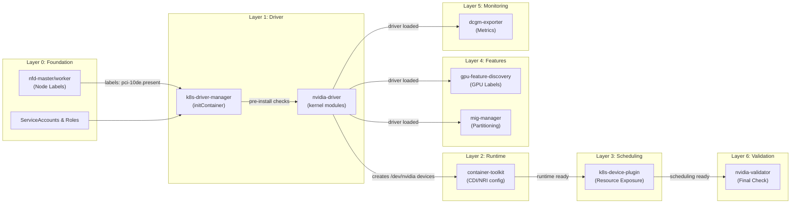
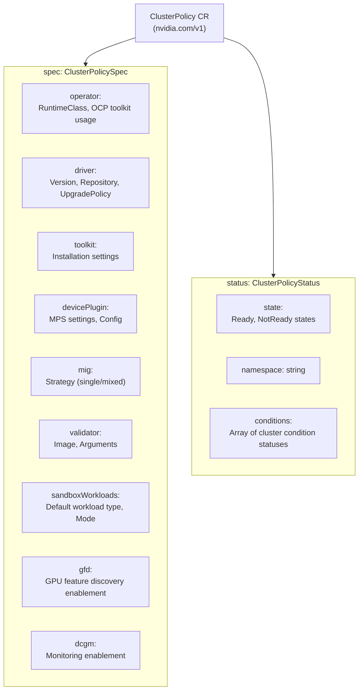

<!-- source: DeepWiki mcp.deepwiki.com · repo NVIDIA/gpu-operator · page 1 Overview · fetched 2026-10-26 -->

# Overview

<details>
<summary>Relevant source files</summary>

The following files were used as context for generating this wiki page:

- [.dockerignore](.dockerignore)
- [CODE_OF_CONDUCT.md](CODE_OF_CONDUCT.md)
- [CONTRIBUTING.md](CONTRIBUTING.md)
- [GOVERNANCE.md](GOVERNANCE.md)
- [LICENSE](LICENSE)
- [README.md](README.md)
- [api/nvidia/v1/clusterpolicy_types.go](api/nvidia/v1/clusterpolicy_types.go)
- [api/nvidia/v1/zz_generated.deepcopy.go](api/nvidia/v1/zz_generated.deepcopy.go)
- [api/nvidia/v1alpha1/gpucluster_types.go](api/nvidia/v1alpha1/gpucluster_types.go)
- [api/nvidia/v1alpha1/zz_generated.deepcopy.go](api/nvidia/v1alpha1/zz_generated.deepcopy.go)
- [bundle/manifests/nvidia.com_clusterpolicies.yaml](bundle/manifests/nvidia.com_clusterpolicies.yaml)
- [cmd/gpu-operator/main.go](cmd/gpu-operator/main.go)
- [cmd/gpu-operator/main_test.go](cmd/gpu-operator/main_test.go)
- [config/crd/bases/nvidia.com_clusterpolicies.yaml](config/crd/bases/nvidia.com_clusterpolicies.yaml)
- [config/samples/v1_clusterpolicy.yaml](config/samples/v1_clusterpolicy.yaml)
- [controllers/active_config.go](controllers/active_config.go)
- [controllers/active_config_test.go](controllers/active_config_test.go)
- [controllers/clusterpolicy_controller_test.go](controllers/clusterpolicy_controller_test.go)
- [controllers/gpucluster_controller_test.go](controllers/gpucluster_controller_test.go)
- [controllers/nodelabeling_controller.go](controllers/nodelabeling_controller.go)
- [controllers/nodelabeling_controller_test.go](controllers/nodelabeling_controller_test.go)
- [controllers/object_controls.go](controllers/object_controls.go)
- [controllers/object_controls_test.go](controllers/object_controls_test.go)
- [controllers/state_manager.go](controllers/state_manager.go)
- [controllers/transforms_test.go](controllers/transforms_test.go)
- [controllers/upgrade_controller_test.go](controllers/upgrade_controller_test.go)
- [deployments/gpu-operator/crds/nvidia.com_clusterpolicies.yaml](deployments/gpu-operator/crds/nvidia.com_clusterpolicies.yaml)
- [deployments/gpu-operator/templates/clusterpolicy.yaml](deployments/gpu-operator/templates/clusterpolicy.yaml)
- [deployments/gpu-operator/values.yaml](deployments/gpu-operator/values.yaml)

</details>


## Purpose and Scope

The NVIDIA GPU Operator is designed to automate the deployment and lifecycle management of the full software stack required to provision, manage, and monitor NVIDIA GPUs in Kubernetes clusters. It employs the Operator pattern to handle software components ranging from kernel drivers to monitoring daemons in a declarative and cluster-aware manner.

Targeted at administrators managing GPU nodes, the operator abstracts the complexity of installing and maintaining drivers, container runtimes, device plugins, and monitoring agents across potentially heterogeneous environments — different OSes, kernel versions, and GPU types. It supports GPU workloads in containers as well as sandboxed virtual environments like KubeVirt or Kata Containers.

**Sources:** [deployments/gpu-operator/values.yaml:1-32](), [README.md:1-20]()

## What the GPU Operator Manages

The NVIDIA GPU Operator controls multiple components essential for GPU functionality within Kubernetes clusters. Through the `ClusterPolicy` controller, it deploys and manages:

| Component             | Purpose                                                   | Deployment Type          |
|-----------------------|-----------------------------------------------------------|-------------------------|
| NVIDIA Driver         | Kernel modules and userspace libraries for GPU access     | DaemonSet per OS/kernel  |
| Container Toolkit     | Integrates GPU support into container runtimes (CDI/NRI) | DaemonSet               |
| Device Plugin         | Exposes GPU resources for Kubernetes scheduling           | DaemonSet               |
| DCGM Exporter         | Collects GPU metrics for Prometheus/Grafana               | DaemonSet               |
| MIG Manager           | Handles Multi-Instance GPU partitioning and profiles      | DaemonSet               |
| GPU Feature Discovery | Labels GPUs and nodes based on features                    | DaemonSet               |
| Validator             | Validates driver, toolkit, and CUDA setup                  | DaemonSet               |

It supports heterogeneous clusters by deploying the appropriate driver per node pool, considering OS and kernel differences.

**Sources:** [deployments/gpu-operator/values.yaml:114-322](), [bundle/manifests/gpu-operator-certified.clusterserviceversion.yaml:22-156](), [api/nvidia/v1/clusterpolicy_types.go:20-150]()

## Architecture Overview

The GPU Operator leverages the Kubernetes controller model using the `controller-runtime` library. It monitors `ClusterPolicy` and `NVIDIADriver` Custom Resources (CRs) and reconciles the cluster to match the desired state.

A high-level control flow from user configuration to deployed components can be illustrated as:

```mermaid
graph TB
    User["User/Administrator"]
    
    subgraph "Configuration Layer"
        CP["ClusterPolicy CR<br/>nvidia.com/v1<br/>(Primary API)"]
        ND["NVIDIADriver CR<br/>nvidia.com/v1alpha1<br/>(Driver-specific)"]
        ValuesYAML["values.yaml<br/>(Helm defaults)"]
    end
    
    subgraph "Control Plane"
        CPController["ClusterPolicyController<br/>controllers/state_manager.go"]
        Reconciler["Reconcile()<br/>controllers/clusterpolicy_controller.go"]
        StateManager["Sync()<br/>controllers/state_manager.go"]
    end
    
    subgraph "State Layer"
        DriverState["state-driver<br/>assets/state-driver/"]
        ToolkitState["state-container-toolkit<br/>assets/state-container-toolkit/"]
        DevicePluginState["state-device-plugin<br/>assets/state-device-plugin/"]
        DCGMState["state-dcgm-exporter<br/>assets/state-dcgm-exporter/"]
    end
    
    subgraph "Operands (DaemonSets)"
        DriverDS["nvidia-driver-daemonset"]
        ToolkitDS["nvidia-container-toolkit-daemonset"]
        DevicePluginDS["nvidia-device-plugin-daemonset"]
        DCGMDS["nvidia-dcgm-exporter"]
    end
    
    subgraph "Dependencies"
        NFD["Node Feature Discovery<br/>(NFD)"]
        Nodes["GPU Nodes<br/>(labeled by NFD)"]
    end
    
    User -->|"helm install"| ValuesYAML
    ValuesYAML -->|renders| CP
    User -->|optional| ND
    
    CP -->|watched by| Reconciler
    Reconciler -->|invokes| StateManager
    
    StateManager -->|addState()| DriverState
    StateManager -->|addState()| ToolkitState
    StateManager -->|addState()| DevicePluginState
    StateManager -->|addState()| DCGMState
    
    DriverState -->|creates/updates| DriverDS
    ToolkitState -->|creates/updates| ToolkitDS
    DevicePluginState -->|creates/updates| DevicePluginDS
    DCGMState -->|creates/updates| DCGMDS
    
    NFD -->|labels| Nodes
    DriverDS -->|scheduled on| Nodes
```

This diagram shows the flow from Helm `values.yaml` to ClusterPolicy creation, the reconciliation by the controller, state management delegation, and finally the deployment of Kubernetes DaemonSets for GPU components. Node Feature Discovery (NFD) labels the GPU nodes which are the targets for deployment.

**Sources:** [controllers/state_manager.go:146-220](), [controllers/object_controls.go:1-55](), [deployments/gpu-operator/values.yaml:72-130]()

## Component Dependency Chain

GPU Operator components are deployed in a carefully ordered chain of dependencies:



Key points:

- Nodes are labeled by NFD to indicate GPU presence.
- The driver manager ensures kernel modules are correctly set up.
- Driver readiness triggers deployment of container runtime tooling (like CDI).
- Device plugin exposes GPU resources to Kubernetes.
- Higher-level components like GPU Feature Discovery, MIG management, and monitoring come next.
- Validation ensures the full stack operates correctly.

**Sources:** [controllers/state_manager.go:115-120](), [deployments/gpu-operator/values.yaml:8-10, 196-202](), [controllers/object_controls.go:131-135](), [controllers/object_controls_test.go:64-66]()

## Core Configuration Resources

### ClusterPolicy Custom Resource

The `ClusterPolicy` CR is the primary user API to configure the GPU Operator. It is cluster-scoped and defines specifications for all GPU-related components:



This CR includes fine-grained control over operator behavior, daemonsets, driver upgrades, and related GPU ecosystem components.

**Sources:** [bundle/manifests/nvidia.com_clusterpolicies.yaml:27-163](), [deployments/gpu-operator/templates/clusterpolicy.yaml:1-99](), [api/nvidia/v1/clusterpolicy_types.go:40-105]()

### Helm Chart Configuration Flow

The typical installation flow with Helm is:

1. User customizes `values.yaml` or uses Helm CLI to set values.
2. Helm templates render the `ClusterPolicy` object (`deployments/gpu-operator/templates/clusterpolicy.yaml`).
3. The `ClusterPolicy` CR is applied to Kubernetes.
4. The GPU Operator's `ClusterPolicyController` detects the CR and begins reconciliation leading to deployment or update of GPU components.

This flow allows users to declaratively configure their GPU environment via Kubernetes-native resources.

**Sources:** [deployments/gpu-operator/values.yaml:1-113](), [deployments/gpu-operator/templates/clusterpolicy.yaml:1-99]()

## State Reconciliation Pattern

Internally, the operator manages the deployment lifecycle via a state-oriented reconciliation pattern:

- The controller registers "states" (functional modules) representing individual components or subsystems (e.g., driver, device plugin).
- During each reconciliation sync loop (`Sync()` function in `state_manager.go`), the controller executes these states in sequence.
- Each state works on its assigned Kubernetes resources (DaemonSets, ConfigMaps, etc.), updating or creating them as needed.
- The pattern cleanly separates concerns, simplifies testing, and allows progressive deployment as prerequisites are met.

The `controllers/object_controls.go` file contains the logic transforming the `ClusterPolicySpec` into Kubernetes object manifests with advanced handling such as host network config and custom CA injection.

**Sources:** [controllers/state_manager.go:146-180](), [controllers/object_controls.go:56-135](), [controllers/transforms_test.go:244-255]()

## Entry Points and Key Files

| Purpose                   | File Path                             | Key Entities / Notes                                  |
|---------------------------|-------------------------------------|------------------------------------------------------|
| Operator entry point       | `cmd/gpu-operator/main.go`           | Sets up manager, registers controllers               |
| CRD API Definitions       | `api/nvidia/v1/`                    | Defines ClusterPolicy, NVIDIADriver types             |
| Reconciliation Logic      | `controllers/state_manager.go`       | `ClusterPolicyController`, `Sync()` method            |
| Kubernetes Object Control | `controllers/object_controls.go`     | Functions for creating/updating k8s resources          |
| Helm Configuration Defaults | `deployments/gpu-operator/values.yaml` | Overrides for images, versions, deployment parameters  |
| OLM Manifests             | `bundle/manifests/`                  | ClusterServiceVersion, CRD manifests                   |

**Sources:** [cmd/gpu-operator/main.go:1-50](), [api/nvidia/v1/clusterpolicy_types.go:1-100](), [controllers/state_manager.go:1-200](), [controllers/object_controls.go:1-150](), [deployments/gpu-operator/values.yaml:1-200]()

---

For detailed onboarding, installation, and codebase layouts, see the child pages:

- [Getting Started](#1.1) — Quick install steps, prerequisites, and first `ClusterPolicy` deployment.
- [Repository Layout](#1.2) — Directory structure and key code locations.

---

**Overall, the NVIDIA GPU Operator is a comprehensive Kubernetes-native toolkit automating NVIDIA GPU environment management, designed for scalability, heterogeneity, and fault-tolerance.**

---

