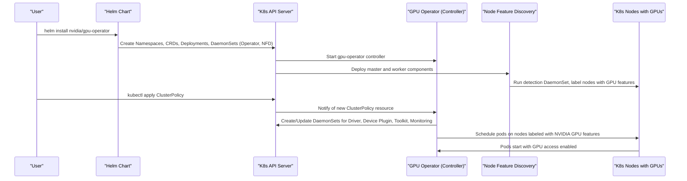
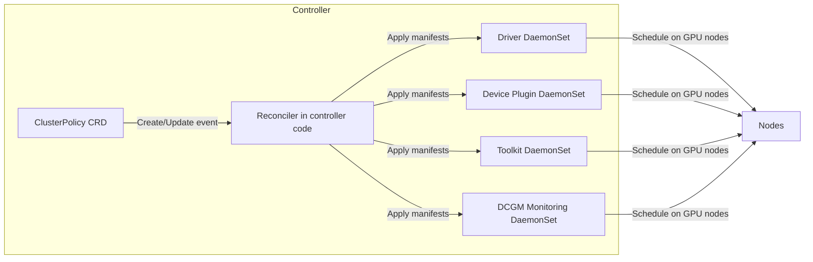

<!-- source: DeepWiki mcp.deepwiki.com · repo NVIDIA/gpu-operator · page 1.1 Getting Started · fetched 2026-10-26 -->

# 1.1 Getting Started

<details>
<summary>Relevant source files</summary>

The following files were used as context for generating this wiki page:

- [.dockerignore](.dockerignore)
- [.github/scripts/generate-values-overrides.sh](.github/scripts/generate-values-overrides.sh)
- [.github/scripts/get-latest-images.sh](.github/scripts/get-latest-images.sh)
- [CODE_OF_CONDUCT.md](CODE_OF_CONDUCT.md)
- [CONTRIBUTING.md](CONTRIBUTING.md)
- [GOVERNANCE.md](GOVERNANCE.md)
- [LICENSE](LICENSE)
- [README.md](README.md)
- [deployments/gpu-operator/Chart.lock](deployments/gpu-operator/Chart.lock)
- [deployments/gpu-operator/Chart.yaml](deployments/gpu-operator/Chart.yaml)
- [deployments/gpu-operator/charts/node-feature-discovery/Chart.yaml](deployments/gpu-operator/charts/node-feature-discovery/Chart.yaml)
- [deployments/gpu-operator/charts/node-feature-discovery/README.md](deployments/gpu-operator/charts/node-feature-discovery/README.md)
- [deployments/gpu-operator/charts/node-feature-discovery/templates/clusterrole.yaml](deployments/gpu-operator/charts/node-feature-discovery/templates/clusterrole.yaml)
- [deployments/gpu-operator/charts/node-feature-discovery/templates/clusterrolebinding.yaml](deployments/gpu-operator/charts/node-feature-discovery/templates/clusterrolebinding.yaml)
- [deployments/gpu-operator/charts/node-feature-discovery/templates/master.yaml](deployments/gpu-operator/charts/node-feature-discovery/templates/master.yaml)
- [deployments/gpu-operator/charts/node-feature-discovery/templates/nfd-gc.yaml](deployments/gpu-operator/charts/node-feature-discovery/templates/nfd-gc.yaml)
- [deployments/gpu-operator/charts/node-feature-discovery/templates/serviceaccount.yaml](deployments/gpu-operator/charts/node-feature-discovery/templates/serviceaccount.yaml)
- [deployments/gpu-operator/charts/node-feature-discovery/templates/topologyupdater.yaml](deployments/gpu-operator/charts/node-feature-discovery/templates/topologyupdater.yaml)
- [deployments/gpu-operator/charts/node-feature-discovery/templates/worker.yaml](deployments/gpu-operator/charts/node-feature-discovery/templates/worker.yaml)
- [deployments/gpu-operator/charts/node-feature-discovery/values.yaml](deployments/gpu-operator/charts/node-feature-discovery/values.yaml)
- [tests/README.md](tests/README.md)
- [tests/local.sh](tests/local.sh)
- [tests/scripts/env-to-values.sh](tests/scripts/env-to-values.sh)
- [tests/scripts/install-operator.sh](tests/scripts/install-operator.sh)

</details>


This page provides a detailed technical guide to get the NVIDIA GPU Operator up and running quickly in a Kubernetes cluster. It includes instructions for Helm-based installation, covers critical prerequisites such as Node Feature Discovery (NFD) and container runtime configuration, explains the role of the `examples/` directory, and demonstrates an initial deployment using the `ClusterPolicy` custom resource.

---

## 1.1.1 Overview

The NVIDIA GPU Operator automates the deployment and management of NVIDIA GPU software components on Kubernetes nodes. It integrates several moving parts, including NVIDIA drivers, device plugins, container runtime configurations, GPU feature discovery, and monitoring tools, orchestrated via Kubernetes controllers. Its installation via Helm simplifies deployment with configurable parameters.

Deployment typically follows these steps:

- Ensure prerequisites (such as NFD and compatible container runtime) are met.
- Install the GPU Operator Helm chart.
- Deploy initial configuration via `ClusterPolicy` custom resource.

---

## 1.1.2 Prerequisites

Before installing the GPU Operator, the following prerequisites must be addressed:

### Node Feature Discovery (NFD)

- **Purpose**: NFD is a Kubernetes add-on for detecting hardware features and system configurations and publishing these as Kubernetes node labels.
- **Role with GPU Operator**: NFD labels nodes with detailed GPU and system information, which the Operator uses to determine what components should be deployed on particular nodes.
- **Installation**: NFD is included as a sub-chart in the GPU Operator Helm chart and can be enabled or disabled.
- **Details**:
  - Deploys two main components:
    - **nfd-master**: A deployment that watches and aggregates node feature labels.
    - **nfd-worker**: A DaemonSet running on each node to detect hardware features.
  - Configurable via Helm values such as `.Values.nfd.enabled`, `.Values.master.enable`, `.Values.worker.enable`.
  - NFD manifests include `Deployment` and `DaemonSet` for master and worker components, respectively.
  - Provides RBAC resources like `ClusterRoleBinding` for permissions.
- **Configuration**:
  - Configure feature-gates, label namespaces, resync periods, and others via the Helm values.
  - Configuration files are mounted via ConfigMaps to the respective NFD pods.
- **References**:
  - Helm Chart metadata lists NFD as a dependency with version `0.19.0` ([deployments/gpu-operator/Chart.yaml:20-24]())
  - NFD Helm charts define templates such as `master.yaml` and `worker.yaml` deploying master and worker components respectively ([deployments/gpu-operator/charts/node-feature-discovery/templates/master.yaml:1-176](), [worker.yaml:1-194]())
  - NFD values.yaml expose configuration for image repositories, replicas, feature gates, etc. ([deployments/gpu-operator/charts/node-feature-discovery/values.yaml:1-165]())

### Container Runtime Configuration

- The GPU Operator requires a container runtime compatible with the NVIDIA Container Toolkit to support GPU workloads.
- Docker with NVIDIA runtime or containerd with NVIDIA configuration is typical.
- Proper runtime setup ensures containers can access GPUs.

### Kubernetes Version and Cluster Requirements

- Kubernetes version >= 1.16.0 is required.
- Cluster must have nodes with NVIDIA GPUs for the GPU components to deploy.
- Cluster RBAC roles and permissions must allow the Operator to create necessary resources in namespaces.

---

## 1.1.3 Installing the GPU Operator Using Helm

The GPU Operator is distributed as a Helm chart suitable for Kubernetes v1.16+.

### Add NVIDIA Helm Repository

```bash
helm repo add nvidia https://helm.ngc.nvidia.com/nvidia && helm repo update
```

This adds the official NVIDIA Helm chart repository with GPU Operator charts.

### Install GPU Operator

Install the chart in the `gpu-operator` namespace (created if it does not exist):

```bash
helm install --wait --generate-name \
    -n gpu-operator --create-namespace \
    nvidia/gpu-operator
```

### What Happens Under the Hood?

- Helm deploys the GPU Operator CRDs and controller deployment.
- NFD sub-chart defaults to enabled, installing NFD master and worker components.
- Operator deploys DaemonSets and Deployments for all NVIDIA components (drivers, device plugin, toolkit, monitoring).
- The Helm chart values allow detailed customization such as image overrides and component toggles.

### Monitoring Installation

After installation, verify components are running:

```bash
kubectl get pods -n gpu-operator
kubectl get pods -n node-feature-discovery
```

---

## 1.1.4 The `examples/` Directory

The repository contains `examples/` directory with example Custom Resources (CRs) to get started quickly:

- Example `ClusterPolicy` manifests demonstrate how to configure GPU Operator behavior.
- Users can apply these manifests to deploy GPUs with common configurations.
- The `ClusterPolicy` is the primary resource for configuring driver versions, toolkit options, monitoring, and node labels.

---

## 1.1.5 Deploying Your First ClusterPolicy

### What is ClusterPolicy?

- The `ClusterPolicy` CRD is the central configuration API for the GPU Operator.
- It allows specifying:
  - Which driver and runtime versions to deploy.
  - Enablement and configuration of GPU driver, container toolkit, device plugin.
  - Monitoring options such as DCGM Exporter.
  - Node selection and feature discovery overrides.

### Example Deployment Workflow

1. Create a `ClusterPolicy` YAML file (from `examples/` or custom):

```yaml
apiVersion: nvidia.com/v1
kind: ClusterPolicy
metadata:
  name: gpu-cluster-policy
spec:
  driver:
    version: "525.89.02"
  toolkit:
    enabled: true
  devicePlugin:
    enabled: true
  monitoring:
    dcgm:
      enabled: true
```

2. Apply the resource:

```bash
kubectl apply -f examples/cluster-policy.yaml
```

3. The GPU Operator reconciler detects the new `ClusterPolicy` and triggers deployments for NVIDIA drivers, toolkit, device plugin, and monitoring DaemonSets.

4. Nodes labeled by NFD are selected automatically based on GPU presence.

---

## 1.1.6 Data Flow and Key Components in Installation

Below is a detailed mermaid sequence diagram describing the high-level control flow during installation with Helm and first ClusterPolicy deployment:



---

## 1.1.7 Code Entities Correlation Diagram: Helm Chart and NFD Sub-chart

The GPU Operator Helm chart, located in `deployments/gpu-operator/`, manages a sub-chart dependency `node-feature-discovery`, which is crucial for node hardware feature labeling.

```mermaid
graph TD
  A[deployments/gpu-operator/Chart.yaml] --> |"depends on"| B[charts/node-feature-discovery/Chart.yaml]
  B --> |"defines resources"| C[nfd-master Deployment (templates/master.yaml)]
  B --> |"defines resources"| D[nfd-worker DaemonSet (templates/worker.yaml)]
  C --> |"uses ConfigMap"| E[nfd-master.conf (values.yaml)]
  D --> |"uses ConfigMap"| F[nfd-worker.conf]
  A --> |"values file controls NFD"| G[values.yaml nfd.enabled]
  A --> |"deploys"| H[gpu-operator controller deployment]
  H --> |"reconciles"| I[ClusterPolicy CRD & operator logic]
```

This structure shows how the operator chart orchestration includes NFD deployment, configured by Helm values.

---

## 1.1.8 Code Entities Correlation Diagram: Operator Controller Workflow for ClusterPolicy

This diagram explains how the GPU Operator reconciles the `ClusterPolicy` resource to manage GPU components on the cluster.



The reconciler reads `ClusterPolicy` spec and triggers deployment or update of DaemonSets managing NVIDIA software stack components.

---

## 1.1.9 Summary Table: Quick Helm Installation Steps

| Step                | Command / Notes                                         |
|---------------------|--------------------------------------------------------|
| Add NVIDIA Helm repo | `helm repo add nvidia https://helm.ngc.nvidia.com/nvidia` |
| Update repo         | `helm repo update`                                      |
| Install operator    | `helm install --wait --generate-name -n gpu-operator --create-namespace nvidia/gpu-operator` |
| Verify operator     | `kubectl get pods -n gpu-operator`                      |
| Apply ClusterPolicy | `kubectl apply -f examples/cluster-policy.yaml`         |
| Verify GPU pods     | `kubectl get pods -n gpu-operator` (DaemonSets for driver, dp, toolkit, monitoring) |

---

## 1.1.10 Additional Notes

- If deploying on OpenShift, consult the official OpenShift-specific instructions as additional configurations for security and runtime are required.
- GPU Operator Helm chart version `v1.0.0-devel` supports Kubernetes `>=1.16.0-0`.
- The Chart.yaml lists NFD as a dependency enabled via `nfd.enabled` flag.
- For advanced configurations, see the `examples/` directory and customize `ClusterPolicy` accordingly.
- The operator handles device plugin lifecycle, driver installation, container toolkit enablement, GPU monitoring setup automatically once configured via the `ClusterPolicy`.

---

# References and Sources

- `deployments/gpu-operator/Chart.yaml:1-25` (Helm Chart configuration, dependencies)
- `README.md:18-44` (Quick install instructions and audience)
- `deployments/gpu-operator/charts/node-feature-discovery/templates/master.yaml:1-176` (NFD master deployment details)
- `deployments/gpu-operator/charts/node-feature-discovery/templates/worker.yaml:1-194` (NFD worker DaemonSet details)
- `deployments/gpu-operator/charts/node-feature-discovery/values.yaml:1-165` (NFD Helm values)
- `tests/scripts/install-operator.sh:1-124` (Helm install script logic and options)
- `CONTRIBUTING.md:1-112` (Architecture overview and components involved)
  
---

This concludes the "Getting Started" documentation for NVIDIA GPU Operator installation, prerequisites, and initial configuration deployment.

---

