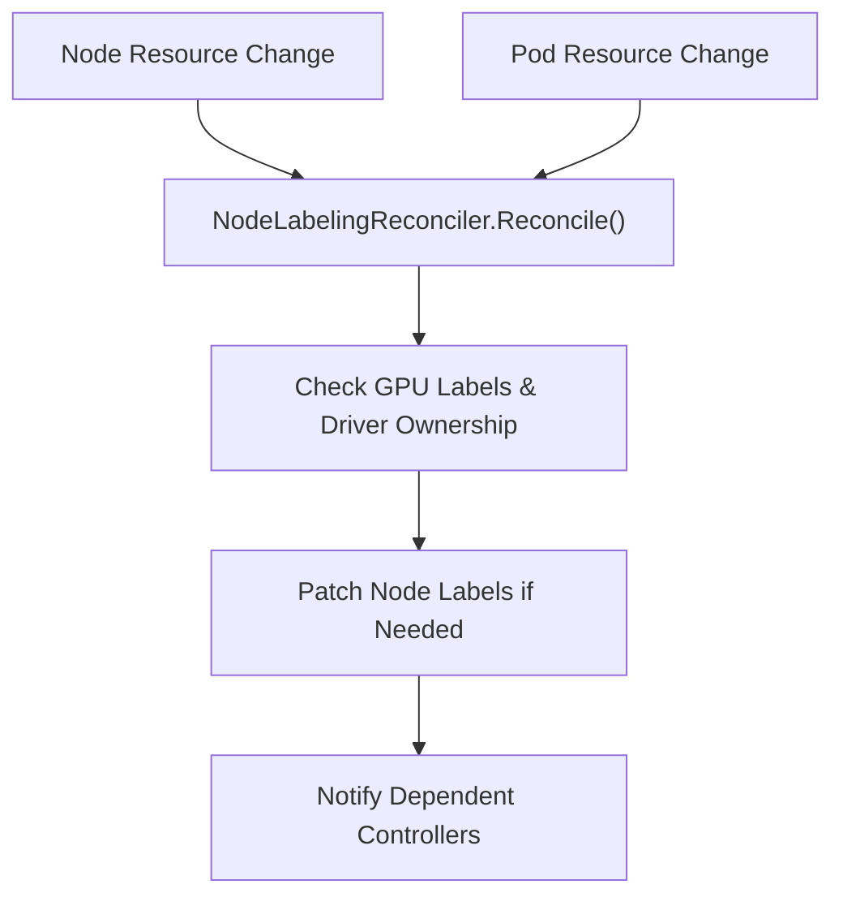
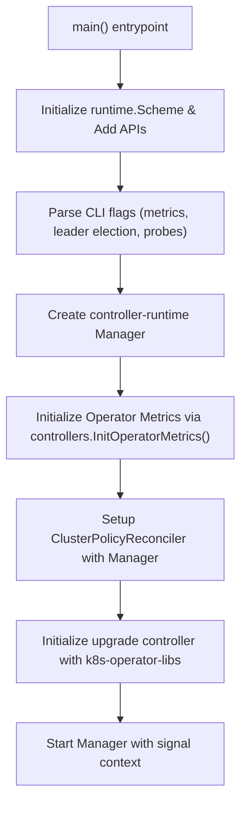

<!-- source: DeepWiki mcp.deepwiki.com · repo NVIDIA/gpu-operator · page 1.2 Repository Layout · fetched 2026-10-26 -->

# Repository Layout

<details>
<summary>Relevant source files</summary>

The following files were used as context for generating this wiki page:

- [PROJECT](PROJECT)
- [api/nvidia/v1/clusterpolicy_types_test.go](api/nvidia/v1/clusterpolicy_types_test.go)
- [api/nvidia/v1alpha1/gpucluster_types.go](api/nvidia/v1alpha1/gpucluster_types.go)
- [api/nvidia/v1alpha1/zz_generated.deepcopy.go](api/nvidia/v1alpha1/zz_generated.deepcopy.go)
- [cmd/gpu-operator/main.go](cmd/gpu-operator/main.go)
- [cmd/gpu-operator/main_test.go](cmd/gpu-operator/main_test.go)
- [cmd/gpuop-cfg/main.go](cmd/gpuop-cfg/main.go)
- [cmd/gpuop-cfg/validate/clusterpolicy/clusterpolicy.go](cmd/gpuop-cfg/validate/clusterpolicy/clusterpolicy.go)
- [cmd/gpuop-cfg/validate/clusterpolicy/images.go](cmd/gpuop-cfg/validate/clusterpolicy/images.go)
- [cmd/gpuop-cfg/validate/csv/alm-examples.go](cmd/gpuop-cfg/validate/csv/alm-examples.go)
- [cmd/gpuop-cfg/validate/csv/csv.go](cmd/gpuop-cfg/validate/csv/csv.go)
- [cmd/gpuop-cfg/validate/csv/images.go](cmd/gpuop-cfg/validate/csv/images.go)
- [cmd/gpuop-cfg/validate/validate.go](cmd/gpuop-cfg/validate/validate.go)
- [cmd/manage-crds/main.go](cmd/manage-crds/main.go)
- [config/crd/kustomization.yaml](config/crd/kustomization.yaml)
- [config/samples/kustomization.yaml](config/samples/kustomization.yaml)
- [controllers/active_config.go](controllers/active_config.go)
- [controllers/active_config_test.go](controllers/active_config_test.go)
- [controllers/clusterpolicy_controller_test.go](controllers/clusterpolicy_controller_test.go)
- [controllers/gpucluster_controller_test.go](controllers/gpucluster_controller_test.go)
- [controllers/nodelabeling_controller.go](controllers/nodelabeling_controller.go)
- [controllers/nodelabeling_controller_test.go](controllers/nodelabeling_controller_test.go)
- [controllers/upgrade_controller_test.go](controllers/upgrade_controller_test.go)
- [internal/image/image.go](internal/image/image.go)
- [internal/image/imagepath_validation_test.go](internal/image/imagepath_validation_test.go)
- [internal/state/info_source.go](internal/state/info_source.go)

</details>


This page presents a detailed technical mapping of the **gpu-operator** repository directory structure. The purpose is to navigate the core organization of the codebase and explain how the major directories and binaries contribute to the GPU Operator’s functionality. This foundational understanding facilitates exploring further architectural and developmental details in other parts of the documentation.

---

## Top-Level Directory Structure Overview

The repository organizes code and assets in distinct directories reflecting their roles in the operator's implementation, configuration, resource definitions, controllers, and tests. Below is a summary of the primary directories and their responsibilities:

| Directory     | Description                                                                                                     |
|---------------|-----------------------------------------------------------------------------------------------------------------|
| `api/`        | Custom Resource Definitions (CRDs) and API type definitions for the GPU Operator resources                      |
| `controllers/`| Kubernetes controllers implementing reconciliation logic for Custom Resources and node labeling                 |
| `internal/`   | Internal shared packages, constants, utilities, and business logic modules used across the operator            |
| `assets/`     | Static files, scripts, and auxiliary resources used by the operator                                            |
| `manifests/`  | Kubernetes manifests and Helm resource templates for operator deployment                                       |
| `deployments/`| Kubernetes deployment YAMLs and manifests, including Helm chart subcomponents for deployment                   |
| `cmd/`        | Source code for operator and related utility binaries (CLI tools)                                             |
| `bundle/`     | OLM (Operator Lifecycle Manager) bundle manifests and metadata files                                          |
| `config/`     | Kustomize configurations, samples, CRDs, and operator configuration files                                      |
| `tests/`      | End-to-end, integration, and unit tests for the operator code                                                |

---

## Directory Details and Code Insights

### `api/`

This directory contains API type definitions for the operator's Custom Resources. The project uses [Kubebuilder](https://book.kubebuilder.io/) conventions to model resources such as `ClusterPolicy`, `NVIDIADriver`, and `GPUCluster` under separate API versions:

- `api/nvidia/v1/` — contains core API types like `ClusterPolicy` which is the primary user configuration API.
- `api/nvidia/v1alpha1/` — contains experimental or newer types such as `NVIDIADriver` and `GPUCluster`.

Types have autogenerated boilerplate for deep copy and client generation, supporting Kubernetes API machinery and client code generation.

Key generated functions include:

- `ImagePath` methods to assemble container image references from spec fields, supporting digest and tag forms [api/nvidia/v1/clusterpolicy_types_test.go:26-88]().
- Deepcopy implementations for CRD Spec and Status structs [api/nvidia/v1alpha1/zz_generated.deepcopy.go:31-209]().

Sources: `api/nvidia/v1/clusterpolicy_types_test.go:26-88`, `api/nvidia/v1alpha1/zz_generated.deepcopy.go:31-209`


### `controllers/`

The `controllers/` directory implements the operator's reconciliation logic for Kubernetes resources using [controller-runtime](https://sigs.k8s.io/controller-runtime). It contains controllers for each major custom resource and node-related logic:

- `ClusterPolicyReconciler`: Handles the main `ClusterPolicy` CR reconciliation, managing GPU driver upgrades, component deployments, and overall cluster state.
- `NodeLabelingReconciler`: Centralizes all GPU-related node label and annotation updates, ensuring accurate node labeling for GPU presence and driver ownership.
- `GPUClusterReconciler`: Manages the `GPUCluster` resource for the newer device plugin stacks.
- `UpgradeReconciler`: Coordinates driver upgrade states and orchestrates node-level upgrades via k8s-operator-libs [cmd/gpu-operator/main.go:165-186]().

Most controllers import relevant API types and custom predicates for event filtering.

The node labeling controller maintains a stateful reconcile flow with fine-grained reasons to trigger label updates. The reconciliation ensures synchronization of GPU presence, MIG capability, and driver ownership labels on nodes. It observes node and pod updates to detect GPU usage [controllers/nodelabeling_controller.go:53-156]().

**NodeLabelingReconciler** workflow snippet:



Sources: `controllers/nodelabeling_controller.go:53-156`, `cmd/gpu-operator/main.go:165-186`


### `internal/`

This directory hosts shared internal packages that implement utilities and constants leveraged by controllers and commands. Examples include:

- `consts` package defining key constants (e.g., label keys, namespaces)
- `image` package performing image path computations and validation (resolving image references from spec fields or environment variables) [internal/image/image.go:25-57]().

This encapsulation avoids polluting the public API and reduces cyclic dependencies.

Sources: `internal/image/image.go:25-57`


### `assets/`

Contains static resources such as scripts, configuration templates, and manifest snippets which are not explicitly shown in the excerpts but are used during manifests generation and deployment.

Sources: None explicitly shown.


### `manifests/`

This directory contains Kubernetes manifests, including Helm templates, configmaps, and CRDs that form the deployable parts of the GPU Operator. It aligns with Kubebuilder and Operator SDK conventions for operator manifests.

Sources: None explicitly shown.


### `deployments/`

Houses deployment manifests, Helm chart snippets, and supporting RBAC definitions used to install and manage the GPU Operator in clusters. It includes readiness probes, container specifications, and deployment YAMLs.

Sources: None explicitly shown.


### `cmd/`

This directory contains source and binaries for the GPU Operator and related CLI utilities:

- `cmd/gpu-operator/`: The main operator binary implemented in Go. The entrypoint (`main.go`) initializes the controller manager with schemes for all API versions and sets up all controllers including `ClusterPolicyReconciler`. It configures leader election, metrics, health probes, and webhook servers. It also initializes upgrade state management using `k8s-operator-libs` [cmd/gpu-operator/main.go:1-186]().

- `cmd/gpuop-cfg/`: Utilities for configuration validation. The validation subpackage implements Image validation functions that use `regclient` to fetch image manifests and verify image accessibility [cmd/gpuop-cfg/validate/clusterpolicy/images.go:16-173]().

Other binaries like `manage-crds` are separate CLI tools for managing CRDs lifecycle.

**Operator manager initialization sequence:**



Sources: `cmd/gpu-operator/main.go:1-186`, `cmd/gpuop-cfg/validate/clusterpolicy/images.go:16-173`


### `bundle/`

Includes Operator Lifecycle Manager (OLM) bundle artifacts such as CSV files, CRDs, and metadata to support Operator installation on OLM-enabled Kubernetes clusters, including OpenShift.

Sources: None explicitly shown.


### `config/`

Contains Kustomize overlays, CRD yamls, example configurations, and manifests used for deployments and environment setup. This directory facilitates environment-specific customization.

Sources: None explicitly shown.


### `tests/`

Houses unit, integration, and end-to-end tests for the operator, controllers, and utility packages. Tests harness Kubernetes fake clients and reconcile mocks for isolated testing of controller logic, including state transitions and label updates [controllers/nodelabeling_controller_test.go](), [controllers/gpucluster_controller_test.go]().

---

## Binaries Built from `cmd/`

The repository is designed to compile several key command-line binaries from the subdirectories under `cmd/`. Notable binaries include:

| Binary          | Description                                                      | Main Source Location        |
|-----------------|------------------------------------------------------------------|-----------------------------|
| `gpu-operator`  | The main operator binary containing all controller logic and manager setup, responsible for GPU lifecycle management in the cluster | `cmd/gpu-operator/main.go`  |
| `gpuop-cfg`     | Configuration validation CLI used to validate cluster policies and manifest correctness, particularly image reference validation | `cmd/gpuop-cfg/main.go` and subpackages like `validate` |
| `manage-crds`   | CLI utility for management and monitoring of Custom Resource Definitions | `cmd/manage-crds/main.go`   |

---

## Repository Layout Diagram

This diagram maps conceptual components (Natural Language) to the corresponding code components and directories (Code Entity Space), showing their interactions and responsibilities.

```mermaid
graph TB
  subgraph OperatorCore["GPU Operator Core"]
    A[ClusterPolicy Controller<br/>(controllers.ClusterPolicyReconciler)]
    B[Node Labeling Controller<br/>(controllers.NodeLabelingReconciler)]
    C[GPUCluster Controller<br/>(controllers.GPUClusterReconciler)]
    D[Upgrade Controller<br/>(controllers.UpgradeReconciler)]
  end

  subgraph API["API Definitions (api/)"]
    API1[ClusterPolicy (api/nvidia/v1)]
    API2[NVIDIADriver & GPUCluster (api/nvidia/v1alpha1)]
  end

  subgraph InternalLibs["Internal Packages (internal/)"]
    CONST[Constants & Labels (internal/consts)]
    IMG[Image Utilities (internal/image)]
  end

  subgraph CmdBinaries["Binaries (cmd/)"]
    OPERATOR["gpu-operator<br/>cmd/gpu-operator/main.go"]
    CFG["gpuop-cfg<br/>cmd/gpuop-cfg/validate/"]
    MCRDS["manage-crds CLI<br/>cmd/manage-crds/main.go"]
  end

  subgraph DeployArtifacts["Manifests & Deployment"]
    MFST["manifests/ - k8s manifests & helm templates"]
    DEPLOY["deployments/ - k8s deployment YAMLs"]
    BUNDLE["bundle/ - OLM bundle manifests"]
    CONFIG["config/ - kustomize, samples, CRDs"]
  end

  subgraph Tests["Tests (tests/)"]
    TCONT["Unit & Integration Tests"]
    E2E["E2E Tests"]
  end

  %% Relations
  API1 -->|Defines CRDs used by| A
  API2 -->|Used by| C & A
  CONST -->|Used by| A & B & C & D
  IMG -->|Used for image refs, validation| A & CFG
  OPERATOR -->|Runs controllers| A & B & C & D
  CFG -->|Validates ClusterPolicy| API1 & API2
  MCRDS -->|Manages CRDs lifecycle| DEPLOY
  A & B & C & D -->|Deploy resource manifests| DEPLOY & MFST & BUNDLE & CONFIG
  TCONT -->|Tests controllers and internal libs| A & B & C & D & CONST & IMG
  E2E -->|Tests operator end-to-end| OPERATOR

```

---

## Summary

- The `api/` directory provides versioned Kubernetes CRD type definitions.
- The `controllers/` directory implements Kubernetes controllers that reconcile the GPU Operator’s resources and manage core logic such as node labeling.
- Shared logic and constants are encapsulated in `internal/`.
- Static assets and deployment artifacts are organized in `assets/`, `manifests/`, `deployments/`, `bundle/`, and `config/`.
- The main operator binary and utility CLIs are developed under `cmd/`.
- Testing code is located in `tests/`.
- Binaries built from `cmd/` form the deployable operator, configuration validation tools, and CRD management utilities.

This structure supports modularity and separation of concerns, facilitating streamlined operator development, testing, and deployment.

---

Sources:

- `cmd/gpu-operator/main.go:1-186`  
- `controllers/nodelabeling_controller.go:53-156`  
- `api/nvidia/v1/clusterpolicy_types_test.go:26-88`  
- `api/nvidia/v1alpha1/zz_generated.deepcopy.go:31-209`  
- `internal/image/image.go:25-57`  
- `cmd/gpuop-cfg/validate/clusterpolicy/images.go:16-173`  
- `controllers/nodelabeling_controller_test.go`  
- `controllers/gpucluster_controller_test.go`

---

