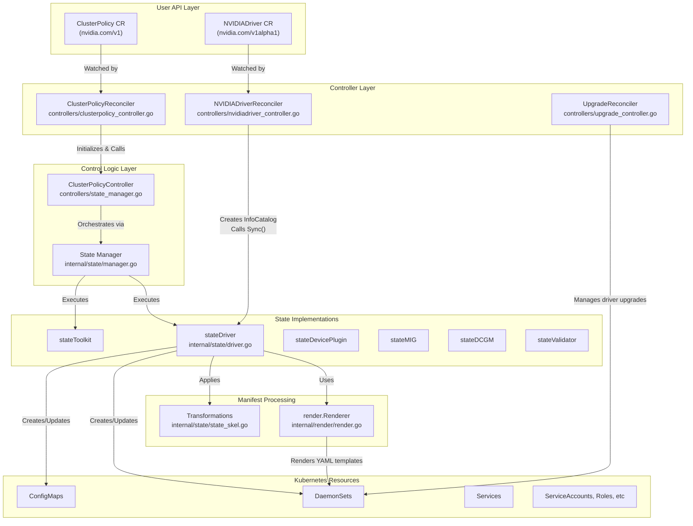
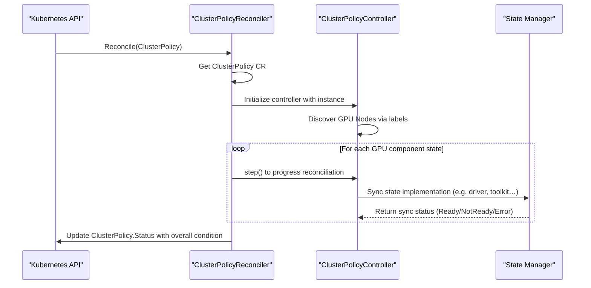
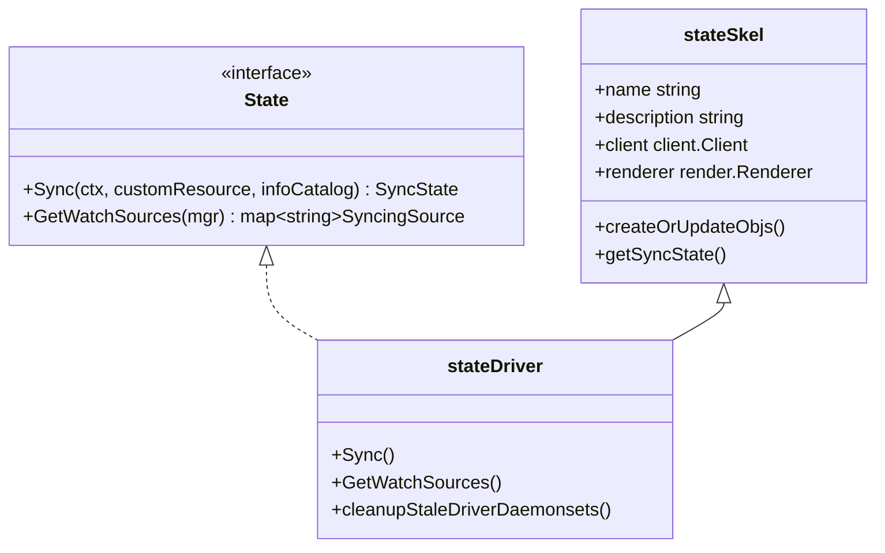

<!-- source: DeepWiki mcp.deepwiki.com · repo NVIDIA/gpu-operator · page 2 Architecture · fetched 2026-10-26 -->

# Architecture

Relevant source files

The following files were used as context for generating this wiki page:

- [api/nvidia/v1alpha1/nvidiadriver_types_test.go](api/nvidia/v1alpha1/nvidiadriver_types_test.go)
- [controllers/clusterinfo/clusterinfo.go](controllers/clusterinfo/clusterinfo.go)
- [controllers/clusterpolicy_controller.go](controllers/clusterpolicy_controller.go)
- [controllers/nvidiadriver_controller.go](controllers/nvidiadriver_controller.go)
- [controllers/nvidiadriver_controller_test.go](controllers/nvidiadriver_controller_test.go)
- [controllers/upgrade_controller.go](controllers/upgrade_controller.go)
- [deployments/gpu-operator/templates/gpucluster.yaml](deployments/gpu-operator/templates/gpucluster.yaml)
- [internal/consts/consts.go](internal/consts/consts.go)
- [internal/render/render.go](internal/render/render.go)
- [internal/state/driver.go](internal/state/driver.go)
- [internal/state/driver_test.go](internal/state/driver_test.go)
- [internal/state/driver_volumes.go](internal/state/driver_volumes.go)
- [internal/state/manager.go](internal/state/manager.go)
- [internal/state/metrics.go](internal/state/metrics.go)
- [internal/state/types.go](internal/state/types.go)
- [internal/validator/validator.go](internal/validator/validator.go)
- [internal/validator/validator_suite_test.go](internal/validator/validator_suite_test.go)
- [internal/validator/validator_test.go](internal/validator/validator_test.go)

## Purpose and Scope

This document provides a high-level overview of the NVIDIA GPU Operator’s system architecture. It focuses on the control flow, core design patterns, and interactions between the operator’s components. This includes the controller reconciliation model, the `State` interface pattern that manages various GPU infrastructure components, and how user configurations propagate to deployed Kubernetes resources.

To explore the detailed implementations, deeper technical topics are delegated to child pages:  
- [Core Concepts](#2.1) — covering state management, controllers, conditions, and node utilities.  
- [Component Architecture](#2.2) — detailing layered dependencies like driver, toolkit, device plugin, and directory structure.  
- [Configuration and Transformation System](#2.3) — explaining Helm values flow, CRDs, and manifest rendering.

---

## High-Level System Architecture

This architecture centers on Kubernetes custom resources (`ClusterPolicy` and `NVIDIADriver`) that define the user’s desired GPU infrastructure state. Kubernetes controllers watch these resources and trigger reconciliation loops, implemented primarily in the `ClusterPolicyReconciler` and `NVIDIADriverReconciler` classes.

The `ClusterPolicyController` orchestrates the deployment and management of components through a `State Manager`, which runs discrete State implementations representing components like the NVIDIA driver (`stateDriver`), container toolkit, device plugin, monitoring, and validation.

Component States leverage a manifest `Renderer` to produce Kubernetes YAML manifests from templates, then apply transformation logic to tailor these manifests dynamically to cluster specifics before creating/updating objects like DaemonSets and ConfigMaps.

The `UpgradeReconciler` handles advanced upgrade scenarios by coordinating the rollout of new driver versions safely.

**Sources:**  
- [controllers/clusterpolicy_controller.go:59-65]()  
- [controllers/nvidiadriver_controller.go:53-62]()  
- [controllers/state_manager.go:146-173]()  
- [internal/state/driver.go:134-167]()  

---

## Controller Reconciliation Pattern

The operator adheres to the canonical Kubernetes controller pattern: watching Kubernetes objects, reconciling cluster state toward the desired configuration, and updating status accordingly.

### ClusterPolicy Reconciliation Flow

The `ClusterPolicyReconciler` watches `ClusterPolicy` CRs and initializes a `ClusterPolicyController`. It labels GPU nodes (using e.g., NFD labels) and iterates through component States by calling `step()` which invokes their `Sync()` methods via the `State Manager`. The overall status is aggregated and reflected in the CR’s status.

If crucial labels like NFD GPU hardware labels are missing, a warning is logged indicating that GPU nodes may not be correctly discovered.

**Sources:**  
- [controllers/clusterpolicy_controller.go:93-155]()  
- [controllers/state_manager.go:146-173]()  

---

### NVIDIADriver Reconciliation Flow

The `NVIDIADriverReconciler` manages the `NVIDIADriver` CR, which allows fine-grained driver customization beyond `ClusterPolicy`.

Key steps:

1. **Validation:** Ensures the configured `nodeSelector` doesn't conflict with other `NVIDIADriver` instances to avoid multiple driver DaemonSets targeting the same node [validator/validator.go:33-103]().

2. **Cluster Info Gathering:** Builds an `InfoCatalog` encapsulating cluster-specific data like container runtime, OpenShift version, and proxy specs, insulated from the controller logic.

3. **State Sync:** Calls into `stateDriver.Sync()` to render manifests and apply them, managing DaemonSets and cleaning up stale ones when selectors or specs change [internal/state/driver.go:134-167]().

4. **Status Updates:** Reflects component readiness and errors back into the NVIDIADriver status conditions.

This controller ensures only one driver DaemonSet targets a given node and handles precompiled vs. source drivers, GDS configuration, and OpenShift Driver Toolkit integration.

**Sources:**  
- [controllers/nvidiadriver_controller.go:77-167]()  
- [internal/state/driver.go:134-167]()  
- [internal/validator/validator.go:33-103]()  

---

## State Management Architecture

Fundamental to the operator’s modular design is the `State` interface pattern: each GPU subsystem (driver, toolkit, etc.) implements `State` allowing the controller to manage components uniformly.

### State Interface and Skeleton Implementation

The `State` interface requires two methods:  
- `Sync()`: Reconcile the component’s desired state.  
- `GetWatchSources()`: Return Kubernetes event sources to watch for changes.

Most states embed a `stateSkel` struct which supplies shared utility methods, such as:  
- Applying k8s objects idempotently (`createOrUpdateObjs`).  
- Labeling objects with component and operator state labels.  
- Checking readiness of DaemonSets or Deployments (`getSyncState`).  

For example, `stateDriver` implements driver-specific sync logic and manages stale DaemonSets cleanup on node selector changes [internal/state/driver.go:63-67, 134-167]().

**Sources:**  
- [internal/state/driver.go:63-67]()  
- [internal/state/state_skel.go:40-75]() (not directly shown but referenced)  

---

## Configuration and Discovery

The operator dynamically adapts to the cluster environment via the `clusterinfo` package, which abstracts discovery of:  
- Container runtime (e.g., `containerd`, `docker`, `crio`) detected from node info.  
- OpenShift version and features like Driver Toolkit enabled state.  
- Proxy configuration (e.g., OpenShift ProxySpec).  
- DRA (Dynamic Resource Allocation) support and GroupVersionResource discovery for device classes.  

This discovery data influences how manifests are rendered and components deployed [controllers/clusterinfo/clusterinfo.go:40-170]().

| Aspect                      | Purpose                                    | Code Reference                              |
|-----------------------------|--------------------------------------------|---------------------------------------------|
| Container Runtime            | Detect runtime to handle driver/toolkit config | [clusterinfo.go:125-131]()                |
| OpenShift Version/Proxy      | Enable OpenShift-specific features, images | [clusterinfo.go:133-158]()                 |
| DRA Support                 | Determine support for device classes        | [clusterinfo.go:161-200]()                 |
| Node Label-Based Discovery  | Discover GPU nodes using NFD labels         | [controllers/state_manager.go:50-60]()    |
| Workload Type Configuration | Determines node workload type (container/VM) | [controllers/state_manager.go:88-113]()   |

**Sources:**  
- [controllers/clusterinfo/clusterinfo.go:40-170]()  
- [controllers/state_manager.go:50-113]()  

---

## Key Design Patterns

### Information Cataloging

To decouple logic and reduce API client dependencies, the operator uses an `InfoCatalog` interface that aggregates cluster metadata for use by states. For example, the `NVIDIADriverReconciler` prepares and passes an InfoCatalog holding runtime info, OpenShift version, and proxy details to `stateDriver.Sync` [controllers/nvidiadriver_controller.go:135-145]().

### Template-Driven Manifest Rendering

Component manifests are stored as declarative YAML templates in the `manifests/` directory. The `render.Renderer` loads these templates and combines them with dynamically computed data, such as the rendered driver's full container image, host paths, or computed config digests used for rolling updates [internal/state/driver.go:120-130, 105-107](). This approach fosters maintainability and easy customization.

### Automated Driver Upgrades

The `UpgradeReconciler` integrates with `k8s-operator-libs` upgrade libraries to automate safe NVIDIA driver rollouts. It calculates suitable `maxUnavailable` counts for nodes, manages upgrade state labels on nodes, and directs rolling upgrades of driver DaemonSets, reducing operator downtime and manual intervention [controllers/upgrade_controller.go:52-156]().

---

## Relations and Next Steps

This architecture ties together user APIs, controllers, state implementations, and Kubernetes resource management in a modular fashion. To understand each facet comprehensively, dive into the child pages:

- [Core Concepts](#2.1): Understand the fundamental state interface, reconciliation loops, conditions, resource managers, and utilities.  
- [Component Architecture](#2.2): Explore specific GPU Operator components, their layered dependencies, and manifest structure.  
- [Configuration and Transformation System](#2.3): Learn the flow from Helm values to CRDs, and how manifests are transformed before deployment.

---

**Sources:**  
- [internal/state/driver.go:1-198]()  
- [controllers/clusterpolicy_controller.go:59-141]()  
- [controllers/nvidiadriver_controller.go:59-162]()  
- [controllers/upgrade_controller.go:51-156]()  
- [controllers/clusterinfo/clusterinfo.go:1-201]()  
- [internal/state/types.go:17-149]()  
- [internal/validator/validator.go:33-103]()

---

