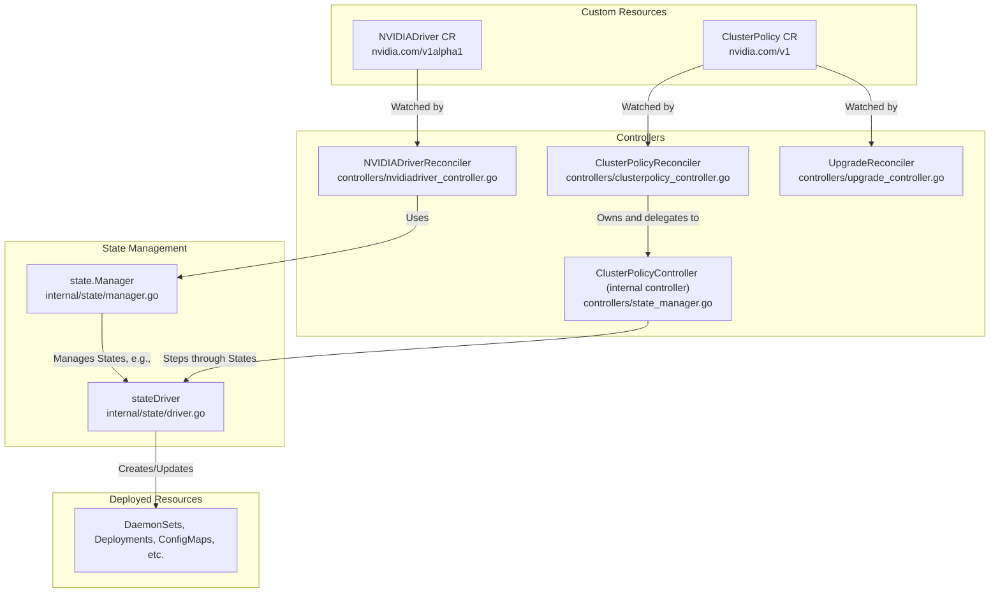
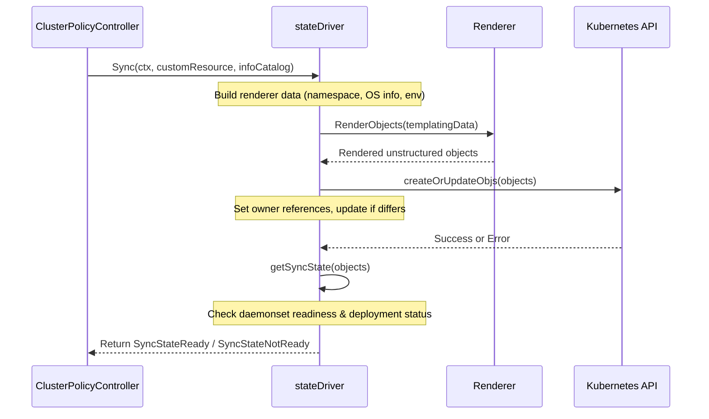

<!-- source: DeepWiki mcp.deepwiki.com · repo NVIDIA/gpu-operator · page 2.1 Core Concepts · fetched 2026-10-26 -->

# Core Concepts

<details>
<summary>Relevant source files</summary>

The following files were used as context for generating this wiki page:

- [api/nvidia/v1alpha1/nvidiadriver_types_test.go](api/nvidia/v1alpha1/nvidiadriver_types_test.go)
- [controllers/clusterpolicy_controller.go](controllers/clusterpolicy_controller.go)
- [controllers/nvidiadriver_controller.go](controllers/nvidiadriver_controller.go)
- [controllers/nvidiadriver_controller_test.go](controllers/nvidiadriver_controller_test.go)
- [controllers/resource_manager.go](controllers/resource_manager.go)
- [controllers/resource_manager_test.go](controllers/resource_manager_test.go)
- [controllers/upgrade_controller.go](controllers/upgrade_controller.go)
- [deployments/gpu-operator/templates/gpucluster.yaml](deployments/gpu-operator/templates/gpucluster.yaml)
- [internal/conditions/clusterpolicy.go](internal/conditions/clusterpolicy.go)
- [internal/conditions/conditions_test.go](internal/conditions/conditions_test.go)
- [internal/conditions/consts.go](internal/conditions/consts.go)
- [internal/conditions/nvidiadriver.go](internal/conditions/nvidiadriver.go)
- [internal/state/driver_cleanup_test.go](internal/state/driver_cleanup_test.go)
- [internal/state/driver_manifest_test.go](internal/state/driver_manifest_test.go)
- [internal/state/driver_sync_test.go](internal/state/driver_sync_test.go)
- [internal/state/info_source_test.go](internal/state/info_source_test.go)
- [internal/state/manager.go](internal/state/manager.go)
- [internal/state/manager_test.go](internal/state/manager_test.go)
- [internal/state/metrics.go](internal/state/metrics.go)
- [internal/state/state_skel.go](internal/state/state_skel.go)
- [internal/state/state_skel_reconcile_test.go](internal/state/state_skel_reconcile_test.go)
- [internal/state/state_skel_test.go](internal/state/state_skel_test.go)
- [internal/validator/validator.go](internal/validator/validator.go)
- [internal/validator/validator_suite_test.go](internal/validator/validator_suite_test.go)
- [internal/validator/validator_test.go](internal/validator/validator_test.go)
- [vendor/k8s.io/client-go/util/retry/util.go](vendor/k8s.io/client-go/util/retry/util.go)

</details>


This page explains the fundamental architectural patterns and programming concepts used throughout the NVIDIA GPU Operator. It covers the controller pattern, state management, reconciliation loops, and the State interface that forms the backbone of component orchestration.

For information about specific components deployed by the operator (driver, toolkit, device plugin, etc.), see **2.2 Component Architecture**. For details on how user configuration is transformed into deployed resources, see **2.3 Configuration and Transformation System**.

---

## Overview

The GPU Operator follows the Kubernetes Operator pattern, using custom controllers that continuously reconcile the desired state (defined in Custom Resources) with the actual cluster state. The operator's architecture is built on three core concepts:

1.  **Controllers**: Kubernetes controllers that watch Custom Resources and trigger reconciliation.
2.  **State Pattern**: Each deployable component is represented as a `State` that implements a common interface.
3.  **Reconciliation Loop**: The continuous process of comparing desired state with actual state and taking corrective action.

The coordination between these elements enables the operator to deploy, configure, verify, and upgrade various NVIDIA GPU related components reliably across the cluster.

---

## Controller Architecture

The GPU Operator implements multiple key controllers that operate on distinct Custom Resources (CRs) to manage GPU infrastructure lifecycle.

### Controller Interaction Map



Here the main custom controllers watch CRs:

- `ClusterPolicyReconciler` for the main ClusterPolicy resource.
- `NVIDIADriverReconciler` for fine-grained per-driver custom resources.
- `UpgradeReconciler` handles driver upgrade orchestration.

Internally, these controllers delegate detailed logic to a `ClusterPolicyController` (implemented in `controllers/state_manager.go`), which operates using the State interface pattern. This controller coordinates individual component states, such as deploying driver daemonsets through `stateDriver` and others.

**Sources:** [controllers/clusterpolicy_controller.go:59-65](), [controllers/nvidiadriver_controller.go:53-62](), [controllers/upgrade_controller.go:53-58]()

### ClusterPolicyController

`ClusterPolicyReconciler` is the top-level entry point for the ClusterPolicy CR. It fetches the singleton ClusterPolicy and initializes the internal `ClusterPolicyController`, which continuously steps through a sequence of states that represent GPU Operator components (driver, toolkit, device plugin, monitoring, validation, etc.).

Key functions:

- `Reconcile`: Fetches ClusterPolicy, determines if it is the active singleton, handles conflicts with GPUCluster CRs, and triggers the state reconciliation loop [controllers/clusterpolicy_controller.go:90-156]().
- `init`: Initializes environment detection, state list creation, and node info gathering [controllers/state_manager.go:753-892]().
- `step`: Iterates through enabled states and calls `Sync`, building a consistent operator state [controllers/state_manager.go:938-976]().

This layered architecture allows adding or modifying component states without changing the outer controller logic.

### NVIDIADriverReconciler

This controller manages the `NVIDIADriver` CRD, providing more granular, node-group-aware driver management and configuration.

Key behaviors include:

- Validating whether the operator is configured to reconcile NVIDIADriver CRs by checking the `useNvidiaDriverCRD` flag in ClusterPolicy [controllers/nvidiadriver_controller.go:123-132]().
- Using a `nodeSelectorValidator` to enforce exclusive node targeting: no two drivers select overlapping node sets [internal/validator/validator.go:31-116]().
- Handling driver deployment logic sensitive to features like precompiled binaries, GPUDirect Storage (GDS), and GDRCopy support [controllers/nvidiadriver_controller.go:155-163]().
- Using a shared InfoCatalog to pass environment and host filesystem info into states for templating and deployment [controllers/nvidiadriver_controller.go:138-145]().

This encapsulation enables driving different driver versions/configs in heterogenous clusters.

### UpgradeReconciler

The `UpgradeReconciler` automates the upgrading of NVIDIA driver DaemonSets across the cluster. It integrates with the `k8s-operator-libs` upgrade manager to track the upgrade state of nodes.

Core responsibilities:

- Watches the ClusterPolicy and/or NVIDIADriver CRs for upgrade directives.
- Selects DaemonSets representing the driver component via labels for rolling update enforcement.
- Manages node draining and pod eviction respecting maxUnavailable settings during upgrades.
- Handles OpenShift dynamics with Driver Toolkit conditions [controllers/upgrade_controller.go:89-156]().

This ensures zero-downtime or controlled downtime upgrades of GPU drivers in production environments.

---

## State Management Pattern

The operator internally decomposes the delivery and management of each deployable component into a `State` abstraction.

### The State Interface

The `State` interface (defined in `internal/state/types.go`) standardizes how each component performs reconciliation:

| Method          | Purpose                                              |
|-----------------|------------------------------------------------------|
| `Sync`          | Renders manifests, applies them to the cluster, and returns sync status and errors [internal/state/driver.go:134-167](). |
| `GetWatchSources`| Returns resource types to watch for triggering state syncs [internal/state/driver.go:169-184]().         |

Enforcing this interface allows the `ClusterPolicyController` and `StateManager` to operate generically over states.

### State Skeleton (`stateSkel`)

To reduce duplicated code for common logic, each state typically embeds a `stateSkel` struct that provides:

- Kubernetes client and scheme references.
- Manifest rendering utilities.
- Common methods for resource creation, update, deletions, and readiness checking.

Key methods:

- `renderObjects`: Renders all manifests with templating data [internal/state/state_skel.go:90-98]().
- `syncObjects`: Creates or updates rendered objects with owner references and returns an overall sync state [internal/state/state_skel.go:101-120]().
- `createOrUpdateObjs`: A helper that handles resource fetch, compare, update/create logic including error handling and logging [internal/state/state_skel.go:188-275]().
- `getSyncState`: Aggregates the readiness conditions of the managed resources into a single state enum [internal/state/state_skel.go:294-338]().

The `stateSkel` comes loaded with supported resource types and common convenience functions to merge objects, check daemonset deployment readiness, and set GPU-Operator-specific labels.

This skeleton pattern allows state implementations to focus on component-specific logic while reusing the robust resource lifecycle management.

---

## Reconciliation Loop & Ordering

The GPU Operator executes reconciliation in a well-defined order to respect dependencies and readiness.

### Execution Order

Defined during `ClusterPolicyController.init`:

1. **Prerequisite States**: Namespace and RBAC setup.
2. **Driver State**: Deploy kernel driver modules and daemonsets.
3. **Container Toolkit State**: Install NVIDIA Container Toolkit components.
4. **Device Plugin State**: Deploy device plugin daemonsets exposing GPUs.
5. **Monitoring State**: Deploy DCGM exporter and Prometheus rules.
6. **Validation State**: Run workload validations and health checks.

No state attempts deployment unless all prior states are in Ready state, ensuring stable progressive rollout.

### Reconciliation Flow



`ClusterPolicyController` aggregates states' statuses to decide whether to proceed or requeue reconciliation.

---

## Conditions Tracking

The operator uses Kubernetes conditions on CR statuses to signal state to users and other controllers.

For example, on the `NVIDIADriver` CR, conditions updated include:

- `ReconcileFailed`: Set when reconciliation errors occur [controllers/nvidiadriver_controller.go:93]().
- `ConflictingNodeSelector`: Set when multiple NVIDIADriver CRs select overlapping node sets, detected by validator checks [internal/conditions/nvidiadriver.go:34-37]().
- `Reconciled`: Signals success or intentional skipping of reconciliation due to disabled flags [controllers/nvidiadriver_controller.go:128]().

A dedicated `conditionUpdater` interface implementation per controller encapsulates this logic and leverages conflict-retry for robust status patching [internal/conditions/nvidiadriver.go:40-128]().

---

## Resource Manager and Manifest Handling

The operator's `ResourceManager` (in `controllers/resource_manager.go`) encapsulates logic to load, parse, and manage Kubernetes assets from manifests on disk.

Key features:

- Recursively reads files from manifests directories, filtering by Kubernetes resource types and OpenShift versions [controllers/resource_manager.go:68-102]().
- Decodes YAML manifests into typed Kubernetes API objects like DaemonSet, Deployment, ConfigMap, etc. [controllers/resource_manager.go:115-201]().
- Produces a `Resources` struct holding typed resource objects and a control function list indicating which controllers to invoke for each resource type.
- Handles compatibility such as presence of OpenShift or Node v1 APIs depending on cluster versions.

This module facilitates modular composition of manifests into resource sets used in each `State` for dynamic deployment.

---

## Node Info Utilities and InfoCatalog

The operator collects detailed cluster and node metadata to tailor deployments.

- **Cluster Info Interface**: Provides accessors for container runtime, OpenShift version, and proxy config [controllers/clusterinfo/clusterinfo.go].
- **Node Discovery**: The operator selects GPU nodes via labels like `nvidia.com/gpu.present` and uses NFD (Node Feature Discovery) labels such as kernel version to refine targeting.
- **InfoCatalog**: An interface to inject these environment details into the templating context passed to each state's `Sync` method. Examples include `ClusterInfo` and `hostRoot` for filesystem paths [controllers/nvidiadriver_controller.go:138-145]().

This design allows states to adapt manifests dynamically at runtime.

---

## Summary Diagram Bridging Concepts to Code Entities

```mermaid
classDiagram
    class "ClusterPolicyReconciler" {
      +Reconcile()
    }
    class "ClusterPolicyController" {
      +Init()
      +Step()
      -states : []State
    }
    class "NVIDIADriverReconciler" {
      +Reconcile()
    }
    class "UpgradeReconciler" {
      +Reconcile()
    }
    class stateManager {
      +SyncState()
      +GetWatchSources()
    }
    class stateSkel {
      -renderObjects()
      -syncObjects()
      -createOrUpdateObjs()
      -getSyncState()
    }
    class "State (interface)" {
      +Sync()
      +GetWatchSources()
    }
    class ResourceManager {
      +getAssetsFrom()
      +addResourcesControls()
    }
    class Validator {
      +Validate()
    }
    class ConditionUpdater {
      +SetConditionsReady()
      +SetConditionsError()
    }
    class InfoCatalog {
      +Add()
      +Get()
    }

    "ClusterPolicyReconciler" --> "ClusterPolicyController"
    "ClusterPolicyReconciler" --> "ConditionUpdater"
    "NVIDIADriverReconciler" --> Validator
    "NVIDIADriverReconciler" --> InfoCatalog
    "NVIDIADriverReconciler" --> stateManager
    "UpgradeReconciler" --> stateManager
    "ClusterPolicyController" --> stateManager
    stateManager --> "State (interface)"
    stateSkel ..|> "State (interface)"
    stateSkel --|> "ResourceManager"
    "State (interface)" <.. stateSkel
    "ConditionUpdater" <.. internal/conditions/nvidiadriver.go
```

This diagram correlates major architectural elements and their implementation locations, illustrating how controller structs utilize state management, validation, condition update, and resource rendering sub-systems.

**Sources:**

- [controllers/clusterpolicy_controller.go:59-156]()
- [controllers/nvidiadriver_controller.go:53-162]()
- [controllers/upgrade_controller.go:53-156]()
- [internal/state/manager.go:32-116]()
- [internal/state/state_skel.go:43-120]()
- [controllers/resource_manager.go:68-201]()
- [internal/validator/validator.go:31-117]()
- [internal/conditions/nvidiadriver.go:40-128]()

---

# Summary

The core concepts of the NVIDIA GPU Operator center around:

- Kubernetes controller runtimes managing GPU-configured custom resources.
- A structured State interface pattern that neatly encapsulates component-specific deployment logic.
- Robust reconciliation loops that render and synchronize Kubernetes manifests dynamically.
- Condition management for reflecting reconciliation state back in CRs.
- Resource manifest handling for modular, version-aware asset delivery.
- Utilities providing environment context to manifests to tailor deployments per cluster and node.

This design allows the GPU Operator to reliably deploy the NVIDIA GPU software stack in diverse Kubernetes environments with seamless upgrades and rich customization capabilities.

---

# Appendix: Key Files with Core Concepts

| Area | File/Location | Description |
|-|-|-|
| ClusterPolicy Controller | `controllers/clusterpolicy_controller.go` Lines 59-156 | Main reconciler delegate for the root ClusterPolicy CR |
| NVIDIADriver Controller | `controllers/nvidiadriver_controller.go` Lines 53-162 | Fine-grained driver reconciler with validation |
| Upgrade Controller | `controllers/upgrade_controller.go` Lines 53-156 | DaemonSet upgrade management reconciler |
| State Manager | `internal/state/manager.go` Lines 32-116 | Manages multiple states and orchestrates sync |
| State Skeleton | `internal/state/state_skel.go` Lines 40-120 | Common utilities for implementing states |
| Resource Manager | `controllers/resource_manager.go` Lines 68-201 | Loads and decodes manifests into typed resources |
| Validator Interface | `internal/validator/validator.go` Lines 31-117 | NodeSelector-based CR validation logic |
| Condition Updater | `internal/conditions/nvidiadriver.go` Lines 40-128 | CR condition setting implementation |

---

**Sources:**

- `controllers/clusterpolicy_controller.go:59-156`  
- `controllers/nvidiadriver_controller.go:53-162`  
- `controllers/upgrade_controller.go:53-156`  
- `internal/state/manager.go:32-116`  
- `internal/state/state_skel.go:43-120`  
- `controllers/resource_manager.go:68-201`  
- `internal/validator/validator.go:31-117`  
- `internal/conditions/nvidiadriver.go:40-128`

---

