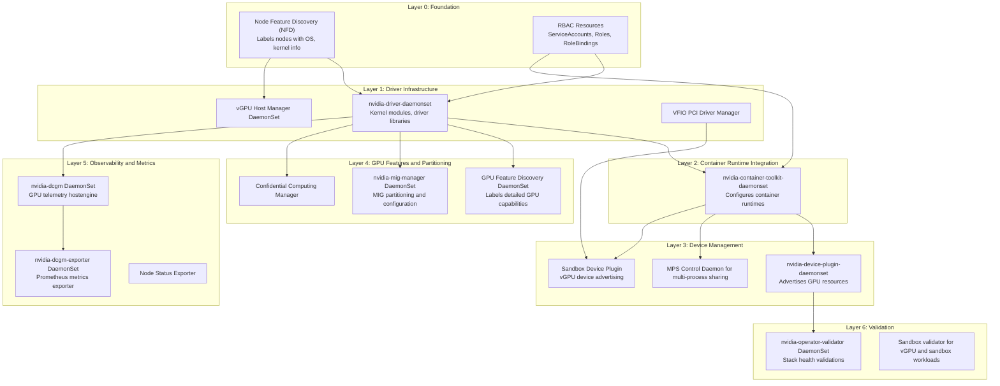
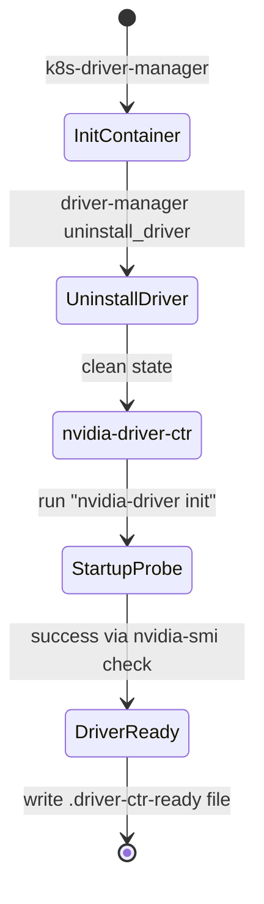
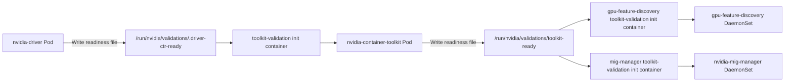
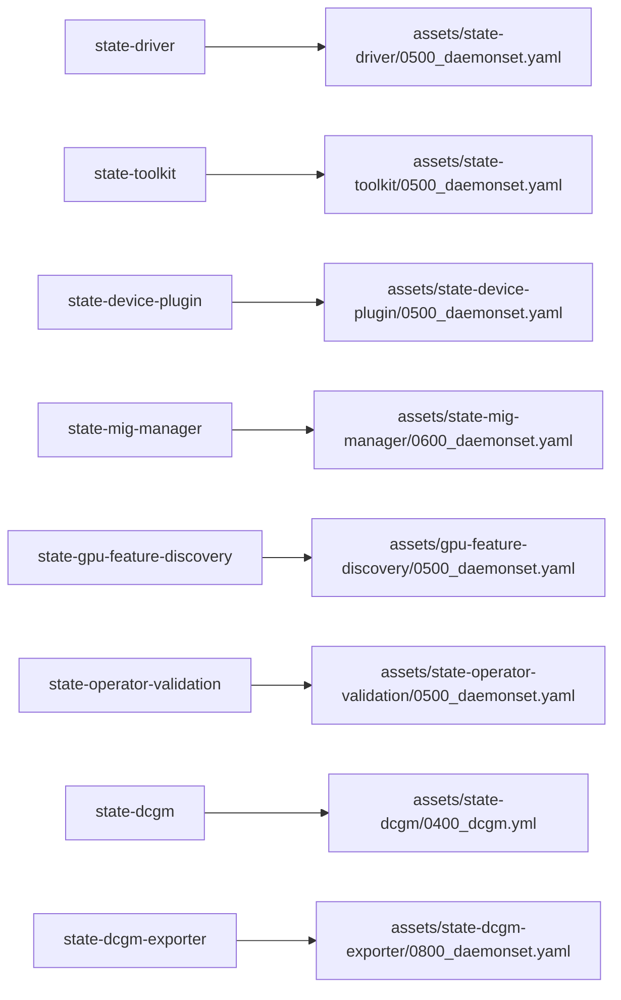

<!-- source: DeepWiki mcp.deepwiki.com · repo NVIDIA/gpu-operator · page 2.2 Component Architecture · fetched 2026-10-26 -->

# Component Architecture

Relevant source files

The following files were used as context for generating this wiki page:

- [assets/gpu-feature-discovery/0100_service_account.yaml](assets/gpu-feature-discovery/0100_service_account.yaml)
- [assets/gpu-feature-discovery/0300_rolebinding.yaml](assets/gpu-feature-discovery/0300_rolebinding.yaml)
- [assets/gpu-feature-discovery/0400_scc_openshift.yaml](assets/gpu-feature-discovery/0400_scc_openshift.yaml)
- [assets/gpu-feature-discovery/0500_daemonset.yaml](assets/gpu-feature-discovery/0500_daemonset.yaml)
- [assets/state-dcgm-exporter/0200_role.yaml](assets/state-dcgm-exporter/0200_role.yaml)
- [assets/state-dcgm-exporter/0800_daemonset.yaml](assets/state-dcgm-exporter/0800_daemonset.yaml)
- [assets/state-dcgm/0400_dcgm.yml](assets/state-dcgm/0400_dcgm.yml)
- [assets/state-device-plugin/0500_daemonset.yaml](assets/state-device-plugin/0500_daemonset.yaml)
- [assets/state-mig-manager/0100_service_account.yaml](assets/state-mig-manager/0100_service_account.yaml)
- [assets/state-mig-manager/0200_role.yaml](assets/state-mig-manager/0200_role.yaml)
- [assets/state-mig-manager/0210_clusterrole.yaml](assets/state-mig-manager/0210_clusterrole.yaml)
- [assets/state-mig-manager/0400_configmap.yaml](assets/state-mig-manager/0400_configmap.yaml)
- [assets/state-mig-manager/0500_scc.openshift.yaml](assets/state-mig-manager/0500_scc.openshift.yaml)
- [assets/state-mig-manager/0600_daemonset.yaml](assets/state-mig-manager/0600_daemonset.yaml)
- [assets/state-mps-control-daemon/0400_daemonset.yaml](assets/state-mps-control-daemon/0400_daemonset.yaml)
- [assets/state-node-status-exporter/0300_clusterrole.yaml](assets/state-node-status-exporter/0300_clusterrole.yaml)
- [assets/state-operator-validation/0100_service_account.yaml](assets/state-operator-validation/0100_service_account.yaml)
- [assets/state-operator-validation/0200_role.yaml](assets/state-operator-validation/0200_role.yaml)
- [assets/state-operator-validation/0210_clusterrole.yaml](assets/state-operator-validation/0210_clusterrole.yaml)
- [assets/state-operator-validation/0500_daemonset.yaml](assets/state-operator-validation/0500_daemonset.yaml)
- [assets/state-sandbox-validation/0500_daemonset.yaml](assets/state-sandbox-validation/0500_daemonset.yaml)
- [controllers/clusterinfo/clusterinfo_test.go](controllers/clusterinfo/clusterinfo_test.go)
- [controllers/state_manager_test.go](controllers/state_manager_test.go)
- [deployments/gpu-operator/templates/validations.yaml](deployments/gpu-operator/templates/validations.yaml)
- [internal/state/nodepool.go](internal/state/nodepool.go)
- [internal/state/nodepool_test.go](internal/state/nodepool_test.go)

## Purpose and Scope

This page provides an in-depth technical description of the NVIDIA GPU Operator's component architecture. It details the layered dependencies among core components such as drivers, container toolkit, device plugins, MIG manager, monitoring, and validation. It explains the directory structure for deployment manifests and assets and clarifies how each logical operator state corresponds to Kubernetes resources managed on the cluster.

For foundational concepts on controllers, state reconciliation, and resource management, see [Core Concepts (2.1)](2.1). For configuration flow and transformations, see [Configuration and Transformation System (2.3)](2.3).

---

## Component Layers

The GPU Operator organizes components in strict dependency layers reflecting hardware and software prerequisites. Each subsequent layer depends on the healthy startup and configuration of the prior layer. This design ensures that all GPU-related kernel modules, driver binaries, container runtime integration, and device advertising are correctly established before enabling GPU workloads.

### Layered Dependencies Overview

**Sources:**
- [assets/state-driver/0500_daemonset.yaml:1-210]()
- [assets/gpu-feature-discovery/0500_daemonset.yaml:1-132]()
- [assets/state-mig-manager/0400_configmap.yaml:1-55]()
- [assets/state-mig-manager/0600_daemonset.yaml:1-116]()
- [assets/state-device-plugin/0500_daemonset.yaml:1-167]()

---

## Assets and Manifests Directory Structure

- **assets/**: Contains declarative Kubernetes manifest templates for each component and state, organized by component/state name subdirectories, e.g., `state-driver/`, `gpu-feature-discovery/`, `state-mig-manager/`.
  
  - Example:
    - `state-driver/0500_daemonset.yaml` defines the driver DaemonSet.
    - `state-mig-manager/0400_configmap.yaml` holds the default MIG configuration.
  
- **manifests/**: Contains fully rendered deployment manifests post-Helm or operator transformations. These are installed resources representing the runtime state footprint of the operator components in Kubernetes.

This directory organization supports modular management of GPU Operator components by state and facilitates the operator's reconciliation logic that selectively applies manifests according to detected cluster state.

**Sources:**
- [assets/state-driver/0500_daemonset.yaml]()
- [assets/state-mig-manager/0400_configmap.yaml]()
- [assets/gpu-feature-discovery/0500_daemonset.yaml]()

---

## Detailed Component Layers and Kubernetes Resources

### Layer 0: Foundation

- **Node Feature Discovery (NFD):**
  - A prerequisite DaemonSet (not part of the GPU Operator itself) that labels Kubernetes nodes with detailed OS release, kernel version, and platform information.
  - Labels like `feature.node.kubernetes.io/kernel-version.full` and `feature.node.kubernetes.io/system-os_release.OSTREE_VERSION` enable GPU Operator to create targeted DaemonSets per OS/kernel.

- **RBAC Resources:**
  - The operator programmatically defines and creates ServiceAccounts, Roles, ClusterRoles, RoleBindings, and ClusterRoleBindings for permissions.
  - These resources enable GPU Operator components to interact with the K8s API server and manage node-level configurations securely.

**Sources:**
- [assets/state-driver/0500_daemonset.yaml:78-85]()
- [internal/state/testdata/golden/driver-openshift-drivertoolkit.yaml:134-175]()

---

### Layer 1: Driver Infrastructure

- **nvidia-driver-daemonset:**
  - A DaemonSet deploying NVIDIA kernel modules and user-space driver libraries on nodes matched by OS and kernel labels.
  - Runs with privileged security context to install kernel modules.
  
- **Init Containers:**
  - `k8s-driver-manager` init container uninstalls previous driver version to ensure clean setup.
  - Uses the binary `driver-manager` with argument `uninstall_driver`.

- **Main Container:**
  - `nvidia-driver-ctr` runs the driver installation with `/bin/entrypoint.sh` and commands like `nvidia-driver init` to load modules.
  - A startup probe (using `startup-probe.sh`) checks readiness by running `nvidia-smi` and ensures kernel module is loaded.
  - On success, it writes readiness file `.driver-ctr-ready` in `/run/nvidia/validations`.

- **Sidecars:**
  - `nvidia-peermem-ctr` handles peer memory modules for GPUDirect RDMA.
  - `nvidia-fs-ctr` optionally loads GPUDirect Storage kernel modules.

- Each driver DaemonSet instance is strictly tied to node OS/kernel labels to prevent cross-version mismatches.

**Sources:**
- [assets/state-driver/0500_daemonset.yaml:1-210]()
- [internal/state/testdata/golden/driver-gds.yaml:94-125]()

---

### Layer 2: Container Runtime Integration

- **nvidia-container-toolkit DaemonSet:**
  - Configures GPU container runtimes like containerd, Docker, CRI-O.
  - Sets up NVIDIA Container Device Interface (CDI) specifications enabling device injection.
  - Writes validation readiness file `/run/nvidia/validations/toolkit-ready`.
  
- Downstream components use an init container named `toolkit-validation` to block until this file is present.

**Sources:**
- [assets/gpu-feature-discovery/0500_daemonset.yaml:29-32]()
- [assets/state-mig-manager/0600_daemonset.yaml:28-31]()

---

### Layer 3: Device Management

- **nvidia-device-plugin DaemonSet:**
  - Implements the Kubernetes Device Plugin API for GPU resource advertising.
  - Supports device selection strategies and Multi-Process Service (MPS) modes.
  - Watches ConfigMaps for device plugin config and supports hot config updates via a `config-manager` sidecar.
  - Runs privileged container with volume mounts exposing the `/var/lib/kubelet/device-plugins` directory.

- **MPS Control Daemon:**
  - When MPS capable GPUs are detected (`nvidia.com/mps.capable`), runs `nvidia-device-plugin-mps-control-daemon` DaemonSet.
  - Manages shared GPU resource lifecycles for multiple processes.

- **Sandbox Device Plugin:**
  - Specifically for workloads running in sandboxed environments (e.g., KubeVirt, Kata Containers).
  - Advertises vGPU and mediated device resources.

**Sources:**
- [assets/state-device-plugin/0500_daemonset.yaml:1-167]()
- [assets/state-mps-control-daemon/0400_daemonset.yaml:1-135]()

---

### Layer 4: GPU Features and Partitioning

- **GPU Feature Discovery (GFD) DaemonSet:**
  - Discovers installed GPU features and reports them as Kubernetes node labels.
  - Runs a privileged main container doing discovery and a `config-manager` sidecar that manages config updates and signals.
  - Outputs feature info to `/etc/kubernetes/node-feature-discovery/features.d` host path.

- **MIG Manager (`nvidia-mig-manager` DaemonSet):**
  - Manages Multi-Instance GPU (MIG) partitions based on configurations from a ConfigMap named e.g., `default-mig-parted-config`.
  - Reads structured MIG profiles with device types and counts described in `config.yaml`.
  - Waits for container toolkit readiness before activation.
  - Uses privileged security contexts to configure MIG hardware.

- **Confidential Computing Manager:**
  - Handles deployment of components managing confidential computing capabilities (not covered in detail here).

**Sources:**
- [assets/gpu-feature-discovery/0500_daemonset.yaml:1-132]()
- [assets/state-mig-manager/0400_configmap.yaml:1-55]()
- [assets/state-mig-manager/0600_daemonset.yaml:27-37]()

---

### Layer 5: Observability and Metrics

- **NVIDIA Data Center GPU Manager (DCGM):**
  - Runs as the `nvidia-dcgm` DaemonSet providing telemetry and health monitoring of GPUs.
  - Uses privileged containers with host path access to GPU-related sockets and files.

- **DCGM Exporter:**
  - A DaemonSet exporting DCGM telemetry in Prometheus format (`nvidia-dcgm-exporter`).
  - Enables metrics scraping for monitoring GPU health and utilization.

- **Node Status Exporter (not described in detail):**
  - Emits metrics about device plugin and node GPU states.

**Sources:**
- [assets/state-dcgm/0400_dcgm.yml:1-60]()
- [assets/state-dcgm-exporter/0800_daemonset.yaml:1-81]()

---

### Layer 6: Validation

- **Operator Validator (`nvidia-operator-validator` DaemonSet):**
  - Runs as a DaemonSet validating driver, toolkit, CUDA runtime, and device plugin functionality.
  - Uses `nvidia-validator` binary with modes for driver, toolkit, CUDA, and plugin checks.
  - Runs multiple init containers performing component-specific validations with readiness signaling files.
  - Helps ensure the GPU stack is functional before declaring node ready.

- **Sandbox Validator:**
  - Specialized validation for sandboxed environments with vGPU workloads.

**Sources:**
- [assets/state-operator-validation/0500_daemonset.yaml:1-154]()

---

## How Logical States Map to Kubernetes Resources

The GPU Operator defines a finite state model where each "state" corresponds to deployed components implemented as Kubernetes resources (DaemonSets, Deployments, ConfigMaps, Roles, etc.). These states reflect enabling or disabling of GPU stack layers and their readiness.

Example mapping:

| Operator State Name      | Mapped Kubernetes Resources                                                  | Description                                           |
|-------------------------|-----------------------------------------------------------------------------|-------------------------------------------------------|
| `state-driver`          | `nvidia-driver-daemonset` + associated RBAC and service accounts           | Installs GPU kernel modules and drivers               |
| `state-toolkit`         | `nvidia-container-toolkit-daemonset`                                      | Container runtime integration for GPU containers      |
| `state-device-plugin`   | `nvidia-device-plugin-daemonset`, MPS Control Daemon, ConfigMaps          | Device advertising and GPU resource management         |
| `state-gpu-feature-discovery` | `gpu-feature-discovery` DaemonSet                                     | Discovers and labels GPU features                      |
| `state-mig-manager`     | `nvidia-mig-manager` DaemonSet + ConfigMap with MIG configs                | Manages MIG partitioning                               |
| `state-dcgm`            | `nvidia-dcgm` DaemonSet                                                     | GPU telemetry monitoring service                       |
| `state-dcgm-exporter`   | `nvidia-dcgm-exporter` DaemonSet                                           | Prometheus metrics exporter for DCGM                   |
| `state-operator-validator` | `nvidia-operator-validator` DaemonSet                                   | Validates GPU operator stack health                    |

Control loops reconcile these states by creating/updating/deleting appropriate Kubernetes resources according to the ClusterPolicy CR and detected hardware/node state.

**Sources:**
- [assets/state-driver/0500_daemonset.yaml]()
- [assets/state-device-plugin/0500_daemonset.yaml]()
- [assets/gpu-feature-discovery/0500_daemonset.yaml]()
- [assets/state-mig-manager/0400_configmap.yaml]()
- [assets/state-mig-manager/0600_daemonset.yaml]()
- [assets/state-dcgm/0400_dcgm.yml]()
- [assets/state-dcgm-exporter/0800_daemonset.yaml]()
- [assets/state-operator-validation/0500_daemonset.yaml]()

---

## Critical Shared Paths and Volume Mounts

GPU Operator components share information primarily through host-mounted directories:

| Host Path                           | Usage                                                | Mounted By                               |
|-----------------------------------|------------------------------------------------------|------------------------------------------|
| `/run/nvidia`                     | Root directory for NVIDIA runtime and validations    | Driver, DCGM, Toolkit, MIG Manager       |
| `/run/nvidia/validations`         | Files signaling readiness of driver/toolkit/validator| Driver, toolkit, validator init containers |
| `/etc/kubernetes/node-feature-discovery/features.d` | Output directory for GPU feature labels           | GPU Feature Discovery                     |
| `/var/lib/kubelet/device-plugins`| Device plugin Unix sockets for communicating with kubelet | Device Plugin DaemonSet                    |
| `/run/nvidia/driver`              | Driver installation directory accessible to stock and MIG components | MIG Manager, Device Plugin                |
| `/run/nvidia/mps` & `/dev/shm`   | Shared files for Multi-Process Service (MPS)          | MPS Control Daemon, Device Plugin         |

These mounts ensure processes running in containers have access to required node-level paths for managing kernel modules, device plugins, and reporting readiness.

**Sources:**
- [assets/state-driver/0500_daemonset.yaml:78-140]()
- [assets/gpu-feature-discovery/0500_daemonset.yaml:86-92]()
- [assets/state-mig-manager/0600_daemonset.yaml:100-116]()
- [assets/state-device-plugin/0500_daemonset.yaml:139-167]()

---

## Implementation Details: Key Functions and Classes

- The operator's core controller (e.g., `ClusterPolicyController`) uses the State interface pattern and reconciliation loops ([controllers/state_manager_test.go:167-239]()) to transition through states, invoking functions that manage the creation of corresponding Kubernetes resources.

- Node pool management is implemented in `internal/state/nodepool.go`. It partitions nodes by OS and kernel version information obtained via NFD labels to ensure correct targeting for driver DaemonSets ([internal/state/nodepool.go:60-149]()).

- The operator dynamically injects node selectors in manifests, derived from node pools, to deploy OS/kernel version specific DaemonSets ([internal/state/nodepool.go:60-149]()).

- Initialization containers named `toolkit-validation` commonly block component startup until the NVIDIA Container Toolkit signals readiness by writing `/run/nvidia/validations/toolkit-ready`. This pattern is observed in the GPU Feature Discovery and MIG manager DaemonSets ([assets/gpu-feature-discovery/0500_daemonset.yaml:29-32](), [assets/state-mig-manager/0600_daemonset.yaml:28-31]().

---

## Component Initialization Data Flow

### Driver Container Startup and Validation Flow

- The init container performs an uninstall of previous drivers to guarantee clean conditions before installing a new driver.
- The main container executes `nvidia-driver init` which loads kernel modules and driver binaries.
- Successful startup verifies `nvidia-smi` responds correctly before marking readiness by a specific file.

**Sources:**
- [assets/state-driver/0500_daemonset.yaml:47-51]()
- [assets/state-driver/0500_daemonset.yaml:94-96]()
- [internal/state/testdata/golden/driver-gds.yaml:94-125]()

---

### Downstream Components Wait for Upstream Readiness

- Driver readiness file signals to the toolkit's blocking init container to proceed.
- Toolkit readiness similarly allows GPU Feature Discovery and MIG Manager components to start safely.
- This ensures strict startup ordering across dependent layers.

**Sources:**
- [assets/gpu-feature-discovery/0500_daemonset.yaml:29-32]()
- [assets/state-mig-manager/0600_daemonset.yaml:28-31]()
- [internal/state/testdata/golden/driver-gds.yaml:98-99]()

---

# Summary

The NVIDIA GPU Operator employs a rigorously layered component architecture. Each layer corresponds to a set of Kubernetes resources carefully targeted and configured per node OS/kernel characteristics. Readiness signaling files and init containers enforce strict startup ordering, while node labeling via NFD allows dynamic adaptation to heterogeneous clusters.

The assets/ directory contains modular manifests defining each component’s DaemonSets, ConfigMaps, and RBAC. The manifests/ directory holds fully rendered resources applied to the cluster.

The operator's state machine logic orchestrates progressive provisioning of GPU support from driver installation through device plugin management, MIG partitioning, telemetry collection, and stack validation — all mapped tightly to specific Kubernetes resources, ensuring consistent, reliable deployments across diverse clusters.

---

# Mermaid Diagrams Highlighting Code Entities and Component Mapping

### Diagram 1: Component to Kubernetes Resources & Code Entities

```mermaid
graph TB
    classDef codeEntity fill:none,stroke:none,font-family:monospace,font-weight:bold;
    
    DriverComp["Driver Component"]:::codeEntity
    DriverMan["k8s-driver-manager (init container)"]:::codeEntity
    DriverCtr["nvidia-driver-ctr (main container)"]:::codeEntity
    
    ToolkitComp["Container Toolkit Component"]:::codeEntity
    ToolkitInit["toolkit-validation (init container)"]:::codeEntity
    
    DPComp["Device Plugin Component"]:::codeEntity
    DPConfig["config-manager sidecar"]:::codeEntity
    
    MIGComp["MIG Manager Component"]:::codeEntity
    MIGConfigMap["default-mig-parted-config ConfigMap"]:::codeEntity
    
    GFDComp["GPU Feature Discovery Component"]:::codeEntity
    GFDCtr["gpu-feature-discovery container"]:::codeEntity
    GFDConfigMgr["config-manager sidecar"]:::codeEntity
    
    ValidatorComp["Validator Component"]:::codeEntity
    
    DriverComp -->|uninstall| DriverMan
    DriverComp -->|init & driver load| DriverCtr
    ToolkitComp -->|blocks until ready| ToolkitInit
    DPComp -->|watches config| DPConfig
    MIGComp -->|reads config| MIGConfigMap
    GFDComp -->|labels nodes| GFDCtr
    GFDComp -->|ConfigMgr manages configs| GFDConfigMgr
```

---

### Diagram 2: Component State to Kubernetes Resource Manifest Files

---

# References

Please consult the following files for detailed manifests and implementation specifics:

- Driver DaemonSet: `assets/state-driver/0500_daemonset.yaml`
- Container Toolkit DaemonSet, Toolkit Validation: `assets/gpu-feature-discovery/0500_daemonset.yaml`
- Device Plugin DaemonSet: `assets/state-device-plugin/0500_daemonset.yaml`
- MIG Manager ConfigMap and DaemonSet: `assets/state-mig-manager/0400_configmap.yaml`, `assets/state-mig-manager/0600_daemonset.yaml`
- GPU Feature Discovery DaemonSet: `assets/gpu-feature-discovery/0500_daemonset.yaml`
- Validation DaemonSet: `assets/state-operator-validation/0500_daemonset.yaml`
- DCGM and DCGM Exporter DaemonSets: `assets/state-dcgm/0400_dcgm.yml`, `assets/state-dcgm-exporter/0800_daemonset.yaml`
- Node Pool management and OS tagging functions: `internal/state/nodepool.go`

Sources:  
- [assets/state-driver/0500_daemonset.yaml:1-210]()  
- [internal/state/nodepool.go:60-149]()  
- [assets/gpu-feature-discovery/0500_daemonset.yaml:1-132]()  
- [assets/state-mig-manager/0400_configmap.yaml:1-55]()  
- [assets/state-mig-manager/0600_daemonset.yaml:1-116]()  
- [assets/state-device-plugin/0500_daemonset.yaml:1-167]()  
- [assets/state-dcgm-exporter/0800_daemonset.yaml:1-81]()  
- [assets/state-operator-validation/0500_daemonset.yaml:1-154]()  
- [internal/state/testdata/golden/driver-gds.yaml:94-125]()  
- [controllers/state_manager_test.go:167-239]()

---

