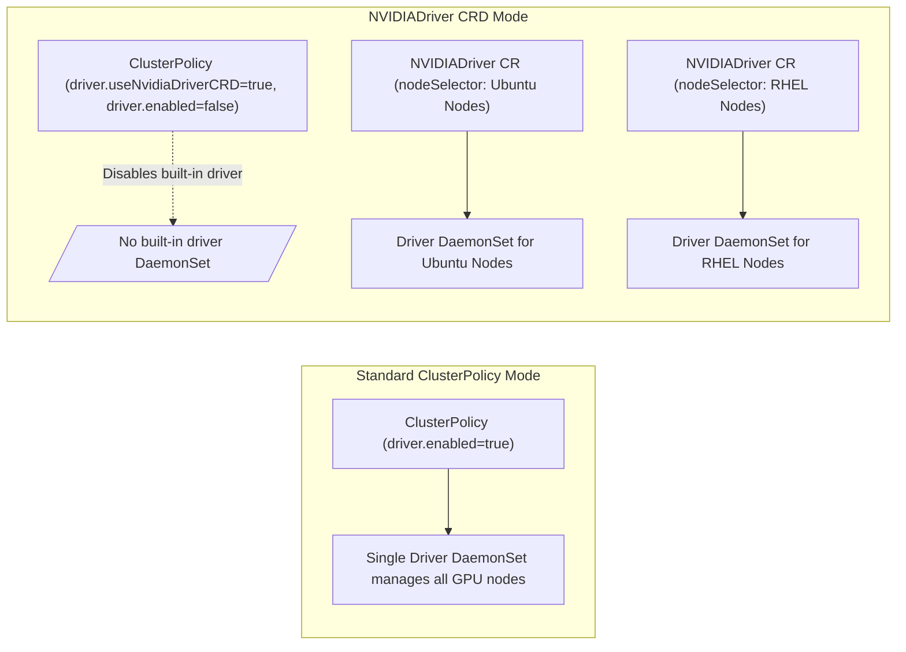
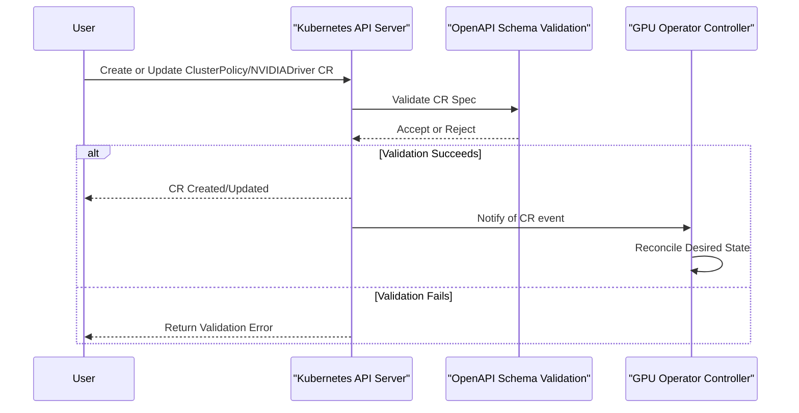

<!-- source: DeepWiki mcp.deepwiki.com · repo NVIDIA/gpu-operator · page 3 Custom Resources · fetched 2026-10-26 -->

# Custom Resources

<details>
<summary>Relevant source files</summary>

The following files were used as context for generating this wiki page:

- [api/nvidia/v1/clusterpolicy_types.go](api/nvidia/v1/clusterpolicy_types.go)
- [api/nvidia/v1/zz_generated.deepcopy.go](api/nvidia/v1/zz_generated.deepcopy.go)
- [api/nvidia/v1alpha1/nvidiadriver_types.go](api/nvidia/v1alpha1/nvidiadriver_types.go)
- [bundle/manifests/nvidia.com_clusterpolicies.yaml](bundle/manifests/nvidia.com_clusterpolicies.yaml)
- [bundle/manifests/nvidia.com_gpuclusters.yaml](bundle/manifests/nvidia.com_gpuclusters.yaml)
- [bundle/manifests/nvidia.com_nvidiadrivers.yaml](bundle/manifests/nvidia.com_nvidiadrivers.yaml)
- [config/crd/bases/nvidia.com_clusterpolicies.yaml](config/crd/bases/nvidia.com_clusterpolicies.yaml)
- [config/crd/bases/nvidia.com_gpuclusters.yaml](config/crd/bases/nvidia.com_gpuclusters.yaml)
- [config/crd/bases/nvidia.com_nvidiadrivers.yaml](config/crd/bases/nvidia.com_nvidiadrivers.yaml)
- [config/samples/nvidia_v1alpha1_gpucluster.yaml](config/samples/nvidia_v1alpha1_gpucluster.yaml)
- [config/samples/v1_clusterpolicy.yaml](config/samples/v1_clusterpolicy.yaml)
- [controllers/object_controls.go](controllers/object_controls.go)
- [controllers/object_controls_test.go](controllers/object_controls_test.go)
- [controllers/state_manager.go](controllers/state_manager.go)
- [controllers/transforms_test.go](controllers/transforms_test.go)
- [deployments/gpu-operator/crds/nvidia.com_clusterpolicies.yaml](deployments/gpu-operator/crds/nvidia.com_clusterpolicies.yaml)
- [deployments/gpu-operator/crds/nvidia.com_gpuclusters.yaml](deployments/gpu-operator/crds/nvidia.com_gpuclusters.yaml)
- [deployments/gpu-operator/crds/nvidia.com_nvidiadrivers.yaml](deployments/gpu-operator/crds/nvidia.com_nvidiadrivers.yaml)
- [deployments/gpu-operator/templates/clusterpolicy.yaml](deployments/gpu-operator/templates/clusterpolicy.yaml)
- [deployments/gpu-operator/templates/nvidiadriver.yaml](deployments/gpu-operator/templates/nvidiadriver.yaml)
- [deployments/gpu-operator/values.yaml](deployments/gpu-operator/values.yaml)

</details>


## Purpose and Scope

This document describes the Custom Resource Definitions (CRDs) that form the main user-facing API for configuring the NVIDIA GPU Operator. These Custom Resources express the desired state of GPU-related components deployed in a Kubernetes cluster. The GPU Operator controllers watch these resources and reconcile the cluster state to match the specified configuration.

This page offers a high-level overview of the key Custom Resources that users interact with, highlighting their roles and relationships. Detailed, field-level references and usage examples are delegated to dedicated child pages:
- [ClusterPolicy](#3.1) — The primary and comprehensive configuration API for GPU infrastructure managed by the operator.
- [NVIDIADriver](#3.2) — Advanced driver configuration for heterogeneous and more granular node targeting.
- [GPUCluster and ComputeDomain](#3.3) — Newer CRDs related to GPU cluster resource management and specialized compute domains.

---

## Custom Resource Definitions Overview

The GPU Operator defines the following main Custom Resources under the `nvidia.com` API group:

| CRD Name       | API Version         | Scope   | Purpose                                                              |
|----------------|---------------------|---------|----------------------------------------------------------------------|
| `ClusterPolicy`| `nvidia.com/v1`     | Cluster | Comprehensive configuration of GPU Operator components and features |
| `NVIDIADriver` | `nvidia.com/v1alpha1`| Cluster | Advanced NVIDIA driver deployment for specialized node selectors     |
| `GPUCluster`   | `nvidia.com/v1alpha1`| Cluster | Newer resource to manage GPU clusters and ComputeDomain resources    |

Users typically create and update these Custom Resources either via Helm charts or manual kubectl commands.

**Sources:**  
- [deployments/gpu-operator/crds/nvidia.com_clusterpolicies.yaml:7-24]()  
- [deployments/gpu-operator/crds/nvidia.com_nvidiadrivers.yaml:7-30]()  
- [deployments/gpu-operator/crds/nvidia.com_gpuclusters.yaml:1-40]() (not fully shown here)

---

## Custom Resource Architecture

```mermaid
graph TB
    subgraph "User Input"
        HelmValues["Helm values.yaml"]
        ManualCR["Manual CR Creation (kubectl apply)"]
    end

    subgraph "Custom Resources"
        ClusterPolicy["ClusterPolicy CR<br/>apiVersion: nvidia.com/v1"]
        NVIDIADriver["NVIDIADriver CR<br/>apiVersion: nvidia.com/v1alpha1"]
    end

    subgraph "API Type Definitions"
        CPAPI["ClusterPolicySpec<br/>api/nvidia/v1/clusterpolicy_types.go"]
        NDAPI["NVIDIADriverSpec<br/>api/nvidia/v1alpha1/nvidiadriver_types.go"]
    end

    subgraph "Controllers & Reconciliation"
        CPController["ClusterPolicyController<br/>controllers/clusterpolicy_controller.go"]
        NDController["NVIDIADriverController<br/>controllers/nvidiadriver_controller.go"]
        StateManager["StateManager<br/>controllers/state_manager.go"]
        ObjectControls["ObjectControls<br/>controllers/object_controls.go"]
    end

    subgraph "Kubernetes Resources"
        K8sResources["DaemonSets, ConfigMaps, Deployments, Secrets, etc."]
    end

    HelmValues -->|Render| ClusterPolicy
    HelmValues -->|Render (optional)| NVIDIADriver
    ManualCR -->|Create Resource| ClusterPolicy
    ManualCR -->|Create Resource| NVIDIADriver

    ClusterPolicy -->|Validate| CPAPI
    NVIDIADriver -->|Validate| NDAPI

    ClusterPolicy -->|Watch| CPController
    NVIDIADriver -->|Watch| NDController

    CPController --> StateManager
    NDController --> StateManager

    StateManager --> ObjectControls
    ObjectControls --> K8sResources
```

**Diagram: Custom Resource Processing Flow**  
This diagram shows how user-supplied configuration, via Helm or manual CRs, is validated, then processed by controllers that reconcile desired GPU Operator state into Kubernetes resources.

**Sources:**  
- [api/nvidia/v1/clusterpolicy_types.go:42-99]()  
- [deployments/gpu-operator/templates/nvidiadriver.yaml:1-128]()  
- [controllers/object_controls.go:50-135]()  
- [controllers/state_manager.go:35-200]()  

---

## ClusterPolicy vs NVIDIADriver

### When to Use Each Custom Resource

| Feature                      | ClusterPolicy                                       | NVIDIADriver                                    |
|------------------------------|----------------------------------------------------|------------------------------------------------|
| Role                         | Full GPU Operator config including driver, toolkit, device plugin, monitoring, etc. | Driver daemonset configuration for specialized scenarios |
| Use Case                     | Typical deployments with a single global driver setup | Node pool specific driver versions or multiple drivers |
| API Stability                | Stable (v1)                                        | Alpha (v1alpha1)                               |
| Node Selection               | Global (single policy per cluster)                 | Per-CR nodeSelector for fine-grained control  |
| Driver Deployment Enabled By | Yes (default)                                      | Opt-in with ClusterPolicy's `driver.useNvidiaDriverCRD=true` |
| Relationship                | Controls whole stack including driver when NVIDIADriver CRD is disabled | Driver focused CRD used when ClusterPolicy disables built-in driver |

**Sources:**  
- [api/nvidia/v1/clusterpolicy_types.go:42-99]()  
- [deployments/gpu-operator/values.yaml:167-170]()  
- [deployments/gpu-operator/templates/nvidiadriver.yaml:1-22]()  

### Relationship Between ClusterPolicy and NVIDIADriver



**Diagram: Deployment Modes of Driver via ClusterPolicy vs NVIDIADriver CRD**  
Standard use: ClusterPolicy handles the driver globally. In advanced use: ClusterPolicy disables driver deployment and NVIDIADriver CRs manage drivers per node group.

**Sources:**  
- [deployments/gpu-operator/values.yaml:167-170]()  
- [deployments/gpu-operator/templates/nvidiadriver.yaml:1-22]()  

---

## GPUCluster and ComputeDomain CRs (Overview)

The GPU Operator also includes newer Custom Resources related to GPU cluster resource management:

- **GPUCluster** CRD manages GPU device allocation across nodes with Dynamic Resource Allocation (DRA) support.  
- **ComputeDomain** and **ComputeDomainClique** CRDs (in `resource.nvidia.com` group) support grouping GPUs or MIG devices into cliques for shared compute resources.  
- The `gpucluster_controller` reconciles GPUCluster CRs and associated ComputeDomain resources.  
- The `cleanup-gpuclusters` utility helps clean up GPUCluster resources during operator lifecycle.

These new APIs evolve GPU resource management beyond the scope of the original ClusterPolicy and NVIDIADriver models.

For detailed documentation, see the child page: [GPUCluster and ComputeDomain](#3.3).

---

## Custom Resource Lifecycle and Status

### Typical Lifecycle Flow



The GPU Operator controllers monitor the status subresource of these CRs to update fields such as `status.state` and detailed `status.conditions` that indicate component readiness and errors.

**Sources:**  
- [deployments/gpu-operator/crds/nvidia.com_clusterpolicies.yaml:18-20]()  
- [deployments/gpu-operator/crds/nvidia.com_nvidiadrivers.yaml:22-24]()  

---

## Summary

The GPU Operator exposes a set of Custom Resources to declaratively control GPU infrastructure in Kubernetes:

- **ClusterPolicy (v1):** The recommended, all-encompassing API for defining the full GPU Operator deployment including drivers, device plugins, tooling, monitoring, MIG, and sandbox workloads. Best for most users and stable.

- **NVIDIADriver (v1alpha1):** For advanced and heterogeneous driver deployment scenarios, including node-pool specific driver versions. Used with ClusterPolicy's driver component disabled.

- **GPUCluster and ComputeDomain:** The emerging CRDs for advanced GPU resource slicing, dynamic allocation, and compute domain grouping in clusters.

For detailed API schema, field descriptions, usage examples, and best practices, consult the dedicated child pages:
- [ClusterPolicy](#3.1)  
- [NVIDIADriver](#3.2)  
- [GPUCluster and ComputeDomain](#3.3)  

---

**Sources:**  
- [deployments/gpu-operator/crds/nvidia.com_clusterpolicies.yaml]()  
- [deployments/gpu-operator/crds/nvidia.com_nvidiadrivers.yaml]()  
- [api/nvidia/v1/clusterpolicy_types.go]()  
- [deployments/gpu-operator/templates/nvidiadriver.yaml]()  
- [controllers/object_controls.go]()  
- [controllers/state_manager.go]()  
- [config/samples/v1_clusterpolicy.yaml]()

---

