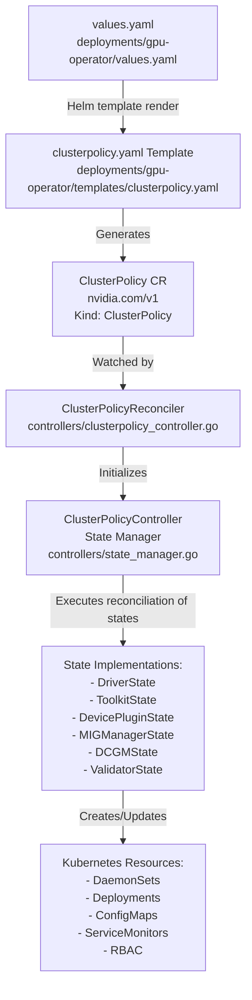
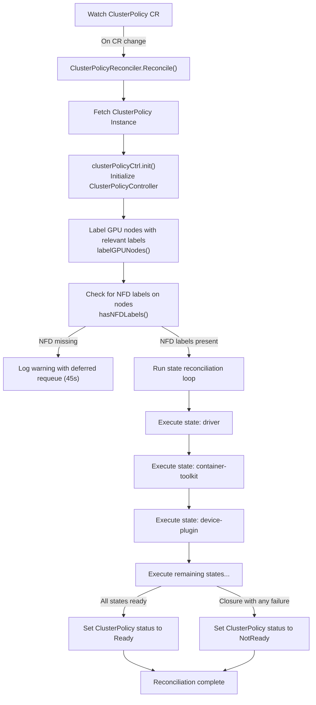
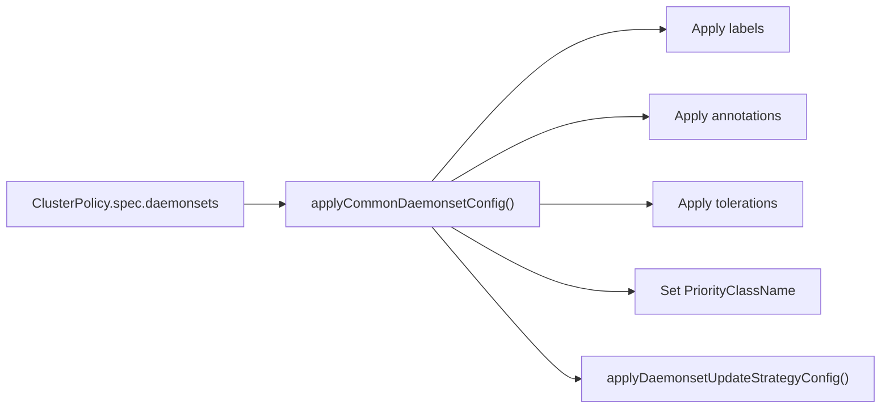
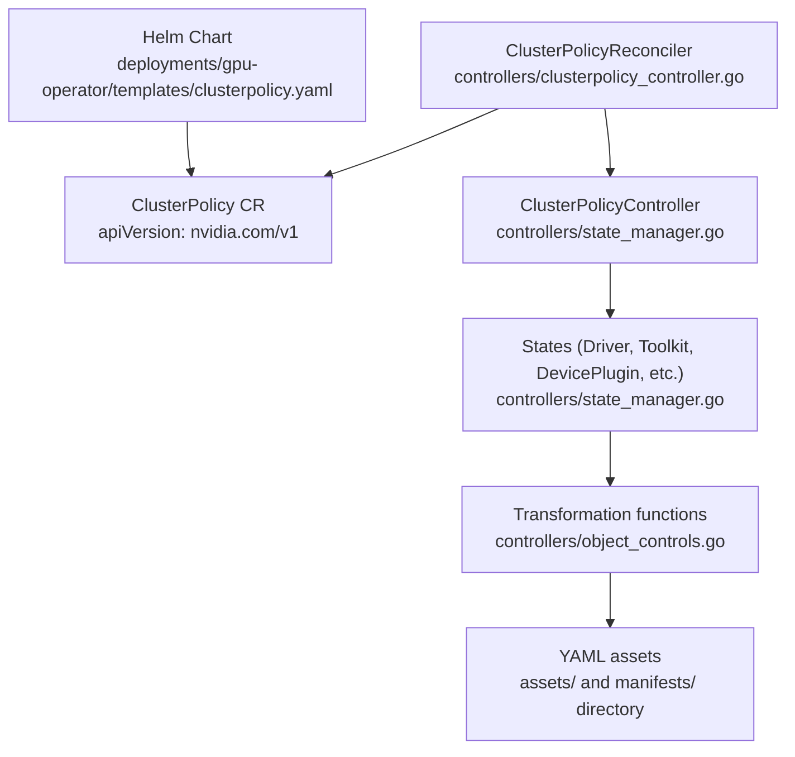
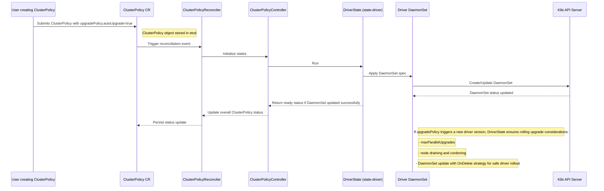

<!-- source: DeepWiki mcp.deepwiki.com · repo NVIDIA/gpu-operator · page 3.1 ClusterPolicy · fetched 2026-10-26 -->

# ClusterPolicy

<details>
<summary>Relevant source files</summary>

The following files were used as context for generating this wiki page:

- [api/nvidia/v1/clusterpolicy_types.go](api/nvidia/v1/clusterpolicy_types.go)
- [api/nvidia/v1/zz_generated.deepcopy.go](api/nvidia/v1/zz_generated.deepcopy.go)
- [api/nvidia/v1alpha1/nvidiadriver_types_test.go](api/nvidia/v1alpha1/nvidiadriver_types_test.go)
- [bundle/manifests/nvidia.com_clusterpolicies.yaml](bundle/manifests/nvidia.com_clusterpolicies.yaml)
- [config/crd/bases/nvidia.com_clusterpolicies.yaml](config/crd/bases/nvidia.com_clusterpolicies.yaml)
- [config/samples/v1_clusterpolicy.yaml](config/samples/v1_clusterpolicy.yaml)
- [controllers/clusterpolicy_controller.go](controllers/clusterpolicy_controller.go)
- [controllers/nvidiadriver_controller.go](controllers/nvidiadriver_controller.go)
- [controllers/nvidiadriver_controller_test.go](controllers/nvidiadriver_controller_test.go)
- [controllers/object_controls.go](controllers/object_controls.go)
- [controllers/object_controls_test.go](controllers/object_controls_test.go)
- [controllers/state_manager.go](controllers/state_manager.go)
- [controllers/transforms_test.go](controllers/transforms_test.go)
- [controllers/upgrade_controller.go](controllers/upgrade_controller.go)
- [deployments/gpu-operator/crds/nvidia.com_clusterpolicies.yaml](deployments/gpu-operator/crds/nvidia.com_clusterpolicies.yaml)
- [deployments/gpu-operator/templates/clusterpolicy.yaml](deployments/gpu-operator/templates/clusterpolicy.yaml)
- [deployments/gpu-operator/templates/gpucluster.yaml](deployments/gpu-operator/templates/gpucluster.yaml)
- [deployments/gpu-operator/values.yaml](deployments/gpu-operator/values.yaml)
- [internal/state/manager.go](internal/state/manager.go)
- [internal/state/metrics.go](internal/state/metrics.go)
- [internal/validator/validator.go](internal/validator/validator.go)
- [internal/validator/validator_suite_test.go](internal/validator/validator_suite_test.go)
- [internal/validator/validator_test.go](internal/validator/validator_test.go)

</details>


## Purpose and Scope

`ClusterPolicy` is the primary Custom Resource Definition (CRD) for configuring the NVIDIA GPU Operator. It provides a comprehensive and declarative API for specifying the desired state of all GPU infrastructure components in a Kubernetes cluster. A single `ClusterPolicy` instance controls the deployment and configuration of GPU drivers, container toolkit, device plugins, monitoring, MIG management, sandbox workloads, and other GPU operator components.

The operator assumes a singleton mode where only one `ClusterPolicy` instance (commonly named `cluster-policy`) is active at any time. The controller orchestrates the lifecycle of numerous states corresponding to different GPU-related components and subsystems.

---

## ClusterPolicy Architecture

### Configuration Flow

The GPU Operator configuration begins with a `values.yaml` file which Helm renders into a `ClusterPolicy` Kubernetes manifest. This CR is then watched by the operator, which reconciles its desired configuration into concrete Kubernetes resources through a multi-state reconciliation engine.



**Sources:** [deployments/gpu-operator/values.yaml:1-205](), [deployments/gpu-operator/templates/clusterpolicy.yaml:1-187](), [api/nvidia/v1/clusterpolicy_types.go:42-99]()

---

### Controller and Reconciliation Loop

The main operator controller is implemented in `ClusterPolicyReconciler`. It fetches the active `ClusterPolicy` instance, ensuring a single active instance with stable selection by timestamp and name. It coordinates with the internal `ClusterPolicyController` (state manager) which executes a series of states in sequence.



The reconciler also detects conflicts with other GPU operator CRDs like `GPUCluster` to ensure exclusive control over GPU infrastructure [controllers/clusterpolicy_controller.go:63-141](), [controllers/object_controls.go:129-140]().

**Sources:** [controllers/clusterpolicy_controller.go:63-141](), [controllers/object_controls.go:129-140]()

---

## ClusterPolicy Specification Structure

The `ClusterPolicySpec` is defined in `api/nvidia/v1/clusterpolicy_types.go` and consolidates all configuration details for the GPU operator components.

### Top-Level Spec Fields Overview

| Field Name              | Type                    | Description                                            |
|-------------------------|-------------------------|--------------------------------------------------------|
| `operator`              | `OperatorSpec`           | Operator global config, e.g., runtimeClass [43-49]()  |
| `daemonsets`            | `DaemonsetsSpec`         | Global DaemonSet config shared by operands [49-51]()  |
| `hostPaths`             | `HostPathsSpec`          | Override host filesystem paths [97-101]()              |
| `driver`                | `DriverSpec`             | NVIDIA GPU driver installation/configuration [50-90]()|
| `toolkit`               | `ToolkitSpec`            | Container Toolkit configuration [53-55]()             |
| `devicePlugin`          | `DevicePluginSpec`       | GPU Device Plugin settings [55-60]()                   |
| `dcgmExporter`          | `DCGMExporterSpec`       | DCGM Exporter monitoring config [58-60]()              |
| `dcgm`                  | `DCGMSpec`               | DCGM internal components [60-65]()                      |
| `nodeStatusExporter`    | `NodeStatusExporterSpec` | NodeStatusExporter config [62-65]()                     |
| `gfd`                   | `GPUFeatureDiscoverySpec`| GPU Feature Discovery config [64-67]()                  |
| `mig`                   | `MIGSpec`                | Multi-Instance GPU config [66-70]()                     |
| `migManager`            | `MIGManagerSpec`         | MIG Manager config [68-70]()                             |
| `psp`                   | `PSPSpec`                | Pod Security Policy (deprecated) [69-71]()              |
| `psa`                   | `PSASpec`                | Pod Security Admission config [72-73]()                 |
| `validator`             | `ValidatorSpec`          | Validator daemonset spec for validation [74-77]()      |
| `gds`                   | `GPUDirectStorageSpec`   | GPU Direct Storage config (experimental) [76-79]()     |
| `gdrcopy`               | `GDRCopySpec`            | GDRCopy component spec [78-81]()                        |
| `sandboxWorkloads`      | `SandboxWorkloadsSpec`   | Sandbox workloads (VMs) config [80-84]()                |
| `vfioManager`           | `VFIOManagerSpec`        | VFIO Manager config [82-84]()                           |
| `sandboxDevicePlugin`   | `SandboxDevicePluginSpec`| Sandbox Device Plugin config [84-87]()                  |
| `vgpuManager`           | `VGPUManagerSpec`        | Virtual GPU Manager config [86-88]()                    |
| `vgpuDeviceManager`     | `VGPUDeviceManagerSpec`  | vGPU Device Manager config [88-91]()                    |
| `cdi`                   | `CDIConfigSpec`          | Container Device Interface config [90-93]()             |
| `kataManager`           | `KataManagerSpec`        | Kata Container Manager (deprecated) [92-98]()           |
| `ccManager`             | `CCManagerSpec`          | Confidential Computing Manager config [95-101]()       |
| `hostPaths`             | `HostPathsSpec`          | Host filesystem paths used by components [97-101]()    |
| `kataSandboxDevicePlugin` | `KataDevicePluginSpec` | Kata Sandbox Device Plugin config [99-103]()           |

This spec definition enables validation, defaulting, and rich schema generation using Kubebuilder and Operator SDK tooling.

**Sources:** [api/nvidia/v1/clusterpolicy_types.go:42-130](), [bundle/manifests/nvidia.com_clusterpolicies.yaml:46-155]()

---

## Common Component Configuration Pattern

Most GPU operator components follow a standardized configuration schema for container images, enablement, resource settings, and environment variables. For example, a typical component snippet:

```yaml
componentName:
  enabled: true
  repository: nvcr.io/nvidia
  image: gpu-operator
  version: "v24.9.0"
  imagePullPolicy: IfNotPresent
  env:
    - name: NVIDIA_VISIBLE_DEVICES
      value: "all"
  resources:
    limits:
      cpu: 500m
      memory: 512Mi
```

### DaemonSet Config and Update Strategy

The operator applies global DaemonSet settings indicated in the `daemonsets` field of the `ClusterPolicySpec`. This includes:

- `labels` and `annotations` for operand DaemonSets
- `tolerations` to handle node taints targeting GPUs
- `priorityClassName` (default: `system-node-critical`)
- Update strategy, typically `RollingUpdate` but with the driver DaemonSet forced to `OnDelete`
- Rolling update configuration such as `maxUnavailable`

At reconciliation, functions like `applyCommonDaemonsetConfig` and `applyDaemonsetUpdateStrategyConfig` implement these behaviors for all GPU operator DaemonSets [controllers/object_controls.go:830-850](), [deployments/gpu-operator/values.yaml:41-57]().



**Sources:** [controllers/object_controls.go:830-850](), [deployments/gpu-operator/values.yaml:41-57]()

---

## Driver Configuration

A critical section is the `driver` spec, which governs NVIDIA GPU driver installation and lifecycle.

### Driver Spec Highlights

| Field                | Description                                                                                  |
|----------------------|----------------------------------------------------------------------------------------------|
| `enabled`            | Toggles the driver installation DaemonSet                                                    |
| `useNvidiaDriverCRD` | Enables use of the `NVIDIADriver` CRD for advanced driver config (default: false)             |
| `kernelModuleType`   | Type of kernel module to use (`auto`, `nvidia`, `nvidia-open`)                                |
| `usePrecompiled`     | If true, leverages precompiled driver packages (tech preview, Ubuntu 22.04 kernels)          |
| `repository`         | Image repository for the driver container                                                    |
| `image`              | Docker image tag for the driver container                                                    |
| `version`            | Driver version tag (e.g., `"595.91.07"`)                                                     |
| `upgradePolicy`      | Controls automated driver upgrade mechanism including concurrency and drain behavior          |
| `manager`            | Configuration of the `k8s-driver-manager` init container that manages driver installation     |
| `rdma`               | Enables GPU Direct RDMA support and host MOFED detection                                     |

The driver DaemonSet is always configured with an `OnDelete` update strategy to avoid unwanted reboots during upgrades.

The upgrade policy includes parameters like `autoUpgrade`, `maxParallelUpgrades`, and drain options, enabling zero-downtime or orchestrated driver version rollouts.

**Sources:** [deployments/gpu-operator/values.yaml:134-218](), [api/nvidia/v1/clusterpolicy_types.go:50-60]()

---

## State Management and Reconciliation

The internal state machine modeled by the `ClusterPolicyController` reconciles a series of discrete states, each responsible for a component.

### Typical States Reconciled

The states execute in a sequence guaranteeing dependencies:

1. **DriverState** — Deploy and monitor the NVIDIA driver DaemonSet
2. **ToolkitState** — Deploy NVIDIA Container Toolkit DaemonSet
3. **DevicePluginState** — Deploy Device Plugin DaemonSet
4. **DCGMState** — Deploy DCGM core components
5. **DCGMExporterState** — Deploy DCGM Exporter for Prometheus metrics
6. **NodeStatusExporterState** — Optional exporter for GPU node status
7. **GPUFeatureDiscoveryState (GFD)** — Discovers GPU features and labels nodes accordingly
8. **MIGManagerState** — Manage Multi-Instance GPU resource partitioning
9. **ValidatorState** — Deploy validation DaemonSet to check GPU functionality

Additional states are dynamically incorporated if sandbox workloads are enabled, such as:

- `state-vgpu-manager`
- `state-vfio-manager`
- `state-cc-manager`

This structured approach guarantees coherent deployment and status reporting for all GPUs in the cluster and their associated software stacks.

**Sources:** [controllers/object_controls_test.go:57-63](), [deployments/gpu-operator/values.yaml:131-132]()

---

## Transformation System

The operator leverages a powerful transformation system implemented in `controllers/object_controls.go` that modifies static Kubernetes asset manifests using the current `ClusterPolicy` spec.

### DaemonSet Transform Dispatcher

The function `preProcessDaemonSet` serves as a central dispatcher that applies transform functions depending on the DaemonSet name:

| DaemonSet Name                 | Transform Function      | Reference                      |
|-------------------------------|------------------------|-------------------------------|
| `nvidia-driver-daemonset`      | `TransformDriver`       | [controllers/object_controls.go:750-790]() |
| `nvidia-container-toolkit-daemonset` | `TransformToolkit`    | [controllers/object_controls.go:754-754]() |
| `nvidia-device-plugin-daemonset` | `TransformDevicePlugin` | [controllers/object_controls.go:756-757]() |
| `nvidia-dcgm-exporter`         | `TransformDCGMExporter` | [controllers/object_controls.go:762-763]() |

These functions add environment variables, volumes, init containers, security context, and node selectors derived from the ClusterPolicy configuration.

### Host Path Transformations

The operator supports flexible mounting of host filesystem paths, such as overriding the root filesystem path (`rootFS`) and driver install directory (`driverInstallDir`).

For example, `transformForHostRoot` rewrites all `HostPath` volume paths to reflect the user's specified root:

```go
// Example pseudocode
for each volume in ds volumes:
    if volume.HostPath exists:
        volume.HostPath.Path = filepath.Join(rootFS, volume.HostPath.Path)
```

This enables running GPU operator components in alternate root filesystem contexts (e.g., chroot or containerized environments) [controllers/transforms_test.go:244-255]().

---

## Status and Conditions

The `ClusterPolicy` CRD includes status tracking about overall deployment health and component readiness.

Standard `status.state` values provide high-level status (e.g., `Ready`, `NotReady`) visible in `kubectl get clusterpolicy` commands.

Example condition snippet in the status:

```yaml
status:
  state: Ready
  conditions:
    - type: Ready
      status: "True"
      reason: Reconciled
      message: "ClusterPolicy is ready"
```

This status field and conditions are updated by the controller during reconciliation to provide cluster operators real-time feedback.

**Sources:** [bundle/manifests/nvidia.com_clusterpolicies.yaml:17-24](), [api/nvidia/v1/clusterpolicy_types.go:35-40]()

---

## Example Configuration

Below is a minimal `ClusterPolicy` example configuring basic GPU operator components for standard container workloads:

```yaml
apiVersion: nvidia.com/v1
kind: ClusterPolicy
metadata:
  name: gpu-cluster-policy
spec:
  operator:
    runtimeClass: nvidia
  driver:
    enabled: true
    version: "595.58.03"
  toolkit:
    enabled: true
  devicePlugin:
    enabled: true
  dcgmExporter:
    enabled: true
```

This example enables core driver, container toolkit, device plugin, and DCGM exporter components with a specified driver version and runtime class.

---

## Natural Language to Code Entity Mapping: System Components



**Sources:** [controllers/clusterpolicy_controller.go:63-141](), [controllers/state_manager.go:17-144](), [controllers/object_controls.go:20-130](), [deployments/gpu-operator/templates/clusterpolicy.yaml:1-187]()

---

## Natural Language to Code Entity Mapping: Driver Upgrade Workflow



**Sources:** [deployments/gpu-operator/values.yaml:180-205](), [controllers/object_controls.go:751-791](), [controllers/clusterpolicy_controller.go:90-138]()

---

# Summary

The `ClusterPolicy` CRD is central to the NVIDIA GPU Operator, consolidating configuration of diverse GPU-related components into a unified Kubernetes API. It enables declarative management of GPU drivers, container runtimes, device plugins, monitoring, and advanced features like MIG and sandbox workloads. The singleton controller and state machine pattern ensure robust and orderly deployment, while the transformation framework adapts static manifests to cluster-specific configurations. This design supports flexible upgrades, various runtime environments, and scalable GPU orchestration.

---

# References

- API Spec: [api/nvidia/v1/clusterpolicy_types.go:40-130]()
- Helm Template: [deployments/gpu-operator/templates/clusterpolicy.yaml:1-187]()
- Default Values: [deployments/gpu-operator/values.yaml:1-205]()
- Controller Implementation: [controllers/clusterpolicy_controller.go:63-141](), [controllers/state_manager.go:17-144]()
- Transformations: [controllers/object_controls.go:749-801]()
- CRD Manifest: [bundle/manifests/nvidia.com_clusterpolicies.yaml:1-155]()

---

