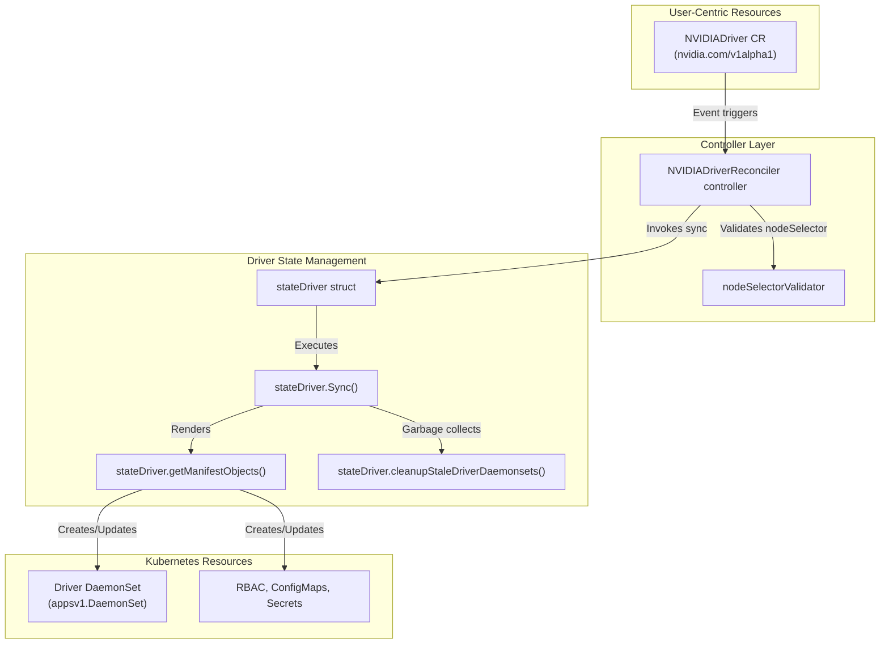
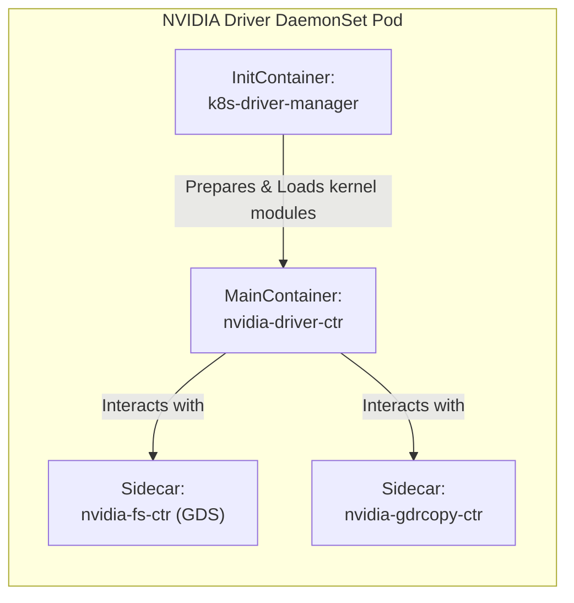
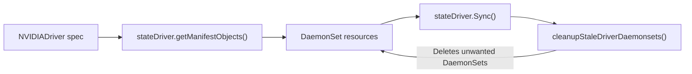

<!-- source: DeepWiki mcp.deepwiki.com · repo NVIDIA/gpu-operator · page 3.2 NVIDIADriver · fetched 2026-10-26 -->

# NVIDIADriver

Relevant source files

The following files were used as context for generating this wiki page:

- [api/nvidia/v1alpha1/nvidiadriver_types.go](api/nvidia/v1alpha1/nvidiadriver_types.go)
- [bundle/manifests/nvidia.com_nvidiadrivers.yaml](bundle/manifests/nvidia.com_nvidiadrivers.yaml)
- [config/crd/bases/nvidia.com_nvidiadrivers.yaml](config/crd/bases/nvidia.com_nvidiadrivers.yaml)
- [controllers/clusterinfo/clusterinfo.go](controllers/clusterinfo/clusterinfo.go)
- [deployments/gpu-operator/crds/nvidia.com_nvidiadrivers.yaml](deployments/gpu-operator/crds/nvidia.com_nvidiadrivers.yaml)
- [deployments/gpu-operator/templates/nvidiadriver.yaml](deployments/gpu-operator/templates/nvidiadriver.yaml)
- [internal/consts/consts.go](internal/consts/consts.go)
- [internal/render/render.go](internal/render/render.go)
- [internal/state/driver.go](internal/state/driver.go)
- [internal/state/driver_test.go](internal/state/driver_test.go)
- [internal/state/driver_volumes.go](internal/state/driver_volumes.go)
- [internal/state/types.go](internal/state/types.go)

## Purpose and Scope

The `NVIDIADriver` Custom Resource (CR) provides advanced and fine-grained control over NVIDIA GPU driver deployments in Kubernetes clusters. It belongs to the `nvidia.com` API group, version `v1alpha1`, and facilitates driver management scenarios beyond the simplified interface offered by `ClusterPolicy`.

The `NVIDIADriver` CR is especially suited for:

- Managing multiple, heterogeneous driver versions across different node pools by using node selectors.  
- Deploying different driver types such as `gpu`, `vgpu` (for virtual GPU guests), and `vgpu-host-manager` (for hypervisor hosts).  
- Configuring specialized optional components like GPUDirect Storage (GDS), GDRCopy, and GPU Direct RDMA, with control over images, environment variables, and arguments.  
- Supporting precompiled driver modules that target specific kernel versions or OS types.  
- Customizing the behavior of the driver installation and management via settings for the `k8s-driver-manager` init container and lifecycle probes.  

For general GPU Operator configuration, review the `ClusterPolicy` CR. For concepts related to driver deployment mechanics, see the Driver Management component.

**Sources:**  
[deployments/gpu-operator/crds/nvidia.com_nvidiadrivers.yaml:7-84](),  
[api/nvidia/v1alpha1/nvidiadriver_types.go:32-141]()

---

## Overview

`NVIDIADriver` is a cluster-scoped resource that specifies the desired state for NVIDIA GPU driver deployments, allowing explicit control of targeting, versioning, images, and node selection. It offers enhanced flexibility for use cases like multi-version clusters, virtualization, and advanced driver features.

### Code-to-System Mapping: Reconciliation Flow

The following diagram illustrates how the `NVIDIADriver` CR triggers the reconciliation workflow managed by the operator, linking key code components in the process of deploying and managing the driver DaemonSet:

Here:  
- `NVIDIADriverReconciler` is the primary controller responding to CR events.  
- A `nodeSelectorValidator` ensures selectors are valid and meet constraints (e.g., default drivers may not specify node selectors).  
- `stateDriver` encapsulates logic to sync cluster state, render manifests, and manage resources.  
- Driver DaemonSets are the core deployment units managing driver pods on nodes matching criteria.  
- Supporting RBAC, ConfigMaps and Secrets configure necessary driver permissions and data.  

**Sources:**  
[api/nvidia/v1alpha1/nvidiadriver_types.go:39-47](),  
[internal/state/driver.go:133-167](),  
[deployments/gpu-operator/templates/nvidiadriver.yaml:1-131]()

---

## Architecture

### Driver DaemonSet and Pod Composition

NVIDIA driver deployments use a `DaemonSet` with customized pod specs constructed based on the `NVIDIADriver` resource. The pod typically contains:

- **Init Container:** `k8s-driver-manager` — pre-installs or prepares kernel modules and necessary files.  
- **Main Container:** `nvidia-driver-ctr` — runs the NVIDIA driver components and kernel modules in the pod.  
- **Optional Sidecars:** For features such as GPUDirect Storage (GDS), GDRCopy, and GPU Direct RDMA, additional sidecar containers are injected as per CR spec flags.

The operator computes a `DRIVER_CONFIG_DIGEST` environment variable representing a hash of all driver-install relevant parameters. Changes to this digest cause the driver DaemonSet pods to restart and pick up new configurations. This provides an efficient reconciliation trigger mechanism.  

**Sources:**  
[deployments/gpu-operator/templates/nvidiadriver.yaml:107-129](),  
[internal/state/driver.go:103-107]()

### Node Selector and Driver Type

- **Node Selector:** The `nodeSelector` field (optional and restricted for `default` drivers) indicates Kubernetes label selectors that define which nodes a given driver instance manages. This allows:
  - Heterogeneous GPU clusters with different drivers per node group.  
  - Fallback drivers (`default: true`) apply to nodes that do not match any non-default driver.  
- **Driver Type:** The immutable `driverType` property defines the driver variant:
  - `gpu` — Traditional NVIDIA GPU driver.  
  - `vgpu` — NVIDIA vGPU guest driver inside virtual machines.  
  - `vgpu-host-manager` — Driver host managing vGPU hypervisor features.  

### Additional Configurations

The CR provides fields to specify:  
- Driver image repository, tag/version, and image pull policies.  
- Environment variables and command-line arguments for driver containers and sidecars.  
- ConfigMaps and Secrets for certificates, licensing (notably for vGPU licensing using NLS tokens and configs), and custom repo configurations.  
- Kernel module type selection (`auto`, `open`, `proprietary`) controlling which kernel module version to load — supporting precompiled or open kernel modules.  
- Startup, readiness, and liveness probes for health checks.  
- Upgrade policies for controlled driver rollouts.  

These enable precise customization of the driver deployment lifecycle and runtime behavior.

**Sources:**  
[api/nvidia/v1alpha1/nvidiadriver_types.go:44-90](),  
[api/nvidia/v1alpha1/nvidiadriver_types.go:135-156](),  
[deployments/gpu-operator/templates/nvidiadriver.yaml:7-40]()

---

## Specification Reference

### Important Fields in `NVIDIADriverSpec`

| Field               | Type                                        | Description                                                                                                                                                              |
|---------------------|---------------------------------------------|--------------------------------------------------------------------------------------------------------------------------------------------------------------------------|
| `default`           | `bool` (optional, default `false`)          | Marks this instance as fallback driver managing GPU nodes unmatched by other NVIDIADriver resources. Must not specify `nodeSelector` if `true`.                          |
| `driverType`        | `string` (enum: `gpu`, `vgpu`, `vgpu-host-manager`) | Immutable driver type determining driver variant to deploy.                                                                                                             |
| `nodeSelector`      | `map[string]string` (optional)               | Kubernetes labels to match nodes for this driver deployment. Not allowed if `default` is `true`.                                                                        |
| `image`, `repository`, `version` | `string`                           | Image repository and tag for NVIDIA driver container.                                                                                                                   |
| `usePrecompiled`    | `bool` (optional)                            | Enable deployment of precompiled NVIDIA drivers based on node kernel versions.                                                                                           |
| `kernelModuleType`  | `string` (enum: `auto`, `open`, `proprietary`) | Select driver kernel module variant to be used.                                                                                                                         |
| `gdrcopy`           | `GDRCopySpec` (optional)                      | Configuration for GDRCopy sidecar container.                                                                                                                            |
| `gds`               | `GPUDirectStorageSpec` (optional)             | Configuration for GPUDirect Storage sidecar container.                                                                                                                  |
| `rdma`              | `GPUDirectRDMASpec` (optional)                 | NVIDIA Peer Memory driver configuration for RDMA support.                                                                                                              |
| `licensingConfig`   | Licensing config secret or configmap          | For vGPU licensing files (e.g., NLS tokens and configuration files).                                                                                                    |
| `virtualTopologyConfig` | ConfigMap reference                        | Configuration for vGPU virtual topology daemon.                                                                                                                         |
| `env`               | List of environment variables                  | Additional environment variables to inject in driver containers.                                                                                                       |
| `args`              | List of strings                                | Additional command-line arguments for driver containers.                                                                                                               |
| `startupProbe`, `livenessProbe`, `readinessProbe` | Probe definitions                 | Container lifecycle probes for driver health monitoring.                                                                                                               |
| `resources`         | Kubernetes `ResourceRequirements`              | Resource requests and limits settings for driver containers.                                                                                                           |

**Sources:**  
[deployments/gpu-operator/crds/nvidia.com_nvidiadrivers.yaml:53-159](),  
[api/nvidia/v1alpha1/nvidiadriver_types.go:44-141]()

---

## Advanced Configuration

### vGPU Licensing and Virtual Topology

For the `vgpu` and `vgpu-host-manager` driver types, licensing and topology configuration are important:

- **LicensingConfig:** The CR can reference Kubernetes Secrets or ConfigMaps to provide licensing files (e.g., `gridd.conf`) and NLS client tokens required by NVIDIA Licensing System (NLS). This enables proper licensing enforcement within vGPU environments.  
- **VirtualTopologyConfig:** A ConfigMap reference can provide configuration files for the vGPU virtual topology daemon, facilitating advanced device mapping and topology awareness.

These enable the operator to properly manage driver components in complex virtualized GPU deployments.

**Sources:**  
[api/nvidia/v1alpha1/nvidiadriver_types.go:145-156](),  
[internal/consts/consts.go:52-63]()

### Precompiled Drivers and Host Subscription Mounts

When `usePrecompiled` is enabled, the driver deployment is optimized to load kernel modules already compiled for the target system, reducing build time during startup.

The operator mounts OS-specific subscription or entitlement paths into the driver containers, allowing access to restricted or subscription-based repositories, especially for RHEL or RHCOS-based distros. Standard paths are automatically detected and injected as volumes and mounts.

This integration is handled internally by the state logic during the manifest rendering stage.

**Sources:**  
[internal/state/driver_volumes.go:33-140](),  
[internal/state/driver.go:140-160]()

---

## Status and Conditions

The `NVIDIADriver` resource status tracks the observed state and readiness of the driver deployment.

| Status Field   | Description                                |
|----------------|--------------------------------------------|
| `state`        | Overall high-level state (e.g., `Ready`, `NotReady`). Reflects driver DaemonSet pod health and availability. [crd columns] |
| `conditions`   | Array capturing transition states, errors, and operational insights during reconciliation. |

Driver resources are labeled with `app.kubernetes.io/component: nvidia-driver` (or `nvidia-vgpu-host-manager` for vGPU types) for easier tracking and monitoring by the controller.

The reconciliation logic evaluates readiness by inspecting DaemonSet statuses to set conditions and overall state accordingly.

**Sources:**  
[deployments/gpu-operator/crds/nvidia.com_nvidiadrivers.yaml:21-29](),  
[internal/state/driver.go:134-167]()

---

## Implementation Details

### `stateDriver` Structure and Key Methods

The internal driver state manager is implemented by the `stateDriver` struct which embeds `stateSkel`. It manages syncing the `NVIDIADriver` resource with its corresponding Kubernetes objects (primarily a DaemonSet).

- **Creation:** Use `NewStateDriver()` to instantiate given a Kubernetes client, namespace, scheme, and manifest directory. This initializes the renderer for manifest templates.  
- **Syncing:** The `Sync()` method reconciles the `NVIDIADriver` instance. It:  
  - Renders manifests based on the CR spec and cluster info.  
  - Cleans up stale DaemonSets no longer desired.  
  - Creates or updates current resources, setting controller ownership references.  
  - Checks readiness by examining DaemonSet pod statuses.  
- **Watch Sources:** Declares Kubernetes resource kinds and predicates used for event watching and triggering reconciliation. It specifically watches DaemonSets labeled as NVIDIA drivers.

### Manifest Rendering and Cleanup

Manifests are rendered via a templating engine using the `render.Renderer` interface, which processes `.yaml` templates under the `manifests/state-driver` folder based on driver specifications and cluster runtime information (e.g., OpenShift version and proxy specs).

Stale DaemonSets (from old or removed `NVIDIADriver` specs) are detected by their ownership labels and deleted to ensure cluster cleanliness.

**Sources:**  
[internal/state/driver.go:109-167](),  
[internal/render/render.go:67-156]()

---

## Summary

The `NVIDIADriver` CRD provides a comprehensive API for advanced NVIDIA driver deployment and management across Kubernetes clusters. It empowers operators and cluster admins to target specific nodes, use different driver flavors, and enable advanced GPU features with extensive customization. The GPU Operator uses this CRD to orchestrate the lifecycle of driver DaemonSets with monitoring, cleanup, and upgrade capabilities.

---

# References to Key Source Files

| Purpose                                 | File Path and Lines                         |
|-----------------------------------------|--------------------------------------------|
| `NVIDIADriver` CRD and Spec Definition  | `deployments/gpu-operator/crds/nvidia.com_nvidiadrivers.yaml:7-84` `api/nvidia/v1alpha1/nvidiadriver_types.go:32-141`  |
| Reconciliation and State Management     | `internal/state/driver.go:109-167`          |
| Driver DaemonSet manifest template      | `deployments/gpu-operator/templates/nvidiadriver.yaml:1-131`    |
| Volume and mounts for subscriptions     | `internal/state/driver_volumes.go:33-140`   |
| Rendering implementation                | `internal/render/render.go:67-156`          |
| Cluster info interface for runtime info | `controllers/clusterinfo/clusterinfo.go:42-170` |

---

**Sources:**  
[deployments/gpu-operator/crds/nvidia.com_nvidiadrivers.yaml](),  
[api/nvidia/v1alpha1/nvidiadriver_types.go](),  
[internal/state/driver.go](),  
[internal/state/driver_volumes.go](),  
[deployments/gpu-operator/templates/nvidiadriver.yaml](),  
[internal/render/render.go](),  
[controllers/clusterinfo/clusterinfo.go]()

---

