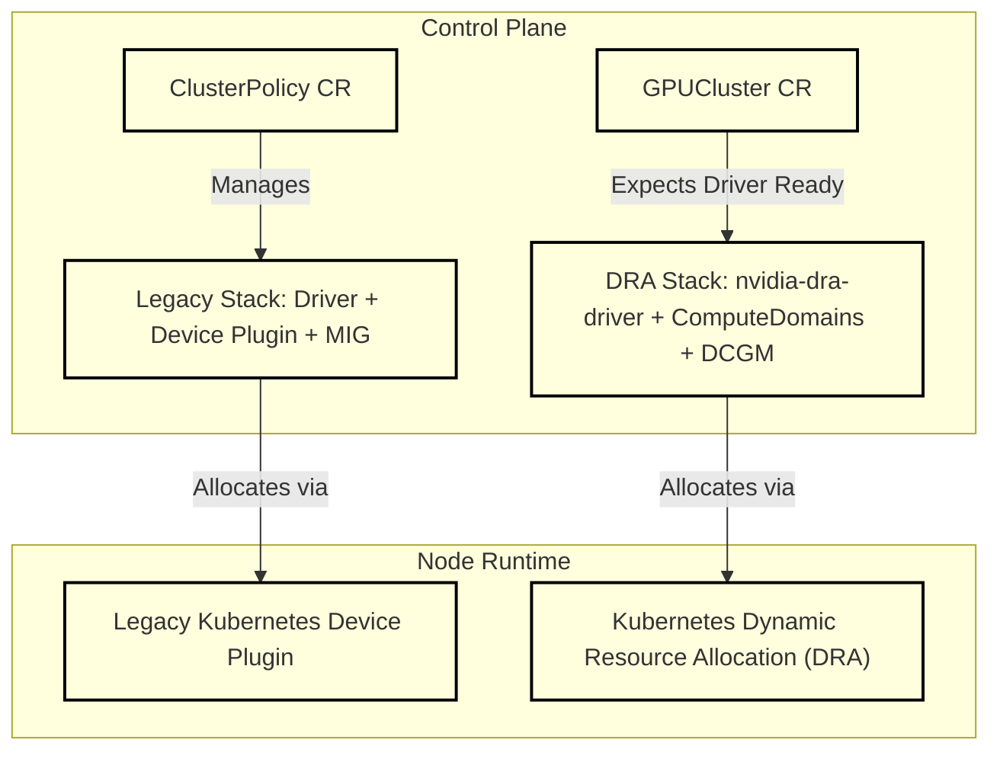
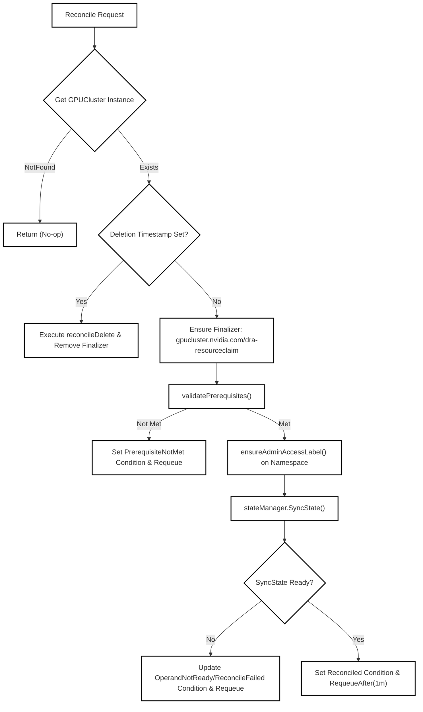
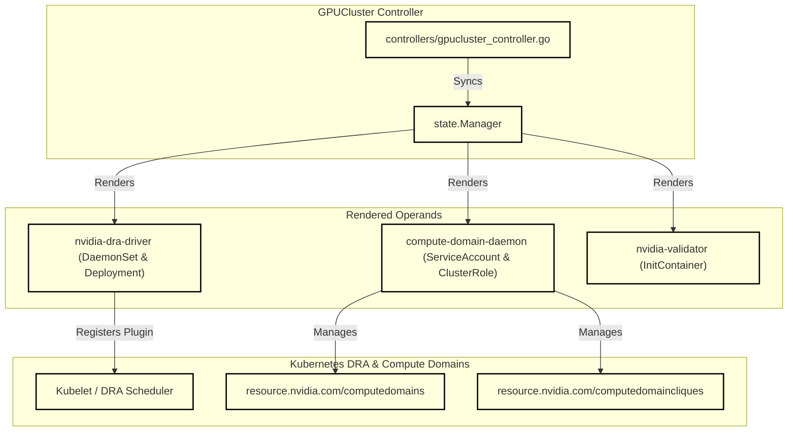

<!-- source: DeepWiki mcp.deepwiki.com · repo NVIDIA/gpu-operator · page 3.3 GPUCluster and ComputeDomain · fetched 2026-10-26 -->

# GPUCluster and ComputeDomain

Relevant source files

The following files were used as context for generating this wiki page:

- [bundle/manifests/nvidia.com_gpuclusters.yaml](bundle/manifests/nvidia.com_gpuclusters.yaml)
- [bundle/manifests/resource.nvidia.com_computedomaincliques.yaml](bundle/manifests/resource.nvidia.com_computedomaincliques.yaml)
- [bundle/manifests/resource.nvidia.com_computedomains.yaml](bundle/manifests/resource.nvidia.com_computedomains.yaml)
- [cmd/cleanup-gpuclusters/main.go](cmd/cleanup-gpuclusters/main.go)
- [cmd/nvidia-validator/driver.go](cmd/nvidia-validator/driver.go)
- [config/crd/bases/nvidia.com_gpuclusters.yaml](config/crd/bases/nvidia.com_gpuclusters.yaml)
- [config/rbac/role.yaml](config/rbac/role.yaml)
- [config/samples/nvidia_v1alpha1_gpucluster.yaml](config/samples/nvidia_v1alpha1_gpucluster.yaml)
- [controllers/gpucluster_controller.go](controllers/gpucluster_controller.go)
- [deployments/gpu-operator/crds/nvidia.com_gpuclusters.yaml](deployments/gpu-operator/crds/nvidia.com_gpuclusters.yaml)
- [deployments/gpu-operator/crds/resource.nvidia.com_computedomaincliques.yaml](deployments/gpu-operator/crds/resource.nvidia.com_computedomaincliques.yaml)
- [deployments/gpu-operator/crds/resource.nvidia.com_computedomains.yaml](deployments/gpu-operator/crds/resource.nvidia.com_computedomains.yaml)
- [deployments/gpu-operator/templates/cleanup_crd.yaml](deployments/gpu-operator/templates/cleanup_crd.yaml)
- [deployments/gpu-operator/templates/cleanup_gpucluster.yaml](deployments/gpu-operator/templates/cleanup_gpucluster.yaml)
- [deployments/gpu-operator/templates/clusterrole.yaml](deployments/gpu-operator/templates/clusterrole.yaml)
- [deployments/gpu-operator/templates/upgrade_crd.yaml](deployments/gpu-operator/templates/upgrade_crd.yaml)
- [internal/driver/hostsmi.go](internal/driver/hostsmi.go)
- [internal/driver/root.go](internal/driver/root.go)
- [internal/driver/root_test.go](internal/driver/root_test.go)
- [internal/state/dra_driver.go](internal/state/dra_driver.go)
- [internal/state/dra_driver_test.go](internal/state/dra_driver_test.go)
- [internal/state/gpucluster_render_test.go](internal/state/gpucluster_render_test.go)
- [internal/state/gpucluster_scc_test.go](internal/state/gpucluster_scc_test.go)
- [internal/state/testdata/golden/gpucluster-dra-driver-full-spec.yaml](internal/state/testdata/golden/gpucluster-dra-driver-full-spec.yaml)
- [internal/state/testdata/golden/gpucluster-dra-driver-gpus-only.yaml](internal/state/testdata/golden/gpucluster-dra-driver-gpus-only.yaml)
- [internal/state/testdata/golden/gpucluster-dra-driver-passthrough-support.yaml](internal/state/testdata/golden/gpucluster-dra-driver-passthrough-support.yaml)
- [manifests/state-dra-driver/0120_compute-domain-daemon-rbac.yaml](manifests/state-dra-driver/0120_compute-domain-daemon-rbac.yaml)
- [manifests/state-dra-driver/0200_kubeletplugin-clusterrole.yaml](manifests/state-dra-driver/0200_kubeletplugin-clusterrole.yaml)
- [manifests/state-dra-driver/0450_scc.openshift.yaml](manifests/state-dra-driver/0450_scc.openshift.yaml)
- [manifests/state-dra-driver/0500_daemonset.yaml](manifests/state-dra-driver/0500_daemonset.yaml)
- [manifests/state-dra-driver/0600_controller-deployment.yaml](manifests/state-dra-driver/0600_controller-deployment.yaml)

## Purpose and Scope
This document provides a comprehensive technical reference for the `GPUCluster` Custom Resource Definition (CRD), the `resource.nvidia.com` `ComputeDomain` and `ComputeDomainClique` CRDs, the `gpucluster_controller`, the `cleanup-gpuclusters` utility, and the architectural relationship between `GPUCluster` and `ClusterPolicy`. 

Unlike the monolithic `ClusterPolicy` architecture, `GPUCluster` represents the modern Kubernetes Dynamic Resource Allocation (DRA)-based software enablement stack. It decouples NVIDIA driver installation from the higher-level GPU software stack (`nvidia-dra-driver`, DCGM, validation) and introduces advanced compute domain orchestration for multi-GPU topologies.

---

## 1. GPUCluster vs. ClusterPolicy Architecture

The GPU Operator supports two primary high-level configuration APIs for deploying GPU software stacks:

1. **`ClusterPolicy`**: The legacy and standard control plane API. It manages the entire lifecycle of NVIDIA drivers (`NVIDIADriver` or host-injected), the NVIDIA Container Toolkit, the traditional Kubernetes Device Plugin, MIG Manager, DCGM monitoring, and GPU Feature Discovery.
2. **`GPUCluster`**: The newer, DRA-centric control plane API (`nvidiav1alpha1.GPUCluster`). It assumes the NVIDIA driver is already installed on the nodes (either via host installation or an independent `NVIDIADriver` CR). It waits for driver readiness and then provisions the NVIDIA DRA driver (`nvidia-dra-driver`), DeviceClasses, ResourceSlices, and Compute Domains.

*Sources: `deployments/gpu-operator/crds/nvidia.com_gpuclusters.yaml` [deployments/gpu-operator/crds/nvidia.com_gpuclusters.yaml:48-54](), `controllers/gpucluster_controller.go` [controllers/gpucluster_controller.go:80-157]()*

---

## 2. Custom Resource Definitions (CRDs)

### GPUCluster CRD (`gpuclusters.nvidia.com`)
The `GPUCluster` CRD defines the desired state for the DRA-based software stack. Its schema includes configuration blocks for the DRA driver (`draDriver`), standalone DCGM monitoring (`dcgm`, `dcgmExporter`), host paths, and common DaemonSet parameters [`deployments/gpu-operator/crds/nvidia.com_gpuclusters.yaml:48-87()`].

Key specification structures include:
* `draDriver`: Configures the `nvidia-dra-driver` controller, kubelet plugin, image repositories, feature gates (e.g., `PassthroughSupport`), and `computeDomains` capabilities [`internal/state/gpucluster_render_test.go:34-74()`].
* `daemonsets`: Applies cluster-wide pod security contexts, priority classes (`system-node-critical`), tolerations, and node selectors across all deployed operands [`config/samples/nvidia_v1alpha1_gpucluster.yaml:75-87()`].

### ComputeDomain and ComputeDomainClique CRDs (`resource.nvidia.com`)
To support advanced multi-GPU collective communication and domain partitioning under DRA, two specialized CRDs are introduced under the `resource.nvidia.com` API group:
* **`ComputeDomain`**: Represents a logical grouping or slice of compute resources managed by the compute domain daemon [deployments/gpu-operator/templates/clusterrole.yaml:171-181()].
* **`ComputeDomainClique`**: Represents tightly coupled cliques of GPUs configured for high-bandwidth interconnect topologies [deployments/gpu-operator/templates/clusterrole.yaml:182-194()].

---

## 3. The `gpucluster_controller` Implementation

The `GPUClusterReconciler` (`controllers/gpucluster_controller.go`) manages the reconciliation loop for `GPUCluster` instances.

*Sources: `controllers/gpucluster_controller.go` [controllers/gpucluster_controller.go:80-157]()*

### Key Controller Mechanics
1. **Finalizer Protection**: The controller injects the `gpucluster.nvidia.com/dra-resourceclaim` finalizer to ensure proper cleanup of dependent DRA resource claims and cluster resources prior to CR deletion [controllers/gpucluster_controller.go:52-54(), controllers/gpucluster_controller.go:100-102()].
2. **Admin Access Labeling**: Because DRA resource claim templates utilize `adminAccess: true`, the controller automatically ensures the operator's namespace is labeled with `resource.kubernetes.io/admin-access` before syncing states [controllers/gpucluster_controller.go:55-58(), controllers/gpucluster_controller.go:119-121()].
3. **State Synchronization**: The controller leverages `state.Manager` to iterate through the catalog of operands (`dra-driver`, `dra-validator`, `dcgm`, `dcgm-exporter`) [controllers/gpucluster_controller.go:123-126()].

---

## 4. ComputeDomain & DRA Driver Architecture

When `computeDomains.enabled` is set to `true` in the `GPUCluster` spec, the rendering engine provisions specialized controller deployments, kubelet plugins, and the `compute-domain-daemon` [internal/state/gpucluster_render_test.go:54-72(), internal/state/testdata/golden/gpucluster-dra-driver-full-spec.yaml:131-190()].

*Sources: `controllers/gpucluster_controller.go` [controllers/gpucluster_controller.go:123-126](), `internal/state/testdata/golden/gpucluster-dra-driver-full-spec.yaml` [internal/state/testdata/golden/gpucluster-dra-driver-full-spec.yaml:1-326]()*

---

## 5. The `cleanup-gpuclusters` and CRD Management Utilities

The GPU Operator provides helper binaries and Helm hooks to manage the lifecycle of `GPUCluster` and `ComputeDomain` CRDs.

* **`manage-crds`**: Located under `cmd/manage-crds/` (invoked via upgrade and cleanup Helm jobs), this utility applies or deletes CRD YAML definitions including `nvidia.com_gpuclusters.yaml`, `resource.nvidia.com_computedomains.yaml`, and `resource.nvidia.com_computedomaincliques.yaml` [deployments/gpu-operator/templates/upgrade_crd.yaml:105-114(), deployments/gpu-operator/templates/cleanup_crd.yaml:56-65()].
* **`cleanup-gpuclusters`**: Located under `cmd/cleanup-gpuclusters/main.go`, this utility performs targeted cleanup of GPUCluster resources and associated cluster-scoped DRA objects during operator uninstallation.

---
*Sources: `deployments/gpu-operator/templates/upgrade_crd.yaml` [deployments/gpu-operator/templates/upgrade_crd.yaml:1-116](), `deployments/gpu-operator/templates/cleanup_crd.yaml` [deployments/gpu-operator/templates/cleanup_crd.yaml:1-67]()*

---

