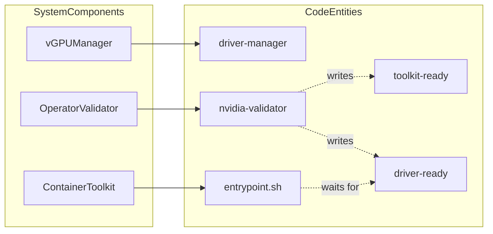

<!-- source: DeepWiki mcp.deepwiki.com · repo NVIDIA/gpu-operator · page 4 Components · fetched 2026-10-26 -->

# Components

<details>
<summary>Relevant source files</summary>

The following files were used as context for generating this wiki page:

- [assets/gpu-feature-discovery/0500_daemonset.yaml](assets/gpu-feature-discovery/0500_daemonset.yaml)
- [assets/state-dcgm-exporter/0800_daemonset.yaml](assets/state-dcgm-exporter/0800_daemonset.yaml)
- [assets/state-dcgm/0400_dcgm.yml](assets/state-dcgm/0400_dcgm.yml)
- [assets/state-device-plugin/0500_daemonset.yaml](assets/state-device-plugin/0500_daemonset.yaml)
- [assets/state-driver/0500_daemonset.yaml](assets/state-driver/0500_daemonset.yaml)
- [assets/state-mig-manager/0600_daemonset.yaml](assets/state-mig-manager/0600_daemonset.yaml)
- [assets/state-mps-control-daemon/0400_daemonset.yaml](assets/state-mps-control-daemon/0400_daemonset.yaml)
- [assets/state-operator-validation/0500_daemonset.yaml](assets/state-operator-validation/0500_daemonset.yaml)
- [assets/state-sandbox-validation/0500_daemonset.yaml](assets/state-sandbox-validation/0500_daemonset.yaml)
- [internal/state/testdata/golden/driver-additional-configs.yaml](internal/state/testdata/golden/driver-additional-configs.yaml)
- [internal/state/testdata/golden/driver-full-spec.yaml](internal/state/testdata/golden/driver-full-spec.yaml)
- [internal/state/testdata/golden/driver-gdrcopy-openshift.yaml](internal/state/testdata/golden/driver-gdrcopy-openshift.yaml)
- [internal/state/testdata/golden/driver-gdrcopy.yaml](internal/state/testdata/golden/driver-gdrcopy.yaml)
- [internal/state/testdata/golden/driver-gds.yaml](internal/state/testdata/golden/driver-gds.yaml)
- [internal/state/testdata/golden/driver-minimal.yaml](internal/state/testdata/golden/driver-minimal.yaml)
- [internal/state/testdata/golden/driver-openshift-drivertoolkit.yaml](internal/state/testdata/golden/driver-openshift-drivertoolkit.yaml)
- [internal/state/testdata/golden/driver-precompiled.yaml](internal/state/testdata/golden/driver-precompiled.yaml)
- [internal/state/testdata/golden/driver-rdma-hostmofed.yaml](internal/state/testdata/golden/driver-rdma-hostmofed.yaml)
- [internal/state/testdata/golden/driver-rdma.yaml](internal/state/testdata/golden/driver-rdma.yaml)
- [internal/state/testdata/golden/driver-vgpu-licensing.yaml](internal/state/testdata/golden/driver-vgpu-licensing.yaml)
- [manifests/state-driver/0500_daemonset.yaml](manifests/state-driver/0500_daemonset.yaml)

</details>


This page provides an overview of all components deployed by the NVIDIA GPU Operator. Each component is a Kubernetes DaemonSet or Deployment that fulfills a specific role in the GPU infrastructure stack, configured via the `ClusterPolicy` Custom Resource and managed through state reconciliation.

For information about the overall architecture, see [Architecture](#2). For details on the `ClusterPolicy` API, see [ClusterPolicy](#3.1). For deployment instructions, see [Deployment](#5).

---

## Component Architecture Overview

The GPU Operator deploys components in a layered dependency architecture. Each layer relies on the successful execution and validation of preceding layers, coordinated via validation markers and init containers.

```mermaid
graph TB
    subgraph "Foundation"
        NFD["NodeFeatureDiscovery"]
    end
    
    subgraph "Driver"
        Driver["nvidia-driver-daemonset"]
        VGPUMgr["nvidia-vgpu-manager-daemonset"]
    end
    
    subgraph "Toolkit"
        Toolkit["nvidia-container-toolkit-daemonset"]
    end
    
    subgraph "DeviceManagement"
        DevicePlugin["nvidia-device-plugin-daemonset"]
        MPSControl["nvidia-device-plugin-mps-control-daemon"]
    end
    
    subgraph "FeatureDiscovery"
        GFD["gpu-feature-discovery"]
        MIGMgr["nvidia-mig-manager"]
    end
    
    subgraph "Monitoring"
        DCGM["nvidia-dcgm"]
        DCGMExp["nvidia-dcgm-exporter"]
    end
    
    subgraph "Validation"
        OpValidator["nvidia-operator-validator"]
    end

    NFD --> Driver
    NFD --> VGPUMgr
    Driver --> Toolkit
    VGPUMgr --> Toolkit
    Toolkit --> DevicePlugin
    Toolkit --> MPSControl
    Driver --> GFD
    Driver --> MIGMgr
    Driver --> DCGM
    DCGM --> DCGMExp
    DevicePlugin --> OpValidator
```

Sources: [assets/gpu-feature-discovery/0500_daemonset.yaml:28-122](), [assets/state-mig-manager/0600_daemonset.yaml:28-116](), [assets/state-operator-validation/0500_daemonset.yaml:28-126]()

---

## 4.1. Driver Management

The driver management component deploys NVIDIA GPU drivers and vGPU managers across nodes using DaemonSets. It utilizes the `k8s-driver-manager` init container to handle pre-flight cleanup, driver uninstallation, and node draining [assets/state-driver/0500_daemonset.yaml:46-90](). It supports standard precompiled drivers, custom container images, and the OpenShift Driver Toolkit [manifests/state-driver/0500_daemonset.yaml:1-180]().

For details, see [Driver Management](#4.1).

Sources: [assets/state-driver/0500_daemonset.yaml:46-90](), [manifests/state-driver/0500_daemonset.yaml:1-180]()

---

## 4.2. Container Toolkit

The NVIDIA Container Toolkit component configures container runtimes (such as containerd, Docker, or CRI-O) to integrate GPU support via CDI (Container Device Interface) and runtime injection. It verifies driver readiness via init containers before configuring the host runtime environment.

For details, see [Container Toolkit](#4.2).

Sources: [assets/state-container-toolkit/0500_daemonset.yaml:1-139](), [assets/state-container-toolkit/0400_configmap.yaml:1-34]()

---

## 4.3. Device Plugin

The Kubernetes device plugin component advertises GPU resources to the Kubernetes scheduler and manages resource allocation for containers. It includes config maps for custom device-plugin configurations and supports multi-process service (MPS) control daemons.

For details, see [Device Plugin](#4.3).

Sources: [assets/state-device-plugin/0500_daemonset.yaml:1-167](), [assets/state-mps-control-daemon/0400_daemonset.yaml:1-100]()

---

## 4.4. MIG Manager

The MIG Manager configures Multi-Instance GPU (MIG) partitioning on supported GPUs. It runs as a DaemonSet using the `mig-parted` utility to apply partitioning profiles defined in ConfigMaps.

For details, see [MIG Manager](#4.4).

Sources: [assets/state-mig-manager/0400_configmap.yaml:1-55](), [assets/state-mig-manager/0600_daemonset.yaml:1-116]()

---

## 4.5. Monitoring and DCGM

The monitoring stack includes the Data Center GPU Manager (DCGM) hostengine and the DCGM Exporter. DCGM provides low-level telemetry, while DCGM Exporter exposes Prometheus metrics for GPU utilization, health, and power consumption.

For details, see [Monitoring and DCGM](#4.5).

Sources: [assets/state-dcgm/0400_dcgm.yml:1-59](), [assets/state-dcgm-exporter/0800_daemonset.yaml:1-81]()

---

## 4.6. Validation

The operator validator components (`nvidia-operator-validator` and `nvidia-sandbox-validator`) execute validation checks via init containers to ensure that the driver, container toolkit, device plugin, and CUDA workloads function correctly before marking nodes as ready.

For details, see [Validation](#4.6).

Sources: [assets/state-operator-validation/0500_daemonset.yaml:1-154](), [assets/state-sandbox-validation/0500_daemonset.yaml:1-147]()

---

## 4.7. GPU Feature Discovery

GPU Feature Discovery (GFD) detects GPU hardware capabilities (such as compute capability, driver version, and product name) and automatically labels Kubernetes nodes. It integrates with Node Feature Discovery (NFD) and the config-manager sidecar.

For details, see [GPU Feature Discovery](#4.7).

Sources: [assets/gpu-feature-discovery/0500_daemonset.yaml:1-132]()

---

## 4.8. DRA Driver

The Dynamic Resource Allocation (DRA) driver state manages Kubernetes DRA components, including the kubelet plugin DaemonSet, controller deployments, `DeviceClasses` (`gpu`, `mig`, `compute-domains`, `vfio-gpu`), and resource slice policies.

For details, see [DRA Driver](#4.8).

Sources: [assets/state-operator-validation/0500_daemonset.yaml:1-50]()

---

## Component Logic Mapping

Diagram: Component Code Entity Association



Sources: [assets/state-vgpu-manager/0500_daemonset.yaml:33-36](), [assets/state-operator-validation/0500_daemonset.yaml:32-79](), [assets/state-container-toolkit/0400_configmap.yaml:9-34]()

---

