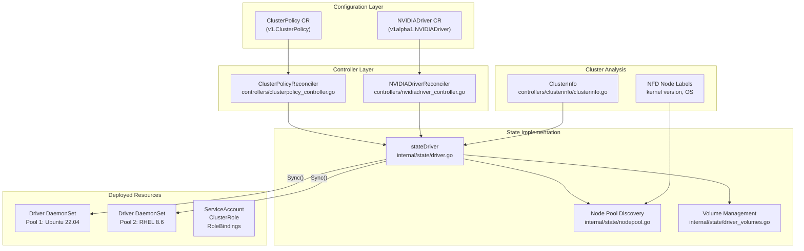
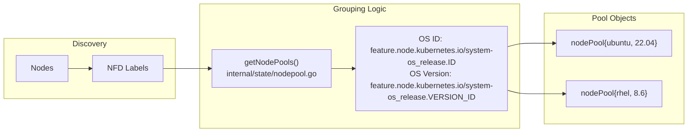
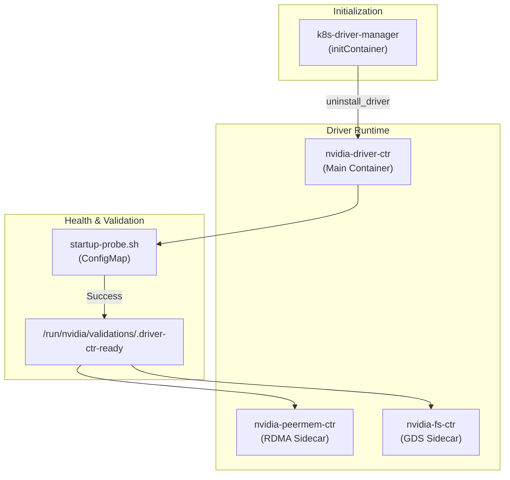

<!-- source: DeepWiki mcp.deepwiki.com · repo NVIDIA/gpu-operator · page 4.1 Driver Management · fetched 2026-10-26 -->

# Driver Management

Relevant source files

The following files were used as context for generating this wiki page:

- [assets/state-driver/0500_daemonset.yaml](assets/state-driver/0500_daemonset.yaml)
- [controllers/clusterinfo/clusterinfo.go](controllers/clusterinfo/clusterinfo.go)
- [internal/consts/consts.go](internal/consts/consts.go)
- [internal/render/render.go](internal/render/render.go)
- [internal/state/driver.go](internal/state/driver.go)
- [internal/state/driver_test.go](internal/state/driver_test.go)
- [internal/state/driver_volumes.go](internal/state/driver_volumes.go)
- [internal/state/testdata/golden/driver-additional-configs.yaml](internal/state/testdata/golden/driver-additional-configs.yaml)
- [internal/state/testdata/golden/driver-full-spec.yaml](internal/state/testdata/golden/driver-full-spec.yaml)
- [internal/state/testdata/golden/driver-gdrcopy-openshift.yaml](internal/state/testdata/golden/driver-gdrcopy-openshift.yaml)
- [internal/state/testdata/golden/driver-gdrcopy.yaml](internal/state/testdata/golden/driver-gdrcopy.yaml)
- [internal/state/testdata/golden/driver-gds.yaml](internal/state/testdata/golden/driver-gds.yaml)
- [internal/state/testdata/golden/driver-minimal.yaml](internal/state/testdata/golden/driver-minimal.yaml)
- [internal/state/testdata/golden/driver-openshift-drivertoolkit.yaml](internal/state/testdata/golden/driver-openshift-drivertoolkit.yaml)
- [internal/state/testdata/golden/driver-precompiled.yaml](internal/state/testdata/golden/driver-precompiled.yaml)
- [internal/state/testdata/golden/driver-rdma-hostmofed.yaml](internal/state/testdata/golden/driver-rdma-hostmofed.yaml)
- [internal/state/testdata/golden/driver-rdma.yaml](internal/state/testdata/golden/driver-rdma.yaml)
- [internal/state/testdata/golden/driver-vgpu-licensing.yaml](internal/state/testdata/golden/driver-vgpu-licensing.yaml)
- [internal/state/types.go](internal/state/types.go)
- [manifests/state-driver/0100_service_account.yaml](manifests/state-driver/0100_service_account.yaml)
- [manifests/state-driver/0200_role.yaml](manifests/state-driver/0200_role.yaml)
- [manifests/state-driver/0300_rolebinding.yaml](manifests/state-driver/0300_rolebinding.yaml)
- [manifests/state-driver/0310_clusterrolebinding.yaml](manifests/state-driver/0310_clusterrolebinding.yaml)
- [manifests/state-driver/0410_scc.openshift.yaml](manifests/state-driver/0410_scc.openshift.yaml)
- [manifests/state-driver/0500_daemonset.yaml](manifests/state-driver/0500_daemonset.yaml)

## Purpose and Scope

This document describes how the NVIDIA GPU Operator manages the deployment, configuration, and lifecycle of NVIDIA GPU drivers across Kubernetes clusters. Driver Management is responsible for installing the appropriate driver version on each GPU node, handling heterogeneous clusters with different operating systems and kernel versions, and orchestrating driver upgrades.

For information about the higher-level orchestration of all GPU operator components, see [Architecture](#2). For details on driver upgrade policies specifically, see [Driver Upgrades](#7.3). For OpenShift-specific driver features, see [OpenShift Integration](#7.2).

## Architecture Overview

Driver Management operates through a state-based reconciliation model where controllers continuously ensure that the actual driver deployment matches the desired state defined in Custom Resources. The `stateDriver` struct implements the `State` interface, managing the lifecycle of driver-related Kubernetes objects.

Title: Driver Management Architecture

**Sources:** [internal/state/driver.go:63-67](), [internal/state/driver.go:134-167](), [internal/state/driver.go:109-132]()

## Driver Deployment Models

The GPU Operator supports two deployment models for managing drivers:

### ClusterPolicy-Managed Drivers (Legacy)
In this mode, the `ClusterPolicy` controller manages driver deployment as one of many states. The driver configuration is specified in `ClusterPolicy.spec.driver`.

### NVIDIADriver CRD Mode
The preferred mode uses the `NVIDIADriver` Custom Resource, supporting multiple driver versions in a single cluster. The `stateDriver.Sync` function specifically handles the `NVIDIADriver` CR type to reconcile DaemonSets.

| Feature | ClusterPolicy Mode | NVIDIADriver CRD Mode |
|---------|-------------------|---------------------|
| Multiple driver versions | No | Yes |
| Node Selection | Global | Per-CR via `nodeSelector` |
| State Logic | `state-driver` | `state-driver` |

**Sources:** [internal/state/driver.go:134-138](), [internal/state/driver.go:186-210]()

## Node Pool Discovery

Driver Management groups GPU nodes into **node pools** based on OS and kernel versions. This allows the operator to deploy different driver images or configurations (like precompiled drivers) to different nodes.

Title: Node Pool Grouping and Rendering

The operator uses labels like `feature.node.kubernetes.io/system-os_release.ID` to identify the host environment.

**Sources:** [internal/state/driver.go:53-55](), [internal/state/nodepool.go:42-60]()

## DaemonSet Structure and Container Architecture

The driver is deployed via a DaemonSet (rendered from `manifests/state-driver/0500_daemonset.yaml`) containing multiple containers and init containers.

Title: Driver Container Lifecycle

### Init Container: k8s-driver-manager
The `k8s-driver-manager` init container ensures a clean state by uninstalling existing drivers and handling node draining/eviction if configured. It also calculates a `DRIVER_CONFIG_DIGEST` to detect configuration changes.

**Manifest:** [manifests/state-driver/0500_daemonset.yaml:135-180]()
**Command:** `driver-manager uninstall_driver` [assets/state-driver/0500_daemonset.yaml:50-51]()

### Main Container: nvidia-driver-ctr
Installs the NVIDIA driver and kernel modules. It uses a `startupProbe` to verify the driver is functional (e.g., `nvidia-smi` works) before signaling readiness via a sentinel file.

**Manifest:** [manifests/state-driver/0500_daemonset.yaml:42-45]()
**Startup Probe Script:** [internal/state/testdata/golden/driver-gds.yaml:101-141]()

**Sources:** [manifests/state-driver/0500_daemonset.yaml:135-180](), [internal/state/driver.go:103-107]()

## Advanced Driver Features

### OpenShift Driver Toolkit (DTK)
On OpenShift, the operator can use the Driver Toolkit to build drivers for the specific RHCOS kernel. The operator detects the OpenShift version and RHCOS version to pull the correct DTK image.

**Logic:** The `driverRuntimeSpec` includes `OpenshiftDriverToolkitEnabled`.
**Sources:** [internal/state/driver.go:69-74](), [manifests/state-driver/0500_daemonset.yaml:16-22]()

### Precompiled Drivers
When `usePrecompiled=true`, the operator selects a driver image containing pre-built modules for the specific kernel version found on the node.

**Labeling:** Nodes are labeled with `nvidia.com/precompiled.kernel-version`.
**Sources:** [manifests/state-driver/0500_daemonset.yaml:7-10](), [internal/state/driver.go:81-84]()

### GPU Direct RDMA and Storage
Sidecar containers are deployed to support specialized data paths:
- **nvidia-peermem-ctr**: Loads `nvidia_peermem` for RDMA support. [assets/state-driver/0500_daemonset.yaml:156-193]()
- **nvidia-fs-ctr**: Installs `nvidia-fs` for GPUDirect Storage (GDS). [assets/state-driver/0500_daemonset.yaml:194-197]()

## Volume Management

The `internal/state/driver_volumes.go` file manages complex host-path mounts required for different distributions (RHEL, SLES, Ubuntu). This includes mounting subscription certificates and repository configurations to allow the driver container to install dependencies.

| OS Type | Repo Config Path | Cert Config Path |
|---------|------------------|------------------|
| `ubuntu` | `/etc/apt/sources.list.d` | `/usr/local/share/ca-certificates` |
| `rhel` | `/etc/yum.repos.d` | `/etc/pki/ca-trust/extracted/pem` |
| `sles` | `/etc/zypp/repos.d` | `/etc/pki/trust/anchors` |

**Sources:** [internal/state/driver_volumes.go:34-60](), [internal/state/driver_volumes.go:69-138]()

## Reconciliation and Cleanup

The `stateDriver` ensures that only the desired DaemonSets exist. If a node pool is removed or a `NVIDIADriver` CR is updated to no longer match certain nodes, the operator performs a cleanup.

**Function:** `cleanupStaleDriverDaemonsets`
**Logic:** Lists all DaemonSets owned by the `NVIDIADriver` CR and deletes those not present in the current desired object list.
**Sources:** [internal/state/driver.go:186-210]()

---

