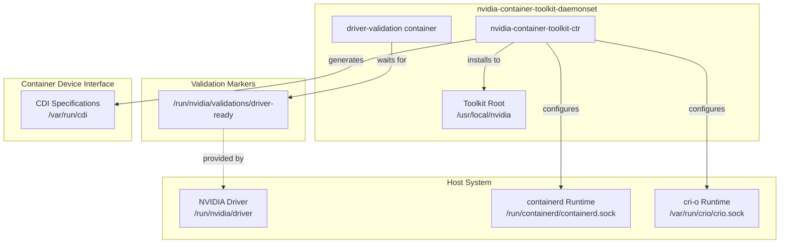
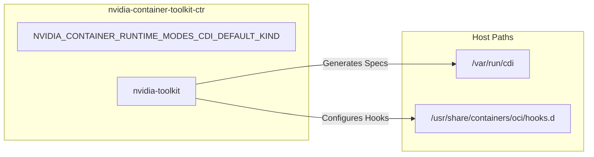

<!-- source: DeepWiki mcp.deepwiki.com · repo NVIDIA/gpu-operator · page 4.2 Container Toolkit · fetched 2026-10-26 -->

# Container Toolkit

<details>
<summary>Relevant source files</summary>

The following files were used as context for generating this wiki page:

- [assets/state-container-toolkit/0100_service_account.yaml](assets/state-container-toolkit/0100_service_account.yaml)
- [assets/state-container-toolkit/0200_role.yaml](assets/state-container-toolkit/0200_role.yaml)
- [assets/state-container-toolkit/0300_rolebinding.yaml](assets/state-container-toolkit/0300_rolebinding.yaml)
- [assets/state-container-toolkit/0400_configmap.yaml](assets/state-container-toolkit/0400_configmap.yaml)
- [assets/state-container-toolkit/0500_daemonset.yaml](assets/state-container-toolkit/0500_daemonset.yaml)
- [assets/state-device-plugin/0100_service_account.yaml](assets/state-device-plugin/0100_service_account.yaml)
- [assets/state-device-plugin/0300_rolebinding.yaml](assets/state-device-plugin/0300_rolebinding.yaml)
- [assets/state-device-plugin/0400_configmap.yaml](assets/state-device-plugin/0400_configmap.yaml)
- [assets/state-driver/0100_service_account.yaml](assets/state-driver/0100_service_account.yaml)
- [assets/state-driver/0300_rolebinding.yaml](assets/state-driver/0300_rolebinding.yaml)
- [assets/state-kata-manager/0410_configmap.yaml](assets/state-kata-manager/0410_configmap.yaml)
- [assets/state-kata-manager/0600_daemonset.yaml](assets/state-kata-manager/0600_daemonset.yaml)
- [assets/state-mig-manager/0420_configmap.yaml](assets/state-mig-manager/0420_configmap.yaml)

</details>


The Container Toolkit component configures container runtimes to expose NVIDIA GPUs to containerized workloads. It bridges the NVIDIA driver installation with Kubernetes by modifying runtime configurations for containerd, Docker, or CRI-O to enable GPU access. This is a required component that sits between the driver layer and device management layers in the GPU Operator stack.

For information about driver installation, see [Driver Management](#4.1). For information about GPU resource scheduling and allocation, see [Device Plugin](#4.3).

## Overview

The Container Toolkit component is responsible for:

- Installing the NVIDIA Container Runtime components on each GPU node using `nvidia-container-toolkit-daemonset` [assets/state-container-toolkit/0500_daemonset.yaml:5-6]().
- Configuring the container runtime to use the NVIDIA runtime.
- Enabling Container Device Interface (CDI) support when configured via `NVIDIA_CONTAINER_RUNTIME_MODES_CDI_DEFAULT_KIND` [assets/state-container-toolkit/0500_daemonset.yaml:68-69]().
- Providing hooks and utilities for GPU-enabled container lifecycle management via container entrypoints [assets/state-container-toolkit/0400_configmap.yaml:9-34]().

The toolkit is deployed as a DaemonSet (`nvidia-container-toolkit-daemonset`) that runs on all GPU nodes matched by the node selector `nvidia.com/gpu.deploy.container-toolkit` [assets/state-container-toolkit/0500_daemonset.yaml:19-20]().

**Sources**: [assets/state-container-toolkit/0500_daemonset.yaml:1-20](), [assets/state-container-toolkit/0400_configmap.yaml:1-34]()

## Architecture

The following diagram illustrates the relationship between the host runtimes, the toolkit DaemonSet, and the configuration files it manages, mapping natural language entities to concrete code structures.

### System Entity Mapping
| Code Symbol | Description | File Reference |
| :--- | :--- | :--- |
| `nvidia-container-toolkit-daemonset` | The DaemonSet managing toolkit lifecycle | [assets/state-container-toolkit/0500_daemonset.yaml:6-6]() |
| `nvidia-container-toolkit-entrypoint` | ConfigMap containing the execution script | [assets/state-container-toolkit/0400_configmap.yaml:4-4]() |
| `nvidia-container-toolkit-ctr` | Main container executing `nvidia-toolkit` | [assets/state-container-toolkit/0500_daemonset.yaml:79-79]() |
| `driver-validation` | Init container executing `nvidia-validator` | [assets/state-container-toolkit/0500_daemonset.yaml:29-33]() |
| `ROOT` | Env variable for toolkit install path | [assets/state-container-toolkit/0500_daemonset.yaml:66-67]() |

### Component Data Flow


**Sources**: [assets/state-container-toolkit/0500_daemonset.yaml:28-105](), [assets/state-container-toolkit/0400_configmap.yaml:9-34]()

## Configuration Options

### RBAC and Service Accounts

The toolkit deployment utilizes a dedicated ServiceAccount (`nvidia-container-toolkit`) and RBAC Role to perform privileged host operations, such as listing DaemonSets and using the OpenShift `privileged` SecurityContextConstraints [assets/state-container-toolkit/0100_service_account.yaml:1-5](), [assets/state-container-toolkit/0200_role.yaml:1-20](), [assets/state-container-toolkit/0300_rolebinding.yaml:1-13]().

| Resource | Name | Purpose |
|-------|------|---------|
| ServiceAccount | `nvidia-container-toolkit` | Identity for the toolkit pods [assets/state-container-toolkit/0100_service_account.yaml:4-4]() |
| Role | `nvidia-container-toolkit` | RBAC for OpenShift SCC and DaemonSet listing [assets/state-container-toolkit/0200_role.yaml:4-18]() |
| RoleBinding | `nvidia-container-toolkit` | Binds role to service account [assets/state-container-toolkit/0300_rolebinding.yaml:4-13]() |

**Sources**: [assets/state-container-toolkit/0100_service_account.yaml:1-5](), [assets/state-container-toolkit/0200_role.yaml:1-20](), [assets/state-container-toolkit/0300_rolebinding.yaml:1-13]()

### CDI (Container Device Interface) Configuration

CDI is a standardized mechanism for making GPUs accessible to containers. The toolkit container `nvidia-container-toolkit-ctr` sets the default CDI kind using environment variables [assets/state-container-toolkit/0500_daemonset.yaml:68-69]().



**Sources**: [assets/state-container-toolkit/0500_daemonset.yaml:68-69](), [assets/state-container-toolkit/0500_daemonset.yaml:104-105]()

## Volume Mounts

The `nvidia-container-toolkit-daemonset` requires several host volume mounts to interact with host runtimes, driver paths, and CDI directories [assets/state-container-toolkit/0500_daemonset.yaml:84-138]().

| Volume Name | Host Path | Container Path | Purpose |
| :--- | :--- | :--- | :--- |
| `driver-install-dir` | `/run/nvidia/driver` | `/driver-root` | Access to driver libraries [assets/state-container-toolkit/0500_daemonset.yaml:97-99](), [assets/state-container-toolkit/0500_daemonset.yaml:119-122]() |
| `toolkit-install-dir` | `/usr/local/nvidia` | `/usr/local/nvidia` | Destination for toolkit binaries [assets/state-container-toolkit/0500_daemonset.yaml:93-94](), [assets/state-container-toolkit/0500_daemonset.yaml:126-128]() |
| `cdi-root` | `/var/run/cdi` | `/var/run/cdi` | Storage for CDI spec files [assets/state-container-toolkit/0500_daemonset.yaml:104-105](), [assets/state-container-toolkit/0500_daemonset.yaml:135-138]() |
| `run-nvidia-validations`| `/run/nvidia/validations`| `/run/nvidia/validations`| Readiness markers [assets/state-container-toolkit/0500_daemonset.yaml:91-92](), [assets/state-container-toolkit/0500_daemonset.yaml:115-118]() |
| `crio-hooks` | `/run/containers/oci/hooks.d` | `/usr/share/containers/oci/hooks.d` | OCI hook configuration [assets/state-container-toolkit/0500_daemonset.yaml:95-96](), [assets/state-container-toolkit/0500_daemonset.yaml:129-131]() |

**Sources**: [assets/state-container-toolkit/0500_daemonset.yaml:84-138]()

## Implementation Details

### Dependency Management

The toolkit maintains strict startup ordering via the `driver-validation` init container which executes `nvidia-validator` with `COMPONENT=driver` and `WITH_WAIT=true` [assets/state-container-toolkit/0500_daemonset.yaml:28-38]().

```yaml
- name: driver-validation
  image: "FILLED BY THE OPERATOR"
  command: ['sh', '-c']
  args: ["nvidia-validator"]
  env:
    - name: WITH_WAIT
      value: "true"
    - name: COMPONENT
      value: driver
```

The `nvidia-container-toolkit-entrypoint` ConfigMap script controls the runtime start sequence:
1. Waits for `/run/nvidia/validations/driver-ready` [assets/state-container-toolkit/0400_configmap.yaml:12-16]().
2. Sources exported validation variables [assets/state-container-toolkit/0400_configmap.yaml:18-20]().
3. Pauses for 5 seconds to prevent containerd restart crashloop issues [assets/state-container-toolkit/0400_configmap.yaml:23-32]().
4. Executes `nvidia-toolkit` [assets/state-container-toolkit/0400_configmap.yaml:34-34]().

**Sources**: [assets/state-container-toolkit/0500_daemonset.yaml:28-38](), [assets/state-container-toolkit/0400_configmap.yaml:9-34]()

---

