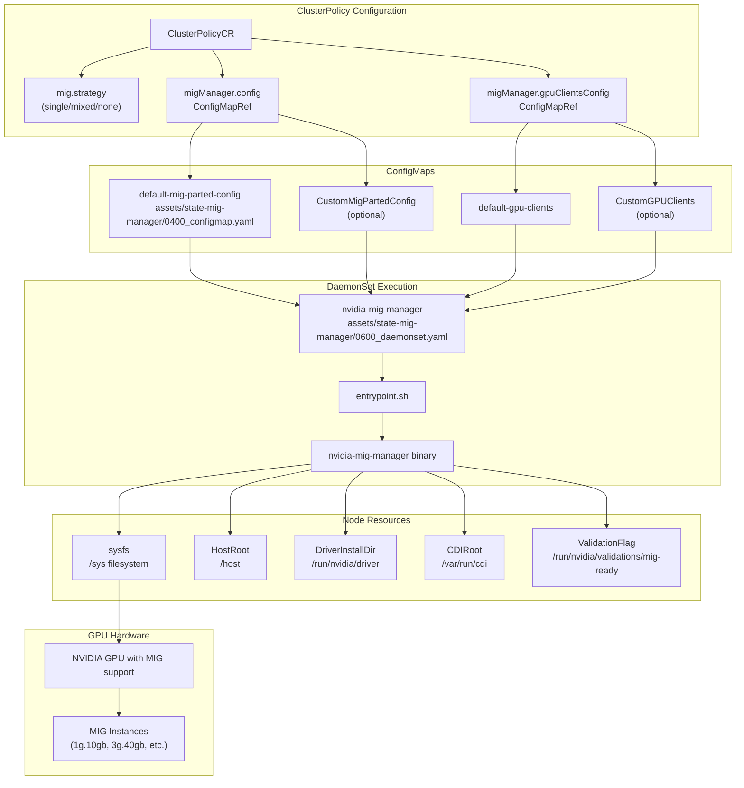
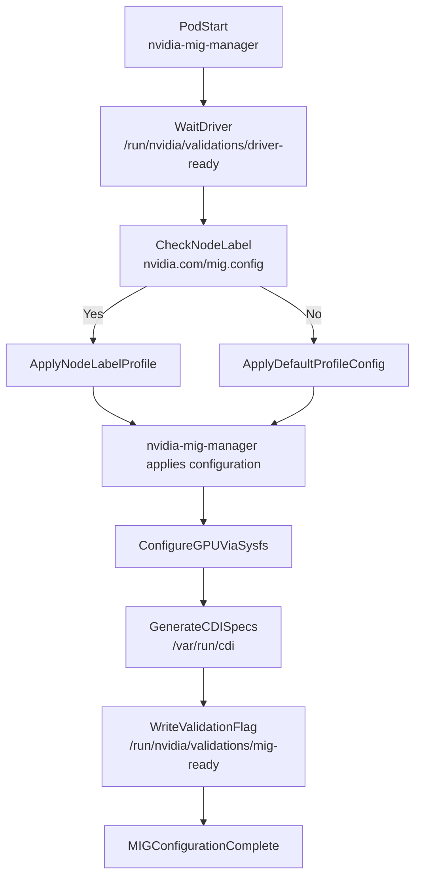
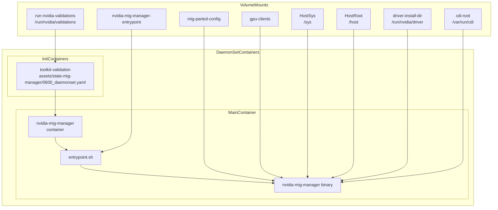

<!-- source: DeepWiki mcp.deepwiki.com · repo NVIDIA/gpu-operator · page 4.4 MIG Manager · fetched 2026-10-26 -->

# MIG Manager

<details>
<summary>Relevant source files</summary>

The following files were used as context for generating this wiki page:

- [assets/gpu-feature-discovery/0100_service_account.yaml](assets/gpu-feature-discovery/0100_service_account.yaml)
- [assets/gpu-feature-discovery/0300_rolebinding.yaml](assets/gpu-feature-discovery/0300_rolebinding.yaml)
- [assets/gpu-feature-discovery/0400_scc_openshift.yaml](assets/gpu-feature-discovery/0400_scc_openshift.yaml)
- [assets/gpu-feature-discovery/0500_daemonset.yaml](assets/gpu-feature-discovery/0500_daemonset.yaml)
- [assets/state-dcgm-exporter/0200_role.yaml](assets/state-dcgm-exporter/0200_role.yaml)
- [assets/state-dcgm-exporter/0800_daemonset.yaml](assets/state-dcgm-exporter/0800_daemonset.yaml)
- [assets/state-dcgm/0400_dcgm.yml](assets/state-dcgm/0400_dcgm.yml)
- [assets/state-device-plugin/0500_daemonset.yaml](assets/state-device-plugin/0500_daemonset.yaml)
- [assets/state-mig-manager/0100_service_account.yaml](assets/state-mig-manager/0100_service_account.yaml)
- [assets/state-mig-manager/0200_role.yaml](assets/state-mig-manager/0200_role.yaml)
- [assets/state-mig-manager/0210_clusterrole.yaml](assets/state-mig-manager/0210_clusterrole.yaml)
- [assets/state-mig-manager/0400_configmap.yaml](assets/state-mig-manager/0400_configmap.yaml)
- [assets/state-mig-manager/0500_scc.openshift.yaml](assets/state-mig-manager/0500_scc.openshift.yaml)
- [assets/state-mig-manager/0600_daemonset.yaml](assets/state-mig-manager/0600_daemonset.yaml)
- [assets/state-mps-control-daemon/0400_daemonset.yaml](assets/state-mps-control-daemon/0400_daemonset.yaml)
- [assets/state-node-status-exporter/0300_clusterrole.yaml](assets/state-node-status-exporter/0300_clusterrole.yaml)
- [assets/state-operator-validation/0100_service_account.yaml](assets/state-operator-validation/0100_service_account.yaml)
- [assets/state-operator-validation/0200_role.yaml](assets/state-operator-validation/0200_role.yaml)
- [assets/state-operator-validation/0210_clusterrole.yaml](assets/state-operator-validation/0210_clusterrole.yaml)
- [assets/state-operator-validation/0500_daemonset.yaml](assets/state-operator-validation/0500_daemonset.yaml)
- [assets/state-sandbox-validation/0500_daemonset.yaml](assets/state-sandbox-validation/0500_daemonset.yaml)

</details>


## Purpose and Scope

The MIG Manager component manages Multi-Instance GPU (MIG) partitioning on NVIDIA GPUs that support MIG technology. It configures MIG modes, creates MIG devices, and coordinates with other GPU Operator components to expose partitioned GPU resources to Kubernetes workloads.

This document covers MIG Manager's architecture, configuration system, and operational behavior. For information about how MIG devices are exposed to pods, see the Device Plugin documentation. For driver installation and GPU initialization, see Driver Management.

Sources: [assets/state-mig-manager/0600_daemonset.yaml:1-116]()

---

## MIG (Multi-Instance GPU) Overview

Multi-Instance GPU (MIG) is an NVIDIA technology that partitions a single physical GPU into multiple isolated GPU instances. Each MIG instance has dedicated memory, cache, and compute resources, enabling multiple workloads to run on a single GPU with guaranteed quality of service.

MIG is supported on:
- A100, A800 (40GB and 80GB variants)
- A30
- H100, H800 (80GB, 96GB, NVL variants)
- H200 (141GB, NVL variants)
- GH200, GB200
- B200, B300, GB300
- RTX PRO 6000 (96GB)

**MIG Profiles** specify the GPU slice size and memory allocation. Examples include `1g.10gb` (1 GPU slice with 10GB memory), `3g.40gb` (3 GPU slices with 40GB memory), and `7g.80gb` (full GPU with 80GB memory).

Sources: [assets/state-mig-manager/0400_configmap.yaml:1-303]()

---

## Architecture and Components

### System Architecture



**Diagram: MIG Manager Architecture and Data Flow**

Sources: [assets/state-mig-manager/0600_daemonset.yaml:1-116](), [assets/state-mig-manager/0400_configmap.yaml:1-10]()

---

## MIG Strategies

The GPU Operator supports three MIG strategies that control how MIG devices are exposed to Kubernetes:

| Strategy | Description | Use Case |
|----------|-------------|----------|
| `single` | Each MIG device is exposed as a separate GPU resource | Default mode. Pods request specific MIG profiles (e.g., `nvidia.com/gpu: 1`) |
| `mixed` | Both full GPUs and MIG devices are available on the same node | Heterogeneous workloads requiring different GPU allocation granularities |
| `none` | MIG is disabled; GPUs are exposed as full devices | Non-MIG workloads or when MIG partitioning is not needed |

The strategy is passed to the `nvidia-operator-validator` to ensure the node is correctly partitioned before other components start.

Sources: [assets/state-operator-validation/0500_daemonset.yaml:110-111]()

---

## Configuration System

### Configuration Selection Flow



**Diagram: MIG Configuration Selection and Application Flow**

Sources: [assets/state-mig-manager/0600_daemonset.yaml:42-86]()

---

## Default MIG Profiles

The GPU Operator includes a comprehensive set of pre-defined MIG profiles in the `default-mig-parted-config` ConfigMap.

### Common MIG Profiles by GPU Model

#### A100-40GB / A800-40GB
```yaml
all-1g.5gb:
  - devices: all
    mig-enabled: true
    mig-devices:
      "1g.5gb": 7
      
all-3g.20gb:
  - devices: all
    mig-enabled: true
    mig-devices:
      "3g.20gb": 2
```

#### H100-80GB / H800-80GB / A100-80GB / A800-80GB
```yaml
all-1g.10gb:
  - device-filter: ["0x233010DE", "0x233110DE", "0x232210DE", "0x20B210DE", "0x20B510DE", "0x20F310DE", "0x20F510DE", "0x232410DE"]
    devices: all
    mig-enabled: true
    mig-devices:
      "1g.10gb": 7
```

Sources: [assets/state-mig-manager/0400_configmap.yaml:19-43, 112-119]()

---

## Deployment and Lifecycle

### DaemonSet Structure



**Diagram: MIG Manager DaemonSet Pod Structure**

Sources: [assets/state-mig-manager/0600_daemonset.yaml:1-116]()

### Lifecycle and Dependencies

1. **Toolkit Validation**: Init container waits for `/run/nvidia/validations/toolkit-ready`.
   - Sources: [assets/state-mig-manager/0600_daemonset.yaml:28-37]()
2. **Driver Validation**: The entrypoint script waits for driver readiness before starting the manager.
   - Sources: [assets/state-mig-manager/0600_daemonset.yaml:42-44]()
3. **MIG Configuration**: The manager applies the desired partition configuration.
4. **Component Coordination**: The manager uses `GPU_CLIENTS_FILE` (typically `/gpu-clients/clients.yaml`) to identify and restart dependent pods like the device plugin or DCGM exporter after reconfiguration.
   - Sources: [assets/state-mig-manager/0600_daemonset.yaml:58-59]()

### RBAC and Permissions

The MIG Manager requires privileged access to host resources:
- **Host PID/IPC**: Needed to manage GPU processes.
  - Sources: [assets/state-mig-manager/0600_daemonset.yaml:25-26]()
- **Privileged SecurityContext**: Required for direct hardware access via sysfs.
  - Sources: [assets/state-mig-manager/0600_daemonset.yaml:64-65]()
- **Host Path Mounts**: Access to `/sys`, `/`, and `/run/nvidia/driver`.
  - Sources: [assets/state-mig-manager/0600_daemonset.yaml:92-106]()
- **ClusterRole Permissions**: Grants access to nodes (get, list, watch, update, patch) and pods (list).
  - Sources: [assets/state-mig-manager/0210_clusterrole.yaml:1-21]()

---

## Integration with Other Components

### GPU Feature Discovery (GFD)
GFD detects if MIG is enabled and labels the node accordingly. It waits for the container toolkit to be setup before running.
Sources: [assets/gpu-feature-discovery/0500_daemonset.yaml:28-32]()

### Device Plugin
The device plugin waits for toolkit validation and uses a `config-manager` to handle dynamic configuration changes, which may be triggered by MIG reconfiguration.
Sources: [assets/state-device-plugin/0500_daemonset.yaml:28-63]()

### Validator
The `nvidia-operator-validator` checks the `MIG_STRATEGY` environment variable during the `plugin-validation` phase to ensure the node state matches the desired strategy.
Sources: [assets/state-operator-validation/0500_daemonset.yaml:110-111]()

---

