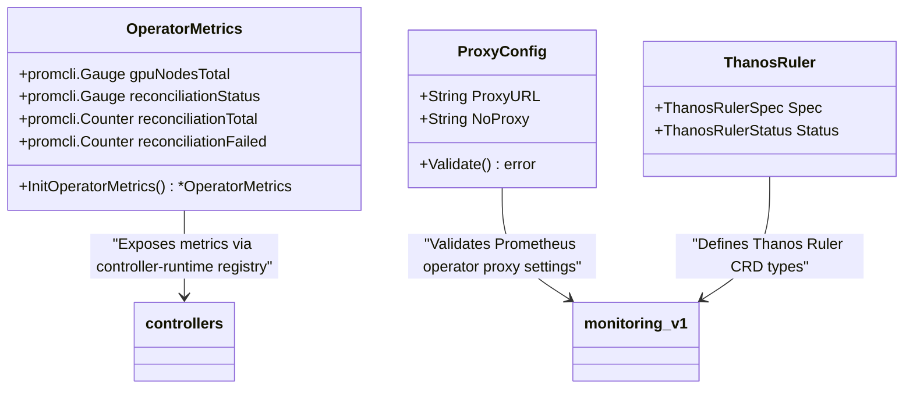

<!-- source: DeepWiki mcp.deepwiki.com · repo NVIDIA/gpu-operator · page 4.5 Monitoring and DCGM · fetched 2026-10-26 -->

# Monitoring and DCGM

<details>
<summary>Relevant source files</summary>

The following files were used as context for generating this wiki page:

- [assets/state-dcgm-exporter/0400_service.yaml](assets/state-dcgm-exporter/0400_service.yaml)
- [assets/state-dcgm/0500_service.yaml](assets/state-dcgm/0500_service.yaml)
- [assets/state-node-status-exporter/0800_prometheus_rule_openshift.yaml](assets/state-node-status-exporter/0800_prometheus_rule_openshift.yaml)
- [assets/state-operator-metrics/0400_prometheus_rule_openshift.yaml](assets/state-operator-metrics/0400_prometheus_rule_openshift.yaml)
- [cmd/nvidia-validator/metrics.go](cmd/nvidia-validator/metrics.go)
- [controllers/operator_metrics.go](controllers/operator_metrics.go)
- [hack/boilerplate.go.txt](hack/boilerplate.go.txt)
- [internal/state/dcgm_exporter_test.go](internal/state/dcgm_exporter_test.go)
- [internal/state/dcgm_test.go](internal/state/dcgm_test.go)
- [internal/state/testdata/golden/gpucluster-dcgm-exporter-embedded.yaml](internal/state/testdata/golden/gpucluster-dcgm-exporter-embedded.yaml)
- [internal/state/testdata/golden/gpucluster-dcgm-exporter-pod-metadata.yaml](internal/state/testdata/golden/gpucluster-dcgm-exporter-pod-metadata.yaml)
- [internal/state/testdata/golden/gpucluster-dcgm-exporter-remote-engine.yaml](internal/state/testdata/golden/gpucluster-dcgm-exporter-remote-engine.yaml)
- [internal/state/testdata/golden/gpucluster-dcgm.yaml](internal/state/testdata/golden/gpucluster-dcgm.yaml)
- [manifests/state-dcgm-exporter/0500_service.yaml](manifests/state-dcgm-exporter/0500_service.yaml)
- [manifests/state-dcgm-exporter/0600_service_monitor.yaml](manifests/state-dcgm-exporter/0600_service_monitor.yaml)
- [manifests/state-dcgm-exporter/0700_daemonset.yaml](manifests/state-dcgm-exporter/0700_daemonset.yaml)
- [manifests/state-dcgm/0500_daemonset.yaml](manifests/state-dcgm/0500_daemonset.yaml)
- [manifests/state-dcgm/0600_service.yaml](manifests/state-dcgm/0600_service.yaml)
- [manifests/state-dra-validation/0500_daemonset.yaml](manifests/state-dra-validation/0500_daemonset.yaml)
- [tests/e2e/helpers/clusterpolicy.go](tests/e2e/helpers/clusterpolicy.go)
- [tests/e2e/suites/clusterpolicy_test.go](tests/e2e/suites/clusterpolicy_test.go)
- [vendor/github.com/prometheus-operator/prometheus-operator/pkg/apis/monitoring/v1/alertmanager_types.go](vendor/github.com/prometheus-operator/prometheus-operator/pkg/apis/monitoring/v1/alertmanager_types.go)
- [vendor/github.com/prometheus-operator/prometheus-operator/pkg/apis/monitoring/v1/podmonitor_types.go](vendor/github.com/prometheus-operator/prometheus-operator/pkg/apis/monitoring/v1/podmonitor_types.go)
- [vendor/github.com/prometheus-operator/prometheus-operator/pkg/apis/monitoring/v1/probe_types.go](vendor/github.com/prometheus-operator/prometheus-operator/pkg/apis/monitoring/v1/probe_types.go)
- [vendor/github.com/prometheus-operator/prometheus-operator/pkg/apis/monitoring/v1/prometheus_types.go](vendor/github.com/prometheus-operator/prometheus-operator/pkg/apis/monitoring/v1/prometheus_types.go)
- [vendor/github.com/prometheus-operator/prometheus-operator/pkg/apis/monitoring/v1/prometheusrule_types.go](vendor/github.com/prometheus-operator/prometheus-operator/pkg/apis/monitoring/v1/prometheusrule_types.go)
- [vendor/github.com/prometheus-operator/prometheus-operator/pkg/apis/monitoring/v1/servicemonitor_types.go](vendor/github.com/prometheus-operator/prometheus-operator/pkg/apis/monitoring/v1/servicemonitor_types.go)
- [vendor/github.com/prometheus-operator/prometheus-operator/pkg/apis/monitoring/v1/thanos_types.go](vendor/github.com/prometheus-operator/prometheus-operator/pkg/apis/monitoring/v1/thanos_types.go)
- [vendor/github.com/prometheus-operator/prometheus-operator/pkg/apis/monitoring/v1/types.go](vendor/github.com/prometheus-operator/prometheus-operator/pkg/apis/monitoring/v1/types.go)
- [vendor/github.com/prometheus-operator/prometheus-operator/pkg/apis/monitoring/v1/zz_generated.deepcopy.go](vendor/github.com/prometheus-operator/prometheus-operator/pkg/apis/monitoring/v1/zz_generated.deepcopy.go)

</details>


This page documents the GPU Operator's monitoring architecture, focusing on DCGM (NVIDIA Data Center GPU Manager) integration, Prometheus metrics collection, operator internal telemetry, and observability infrastructure.

## Architecture Overview

The GPU Operator deploys a monitoring stack that collects GPU telemetry through DCGM and exposes it to Prometheus via exporters and `ServiceMonitor` resources. The control plane manages these components by parsing manifests from the assets and manifests directories and applying transformations based on the `ClusterPolicy` and `GPUCluster` specifications.

### Data Flow and Component Interaction

```mermaid
graph TB
    subgraph "GPU Node"
        [GPU_HW] -->| "Telemetry" | [DCGM_Daemon]
        
        subgraph "Monitoring Pods"
            [DCGM_Daemon] -- "Port 5555" --> [DCGM_Exporter_Binary]
            [DCGM_Exporter_Binary] -- "Port 9400" --> [Metrics_Endpoint]
        end
    end
    
    subgraph "Kubernetes Services"
        [Metrics_Endpoint] --> [DCGM_Exporter_Svc]
    end
    
    subgraph "Prometheus Stack"
        [ServiceMonitor_CR] -->| "Configures" | [Prometheus_Server]
        [Prometheus_Server] -->| "Scrapes" | [DCGM_Exporter_Svc]
        [Prometheus_Rule_CR] -->| "Alerts" | [Prometheus_Server]
    end

    style [DCGM_Daemon] stroke-dasharray: 5 5
```

**Sources:**
- [manifests/state-dcgm/0500_daemonset.yaml:1-110]()
- [manifests/state-dcgm-exporter/0700_daemonset.yaml:1-186]()

---

## DCGM Components

The operator manages monitoring via several distinct states, primarily `state-dcgm` and `state-dcgm-exporter`.

### DCGM Hostengine (`state-dcgm`)
The DCGM Hostengine (`nvidia-dcgm` / `nvidia-dcgm-dra`) is the base daemon that interacts with the NVIDIA driver to collect low-level telemetry. It is typically deployed as a `DaemonSet` [manifests/state-dcgm/0500_daemonset.yaml:2]().

*   **Node Selection**: Gated on node selectors such as `nvidia.com/gpu.deploy.dcgm-dra: "true"` [manifests/state-dcgm/0500_daemonset.yaml:48]() to ensure proper scheduling after driver initialization.
*   **Networking**: It exposes port `5555` for hostengine gRPC requests [manifests/state-dcgm/0500_daemonset.yaml:91]().
*   **Security**: Runs with privileged security context to access raw GPU devices and metrics [manifests/state-dcgm/0500_daemonset.yaml:88]().

### DCGM Exporter (`state-dcgm-exporter`)
The exporter queries the DCGM hostengine and converts telemetry into Prometheus metrics.

*   **DaemonSet**: Deployed via manifests like `manifests/state-dcgm-exporter/0700_daemonset.yaml` [manifests/state-dcgm-exporter/0700_daemonset.yaml:2]().
*   **Environment Configuration**: Configured via environment variables such as `DCGM_EXPORTER_LISTEN`, `DCGM_EXPORTER_KUBERNETES`, and `DCGM_EXPORTER_COLLECTORS` [manifests/state-dcgm-exporter/0700_daemonset.yaml:88-93]().
*   **Dynamic Resource Allocation (DRA) Integration**: Supports `KUBERNETES_ENABLE_DRA` and ResourceClaim templates to associate metrics with pods when DRA drivers are active [manifests/state-dcgm-exporter/0700_daemonset.yaml:109-110]().
*   **Pod Resources**: Mounts `/var/lib/kubelet/pod-resources` to map GPU container allocations [manifests/state-dcgm-exporter/0700_daemonset.yaml:155-157]().

**Sources:**
- [manifests/state-dcgm/0500_daemonset.yaml:1-110]()
- [manifests/state-dcgm-exporter/0700_daemonset.yaml:1-186]()
- [internal/state/testdata/golden/gpucluster-dcgm-exporter-pod-metadata.yaml:1-194]()

---

## Prometheus and Observability Integration

The Operator integrates with the Prometheus Operator CRDs (vendored from `prometheus-operator`) to automate metric scraping and alerting rules.

### Service Discovery & Monitors
The monitoring stack defines `ServiceMonitor` definitions (matching types in `vendor/github.com/prometheus-operator/prometheus-operator/pkg/apis/monitoring/v1/types.go` [vendor/github.com/prometheus-operator/prometheus-operator/pkg/apis/monitoring/v1/types.go:1-182]()) to allow Prometheus instances to discover metrics endpoints.

### Operator Metrics and Alerting
The Operator tracks its own internal health via `OperatorMetrics` defined in the controllers package [controllers/operator_metrics.go:29](). Key metrics registered with controller-runtime include:
*   `gpu_operator_gpu_nodes_total`: Gauge tracking the total number of nodes with GPUs [controllers/operator_metrics.go:30]().
*   `gpu_operator_reconciliation_status`: Gauge indicating success (`1`), operands not ready (`0`), cluster policy unavailable (`-1`), or operator error (`-2`) [controllers/operator_metrics.go:33,53-56]().
*   `gpu_operator_reconciliation_total` and `gpu_operator_reconciliation_failed_total`: Counters tracking reconciliation execution counts [controllers/operator_metrics.go:34-35]().
*   `gpu_operator_openshift_driver_toolkit_enabled`: Gauge tracking DriverToolkit integration state on OpenShift [controllers/operator_metrics.go:38]().

### Alerting Rules
Prometheus rules (such as those in `assets/state-operator-metrics/0400_prometheus_rule_openshift.yaml` [assets/state-operator-metrics/0400_prometheus_rule_openshift.yaml:1-116]()) raise warnings if reconciliation loops fail for extended periods or if DriverToolkit imagestreams are broken.

**Sources:**
- [controllers/operator_metrics.go:29-195]()
- [vendor/github.com/prometheus-operator/prometheus-operator/pkg/apis/monitoring/v1/types.go:1-182]()
- [assets/state-operator-metrics/0400_prometheus_rule_openshift.yaml:1-116]()

---

## Implementation Details

The control plane reconciles monitoring objects alongside other node operands using underlying state renderers and resource managers.

### Code-to-Entity Mapping



### Key Functions and Constants
*   `InitOperatorMetrics()`: Registers all GPU operator Prometheus metrics (`gpu_nodes_total`, `reconciliation_status`, etc.) with controller-runtime [controllers/operator_metrics.go:71]().
*   `ProxyConfig.Validate()`: Validates Prometheus proxy configurations and connection headers [vendor/github.com/prometheus-operator/prometheus-operator/pkg/apis/monitoring/v1/types.go:121]().

**Sources:**
- [controllers/operator_metrics.go:29-195]()
- [vendor/github.com/prometheus-operator/prometheus-operator/pkg/apis/monitoring/v1/types.go:121-167]()

---

## OpenShift Specifics

On OpenShift environments, monitoring integration leverages cluster-monitoring operators and custom Prometheus rules:
1.  **PrometheusRules for OpenShift**: Files like `assets/state-operator-metrics/0400_prometheus_rule_openshift.yaml` provide native alerts for OpenShift monitoring operators [assets/state-operator-metrics/0400_prometheus_rule_openshift.yaml:1-116]().
2.  **DriverToolkit Telemetry**: Specific metrics check whether the OpenShift DriverToolkit image stream is missing, broken, or if NFD labels are outdated [controllers/operator_metrics.go:38-42]().

**Sources:**
- [controllers/operator_metrics.go:29-50]()
- [assets/state-operator-metrics/0400_prometheus_rule_openshift.yaml:1-116]()

---

