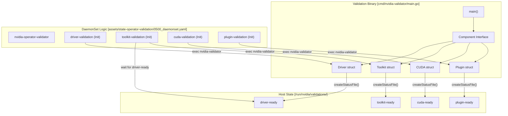
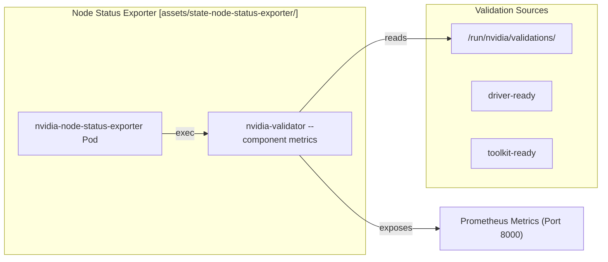

<!-- source: DeepWiki mcp.deepwiki.com · repo NVIDIA/gpu-operator · page 4.6 Validation · fetched 2026-10-26 -->

# Validation

<details>
<summary>Relevant source files</summary>

The following files were used as context for generating this wiki page:

- [assets/state-node-status-exporter/0100_service_account.yaml](assets/state-node-status-exporter/0100_service_account.yaml)
- [assets/state-node-status-exporter/0200_role.yaml](assets/state-node-status-exporter/0200_role.yaml)
- [assets/state-node-status-exporter/0210_rolebinding.yaml](assets/state-node-status-exporter/0210_rolebinding.yaml)
- [assets/state-node-status-exporter/0310_clusterrolebinding.yaml](assets/state-node-status-exporter/0310_clusterrolebinding.yaml)
- [assets/state-node-status-exporter/0400_scc.openshift.yaml](assets/state-node-status-exporter/0400_scc.openshift.yaml)
- [assets/state-node-status-exporter/0500_service.yaml](assets/state-node-status-exporter/0500_service.yaml)
- [assets/state-node-status-exporter/0700_daemonset.yaml](assets/state-node-status-exporter/0700_daemonset.yaml)
- [cmd/nvidia-validator/main.go](cmd/nvidia-validator/main.go)
- [cmd/nvidia-validator/main_test.go](cmd/nvidia-validator/main_test.go)
- [cmd/nvidia-validator/resolve_linux.go](cmd/nvidia-validator/resolve_linux.go)
- [cmd/nvidia-validator/resolve_linux_test.go](cmd/nvidia-validator/resolve_linux_test.go)
- [cmd/nvidia-validator/resolve_unsupported.go](cmd/nvidia-validator/resolve_unsupported.go)

</details>


This page documents the validation components deployed by the NVIDIA GPU Operator to verify the correct installation and configuration of the GPU software stack. The operator uses specialized components to ensure that drivers, runtimes, and plugins are operational before nodes are considered ready for production workloads.

## Overview

The GPU Operator employs a multi-layered validation strategy using two primary DaemonSets: the **Operator Validator** for standard GPU workloads and the **Sandbox Validator** for virtualized or sandboxed environments (vGPU, VFIO, Confidential Computing). These components execute the `nvidia-validator` binary (`cmd/nvidia-validator/main.go`) to perform health checks and write readiness signals to the host filesystem.

Sources: [assets/state-operator-validation/0500_daemonset.yaml:1-154](), [assets/state-sandbox-validation/0500_daemonset.yaml:1-147](), [cmd/nvidia-validator/main.go:53-120]()

## Validation Architecture

The validation system is built around a sequential dependency model. Each component in the stack (Driver, Toolkit, Device Plugin) is validated by an init container within a Validator DaemonSet. Upon success, a "ready" file is created in a shared host directory, typically `/run/nvidia/validations/`.

### Validation Sequence and Dependency Flow

The following diagram illustrates how the `nvidia-validator` binary interacts with the Kubernetes DaemonSet lifecycle and the host filesystem to signal readiness.



Sources: [cmd/nvidia-validator/main.go:53-88](), [assets/state-operator-validation/0500_daemonset.yaml:28-125]()

## The `nvidia-validator` Binary

The `nvidia-validator` (`cmd/nvidia-validator/main.go`) is a specialized utility that implements the `Component` interface. It handles the logic for checking system state and managing readiness files.

### Key Components and Interfaces
The binary defines a `Component` interface with three primary methods:
- `validate() error`: Performs the actual health check (e.g., running `nvidia-smi` or a CUDA kernel) [cmd/nvidia-validator/main.go:57]().
- `createStatusFile() error`: Writes the readiness marker to the filesystem [cmd/nvidia-validator/main.go:58]().
- `deleteStatusFile() error`: Removes the marker during cleanup [cmd/nvidia-validator/main.go:59]().

Additionally, the validator performs robust host binary resolution via `resolveHostNvidiaSMI` (`cmd/nvidia-validator/resolve_linux.go`), ensuring that `nvidia-smi` is securely resolved and validated as a regular executable file within the mounted host root [cmd/nvidia-validator/resolve_linux.go:41-65]().

Sources: [cmd/nvidia-validator/main.go:56-60](), [cmd/nvidia-validator/resolve_linux.go:41-65]()

### Supported Component Types
| Type | Code Entity | Purpose |
| :--- | :--- | :--- |
| **Driver** | `Driver` [cmd/nvidia-validator/main.go:63]() | Validates kernel modules and `nvidia-smi`. |
| **Toolkit** | `Toolkit` [cmd/nvidia-validator/main.go:89]() | Validates NVIDIA Container Toolkit and runtime hooks. |
| **CUDA** | `CUDA` [cmd/nvidia-validator/main.go:77]() | Runs a sample CUDA workload to verify hardware access. |
| **Plugin** | `Plugin` [cmd/nvidia-validator/main.go:83]() | Verifies Kubernetes device plugin registration. |
| **CC Manager** | `CCManager` [cmd/nvidia-validator/main.go:117]() | Validates Confidential Computing Manager status. |
| **vGPU** | `VGPUManager` [cmd/nvidia-validator/main.go:107]() | Validates vGPU Manager installation. |

Sources: [cmd/nvidia-validator/main.go:62-121]()

## Operator Validator

The `nvidia-operator-validator` DaemonSet is the primary validation mechanism for standard GPU nodes. It runs on nodes labeled with `nvidia.com/gpu.deploy.operator-validator: "true"`.

### Validation Sequence
The DaemonSet uses a series of init containers to enforce a strict order of operations:

1. **driver-validation**: Executes `nvidia-validator` with `COMPONENT=driver`. It checks for the existence of `/run/nvidia/driver` and verifies the driver is loaded.
2. **toolkit-validation**: Executes with `COMPONENT=toolkit`. It ensures the container runtime is correctly configured to use the NVIDIA stack.
3. **cuda-validation**: Executes with `COMPONENT=cuda`. This step runs a small CUDA workload to ensure that containers can actually execute code on the GPU.
4. **plugin-validation**: Executes with `COMPONENT=plugin`. It checks if the Kubernetes node has successfully registered GPU resources.

Sources: [assets/state-operator-validation/0500_daemonset.yaml:28-125](), [cmd/nvidia-validator/main.go:162-176]()

### Filesystem Integration
The validator maps several host paths to perform its checks:
- `/run/nvidia/validations`: Shared directory for readiness files [assets/state-operator-validation/0500_daemonset.yaml:142-145]().
- `/run/nvidia/driver`: Access to the driver installation directory [assets/state-operator-validation/0500_daemonset.yaml:146-148]().
- `/host`: The host root filesystem (mounted read-only) [assets/state-operator-validation/0500_daemonset.yaml:149-151]().
- `/dev/char`: Access to character devices for hardware verification [assets/state-operator-validation/0500_daemonset.yaml:152-154]().

Sources: [assets/state-operator-validation/0500_daemonset.yaml:142-154]()

## Sandbox Validator

For environments using virtualized GPUs or sandboxed runtimes, the `nvidia-sandbox-validator` is used. This component focuses on the specialized drivers and managers required for these workloads.

### Specialized Checks
- **CC Manager**: Validates the Confidential Computing Manager [assets/state-sandbox-validation/0500_daemonset.yaml:29-37]().
- **VFIO PCI**: Ensures GPUs are correctly bound to the `vfio-pci` driver [assets/state-sandbox-validation/0500_daemonset.yaml:50-58]().
- **vGPU Manager**: Validates the NVIDIA vGPU Manager installation [assets/state-sandbox-validation/0500_daemonset.yaml:75-83]().
- **vGPU Devices**: Verifies that mediated devices (mdev) have been created [assets/state-sandbox-validation/0500_daemonset.yaml:103-111]().

Sources: [assets/state-sandbox-validation/0500_daemonset.yaml:28-121](), [cmd/nvidia-validator/main.go:178-187]()

## Node Status Exporter

The Node Status Exporter (`assets/state-node-status-exporter/0700_daemonset.yaml`) is a component that exposes validation results as metrics. It runs the `nvidia-validator` binary with `COMPONENT=metrics` on port `8000` [assets/state-node-status-exporter/0700_daemonset.yaml:31-49](), [cmd/nvidia-validator/main.go:96](). RBAC rules and SecurityContextConstraints (`assets/state-node-status-exporter/0200_role.yaml`, `assets/state-node-status-exporter/0400_scc.openshift.yaml`) grant necessary permissions to inspect cluster pods and daemonsets.

### Data Flow: Node Status Exporting

The exporter monitors the validation state on the node and serves it to Prometheus.



Sources: [assets/state-node-status-exporter/0700_daemonset.yaml:31-49](), [assets/state-node-status-exporter/0200_role.yaml:1-29](), [assets/state-node-status-exporter/0400_scc.openshift.yaml:1-47](), [cmd/nvidia-validator/main.go:98-100]()

## Internal Validation Logic

The operator also includes internal Go-based validators used during the reconciliation of Custom Resources.

### Node Selector Validation
The `nodeSelectorValidator` (`internal/validator/validator.go`) ensures that multiple `NVIDIADriver` resources do not have conflicting node selectors. This prevents a scenario where two different driver versions are targeted at the same physical node.

- **Function**: `Validate(ctx context.Context, cr *nvidiav1alpha1.NVIDIADriver) error`
- **Logic**: It lists all existing `NVIDIADriver` objects, resolves the nodes selected by each, and returns an error if the requested CR overlaps with an existing one.

Sources: [internal/validator/validator.go:31-72]()

## Readiness Cleanup

To prevent stale validation states, the validator pods include a `preStop` lifecycle hook. When a validator pod is terminated (e.g., during an upgrade or node drain), it automatically removes the readiness files from the host.

```yaml
lifecycle:
  preStop:
    exec:
      command: ["sh", "-c", "rm -f /run/nvidia/validations/*-ready"]
```

Sources: [assets/state-operator-validation/0500_daemonset.yaml:133-136](), [assets/state-sandbox-validation/0500_daemonset.yaml:129-132]()

---

