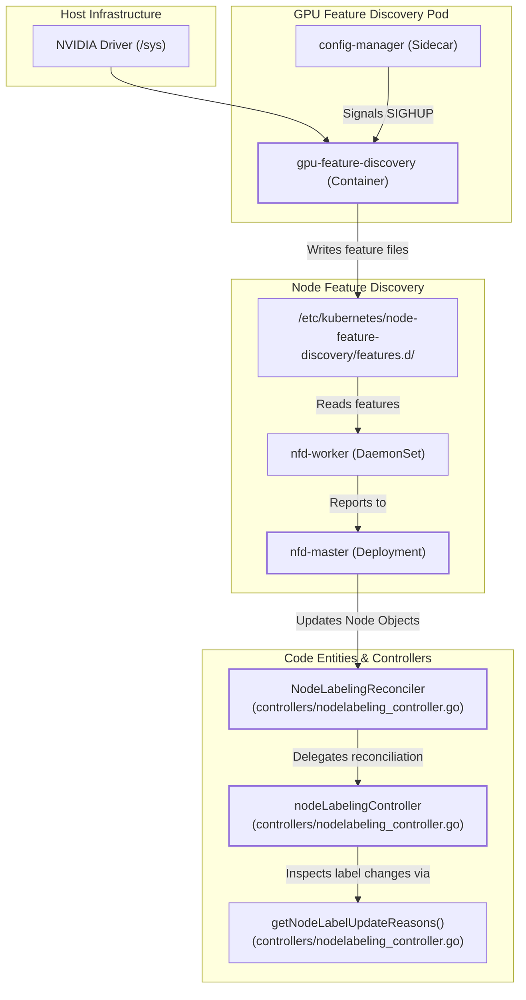
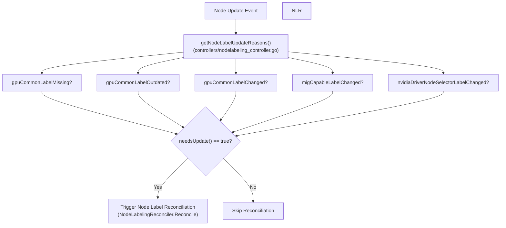

<!-- source: DeepWiki mcp.deepwiki.com · repo NVIDIA/gpu-operator · page 4.7 GPU Feature Discovery · fetched 2026-10-26 -->

# GPU Feature Discovery

Relevant source files

The following files were used as context for generating this wiki page:

- [api/nvidia/v1alpha1/gpucluster_types.go](api/nvidia/v1alpha1/gpucluster_types.go)
- [api/nvidia/v1alpha1/zz_generated.deepcopy.go](api/nvidia/v1alpha1/zz_generated.deepcopy.go)
- [assets/gpu-feature-discovery/0200_role.yaml](assets/gpu-feature-discovery/0200_role.yaml)
- [assets/gpu-feature-discovery/0210_clusterrole.yaml](assets/gpu-feature-discovery/0210_clusterrole.yaml)
- [assets/gpu-feature-discovery/0310_clusterrolebinding.yaml](assets/gpu-feature-discovery/0310_clusterrolebinding.yaml)
- [cmd/gpu-operator/main.go](cmd/gpu-operator/main.go)
- [cmd/gpu-operator/main_test.go](cmd/gpu-operator/main_test.go)
- [controllers/active_config.go](controllers/active_config.go)
- [controllers/active_config_test.go](controllers/active_config_test.go)
- [controllers/clusterpolicy_controller_test.go](controllers/clusterpolicy_controller_test.go)
- [controllers/gpucluster_controller_test.go](controllers/gpucluster_controller_test.go)
- [controllers/nodelabeling_controller.go](controllers/nodelabeling_controller.go)
- [controllers/nodelabeling_controller_test.go](controllers/nodelabeling_controller_test.go)
- [controllers/upgrade_controller_test.go](controllers/upgrade_controller_test.go)
- [deployments/gpu-operator/templates/nodefeaturerules.yaml](deployments/gpu-operator/templates/nodefeaturerules.yaml)

## Purpose and Scope

This page documents the GPU Feature Discovery (GFD) component of the NVIDIA GPU Operator, its integration with Node Feature Discovery (NFD), and the operator-side `NodeLabelingReconciler` controller (`controllers/nodelabeling_controller.go`). GFD automatically detects GPU hardware features and advertises them as Kubernetes node labels, enabling workload scheduling based on GPU models, CUDA versions, driver versions, and architecture.

For related components, see [Monitoring and DCGM](#4.5) and [Device Plugin](#4.3). For NFD sub-chart deployment details, see [deployments/gpu-operator/charts/node-feature-discovery/README.md:1-11]().

Sources: [controllers/nodelabeling_controller.go:53-60](), [deployments/gpu-operator/charts/node-feature-discovery/Chart.yaml:1-15]()

## Overview

GPU Feature Discovery is a Kubernetes DaemonSet running on each GPU node to:

1. **Detect GPU hardware features** including model, architecture, memory size, compute capability, and driver version.
2. **Label Kubernetes nodes** with discovered features in a standardized format.
3. **Integrate with Node Feature Discovery (NFD)** by writing feature files to `/etc/kubernetes/node-feature-discovery/features.d/`.
4. **Coordinate via the `NodeLabelingReconciler`** to centrally apply GPU-operator related labels and annotations to nodes [controllers/nodelabeling_controller.go:53-60]().

Sources: [controllers/nodelabeling_controller.go:53-60](), [assets/gpu-feature-discovery/0500_daemonset.yaml:65-71]()

## Architecture and Integration

The following diagram bridges natural language concepts with code entities in the GPU Operator control plane, illustrating how hardware discovery flows from GFD through NFD and the operator's nodelabeling controller.

### System Architecture and Code Entity Mapping

**GFD Integration Points**:

| Integration | Mechanism | Purpose | Code Reference |
| :--- | :--- | :--- | :--- |
| **Driver** | Reads `/sys` filesystem | Queries GPU hardware information via sysfs | [assets/gpu-feature-discovery/0500_daemonset.yaml:89-91]() |
| **NFD Worker** | Writes to `features.d/` | Provides GPU features to NFD for node labeling | [assets/gpu-feature-discovery/0500_daemonset.yaml:87-88]() |
| **NodeLabelingReconciler** | Kubernetes Controller-Runtime | Centralizes all node label write operations for the GPU Operator | [controllers/nodelabeling_controller.go:53-60]() |
| **NodeFeatureRules** | CRD `nfd.k8s-sigs.io/v1alpha1` | Defines rules for kernel module detection | [deployments/gpu-operator/templates/nodefeaturerules.yaml:1-32]() |

Sources: [controllers/nodelabeling_controller.go:53-60](), [assets/gpu-feature-discovery/0500_daemonset.yaml:28-91](), [deployments/gpu-operator/templates/nodefeaturerules.yaml:1-32]()

## Node Labeling Controller (`NodeLabelingReconciler`)

The GPU Operator centralizes all node label and annotation write operations in the `NodeLabelingReconciler` [controllers/nodelabeling_controller.go:53-60](). When node labels change (such as GFD publishing GPU presence or NFD updating features), the reconciler evaluates update reasons using `getNodeLabelUpdateReasons` [controllers/nodelabeling_controller.go:115-156]().

### Node Label Update Reason Evaluation

The `nodeLabelUpdateReasons` struct tracks specific label mutation types that trigger downstream operator actions [controllers/nodelabeling_controller.go:89-112]():
- `gpuCommonLabelMissing`: Node has GPU PCI devices present but lacks the common GPU label [controllers/nodelabeling_controller.go:119]().
- `gpuCommonLabelOutdated`: Node lacks GPU PCI devices but retains the common GPU label [controllers/nodelabeling_controller.go:120]().
- `commonOperandsLabelChanged`: Operands enabled/disabled state changed [controllers/nodelabeling_controller.go:123]().
- `nvidiaDriverNodeSelectorLabelChanged`: Labels matching active `NVIDIADriver` custom resources changed [controllers/nodelabeling_controller.go:145-152]().

Sources: [controllers/nodelabeling_controller.go:53-156]()

## NodeFeatureRules for Specialized Discovery

Beyond standard GFD labels, the GPU Operator utilizes NFD's `NodeFeatureRule` CRD to detect specialized kernel modules and capabilities.

### Kernel Module Detection Rules

| Rule Name | Label Applied | Feature Matched |
| :--- | :--- | :--- |
| `kernel-module-gdrdrv` | `nvidia.com/gdrcopy.capable: "true"` | `kernel.loadedmodule: gdrdrv` [deployments/gpu-operator/templates/nodefeaturerules.yaml:8-15]() |
| `kernel-module-nvidia_fs` | `nvidia.com/gds.capable: "true"` | `kernel.loadedmodule: nvidia_fs` [deployments/gpu-operator/templates/nodefeaturerules.yaml:16-23]() |
| `kernel-module-nvidia_peermem` | `nvidia.com/peermem.capable: "true"` | `kernel.loadedmodule: nvidia_peermem` [deployments/gpu-operator/templates/nodefeaturerules.yaml:24-31]() |

Sources: [deployments/gpu-operator/templates/nodefeaturerules.yaml:5-31]()

## RBAC and Security

GFD and the node labeling controller require specific RBAC permissions to interact with the Kubernetes API, CRDs, and security contexts.

| Resource | API Group | Verbs | Purpose |
| :--- | :--- | :--- | :--- |
| `securitycontextconstraints` | `security.openshift.io` | `use` (resourceNames: `privileged`) | Required for OpenShift privilege execution [assets/gpu-feature-discovery/0200_role.yaml:7-14]() |
| `nodefeatures` | `nfd.k8s-sigs.io` | `get, list, watch, create, update, delete` | NFD feature object manipulation [assets/gpu-feature-discovery/0200_role.yaml:15-25]() |
| `pods` | `""` | `get` | Pod verification checks [assets/gpu-feature-discovery/0200_role.yaml:26-31]() |

Sources: [assets/gpu-feature-discovery/0200_role.yaml:1-31]()

---

