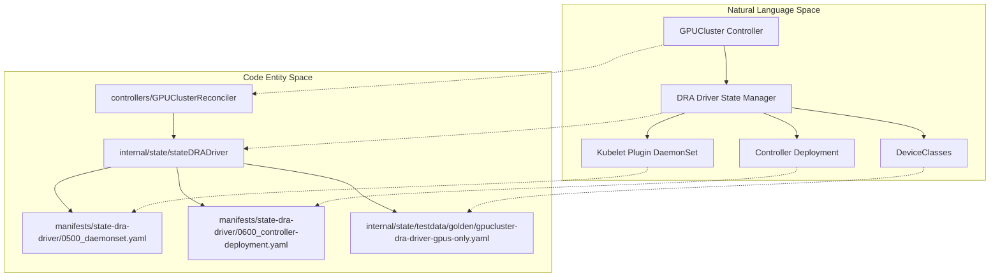
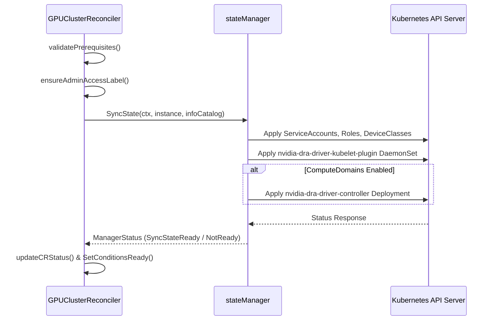

<!-- source: DeepWiki mcp.deepwiki.com · repo NVIDIA/gpu-operator · page 4.8 DRA Driver · fetched 2026-10-26 -->

# DRA Driver

Relevant source files

The following files were used as context for generating this wiki page:

- [config/rbac/role.yaml](config/rbac/role.yaml)
- [controllers/gpucluster_controller.go](controllers/gpucluster_controller.go)
- [deployments/gpu-operator/templates/clusterrole.yaml](deployments/gpu-operator/templates/clusterrole.yaml)
- [internal/state/dra_driver.go](internal/state/dra_driver.go)
- [internal/state/dra_driver_test.go](internal/state/dra_driver_test.go)
- [internal/state/gpucluster_render_test.go](internal/state/gpucluster_render_test.go)
- [internal/state/gpucluster_scc_test.go](internal/state/gpucluster_scc_test.go)
- [internal/state/testdata/golden/gpucluster-dra-driver-full-spec.yaml](internal/state/testdata/golden/gpucluster-dra-driver-full-spec.yaml)
- [internal/state/testdata/golden/gpucluster-dra-driver-gpus-only.yaml](internal/state/testdata/golden/gpucluster-dra-driver-gpus-only.yaml)
- [internal/state/testdata/golden/gpucluster-dra-driver-passthrough-support.yaml](internal/state/testdata/golden/gpucluster-dra-driver-passthrough-support.yaml)
- [manifests/state-dra-driver/0120_compute-domain-daemon-rbac.yaml](manifests/state-dra-driver/0120_compute-domain-daemon-rbac.yaml)
- [manifests/state-dra-driver/0200_kubeletplugin-clusterrole.yaml](manifests/state-dra-driver/0200_kubeletplugin-clusterrole.yaml)
- [manifests/state-dra-driver/0450_scc.openshift.yaml](manifests/state-dra-driver/0450_scc.openshift.yaml)
- [manifests/state-dra-driver/0500_daemonset.yaml](manifests/state-dra-driver/0500_daemonset.yaml)
- [manifests/state-dra-driver/0600_controller-deployment.yaml](manifests/state-dra-driver/0600_controller-deployment.yaml)
- [vendor/k8s.io/api/resource/v1alpha3/generated.proto](vendor/k8s.io/api/resource/v1alpha3/generated.proto)
- [vendor/k8s.io/api/resource/v1alpha3/types.go](vendor/k8s.io/api/resource/v1alpha3/types.go)
- [vendor/k8s.io/api/resource/v1alpha3/types_swagger_doc_generated.go](vendor/k8s.io/api/resource/v1alpha3/types_swagger_doc_generated.go)
- [vendor/k8s.io/api/resource/v1beta1/generated.proto](vendor/k8s.io/api/resource/v1beta1/generated.proto)
- [vendor/k8s.io/api/resource/v1beta1/types.go](vendor/k8s.io/api/resource/v1beta1/types.go)
- [vendor/k8s.io/api/resource/v1beta1/types_swagger_doc_generated.go](vendor/k8s.io/api/resource/v1beta1/types_swagger_doc_generated.go)

## Purpose and Scope

This section documents the Dynamic Resource Allocation (DRA) driver state within the NVIDIA GPU Operator (`gpu-operator`). The DRA driver state manages Kubernetes Dynamic Resource Allocation components, enabling fine-grained GPU resource claims, device discovery, and compute domain orchestration through Kubernetes native `resource.k8s.io` APIs. It provisions the kubelet plugin DaemonSet, the optional compute domain controller Deployment, required `DeviceClass` objects (`gpu`, `mig`, `vfio-gpu`), security context constraints (SCCs) for OpenShift environments, and driver validation init containers.

Sources: [controllers/gpucluster_controller.go:59-157](), [internal/state/dra_driver_test.go:42-48]()

---

## Component Architecture and Manifest Rendering

The DRA driver state is implemented in the codebase by the `stateDRADriver` component, which renders manifest templates from `manifests/state-dra-driver` based on the configuration defined in the `GPUCluster` custom resource [internal/state/dra_driver_test.go:40-48]().

### Diagram: Component to Code Entity Mapping
The following diagram bridges natural language component descriptions to their concrete code entities within the operator:

Sources: [controllers/gpucluster_controller.go:59-69](), [internal/state/dra_driver_test.go:40-48](), [manifests/state-dra-driver/0500_daemonset.yaml:1-10](), [manifests/state-dra-driver/0600_controller-deployment.yaml:1-10](), [internal/state/testdata/golden/gpucluster-dra-driver-gpus-only.yaml:134-163]()

---

### Kubelet Plugin DaemonSet

The kubelet plugin runs as a DaemonSet (`nvidia-dra-driver-kubelet-plugin`) on nodes labeled with `nvidia.com/gpu.deploy.dra-driver: "true"` [manifests/state-dra-driver/0500_daemonset.yaml:1-59](). 

Key characteristics of the kubelet plugin pod spec:
- **Init Container (`driver-validation`)**: Executes `nvidia-validator` with `DRIVER_VALIDATION_SKIP_GPU_INIT="true"` and `DISABLE_DEV_CHAR_SYMLINK_CREATION="true"` to verify host driver readiness and populate the `/run/nvidia/validations/driver-ready` environment contract [manifests/state-dra-driver/0500_daemonset.yaml:85-131]().
- **Main Container (`gpus`)**: Sources the driver-ready contract and executes `gpu-kubelet-plugin -v "${LOG_VERBOSITY}"` [manifests/state-dra-driver/0500_daemonset.yaml:132-157](). It connects to the host root (`/host`) and CDI root (`/var/run/cdi`) [manifests/state-dra-driver/0500_daemonset.yaml:169-172]().

Sources: [manifests/state-dra-driver/0500_daemonset.yaml:1-188]()

---

### Controller Deployment

When compute domains are enabled (`.Spec.DRADriver.ComputeDomains.Enabled`), the operator renders a controller Deployment (`nvidia-dra-driver-controller`) [manifests/state-dra-driver/0600_controller-deployment.yaml:1-22]().

- **Replicas**: Runs with `replicas: 1` and leader election disabled or configured via environment variables [manifests/state-dra-driver/0600_controller-deployment.yaml:21-25, 113-116]().
- **Command**: Executes `compute-domain-controller` with configured verbosity [manifests/state-dra-driver/0600_controller-deployment.yaml:86-89]().
- **Tolerations & Affinity**: Includes control-plane node tolerations and preferred control-plane anti-affinity rules [manifests/state-dra-driver/0600_controller-deployment.yaml:52-76]().

Sources: [manifests/state-dra-driver/0600_controller-deployment.yaml:1-136]()

---

### DeviceClasses

The DRA driver defines three standard Kubernetes `DeviceClass` resources to categorize GPU allocation modes [internal/state/testdata/golden/gpucluster-dra-driver-gpus-only.yaml:134-163]():

| DeviceClass Name | CEL Expression Selector | Description |
| :--- | :--- | :--- |
| `gpu.nvidia.com` | `device.driver == 'gpu.nvidia.com' && device.attributes['gpu.nvidia.com'].type == 'gpu'` | Standard full GPU allocation. |
| `mig.nvidia.com` | `device.driver == 'gpu.nvidia.com' && device.attributes['gpu.nvidia.com'].type == 'mig'` | Multi-Instance GPU (MIG) partition allocation. |
| `vfio.gpu.nvidia.com` | `device.driver == 'gpu.nvidia.com' && device.attributes['gpu.nvidia.com'].type == 'vfio'` | VFIO passthrough allocation for sandboxed workloads. |

Sources: [internal/state/testdata/golden/gpucluster-dra-driver-gpus-only.yaml:134-163]()

---

## Reconciliation and Control Flow

The `GPUClusterReconciler` manages the lifecycle of DRA resources. Before synchronizing operand states, the reconciler ensures prerequisites are met and injects the `resource.kubernetes.io/admin-access` label into the operator namespace, which is required by the kube-scheduler to admit `adminAccess: true` in resource claim templates [controllers/gpucluster_controller.go:104-121]().

### Diagram: DRA Reconciliation Data Flow

Sources: [controllers/gpucluster_controller.go:80-157]()

---

## OpenShift Integration and SecurityContextConstraints

When deployed on OpenShift clusters, the DRA driver state applies specialized `SecurityContextConstraints` (`nvidia-dra-driver`) to grant necessary host privileges, host PID access, and raw device volume mounts to the kubelet plugin and compute domain daemon service accounts [manifests/state-dra-driver/0450_scc.openshift.yaml:1-40](), [internal/state/gpucluster_scc_test.go:60-92]().

- **Users included**: `system:serviceaccount:<namespace>:nvidia-dra-driver-kubeletplugin` and `system:serviceaccount:<namespace>:compute-domain-daemon-service-account` [manifests/state-dra-driver/0450_scc.openshift.yaml:35-37]().
- **Privileges**: Sets `allowHostNetwork: true`, `allowHostPID: true`, `allowPrivilegedContainer: true`, and wildcard capabilities/sysctls [manifests/state-dra-driver/0450_scc.openshift.yaml:2-39]().

Sources: [manifests/state-dra-driver/0450_scc.openshift.yaml:1-40](), [internal/state/gpucluster_scc_test.go:60-92]()

---

