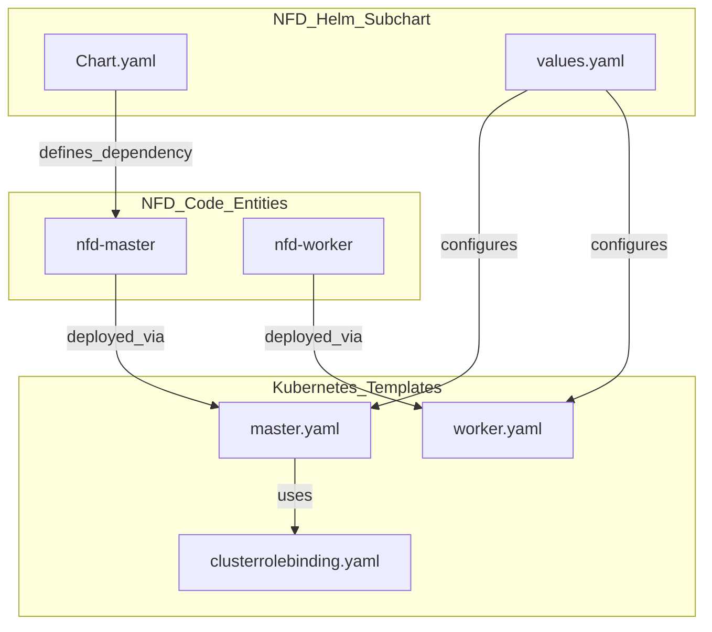

<!-- source: DeepWiki mcp.deepwiki.com · repo NVIDIA/gpu-operator · page 5 Deployment · fetched 2026-10-26 -->

# Deployment

<details>
<summary>Relevant source files</summary>

The following files were used as context for generating this wiki page:

- [.common-ci.yml](.common-ci.yml)
- [.github/renovate.json](.github/renovate.json)
- [.golangci.yml](.golangci.yml)
- [.nvidia-ci.yml](.nvidia-ci.yml)
- [Makefile](Makefile)
- [bundle/manifests/gpu-operator-certified.clusterserviceversion.yaml](bundle/manifests/gpu-operator-certified.clusterserviceversion.yaml)
- [bundle/metadata/annotations.yaml](bundle/metadata/annotations.yaml)
- [config/samples/nvidia_v1alpha1_nvidiadriver.yaml](config/samples/nvidia_v1alpha1_nvidiadriver.yaml)
- [deployments/gpu-operator/Chart.lock](deployments/gpu-operator/Chart.lock)
- [deployments/gpu-operator/Chart.yaml](deployments/gpu-operator/Chart.yaml)
- [deployments/gpu-operator/charts/node-feature-discovery/Chart.yaml](deployments/gpu-operator/charts/node-feature-discovery/Chart.yaml)
- [deployments/gpu-operator/charts/node-feature-discovery/README.md](deployments/gpu-operator/charts/node-feature-discovery/README.md)
- [deployments/gpu-operator/charts/node-feature-discovery/templates/clusterrole.yaml](deployments/gpu-operator/charts/node-feature-discovery/templates/clusterrole.yaml)
- [deployments/gpu-operator/charts/node-feature-discovery/templates/clusterrolebinding.yaml](deployments/gpu-operator/charts/node-feature-discovery/templates/clusterrolebinding.yaml)
- [deployments/gpu-operator/charts/node-feature-discovery/templates/master.yaml](deployments/gpu-operator/charts/node-feature-discovery/templates/master.yaml)
- [deployments/gpu-operator/charts/node-feature-discovery/templates/nfd-gc.yaml](deployments/gpu-operator/charts/node-feature-discovery/templates/nfd-gc.yaml)
- [deployments/gpu-operator/charts/node-feature-discovery/templates/serviceaccount.yaml](deployments/gpu-operator/charts/node-feature-discovery/templates/serviceaccount.yaml)
- [deployments/gpu-operator/charts/node-feature-discovery/templates/topologyupdater.yaml](deployments/gpu-operator/charts/node-feature-discovery/templates/topologyupdater.yaml)
- [deployments/gpu-operator/charts/node-feature-discovery/templates/worker.yaml](deployments/gpu-operator/charts/node-feature-discovery/templates/worker.yaml)
- [deployments/gpu-operator/charts/node-feature-discovery/values.yaml](deployments/gpu-operator/charts/node-feature-discovery/values.yaml)
- [docker/Dockerfile](docker/Dockerfile)
- [docker/Dockerfile.devel](docker/Dockerfile.devel)
- [tests/scripts/.definitions.sh](tests/scripts/.definitions.sh)
- [versions.mk](versions.mk)

</details>


This page provides an overview of deploying the NVIDIA GPU Operator into Kubernetes and OpenShift clusters. The GPU Operator automates the lifecycle management of NVIDIA GPU infrastructure components through declarative configuration.

For detailed instructions on specific deployment mechanisms, see the child pages:
- For details, see [Helm Chart Deployment](#5.1) — Documenting Helm-based installation, chart structure, `values.yaml` configuration, and Node Feature Discovery (NFD) integration [deployments/gpu-operator/Chart.yaml:1-24]().
- For details, see [OLM Bundle Deployment](#5.2) — Documenting the Operator Lifecycle Manager bundle, `ClusterServiceVersion`, bundle Dockerfile, and OpenShift-specific installation [bundle/manifests/gpu-operator-certified.clusterserviceversion.yaml:1-221]().

---

## Deployment Methods

The GPU Operator supports two primary deployment mechanisms tailored to different cluster environments and lifecycle management requirements.

### Method Comparison

| Method | Best For | Installation Tool | Update Mechanism | Configuration Source |
|--------|----------|-------------------|------------------|---------------------|
| **Helm Chart** | General Kubernetes distributions | `helm` CLI | Helm upgrade | `values.yaml` + CLI flags |
| **OLM Bundle** | OpenShift and OLM-enabled clusters | Operator Hub UI / `oc` CLI | OLM automatic updates | `ClusterServiceVersion` annotations |

For a comprehensive guide on Helm configurations and subchart deployments, see [Helm Chart Deployment](#5.1). For OLM bundle specifications, kustomize manifests, and CSV manifests, see [OLM Bundle Deployment](#5.2).

Sources:
- [deployments/gpu-operator/Chart.yaml:1-24]()
- [bundle/manifests/gpu-operator-certified.clusterserviceversion.yaml:1-221]()

---

## Prerequisites and Dependencies

Deploying the GPU Operator requires specific cluster prerequisites, notably Node Feature Discovery (NFD) for hardware labeling and adequate Kubernetes permissions.

### Node Feature Discovery Integration

Node Feature Discovery is a mandatory dependency that labels nodes with hardware and kernel attributes. The operator relies on these labels to target GPU workloads. NFD is managed either as a Helm subchart dependency or through OLM descriptors.



Sources:
- [deployments/gpu-operator/Chart.yaml:20-24]()
- [deployments/gpu-operator/charts/node-feature-discovery/templates/master.yaml:1-10]()
- [deployments/gpu-operator/charts/node-feature-discovery/templates/worker.yaml:1-10]()

---

## Installation Workflow

The installation process initializes cluster-level custom resource definitions (CRDs), deploys prerequisite labeling agents, starts the operator controller manager, and applies the initial `ClusterPolicy` [bundle/manifests/gpu-operator-certified.clusterserviceversion.yaml:26-30]().

```mermaid
stateDiagram-v2
    [*] --> "helm_install_or_olm_subscribe"
    
    state "NFD_Deployment" as NFD {
        "nfd-master" --> "nfd-worker"
    }
    
    "helm_install_or_olm_subscribe" --> NFD
    NFD --> "operator_pod_start"
    
    state "GPU_Operator_Runtime" as Runtime {
        "ClusterPolicy_Watcher" --> "StateManager"
        "StateManager" --> "Driver_State"
        "StateManager" --> "Toolkit_State"
        "StateManager" --> "DevicePlugin_State"
    }
    
    "operator_pod_start" --> Runtime
    
    note right of "ClusterPolicy_Watcher"
        Watches for CRD:
        "nvidia.com/v1 ClusterPolicy"
    end note
    
    note right of "Driver_State"
        Manages:
        "nvidia-driver-daemonset"
    end note
```

Sources:
- [bundle/manifests/gpu-operator-certified.clusterserviceversion.yaml:22-156]()
- [docker/Dockerfile:123-145]()

---

