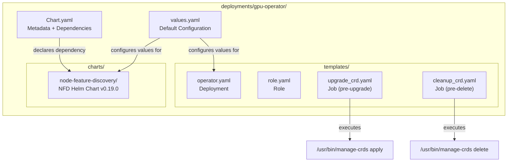
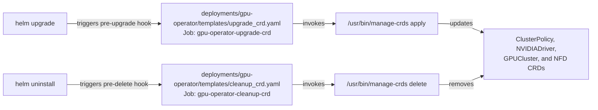

<!-- source: DeepWiki mcp.deepwiki.com · repo NVIDIA/gpu-operator · page 5.1 Helm Chart Deployment · fetched 2026-10-26 -->

# Helm Chart Deployment

<details>
<summary>Relevant source files</summary>

The following files were used as context for generating this wiki page:

- [cmd/cleanup-gpuclusters/main.go](cmd/cleanup-gpuclusters/main.go)
- [deployments/gpu-operator/Chart.lock](deployments/gpu-operator/Chart.lock)
- [deployments/gpu-operator/Chart.yaml](deployments/gpu-operator/Chart.yaml)
- [deployments/gpu-operator/charts/node-feature-discovery/Chart.yaml](deployments/gpu-operator/charts/node-feature-discovery/Chart.yaml)
- [deployments/gpu-operator/charts/node-feature-discovery/README.md](deployments/gpu-operator/charts/node-feature-discovery/README.md)
- [deployments/gpu-operator/charts/node-feature-discovery/templates/clusterrole.yaml](deployments/gpu-operator/charts/node-feature-discovery/templates/clusterrole.yaml)
- [deployments/gpu-operator/charts/node-feature-discovery/templates/clusterrolebinding.yaml](deployments/gpu-operator/charts/node-feature-discovery/templates/clusterrolebinding.yaml)
- [deployments/gpu-operator/charts/node-feature-discovery/templates/master.yaml](deployments/gpu-operator/charts/node-feature-discovery/templates/master.yaml)
- [deployments/gpu-operator/charts/node-feature-discovery/templates/nfd-gc.yaml](deployments/gpu-operator/charts/node-feature-discovery/templates/nfd-gc.yaml)
- [deployments/gpu-operator/charts/node-feature-discovery/templates/serviceaccount.yaml](deployments/gpu-operator/charts/node-feature-discovery/templates/serviceaccount.yaml)
- [deployments/gpu-operator/charts/node-feature-discovery/templates/topologyupdater.yaml](deployments/gpu-operator/charts/node-feature-discovery/templates/topologyupdater.yaml)
- [deployments/gpu-operator/charts/node-feature-discovery/templates/worker.yaml](deployments/gpu-operator/charts/node-feature-discovery/templates/worker.yaml)
- [deployments/gpu-operator/charts/node-feature-discovery/values.yaml](deployments/gpu-operator/charts/node-feature-discovery/values.yaml)
- [deployments/gpu-operator/templates/_helpers.tpl](deployments/gpu-operator/templates/_helpers.tpl)
- [deployments/gpu-operator/templates/cleanup_crd.yaml](deployments/gpu-operator/templates/cleanup_crd.yaml)
- [deployments/gpu-operator/templates/cleanup_gpucluster.yaml](deployments/gpu-operator/templates/cleanup_gpucluster.yaml)
- [deployments/gpu-operator/templates/operator.yaml](deployments/gpu-operator/templates/operator.yaml)
- [deployments/gpu-operator/templates/readonlyfs_scc.openshift.yaml](deployments/gpu-operator/templates/readonlyfs_scc.openshift.yaml)
- [deployments/gpu-operator/templates/role.yaml](deployments/gpu-operator/templates/role.yaml)
- [deployments/gpu-operator/templates/rolebinding.yaml](deployments/gpu-operator/templates/rolebinding.yaml)
- [deployments/gpu-operator/templates/serviceaccount.yaml](deployments/gpu-operator/templates/serviceaccount.yaml)
- [deployments/gpu-operator/templates/upgrade_crd.yaml](deployments/gpu-operator/templates/upgrade_crd.yaml)

</details>


This document describes the Helm-based installation method for the NVIDIA GPU Operator. It covers the chart structure, configuration through `values.yaml`, Node Feature Discovery (NFD) sub-chart integration, RBAC template definitions, and the CRD lifecycle management hooks.

## Purpose and Scope

The GPU Operator Helm chart [deployments/gpu-operator/Chart.yaml:1-24]() provides a complete declarative mechanism for deploying the operator, configuring required Custom Resource Definitions (CRDs), bundling NFD for node feature labeling, and setting up RBAC policies.

Sources: [deployments/gpu-operator/Chart.yaml:1-24]()

## Helm Chart Structure

The chart is organized into standard Helm components, containing chart metadata, default values, template files for core resources, and embedded sub-charts.

### Chart Structure and Dependency Flow



**Chart Components Table**

| Component | Location | Purpose |
| :--- | :--- | :--- |
| Chart metadata | `deployments/gpu-operator/Chart.yaml` | Declares chart version, application version, and the `node-feature-discovery` OCI dependency [deployments/gpu-operator/Chart.yaml:1-24]() |
| Chart lock | `deployments/gpu-operator/Chart.lock` | Locks sub-chart versions (e.g., NFD `0.19.0`) [deployments/gpu-operator/Chart.lock:1-6]() |
| Operator Deployment | `deployments/gpu-operator/templates/operator.yaml` | Deploys the main `gpu-operator` controller pod [deployments/gpu-operator/templates/operator.yaml:1-11] |
| RBAC Role | `deployments/gpu-operator/templates/role.yaml` | Grants permissions over core types, apps, coordination, and NFD [deployments/gpu-operator/templates/role.yaml:1-108]() |
| Upgrade Hook | `deployments/gpu-operator/templates/upgrade_crd.yaml` | Manages pre-upgrade CRD updates using `/usr/bin/manage-crds` [deployments/gpu-operator/templates/upgrade_crd.yaml:1-116]() |
| Cleanup Hook | `deployments/gpu-operator/templates/cleanup_crd.yaml` | Manages pre-delete CRD removal [deployments/gpu-operator/templates/cleanup_crd.yaml:1-67]() |

Sources: [deployments/gpu-operator/Chart.yaml:1-24](), [deployments/gpu-operator/Chart.lock:1-6](), [deployments/gpu-operator/templates/operator.yaml:1-11](), [deployments/gpu-operator/templates/role.yaml:1-108](), [deployments/gpu-operator/templates/upgrade_crd.yaml:1-116](), [deployments/gpu-operator/templates/cleanup_crd.yaml:1-67]()

## Node Feature Discovery (NFD) Integration

Node Feature Discovery is integrated as an OCI-based sub-chart dependency defined in `Chart.yaml`.

```yaml
dependencies:
  - name: node-feature-discovery
    version: 0.19.0
    repository: oci://registry.k8s.io/nfd/charts
    condition: nfd.enabled
```

The NFD sub-chart deploys `nfd-master` [deployments/gpu-operator/charts/node-feature-discovery/templates/master.yaml:1-15]() and `nfd-worker` DaemonSets [deployments/gpu-operator/charts/node-feature-discovery/templates/worker.yaml:1-6](), labeling cluster nodes with hardware features, PCI IDs, OS versions, and kernel details required by the GPU Operator.

Sources: [deployments/gpu-operator/Chart.yaml:20-24](), [deployments/gpu-operator/charts/node-feature-discovery/templates/master.yaml:1-15](), [deployments/gpu-operator/charts/node-feature-discovery/templates/worker.yaml:1-6]()

## RBAC Templates and Security Context

The operator executes with restricted privileges using dedicated ServiceAccounts, Roles, and ClusterRoles.

- **Service Account**: Created by `deployments/gpu-operator/templates/serviceaccount.yaml` under the name `gpu-operator` [deployments/gpu-operator/templates/serviceaccount.yaml:1-5]().
- **Role Permissions**: Defined in `deployments/gpu-operator/templates/role.yaml`, granting access to create/manage `deployments`, `daemonsets`, `configmaps`, `secrets`, `leases`, `servicemonitors`, and `nodefeatures` (`nfd.k8s-sigs.io`) [deployments/gpu-operator/templates/role.yaml:10-108]().
- **Operator Security Context**: Enforces strict hardening policies in `deployments/gpu-operator/templates/operator.yaml`:
  ```yaml
  securityContext:
    allowPrivilegeEscalation: false
    readOnlyRootFilesystem: true
    capabilities:
      drop:
        - ALL
  ```

Sources: [deployments/gpu-operator/templates/serviceaccount.yaml:1-5](), [deployments/gpu-operator/templates/role.yaml:1-108](), [deployments/gpu-operator/templates/operator.yaml:102-107]()

## CRD Lifecycle Management & Hooks

To manage Custom Resource Definitions reliably during chart upgrades and uninstalls, the chart utilizes Helm hooks backed by the `/usr/bin/manage-crds` binary inside batch jobs.

### CRD Lifecycle Job Execution Flow



### Upgrade CRD Job Template Example

The `upgrade_crd.yaml` template configures a Kubernetes `Job` executing before upgrades using `helm.sh/hook: pre-upgrade`:

```yaml
apiVersion: batch/v1
kind: Job
metadata:
  name: gpu-operator-upgrade-crd
  annotations:
    "helm.sh/hook": pre-upgrade
    "helm.sh/hook-weight": "1"
    "helm.sh/hook-delete-policy": hook-succeeded,before-hook-creation
spec:
  template:
    spec:
      serviceAccountName: gpu-operator-upgrade-crd-hook-sa
      containers:
        - name: upgrade-crd
          image: {{ include "gpu-operator.fullimage" . }}
          command:
            - /usr/bin/manage-crds
          args:
            - apply
            - --filepath=/opt/gpu-operator/nvidia.com_clusterpolicies.yaml
            - --filepath=/opt/gpu-operator/nvidia.com_nvidiadrivers.yaml
            - --filepath=/opt/gpu-operator/nvidia.com_gpuclusters.yaml
        {{- if .Values.nfd.enabled }}
            - --filepath=/opt/gpu-operator/nfd-api-crds.yaml
        {{- end }}
      restartPolicy: OnFailure
```

Sources: [deployments/gpu-operator/templates/upgrade_crd.yaml:1-116](), [deployments/gpu-operator/templates/cleanup_crd.yaml:1-67]()

---

